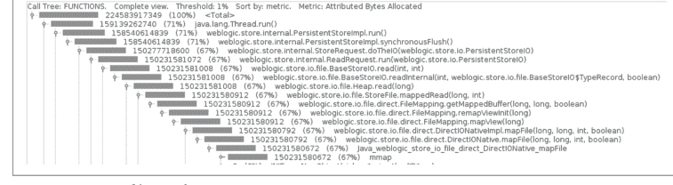
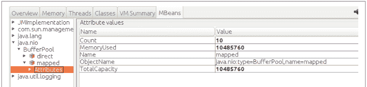

## Native Memory Best Practices

The heap is the largest consumer of memory in a Java application, but the JVM will allocate and use a large amount of native memory. And while Chapter 7 discussed ways to efficiently manage the heap from a pragmatic point of view, the configuration of the heap and how it interacts with the native memory of the operating system is another important factor in the overall performance of an application. There’s a terminology conflict here, since C programmers tend to refer to portions of their native memory as the C heap. In keeping with a Java-centric worldview, we’ll continue to use *heap* to refer to the Java heap, and *native memory* to refer to the non-heap memory of the JVM, including the C heap.

This chapter discusses these aspects of native (or operating system) memory. We start with a discussion of the entire memory use of the JVM, with a goal of understanding how to monitor that usage for performance issues. Then we’ll discuss various ways to tune the JVM and operating system for optimal memory use.

### Footprint

The heap (usually) accounts for the largest amount of memory used by the JVM, but the JVM also uses memory for its internal operations. This nonheap memory is native memory. Native memory can also be allocated in applications (via JNI calls to `malloc()` and similar methods, or when using New I/O, or NIO). The total of native and heap memory used by the JVM yields the total *footprint* of an application.

From the point of view of the operating system, this total footprint is the key to performance. If enough physical memory to contain the entire total footprint of an application is not available, performance may begin to suffer. The operative word here is *may*. Parts of native memory are used only during startup (for instance, the memory associated with loading the JAR files in the classpath), and if that memory is swapped out, it won’t necessarily be noticed. Some of the native memory used by one Java process is shared with other Java processes on the system, and some smaller part is shared with other kinds of processes on the system. For the most part, though, for optimal performance you want to be sure that the total footprint of all Java processes does not exceed the physical memory of the machine (plus you want to leave some memory available for other applications).

### Measuring Footprint

To measure the total footprint of a process, you need to use an operating-system-specific tool. In Unix-based systems, programs like top and ps can show you that data at a basic level; on Windows, you can use perfmon or VMMap. No matter which tool and platform are used, you need to look at the actual allocated memory (as opposed to the reserved memory) of the process.

The distinction between allocated and reserved memory comes about as a result of the way the JVM (and all programs) manage memory. Consider a heap that is specified with the parameters `-Xms512m -Xmx2048m`. The heap starts by using 512 MB, and it will be resized as needed to meet the GC goals of the application.

That concept is the essential difference between committed (or allocated) memory and reserved memory (sometimes called the *virtual size* of a process). The JVM must tell the operating system that it might need as much as 2 GB of memory for the heap so that memory is *reserved*: the operating system promises that when the JVM attempts to allocate additional memory when it increases the size of the heap, that memory will be available.

Still, only 512 MB of that memory is allocated initially, and that 512 MB is all of the memory that is being used (for the heap). That (actually *allocated*) memory is known as the *committed memory*. The amount of committed memory will fluctuate as the heap resizes; in particular, as the heap size increases, the committed memory correspondingly increases.

> ### Is Over-Reserving a Problem?
> 
> When we look at performance, only committed memory really matters: a performance problem never results from reserving too much memory.
> 
> However, sometimes you want to make sure that the JVM does not reserve too much memory. This is particularly true for 32-bit JVMs. Since the maximum process size of a 32-bit application is 4 GB (depending on the operating system), over-reserving memory can be an issue. A JVM that reserves 3.5 GB of memory for the heap is left with only 0.5 GB of native memory for its stacks, code cache, and so on. It doesn’t matter if the heap expands to commit only 1 GB of memory: because of the 3.5 GB reservation, the amount of memory for other operations is limited to 0.5 GB.


64 位 JVM 的限制并非由进程大小决定，而是由机器上的总虚拟内存量决定。假设你有一台物理内存为 4 GB、虚拟内存为 10 GB 的小型服务器，并启动了一个最大堆大小为 6 GB 的 JVM。那将预留 6 GB 的虚拟内存（加上非堆内存部分所占用的更多内存）。无论该堆增长多大（以及已提交的内存），第二个 JVM 在该机器上最多只能预留不到 4 GB 的内存。

在其他条件相同的情况下，过度分配 JVM 结构并让 JVM 最优地使用该内存是方便的。但并非总是可行。

这种差异适用于 JVM 分配的几乎所有重要内存。代码缓存会随着更多代码被编译而从初始值增长到最大值。Metaspace 与堆分开分配，并在其初始（已提交）大小与最大（已预留）大小之间增长。

线程栈是此规则的例外。每次 JVM 创建一个线程时，操作系统都会分配一些本地内存来保存该线程的栈，并在线程至少退出前提交更多内存给进程。线程栈在创建时是完全分配的。

在 Unix 系统中，应用程序的占用空间可以通过各种操作系统工具报告的进程的 *驻留集大小 (RSS)* 来估算。该值是对进程正在使用的已提交内存量的良好估计，尽管在两种方式上并不精确。首先，在操作系统级别与 JVM 和其他进程之间共享的少量页面（即共享库的文本部分）会被计入每个进程的 RSS。其次，进程可能已提交的内存比其在任何时刻分页进来的内存更多。尽管如此，跟踪进程的 RSS 仍是监控总内存使用情况的一个很好的初步方法。在较新的 Linux 内核上，PSS 是 RSS 的改进，它去除了与其他程序共享的数据。

在 Windows 系统中，等价的概念称为应用程序的 *工作集*，这就是任务管理器报告的内容。

## 最小化占用空间

要最小化 JVM 使用的占用空间，请限制以下内容的内存使用：

## *堆*

堆是最大的内存块，尽管令人惊讶的是，它可能只占总占用空间的 50% 到 60%。使用较小的最大堆（或设置 GC 调优参数，使堆永远不会完全扩展）会限制程序的占用空间。

## 线程栈

线程栈相当大，特别是对于 64 位 JVM。参见第 9 章，了解限制线程栈消耗内存的方法。

## 代码缓存

代码缓存使用本地内存来保存编译后的代码。如第 4 章所述，这可以进行调优（尽管如果由于空间限制而无法编译所有代码，性能会下降）。

## 本地库分配

本地库可以分配自己的内存，有时这会相当可观。

接下来的几节讨论如何监控和减少这些区域。


## 快速总结

- JVM 的总占用空间对其性能有显著影响，特别是当机器上的物理内存受限时。占用空间是性能测试中应经常监控的另一个方面。

## 本地内存跟踪

JVM 提供了对其如何分配本地内存的有限可见性。必须认识到，这种跟踪适用于 JVM 代码本身分配的内存，但不包括应用程序使用的任何本地库分配的内存。这包括第三方本地库以及随 JDK 本身提供的本地库（例如，libsocket.so）。

使用选项 -XX:NativeMemoryTracking=off/summary/detail 可启用此可见性。默认情况下，Native Memory Tracking (NMT) 是关闭的。如果启用了 summary 或 detail 模式，则可以随时从 jcmd 获取本地内存信息：

```
% jcmd process_id VM.native_memory summary
```

如果 JVM 以参数 -XX:+PrintNMStatistics 启动（默认 false），JVM 将在程序退出时打印出有关分配的信息。

以下是使用 512 MB 初始堆大小和 4 GB 最大堆大小运行的 JVM 的摘要输出：

```
Native Memory Tracking:

Total: reserved=5947420KB, committed=620432KB
```

尽管 JVM 已做出总计 5.9 GB 的内存预留，但它实际使用的远少于此：仅 620 MB。这相当典型（也是一个原因，不要特别关注操作系统工具中显示的进程虚拟大小，因为它仅反映内存预留）。

该内存使用情况的分解如下。堆本身（不出所料）是预留内存中最大的一部分，为 4 GB。但由于堆的动态调整，它仅增长到 268 MB（在本例中，堆大小为 -Xms256m -Xmx4g，因此实际堆使用量仅略有扩展）：

```
Java Heap (reserved=4194304KB, committed=268288KB)
(mmap: reserved=4194304KB, committed=268288KB)
```

接下来是用于保存类元数据的本地内存。同样要注意，JVM 已预留比用于保存程序中 24,316 个类所使用的内存更多的内存。此处的已提交大小将从 MetaspaceSize 标志的值开始，并在需要时增长，直到达到 MaxMetaspaceSize 标志的值：

```
Class (reserved=1182305KB, committed=150497KB)
(classes #24316)
(malloc=2657KB #35368)
(mmap: reserved=1179648KB, committed=147840KB)
```

分配了七十七个线程栈，每个约 1 MB：

```
Thread (reserved=84455KB, committed=84455KB)
(thread #77)
(stack: reserved=79156KB, committed=79156KB)
(malloc=243KB, #314)
(arena=5056KB, #154)
```

然后是 JIT 代码缓存：24,316 个类并不算多，因此仅提交了代码缓存的一小部分：

```
Code (reserved=102581KB, committed=15221KB)
(malloc=2741KB, #4520)
(mmap: reserved=99840KB, committed=12480KB)
```

接下来是 GC 算法用于其处理的堆外区域。该区域的大小取决于所使用的 GC 算法：简单的串行收集器将预留远少于更复杂的 G1 GC 算法（尽管通常这里的数量永远不会很大）：

```
GC (reserved=199509KB, committed=53817KB)
(malloc=11093KB #18170)
(mmap: reserved=188416KB, committed=42724KB)
```

同样，此区域由编译器用于其操作，而编译结果放置在代码缓存中：

Compiler (reserved=162KB, committed=162KB)
(malloc=63KB, #229)
(arena=99KB, #3)

JVM 的内部操作在这里表示。其中大多数往往很小，但一个重要例外是直接字节缓冲区，它们在此处分配：

Internal (reserved=10584KB, committed=10584KB)
(malloc=10552KB #32851)
(mmap: reserved=32KB, committed=32KB)

符号表引用（来自类文件常量）保存在此处：

Symbol (reserved=12093KB, committed=12093KB)
(malloc=10039KB, #110773)
(arena=2054KB, #1)

NMT 本身需要一些空间来运行（这也是它默认不启用的原因之一）：

Native Memory Tracking (reserved=7195KB, committed=7195KB)
(malloc=16KB #199)
(tracking overhead=7179KB)

最后，这里有一些 JVM 的次要记账部分：

Arena Chunk (reserved=188KB, committed=188KB)
(malloc=188KB)

Unknown (reserved=8192KB, committed=0KB)
(mmap: reserved=8192KB, committed=0KB)

## 详细内存跟踪信息

如果 JVM 以 -XX:NativeMemoryTracking=detail 启动，则 jcmd（带最终的 detail 参数）将提供有关本地内存分配的详细信息。其中包括整个内存空间的映射，其中包含如下行：

```
0x00000006c0000000 - 0x00000007c0000000] reserved 4194304KB for Java Heap
from [ReservedSpace::initialize(unsigned long, unsigned long, bool, char*, unsigned long, bool)+0xc2]
[0x00000006c0000000 - 0x00000006fb100000] committed 967680KB
from [PSVirtualSpace::expand_by(unsigned long)+0x53]
[0x000000076ab00000 - 0x00000007c0000000] committed 1397760KB
from [PSVirtualSpace::expand_by(unsigned long)+0x53]
```

4 GB 的堆空间是在 initialize() 函数中预留的，其中两次分配是在 expand_by() 函数中进行的。

这种信息会针对整个进程空间重复。它为 JVM 工程师提供了有趣的线索，但对于我们其他人来说，摘要信息已足够有用。


总体而言，NMT 提供了两项关键信息：

## 总提交大小

JVM 的总提交大小（理想情况下）接近进程将消耗的物理内存量。反过来，这应该接近应用程序的 RSS（或工作集），但操作系统提供的这些测量值不包括已提交但已从进程中分页出去的内存。事实上，如果进程的 RSS 小于已提交内存，这通常表明操作系统在将整个 JVM 放入物理内存方面遇到困难。

## 各自的提交大小

当需要调整最大数值时——堆、代码缓存和元空间——了解 JVM 使用了多少该内存会很有帮助。对这些区域过度分配通常只会导致无害的内存预留，不过当预留内存很重要时，NMT 可以帮助追踪这些最大大小可以削减的位置。

另一方面，正如本节开头所述，NMT 无法提供对共享库的本地内存使用的可见性，因此在某些情况下，进程总大小会大于 JVM 数据结构的提交大小。

## 随时间的 NMT

NMT 还允许你跟踪内存分配随时间的变化。在启用 NMT 启动 JVM 后，你可以使用以下命令为内存使用建立基线：

```text
% jcmd process_id VM.native_memory baseline
```

这会使 JVM 标记其当前的内存分配。稍后，你可以将当前内存使用情况与该标记进行比较：

```text
% jcmd process_id VM.native_memory summary.diff
Native Memory Tracking:

Total:  reserved=5896078KB -3655KB, committed=2358357KB -448047KB

-              Java Heap (reserved=4194304KB, committed=1920512KB -444927KB)
                  (mmap: reserved=4194304KB, committed=1920512KB -444927KB)
....
```

在这种情况下，JVM 已预留 5.8 GB 内存，目前使用 2.3 GB。该已提交大小比建立基线时少了 448 MB。同样，堆使用的已提交内存减少了 444 MB（其余输出可以检查以查看内存使用在何处下降以解释剩余的 4 MB）。

这是一种有用的技术，可以随时间检查 JVM 的占用情况。

## NMT 自动禁用

在 NMT 输出中，我们看到 NMT 本身需要本地内存。此外，启用 NMT 会创建协助内存跟踪的后台线程。

如果 JVM 对内存或 CPU 资源严重紧张，NMT 会自动关闭自身以节省资源。这通常是好事——除非你需要诊断的正是这种紧张情况。在这种情况下，你可以通过禁用 `-XX:-AutoShutdownNMT` 标志来确保 NMT 保持运行（默认情况下为 true）。


## 快速总结

- Native Memory Tracking（NMT）提供了有关 JVM 本地内存使用情况的详细信息。从操作系统角度来看，这包括 JVM 堆（对操作系统而言只是本地内存的一部分）。
- NMT 的摘要模式足以满足大多数分析需求，并允许你确定 JVM 已提交了多少内存（以及这些内存用于何处）。

## 共享库本地内存

从架构角度来看，NMT 是 HotSpot 的一部分：运行应用程序 Java 字节码的 C++ 引擎。这位于 JDK 本身之下，因此它不会跟踪 JDK 级别任何内容的分配。这些分配来自共享库（由 `System.loadLibrary()` 调用加载的库）。

共享库通常被认为是 Java 的第三方扩展：例如，Oracle WebLogic Server 有几个本地库用于比 JDK 更高效地处理 I/O。¹ 但 JDK 本身也有几个本地库，与所有共享库一样，这些库超出了 NMT 的视野。

> ¹ 这在很大程度上是一个历史遗留问题：这些库是在 NIO 之前开发的，在很大程度上重复了其功能。

因此，本地内存泄漏——应用程序的 RSS 或工作集随时间不断增长——通常不会被 NMT 检测到。NMT 监控的内存池通常都有上限（例如最大堆大小）。NMT 有助于告诉我们哪个池使用了大量内存（因此需要调整以使用更少的内存），但一个无限制泄漏本地内存的应用程序通常是由于本地库中的问题造成的。

没有 Java 级别的工具可以真正帮助我们检测应用程序从共享库使用本地内存的位置。操作系统级工具可以告诉我们进程的工作集是否不断增长，如果一个进程的工作集增长到 10 GB，而 NMT 告诉我们 JVM 只提交了 6 GB 内存，我们就知道另外 4 GB 内存必须来自本地库分配。

弄清楚哪个本地库负责需要操作系统级工具而不是 JDK 工具。各种调试版本的 malloc 可用于此目的。它们在一定程度上很有用，不过通常本地内存是通过 mmap 调用分配的，而大多数用于跟踪 malloc 调用的库会遗漏这些。

一个不错的替代方案是能够同时分析本地代码和 Java 代码的分析器。例如，在第 3 章中我们讨论了 Oracle Studio Profiler，这是一个混合语言分析器。该分析器还有一个选项可以跟踪内存分配——一个需要注意的是，它只能跟踪本地代码的内存分配而不能跟踪 Java 代码，但这正是我们想要的。

图 8-1 显示了 Studio Profiler 中的本地分配视图。



图 8-1. 本地内存分析

此调用图显示我们，WebLogic 本地函数 mapFile 已使用 mmap 向我们的进程分配了约 150 GB 的本地内存。这有点误导：对该文件的多个映射存在，分析器还不够智能，无法意识到它们共享实际内存：如果例如有 100 个该 15 GB 文件的映射，内存使用量只会增加 15 GB。（而且，说实话，我故意损坏了该文件使其变得如此之大；这在任何情况下都不能反映实际使用情况。）尽管如此，本地分析器已指向问题所在。

在 JDK 本身内部，有两种常见操作可能导致大量本地内存使用：使用 Inflater 和 Deflater 对象，以及使用 NIO 缓冲区。即使不进行分析，也有方法可以检测这些操作是否导致你的本地内存增长。

## 本地内存与充气器/放气器

Inflater 和 Deflater 类执行各种压缩：zip、gzip 等。它们可以直接使用或通过各种输入流隐式使用。这些各种算法使用特定于平台的本地库来执行其操作。这些库可能会分配大量本地内存。

当你使用其中一个类时，你应该——正如文档所说——在操作完成后调用 end() 方法。除其他事项外，这会释放对象使用的本地内存。如果你使用流，你应该关闭流（流类将对其内部对象调用 end() 方法）。

如果你忘记调用 end() 方法，一切都不会丢失。回想一下第 7 章，所有对象都有一个清理机制正是为这种情况准备的：finalize() 方法（在 JDK 8 中）或与对象关联的 Cleaner（在 JDK 11 中）可以在 Inflater 对象被收集时调用 end() 方法。因此你不会在这里泄漏本地内存；最终，对象将被收集并完成，本地内存将被释放。

尽管如此，这可能需要很长时间。Inflater 对象的大小相对较小，在一个堆很大且很少执行完整 GC 的应用程序中，这些对象很容易被提升到老年代并停留数小时。因此，即使技术上不是泄漏——当应用程序执行完整 GC 时本地内存最终会被释放——未能在此处调用 end() 操作也可能看起来像本地内存泄漏。

更何况，如果 Inflater 对象本身在 Java 代码中泄漏，那么本地内存实际上就会泄漏。

因此，当大量本地内存泄漏时，获取应用程序的堆转储并查找这些 Inflater 和 Deflater 对象会很有帮助。这些对象本身不太可能在堆中造成问题（它们太小），但大量出现会表明有大量本地内存使用。

## 本地 NIO 缓冲区

NIO 字节缓冲区如果通过 ByteBuffer 类的 allocateDirect() 方法或 FileChannel 类的 map() 方法创建，则会分配本地（堆外）内存。

本地字节缓冲区在性能方面很重要，因为它们允许本地代码和 Java 代码在不复制数据的情况下共享数据。用于文件系统和套接字操作的缓冲区是最常见的例子。将数据写入本地 NIO 缓冲区然后将该数据发送到通道（例如文件或套接字）不需要


在 JVM 与用于传输数据的 C 库之间复制数据。如果使用堆字节缓冲区，则 JVM 必须复制缓冲区的內容。

`allocateDirect()` 方法调用开销很大；应尽可能重用直接字节缓冲区。理想情况下，线程相互独立，每个线程都可以将直接字节缓冲区作为线程本地变量保留。这种情况有时会使用过多的本地内存，如果许多线程需要不同大小的缓冲区，因为最终每个线程都会得到一个最大可能大小的缓冲区。对于这种情况——或当线程本地缓冲区不适合应用程序设计时——直接字节缓冲区的对象池可能更有用。

字节缓冲区也可以通过切片来管理。应用程序可以分配一个非常大的直接字节缓冲区，并且单个请求可以通过使用 `ByteBuffer` 类的 `slice()` 方法从该缓冲区分配一部分。这种解决方案在切片大小不总是相同的情况下会变得难以处理：原始字节缓冲区可能会像在分配和释放不同大小的对象时堆会变得碎片化一样变得碎片化。然而，与堆不同，字节缓冲区的各个切片不能被压缩，因此这种解决方案仅在所有切片大小统一时才有效。

从调优的角度来看，无论采用哪种编程模型，都需要认识到应用程序可以分配的直接字节缓冲区空间量可能会受到 JVM 的限制。可以分配给直接字节缓冲区的总内存量是通过设置 `-XX:MaxDirectMemorySize=N` 标志来指定的。当前 JVM 中该标志的默认值是 0。该限制的含义曾多次发生变化，但在 Java 8 的后期版本（以及所有 Java 11 版本）中，最大限制等于最大堆大小：如果最大堆大小为 4 GB，你也可以在直接和/或映射字节缓冲区中创建 4 GB 的非堆内存。如果你需要，可以将该值增加到超过最大堆值。

为直接字节缓冲区分配的内存包含在 NMT 报告的 Internal 部分中；如果该数字很大，几乎总是由于这些缓冲区。如果你想确切知道缓冲区本身消耗了多少内存，mbeans 会跟踪这些信息。检查 mbean `java.nio.BufferPool.direct.Attributes` 或 `java.nio.BufferPool.mapped.Attributes` 将显示每种类型已分配的内存量。图 8-2 显示了我们映射了总共 10 MB 空间的 10 个缓冲区的情况。



图 8-2. 检查字节缓冲区本地内存

## Linux 系统内存泄漏

大型 Linux 系统有时会由于其内存分配库的设计而表现出本地内存泄漏。这些库将本地内存划分为分配段，这有利于多线程分配（因为它限制了锁竞争）。

然而，本地内存的管理方式与 Java 堆不同：特别是，本地内存永远不会被压缩。因此，本地内存中的分配模式可能导致与第 5 章所述相同的碎片化。

由于本地内存碎片化，Java 中可能耗尽本地内存；这在较大系统上最常见（例如，拥有超过八个核心的系统），因为 Linux 中内存分区数量是系统核心数量的函数。

有两件事可以帮助诊断此问题：首先，应用程序会抛出 `OutOfMemoryError`，表示本地内存不足。其次，如果你查看进程的 `smaps` 文件，它将显示许多小的（通常为 64 KB）分配。在这种情况下，补救措施是将环境变量 `MALLOC_ARENA_MAX` 设置为 2 或 4 等小数字。该变量的默认值是系统核心数乘以 8（这就是为什么该问题在大型系统上更频繁出现的原因）。在这种情况下，本地内存仍然会碎片化，但碎片化应该会减轻。


## 快速总结

- 如果应用程序似乎使用了过多的本地内存，很可能是来自本地库而不是 JVM 本身。
- 原生分析可以有效定位这些分配的来源。
- 少数常见的 JDK 类通常会促成本地内存使用；确保正确使用这些类。

## JVM 对操作系统的调优

JVM 可以使用多种调优来改善其对 OS 内存的使用。

### 大页

关于内存分配和交换的讨论以页为单位进行。页是操作系统用于管理物理内存的内存单元。它是操作系统的最小分配单元：当分配 1 字节时，操作系统必须分配整个页。对于该程序的进一步分配将来自同一页，直到填满为止，此时会分配新页。

操作系统分配的页数远多于可放入物理内存的页数，这就是分页的原因：地址空间的页在交换空间（或取决于页包含的内容的其他存储）之间移动。这意味着必须在这些页与它们当前在计算机 RAM 中存储位置之间进行映射。这些映射以两种方式处理。所有页映射都保存在全局页表中（操作系统可以扫描以找到特定映射），并且最频繁使用的映射保存在转换后备缓冲区（TLBs）中。TLB 保存在快速缓存中，因此通过 TLB 条目访问页比通过页表访问快得多。

机器的 TLB 条目数量有限，因此最大化 TLB 条目的命中率变得很重要（它作为最近最少使用缓存运行）。由于每个条目代表一个内存页，增加应用程序使用的页大小通常是有利的。如果每个页代表更多内存，则涵盖整个程序所需的 TLB 条目更少，并且在需要时更有可能在 TLB 中找到页。这对任何程序都是正确的，因此对于 Java 应用程序服务器或其他具有中等大小堆的 Java 程序也同样正确。

大页必须在 Java 和 OS 两个层面启用。在 Java 层面，`-XX:+UseLargePages` 标志启用大页使用；默认情况下，该标志为 false。并非所有操作系统都支持大页，并且启用方式显然各不相同。

如果在不支持大页的系统上启用 `UseLargePages` 标志，不会给出警告，JVM 使用常规页。如果在支持大页的系统上启用 `UseLargePages` 标志，但没有可用的大页（因为它们已被全部使用或操作系统配置错误），JVM 将打印警告。

### Linux huge（大）页

Linux 将大页称为 huge 页。Linux 上 huge 页的配置因发行版而异；有关最准确的说明，请参阅您发行版的文档。但一般流程如下：

- 1. 确定内核支持哪些 huge 页大小。大小基于计算机的处理器和内核启动时给出的引导参数，但最常见的值为 2 MB：
  # grep HugePageSize /proc/meminfo
  HugePageSize: 2048 kB
- 2. 计算需要多少 huge 页。如果 JVM 将分配 4 GB 堆并且系统具有 2 MB huge 页，则该堆需要 2,048 个 huge 页。Linux 内核中可使用的 huge 页数量在全局定义，因此请对将运行的所有 JVM（以及将使用 huge 页的任何其他程序）重复此过程。你应该将此值高估 10% 以考虑 huge 页的其他非堆用途（因此这里的示例使用 2,200 个 huge 页）。
- 3. 将该值写入操作系统（以便立即生效）：
  # echo 2200 > /proc/sys/vm/nr_hugepages
- 4. 将该值保存在 `/etc/sysctl.conf` 中以便在重新启动后保留：
  sys.nr_hugepages=2200
- 5. 在许多 Linux 版本中，用户可以分配的 huge 页内存量是有限的。编辑 `/etc/security/limits.conf` 文件并为运行 JVM 的用户添加 `memlock` 条目（例如，在示例中为用户 `appuser`）：
  appuser soft memlock 4613734400
  appuser hard memlock 4613734400

如果修改了 `limits.conf` 文件，用户必须再次登录才能使值生效。此时，JVM 应该能够分配必要的大页。为验证其是否有效，运行以下命令：

```
### java -Xms4G -Xmx4G -XX:+UseLargePages -version
java version "1.8.0_201"
Java(TM) SE Runtime Environment (build 1.8.0_201-b09)
Java HotSpot(TM) 64-Bit Server VM (build 25.201-b09, mixed mode)
```

成功完成该命令表明 huge 页配置正确。如果 huge 页内存配置不正确，将给出警告：

```
Java HotSpot(TM) 64-Bit Server VM warning:
Failed to reserve shared memory (errno = 22).
```

在这种情况下，程序仍会运行；它只是使用常规页而不是大页。


## Linux 透明大页

从 2.6.32 版本开始的 Linux 内核支持 *透明大页*。它们在理论上提供了与传统大页相同的性能优势，但与传统大页相比存在一些差异。

首先，传统大页被锁定在内存中；它们永远不会被交换。对于 Java 来说，这是一个优势，因为正如我们所讨论的，交换堆的一部分对 GC 性能不利。透明大页可以被交换到磁盘，这对性能不利。

其次，透明大页的分配也与传统大页显著不同。传统大页在内核启动时预留；它们始终可用。透明大页是按需分配的：当应用程序请求一个 2 MB 的页时，内核会尝试在物理内存中找到 2 MB 的连续空间用于该页。如果物理内存碎片化，内核可能会决定花费时间重新排列页面，其过程类似于 Java 堆中众所周知的内存压缩。这意味着分配页面的时间可能会显著变长，因为它需要等待内核完成为内存腾出空间的工作。

这会影响所有程序，但对于 Java 来说，这可能导致非常长的 GC 暂停。在 GC 期间，JVM 可能会决定扩展堆并请求新页面。如果该页面分配需要几百毫秒甚至一秒，GC 时间就会受到显著影响。

第三，透明大页在操作系统和 Java 两个层面上配置方式不同。细节如下。

在操作系统层面，透明大页通过更改 `/sys/kernel/mm/transparent_hugepage/enabled` 的内容进行配置：

```text
### cat /sys/kernel/mm/transparent_hugepage/enabled
always [madvise] never
### echo always > /sys/kernel/mm/transparent_hugepage/enabled
### cat /sys/kernel/mm/transparent_hugepage/enabled
[always] madvise never
```

这里有三个选项：

- **always**  
  所有程序在可能的情况下都会获得大页。
- **madvise**  
  请求大页的程序会获得大页；其他程序获得常规（4 KB）页。
- **never**  
  没有程序会获得大页，即使它们请求了。

不同版本的 Linux 对该设置的默认值不同（并且在未来版本中可能会更改）。例如，Ubuntu 18.04 LTS 将默认值设置为 madvise，但 CentOS 7（以及基于该版本的厂商发行版，如 Red Hat 和 Oracle Enterprise Linux）将其设置为 always。还要注意，在云机器上，操作系统镜像的提供商可能已更改该值；我见过一些 Ubuntu 镜像也将该值设置为 always。

如果该值设置为 always，则在 Java 层面无需配置：JVM 将获得大页。事实上，系统上运行的所有程序都将在大页中运行。

如果该值设置为 madvise，并且你希望 JVM 使用大页，请指定 UseTransparentHugePages 标志（默认为 false）。然后 JVM 在分配页面时会发出适当的请求并获得大页。

可以预见，如果该值设置为 never，任何 Java 层面的参数都无法让 JVM 获得大页。与传统大页不同，如果你指定 UseTransparentHugePages 标志而系统无法提供它们时，不会发出警告。

由于透明大页在交换和分配方面的差异，它们通常不建议与 Java 一起使用；当然，使用它们可能会导致暂停时间出现不可预测的峰值。另一方面，尤其是在默认启用的系统上，你会——正如广告所说，透明地——在大多数情况下看到性能提升。如果你想确保使用大页时获得最平稳的性能，那么最好将系统设置为仅在请求时使用透明大页，并为你的 JVM 配置传统大页。

## Windows 大页

Windows 大页只能在基于服务器的 Windows 版本上启用。Windows 10 的具体说明如下；不同版本之间存在差异：

1. 启动 Microsoft 管理控制台。单击“开始”按钮，并在搜索框中输入 mmc。
2. 如果左侧面板未显示“本地计算机策略”图标，请从“文件”菜单中选择“添加/删除管理单元”，并添加“组策略对象编辑器”。如果该选项不可用，则所使用的 Windows 版本不支持大页。
3. 在左侧面板中，展开“本地计算机策略” → “计算机配置” → “Windows 设置” → “安全设置” → “本地策略”，并单击“用户权利分配”文件夹。
4. 在右侧面板中，双击“锁定内存中的页面”。
5. 在弹出窗口中，添加用户或组。
