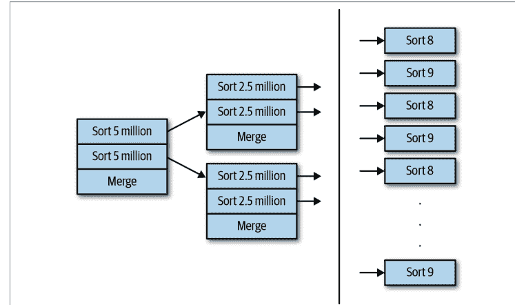
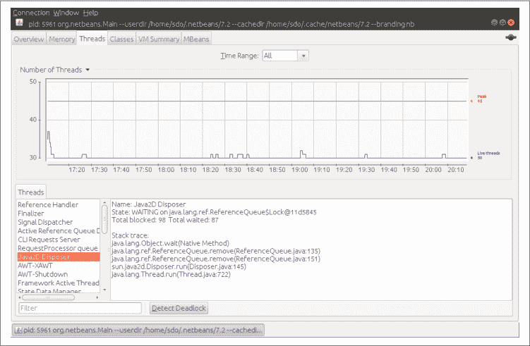
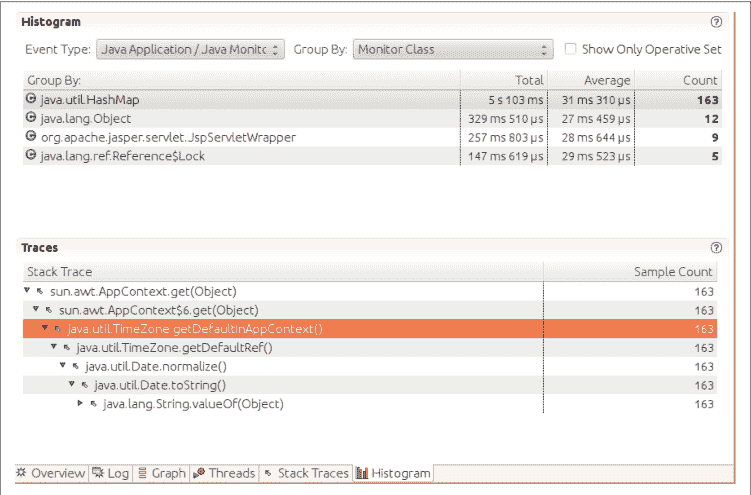
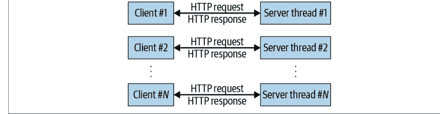
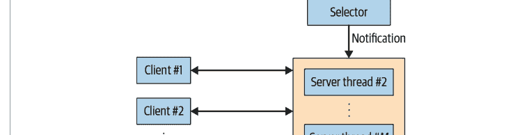
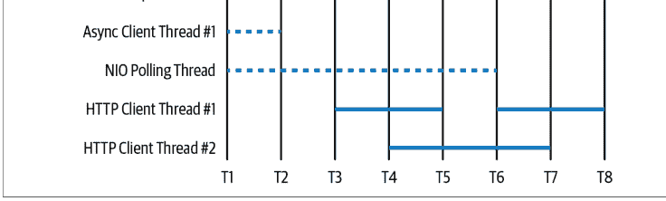

## 线程和同步性能

从最初的日子开始，Java 的吸引力之一就在于它是多线程的。即使在多核和多 CPU 系统尚未成为主流的年代，用 Java 轻松编写线程程序的能力也被认为是其标志性特性之一。

从性能角度来看，其吸引力显而易见：如果有两颗 CPU 可用，应用程序可能能够完成两倍的工作量，或以两倍的速度完成相同的工作量。这假设任务可以分解为离散的段，因为 Java 不是一种自动并行化语言，不会自行找出算法部分。幸运的是，今天的计算通常涉及离散任务：服务器同时处理来自不同客户端的请求、批处理作业对一系列数据执行相同操作、分解为组成部分的数学算法等等。

本章探讨如何充分发挥 Java 线程和同步设施的最大性能。

### 线程和硬件

回顾第 1 章中关于多核系统和超线程系统的讨论。软件层面的线程允许我们利用机器的多个核心和超线程。

在机器上将核心数量加倍，可以使我们正确编写的应用程序性能加倍，尽管正如我们在第 1 章中所讨论的，向 CPU 添加超线程并不会使其性能翻倍。

本章几乎所有的示例都在一台具有四个单线程 CPU 的机器上运行——例外是第一个展示超线程 CPU 与非超线程 CPU 之间差异的示例。此后，我们将仅以单线程 CPU 核心来衡量扩展，以便更好地理解添加线程对性能的影响。这并不是说超线程 CPU 不重要；来自额外硬件线程的 20%–40% 性能提升肯定会改善应用程序的整体性能或吞吐量。从 Java 角度来看，我们仍应将超线程视为实际 CPU，并在四核、八超线程机器上运行的应用程序进行调优，就好像它有八个 CPU 一样。但从测量角度来看，我们应预期相比单核仅有五到六倍的提升。

### 线程池和 ThreadPoolExecutors

线程可以在 Java 中由自定义代码管理，或者应用程序可以利用线程池。Java 服务器通常围绕一个或多个线程池构建来处理请求：对服务器的每次调用都由池中的（可能不同的）线程处理。同样，其他应用程序也可以使用 Java 的 ThreadPoolExecutor 并行执行任务。

事实上，一些服务器框架使用 ThreadPoolExecutor 类的实例来管理其任务，尽管许多框架编写了自己的线程池（如果只是因为它们早于 ThreadPoolExecutor 添加到 Java API）。尽管这些情况下池的实现可能不同，但基本概念相同，本节将同时讨论两者。

使用线程池的关键因素是，调整池的大小对于获得最佳性能至关重要。线程池性能取决于线程池大小的基本选择，并且在某些情况下，过大的线程池会损害性能。

所有线程池的工作方式本质上相同。任务被提交到队列（可以有多个队列，但概念相同）。然后一定数量的线程从队列中取出任务并执行它们。任务的结果可以发送回客户端（例如在服务器的情况下）、存储在数据库中、存储在内部数据结构中，或其他操作。但在完成任务后，线程返回到任务队列以检索另一个作业来执行（如果没有更多任务要执行，线程会等待任务）。

线程池具有最小线程数和最大线程数。最小线程数会被保留，等待分配任务。由于创建线程是一项相当昂贵的操作，这在提交任务时加快了整体操作：预期已有存在的线程可以接收它。另一方面，线程需要系统资源——包括其栈的本地内存——拥有太多空闲线程会消耗本可由其他进程使用的资源。最大线程数也充当必要的节流，防止同时执行太多任务。


## 表 9-1. 计算 10,000 条模拟价格历史所需的时间

| 线程数 | 所需秒数 | 基线百分比 |
| 1 | 55.2 ± 0.6 | 100% |
| 2 | 28.3 ± 0.3 | 51.2% |
| 4 | 13.9 ± 0.6 | 25.1% |
| 8 | 14.3 ± 0.2 | 25.9% |
| 16 | 14.5 ± 0.3 | 26.2% |

如果应用程序中的任务完全并行，则“基线百分比”列对于两个线程应显示 50%，对于四个线程应显示 25%。由于多种原因，完全线性的扩展是不可能实现的：除其他外，线程必须相互协调以从运行队列中选取任务，而通常线程之间还有更多的同步。到使用四个线程时，系统已消耗了 100% 的可用 CPU，并且虽然机器可能没有运行任何其他用户级应用程序，但各种系统级进程会启动并使用部分 CPU，从而阻止 JVM 利用全部 100% 的周期。尽管如此，该应用程序的扩展效果仍然很好，即使线程池中的线程数量估计过高，我们也只需付出轻微的代价。

## 超线程的影响

如果这四个 CPU 采用超线程技术，使得我们拥有两个核心和四个硬件线程会怎样？表 9-2 显示了在这种机器上进行的相同实验。正如前一个示例一样，这对 JVM 来说表现为四核机器，但基准测试的扩展情况截然不同。

## 表 9-2. 使用超线程计算 10,000 条模拟价格历史所需的时间

| 线程数 | 所需秒数 | 基线百分比 |
| 1 | 55.7 ± 0.1 | 100% |
| 2 | 28.1 ± 0.4 | 50.4% |
| 4 | 25.5 ± 0.4 | 45.7% |
| 8 | 25.7 ± 0.2 | 46.1% |
| 16 | 26.0 ± 0.2 | 46.6% |

现在程序从一个到两个 CPU 的扩展效果很好，因为它们都是完整核心。但增加两个超线程带来的好处只有一点。这是最坏的情况；如果线程因 I/O 而暂停或等待另一个线程持有的锁，则超线程的好处会更明显。尽管如此，增加一个超线程通常只能带来约 20% 的提升。

在其他情况下，线程过多带来的惩罚可能更大。在股票历史计算器的 REST 版本中，线程过多的影响更大，如表 9-3 所示。应用程序服务器配置为具有给定数量的线程，并且负载生成器向服务器发送 16 个并发请求。

## 表 9-3. 通过 REST 服务器获取模拟股票价格的操作次数

| 线程数 | 每秒操作次数 | 基线百分比 |
|---|---|---|
| 1 | 46.4 | 27% |
| 4 | 169.5 | 100% |
| 8 | 165.2 | 97% |
| 16 | 162.2 | 95% |

鉴于 REST 服务器有四个可用 CPU，使用相同数量的线程在池中可实现最大吞吐量。

第 1 章讨论了在调查性能问题时确定瓶颈的必要性。在此示例中，瓶颈显然是 CPU：在四个 CPU 时，CPU 利用率为 100%。尽管如此，在这种情况下增加更多线程的惩罚相对较小，至少在线程数量超过四倍之前是如此。

但如果瓶颈在其他地方呢？这个示例在某种程度上也不寻常，因为任务完全受 CPU 限制：它们不执行 I/O。通常，线程可能会被期望调用数据库或将输出写入某处，甚至与另一个资源会合。在这种情况下，CPU 不一定是瓶颈：外部资源可能是。

当这种情况发生时，向线程池添加线程是有害的。虽然我在第 1 章中（只是半开玩笑地）说数据库总是瓶颈，但瓶颈可以是任何外部资源。

举例来说，考虑股票 REST 服务器角色互换的情况：如果目标是最大化负载生成器机器的利用率会怎样？（毕竟，它只是在运行一个多线程 Java 程序。）

在典型使用中，如果 REST 应用程序在具有四个 CPU 的服务器上运行，并且只有一个客户端请求数据，则 REST 服务器将大约 25% 忙碌，而客户端机器几乎处于空闲状态。如果负载增加到四个并发客户端，服务器将 100% 忙碌，而客户端机器可能只有 20% 忙碌。

仅从客户端来看，很容易得出结论，因为客户端有大量剩余 CPU，所以应该可以添加更多线程到客户端以提高其吞吐量。表 9-4 显示了这种假设是多么错误：当向客户端添加线程时，性能会急剧下降。

## 表 9-4. 计算模拟股票价格历史的平均响应时间

| 客户端线程数 | 平均响应时间 | 基线百分比 |
| 1 | 0.022 秒 | 100% |
| 2 | 0.022 秒 | 100% |
| 4 | 0.024 秒 | 109% |
| 8 | 0.046 秒 | 209% |
| 16 | 0.093 秒 | 422% |
| 32 | 0.187 秒 | 885% |

一旦在此示例中 REST 服务器成为瓶颈（即在四个客户端线程时），向服务器添加负载会非常有害。

这个示例可能看起来有些牵强。谁会在服务器已经 CPU 受限时再添加更多客户端线程？但我使用这个示例只是因为它易于理解，并且只使用 Java 程序。你可以自己运行它来了解其工作原理，而无需设置数据库连接和模式等等。

重点是，对于向 CPU 或 I/O 受限的数据库发送请求的 REST 服务器来说，同样的原则也适用。你可能只查看服务器的 CPU，发现它远低于 100% 并且还有额外的请求要处理，并假设增加服务器中线程的数量是个好主意。这会导致很大的惊喜，因为在这种情况下增加线程数量实际上会降低总吞吐量（并且可能显著降低），正如在仅 Java 示例中增加客户端线程数量一样。

这也是了解系统实际瓶颈所在很重要的另一个原因：如果向瓶颈增加负载，性能会显著下降。相反，如果减少对当前瓶颈的负载，性能可能会提高。

这也是线程池自调优困难的原因之一。线程池通常可以看到它们有待处理的任务量，甚至可能知道机器有多少 CPU 可用——但它们通常无法看到它们执行所在的整个环境中的其他方面。因此，在有待处理工作时添加线程——这是许多自调优线程池（以及 ThreadPoolExecutor 的某些配置）的关键特性——通常正是错误的做法。

在表 9-4 中，REST 服务器的默认配置是在四核机器上创建 16 个线程。在一般默认情况下这是有意义的，因为线程可以预期会进行外部调用。当这些调用阻塞等待响应时，可以运行其他任务，并且服务器需要超过四个线程来执行这些任务。因此，创建一个比需要稍多的线程的默认值是

另一方面，指定最小线程数的缺点相当有限。该缺点发生在第一次有多个任务要执行时：然后池需要创建一个新线程。创建线程对性能有害——这正是需要线程池的原因所在——但只要该线程随后保留在池中，这个一次性创建线程的成本很可能不会被注意到。

在批处理应用程序中，线程是在池创建时分配（如果将最小线程数和最大线程数设置为相同值，则会发生这种情况）还是按需分配并不重要：应用程序的执行时间是相同的。在其他应用程序中，新线程可能在预热期间分配（同样，分配线程的总时间是相同的）；对应用程序性能的影响可以忽略不计。即使线程创建发生在测量周期期间，只要线程创建是有限的，就可能不会被注意到。

这里适用的另一个调优是线程的空闲时间。假设池的最小值为一个线程，最大值为四个。现在假设通常有一个线程正在执行任务，然后应用程序开始一个周期，每 15 秒，平均有两项任务要执行。第一次通过该周期时，池将创建第二个线程——现在让第二个线程在池中保留一段时间是有意义的。你希望避免出现这种情况：第二个线程被创建，在 5 秒内完成其任务，空闲 5 秒，然后退出——因为 5 秒后，下一个任务需要第二个线程。一般来说，一旦线程在池中为最小大小创建，它应该至少保留几分钟以处理任何负载峰值。在你对到达率有良好模型的情况下，可以基于此来确定空闲时间。否则，计划空闲时间以分钟为单位，至少在 10 到 30 分钟之间。

通常情况下，保留空闲线程对应用程序的影响很小。通常，线程对象本身不会占用太多堆空间。规则的例外情况是，如果线程保留大量线程本地存储，或者如果线程的可运行对象通过大量内存引用。在这两种情况下，释放线程可以在堆中保留的实时数据方面提供显著节省（这反过来又影响 GC 的效率）。

然而，这些情况对于线程池来说真的不应该发生。当池中的线程空闲时，它不应该再引用任何可运行对象（如果引用，则存在错误）。根据池实现，线程本地变量可能仍然保留——但虽然线程本地变量在某些情况下可以成为促进对象重用的有效方式（见第 7 章），但这些线程本地对象占用的总内存量应受到限制。


这条规则的一个重要例外是那些可以增长到非常大的线程池（因而运行在非常大型的机器上）。假设一个线程池的任务队列预计平均有 20 个任务；那么 20 就是这个线程池一个很好的最小大小。再假设该线程池运行在一台非常大型的机器上，并且设计用来应对 2,000 个任务的峰值。在这样的池中保持 2,000 个空闲线程，当它只运行这 20 个任务时会影响其性能——当池中包含 1,980 个空闲线程时，其吞吐量可能比只有核心的 20 个忙碌线程时降低多达 50%。线程池通常不会遇到这样的规模问题，但当遇到时，正是确保它们有一个良好最小值的好时机。

## 线程池任务大小

线程池的待处理任务保存在一个队列或列表中；当池中的某个线程可以执行任务时，它会从队列中取出一个任务。这可能会导致不平衡，因为队列中的任务数量可能会增长得非常庞大。如果队列过大，队列中的任务将不得不等待很长时间，直到排在它们前面的任务执行完毕。想象一个过载的 Web 服务器：如果一个任务被添加到队列中却 3 秒内没有得到执行，用户很可能已经转到另一个页面了。

因此，线程池通常会限制待处理任务队列的大小。ThreadPoolExecutor 根据其配置的数据结构，以多种方式实现这一点（下一节将详细讨论）；服务器通常有一个调优参数来调整这个值。

与线程池的最大大小一样，没有通用规则说明应该如何调整这个值。一个队列中有 30,000 个项目、有 4 个可用 CPU 的服务器，如果每个任务只需 50 ms 即可执行完毕，那么它可以在 6 分钟内清空队列（假设在此期间没有新任务到达）。这或许可以接受，但如果每个任务需要 1 秒才能执行完毕，那么清空队列将需要 2 小时。再次强调，只有对你的实际应用进行测量，才能确定什么值能带来你所需的性能。

无论如何，当达到队列限制时，尝试向队列添加任务将会失败。ThreadPoolExecutor 有一个 rejectedExecution() 方法来处理这种情况（默认情况下，它会抛出 RejectedExecutionException，但你可以覆盖该行为）。应用服务器应向用户返回合理的响应（附带一条说明发生了什么的提示信息），REST 服务器应返回 429（请求过多）或 503（服务不可用）状态码。

## 调整 ThreadPoolExecutor 的大小

线程池的一般行为是：它从最少数量的线程开始，如果所有现有线程都忙时又有任务到达，就会启动一个新线程（直到达到最大线程数）并立即执行该任务。如果已经启动了最大数量的线程但它们全部忙碌，则该任务会被放入队列，除非已有太多任务在等待，在这种情况下任务会被拒绝。虽然这是线程池的典型行为，但 ThreadPoolExecutor 的行为可能略有不同。

ThreadPoolExecutor 根据用于保存任务的队列类型来决定何时启动新线程。有三种可能：

### SynchronousQueue

当执行器使用 SynchronousQueue 时，线程池在线程数量方面的表现与预期一致：如果所有现有线程都忙，且池中的线程数小于最大线程数，新任务将启动一个新线程。然而，这种队列无法保存待处理任务：如果一个任务到达时最大线程数已经全部忙碌，该任务总是会被拒绝。因此，这种选择适合管理少量任务，但在其他情况下可能并不合适。这个类的文档建议为最大线程数指定一个非常大的值——如果任务完全是 I/O 密集型的，这可能没问题；但正如我们所看到的，在其他情况下可能适得其反。另一方面，如果你需要一个线程数易于调整的线程池，这是更好的选择。

在这种情况下，核心值就是最小池大小：即使线程空闲也会保持运行的线程数量。最大值是池中的最大线程数。

这就是 Executors 类的 newCachedThreadPool() 方法返回的线程池类型（具有无界的最大线程数）。

### 无界队列

当执行器使用无界队列（如 LinkedBlockingQueue）时，任何任务都不会被拒绝（因为队列大小是无限的）。在这种情况下，执行器最多只会使用由核心线程池大小指定的线程数：最大池大小会被忽略。这实质上模仿了传统线程池，其中核心大小被解释为最大池大小，不过由于队列是无界的，如果任务提交速度快于其执行速度，就有消耗过多内存的风险。

这就是 Executors 类的 newFixedThreadPool() 和 newSingleThreadScheduledExecutor() 方法返回的线程池类型。第一种情况的核心（或最大）池大小是构造线程池时传入的参数；第二种情况的核心池大小为 1。

### 有界队列

使用有界队列（例如 ArrayBlockingQueue）的执行器会采用一种复杂的算法来决定何时启动新线程。例如，假设线程池的核心大小为 4，最大大小为 8，ArrayBlockingQueue 的最大大小为 10。当任务到达并被放入队列时，线程池最多运行 4 个线程（核心池大小）。即使队列完全填满——也就是其中保存了 10 个待处理任务——执行器仍只会使用 4 个线程。

只有当队列已满，并且又有新任务被添加到队列时，才会启动额外的线程。执行器不会拒绝该任务（因为队列已满），而是会启动一个新线程。这个新线程会执行队列中的第一个任务，从而为待处理任务腾出空间，使其得以加入队列。

在这个例子中，线程池最终达到 8 个线程（其指定的最大值）的唯一方式是：有 7 个任务正在执行、队列中有 10 个任务，并且又一个新任务被添加到队列中。

该算法背后的想法是：即使队列中有中等数量的任务在等待运行，线程池大多数时间也只使用核心线程（4 个）运行。这样可以让线程池起到节流阀的作用（这是一个优势）。如果请求积压变得过大，线程池就会尝试运行更多线程来清除积压（受制于第二个节流阀，即最大线程数）。

如果系统中没有外部瓶颈，并且有可用的 CPU 周期，那么这里的一切都能顺利进行：添加新线程会更快地处理队列，并很可能使其恢复到期望的大小。因此，当然可以构造出适合这种算法的情况。

另一方面，该算法并不知道队列大小为何增加。如果是由外部积压导致的，那么添加更多线程是错误的做法。如果线程池运行在一台 CPU 密集型的机器上，添加更多线程也是错误的做法。只有在积压是由于额外的负载进入系统（例如，更多客户端开始发送 HTTP 请求）而产生时，添加线程才有意义。但如果是这样，为什么要等到队列大小达到某个界限才添加线程呢？如果有额外的资源可以用来利用更多线程，那么更早地添加它们将提高系统的整体性能。

对于这些选择，支持和反对的论据都有很多，但在试图最大化性能时，此时应运用 KISS 原则：保持简单，傻瓜。一如既往，应用的需求可能会另有要求，但作为一般性建议，不要使用 Executors 类提供的默认的无界线程池，因为这类线程池不让你控制应用程序的内存使用。相反，构造你自己的 ThreadPoolExecutor，让核心线程数和最大线程数相同，并使用 ArrayBlockingQueue 来限制内存中可等待执行的任务请求数量。


## 快速总结

- 线程池是对象池化的一种良好案例：线程初始化成本高昂，而线程池允许系统上的线程数量易于限制。
- 线程池必须仔细调优。盲目地向池中添加新线程，在某些情况下会降低性能。
- 对 ThreadPoolExecutor 使用更简单的选项通常会提供最佳的、也最可预测的性能。

## ForkJoinPool

除了通用的 ThreadPoolExecutors 之外，Java 还提供了一个 somewhat 专用池：ForkJoinPool 类。该类看起来就像任何其他线程池一样；与 ThreadPoolExecutor 类一样，它实现了 Executor 和 ExecutorService 接口。当使用这些接口时，ForkJoinPool 使用一个内部无界任务列表，由其构造函数中指定的线程数量来运行。如果未向构造函数传递参数，池将根据机器上可用的 CPU 数量自行调整大小（如果适用，则基于 Docker 容器可用的 CPU）。

ForkJoinPool 类旨在与分而治之算法配合使用：即任务可以递归地分解为子集的算法。子集可以并行处理，然后将每个子集的结果合并为单个结果。最经典的例子是快速排序算法。

关于分而治之算法的重要一点是，它们会创建大量必须由相对较少的线程管理的任务。假设我们要对 1000 万个元素的数组进行排序。我们首先创建单独的任务来执行三个操作：对包含前 500 万个元素的子数组进行排序，对包含后 500 万个元素的子数组进行排序，然后合并这两个子数组。

对 500 万元素数组的排序同样通过对 250 万元素的子数组进行排序并合并这些数组来实现。这种递归一直持续到某一点（例如，当子数组有 47 个元素时），此时对数组使用插入排序并直接排序更为高效。图 9-1 显示了其工作原理。

最终，我们将有 262,144 个任务来对叶子数组进行排序，每个数组将有 47 个（或更少）元素。 （该数字 47 取决于算法，并且是大量分析的对象，但它是 Java 用于快速排序的数字。）



### 图 9-1. 递归快速排序中的任务

还需要另外 131,072 个任务来合并这些已排序的数组，65,536 个额外任务来合并下一组已排序的数组，依此类推。最终，将有 524,287 个任务。

这里更重要的观点是，没有一个任务可以在其已生成的任务完成之前完成。直接对少于 47 个元素的数组进行排序的任务必须首先完成，然后任务可以合并它们创建的两个小数组，依此类推：所有内容沿着链条向上合并，直到整个数组合并为最终的已排序值。

使用 ThreadPoolExecutor 高效执行该算法是不可能的，因为父任务必须等待其子任务完成。线程池执行器中的线程无法将另一个任务添加到队列中然后等待其完成：一旦线程处于等待状态，就无法用于执行子任务之一。另一方面，ForkJoinPool 允许其线程创建新任务然后挂起当前任务。在任务挂起时，线程可以执行其他待处理任务。

让我们举一个简单的例子：假设我们有一个 double 数组，目标是统计数组中小于 0.5 的值的数量。简单地顺序扫描数组是微不足道的（并且正如您将在本节后面看到的那样可能更有优势）——但现在，将数组划分为子数组并并行扫描它们是有启发性的（模拟更复杂的快速排序和其他分而治之算法）。以下是使用 ForkJoinPool 实现该目标的代码大纲：

```
```java
private class ForkJoinTask extends RecursiveTask<Integer> {
    private int first;
    private int last;

    public ForkJoinTask(int first, int last) {
        this.first = first;
        this.last = last;
    }

    protected Integer compute() {
        int subCount;
        if (last - first < 10) {
            subCount = 0;
            for (int i = first; i <= last; i++) {
                if (d[i] < 0.5)
                    subCount++;
            }
        }
        else {
            int mid = (first + last) >>> 1;
            ForkJoinTask left = new ForkJoinTask(first, mid);
            left.fork();
            ForkJoinTask right = new ForkJoinTask(mid + 1, last);
            right.fork();
            subCount = left.join();
            subCount += right.join();
        }
        return subCount;
    }
}
```
```

这里的 fork() 和 join() 方法是关键：我们很难在没有这些方法的情况下实现这种递归（ThreadPoolExecutor 执行的任务中不可用）。这些方法使用一系列内部的、每个线程的队列来操作任务并在线程之间切换任务的执行。细节对开发者是透明的，尽管如果你对算法感兴趣，代码的阅读非常有趣。我们这里关注的是性能：ForkJoinPool 和 ThreadPoolExecutor 类之间存在哪些权衡？

首要的是，fork/join 范式实现的挂起允许所有任务仅由少数几个线程执行。使用此示例代码计算 200 万个元素的数组中的 double 值会创建超过 400 万个任务，但这些任务很容易仅由少数几个线程执行（甚至一个，如果对运行测试的机器有意义）。使用 ThreadPoolExecutor 运行类似的算法将需要超过 400 万个线程，因为每个线程必须等待其子任务完成，而这些子任务只有在池中有额外线程可用时才能完成。因此，fork/join 挂起允许我们使用否则无法使用的算法，这是一项性能提升。

另一方面，像这样简单的算法并不特别适合 ForkJoinPool 的实际使用。该池最适合以下情况：

- 算法的合并部分执行一些有趣的工作（而不是像本例中那样简单地添加两个数字）。
- 算法的叶子计算执行足够的工作以抵消创建任务的开销。

如果没有这两个标准，很容易将数组划分为块并使用 ThreadPoolExecutor 让多个线程扫描数组：

```
public class ThreadPoolTest {
    private double[] d;

    private class ThreadPoolExecutorTask implements Callable<Integer> {
        private int first;
        private int last;

        public ThreadPoolExecutorTask(int first, int last) {
            this.first = first;
            this.last = last;
        }

        public Integer call() {
            int subCount = 0;
            for (int i = first; i <= last; i++) {
                if (d[i] < 0.5) {
                    subCount++;
                }
            }
            return subCount;
        }
    }

    public static void main(String[] args) {
        d = createArrayOfRandomDoubles();
        ThreadPoolExecutor tpe = new ThreadPoolExecutor(4, 4,
            Long.MAX_VALUE,
            TimeUnit.SECONDS,
            new LinkedBlockingQueue());
        Future[] f = new Future[4];
        int size = d.length / 4;
        for (int i = 0; i < 3; i++) {
            f[i] = tpe.submit(
                new ThreadPoolExecutorTask(i * size, (i + 1) * size - 1));
        }
        f[3] = tpe.submit(new ThreadPoolExecutorTask(3 * size, d.length - 1));
        int n = 0;
        for (int i = 0; i < 4; i++) {
            n += f.get();
        }
    }
```


```
}
    System.out.println("Found " + n + " values");
}
}
```

在四核机器上，这段代码将充分利用所有可用的 CPU，并行处理数组，同时避免了 fork/join 示例中使用的 400 万个任务的创建和排队。性能可预测地更快，正如表 9-5 所示。

## 表 9-5. 统计 200 万个元素的数组所需时间

| 线程数 | ForkJoinPool | ThreadPoolExecutor |
| 1 | 125 ± 1 ms | 1.731 ± 0.001 ms |
| 4 | 37.7 ± 1 ms | 0.55 ± 0.002 ms |

两个测试在 GC 时间上有所不同，但真正的区别来自于分而治之，特别是在叶子值为 10 的情况下。创建和管理 400 万个任务对象的开销阻碍了 ForkJoinPool 的性能。当有类似的替代方案可用时，它很可能会更快——至少在这种简单情况下。

作为另一种选择，我们本可以通过更早地结束递归来要求更少的任务。在极端情况下，我们可以在子数组有 500,000 个元素时结束递归，这恰好将工作划分为四个任务，这与线程池示例所做的相同。此时，此测试的性能将相同（尽管如果工作可以如此轻松地划分，那么使用分而治之算法就没有理由了）。

为了说明目的，我们可以很容易地通过向任务的叶子计算阶段添加工作来缓解我们标准中的第二个要点：

```
for (int i = first; i <= last; i++) {
    if (d[i] < 0.5) {
        subCount++;
    }
    for (int j = 0; j < 500; j++) {
        d[i] *= d[i];
    }
}
```

现在测试将以 d[i] 的计算为主导。但由于算法的合并部分没有做任何重要工作，创建所有任务仍然会带来惩罚，正如我们在表 9-6 中看到的那样。

## 表 9-6. 统计 200 万个元素的数组并添加工作所需时间

| 线程数 | ForkJoinPool | ThreadPoolExecutor |
| 4 | 271 ± 3 ms | 258 ± 1 ms |

现在测试的时间主要由实际计算主导，fork-join 池与分区相比没有那么糟糕了。尽管如此，创建任务所需的时间仍然很重要，当任务可以简单地分区时（即合并阶段没有重要工作），简单的线程池会更快。

## 工作窃取

使用此池的一个规则是确保拆分任务是有意义的。但 ForkJoinPool 的第二个特性使其更加强大：它实现了工作窃取。这基本上是一个实现细节；它意味着池中的每个线程都有自己的任务队列，其中包含它已 fork 的任务。线程会优先处理自己队列中的任务，但如果该队列为空，它们会从其他线程的队列中窃取任务。结果是，即使 400 万个任务中的一个执行时间很长，ForkJoinPool 中的其他线程也可以完成所有剩余任务。ThreadPoolExecutor 则不然：如果其中一个任务需要很长时间，其他线程无法获取额外的工作。

当我们向原始示例添加工作时，每个值的 work 量是恒定的。如果该工作根据数组中项目的位置而变化会怎样？

```
for (int i = first; i <= last; i++) {
    if (d[i] < 0.5) {
        subCount++;
    }
    for (int j = 0; j < i; j++) {
        d[i] += j;
    }
}
```

由于外层循环（以 j 为索引）基于数组中元素的位置，计算所需的时间与元素位置成比例：计算 d[0] 的值会非常快，而计算 d[d.length - 1] 的值则需要更长时间。

现在 ThreadPoolExecutor 测试的简单分区将处于劣势。计算数组第一个分区的线程完成所需的时间会非常长，比第四个线程处理最后一个分区所花费的时间长得多。一旦第四个线程完成，它将保持空闲状态：必须等待第一个线程完成其长时间任务。

ForkJoinPool 中 400 万个任务的粒度意味着，虽然一个线程会被困在对数组中前 10 个元素进行非常长的计算上，但剩余的线程仍会有工作要做，并且 CPU 在测试的大部分时间内都会保持忙碌。这种差异在表 9-7 中显示。

## 表 9-7. 处理包含 2,000,000 个元素的数组且工作负载不平衡所需时间

| 线程数 | ForkJoinPool | ThreadPoolExecutor |
| 1 | 22.0 ± 0.01 seconds | 21.7 ± 0.1 seconds |
| 4 | 5.6 ± 0.01 seconds | 9.7 ± 0.1 seconds |

当池中只有一个线程时，计算所需的时间基本相同。这是有道理的：计算量与池实现无关，并且由于这些计算从未并行完成，因此可以预期它们所需的时间相同（尽管为创建 400 万个任务存在一些小的开销）。但当池中包含四个线程时，ForkJoinPool 中任务的粒度给了它明显的优势：它能够在测试的大部分时间内保持 CPU 忙碌。

这种情况称为不平衡，因为有些任务比其他任务花费更长时间（因此前一个示例中的任务称为平衡）。通常，这导致建议：当任务可以轻松划分为平衡集时，使用 ThreadPoolExecutor 进行分区会带来更好的性能，而当任务不平衡时，ForkJoinPool 会带来更好的性能。

这里还有一个更微妙的性能建议：仔细考虑 fork/join 模式的递归应该在何时结束。在此示例中，我们任意选择在数组大小小于 10 时结束。在平衡情况下，我们已经讨论过，将递归结束在 500,000 将是最佳的。

另一方面，在不平衡情况下，递归对于更小的叶子值会带来更好的性能。代表性数据点显示在表 9-8 中。

## 表 9-8. 处理包含 2,000,000 个元素的数组且叶子值不同所需时间

| 叶子数组的目标大小 | ForkJoinPool |
| 500,000 | 9,842 ± 5 ms |
| 50,000 | 6,029 ± 100 ms |
| 10,000 | 5,764 ± 55 ms |
| 1,000 | 5,657 ± 56 ms |
| 100 | 5,598 ± 20 ms |
| 10 | 5,601 ± 15 ms |

叶子大小为 500,000 时，我们复制了线程池执行器的情况。随着叶子大小的下降，我们受益于测试的不平衡性质，直到在 1,000 到 10,000 之间，性能趋于平稳。

这种叶子值的调整在这种类型的算法中是常规进行的。正如你在本节前面看到的那样，Java 在其快速排序算法的实现中使用 47 作为叶子值：这是（对于该算法）创建任务的开销超过分而治之方法的好处的那一点。

## 自动并行化

Java 有能力自动并行化某些代码。这种并行化依赖于使用 ForkJoinPool 类。JVM 将为此目的创建一个公共 fork-join 池；它是 ForkJoinPool 类的静态元素，默认情况下按目标机器上的处理器数量进行调整。

这种并行化发生在 Arrays 类的许多方法中：使用并行快速排序对数组进行排序的方法、对数组的每个单独元素进行操作的方法等等。它还用于 streams 功能中，该功能允许对集合中的每个元素执行操作（顺序或并行）。streams 的基本性能影响在第 12 章中讨论；在本节中，我们将看看 streams 如何自动并行处理。

给定一个包含一系列整数的集合，以下代码将为给定整数对应的符号计算股票价格历史：

```
List<String> symbolList = ...;
Stream<String> stream = symbolList.parallelStream();
stream.forEach(s -> {
    StockPriceHistory sph = new StockPriceHistoryImpl(s, startDate,
        endDate, entityManager);
    blackhole.consume(sph);
});
```

此代码将并行计算模拟价格历史：forEach() 方法将为数组列表中的每个元素创建一个任务，并且每个任务都将由公共 ForkJoinTask 池处理。这本质上等同于本章开头的测试，该测试使用线程池并行计算历史——尽管这段代码比显式处理线程池更容易编写。

调整公共 ForkJoinTask 池的大小与调整任何其他线程池一样重要。默认情况下，公共池将拥有与目标机器具有的 CPU 数量一样多的线程。如果你在同一台机器上运行多个 JVM，限制该数量是有意义的，这样 JVM 就不会相互竞争 CPU。同样，如果服务器将并行执行其他请求，并且你希望确保为这些其他任务提供 CPU，请考虑降低公共池的大小。另一方面，如果公共池中的任务会阻塞等待 I/O 或其他数据，则可能需要增加公共池的大小。

大小可以通过指定系统属性 -Djava.util.concurrent.ForkJoinPool.common.parallelism=N 来设置。通常，对于 Docker 容器，在 Java 8 版本 192 之前的版本中应手动设置。


在本章前面，表9-1展示了当线程池具有不同大小时，并行股票历史计算性能的影响。表9-9将该数据与使用公共ForkJoinPool（其中parallelism系统属性设置为给定值）的forEach()构造进行了比较。

**表9-9：计算10,000条模拟价格历史所需的时间**

| 线程数 | ThreadPoolExecutor | ForkJoinPool |
| --- | --- | --- |
| 1 | 40 ± 0.1 秒 | 20.2 ± 0.2 秒 |
| 2 | 20.1 ± 0.07 秒 | 15.1 ± 0.05 秒 |
| 4 | 10.1 ± 0.02 秒 | 11.7 ± 0.1 秒 |
| 8 | 10.2 ± 0.3 秒 | 10.5 ± 0.1 秒 |
| 16 | 10.3 ± 0.03 秒 | 10.3 ± 0.7 秒 |

默认情况下，公共池将包含四个线程（在我们通常的四CPU机器上），因此表格中的第三行是常见情况。公共池大小为1和2的结果恰恰是那种会让性能工程师感到困惑的结果：它们似乎完全不合常理，因为ForkJoinPool的表现远好于预期。

当测试结果出现这种异常时，最常见的原因是测试错误。然而，在这种情况下，事实证明forEach()方法做了一些巧妙的事情：它既使用执行语句的线程，也使用公共池中的线程来处理来自流的数据。即使第一次测试中的公共池被配置为只有一个线程，实际也有两个线程用于计算结果。因此，ThreadPoolExecutor使用两个线程与ForkJoinPool使用一个线程所需的时间基本上是相同的。

如果在使用并行流构造和其他自动并行功能时需要调整公共池的大小，请考虑将期望值减一。


### 快速总结

- ForkJoinPool类应用于递归、分治算法。该类不适用于可以通过简单分区处理的情况。
- 努力确定算法中任务递归应停止的最佳时机。创建过多任务会损害性能，但如果任务耗时不同，任务过少也会损害性能。
- 使用自动并行化的功能将使用ForkJoinPool类的公共实例。您可能需要调整该公共实例的默认大小。

P是程序中并行运行的部分，N是使用的线程数（假设每个线程始终有可用的CPU）。因此，如果20%的代码位于串行块中（即P为80%），那么在8个可用CPU的情况下，代码预计只能快3.33倍。

关于这个方程的一个关键事实是，随着P减小——也就是说，随着更多代码位于串行块中——多线程带来的性能收益也会减少。这就是为什么限制串行块中的代码量如此重要。在这个例子中，有8个可用CPU时，我们可能希望速度提升8倍。当只有20%的代码位于串行块中时，多线程的收益减少了50%以上（即提升仅为3.3倍）。

### 锁定对象的成本

除了对可扩展性的影响之外，同步操作还带来两个基本成本。

首先，是获取同步锁的成本。如果锁是无竞争的——意味着没有两个线程同时尝试访问该锁——这个成本很小。在synchronized关键字和基于CAS的构造之间有一点差别。无竞争的同步锁被称为未膨胀锁，获取未膨胀锁的成本约为几百纳秒。无竞争的CAS代码的性能损失更小。（参见第12章了解差异的示例。）

存在竞争的构造则成本更高。当第二个线程尝试访问同步锁时，锁（可预见地）发生膨胀。这会略微增加获取锁的时间，但真正的影响在于第二个线程必须等待第一个线程释放锁。当然，等待时间取决于应用程序。

在使用了CAS指令的代码中，存在竞争的操作的成本是不可预测的。使用CAS原语的类基于乐观策略：线程设置一个值，执行代码，然后确保初始值没有被更改。如果已经更改，基于CAS的代码必须重新执行。在最坏的情况下，两个线程可能陷入无限循环，因为每个线程都修改了CAS保护的值，结果却发现另一个线程同时修改了它。实际上，两个线程不会陷入这样的无限循环，但随着竞争基于CAS值的线程数增加，重试次数也会增加。

同步的第二个成本是Java特有的，取决于Java内存模型。与C++和C等语言不同，Java对同步周围的内存语义有严格的保证，该保证适用于基于CAS的保护、传统同步和volatile关键字。

### volatile在示例中的使用

第7章中的双重检查锁示例需要使用volatile变量：

```java
private volatile ConcurrentHashMap instanceChm;
...
public void doOperation() {
    ConcurrentHashMap chm = instanceChm;
    if (chm == null) {
        synchronized(this) {
            chm = instanceChm;
            if (chm == null) {
                chm = new ConcurrentHashMap();
                ... code to populate the map
                instanceChm = chm;
            }
        }
    }
    ...use the chm...
}
```

在这个示例中，volatile关键字完成两件事。首先，注意哈希映射是先用局部变量初始化的，只有最终（完全初始化）的值才赋给instanceChm变量。如果填充哈希映射的代码直接使用实例变量，第二个线程可能会看到部分填充的映射。其次，它确保当映射完全初始化时，其他线程会立即看到存储到instanceChm变量中的值。

类似地，第2章指出，在微基准测试中，确保结果被使用的一种方法是将其存储到volatile变量中。编译器无法优化掉该存储操作，因此它确保了产生该变量中结果的代码也无法被优化掉。jmh中的Blackhole类出于同样的原因使用volatile存储（尽管该类还防止了其他一些微基准测试效应，这也是使用jmh比从头编写自己的微基准测试更好的另一个原因）。

同步的目的是保护对内存中值（或变量）的访问。正如第4章所讨论的，变量可能会临时存储在寄存器中，这比直接在主存中访问它们效率高得多。寄存器中的值对其他线程不可见；修改寄存器中值的线程必须在某个时刻将该寄存器刷新到主存，以便其他线程能够看到该值。寄存器值必须刷新的时机由线程同步决定。

语义可能会变得相当复杂，但最简单的理解方式是：当线程离开同步块时，它必须将任何已修改的变量刷新到主存。这意味着其他进入同步块的线程将看到最近更新的值。类似地，基于CAS的构造确保在其操作期间修改的变量刷新到主存，而标记为volatile的变量在每次更改时都会始终一致地更新到主存。

在第1章中，我提到你应该学会避免Java中性能不佳的代码结构，即使这看起来像是“过早优化”你的代码（其实不是）。一个有趣的案例——而且是一个真实世界的例子——来自这个循环：

```java
Vector v;
for (int i = 0; i < v.size(); i++) {
    process(v.get(i));
}
```

在生产环境中，发现这个循环花费了惊人的时间，合理推测是process()方法导致的问题。但并非如此，问题也不在于size()和get()方法调用本身（它们已被编译器内联）。Vector类的get()和size()方法是同步的，事实证明，所有这些调用所需的寄存器刷新是一个巨大的性能问题。[^1]

这段代码在其他方面也不理想。特别是，向量的状态可能会在线程调用size()方法和调用get()方法之间发生变化。如果第二个线程在第一个线程的两次调用之间从向量中移除最后一个元素，get()方法将抛出ArrayIndexOutOfBoundsException。除了代码中的语义问题外，细粒度同步在这里也是一个糟糕的选择。

避免这种情况的一种方法是将大量连续的细粒度同步调用包装在一个同步块中：

```java
synchronized(v) {
    for (int i = 0; i < v.size(); i++) {
        process(v.get(i));
    }
}
```

[^1]: 虽然现代代码会使用不同的集合类，但示例同样适用于通过synchronizedCollection()方法包装的集合，或任何其他过度寄存器刷新的循环。


如果 `process()` 方法需要很长时间才能执行，那么这种方法就不太奏效，因为向量无法再并行处理。另一种方法是，可能需要复制并划分向量，以便在副本中并行处理其元素，同时其他线程仍可以修改原始向量。

寄存器刷新的效果还取决于程序所运行的处理器类型；为线程提供大量寄存器的处理器将比简单的处理器需要更多的刷新。事实上，这段代码在数千种环境中长时间运行都没有问题。只有当它在基于SPARC的大型机器上运行时（每个线程有大量寄存器）才成为问题。

这是否意味着在较小的环境中不太可能遇到寄存器刷新的问题？也许吧。但正如多核CPU已成为普通笔记本电脑的标准配置一样，具有更多缓存和寄存器的更复杂CPU也变得越来越普遍，这将暴露出此类隐藏的性能问题。


## 快速总结

- 线程同步有两个性能代价：它限制了应用程序的可扩展性，并且需要获取锁。
- 同步的内存语义、基于CAS的工具以及 `volatile` 关键字会对性能产生负面影响，尤其是在具有大量寄存器的大型机器上。

## 避免同步

如果能够完全避免同步，锁的代价就不会影响应用程序的性能。有两种通用方法可以实现这一点。

第一种方法是在每个线程中使用不同的对象，这样对对象的访问就不会产生竞争。许多Java对象为了线程安全进行了同步，但不一定需要共享。Random 类就属于这一类；第12章展示了JDK中的一个示例，其中使用线程本地技术开发了一个新类，以避免该类中的同步。

另一方面，许多Java对象的创建成本很高，或者占用大量内存。以 NumberFormat 类为例：该类的实例不是线程安全的，并且创建实例所需的国际化使得构造新对象的成本很高。程序可以使用单个共享的全局 NumberFormat 实例，但对这个共享对象的访问需要同步。

相反，更好的模式是使用 ThreadLocal 对象：

```
public class Thermometer {
    private static ThreadLocal<NumberFormat> nfLocal = new ThreadLocal<>() {
        public NumberFormat initialValue() {
            NumberFormat nf = NumberFormat.getInstance();
            nf.setMinimumIntegerDigits(2);
            return nf;
        }
    }
    public String toString() {
        NumberFormat nf = nfLocal.get();
        nf.format(...);
    }
}
```

通过使用线程本地变量，对象的总数受到限制（最小化对GC的影响），并且每个对象永远不会受到线程竞争的影响。

第二种避免同步的方法是使用基于CAS的替代方案。从某种意义上说，这与其说是避免同步，不如说是以不同的方式解决问题。但在这里，通过减少同步带来的性能损失，实际上达到了同样的效果。

基于CAS的保护与传统同步之间的性能差异似乎是使用微基准测试的理想场景：编写代码来比较基于CAS的操作与传统同步方法应该很简单。例如，JDK提供了一种使用基于CAS的保护来维护计数器的简单方法：AtomicLong 及类似类。然后，微基准测试可以比较使用基于CAS保护的代码与传统同步的代码。例如，假设一个线程需要获取一个全局索引并原子地递增它（以便下一个线程获得下一个索引）。使用基于CAS的操作，可以这样做：

```
AtomicLong al = new AtomicLong(0);
public long doOperation() {
    return al.getAndIncrement();
}
```

该操作的传统同步版本如下所示：

```
private long al = 0;
public synchronized doOperation() {
    return al++;
}
```

事实证明，这两种实现之间的差异无法用微基准测试来衡量。如果只有一个线程（因此没有竞争的可能），则二者表现相同；当多个线程更新 LongAdder 时，该类可以分别保存每个线程的更新。线程不需要等待彼此完成操作；相反，值被存储在一个（本质上的）数组中，每个线程都可以快速返回。稍后，当某个线程尝试获取当前值时，这些值会被相加或累加。

在竞争很少或没有竞争的情况下，值会随着程序的运行而累加，加法器的行为将与传统的原子类相同。在严重竞争的情况下，更新会快得多，但实例会开始使用更多内存来存储值数组。在这种情况下，获取值也会稍慢一些，因为它必须处理数组中所有待处理的更新。不过，在竞争非常激烈的条件下，这些新类的性能甚至会超过对应的原子类。

归根结底，在代码运行的实际生产条件下进行广泛测试是无可替代的：只有这样才能明确判断某个特定方法的哪种实现更好。即便如此，该明确结论也仅适用于那些条件。


## 快速总结

- 避免同步对象的竞争是减轻其性能影响的有效方法。
- 线程本地变量永远不会发生竞争；它们非常适合保存实际上不需要在线程之间共享的同步对象。
- 基于CAS的工具是避免对确实需要共享的对象进行传统同步的一种方法。

## 伪共享

同步的一个鲜为人知的性能影响涉及伪共享（也称为缓存行共享）。它曾经是多线程程序中一个相当隐晦的现象，但随着多核机器成为常态——以及其他更明显的同步性能问题得到解决——伪共享正成为一个日益重要的问题。

伪共享的发生源于CPU处理缓存的方式。考虑这个简单类中的数据：

```
public class DataHolder {
    public volatile long l1;
    public volatile long l2;
    public volatile long l3;
```

```
public volatile long l4;
}
```

每个 long 值在内存中彼此相邻存储；例如，l1 可以存储在内存地址 0xF20。那么 l2 将存储在内存地址 0xF28，l3 在 0xF2C，依此类推。当程序需要操作 l2 时，它会把相对较大的一块内存——例如从 0xF00 到 0xF80 的 128 字节——加载到某个CPU的某个核心的缓存行中。想要操作 l3 的第二个线程会将同一块内存加载到另一个核心的缓存行中。

在大多数情况下，像这样加载邻近的值是有意义的：如果应用程序访问对象中的某个特定实例变量，它很可能会访问相邻的实例变量。如果它们已经加载到核心的缓存中，那么内存访问就会非常非常快——这是一个巨大的性能优势。

这种方案的一个缺点是，每当程序更新其本地缓存中的值时，该核心必须通知所有其他核心相关内存已被更改。这些其他核心必须使它们的缓存行失效，并从内存中重新加载该数据。

让我们看看如果多个线程大量使用 DataHolder 类会发生什么：

```
@State(Scope.Benchmark)
@BenchmarkMode(Mode.AverageTime)
public class ContendedTest {
    private static class DataHolder {
        private volatile long l1 = 0;
        private volatile long l2 = 0;
        private volatile long l3 = 0;
        private volatile long l4 = 0;
    }
    private static DataHolder dh = new DataHolder();
    Thread[] threads;
    @Setup(Level.Invocation)
    public void setup() {
        threads = new Thread[4];
        threads[0] = new Thread(() -> {
            for (long i = 0; i < nLoops; i++) {
                dh.l1 += i;
            }
        });
        threads[1] = new Thread(() -> {
            for (long i = 0; i < nLoops; i++) {
                dh.l2 += i;
            }
        });
        //...similar for 2 and 3...
```


```
```java
}

@Benchmark
public void test(Blackhole bh) throws InterruptedException {
    for (int i = 0; i < 4; i++)
        threads[i].start();
    }
    for (int i = 0; i < 4; i++) {
        threads[i].join();
    }
}
```
```

我们有四个独立的线程，它们之间不共享任何变量：每个线程只访问 DataHolder 类的一个成员。从同步的角度来看，没有竞争，我们可以合理地期望这段代码在我们的四核机器上执行的时间，无论是运行一个线程还是四个线程都是一样的。

事实并非如此。当某个特定线程在其循环中写入 volatile 值时，其他每个线程的缓存行都会失效，并且内存值必须重新加载。**表 9-10** 显示了结果：随着线程数量的增加，性能变得更差。

*表 9-10. 使用伪共享求和 100,000 个值的时间*

| 线程数 | 经过时间 |
|---:|---:|
| 1 | 0.8 ± 0.001 ms |
| 2 | 5.7 ± 0.3 ms |
| 3 | 10.4 ± 0.6 ms |
| 4 | 15.5 ± 0.8 ms |

这个测试用例是为了展示伪共享的最严重惩罚：本质上每次写入都会使所有其他缓存行失效，性能是串行的。

严格来说，伪共享不一定涉及同步（或 volatile）变量：每当 CPU 缓存中的任何数据值被写入时，持有相同数据范围的其他缓存必须失效。然而，请记住 Java 内存模型要求数据必须在同步原语结束时才写入主内存（包括 CAS 和 volatile 构造）。因此，这就是最常遇到这种情况的地方。如果在这个例子中 long 变量不是 volatile，编译器会将值保存在寄存器中，并且无论线程数量如何，测试将在大约 0.7 毫秒内执行。

这显然是一个极端的例子，但它提出了如何检测和纠正伪共享的问题。不幸的是，答案是模糊且不完整的。第 3 章讨论的标准工具集中的任何东西都不涉及伪共享，因为它需要对处理器架构有特定的了解。

如果你很幸运，你的应用目标处理器的供应商将拥有一种可以用于诊断伪共享的工具。例如，Intel 有一个名为 VTune Amplifier 的程序，可以通过检查缓存未命中事件来帮助检测伪共享。某些原生分析器可以提供给定代码行每条指令的时钟周期数（CPI）信息；循环中简单指令的高 CPI 可能表明代码正在等待将目标内存重新加载到 CPU 缓存中。

否则，检测伪共享需要直觉和实验。如果普通分析表明某个特定循环花费了意想不到的时间，请检查多个线程是否可能在循环中访问未共享的变量。（在性能调优作为艺术而非科学的领域中，甚至 Intel VTune Amplifier 手册也说“避免伪共享的主要手段是通过代码检查”。）

防止伪共享需要代码更改。理想的情况是相关变量可以更少地被写入。在前面的例子中，计算可以使用局部变量进行，只有最终结果才写回 DataHolder 变量。随之而来的极少次数的写入不太可能导致缓存行竞争，即使所有四个线程在循环结束时同时更新其结果，也不会对性能产生影响。

第二种可能性涉及填充变量，使它们不会被加载到同一缓存行上。如果目标 CPU 具有 128 字节的缓存行，以下填充可能有效（但也可能无效）：

```
public class DataHolder {
    public volatile long l1;
    public long[] dummy1 = new long[128 / 8];
    public volatile long l2;
    public long[] dummy2 = new long[128 / 8];
    public volatile long l3;
    public long[] dummy3 = new long[128 / 8];
    public volatile long l4;
}
```

使用这样的数组不太可能有效，因为 JVM 很可能会重新排列这些实例变量的布局，使得所有数组彼此相邻，然后所有 long 变量仍然彼此相邻。使用原始值来填充结构更有可能有效，尽管由于所需的变量数量，它可能不切实际。

在使用填充来防止伪共享时，我们需要考虑其他问题。填充的大小很难预测，因为不同的 CPU 将具有不同的缓存大小。而且填充显然会显著增加相关实例的大小，

## JVM 线程调优

JVM 有一些影响线程和同步性能的杂项调优。这些调优会对应用程序的性能产生轻微影响。

## 调优线程栈大小

当空间有限时，可以调整线程使用的内存。每个线程都有一个本地栈，操作系统在其中存储线程的调用栈信息（例如，main() 方法调用了 calculate() 方法，后者调用了 add() 方法）。

此本地栈的大小为 1 MB（32 位 Windows JVM 除外，在那里为 320 KB）。在 64 位 JVM 中，除非机器的物理内存非常紧张，并且较小的栈大小将防止应用程序耗尽本地内存，否则通常没有理由设置此值。这在运行在内存受限的 Docker 容器中时尤其如此。

作为实用规则，许多程序可以用 256 KB 的栈大小运行，很少需要完整的 1 MB。将此值设置得太小的潜在缺点是，具有极大调用栈的线程会抛出 StackOverflowError。

## 本地内存不足

当没有足够的本地内存来创建线程时，可能会发生 OutOfMemoryError。这可能表示以下三种情况之一：

- 在 32 位 JVM 中，进程已达到其 4 GB（或根据操作系统而定更少）的最大大小。
- 系统实际上已耗尽虚拟内存。
- 在类 Unix 系统中，用户已在所有正在运行的程序之间创建了为其登录配置的最大进程数。在这方面，单个线程被视为一个进程。

减小栈大小可以克服前两种问题，但对第三种问题没有影响。不幸的是，无法从 JVM 错误中判断这三种情况中的哪一种适用，但在遇到此错误时请考虑这些原因。

要更改线程的栈大小，请使用 -Xss=N 标志（例如，-Xss=256k）。


## 快速总结

- 在内存稀缺的机器上，可以减小线程栈大小。

## 偏向锁

当锁被竞争时，JVM（和操作系统）可以选择锁应如何分配。锁可以公平授予，这意味着每个线程将以轮询方式获得锁。或者，锁可以偏向最近访问该锁的线程。

偏向锁背后的理论是，如果线程最近使用过锁，处理器缓存更有可能仍包含线程下次执行受同一锁保护的代码时所需的数据。如果线程在重新获得锁时获得优先权，缓存命中的概率就会增加。当这种情况奏效时，性能会得到改善。但由于偏向锁需要簿记，有时对性能更不利。

特别是，使用线程池的应用程序——包括一些应用程序和 REST 服务器——在偏向锁生效时通常性能更差。在这种编程模型中，不同线程同样可能访问有竞争的锁。对于这类应用程序，通过 -XX:-UseBiasedLocking 选项禁用偏向锁可以获得少量性能提升。偏向锁默认启用。

## 线程优先级

每个 Java 线程都有一个开发者定义的 *优先级*，这是向操作系统提示程序认为特定线程有多重要。如果您有不同线程执行不同任务，您可能会认为可以使用线程优先级来提高某些任务的性能，而以较低优先级线程上运行的其他任务为代价。不幸的是，它并不完全那样工作。

操作系统为机器上运行的每个线程计算一个 *当前优先级*。当前优先级考虑了 Java 分配的优先级，但也包括许多其他因素，其中最重要的是线程上次运行以来经过了多长时间。这确保了所有线程最终都有机会运行。无论其优先级如何，没有线程会“饿死”等待 CPU 访问。

这两个因素之间的平衡因操作系统而异。在基于 Unix 的系统上，整体优先级的计算主要由线程上次运行以来的时间决定——线程的 Java 级优先级影响很小。


在 Windows 上，优先级较高的 Java 线程往往比优先级较低的线程运行得更多，但即使是低优先级线程也能获得相当多的 CPU 时间。

无论哪种情况，都不能依赖线程的优先级来影响其运行频率。如果某些任务比其他任务更重要，则必须使用应用程序逻辑来优先处理它们。

## 监控线程和锁

在分析应用程序的性能以评估线程和同步的效率时，我们应关注两件事：线程的总体数量（确保其既不过高也不过低）以及线程等待锁或其他资源所花费的时间。

### 线程可见性

几乎所有 JVM 监控工具都提供有关线程数量（以及它们正在做什么）的信息。像 jconsole 这样的交互式工具显示 JVM 中线程的状态。在 jconsole 的 Threads 面板上，您可以实时观察程序执行期间线程数量的增加和减少。图 9-2 显示了一个示例。



*图 9-2. jconsole 中实时线程的视图*

在某一时刻，应用程序（NetBeans）最多使用了 45 个线程。在图表的开始部分，我们可以看到一个突发，应用程序最多使用了 38 个线程，但最终稳定在 30 到 31 个之间。`jconsole` 还可以打印单个线程堆栈；正如图所示，Java2D Disposer 线程目前正在等待引用队列锁。

### 被阻塞线程的可见性

实时线程监控对于了解应用程序中正在运行哪些线程的高层次视图非常有用，但它并不能真正提供这些线程正在做什么的数据。确定线程是否正在消耗 CPU 周期需要使用分析器，如 [第 3 章](#) 中所述。分析器可以很好地了解线程正在执行的内容，并且通常足够复杂，可以指导您找到代码中可以通过更好的算法和代码选择来加快整体执行速度的区域。

诊断被阻塞的线程更困难，尽管该信息在应用程序的整体执行中通常更重要——特别是如果该代码在多 CPU 系统上运行并且未利用所有可用 CPU 的情况下。可以使用三种方法进行此诊断。一种方法再次是使用分析器，因为大多数分析工具都会提供线程执行的 timeline，让您可以看到线程被阻塞的时间点。 [第 3 章](#) 中给出了一个示例。

### 被阻塞线程和 JFR

要知道线程何时被阻塞，最好的方法是使用可以深入 JVM 并在低级别知道线程何时被阻塞的工具。其中一种工具是 Java Flight Recorder，首次在 [第 3 章](#) 中介绍。我们可以深入 JFR 捕获的事件并查找导致线程阻塞的事件。通常要查找的事件是线程等待获取监视器的事件，但如果我们观察到线程对套接字的读取（以及很少的写入）时间很长，它们也可能被阻塞。

这些事件可以在 Java Mission Control 的 Histogram 面板上轻松查看，如 [图 9-3](#) 所示。

在此示例中，`sun.awt.AppContext.get()` 方法中 `HashMap` 关联的锁在 66 秒内被争用 163 次，导致所测请求响应时间平均增加 31 毫秒。堆栈跟踪指出，争用源于 JSP 写入 `java.util.Date` 对象的方式。为了提高此代码的可扩展性，可以使用线程本地日期格式化程序，而不是简单地调用日期的 `toString()` 方法。



*图 9-3. JFR 中被监视器阻塞的线程*

此过程——从直方图中选择阻塞事件并检查调用代码——适用于任何类型的阻塞事件；这是由工具与 JVM 的紧密集成所实现的。

### 被阻塞线程和 JStack

如果没有程序的 JFR 记录，另一种选择是获取大量线程堆栈并检查它们。`jstack`、`jcmd` 和其他工具可以提供 VM 中每个线程的状态信息，包括线程是否正在运行、等待锁、等待 I/O 等等。这对于确定应用程序中发生了什么非常有用，只要不对输出期望过高即可。

查看线程堆栈时的第一个警告是 JVM 只能在 safepoints 期间转储线程的堆栈。其次，堆栈是逐个线程转储的，因此它们可能提供相互冲突的信息：两个线程可能显示持有同一锁，或者一个线程可能显示等待一个实际上没有其他线程持有的锁。

线程堆栈可以显示线程被阻塞的程度（因为被阻塞的线程已经处于 safepoint）。如果连续的线程转储显示许多线程被阻塞在某个锁上，您可以得出结论，所讨论的锁存在显著争用。如果连续的线程转储显示许多线程被阻塞等待 I/O，您可以得出结论，它们正在读取的 I/O 需要进行调整（例如，如果它们正在进行数据库调用，则它们正在执行的 SQL 需要进行调整，或者数据库本身需要进行调整）。

### JStack 分析器

很容易认为可以快速连续地获取多个堆栈转储并使用该数据作为快速而粗糙的分析器。毕竟，采样分析器的工作方式基本上就是这样：它们定期探测线程正在执行的堆栈，并根据该信息推断方法花费的时间。但由于 safepoints 和不一致的快照，这并不太奏效；您可以通过查看线程堆栈来获得应用程序中昂贵方法的非常高层次的概览，但真正的分析器将提供更准确的信息。

本书的在线示例中有一个用于 jstack 输出的简易解析器，可以汇总一个或多个线程转储中所有线程的状态。jstack 输出的一个问题是它可能会因版本而异，因此开发一个健壮的解析器可能很困难。不能保证在线示例中的解析器不需要为您的特定 JVM 进行调整。

jstack 解析器的基本输出如下所示：

```
% jstack pid > jstack.out
% java ParseJStack jstack.out
[Partial output...]
Threads in state Running
    8 threads in java.lang.Throwable.getStackTraceElement(Native Method)
Total Running Threads: 8

Threads in state Blocked by Locks
    41 threads running in
    com.sun.enterprise.loader.EJBClassLoader.getResourceAsStream
    (EJBClassLoader.java:801)
Total Blocked by Locks Threads: 41

Threads in state Waiting for notify
    39 threads running in
    com.sun.enterprise.web.connector.grizzly.LinkedListPipeline.getTask
    (LinkedListPipeline.java:294)
    18 threads running in System Thread
Total Waiting for notify Threads: 74

Threads in state Waiting for I/O read
    14 threads running in com.acme.MyServlet.doGet(MyServlet.java:603)
Total Waiting for I/O read Threads: 14
```

解析器汇总所有线程并显示有多少线程处于各种状态。八个线程当前正在运行（它们碰巧正在执行堆栈跟踪——这是一个最好避免的昂贵操作）。

41 个线程被锁阻塞。报告的方法是堆栈跟踪中第一个非 JDK 方法，在此示例中是 GlassFish 方法 `EJBClassLoader.getResourceAsStream()`。下一步将是查阅堆栈跟踪，搜索该方法，并查看线程被阻塞在哪个资源上。

在此示例中，所有线程都在等待读取同一个 JAR 文件，并且这些线程的堆栈跟踪显示所有调用都来自实例化一个新的 Simple API for XML（SAX）解析器。事实证明，SAX 解析器可以通过在应用程序 JAR 文件的清单文件中列出资源来动态定义，这意味着 JDK 必须在整个类路径中搜索这些条目，直到找到应用程序想要使用的条目（或直到找不到任何内容并回退到系统解析器）。由于读取 JAR 文件需要同步锁，因此所有尝试创建解析器的线程最终都会争用同一个锁，这极大地阻碍了应用程序的吞吐量。（要克服这种情况，请设置 `-Djavax.xml.parsers.SAXParserFactory` 属性以避免这些查找。）

更广泛的观点是，大量的被阻塞线程会降低性能。无论阻塞的原因是什么，都需要对配置或应用程序进行更改以避免它。

那么等待通知的线程呢？这些线程正在等待其他事情发生。它们通常在等待任务准备就绪的池中（例如，前面的输出中的 `getTask()` 方法正在等待请求）。系统线程正在执行诸如 RMI 分布式 GC 或 JMX 监控之类的操作——它们在 `jstack` 输出中显示为堆栈中只有 JDK 类的线程。这些情况不一定表示性能问题；它们等待通知是正常的。

另一个问题出现在等待 I/O 读取的线程中：这些线程正在进行阻塞 I/O 调用（通常是 `socketRead0()` 方法）。这也在阻碍吞吐量：线程正在等待后端资源响应其请求。这就是开始研究数据库或其他后端资源性能的时候。


## 快速摘要

-   对系统线程的基本可见性，可以让我们概览正在运行的线程数量。
-   线程可见性使我们能够判断线程为何被阻塞：是等待资源，还是等待 I/O。
-   Java Flight Recorder 提供了一种简便的方法来检查导致线程阻塞的事件。
-   `jstack` 可以让我们在一定程度上了解线程被阻塞在哪些资源上。

## 摘要

理解线程的运作方式可以带来重要的性能收益。不过，线程性能与其说在于调优——可供调整的 JVM 标志相对较少，而且这些少数标志的效果也有限——不如说，良好的线程性能在于遵循管理线程数量和限制同步影响的最佳实践指南。借助适当的性能分析和锁分析工具，可以对应用程序进行检查和修改，从而避免线程和锁问题对性能产生负面影响。

## Java 服务器

本章探讨 Java 服务器技术的相关主题。这些技术的核心都是如何在客户端和服务器之间传输数据，通常是通过 HTTP 进行。因此，本章主要关注通用服务器技术的常见主题：如何使用不同的线程模型扩展服务器、异步响应、异步请求，以及高效处理 JSON 数据。

扩展服务器规模主要在于有效利用线程，而这种利用需要事件驱动的非阻塞 I/O。像 Apache Tomcat、IBM WebSphere Application Server 和 Oracle WebLogic Server 这样的传统 Java/Jakarta EE 服务器，长期以来一直使用 Java NIO API 来实现这一点。当前的服务器框架（如 Netty 和 Eclipse Vert.x）封装了 Java NIO API 的复杂性，提供了易于使用的构建模块，用于构建占用空间更小的服务器，而像 Spring WebFlux 和 Helidon 这样的服务器则构建在这些框架之上（两者都使用 Netty 框架），以提供可扩展的 Java 服务器。

这些较新的框架提供了基于响应式编程的编程模型。*响应式编程* 的核心是使用基于事件的范式来处理异步数据流。尽管响应式编程是看待事件的一种不同方式，但就我们的目的而言，响应式编程和异步编程都能带来相同的性能优势：将程序（尤其是 I/O）扩展到许多连接或数据源的能力。

## Java NIO 概述

如果您熟悉非阻塞 I/O 的工作方式，可以跳到下一节。如果不熟悉，这里简要概述一下它的工作原理，以及为什么它作为本章的基础很重要。

在 Java 的早期版本中，所有 I/O 都是阻塞的。一个尝试从套接字读取数据的线程会一直等待（阻塞），直到至少有一些数据可用或读取超时。更重要的是，如果不尝试从套接字读取，就无法知道套接字上是否有数据可用。因此，想要通过客户端连接处理数据的线程，必须先发出读取数据的请求，阻塞直到数据可用，处理请求并发送回响应，然后再回到套接字上的阻塞读取。这就导致了图 10-1 中概述的情况。



图 10-1. 线程在从客户端读取 I/O 时阻塞

阻塞 I/O 要求服务器的客户端连接和服务器线程之间保持一对一的关系；每个线程只能处理一个连接。对于那些希望使用 HTTP 保活（keepalive）以避免每次请求都创建新套接字所带来的性能影响的客户端来说，这尤其是个问题。假设有 100 个客户端发送请求，请求之间的平均思考时间为 30 秒，服务器处理一个请求需要 500 毫秒。在这种情况下，任何时刻平均只有不到两个请求在进行中，但服务器却需要 100 个线程来处理所有客户端。这是非常低效的。

因此，当 Java 引入非阻塞的 NIO API 时，服务器框架便纷纷迁移到这种模型来处理客户端。这就导致了图 10-2 所示的情况。



图 10-2. 用于读取的事件通知线程

-   Selector 和 worker 线程池可以是分离的。Selector 等待所有套接字的通知，并将请求交给 worker 线程池处理。
-   或者，当 selector 收到 I/O 通知时，它会读取（可能只是部分）I/O 来确定请求的相关信息。然后，selector 根据请求类型将请求转发给不同的服务器线程池。
-   selector 池在 ServerSocket 上接受新连接，但连接建立后，所有工作都在 worker 线程池中处理。worker 线程池中的线程有时会使用 Selector 类来等待现有连接上待处理的 I/O，有时它会处理来自另一个 worker 线程的通知，告知某个客户端的 I/O 正在等待处理（例如，它将执行该客户端的请求/响应）。
-   执行 selector 功能的线程和处理请求的线程之间，完全不必有所区分。一个收到套接字上 I/O 可用通知的线程可以处理整个请求。与此同时，线程池中的其他线程会收到其他套接字上 I/O 的通知，并处理这些套接字上的请求。

尽管存在这些差异，在调优服务器线程池时，我们应该牢记两个基本点。首先（也是最重要的），我们需要足够的 worker 线程来处理服务器能够处理的并发请求数（不是并发连接数）。如第 9 章所述，这在一定程度上取决于这些请求本身是执行 CPU 密集型代码，还是会进行其他阻塞调用。在这种情况下，另一个考虑因素是，如果服务器发出额外的非阻塞调用会发生什么。

考虑一个仅执行 CPU 密集型计算的 REST 服务器。那么，像所有 CPU 密集型场景一样，线程数没有必要超过运行服务器的机器或容器上的虚拟 CPU 数量：我们永远不可能运行比这更多的线程。

如果 REST 服务器反过来向另一个资源发出出站调用——比如说，另一个 REST 服务器或数据库——该怎么办？现在这取决于这些调用是阻塞的还是非阻塞的。暂且假设这些调用是阻塞的。那么，每一个并发的出站阻塞调用，我们都需要一个线程。这可能会使我们的服务器退回到效率低下的每个客户端一个线程的模型。

想象一下，为了满足一个特定的客户端请求，在一个有两个非超线程 CPU 的系统上，worker 线程必须花费 900 毫秒从数据库检索数据，以及 100 毫秒来设置该数据库调用并将数据处理到客户端的响应中。该服务器有足够的 CPU 每秒处理 20 个请求。如果每个客户端每 30 秒发出一个请求，服务器可以处理 600 个客户端。由于客户端连接处理是非阻塞的，我们不需要在 worker 线程池中拥有 600 个线程，但仅靠 2 个线程（每个 CPU 一个）也是不够的。平均而言，任何时候都会有 20 个请求被阻塞，因此我们至少需要在 worker 线程池中拥有那么多线程。

现在，假设出站请求也是非阻塞的，那么在这 900 毫秒数据库返回答案的时间里，发起数据库调用的线程可以空闲出来处理其他请求。这样我们又回到了只需要两个 worker 线程的情况：它们可以花所有时间来处理处理数据库数据所需的 100 毫秒部分，让 CPU 保持完全忙碌，使服务器的吞吐量达到最大值。

和往常一样，这在一定程度上简化了讨论：我们还需要时间来读取和设置请求，等等。不过，基本规则依然成立：worker 池中需要的线程数量，应该等于同时执行代码和同时阻塞在其他资源上的线程数量之和。

另一个调优考虑因素是，在任何给定时间点，需要充当 selector 的线程数量。你不只需要一个。一个 selector 线程执行 `select()` 调用，以确定众多套接字中哪个有可用的 I/O。然后，它必须花时间处理这些数据：至少，要通知其他 worker 线程哪些客户端有待处理的请求。之后，它可以返回并再次调用 `select()` 方法。但在它处理 `select()` 调用结果期间，应该有另一个线程为其他套接字执行 `select()` 调用，以查看它们何时有可用数据。

因此，在有独立 selector 线程池的框架中，您需要确保该池至少有几个线程（通常，框架的默认值是三个）。在同一个线程池既处理选择又处理请求的框架中，您需要根据我们刚刚讨论的 worker 线程指南，在线程数要求的基础上再加几个额外的线程。

## 异步 REST 服务器

调整服务器请求线程池的另一种方法是将工作推迟到另一个线程池。这是 JAX-RS 的异步服务器实现以及 Netty 的事件执行器任务（专为长时间运行的任务设计）和其他框架所采用的方法。

让我们从 JAX-RS 的角度来看这个问题。在一个简单的 REST 服务器中，请求和响应都在同一个线程上处理。这限制了这些服务器的并发性。例如，在一台 8 CPU 机器上，Helidon 服务器的默认线程池大小是 32。考虑以下端点：

```java
@GET
@Path("/sleep")
@Produces(MediaType.APPLICATION_JSON)
```


```java
public String sleepEndpoint(
    @DefaultValue("100") @QueryParam("delay") long delay
) throws ParseException {
    try { Thread.sleep(delay); } catch (InterruptedException ie) {}
    return "{\"sleepTime\": \"" + delay + "\"}";
}
```

这个示例中使用 sleep 的目的只是为了测试：假设这段 sleep 是在调用远程数据库或另一个 REST 服务器，并且该远程调用耗时 100 毫秒。如果我在默认配置的 Helidon 服务器上运行该测试，服务器将能同时处理 32 个请求。并发数为 32 的负载生成器会报告每个请求耗时 100 毫秒（外加 1–2 毫秒的处理时间）。并发数为 64 的负载生成器则会报告每个请求耗时 200 毫秒，因为每个请求都必须等待另一个请求完成之后才能开始处理。

其他服务器可能有不同的配置，但效果是一样的：会基于请求线程池的大小产生某种节流。这通常是一件好事：如果在这个示例中，这 100 毫秒是作为活跃的 CPU 时间（而不是睡眠）消耗掉的，那么除非运行在一台非常大的机器上，否则服务器实际上无法同时处理 32 个请求。

不过，在这种情况下，机器还远未达到 CPU 密集型负载的程度；在没有实际处理任务时，可能只需要单个核心的 20%–30% 就能处理该负载（同样地，如果这 100 毫秒的时间间隔只是对另一个服务的远程调用，处理负载所需的资源也相同）。因此，我们可以通过修改默认线程池的配置，让它可以运行更多调用，从而提高这台机器上的并发度。这里的限制将取决于远程系统的并发能力；我们仍然需要对发往这些系统的调用进行节流，以免它们过载。

JAX-RS 提供了第二种提高并发度的方法，即使用异步响应。异步响应允许我们将业务逻辑处理转移到另一个线程池中执行：

```java
ThreadPoolExecutor tpe = Executors.newFixedThreadPool(64);
@GET
@Path("/asyncsleep")
@Produces(MediaType.APPLICATION_JSON)
public void sleepAsyncEndpoint(
    @DefaultValue("100") @QueryParam("delay") long delay,
    @Suspended final AsyncResponse ar
) throws ParseException {
    tpe.execute(() -> {
        try { Thread.sleep(delay); } catch (InterruptedException ie) {}
        ar.resume("{\"sleepTime\": \"" + delay + "\"}");
    });
}
```

在这个示例中，最初的请求进入服务器的默认线程池。该请求会设置一个调用，将业务逻辑放到一个单独的线程池（称为异步线程池）中执行，然后 `sleepAsyncEndpoint()` 方法会立即返回。这会释放默认线程池中的一个线程，让它可以立即处理另一个请求。与此同时，异步响应（使用 `@Suspended` 注解标记）会等待业务逻辑完成；一旦完成，它就会用要发送回给用户的响应来恢复执行。

这让我们能够在请求开始积压之前，并发运行 64 个（或者我们传给线程池的任何参数值）请求。但坦率地说，这与把默认线程池调整为 64 并没有本质区别。实际上，在这种情况下，我们的响应速度会略微变差，因为请求会被发送到另一个线程去处理，这会多花几毫秒。

使用异步响应有三个原因：

- 在业务逻辑中引入更多并行性。设想我们的代码不是睡眠 100 毫秒，而是需要进行三次（不相关的）JDBC 调用来获取响应所需的数据。使用异步响应可以让代码并行处理每个调用，每个 JDBC 调用在异步线程池中占用一个独立线程。
- 限制活跃线程的数量。
- 对服务器进行适当的节流。

在大多数 REST 服务器中，如果我们只是对请求线程池进行节流，新的请求会排队等待，而线程池的队列会不断增长。通常这个队列是无界的（或者至少有一个非常大的上限），最终导致请求总数变得难以管理。在线程池队列中等待时间过长的请求往往会在被处理时已经被用户放弃；即使没有被放弃，过长的响应时间也会拖垮系统的整体吞吐量。

更好的做法是，在将响应排入队列之前先查看异步线程池的状态；如果系统过于繁忙，则拒绝该请求。

```java
@GET
@Path("/asyncreject")
@Produces(MediaType.APPLICATION_JSON)
public void sleepAsyncRejectEndpoint(
    @DefaultValue("100") @QueryParam("delay") long delay,
    @Suspended final AsyncResponse ar
) throws ParseException {
    if (tpe.getActiveCount() == 64) {
        ar.cancel();
        return;
    }
}
```

```java
tpe.execute(() -> {
    // Simulate processing delay using sleep
    try { Thread.sleep(delay); } catch (InterruptedException ie) {}
    ar.resume("{\"sleepTime\": \"" + delay + "\"}");
});
```

实现这一目标的方法有很多，但对于这个简单的示例，我们将查看线程池中正在运行的活跃线程数。如果该数量等于线程池大小，则立即取消响应。（更复杂的示例会为线程池设置一个有界队列，并在线程池的拒绝执行处理器中取消请求。）这样做的效果是，调用方会立即收到 HTTP 503 Service Unavailable 状态，指示当前无法处理该请求。这是在 REST 领域处理服务器过载的首选方式，立即返回该状态会减少过载服务器上的负载，最终带来更好的整体性能。


## 快速总结

- 使用 Java NIO API 的非阻塞 I/O 可以通过减少处理多个客户端所需的线程数，让服务器实现扩展。
- 这项技术意味着服务器需要一个或多个线程池来处理客户端请求。这个线程池应根据服务器应当处理的最大同时请求数进行调整。
- 随后还需要少量额外线程来处理选择器（具体是作为工作线程池的一部分，还是单独形成一个线程池，取决于服务器框架）。
- 服务器框架通常具备一种机制，可以将耗时的请求转移到另一个线程池，从而更稳健地处理主线程池上的请求。

## 异步出站调用

前一小节给出了一个拥有两个 CPU 的服务器示例，它需要 20 个线程的线程池才能获得最大吞吐量。这是因为这些线程在向另一个资源发起出站调用时，有 90% 的时间都阻塞在 I/O 上。

非阻塞 I/O 在这种情况下也同样有帮助：如果这些出站 HTTP 或 JDBC 调用是非阻塞的，我们就不需要为每个调用专门分配一个线程，相应地就可以缩小线程池的大小。

## 异步 HTTP

HTTP 客户端是（毫不意外地）处理对服务器 HTTP 请求的类。客户端有很多种，它们的功能特性和性能特性也各不相同。在本节中，我们将研究其中一些常见用例的性能特征。

Java 8 自带一个基础的 HTTP 客户端，即 java.net.HttpURLConnection 类（以及用于安全连接的子类 java.net.HttpsURLConnection）。Java 11 新增了一个客户端：java.net.http.HttpClient 类（它也支持 HTTPS）。其他包中的 HTTP 客户端类还包括：Apache 基金会的 org.apache.http.client.HttpClient、构建在 Netty 项目之上的 org.asynchttpclient.AsyncHttpClient，以及 Eclipse 基金会的 org.eclipse.jetty.client.HttpClient。

虽然使用 HttpURLConnection 类可以执行基本操作，但大多数 REST 调用是通过 JAX-RS 这类框架完成的。因此，大多数 HTTP 客户端都直接实现了这些 API（或稍作变体），而 JAX-RS 的默认实现也为最流行的 HTTP 客户端提供了连接器。因此，你可以将 JAX-RS 与性能最佳的底层 HTTP 客户端一起使用。JAX-RS 及其底层 HTTP 客户端有两个基本的性能考虑因素。

首先，JAX-RS 连接器提供了一个用于发起 REST 调用的 Client 对象；直接使用这些客户端时，它们同样会提供一个类似 HttpClient 名称的客户端对象（HttpURLConnection 类是个例外，它不能被复用）。一个典型的客户端通常会像这样创建和使用：

```
private static Client client;
static {
    ClientConfig cc = new ClientConfig();
    cc.connectorProvider(new JettyConnectorProvider());
    client = ClientBuilder.newClient(cc);
}

public Message getMessage() {
    Message m = client.target(URI.create(url))
        .request(MediaType.APPLICATION_JSON)
        .get(Message.class);
    return m;
}
```

这个示例的关键在于，client 对象是一个静态的、共享的对象。所有的客户端对象都是线程安全的，而且实例化成本很高，所以你在应用程序中只需要有限数量（例如一个）的客户端对象。

第二个性能考虑因素是，要确保 HTTP 客户端正确地池化连接，并使用 keepalive 保持连接打开。打开一个 socket 用于


HTTP 通信是一项昂贵的操作，特别是当协议为 HTTPS 且客户端和服务器必须执行 SSL 握手时。与 JDBC 连接一样，HTTP(S) 连接也应被重用。

所有 HTTP 客户端都提供了一种池化机制，尽管 HttpURLConnection 类内部的池化机制经常被误解。默认情况下，该类会池化五个连接（每个服务器）。不过，与传统池不同，此类中的池不会限制连接数：如果请求第六个连接，将会创建一个新连接，并在使用完毕后销毁。这种短暂的连接在传统连接池中是看不到的。因此，在 HttpURLConnection 类的默认配置下，很容易看到大量短暂的连接，并据此认为连接未被池化（而且 Javadoc 在这里也没有帮助；它从未提及池化功能，尽管该行为在其他地方有文档记录）。

您可以通过设置系统属性 -Dhttp.maxConnections=N 来更改池的大小，默认为 5。尽管名称如此，该属性也适用于 HTTPS 连接。不过，此类无法限制连接数。

在 JDK 11 中的新 HttpClient 类中，池遵循类似的思路，但有两个重要区别。首先，默认池大小是无界的，但可以通过 -Djdk.httpclient.connectionPoolSize=N 系统属性进行设置。该属性仍然不作为限制器；如果请求的连接数超过配置数量，它们会在需要时创建，并在完成后销毁。其次，此池是按 HttpClient 对象划分的，因此如果您未重用该对象，则不会获得任何连接池化。

在 JAX-RS 本身中，如果想要连接池，通常建议使用默认连接器以外的不同连接器。由于默认连接器使用 HttpURL Connection 类，因此这并不正确：除非您想限制连接数，否则可以按我们刚才讨论的那样调整该类的连接大小。其他流行的连接器也会池化连接。

## 表 10-1. 流行客户端的 HTTP 连接池调优

| 连接器 | HTTP 客户端类 | 池化机制 |
|---|---|---|
| 默认 | java.net.HttpURLConnection | 设置 maxConnections 系统属性 |
| Apache | org.apache.http.client.HttpClient | 创建一个 PoolingHttpClientConnectionManager |
| Grizzly | com.ning.http.client.AsyncHttpClient | 默认池化；可修改配置 |
| Jetty | org.eclipse.jetty.client.HttpClient | 默认池化；可修改配置 |

在 JAX-RS 中，Grizzly 连接管理器使用 `com.ning.http.client.AsyncHttpClient` 客户端。该客户端此后已重命名为 `org.asynchttpclient.AsyncHttpClient`；它是构建在 Netty 之上的异步客户端。

## 异步 HTTP 客户端

异步（async）HTTP 客户端与异步 HTTP 服务器一样，可以在应用程序中实现更好的线程管理。发出异步调用的线程将请求发送到远程服务器，并安排另一个（后台）线程在请求可用时进行处理。

该说法（“安排进行”）在这里是有意模糊的，因为实现这一点的机制在不同的 HTTP 客户端之间差异很大。但从性能角度来看，其要点是使用异步客户端可以提高性能，因为它将响应处理推迟到另一个线程，从而允许更多事情并行运行。

异步 HTTP 客户端是 JAX-RS 2.0 的一项功能，尽管大多数独立 HTTP 客户端也直接支持异步功能。事实上，您可能已经注意到我们查看的一些客户端名称中带有 *async*；它们默认是异步的。尽管它们具有同步模式，但这种模式在同步方法的实现中发生：这些方法会发出异步调用，等待响应完成，然后将该响应（同步地）返回给调用者。

这种异步模式受 JAX-RS 2.0 实现支持，包括参考 Jersey 实现中的实现。该实现包含可异步使用的多个连接器，但并非所有这些连接器都是真正异步的。在所有情况下，响应处理都会推迟到另一个线程，但它可以以两种基本方式运行。在一种情况下，该其他线程可以简单地使用标准的、阻塞的 Java I/O。在这种情况下，后台线程池需要为每个并发处理的请求提供一个线程。这与异步服务器相同：我们通过添加大量其他线程来获得并发性。

在第二种情况下，HTTP 客户端使用非阻塞 I/O。对于这种类型的处理，后台线程需要几个（至少一个，但通常更多）线程来处理 NIO 键选择，然后再有一些线程来处理传入的响应。在许多情况下，这些 HTTP 客户端总体上使用的线程更少。NIO 是经典的事件驱动编程：当套接字连接上的数据可供读取时，会通知一个线程（通常来自池）。该线程读取数据，处理它（或将数据传递给另一个线程进行处理），然后返回到池中。

异步编程通常被认为是一种事件驱动的方式，因此严格来说，使用阻塞 I/O（并为整个请求固定一个线程）的异步 HTTP 客户端并不是异步的。API 提供了异步行为的假象，即使线程可扩展性可能不会如我们所期望的那样。

从性能角度来看，异步客户端为我们提供了与异步服务器类似的好处：我们可以在请求期间增加并发性，使其执行得更快，并且可以通过利用不同的线程池更好地管理（和限制）请求。

让我们以异步示例的常见情况为例：一个 REST 服务充当三个其他 REST 服务的信息聚合器。这种服务的伪代码大纲如下所示：

```
public class TestResource {
    public static class MultiCallback extends InvocationCallback<Message> {
        private AsyncResponse ar;
        private AtomicDouble total = new AtomicDouble(0);
        private AtomicInteger pendingResponses;
        public MultiCallback(AsyncResponse ar, int targetCount) {
            this.ar = ar;
            pendingResponse = new AtomicInteger(targetCount);
        }
        public void completed(Message m) {
            double d = total.getAndIncrement(Message.getValue());
            if (targetCount.decrementAndGet() == 0) {
                ar.resume("{\"total\": \"" + d + "\"}");
            }
        }
    }

    @GET
    @Path("/aggregate")
    @Produces(MediaType.APPLICATION_JSON)
    public void aggregate(@Suspended final AsyncResponse ar)
        throws ParseException {
        MultiCallback callback = new MultiCallback(ar, 3);
        target1.request().async().get(callback);
        target2.request().async().get(callback);
        target3.request().async().get(callback);
    }
}
```

请注意，在此示例中我们也使用了异步响应，但与之前一样，我们不需要单独的池：请求将在处理响应的线程之一中恢复。

这为此操作引入了所需的并发性，但让我们更仔细地看看线程使用情况。图 10-3 显示了 Helidon 服务器在执行此示例时的显著线程使用情况。



图 10-3. 异步 HTTP 客户端的简单线程使用情况

在时间 T1，请求进来并开始在 Helidon 请求线程上执行。该线程设置了三个远程调用；每个调用实际上都是由异步客户端池中的线程发送的。（在图中，三个调用由同一个线程发送，但这取决于时间：它们可能根据请求的速度和发送数据所需的时间在三个不同的线程上执行。）与这些调用关联的三个套接字也注册在由 NIO 轮询线程处理的事件队列上。请求线程在时间 T2 完成处理。

在时间 T3，NIO 轮询线程收到一个事件，表明其中一个套接字有数据，因此它设置 HTTP 客户端线程 #1 来读取和处理该数据。该处理一直持续到时间 T5。与此同时，在时间 T4，NIO 轮询线程收到另一个套接字有数据可读的事件，然后由 HTTP 客户端线程 #2 读取和处理（直到时间 T7）。然后在时间 T5，第三个套接字准备好被处理。由于 HTTP 客户端线程 #1 已空闲，它可以读取和处理该请求，该请求在时间 T8 完成（此时，resume() 方法在响应对象上被调用，并且响应被交付给客户端）。

客户端线程中处理的持续时间是关键所在。如果处理非常快并且响应间隔足够好，单个线程可以处理所有响应。如果处理时间很长或响应集中在一起，我们就需要每个请求一个线程。在示例中，我们处于中间状态：我们使用的线程少于一线程每请求模型，但多于一个线程。这与 REST 服务器和类似 nginx 的静态内容服务器之间的关键区别：最终，即使在完全异步的实现中，业务逻辑的 CPU 需求也需要相当数量的线程才能获得良好的并发性。

此示例假设 HTTP 客户端正在使用 NIO。如果客户端使用传统的 NIO，图示会略有不同。当第一次异步客户端线程调用被发出时，该调用将一直持续到时间 T7。异步客户端上的第二次调用需要一个新线程；该请求将持续到时间 T8。第三次异步


### Grizzly 连接器

Grizzly 连接器使用的 HTTP 客户端是异步的，遵循图 10-3 中的模型。其中涉及多个线程池：一个池（`grizzly-ahc-kernel`）负责写入请求，一个池（`nioEventLoopGroup`）负责等待 NIO 事件，还有一个池（`pool-N`）负责读取和处理响应。出于吞吐量/限流方面的考虑，后一个池是需要配置的重要池，其大小是无界的；可以通过 `ASYNC_THREADPOOL_SIZE` 属性对其进行限流。

### Jetty 连接器

Jetty 使用异步客户端。请求从同一个线程池发送和读取（事件轮询也发生在这个池中）。在 Jersey 中，该池也通过 `ASYNC_THREADPOOL_SIZE` 属性配置，不过使用 Jetty 的服务器有两个后端线程池：一个标准的 `jersey-client-async-executor` 线程池（处理各种杂项簿记工作），以及一个处理 Jetty 客户端的线程池（这些线程的名称以 `HttpClient` 开头）。如果未设置该属性，HttpClient 池的大小将为 200。


### 快速总结

- 始终确保 HTTP 客户端的连接池设置正确。
- 异步 HTTP 客户端可以通过在多个线程之间分配工作来提高性能，从而增加并发性。
- 使用 NIO 构建的异步 HTTP 客户端比使用传统 I/O 构建的客户端需要更少的线程，但 REST 服务器仍然需要相当多的线程来处理异步请求。

### 异步数据库调用

如果所讨论的出站调用是关系数据库调用，那么实现真正的异步是很困难的。标准 JDBC API 不适合使用非阻塞 I/O，因此通用解决方案需要新的 API 或新技术。围绕此类 API 的各种提案曾被提出又被拒绝，目前人们的希望是，一种称为纤程的新型轻量级任务模型能够让现有同步 API 无需异步编程即可良好扩展。纤程是 OpenJDK Project Loom 的一部分，但（截至撰写本文时）尚未确定目标发布日期。

异步 JDBC 包装器的提案（和实现）通常将 JDBC 工作推迟到独立的线程池中。这与上一节中的默认 Jersey 异步 HTTP 客户端类似：从编程角度看，API 看起来是异步的；但在实现中，后台线程会阻塞在 I/O 通道上，因此朝这个方向走并不能获得可扩展性。

JDK 之外的各种项目可以填补这一空白。最广泛使用的是来自 Spring 项目的 Spring Data R2DBC。这需要使用不同的 API，且仅对某些数据库提供驱动程序。尽管如此，对于关系数据库的非阻塞访问，这是目前最好的方案。

对于 NoSQL 数据库，情况有些类似。另一方面，Java 本身就没有访问 NoSQL 数据库的标准，因此你的编程无论如何都依赖于数据库专有的 API。所以，用于响应式 NoSQL 数据库的 Spring 项目可以用来实现真正的异步访问。

## JSON 处理

现在我们已经了解了 Java 服务器中数据发送的机制，接下来深入研究数据本身。在本节中，我们主要讨论 JSON 处理。较老的 Java 程序通常使用 XML（而且 JSON 与 XML 在处理上的取舍几乎相同）；还有一些较新的格式，如 Apache Avro 和 Google 的 Protocol Buffers。

```json
{"findItemsByKeywordsResponse": [
    {"ack":["Success"],
     "version":["1.13.0"],
     "timestamp":["2019-08-26T19:48:28.830Z"],
     "searchResult":[
        {"@count":"100",
         "item":[
            {"itemId":["153452538114"],
             "title":["Apple iPhone 6"],
             ... more fields ...
            }
         ],
         ... more items ...
        }
     ]
    }
]}
```

### JSON 示例数据

本节中的示例基于使用 eBay REST 服务返回的 JSON，该服务会返回与特定关键字匹配的 100 件在售商品。该数据的一部分如下所示：

### 解析和编组概述

给定一系列 JSON 字符串，程序必须将这些字符串转换为适合 Java 处理的数据。这被称为 *编组* 或 *解析*，具体取决于上下文和最终输出。如果输出是 Java 对象，则此过程称为 *编组*；如果数据是在读取时被处理的，则此过程称为 *解析*。相反的过程——从其他数据生成 JSON 字符串——称为 *反编组*。

我们可以使用三种通用技术来处理 JSON 数据：

- *拉取解析器*  
  输入数据与一个解析器关联，程序从解析器中请求（或拉取）一系列令牌。
- *文档模型*  
  输入数据被转换为文档式对象，应用程序在查找数据片段时可以遍历该对象。此处的接口是通用的文档对象形式。
- *对象表示*  
  通过使用一组预定义的、反映数据结构的类（例如，预定义的 `Person` 类用于表示个体的数据），输入数据被转换为一个或多个 Java 对象。这些通常称为普通 Java 对象（POJO）。

这些技术按大致从最快到最慢的顺序排列，但同样，它们之间的功能差异比性能差异更重要。解析器只能进行简单扫描，因此它们不太适合需要随机访问或多次检查的数据。为了处理这些情况，仅使用简单解析器的程序需要构建内部数据结构，这只是个简单的编程问题。而文档模型和 Java 对象模型已经提供了结构化数据，通常比自己定义新结构更容易。

事实上，这才是使用解析器和使用数据编组器之间的真正区别。列表中的第一项是解析器，应用程序逻辑需要按解析器提供的方式来处理数据。后两项是数据编组器：它们必须使用解析器来处理数据，但它们提供了一种数据表示，更复杂的程序可以在其逻辑中使用这种表示。

因此，使用哪种技术的主要选择取决于应用程序需要如何编写。如果程序只需要对数据进行一次简单的遍历，那么使用最快的解析器就足够了。如果数据要保存在简单的、由应用程序定义的结构中，直接使用解析器也是合适的；例如，示例数据中商品的价格可以保存到 `ArrayList` 中，这样便于其他应用程序逻辑处理。

当数据格式很重要时，使用文档模型更为合适。如果必须保留数据格式，文档格式很容易实现：可以将数据读入文档格式，以某种方式修改，然后将文档格式直接写入新的数据流。

为了获得最大的灵活性，对象模型提供了 Java 语言级别的数据表示。可以用熟悉的对象及其属性术语来操作数据。编组中增加的复杂性对开发人员（大部分）是透明的，并且可能会使应用程序的那部分稍慢一些，但使用这些代码带来的生产力提升可以抵消这个问题。

### JSON 对象

JSON 数据有两种对象表示形式。第一种是通用的：简单的 JSON 对象。这些对象通过通用接口操作：JsonObject、JsonArray 等。它们提供了一种构建或检查 JSON 文档的方式，而无需为数据创建特定的类表示。

第二种 JSON 对象表示形式使用 JSON 绑定（JSON-B）将 JSON 数据绑定到完整的 Java 类，从而生成 POJO。例如，示例 JSON 数据中的商品数据可以由一个 Item 类表示，该类包含对应字段的属性。

两种对象表示形式之间的区别在于，第一种是通用的，不需要类。给定一个表示示例数据中商品的 JsonObject，可以这样找到商品的标题：

```
JsonObject jo;
String title = jo.getString("title");
```

在 JSON-B 中，商品的标题可以通过更直观的 getter 和 setter 获得：

```
Item i;
String title = i.getTitle();
```

无论哪种情况，对象本身都是由底层解析器创建的，因此为获得最佳性能而配置解析器非常重要。但除了解析数据之外，对象实现还允许我们从对象生成 JSON 字符串（即对对象进行反编组）。表 10-2 显示了这些操作的性能。

表 10-2. JSON 对象模型的性能

| 对象模型 | 编组性能 |
|---|---|
| JSON 对象 | 2318 ± 51 µs |
| JSON-B 类 | 7071 ± 71 µs |
| Jackson mapper | 1549 ± 40 µs |


生成一个简单的 JSON 对象比生成自定义 Java 类要快得多，尽管从编程角度来看，这些 Java 类更容易使用。

本表中使用的 Jackson mapper 是一种替代方法，到目前为止它几乎已经取代了其他用途。尽管 Jackson 提供了标准 JSON 解析（JSON-P）API 的实现，但它还有一种替代实现，可将 JSON 数据编组和解组到 Java 对象中，但不遵循 JSON-B。该实现基于 Jackson 提供的 ObjectMapper 类构建。JSON-B 将数据编组到对象中的代码如下所示：

```
Jsonb jsonb = JsonbBuilder.create();
FindItemsByKeywordsResponse f =
    jsonb.fromJson(inputStream, FindItemsByKeywordsResponse.class);
```

ObjectMapper 代码略有不同：

```
ObjectMapper mapper = new ObjectMapper();
FindItemsByKeywordsResponse f =
    mapper.readValue(inputStream, FindItemsByKeywordsResponse.class);
```

从性能角度来看，ObjectMapper 的使用存在一些陷阱。随着 JSON 数据的编组，mapper 会创建大量用于创建结果 POJO 的代理类。仅此一项在类首次使用时就相当耗时。为克服这一点，一个常见的错误——也是第二个性能问题——是创建大量 mapper 对象（例如，每个执行编组的类一个静态对象）。这通常会导致内存压力、过度的 GC 周期，甚至 OutOfMemory 错误。应用程序中只需要一个 ObjectMapper 对象，这有助于 CPU 和内存使用。即使如此，数据的对象模型表示也会为这些对象消耗内存。

## JSON 解析

直接解析 JSON 数据有两个优势。首先，如果 JSON 对象模型对应用程序来说内存消耗过大，直接解析 JSON 并处理它将节省该内存。其次，如果你处理的 JSON 包含大量数据（或你希望以某种方式过滤的数据），直接解析它会更高效。

所有 JSON 解析器都是拉式解析器，它们通过按需从流中检索数据来运行。本节测试中的基本拉式解析器，其主要逻辑如下所示：

```
parser = factory.createParser(inputStream);
int idCount = 0;
while (parser.hasNext()) {
    Event event = parser.next();
    switch (event) {
```

*Table 10-3. Performance of pull parsers*

| Items processed | Default parser | Jackson parser |
|---|---|---|
| 10 | 159 ± 2 μs | 86 ± 5 μs |
| 100 | 1662 ± 46 μs | 770 ± 4 μs |

正如一段时间以来一直如此，Jackson 解析器在此提供了卓越的性能，但两者都比读取实际对象快得多。


## Quick Summary

- 处理 JSON 有两种选择：创建 POJOs 对象和使用直接解析。
- 选择取决于应用程序需求，但直接解析提供了过滤和通用性能优化的机会。创建 JSON 对象在对象较大时通常会导致 GC 问题。
- Jackson 解析器通常是最快的解析器；应优先于默认实现。

## Summary

非阻塞 I/O 构成了有效服务器扩展的基础，因为它允许服务器使用相对较少数量的线程处理相对大量数量的连接。传统服务器利用此功能进行基本的客户端连接处理，而新服务器框架可以将非阻塞特性扩展到堆栈上的其他应用程序。

## Database Performance Best Practices

本章研究 Java 驱动数据库应用程序的性能。访问数据库的应用程序会受到非 Java 性能问题的影响：如果数据库受 I/O 限制，或者如果它执行需要全表扫描的 SQL 查询，因为缺少索引，那么无论 Java 调优或应用程序编码如何，都无法解决性能问题。在处理数据库技术时，请准备好从其他来源学习如何调优和编程数据库。

这并不意味着使用数据库的应用程序的性能对 JVM 和所使用的 Java 技术所控制的事物不敏感。相反，为了获得良好的性能，必须确保数据库和应用程序都得到正确调优并执行最佳代码。

本章首先查看 JDBC 驱动程序，因为它们会影响与关系数据库对话的数据框架。许多框架抽象了 JDBC 细节，包括 JPA 和 Spring 数据模块。

## SQL and NoSQL

本章的重点是关系数据库和访问它们的 Java 技术。可以通过 Java 访问非关系数据库，但它们不是标准的。关系数据库遵循各种 SQL 标准，包括 ANSI/ISO SQL 标准（又名 SLQ:2003）。遵循该标准意味着 Java 平台本身可以为这些数据库提供标准接口；该接口是 JDBC（JPA 建立在该接口之上）。

对于 NoSQL 数据库没有相应的标准，因此也没有标准平台支持来访问它们。预计即将推出的 Jakarta Enterprise Edition 9 将包含对 NoSQL 数据库的标准访问规范，尽管细节仍在变化中。

> 尽管本章中的示例未涉及 NoSQL 数据库，但概念绝对适用于它们：诸如批处理和事务边界之类的事物对 NoSQL 数据库的影响与对关系数据库的影响一样重要。

## Sample Database

本章中的示例使用一个示例数据库设置，用于存储 256 个股票实体一年的数据。该年有 261 个交易日。

单个股票的价格保存在名为 STOCKPRICE 的表中，其主键为股票代码和日期。该表中有 66,816 行（256 × 261）。

每只股票都有五个相关的期权，也按日定价。STOCKOPTIONPRICE 表保存该数据，其主键为代码、日期和表示期权编号的整数。该表中有 334,080 行（256 × 261 × 5）。

## JDBC

本章从 JPA 2.x 的角度介绍数据库性能。然而，JPA 在底层使用 JDBC，许多开发人员仍然直接编写应用程序以使用 JDBC API——因此，了解 JDBC 的最重要的性能方面也很重要。即使对于使用 JPA（或来自 Spring Data 之类的数据库框架）的应用程序，了解 JDBC 性能也有助于获得框架的更好性能。

## JDBC Drivers

JDBC 驱动程序是数据库应用程序性能的最重要因素。数据库附带自己的 JDBC 驱动程序集，并且大多数流行数据库都有替代 JDBC 驱动程序。通常，这些替代驱动程序的理由是它们提供更好的性能。

不可能裁定所有数据库驱动程序的性能声明，但评估驱动程序时应考虑以下几点。

## Where work is performed

JDBC 驱动程序可以编写为在 Java 应用程序（数据库客户端）内执行更多工作，也可以编写为在数据库服务器上执行更多工作。Oracle 数据库的 thin 和 thick 驱动程序就是最好的例子。thin 驱动程序编写为在 Java 应用程序内占用相对较小的空间：它依赖数据库服务器执行更多处理。thick 驱动程序则正好相反：它将工作从数据库卸载，以换取在 Java 客户端上需要更多处理和更多内存。这种权衡在大多数数据库中都是可能的。

竞争性的说法对哪种模型提供更好的性能存在分歧。事实是，没有一种模型具有固有的优势——提供最佳性能的驱动程序取决于其运行的环境的具体情况。假设一个应用程序主机是连接大型、经过良好调优数据库的小型双核机器。应用程序主机的 CPU 很可能在对数据库施加任何显著负载之前就会饱和。在这种情况下，thin 风格的驱动程序会提供更好的性能。相反，一个拥有 100 个部门访问单个 HR 数据库的企业，如果数据库资源得到保留并且客户端部署 thick 风格的驱动程序，将会看到最佳性能。¹

这也是对 JDBC 驱动程序的任何性能声明保持怀疑的原因：很容易选择一个非常适合特定环境的驱动程序，并显示它优于在完全相同的设置上表现不佳的另一家厂商的驱动程序。始终在自己的环境中进行测试，并确保该环境与你将部署的环境相匹配。

## The JDBC driver type

JDBC 驱动程序有四种类型（1–4）。今天广泛使用的驱动程序类型是类型 2（使用本地代码）和类型 4（纯 Java）。

类型 1 驱动程序在 Open Database Connectivity（ODBC）和 JBDC 之间提供桥接。如果应用程序必须使用 ODBC 与数据库通信，则必须使用此驱动程序。类型 1 驱动程序通常性能很差；你只有在必须通过 ODBC 协议与遗留数据库通信时才会选择它。

类型 3 驱动程序与类型 4 驱动程序一样，纯 Java 编写，但它们是为特定架构设计的，在该架构中，一段中间件（有时，尽管通常不是，应用程序服务器）提供中间翻译。在此架构中，JDBC 客户端（通常是独立程序，尽管可以设想是应用程序服务器）将 JDBC 协议发送到中间件，中间件将请求翻译成数据库特定协议并将请求转发给数据库（并对响应执行反向翻译）。

在某些情况下，需要这种架构：中间件可以位于网络非军事区（DMZ）中，并为与数据库的连接提供额外的安全性。从性能角度来看，存在潜在的优势和劣势。中间件可以自由缓存数据库信息，这会卸载数据库（使其更快）并更快地将数据返回给客户端（减少请求的延迟）。如果没有这种缓存，性能将会下降，因为

1 你可能更喜欢扩展数据库，但这在实际部署中通常很困难。


现在执行一次数据库操作需要进行两次网络往返请求。在理想情况下，这两次请求会相互抵消（或者缓存甚至更快）。

不过，在实际情况下，这种架构并未得到广泛采用。通常，将服务器本身放在中间层（必要时包括 DMZ）会更简单。然后服务器可以执行数据库操作，但无需向客户端提供 JDBC 接口：最好提供 servlet 接口、Web 服务接口等——从而让客户端对数据库一无所知。

这样就只剩下类型 2 和类型 4 驱动程序，两者都非常流行，并且彼此之间没有固有的性能优势。

类型 2 驱动程序使用原生库访问数据库。这些驱动程序在某些数据库供应商中很受欢迎，因为它们让 Java 驱动程序能够利用多年来为编写其他程序访问数据库所使用的 C 库所做的工作。由于它们依赖原生库，因此部署起来更困难：数据库供应商必须为驱动程序提供特定于平台的原生库，并且 Java 应用程序必须设置环境变量才能使用该库。不过，考虑到供应商已经在 C 库上所做的工作，类型 2 驱动程序往往表现非常出色。

类型 4 驱动程序是纯 Java 驱动程序，实现了数据库供应商为访问其数据库而定义的线路协议。由于它们完全用 Java 编写，因此易于部署：应用程序只需将一个 JAR 文件添加到其 classpath 中。类型 4 驱动程序通常与类型 2 驱动程序性能相当，因为两者使用相同的线路协议。从供应商的角度来看，类型 4 驱动程序可能是额外需要编写的代码，但从用户的角度来看，它们通常是最容易使用的。

不要将驱动程序类型（2 或 4）与驱动程序被视为厚型还是薄型混为一谈，如前一节所讨论的。确实，类型 2 驱动程序往往属于厚型，而类型 4 驱动程序往往属于薄型，但这不是必需的。最终，类型 2 还是类型 4 驱动程序更好取决于环境和所涉及的具体驱动程序。实际上，没有一种先验的方法可以知道哪个性能更好。


### 快速总结

- 花时间评估最适合应用程序的 JDBC 驱动程序。
- 最佳驱动程序通常会根据具体部署而有所不同。同一个应用程序在一种部署中可能使用某个 JDBC 驱动程序更好，而在另一种部署中使用不同的 JDBC 驱动程序更好。
- 如果有选择，请避免使用 ODBC 和类型 1 JDBC 驱动程序。

## JDBC 连接池

创建到数据库的连接非常耗时，因此 JDBC 连接是您应该在 Java 中重用的另一个典型对象。

在大多数服务器环境中，所有 JDBC 连接都来自服务器的连接池。在使用 JPA 的 Java SE 环境中，大多数 JPA 提供程序会透明地使用连接池，并且您可以在 `persistence.xml` 文件中配置连接池。在独立的 Java SE 环境中，连接必须由应用程序管理。为了处理最后一种情况，您可以使用来自许多来源的多个连接池库之一。不过，通常更简单的方法是创建一个连接，并将其存储在独立应用程序中每个线程的线程局部变量中。

像往常一样，在池化对象占用的内存与池化触发的额外 GC 量之间取得适当的平衡非常重要。这一点尤其正确，因为我们将要在下一节中检查预编译语句缓存。实际的连接对象可能不是很大，但语句缓存（存在于每个连接的基础上）可能会变得非常大。

在这种情况下，取得正确的平衡也适用于数据库。每个到数据库的连接都需要数据库上的资源（除了应用程序中持有的内存）。随着添加到数据库的连接增多，数据库需要更多资源：它将为 JDBC 驱动程序使用的每个预编译语句分配额外的内存。如果应用程序服务器打开过多的连接，数据库性能可能会受到不利影响。

连接池的一般经验法则是应用程序中每个线程对应一个连接。在服务器中，首先将相同的规模调整应用于线程池和连接池。在独立应用程序中，根据应用程序创建的线程数来调整连接池大小。在典型情况下，这将提供最佳性能：程序中的任何线程都不必等待可用的数据库连接，并且数据库上通常有足够的资源来处理应用程序施加的负载。

然而，如果数据库成为瓶颈，这条规则可能会适得其反。拥有过多连接到规模不足的数据库，是“向繁忙系统注入负载会降低其性能”这一原则的又一例证。在这种情况下，使用连接池来限制发送到规模不足数据库的工作量是提高性能的方法。应用程序线程可能需要等待空闲连接，但如果数据库不过载，系统的总吞吐量将达到最大化。


### 快速总结

- 连接是初始化成本高昂的对象；它们在 Java 中通常被池化——无论是在 JDBC 驱动程序本身中，还是在 JPA 和其他框架中。
- 与其他对象池一样，调整连接池以避免对垃圾收集器产生不利影响非常重要。在这种情况下，还必须调整连接池，以避免对数据库本身的性能产生不利影响。

## 预编译语句与语句池

在大多数情况下，代码应使用 PreparedStatement 而不是 Statement 进行 JDBC 调用。这有助于提高性能：预编译语句允许数据库重用有关正在执行的 SQL 的信息。这为数据库在后续执行预编译语句时节省了工作。预编译语句还具有安全性和编程优势，尤其是在指定调用参数时。

这里的关键词是重用：第一次使用预编译语句时，数据库执行需要更多时间，因为它必须设置并保存信息。如果该语句只使用一次，这项工作就会被浪费；在这种情况下，最好使用普通语句。

当只有少量数据库调用时，Statement 接口能让应用程序更快完成。但即使是面向批处理的程序，也可能对相同的少数 SQL 语句进行数百或数千次 JDBC 调用；本章后面的示例将使用批处理程序向数据库加载 400,896 条记录。拥有大量 JDBC 调用的批处理程序——以及在其生命周期内将处理许多请求的服务器——最好使用 PreparedStatement 接口（数据库框架会自动这样做）。

预编译语句在被池化时——即实际 PreparedStatement 对象被重用时——才能提供其性能优势。要实现正确的池化，必须考虑两件事：JDBC 连接池和 JDBC 驱动程序配置。[^2] 这些配置选项适用于任何使用 JDBC 的程序，无论是直接使用还是通过框架使用。

[^2]: 语句池化通常被数据库供应商称为语句缓存。

### 设置语句池

预编译语句池按每个连接进行运作。如果程序中的一个线程从池中取出一个 JDBC 连接，并在此连接上使用预编译语句，则与该语句关联的信息仅对该连接有效。使用第二个连接的第二个线程最终会建立该预编译语句的第二个池化实例。最终，每个连接对象都将拥有应用程序中使用的所有预编译语句的自己的池（假设它们在应用程序的生命周期内都被使用）。

这是独立 JDBC 应用程序应该使用连接池的原因之一。这也意味着连接池的大小很重要（对 JDBC 和 JPA 程序都是如此）。这在程序执行初期尤其如此：当使用一个尚未使用过特定预编译语句的连接时，第一个请求会稍慢一些。

连接池的大小也很重要，因为它缓存了这些预编译语句，这些语句会占用堆空间（而且通常占用大量堆空间）。在这种情况下，对象重用当然是一件好事，但您必须意识到这些可重用对象占用多少空间，并确保它不会对 GC 时间产生负面影响。

### 管理语句池

关于预编译语句池需要考虑的第二件事是，实际创建和管理池的代码是什么。这是通过使用 ConnectionPoolDataSource 类的 setMaxStatements() 方法来启用或禁用语句池。如果传递给 setMaxStatements() 方法的值为 0，则语句池被禁用。该接口特别没有定义语句池化应该发生在哪里——是在 JDBC 驱动程序中，还是在另一个层中，例如应用程序服务器。而且，对于某些需要额外配置的 JDBC 驱动程序来说，这个单一接口是不够的。

因此，在编写直接使用 JDBC 调用的 Java SE 应用程序时，我们有两个选择：要么必须配置 JDBC 驱动程序来创建和管理语句池，要么必须在应用程序代码中创建和管理该池。使用框架时，语句池通常由框架管理。

棘手的是，这个领域没有标准。有些 JDBC 驱动程序根本不提供语句池化机制；它们期望只在执行语句池化的应用程序服务器中使用，并希望提供一个更简单的驱动程序。有些应用程序服务器不提供和管理池；它们期望 JDBC 驱动程序来处理该任务，并且不想使代码复杂化。这两种说法都有道理（不过，如果您是独立应用程序的开发人员，不提供语句池的 JDBC 驱动程序会给您带来负担）。最终，

数据库的更改完全存储在磁盘上，数据库事务日志保持一致，等等。其次，在数据库事务期间，事务通常会获取一组特定数据的锁（不一定是行，但这里以行为例）。如果两个事务争用同一数据库行上的锁，应用程序的可扩展性将受到影响。从Java的角度来看，这与第9章关于有竞争和无竞争锁的讨论完全类似。

为了获得最佳性能，需要考虑这两个问题：如何编写事务，使事务本身高效，以及如何在事务期间持有数据库锁，从而使整个应用程序能够扩展。

## JDBC 事务控制

事务在JDBC和JPA应用程序中都有涉及，但JPA管理事务的方式不同（这些细节将在本章后面讨论）。对于JDBC，事务的开始和结束取决于如何使用Connection对象。

在基本的JDBC使用中，连接具有自动提交模式（通过`setAutoCommit()`方法设置）。如果自动提交打开（对大多数JDBC驱动来说，这是默认情况），JDBC程序中的每条语句都是其自己的事务。在这种情况下，程序无需采取任何操作来提交事务（事实上，如果调用`commit()`方法，性能通常会受到影响）。

如果关闭自动提交，则在对连接对象进行第一次调用（例如，通过调用`executeQuery()`方法）时，会隐式开始一个事务。该事务将持续到调用`commit()`方法（或`rollback()`方法）为止。当连接被用于下一次数据库调用时，新的事务将开始。

事务的提交开销很大，因此一个目标是在一个事务中尽可能多地完成工作。不幸的是，这一原则与另一个目标完全矛盾：由于事务可能持有锁，因此事务应尽可能短。这里肯定需要权衡，具体如何权衡将取决于应用程序及其锁要求。下一节关于事务隔离和锁定的内容将对此进行更详细的讨论；首先让我们看看如何优化事务处理本身的选项。

考虑一些示例代码，这些代码将数据插入数据库供股票应用程序使用。对于每个有效数据日，必须向STOCK-PRICE表插入一行，向STOCKOPTIONPRICE表插入五行。实现此功能的基本循环如下所示：

```
try (Connection c = DriverManager.getConnection(URL, p)) {
    try (PreparedStatement ps = c.prepareStatement(insertStockSQL);
        PreparedStatement ps2 = c.prepareStatement(insertOptionSQL)) {
        for (StockPrice sp : stockPrices) {
            String symbol = sp.getSymbol();
```

```
ps.clearParameters();
ps.setBigDecimal(1, sp.getClosingPrice());
... set other parameters ...
ps.executeUpdate();
for (int j = 0; j < 5; j++) {
    ps2.clearParameters();
    ps2.setBigDecimal(1,
        sp.getClosingPrice().multiply(
            new BigDecimal(1 + j / 100.)));
    ... set other parameters ...
    ps2.executeUpdate();
}
}
}
```

在完整代码中，价格被预先计算到`stockPrices`数组中。如果该数组代表2019年的数据，此循环将向STOCKPRICE表插入261行（通过第一次调用`executeUpdate()`方法），并向STOCKOPTIONPRICE表插入1305行（通过for循环）。在默认的自动提交模式下，这意味着有1566个独立事务，这将非常昂贵。

如果禁用自动提交模式并在循环结束时显式提交，则可以实现更好的性能：

```
try (Connection c = DriverManager.getConnection(URL, p)) {
    c.setAutoCommit(false);
    try (PreparedStatement ps = c.prepareStatement(insertStockSQL);
         PreparedStatement ps2 = c.prepareStatement(insertOptionSQL)) {
        ... same code as before ....
    }
    c.commit();
}
```

从逻辑角度来看，这也可能很有意义：数据库最终要么有一整年的数据，要么没有数据。

如果这个循环对多只股票重复执行，我们可以选择一次性提交所有数据，或者一次提交一个符号的所有数据：

```
try (Connection c = DriverManager.getConnection(URL, p)) {
    c.setAutoCommit(false);
    String lastSymbol = null;
    try (PreparedStatement ps = c.prepareStatement(insertStockSQL);
         PreparedStatement ps2 = c.prepareStatement(insertOptionSQL)) {
        for (StockPrice sp : stockPrices) {
            String symbol = sp.getSymbol();
            if (lastSymbol != null && !symbol.equals(lastSymbol)) {
                // We are processing a new symbol; commit the previous symbol
                c.commit();
            }
        }
    }
```

```
}
    c.commit();
}
```

一次性提交所有数据提供了最快的性能。但是，在本示例中，应用程序语义可能要求每年数据分别提交。有时，其他要求会干扰获得最佳性能的尝试。

在前面的代码中，每次执行`executeUpdate()`方法时，都会对数据库进行一次远程调用，并且必须执行相应工作。此外，在更新时会发生锁定（至少确保另一个事务不能为相同的符号和日期插入记录）。在这种情况下，可以通过批量插入来进一步优化事务处理。当插入被批量处理时，JDBC驱动程序会保留它们，直到批次完成；然后所有语句在一次远程JDBC调用中传输。

以下是实现批处理的方法：

```
try (Connection c = DriverManager.getConnection(URL, p)) {
    try (PreparedStatement ps = c.prepareStatement(insertStockSQL);
        PreparedStatement ps2 = c.prepareStatement(insertOptionSQL)) {
        for (StockPrice sp : stockPrices) {
            String symbol = sp.getSymbol();
            ps.clearParameters();
            ps.setBigDecimal(1, sp.getClosingPrice());
            ... set other parameters ...
            ps.addBatch();
            for (int j = 0; j < 5; j++) {
                ps2.clearParameters();
                ps2.setBigDecimal(1,
                    sp.getClosingPrice().multiply(
                        new BigDecimal(1 + j / 100.)));
                ... set other parameters ...
                ps2.addBatch();
            }
        }
        ps.executeBatch();
        ps2.executeBatch();
    }
}
```

代码同样可以选择按每只股票执行各个批次（类似于我们在每个股票代码更改后提交的方式）。一些JDBC驱动程序对它们可以批处理的语句数量有限制（而且批处理确实会消耗应用程序中的内存），因此，即使数据在整个操作结束时提交，也可能需要更频繁地执行批次。

这些优化可以带来非常大的性能提升。表11-1显示了插入256只股票一年数据所需的时间（总共400,896次插入）。

### 表11-1：插入256只股票数据所需的秒数

| 编程模式 | 所需时间 | 数据库调用次数 | 数据库提交次数 |
|---|---|---|---|
| 启用自动提交，不进行批处理 | 537 ± 2 秒 | 400,896 | 400,896 |
| 每只股票提交1次 | 57 ± 4 秒 | 400,896 | 256 |
| 所有数据提交1次 | 56 ± 14 秒 | 400,448 | 1 |
| 每只股票每次提交一个批次 | 4.6 ± 2 秒 | 256 | 256 |
| 每只股票一个批次；提交1次 | 3.9 ± 0.7 秒 | 256 | 1 |
| 所有数据一个批次/一次提交 | 3.8 ± 1 秒 | 1 | 1 |

关于此表，有一个并非显而易见的趣事：第1行和第2行之间的区别在于自动提交已关闭，并且代码在每个while循环结束时显式调用`commit()`方法。第1行和第4行之间的区别在于语句被批处理——但自动提交仍然启用。一个批次被认为是一个事务，这就是数据库调用和提交之间一一对应的原因（减少40多万次调用可带来令人印象深刻的加速）。

同样值得注意的是，400,896次和256次提交数据调用（第1行和第2行）之间的差异是一个数量级，但1次和256次提交之间的差异并不是很明显（即第2行和第3行之间，或第5行和第6行之间的差异）。提交数据的速度足够快，以至于当有256次调用时，开销只是噪声；当有400,896次调用时，开销就会累积起来。³

## 事务隔离与锁定

影响事务性能的第二个因素涉及事务内数据被锁定时的数据库可扩展性。锁定可以保护数据完整性；在数据库术语中，它允许一个事务与其他事务隔离。JDBC和JPA支持数据库的四种主要事务隔离模式，尽管它们实现的方式不同。

这里简要介绍隔离模式，但由于针对正确的隔离模式进行编程并不是真正的Java特定问题，建议你查阅数据库编程书籍以获取更多信息。

以下是基本事务隔离模式（按开销从高到低排列）：

³ 在本书第一版中，当测试在Oracle 11g上运行时，情况并非如此；第2行和第3行之间以及第5行和第6行之间存在明显差异。这些测试是在Oracle 18c上运行的，该版本有自己的改进。


## TRANSACTION_SERIALIZABLE

这是最昂贵的事务模式；它要求事务期间访问的所有数据都被锁定，直到事务结束为止。这既适用于通过主键访问的数据，也适用于通过 WHERE 子句访问的数据——并且当存在 WHERE 子句时，表会被锁定，使得在事务持续期间无法添加满足该子句的新记录。序列化事务每次发出查询时都会看到相同的数据。

## TRANSACTION_REPEATABLE_READ

这要求所有被访问的数据在事务期间都被锁定。然而，其他事务可以随时向表中插入新行。此模式可能导致幻读：事务重新执行带有 WHERE 子句的查询时，第二次执行查询时可能得到不同的数据。

## TRANSACTION_READ_COMMITTED

此模式仅锁定事务期间被写入的行。这会导致不可重复读：事务中某一时刻读取的数据可能与事务中另一时刻读取的数据不同。

## TRANSACTION_READ_UNCOMMITTED

这是最便宜的事务模式。不涉及任何锁，因此一个事务可能会读取另一个事务中已写入但未提交的数据。这被称为脏读；问题在于第一个事务可能会回滚（意味着写入实际上从未发生），因此第二个事务操作的是错误的数据。

数据库以默认的事务隔离模式运行：MySQL 默认使用 TRANSACTION_REPEATABLE_READ；Oracle 和 IBM Db2 默认使用 TRANSACTION_READ_COMMITTED；等等。这里有很多数据库特定的变体。Db2 将其默认事务模式称为 CS（游标稳定）并对其他三种 JDBC 模式使用不同的名称。Oracle 不支持 TRANSACTION_READ_UNCOMMITTED 或 TRANSACTION_REPEATABLE_READ。

当执行 JDBC 语句时，它使用数据库的默认隔离模式。或者，可以调用 JDBC 连接上的 setTransaction() 方法，让数据库提供必要的事务隔离级别（如果数据库不支持给定级别，JDBC 驱动程序将要么抛出异常，要么静默地将隔离级别升级到其支持的下一个最严格级别）。

## TRANSACTION_NONE 和 Autocommit

JDBC 规范定义了第五种事务模式，即 TRANSACTION_NONE。从理论上讲，此事务模式不能通过 setTransactionIsolation() 模式指定，因为如果事务已存在，其隔离级别不能设置为 none。一些 JDBC 驱动程序（尤其是 Db2 的）确实允许进行该调用（甚至默认使用该模式）。其他 JDBC 驱动程序允许在用于初始化驱动程序的属性中指定隔离级别为 none。

严格来说，从具有 TRANSACTION_NONE 语义的连接执行语句不能将数据提交到数据库：它必须是只读查询。如果写入数据，则必须进行某种锁定；否则，如果一个用户使用 TRANSACTION_NONE 语义向表中写入一个长字符串，第二个用户可能会看到表中写入的部分字符串。数据库可以在该模式下运行，尽管这种情况并不常见；至少，写入单个表的数据预计是原子写入的。因此，写入操作实际上至少具有 TRANSACTION_READ_UNCOMMITTED 语义。

TRANSACTION_NONE 查询不能被提交，但使用 TRANSACTION_NONE 的 JDBC 驱动程序如果启用了 autocommit，则可能允许写入查询。这意味着数据库将每个查询视为单独的事务。即使如此，由于数据库（很可能）不允许其他事务看到部分写入，因此实际上使用的是 TRANSACTION_READ_UNCOMMITTED 语义。

对于简单的 JDBC 程序，这就足够了。更常见的是——特别是在使用 JPA 时——程序可能希望在事务中的数据上混合隔离级别。在一个查询我的员工信息以最终给我大幅加薪的应用程序中，我的员工记录的访问必须受到保护：该数据需要被视为 TRANSACTION_REPEATABLE_READ。但该事务也可能访问其他表中的数据，例如保存我的办公室 ID 的表。锁定该数据在事务期间并没有真正必要，因此对该行的访问完全可以作为 TRANSACTION_READ_COMMITTED（或可能更低）操作。

JPA 允许您按实体指定锁定级别（当然，实体通常只是数据库中的一行）。由于正确设置这些锁定级别可能很困难，使用 JPA 比在 JDBC 语句中执行锁定更容易。尽管如此，仍然可以在 JDBC 应用程序中使用不同的锁定级别，采用 JPA 使用的相同悲观和乐观锁定语义（如果您不熟悉这些语义，此示例应作为一个很好的介绍）。

在 JDBC 级别，基本方法是设置连接的隔离级别为 TRANSACTION_READ_UNCOMMITTED，然后仅显式锁定事务期间需要锁定的数据：

```
try (Connection c = DriverManager.getConnection(URL, p)) {
    c.setAutoCommit(false);
    c.setTransactionIsolation(TRANSACTION_READ_UNCOMMITTED);
    try (PreparedStatement ps1 = c.prepareStatement(
        "SELECT * FROM employee WHERE e_id = ? FOR UPDATE")) {
        ... process info from ps1 ...
    }
    try (PreparedStatement ps2 = c.prepareStatement(
        "SELECT * FROM office WHERE office_id = ?")) {
        ... process info from ps2 ...
    }
    c.commit();
}
```

ps1 语句在员工数据表上建立显式锁：在此事务持续期间，没有其他事务能够访问该行。实现此目的的 SQL 语法是非标准的。您必须查阅数据库供应商的文档以了解如何实现所需的锁定级别，但常见的语法是包含 FOR UPDATE 子句。这种锁定称为悲观锁定。它积极防止其他事务访问相关数据。

锁定性能通常可以通过使用乐观锁定来改善。如果数据访问没有竞争，这将带来显著的性能提升。但是，如果数据即使有轻微竞争，编程也会变得更加困难。

在数据库中，乐观并发是通过版本列实现的。当从一行中选择数据时，选择必须包括所需数据加上版本列。要选择关于我的信息，我可以发出以下 SQL：

```
SELECT first_name, last_name, version FROM employee WHERE e_id = 5058;
```

此查询将返回我的姓名（Scott 和 Oaks）以及当前的版本号（比如 1012）。当事务完成时，事务会更新版本列：

```
UPDATE employee SET version = 1013 WHERE e_id = 5058 AND version = 1012;
```

如果相关行需要可重复读或序列化语义，即使数据在事务期间仅被读取，也必须执行此更新——这些隔离级别要求锁定事务中使用的只读数据。对于读已提交语义，仅当行中的其他数据也被更新时才需要更新版本列。

在这种方案下，如果两个事务同时使用我的员工记录，每个事务都会读取版本号 1012。第一个完成的事务将成功将版本号更新为 1013 并继续。第二个事务将无法更新员工记录——

来回的流量将在应用程序和数据库之间发生，因为结果集正在被处理。

通常，这里没有正确答案；在某些情况下，将大部分数据保留在数据库中并在需要时检索会更有效，而在其他情况下，一次性在查询执行时加载所有数据会更有效。要控制这一点，请使用 PreparedStatement 对象上的 setFetchSize() 方法，让 JDBC 驱动程序知道每次应传输多少行。

此默认值因 JDBC 驱动程序而异；例如，在 Oracle 的 JDBC 驱动程序中，默认值是 10。当在前面所示的循环中调用 executeQuery() 方法时，数据库将返回 10 行数据，这些数据将由 JDBC 驱动程序在内部缓冲。对 next() 方法的前 10 次调用将处理其中一个缓冲行。第 11 次调用将返回到数据库以检索另外 10 行，依此类推。

## Other Ways to Set the Fetch Size

我在这里建议在（准备好的）语句对象上使用 setFetchSize() 方法，但该方法也存在于 ResultSet 接口上。在任何一种情况下，大小都只是一个提示。JDBC 驱动程序可以自由忽略该值，将其舍入为另一个值，或做任何它想做的事情。没有保证，但如果在查询执行前设置该值（即在语句对象上），提示更有可能被遵守。

一些 JDBC 驱动程序还允许您在创建连接时通过向 DriverManager 的 getConnection() 方法传递属性来设置默认提取大小。如果这种方式更容易管理，请查阅供应商的文档。

尽管值各不相同，但 JDBC 驱动程序通常会将默认提取大小设置为相当小的数字。这种方法在大多数情况下是合理的；特别是，它不太可能导致应用程序中的任何内存问题。如果 next() 方法（或结果集上的第一个 getter 方法）的性能偶尔特别缓慢，请考虑增加提取大小。


## Quick Summary

- Applications that process large amounts of data from a query should consider changing the fetch size of the data.
- A trade-off exists between loading too much data in the application (putting pressure on the garbage collector) and making frequent database calls to retrieve a set of data.

## JPA

The performance of JPA is directly affected by the performance of the underlying JDBC driver, and most of the performance considerations regarding the JDBC driver apply to JPA. JPA has additional performance considerations.

JPA achieves many of its performance enhancements by altering the bytecode of the entity classes. In most server frameworks, this happens transparently. In a Java SE environment, it is important to make sure that the bytecode processing is set up correctly. Otherwise, JPA application performance will be unpredictable: fields that are expected to be loaded lazily might be loaded eagerly, data saved to the database might be redundant, data that should be in the JPA cache may need to be refetched from the database, and so on.

There is no JPA-defined way for the bytecode to be processed. Typically, this is done as part of compilation—after the entity classes are compiled (and before they are loaded into JAR files or run by the JVM), they are passed through an implementation-specific postprocessor that “enhances” the bytecode, producing an altered class file with the desired optimizations. Hibernate, for example, does this via a Maven or Gradle plug-in during compilation.

Some JPA implementations also provide a way to dynamically enhance the bytecode as the classes are loaded into the JVM. This requires running an agent within the JVM that is notified when classes are loaded; the agent interposes on the classloading and alters the bytes before they are used to define the class. The agent is specified on the command line of the application; for example, for EclipseLink you include the `-javaagent:path_to/eclipselink.jar` argument.

## Optimizing JPA Writes

In JDBC, we looked at two critical performance techniques: reusing prepared statements and performing updates in batches. It is possible to accomplish both of those optimizations with JPA, but the way it is done depends on the JPA implementation in use; there are no calls within the JPA API to do that. For Java SE, these optimizations typically require setting a particular property in the application’s *persistence.xml* file.

## Writing Fewer Fields

One common way to optimize writes to a database is to write only those fields that have changed. The code the HR system uses to double my salary may need to retrieve 20 fields from my employee record, but only one (very important) field needs to be written back to the database.

JPA implementations should be expected to perform this optimization transparently. This is one of the reasons JPA bytecode must be enhanced, since that is the process by which the JPA provider keeps track of when values in the code are changed. When the JPA code is properly enhanced, the SQL to write my doubled salary back to the database will update only that single column.

For example, using the JPA EclipseLink reference implementation, statement reuse is enabled by adding the following property to the persistence.xml file:

```
<property name="eclipselink.jdbc.cache-statements" value="true" />
```

Note that this enables statement reuse within the EclipseLink implementation. If the JDBC driver is capable of providing a statement pool, it is usually preferable to enable the statement caching in the driver and to leave this property out of the JPA configuration.

Statement batching in the reference JPA implementation is achieved by adding these properties:

```
<property name="eclipselink.jdbc.batch-writing" value="JDBC" />
<property name="eclipselink.jdbc.batch-writing.size" value="10000" />
```

JDBC drivers cannot automatically implement statement batching, so this is a useful property to set in all cases. The batch size can be controlled in two ways: first, the size property can be set, as is done in this example. Second, the application can periodically call the flush() method of the entity manager, which will cause all batched statements to be executed immediately.

Table 11-2 shows the effect of the statement reuse and batching to create and write stock entities into the database.

## Table 11-2. Seconds required to insert data for 256 stocks via JPA

| Programming mode | Time required |
|---|---|
| No batching, no statement pool | 83 ± 3 seconds |
| No batching, statement pool | 64 ± 5 seconds |
| Batching, no statement pool | 10 ± 0.4 seconds |
| Batching, statement pooling | 10 ± 0.3 seconds |


## Quick Summary

- JPA applications, like JDBC applications, can benefit from limiting the number of write calls to the database (with the potential trade-off of holding transaction locks).
- Statement caching can be achieved at the JPA layer or the JDBC layer. Caching at the JDBC layer should be explored first.
- Batching JPA updates can be done declaratively (in the persistence.xml file) or programmatically (by calling the flush() method).

## Optimizing JPA Reads

Optimizing when and how JPA reads data from the database is more complicated than it might seem, because JPA will cache data in the hope that it might be used to satisfy a future request. That’s usually a good thing for performance, but it means that the JPA-generated SQL used to read that data may seem, on the face of it, suboptimal. The data retrieval is optimized to serve the needs of the JPA cache, rather than being optimized for whatever particular request is in progress.

The details of the cache are covered in the next section. For now, let’s look at the basic ways to apply database read optimizations to JPA. JPA reads data from the database in three cases: when the find() method of the EntityManager is called, when a JPA query is executed, and when code navigates to a new entity using the relationship of an existing entity. In the stock class, that latter case means calling the getOptions() method on a Stock entity.

Calling the find() method is the most straightforward case: only a single row is involved, and (at least) that single row is read from the database. The only thing that can be controlled is the amount of data retrieved. JPA can retrieve only some of the fields in the row, it can retrieve the entire row, or it can prefetch other entities related to the row being retrieved. Those optimizations apply to queries as well.

Two possible paths are available: read less data (because the data won’t be needed) or read more data at a time (because that data will definitely be needed in the future).

## Reading less data

To read less data, specify that the field in question is loaded lazily. When an entity is retrieved, the fields with a lazy annotation will be excluded from the SQL used to load the data. If the getter of that field is ever executed, it will mean another trip to the database to retrieve that piece of data.

here: a common expectation about eager relationship fetching is that it will employ a JOIN in the generated SQL. In typical JPA providers, that is not the case: they will issue a single SQL query to fetch the primary object, and then one or more SQL commands to fetch any additional, related objects. From a simple find() method, there is no control over this: if a JOIN statement is required, you will have to use a query and program the JOIN into the query.

## Using JOIN in queries

The JPA Query Language (JPQL) doesn’t allow you to specify fields of an object to be retrieved. Take the following JPQL query:

```
Query q = em.createQuery("SELECT s FROM StockPriceImpl s");
```

That query will always yield this SQL statement:

```
SELECT <enumerated list of non-LAZY fields> FROM StockPriceTable
```

If you want to retrieve fewer fields in the generated SQL, you have no option but to mark them as lazy. Similarly, for fields that are marked as lazy, there is no real option for fetching them in a query.

If relationships exist between entities, the entities can be explicitly joined in a query in JPQL, which will retrieve the initial entities and their related entities in one shot. For example, in the stock entities, this query can be issued:

```
Query q = em.createQuery("SELECT s FROM StockOptionImpl s " +
"JOIN FETCH s.optionsPrices");
```

That results in an SQL statement similar to this:

```
SELECT t1.<fields>, t0.<fields> FROM StockOptionPrice t0, StockPrice t1
WHERE ((t0.SYMBOL = t1.SYMBOL) AND (t0.PRICEDATE = t1.PRICEDATE))
```

## Other Mechanisms for a Join Fetch

Many JPA providers allow a join fetch to be specified by setting query hints on a query. For example, in EclipseLink, this code will produce a JOIN query:

```
Query q = em.createQuery("SELECT s FROM StockOptionImpl s");
q.setQueryHint("eclipselink.join-fetch", "s.optionsPrices");
```

Some JPA providers also have a special @JoinFetch annotation that can be used on the relationship.

The exact SQL will differ among JPA providers (this example is from EclipseLink), but this is the general process.


Join fetching is valid for entity relationships regardless of whether they are annotated as eager or lazy. If the join is issued on a lazy relationship, the lazily annotated entities that satisfy the query are still retrieved from the database, and if those entities are later used, no additional trip to the database is required.

When all the data returned by a query using a join fetch will be used, the join fetch often provides a big improvement in performance. However, a join fetch also interacts with the JPA cache in unexpected ways. An example is shown in “JPA Caching” on page 353; be sure you understand those ramifications before writing custom queries using a join fetch.

## Batching and queries

JPA queries are handled like a JDBC query yielding a result set: the JPA implementation has the option of getting all the results at once, getting the results one at a time as the application iterates over the query results, or getting a few results at a time (analogous to how the fetch size worked for JDBC).

There is no standard way to control this, but JPA vendors have proprietary mechanisms to set the fetch size. In EclipseLink, a hint on the query specifies the fetch size:

```
q.setHint("eclipselink.JDBC_FETCH_SIZE", "100000");
```

Hibernate offers a custom @BatchSize annotation instead.

If a very large set of data is being processed, the code may need to page through the list returned by the query. This has a natural relationship to how the data might be displayed to the user on a web page: a subset of data is displayed (say 100 rows), along with Next and Previous page links to navigate (page) through the data.

This is accomplished by setting a range on the query:

```
Query q = em.createNamedQuery("selectAll");
query.setFirstResult(101);
query.setMaxResults(100);
List<? implements StockPrice> = q.getResultList();
```

This returns a list suitable for display on the second page of the web application: items 101–200. Retrieving only the range of data needed will be more efficient than retrieving 200 rows and discarding the first 100 of them.

Note that this example uses a named query (the createNamedQuery() method) rather than an ad hoc query (the createQuery() method). In many JPA implementations, named queries are faster: the JPA implementation will almost always use a prepared statement with bind parameters, utilizing the statement cache pool. Nothing prevents JPA implementations from using similar logic for unnamed, ad hoc queries, though implementing that is more difficult, and the JPA implementation may simply default to creating a new statement (i.e., a Statement object) each time.


## Quick Summary

- JPA can perform several optimizations to limit (or increase) the amount of data read in a single operation.
- Large fields (e.g., BLOBs) that are not frequently used should be loaded lazily in a JPA entity.
- When a relationship exists between JPA entities, the data for the related items can be loaded eagerly or lazily. The choice depends on the needs of the application.
- When eagerly loading relationships, named queries can be used to issue a single SQL statement using a JOIN statement. Be aware that this affects the JPA cache; it is not always the best idea (as the next section discusses).
- Reading data via named queries will often be faster than a regular query, since it is easier for the JPA implementation to use a PreparedStatement for named queries.

## JPA Caching

One of the canonical performance-related use cases for Java is to supply a middle tier that caches data from backend database resources. The Java tier performs architecturally useful functions (such as preventing clients from directly accessing the database). From a performance perspective, caching frequently used data in the Java tier can greatly speed up response times for the clients.

JPA is designed with that architecture in mind. Two kinds of caches exist in JPA. Each entity manager instance is its own cache: it will locally cache data that it has retrieved during a transaction. It will also locally cache data that is written during a transaction; the data is sent to the database only when the transaction commits. A program may have many entity manager instances, each executing a different transaction, and each with its own local cache. (In particular, the entity managers injected into Java servers are distinct instances.)

When an entity manager commits a transaction, all data in the local cache can be merged into a global cache. The global cache is shared among all entity managers in the application. The global cache is also known as the Level 2 (L2) cache or the second-level cache; the cache in the entity manager is known as the Level 1, L1, or first-level cache.

There is little to tune within an entity manager transaction cache (the L1 cache), and the L1 cache is enabled in all JPA implementations. The L2 cache is different: most JPA implementations provide one, but not all of them enable it by default (e.g.,

## Default caching (lazy loading)

In the sample code, the stock prices are loaded via a named query. In the default case, this simple query is executed to load the stock data:

```
@NamedQuery(name="findAll",
    query="SELECT s FROM StockPriceImpl s ORDER BY s.id.symbol")
```

The StockPrice class has a @OneToMany relationship with the StockOptionPrice class using the optionsPrices instance variable:

```
@OneToMany(mappedBy="stock")
private Collection<StockOptionPrice> optionsPrices;
```

@OneToMany relationships are loaded lazily by default. Table 11-3 shows the time to execute this loop.

Table 11-3. Seconds required to read data for 256 stocks (default configuration)

| Test case | First execution | Subsequent executions |
|---|---|---|
| Lazy relationship | 22.7 ± 2 seconds (66,817 SQL calls) | 1.1 ± 0.7 seconds (1 SQL call) |
| Lazy relationship, no traversal | 2.0 ± 0.3 seconds (1 SQL call) | 1.0 ± 0.02 seconds (1 SQL call) |

The first time the sample loop is executed in this scenario (for 256 stocks with one year of data), the JPA code executes one SQL statement in the call to the executeQuery() method. That statement is executed at SQL Call Site 1 in the code listing.

As the code loops through the stock and visits each collection of option prices, JPA will issue SQL statements to retrieve all the options associated with the particular entity (that is, it retrieves the entire collection for one stock/date combination at once). This occurs at SQL Call Site 2, and it results in 66,816 individual SELECT statements during execution (261 days × 256 stocks), yielding 66,817 total calls.

That example takes almost 23 seconds for the first execution of the loop. The next time that code is executed, it takes only a little more than 1 second. That's because the second time the loop is executed, the only SQL executed is the named query. The entities retrieved via the relationship are still in the L2 cache, so no database calls are needed in that case. (Recall that the L2 cache works only for entities loaded from a relationship or a find operation. So the stock option entities can be found in the L2 cache, but the stock prices—since they were loaded from a query—do not appear in the L2 cache and must be reloaded.)

The second line in Table 11-3 represents the code that does not visit each of the options in the relationship (i.e., the processOptions variable is false). In that case, the code is substantially faster: it takes 2 seconds for the first iteration of the loop and 1 second for subsequent iterations. (The difference in performance between those

two cases is due to the warm-up period of the compiler. Although it wasn’t as noticeable, that warm-up occurred in the first example as well.)

## Caching and eager loading

In the next two experiments, the relationship between the stock prices and option prices is redefined so that the option prices are loaded eagerly.

When all the data is used (i.e., the first rows in Tables 11-3 and 11-4), the performance of the eager and lazy loading cases is essentially the same. But when the relationship data isn’t actually used (the second rows in each table), the lazy relationship case saves some time—particularly on the first execution of the loop. Subsequent executions of the loop don’t save time since the eager-loading code isn’t reloading the data in those subsequent iterations; it is loading data from the L2 cache.

Table 11-4. Seconds required to read data for 256 stocks (eager loading)

| Test case | First execution | Subsequent executions |
|---|---|---|
| Eager relationship | 23 ± 1.0 seconds (66,817 SQL calls) | 1.0 ± 0.8 seconds (1 SQL call) |
| Eager relationship, no traversal | 23 ± 1.3 seconds (66,817 SQL calls) | 1.0 ± 0.5 seconds (1 SQL call) |

## Eager Loading of Relationships

Regardless of whether the relationship is fetched lazily or eagerly, this loop will execute 66,816 SELECT statements to retrieve the stock options (as the previous section mentioned, a JOIN will not be used by default).

The difference between eagerly and lazily loading the relationship in this situation applies to when those SQL statements are executed. If the relationship is annotated to load eagerly, the result set is processed immediately as the query is executed (within the call to the getResultList() method). The JPA framework looks at every entity returned in that call and executes an SQL statement to retrieve their related entities. All these SQL statements occur at SQL Call Site 1—in the eager relationship case, no SQL statements are executed at SQL Call Site 2.

If the relationship is annotated to load lazily, only the stock prices are loaded at SQL Call Site 1 (using the named query). The option prices for individual stocks are loaded when the relationship traversal occurs at SQL Call Site 2. That loop is executed 66,816 times, resulting in the 66,816 SQL calls.

Regardless of when the SQL is issued, though, the number of SQL statements remains the same—assuming that all the data is actually used in the lazy-loading example.


## 加入 fetch 和缓存

如前一节所述，查询可以显式编写为使用 JOIN 语句：

```java
@NamedQuery(name="findAll",
    query="SELECT s FROM StockPriceEagerLazyImpl s " +
          "JOIN FETCH s.options ORDER BY s.id.symbol")
```

使用该命名查询（全遍历）得到的数据如**表 11-5**所示。

*表 11-5. 读取 256 只股票数据所需秒数（JOIN 查询）*

| Test case | First execution | Subsequent executions |
|---|---|---|
| Default configuration | 22.7 ± 2 seconds (66,817 SQL calls) | 1.1 ± 0.7 seconds (1 SQL call) |
| Join fetch | 9.0 ± 0.3 seconds (1 SQL call) | 5.6 ± 0.4 seconds (1 SQL call) |
| Join fetch with query cache | 5.8 ± 0.2 seconds (1 SQL call) | 0.001 ± 0.0001 seconds (0 SQL calls) |

第一次使用 JOIN 查询执行循环时，性能大幅提升：仅需 9 秒。这是因为只发出一个 SQL 请求，而不是 66,817 个。

不幸的是，下一次代码执行时，它仍然需要该 SQL 语句，因为查询结果不在 L2 缓存中。示例的后续执行需要 5.6 秒——因为执行的 SQL 语句包含 JOIN 语句，并且检索了超过 400,000 行数据。

如果 JPA 提供程序实现了查询缓存，这显然是使用它的好时机。如果第二次执行代码时不需要任何 SQL 语句，后续执行仅需 1 毫秒。请注意，查询缓存仅在每次执行查询时使用的参数完全相同的情况下才有效。

## 避免查询

如果实体从不通过查询检索，则在初始预热期后，所有实体都可以通过 L2 缓存访问。L2 缓存可以通过加载所有实体来预热，因此对前一个示例进行少量修改即可得到以下代码：

```java
EntityManager em = emf.createEntityManager();
ArrayList<String> allSymbols = ... all valid symbols ...;
ArrayList<Date> allDates = ... all valid dates...;
for (String symbol : allSymbols) {
    for (Date date : allDates) {
        StockPrice sp =
            em.find(StockPriceImpl.class, new StockPricePK(symbol, date));
        ... process sp ...
        if (processOptions) {
            Collection<? extends StockOptionPrice> options = sp.getOptions();
            ... process options ...
        }
    }
}
```

执行此代码的结果如表 11-6 所示。

*表 11-6. 读取 256 只股票数据所需秒数（使用 L2 缓存）*

| Test case | First execution | Subsequent executions |
|---|---|---|
| Default configuration | 22.7 ± 2 seconds (66,817 SQL calls) | 1.1 ± 0.7 seconds (1 SQL call) |
| No query | 35 ± 3 seconds (133,632 SQL calls) | 0.28 ± 0.3 seconds (0 SQL calls) |

此循环的第一次执行需要 133,632 条 SQL 语句：66,816 条用于 find() 方法的调用，另外 66,816 条用于 getOptions() 方法的调用。此代码的后续执行非常快，因为所有实体都已在 L2 缓存中，并且无需发出 SQL 语句。

## 预热测试

Java 性能测试——特别是基准测试——通常都有预热期。如第 4 章所述，这允许编译器以最佳方式编译代码。

这里还有另一个预热期有益的例子。在 JPA 应用程序的预热期间，最频繁使用的实体将被加载到 L2 缓存中。测试的测量期间将看到截然不同的性能，因为这些实体首次被加载。这在前一个示例中尤其如此，即未使用查询加载实体，但这通常是本节中所有表格中第一次和第二次执行之间的差异。

请记住，示例数据库为每个日期和符号对包含五个期权价格，或 256 只股票一年数据的总计 334,080 个期权价格。当通过关系访问特定符号和日期的五个股票期权时，可以一次性全部检索。这就是为什么加载所有期权价格数据只需要 66,816 条 SQL 语句。即使这些 SQL 语句返回多行，JPA 仍能够缓存实体——这与执行查询不同。如果通过遍历实体来预热 L2 缓存，请不要单独遍历相关实体——只需通过访问关系即可完成此操作。

在优化代码时，您必须考虑缓存（特别是 L2 缓存）的影响。即使您认为可以编写比 JPA 生成的更好的 SQL（因此应使用复杂的命名查询），也要确保在缓存生效后代码仍然值得。即使使用简单的命名查询似乎会更快地加载数据，也要考虑如果通过 find() 方法将这些实体加载到 L2 缓存中，长期会发生什么。

## 调整 JPA 缓存大小

与所有对象重用的情况一样，JPA 缓存也存在潜在的性能缺点：如果缓存消耗太多内存，会导致 GC 压力。这可能需要调整缓存大小或控制实体保持缓存的模式。不幸的是，这些不是标准选项，因此您必须根据使用的 JPA 提供程序进行这些调整。

JPA 实现通常提供设置缓存大小的选项，要么全局设置，要么按实体设置。后一种情况显然更灵活，但也需要更多工作来确定每个实体的最佳大小。另一种方法是 JPA 实现为 L2 缓存使用软引用和/或弱引用。例如，EclipseLink 提供了五种缓存类型（以及额外的已弃用类型），基于软引用和弱引用的各种组合。这种方法虽然可能比为每个实体找到最佳大小更容易，但仍需要一些规划：特别是，请记住第 7 章中提到的弱引用在任何 GC 操作中都无法真正存活，因此对于缓存来说是一个值得怀疑的选择。

如果使用基于软引用或弱引用的缓存，应用程序的性能还将取决于堆中发生的其他事情。本节中的示例都使用了大型堆，以便在应用程序中缓存 400,896 个实体对象不会导致垃圾收集器出现问题。当存在大型 JPA L2 缓存时，调整堆对于获得良好的性能非常重要。


## 快速总结

- JPA L2 缓存将自动为应用程序缓存实体。
- L2 缓存不会缓存通过查询检索的实体。这意味着从长远来看，完全避免查询是有益的。
- 除非使用的 JPA 实现支持查询缓存，否则使用 JOIN 查询通常会产生负面性能影响，因为它绕过了 L2 缓存。

## Spring Data

虽然 JDBC 和 JPA 是 Java 平台的标准组成部分，但其他第三方 Java API 和框架管理数据库访问。NoSQL 厂商都有自己的 API 来访问其数据库，而各种框架通过不同于 JPA 的抽象提供数据库访问。

其中最广泛使用的是 Spring Data，它是用于关系数据库和 NoSQL 数据库的数据库访问模块集合。该框架包含多个模块，包括以下模块：

### Spring Data JDBC

这被设计为 JPA 的简单替代方案。它提供与 JPA 类似的实体映射，但没有缓存、延迟加载或脏实体跟踪。它位于标准 JDBC 驱动程序之上，因此具有广泛的支持。这意味着您可以跟踪本章中 Spring 代码的性能方面：确保对重复调用使用预编译语句，在代码中实现必要的接口以支持 Spring 批处理语句模型，和/或直接使用连接对象来更改自动提交语义。

### Spring Data JPA

这被设计为标准 JPA 的包装器。一个很大的好处是它减少了开发人员需要编写的样板代码量（这对开发人员性能有好处，但并不会真正影响我们讨论的性能）。由于它包装了标准 JPA，本章中提到的 JPA 性能方面都适用：设置急加载与延迟加载、批处理更新和插入，以及 L2 缓存都仍然适用。

### Spring Data for NoSQL

Spring 提供了用于 NoSQL（和类似 NoSQL）技术的各种连接器，包括 MongoDB、Cassandra、Couchbase 和 Redis。这在一定程度上简化了 NoSQL 访问，因为访问存储的技术是相同的，尽管设置和初始化的差异仍然存在。

### Spring Data R2DBC

Spring Data R2DBC 在第 10 章中提到，允许异步 JDBC 访问 Postgres、H2 和 Microsoft SQL Server 数据库。它遵循典型的 Spring Data 编程模型而不是直接 JDBC，因此与 Spring Data JDBC 类似：访问是通过存储库中的简单实体进行的，但没有 JPA 的缓存、延迟加载和其他功能。


## 小结

合理调整 JDBC 和 JPA 对数据库的访问是影响中间层应用性能的最重要方式之一。请牢记以下最佳实践：

-   尽可能通过适当配置 JDBC 或 JPA 来批量读取和写入。
-   优化应用发出的 SQL。对于 JDBC 应用，这涉及基本的标准 SQL 命令。对于 JPA 应用，务必考虑 L2 缓存的参与。
-   尽可能减少锁定。当数据不太可能发生争用时使用乐观锁，当数据发生争用时使用悲观锁。
-   务必使用预处理语句池。
-   务必使用大小合适的连接池。
-   设置合理的事务范围：事务应尽可能大，但不能因为事务期间持有的锁而对应用的可扩展性产生负面影响。
