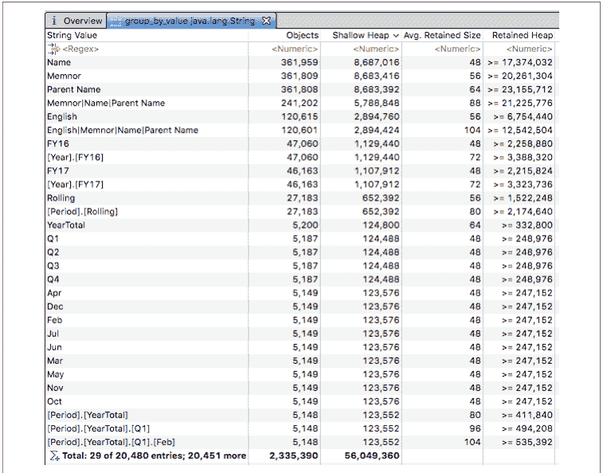
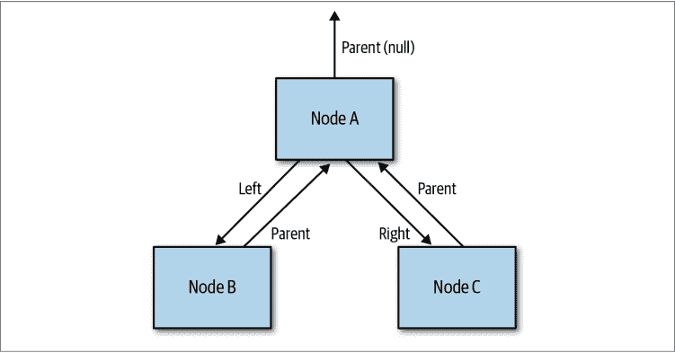

# Java SE API 技巧

本章介绍 Java SE API 中实现怪癖会影响其性能的领域。整个 JDK 中到处都有这样的实现细节；这些领域是我不断发现性能问题（甚至在我自己的代码中）的地方。本章将详细说明处理字符串（尤其是重复字符串）的最佳方法；正确缓冲 I/O 的方法；类加载以及改善使用大量类的应用启动方式的方法；集合的正确用法；以及 JDK 8 中诸如 lambda 和流之类的特性。

## 字符串

字符串（毫不意外）是最常见的 Java 对象。在本节中，我们将介绍多种处理字符串对象所消耗内存的方法；这些技术通常可以显著减少程序所需的堆内存。我们还将介绍 JDK 11 中与字符串拼接相关的新特性。

### 紧凑字符串

在 Java 8 中，所有字符串都编码为 16 位字符数组，无论字符串本身的编码如何。这很浪费：大多数西方语言环境可以将字符串编码为 8 位字节数组，即使在某些所有字符都需要 16 位的语言环境中，像程序常量这样的字符串也常常可以编码为 8 位字节。

在 Java 11 中，字符串编码为 8 位字节数组，除非它们明确需要 16 位字符；这些字符串称为紧凑字符串。Java 6 中有一个类似的（实验性）特性，称为压缩字符串；紧凑字符串在概念上与它相同，但在实现上有很大不同。

因此，在 Java 11 中，平均而言，一个 Java 字符串的大小大约是在 Java 8 中同一字符串的一半。这通常能节省大量内存：平均而言，一个典型 Java 堆中可能有 50% 被字符串对象占用。当然，不同程序会有所差异，但平均而言，使用 Java 11 运行的此类程序的堆需求仅为使用 Java 8 运行的同一程序的 75%。

很容易构造出这种特性带来巨大收益的示例。你可以在 Java 8 中运行一个花费大量时间进行垃圾收集的程序。在 Java 11 中，以相同大小的堆运行同一个程序，收集器可能几乎不需要时间，据称性能可提升 3 到 10 倍。对这种说法要有所保留：你通常不会在如此受限的堆中运行任何 Java 程序。不过，在所有条件相同的情况下，你会看到花在垃圾收集上的时间有所减少。

对于经过良好调优的应用，真正的好处在于内存使用：你可以立即将普通程序的最大堆大小减少 25%，同时仍能获得相同的性能。反过来，如果你保持堆大小不变，就可以向应用引入更多负载，而不会遇到任何 GC 瓶颈（尽管应用的其余部分必须能够处理增加的负载）。

该特性由 -XX:+CompactStrings 标志控制，该标志默认为 true。但与 Java 6 中的压缩字符串不同，紧凑字符串健壮且性能良好；你几乎总是希望保持默认设置。一个可能的例外是：在某个程序中，所有字符串都需要 16 位编码；对这些字符串的操作在紧凑字符串中可能比在非紧凑字符串中稍慢一些。

### 重复字符串与字符串驻留

创建许多包含相同字符序列的字符串对象是很常见的。这些对象不必要地占用了堆空间；由于字符串是不可变的，通常最好重用现有字符串。我们在第 7 章中讨论了具有规范表示（canonical representation）的任意对象的一般情况；本节将这一思想扩展到字符串。

要想知道是否存在大量重复字符串，需要进行堆分析。下面是用 Eclipse Memory Analyzer 实现这一点的一种方法：

1. 加载堆转储。
2. 在 Query Browser 中，选择 Java Basics → Group By Value。
3. 在 objects 参数中，输入 `java.lang.String`。
4. 单击 Finish 按钮。

结果如图 12-1 所示。其中 Name、Memnor 和 Parent Name 字符串各自都有超过 300,000 个副本。其他几个字符串也有多个副本；总的来说，这个堆中重复字符串超过 230 万个。



图 12-1. 重复字符串占用的内存

可以通过三种方式移除重复字符串：

-   通过 G1 GC 执行自动去重
-   使用 String 类的 intern() 方法创建字符串的规范版本
-   使用自定义方法创建字符串的规范版本

### 字符串去重

最简单的机制是让 JVM 找到重复字符串并对其去重：让所有引用都指向同一个副本，然后释放其余副本。这只有在使用 G1 GC 并指定 -XX:+UseStringDeduplication 标志（默认值为 false）时才可能实现。此特性仅在 Java 8 20 版本之后以及 Java 11 的所有发行版中可用。

此特性默认不启用，原因有三。首先，它需要在 G1 GC 的年轻代（young）和混合（mixed）阶段进行额外处理，使这些阶段稍长一些。

其次，它需要一个与应用程序并发运行的额外线程，这可能会占用应用线程的 CPU 周期。第三，如果可去重的字符串很少，应用程序的内存使用反而会更高（而不是更低）；这些额外内存来自跟踪所有字符串以查找重复项的簿记开销。

这是一种在生产环境启用前需要充分测试的选项：它可能对你的应用有帮助，但在某些情况下也会让情况变得更糟。不过，结果很可能对你有利：Java 工程师估计，启用字符串去重的预期收益为 10%。

如果你想查看应用中字符串去重的表现，可以在 Java 8 中使用 -XX:+PrintStringDeduplicationStatistics 标志运行，或在 Java 11 中使用 -Xlog:gc+stringdedup*=debug 标志运行。生成的日志大致如下：

```
[0.896s][debug][gc,stringdedup]  Last Exec: 110.434ms, Idle: 729.700ms,
                                 Blocked: 0/0.000ms
[0.896s][debug][gc,stringdedup]      Inspected:          62420
[0.896s][debug][gc,stringdedup]      Skipped:            0(  0.0%)
[0.896s][debug][gc,stringdedup]      Hashed:             62420(100.0%)
[0.896s][debug][gc,stringdedup]      Known:              0(  0.0%)
[0.896s][debug][gc,stringdedup]      New:                62420(100.0%)
                                         3291.7K
[0.896s][debug][gc,stringdedup]      Deduplicated:       15604( 25.0%)
                                         731.4K( 22.2%)
[0.896s][debug][gc,stringdedup]      Young:              0(  0.0%)
                                         0.0B(  0.0%)
[0.896s][debug][gc,stringdedup]      Old:                15604(100.0%)
                                         731.4K(100.0%)
```

这一轮字符串去重线程的处理持续了 110 毫秒，期间它在 62,420 个被确定为去重候选的字符串中发现了 15,604 个重复字符串。总共节省的内存为 731.4K——大约是我们希望通过此优化获得的 10%。

生成此日志的代码设置为 25% 的字符串是重复的，JVM 工程师表示这对 Java 应用而言是典型情况。（以我的经验——正如我之前提到的——堆中字符串的比例更接近 50%；chacun à son goût。）¹ 我们没有节省 25% 的字符串内存，原因在于此优化只安排共享字符串的底层字符或字节数组；字符串对象的其余部分并不共享。字符串对象的其他字段有 24 到 32 字节的开销（差异取决于平台实现）。因此，两个长度为 16 个字符的相同字符串每个将占用 44（或 52）字节。

1 Chacun à son goût 是（恕我借用小约翰·施特劳斯之名）歌剧爱好者用来表示“YMMV（你的情况可能不同）”的说法。


在去重之前它们总共占用 80 字节；去重后，它们将占用 64 字节。如果字符串被驻留（将在下一节讨论），它们将只占用 40 字节。

如我所提到的，字符串的处理与应用程序线程并发进行。但它实际上是过程中的最后阶段。在一次年轻代回收中，年轻代中的所有字符串都会被检查。那些晋升到老年代的字符串成为后台线程检查的候选对象（在年轻代回收完成后）。此外，回忆一下第 6 章中关于年轻代幸存者空间中对象晋升年龄的讨论：对象在晋升到老年代之前可能会在幸存者空间之间来回移动一段时间。晋升年龄为（默认）三的字符串——意味着它们已被复制到幸存者空间三次——也成为去重的候选对象，并将由该后台线程处理。

这导致短生命周期的字符串不会被去重，这很可能是一件好事：你可能不希望花费 CPU 周期和内存去去重那些即将被丢弃的东西。就像一般调整晋升周期一样，改变此发生的时间点需要大量测试，并且只在不寻常的情况下才进行。但就记录而言，字符串何时有资格被收集的点是通过 -XX:StringDeduplicationAgeThreshold=N 标志控制的，其默认值是 3。

## 字符串驻留

在程序层面处理重复字符串的典型方法是使用 String 类的 intern() 方法。

像大多数优化一样，字符串驻留不应该随意进行，但在大量重复字符串占用堆的很大一部分时，它可能是有效的。但它通常也需要特别的调优（在下一节中，我们将探讨在某些情况下有益的自定义方式）。

驻留字符串保存在一个特殊的哈希表中，该表位于本地内存中（尽管字符串本身在堆中）。此哈希表与你在 Java 中熟悉的哈希表和哈希映射不同，因为此本地哈希表具有固定大小：Java 8 中为 60,013，Java 11 中为 65,536。（如果你使用的是 32 位 Windows JVM，则大小为 1,009。）这意味着在哈希表开始出现冲突之前，你只能存储大约 32,000 个驻留字符串。

该表的大小可以在 JVM 启动时通过使用标志 -XX:StringTableSize=N 设置（默认为 1,009、60,013 或 65,536，如前所述）。如果应用程序将驻留大量字符串，则应增加此数字。字符串驻留表在该值是质数时效率最高。

## 固定大小的哈希表

如果你不熟悉哈希表和哈希映射的基本结构，你可能会想知道什么是固定大小的哈希表（特别是因为 Java 的这些类的实现不是固定大小的）。

概念上，哈希表包含一个可以容纳一定数量条目的数组（数组中的每个元素称为桶）。当某物存储在哈希表中时，其存储的索引是从其 hashCode % numberOfBuckets 计算得出的。在这种方案中，两个具有不同哈希值的对象映射到同一个桶是完全可能的，因此每个桶实际上是所有映射到该桶的存储项的链表。当两个对象映射到同一个桶时，称为冲突。

随着越来越多的对象插入到此表中，会发生越来越多的冲突；每个链表中存储的项目越来越多。查找一个项目然后成为在链表中搜索的问题。这可能非常慢，特别是随着列表变长。

解决办法是使哈希表大小足以拥有更多桶（从而减少冲突）。许多实现会动态地执行此操作；事实上，这就是 Java Hashtable 和 HashMap 类的工作方式。

但其他实现——比如这里讨论的 JVM 内部实现——不能自行调整大小；其数组的大小在映射创建时就已固定。

intern() 方法的性能主要取决于字符串表大小的调优程度。作为示例，表 12-1 显示了创建并驻留 100 万个随机创建的字符串的总时间，有调优和无调优的情况。

表 12-1. 驻留 100 万个字符串的时间

| 调优 | 100% 命中率 | 0% 命中率 |
|---|---|---|
| 字符串表大小 60013 | 4.992 ± 2.9 秒 | 2.759 ± 0.13 秒 |
| 字符串表大小 100 万 | 2.446 ± 0.6 秒 | 2.737 ± 0.36 秒 |

注意当命中率为 100% 时，不当大小的字符串驻留表带来的严重惩罚。一旦表根据预期数据进行调整，性能就会大幅改善。

0% 命中率表可能有点令人惊讶，因为有无调优的性能基本相同。在此测试用例中，字符串在被驻留后立即被丢弃。内部字符串表的功能就像键是弱引用一样，因此当字符串被丢弃时，字符串表可以清除它。因此，在此测试用例中，字符串表从未真正填满；它最终只有几个条目（因为在任何时候只有少数字符串被强引用）。

为了了解字符串表的工作情况，使用 -XX:+PrintStringTableStatistics 参数运行你的应用程序（默认情况下为 false）。当 JVM 退出时，它将打印出如下表：

```
StringTable statistics:
Number of buckets      :      60013 =      480104 bytes, avg   8.000
Number of entries      :    2002784 =    48066816 bytes, avg  24.000
Number of literals     :    2002784 =   606291264 bytes, avg 302.724
Total footprint        :             = 654838184 bytes
Average bucket size    :     33.373
Variance of bucket size:     33.459
Std. dev. of bucket size:     5.784
Maximum bucket size    :        60
```

此输出来自 100% 命中率示例。在该迭代之后，有 2,002,784 个驻留字符串（200 万来自我们的测试，其中一次预热和一次测量周期；其余来自 jmh 和 JDK 类）。我们最关心的条目是平均桶大小和最大桶大小：我们必须在平均 33 个且最多 60 个条目的链表中遍历以在哈希表中搜索一个条目。理想情况下，平均长度应小于一，最大值接近一。这就是我们在 0% 命中率情况下看到的：

```
Number of buckets      :      60013 =      480104 bytes, avg   8.000
Number of entries      :      2753 =      66072 bytes, avg  24.000
Number of literals     :      2753 =     197408 bytes, avg  71.707
Total footprint        :             =    743584 bytes
Average bucket size    :      0.046
Variance of bucket size:      0.046
Std. dev. of bucket size:     0.214
Maximum bucket size    :         3
```

由于字符串很快从表中释放，我们最终在表中只有 2,753 个条目，这对于默认大小 60,013 来说是合适的。

应用程序已分配的驻留字符串的数量（及其总大小）也可以使用 jmap 命令获得：

```
% jmap -heap process_id
... other output ...
36361 interned Strings occupying 3247040 bytes.
```

将字符串表大小设置得过高的惩罚是最小的：每个桶仅占用 8 字节，因此比最佳多出几千个条目是一次性成本，仅为几千字节的本地（非堆）内存。

## 字符串驻留与 Equals

谈到驻留字符串，使用 intern() 方法使程序运行更快怎么样，因为驻留字符串可以通过 == 运算符进行比较？这是一个流行的想法，但在大多数情况下它最终是一个神话。String.equals() 方法相当快。它首先知道长度不等的字符串永远不相等，不过如果字符串长度相等，它必须扫描字符串并比较所有字符（至少直到发现字符串不匹配）。通过 == 操作比较字符串无可否认更快，但驻留字符串的成本也必须考虑在内。这需要（在其他事情中）计算字符串的哈希码，这意味着扫描整个字符串并对其每个字符执行操作（正如 equals() 方法必须做的那样）。

使用 intern() 方法在字符串比较中带来好处的唯一时间是，如果应用程序对一组相同长度的字符串执行大量重复比较。如果两个字符串之前已被驻留，则 == 比较更快；调用 intern() 方法的成本不必超过一次。但在一般情况下，成本大致相同。

## 自定义字符串驻留

调整字符串表有点笨拙；我们能否通过只使用一个自定义驻留方案将重要字符串保存在哈希映射中来做得更好？该代码也在第 2 章中概述。

表 12-2 指向了该问题的答案。除了使用常规 ConcurrentHashMap 来保存驻留字符串外，该表还显示了使用 JSR166 开发的额外类中的 CustomConcurrentHashMap 的用法。此自定义映射允许我们对键使用弱引用，因此其行为更接近字符串驻留表。

表 12-2. 通过自定义代码驻留 100 万个字符串的时间

| 实现 | 100% 命中率 | 0% 命中率 |
|---|---|---|
| ConcurrentHashMap | 7.665 ± 6.9 秒 | 5.490 ± 2.462 秒 |
| CustomConcurrentHashMap | 2.743 ± 0.4 秒 | 3.684 ± 0.5 秒 |

在 100% 命中率测试中，ConcurrentHashMap 遭受了我们对内部字符串表所见的相同问题：条目的 GC 压力在每次迭代中不断累积。这是在 30 GB 堆的测试中；更小的堆会产生更糟的结果。


与所有微基准测试一样，请深入思考这里的使用场景。与其采用我们这里的设置（不断将新创建的字符串塞入其中），不如对 ConcurrentHashMap 进行显式管理。这取决于具体应用，可能容易也可能难以实现；如果足够容易，ConcurrentHashMap 测试将展现出与常规字符串驻留或 CustomConcurrentHashMap 测试相同的优势。而在真实应用中，GC 压力才是关键：我们使用此方法只是为了去除重复字符串，以节省 GC 周期。

不过，这两种情况都不比使用经过适当调优的字符串表的测试更好。自定义映射表的优势在于无需预先设定大小：它可以根据需要自行调整大小。因此，相比于使用 intern() 方法并以依赖于具体应用的方式调整字符串表大小，它对各种应用的适应性要强得多。

## 字符串拼接

字符串拼接是另一个可能存在性能陷阱的领域。考虑这样一个简单的字符串拼接：

```java
String answer = integerPart + "." + mantissa;
```

Java 中的特殊优化可以处理这种构造（不过不同版本之间的细节有所差异）。

在 Java 8 中，javac 编译器会将这条语句转换为以下代码：

```java
String answer = new StringBuilder(integerPart).append(".")
    .append(mantissa).toString();
```

JVM 有专门的代码来处理这类构造（通过设置 -XX:+OptimizeStringConcat 标志来控制，该标志默认为 true）。

在 Java 11 中，javac 编译器会生成截然不同的字节码；该代码会调用 JVM 内部的一个特殊方法，以优化字符串拼接。

这是少数几个不同版本间字节码差异会产生影响的场景之一。通常，当你迁移到新版本时，无需重新编译旧代码：字节码是相同的。（当然，如果你想使用新的语言特性，就需要用新编译器编译新代码。）但这一特定优化依赖于实际的字节码。如果你使用 Java 8 编译执行字符串拼接的代码，并在 Java 11 上运行，Java 11 JDK 会应用与 Java 8 相同的优化。代码仍会被优化并运行得相当快。

不过，如果你在 Java 11 下重新编译代码，字节码将使用新的优化，可能会更快。

让我们考虑以下三种拼接两个字符串的情况：

```java
@Benchmark
public void testSingleStringBuilder(Blackhole bh) {
    String s = new StringBuilder(prefix).append(strings[0]).toString();
    bh.consume(s);
}
```

```java
@Benchmark
public void testSingleJDK11Style(Blackhole bh) {
    String s = prefix + strings[0];
    bh.consume(s);
}
```

```java
@Benchmark
public void testSingleJDK8Style(Blackhole bh) {
    String s = new StringBuilder().append(prefix).append(strings[0]).toString();
    bh.consume(s);
}
```

第一个方法是我们手工编写此操作的方式。第二个方法（使用 Java 11 编译时）会产生最新的优化，而最后一个方法（无论使用哪个编译器）在 Java 8 和 Java 11 中都会以相同方式被优化。

表 12-3 展示了这些操作的结果。

### 表 12-3：单次拼接的性能

| 模式 | 每次操作耗时 |
|---|---|
| JDK 11 优化 | 47.7 ± 0.3 ns |
| JDK 8 优化 | 42.9 ± 0.3 ns |
| 字符串构建器 | 87.8 ± 0.7 ns |

在这种情况下，旧的（Java 8）和新的（Java 11）拼接优化之间没有太大实际差异；尽管 JMH 告诉我们差异在统计上显著，但它们并不是特别重要。关键是，两种优化都比手工编写这个简单案例要好。这多少有些令人意外，因为手工编写的案例看起来更简单：它比 JDK 8 案例少一次对 append() 方法的调用，因此名义上所做的工作更少。但 JVM 内部的字符串拼接优化并不识别这种特定模式，所以最终反而更慢。

不过，Java 8 的优化并不适用于所有拼接。我们可以稍微修改一下测试，如下所示：

```java
@Benchmark
public void testDoubleJDK11Style(Blackhole bh) {
    double d = 1.0;
    String s = prefix + strings[0] + d;
    bh.consume(s);
}
```

```java
@Benchmark
public void testDoubleJDK8Style(Blackhole bh) {
    double d = 1.0;
    String s = new StringBuilder().append(prefix).
        append(strings[0]).append(d).toString();
    bh.consume(s);
}
```

现在性能有所不同，如表 12-4 所示。

### 表 12-4：拼接 double 值的性能

| 模式 | 每次操作耗时 |
|---|---|
| JDK 11 优化 | 49.4 ± 0.6 ns |
| JDK 8 优化 | 77.0 ± 1.9 ns |

JDK 11 的耗时与上一个示例相近，尽管我们附加了一个新值并且做了稍多一些的工作。但 JDK 8 的耗时则糟糕得多——大约慢了 50%。这其实并不是因为额外的拼接，而是因为拼接的类型。JDK 8 的优化对字符串和整数效果良好，但无法处理 double（以及大多数其他类型的数据）。在这些情况下，JDK 8 代码会跳过特殊优化，表现得像之前的手工编码测试一样。

当我们执行多次拼接操作时，尤其是循环内的拼接，这两种优化都不再适用。考虑以下测试：

```java
@Benchmark
public void testJDK11Style(Blackhole bh) {
    String s = "";
    for (int i = 0; i < nStrings; i++) {
        s = s + strings[i];
    }
    bh.consume(s);
}
```

```java
@Benchmark
public void testJDK8Style(Blackhole bh) {
    String s = "";
    for (int i = 0; i < nStrings; i++) {
        s = new StringBuilder().append(s).append(strings[i]).toString();
    }
    bh.consume(s);
}
```

```java
@Benchmark
public void testStringBuilder(Blackhole bh) {
    StringBuilder sb = new StringBuilder();
    for (int i = 0; i < nStrings; i++) {
        sb.append(strings[i]);
    }
    bh.consume(sb.toString());
}
```

现在结果则偏向于手工编码，这也在情理之中。尤其是 Java 8 实现，必须在每次循环迭代时创建一个新的 StringBuilder 对象；即使在 Java 11 中，每次循环都创建一个字符串（而不是在字符串构建器中累积）也会带来不小的开销。这些结果见表 12-5。

### 表 12-5：多次字符串拼接的性能

| 模式 | 10 个字符串 | 1,000 个字符串 |
|---|---|---|
| JDK 11 代码 | 613 ± 8 ns | 2,463 ± 55 µs |
| JDK 8 代码 | 584 ± 8 ns | 2,602 ± 209 µs |
| 字符串构建器 | 412 ± 2 ns | 38 ± 211 µs |

归根结底：如果可以在单行（逻辑行）内完成拼接，尽管使用拼接；但切勿在循环内使用字符串拼接，除非拼接后的字符串不会在下一轮循环迭代中使用。否则，始终显式使用 StringBuilder 对象以获得更好的性能。在第 1 章中，我曾论证有时候需要“过早”优化，即当这个说法在上下文中的含义仅仅是“编写良好的代码”时。这就是一个典型的例子。


### 快速总结

- 单行字符串拼接即可获得良好性能。
- 对于多次拼接操作，务必使用 StringBuilder。
- 涉及某些类型的单行字符串拼接，在 JDK 11 中重新编译后会显著更快。

## 缓冲 I/O

2000 年我加入 Java 性能小组时，我的老板刚刚出版了第一本关于 Java 性能的书，而当时最热门的话题之一就是缓冲 I/O。十四年后，我本以为这个话题已经过时，打算在本书第一版中略去不提。然而，就在我着手撰写第一版大纲的那一周，我针对两个毫不相关的项目提交了 bug，这两个项目都因未使用缓冲 I/O 而严重影响了性能。几个月后，在编写第一版的一个示例时，我挠着头想不明白为什么我的“优化”如此之慢。随后我意识到：真笨，我忘了正确地缓冲 I/O。


关于第二版：在我重新审阅本节的两周前，三位同事找到我，他们在缓冲 I/O 上犯了与我在第一版示例中犯的同样的错误。

那么让我们谈谈缓冲 I/O 性能。`InputStream.read()` 和 `OutputStream.write()` 方法操作单个字符。根据它们访问的资源，这些方法可能非常慢。`FileInputStream` 使用 `read()` 方法会极其缓慢：每次方法调用都需要进入内核获取 1 字节的数据。在大多数操作系统上，内核会缓冲 I/O，因此（幸运的是）这种场景不会为每次 `read()` 方法调用触发一次磁盘读取。但该缓冲区位于内核中，而不是应用程序中，一次读取一个字节意味着每次方法调用都要进行昂贵的系统调用。

写入数据的情形也一样：使用 `write()` 方法将单个字节发送到 `FileOutputStream` 需要一次系统调用将字节存储到内核缓冲区中。最终（当文件关闭或刷新时），内核会将该缓冲区写入磁盘。

对于使用二进制数据的文件 I/O，始终使用 `BufferedInputStream` 或 `BufferedOutputStream` 来包装底层文件流。对于使用字符（字符串）数据的文件 I/O，始终用 `BufferedReader` 或 `BufferedWriter` 包装底层流。

尽管该性能问题在讨论文件 I/O 时最容易理解，但它是一个普遍问题，适用于几乎所有类型 I/O。来自套接字（通过 `getInputStream()` 或 `getOutputStream()` 方法）的流以相同方式操作，通过套接字一次一字节地执行 I/O 非常缓慢。这里也一样，务必确保流适当地用缓冲过滤流包装。

使用 `ByteArrayInputStream` 和 `ByteArrayOutputStream` 类时存在更微妙的问题。这些类本质上本身就是大的内存缓冲区。在许多情况下，将它们与缓冲过滤流包装意味着数据会被复制两次：一遍复制到过滤流中的缓冲区，一遍复制到 `ByteArrayInputStream` 中的缓冲区（或输出流的反向）。如果没有其他流的参与，在这种情况下应避免缓冲 I/O。

当涉及其他过滤流时，是否缓冲的问题变得更加复杂。本章后面，你将看到一个对象序列化的示例，其中涉及使用 `ByteArrayOutputStream`、`ObjectOutputStream` 和 `GZIPOutputStream` 类的多个过滤流。

没有压缩输出流时，该示例的过滤器如下所示：

```
protected void makePrices() throws IOException {
    ByteArrayOutputStream baos = new ByteArrayOutputStream();
    ObjectOutputStream oos = new ObjectOutputStream(baos);
    oos.writeObject(prices);
    oos.close();
}
```

在这种情况下，将 baos 流包装在 BufferedOutputStream 中会因数据额外复制一次而带来性能损失。

一旦添加压缩，最佳的写法如下：

```
protected void makeZippedPrices() throws IOException {
    ByteArrayOutputStream baos = new ByteArrayOutputStream();
    GZIPOutputStream zip = new GZIPOutputStream(baos);
    BufferedOutputStream bos = new BufferedOutputStream(zip);
    ObjectOutputStream oos = new ObjectOutputStream(bos);
    oos.writeObject(prices);
    oos.close();
    zip.close();
}
```

现在有必要缓冲输出流，因为 GZIPOutputStream 对数据块的操作比对单个字节的操作更高效。在任何情况下，ObjectOutputStream 都会向下一个流发送单个字节的数据。如果下一个流是最终目的地——ByteArrayOutputStream——则不需要缓冲。如果中间还有另一个过滤流（如本例中的 GZIPOutputStream），缓冲通常是必要的。

关于在两个其他流之间插入缓冲流何时使用，没有通用规则。最终将取决于所涉及的流类型，但所有可能的情况如果由缓冲流提供字节块（而不是来自 ObjectOutputStream 的一系列单个字节）都会运行得更好。

输入流也适用同样的情况。在此特定情况下，GZIPInputStream 对字节块的操作更高效；在一般情况下，介于 ObjectInputStream 与原始字节源之间的流也更适合使用字节块。

请注意，这一点特别适用于流编码器和解码器。在字节和字符之间转换时，操作尽可能大的数据块将提供最佳性能。如果向编码器和解码器提供单个字节或字符，它们会因性能不佳而受苦。

就记录而言，未缓冲 gzip 流正是我在编写该压缩示例时犯的错误。这是代价高昂的错误，正如表 12-6 中的数据所示。

**表 12-6. 使用压缩序列化与反序列化 Stock 对象的耗时**

| 模式 | 时间 |
|---|---|
| 未缓冲压缩/解压缩 | 21.3 ± 8 ms |
| 缓冲压缩/解压缩 | 5.7 ± 0.08 ms |

未能正确缓冲 I/O 导致性能损失高达四倍。


## 快速总结

- 由于简单输入输出流类的默认实现，缓冲 I/O 问题很常见。
- I/O 必须为文件和套接字以及压缩和字符串编码等内部操作正确缓冲。

## 类加载

类加载的性能是任何试图优化程序启动或在动态系统中部署新代码的人的噩梦。

原因有很多。首先，类数据（即 Java 字节码）通常不易快速访问。该数据必须从磁盘或网络加载，必须在类路径上的多个 JAR 文件之一中找到，并且必须在多个类加载器之一中找到。有一些方法可以改善这一点：某些框架会将从网络读取的类缓存到隐藏目录中，以便下次启动同一应用程序时可以更快地读取类。将应用程序打包到更少的 JAR 文件中也会加快其类加载性能。

在本节中，我们将介绍 Java 11 的一项新功能来加快类加载。

### 类数据共享

*类数据共享*（CDS）是一种机制，允许类元数据在 JVM 之间共享。这对于运行多个 JVM 时节省内存很有用：通常，每个 JVM 都有自己的类元数据，单独的副本会占用部分物理内存。如果该元数据被共享，则只需一份副本驻留在内存中。

事实证明，CDS 对单个 JVM 也非常有用，因为它还可以改善其启动时间。

类数据共享在 Java 8（及以前版本）中可用，但仅限于 `rt.jar` 中的类，并且仅在使用串行收集器与客户端 JVM 时使用。换句话说，它在 32 位、单 CPU、Windows 桌面机器上有所帮助。

在 Java 11 中，CDS 在所有平台上普遍可用，尽管它不能开箱即用，因为没有默认的类元数据共享存档。Java 12 确实有常见 JDK 类的默认共享存档，因此所有应用程序默认都会获得一些启动（和内存）收益。在任何情况下，我们都可以做得更好，通过为我们的应用程序生成更完整的共享存档，因为在 Java 11 中，CDS 可以与任何一组类一起使用，无论哪个类加载器加载它们以及它们从哪个 JAR 或模块加载。有一个限制适用：CDS 仅适用于从模块或 JAR 文件加载的类。你无法共享（或快速加载）来自文件系统或网络 URL 的类。

从某种意义上说，这意味着 CDS 有两种风格：*常规 CDS*（共享默认 JDK 类）和 *应用程序类数据共享*，它共享任何一组类。应用程序类数据共享实际上是在 Java 10 中引入的，其工作方式与常规 CDS 不同：程序使用它有不同的命令行参数。该区别现在已过时，Java 11 及以后的 CDS 无论共享的类如何都以相同方式工作。

使用 CDS 所需的第一件事是类的共享存档。如我所提到的，Java 12 附带了一个默认的类共享存档，位于 `$JAVA_HOME/lib/server/classes.jsa`（或 Windows 上 `%JAVA_HOME%\bin\server\classes.jsa`）。该存档包含 12,000 个 JDK 类的数据，因此其对核心类的覆盖相当广泛。要生成自己的存档，你首先需要一份要启用共享（从而快速加载）的所有类的列表。该列表可以包括 JDK 类和应用程序级类。

获取此类列表的方法有很多，但最简单的方法是使用 `-XX:+DumpLoadedClassList=filename` 标志运行应用程序，这将在 *filename* 中生成已加载的所有类的列表。

第二步是使用该类列表生成共享存档，如下所示：

```
```bash
$ java -Xshare:dump -XX:SharedClassListFile=filename \
    -XX:SharedArchiveFile=myclasses.jsa \
    ... classpath arguments ...
```
```

这将基于文件列表创建具有给定名称的新共享存档文件（此处为 *myclasses.jsa*）。你还必须像运行应用程序一样设置类路径（即使用运行应用程序时通常使用的 `-cp` 或 `-jar` 参数）。


你会看到应用程序启动得更慢。这是考虑指定 `-Xshare:on` 而不是使用默认值的一个理由，尽管共享归档可能失败还有其他原因。

要验证类是否是从共享归档加载的，可以在命令行中加入类加载日志（`-Xlog:class+load=info`）；你会看到通常的类加载输出，而从共享归档加载的类会显示如下：

```
[0.080s][info][class,load] java.lang.Comparable source: shared objects file
```

## 类数据共享的好处

类数据共享对启动时间的好处显然取决于需要加载的类数量。表 12-7 显示了本书示例中启动示例股票服务器应用程序所需的时间；该应用程序需要加载 6,314 个类。

*表 12-7. 使用 CDS 启动应用程序的时间*

| CDS 模式 | 启动时间 |
|---|---|
| -Xshare:off | 8.9 秒 |
| -Xshare:on（默认） | 9.1 秒 |
| -Xshare:on（自定义） | 7.0 秒 |

在默认情况下，我们只使用 JDK 的共享归档；最后一行是所有应用程序类的自定义共享归档。在这种情况下，CDS 为我们节省了 30% 的启动时间。

CDS 还会为我们节省一些内存，因为类数据将在进程之间共享。总的来说，正如你在第 8 章的示例中看到的，原生内存中的类数据所占比例很小，尤其是与应用程序堆相比。在一个包含大量类的大型程序中，CDS 会节省更多内存，不过大型程序可能需要更大的堆，因此节省的比例仍然很小。不过，在原生内存特别紧张且运行多个共享大量相同类的 JVM 副本的环境中，CDS 在内存节省方面也会带来一些好处。


### 快速小结

- 加速类加载的最佳方法是为应用程序创建类数据共享归档。幸运的是，这不需要修改任何代码。

## 随机数

接下来我们要看的一组 API 涉及随机数生成。Java 自带了三个标准的随机数生成器类：`java.util.Random`、`java.util.concurrent.ThreadLocalRandom` 和 `java.security.SecureRandom`。这三个类在性能上有重要差异。

`Random` 和 `ThreadLocalRandom` 类的区别在于，`Random` 类的主要操作（`nextGaussian()` 方法）是同步的。该方法被所有获取随机值的方法使用，因此无论随机数生成器如何使用，这个锁都可能成为竞争点：如果两个线程同时使用同一个随机数生成器，一个线程就必须等待另一个线程完成其操作。这就是为什么提供了线程局部版本：当每个线程有自己的随机数生成器时，`Random` 类的同步问题就不再存在。（正如第 7 章所讨论的，线程局部版本还因为复用了创建成本较高的对象而带来了显著的性能优势。）

这些类与 `SecureRandom` 类的区别在于所使用的算法。`Random` 类（以及通过继承继承的 `ThreadLocalRandom` 类）实现了一种典型的伪随机算法。虽然这些算法相当复杂，但它们终究是确定性的。如果初始种子已知，就可以确定该引擎将生成的确切数字序列。这意味着黑客能够查看某个特定生成器产生的数字序列，并（最终）推算出下一个数字是什么。尽管好的伪随机数生成器可以发出看起来非常随机的数字序列（甚至符合随机性的概率预期），但它们并不是真正的随机。

另一方面，`SecureRandom` 类使用系统接口来获取其随机数据的种子。数据的生成方式特定于操作系统，但通常该来源基于真正随机的事件（例如鼠标移动时）提供数据。这被称为基于熵的随机性，对于依赖随机数的操作来说要安全得多。

Java 区分两个随机数来源：一个用于生成种子，另一个用于生成随机数本身。种子用于创建公钥和私钥，例如你通过 SSH 或 PuTTY 访问系统时使用的密钥。这些密钥是长期存在的，因此需要尽可能强大的加密算法。安全随机数也用于为常规随机数流提供种子，包括 Java SSL 库的默认实现所使用的随机数流。

在 Linux 系统上，这两个来源分别是 `/dev/random`（用于种子）和 `/dev/urandom`（用于随机数）。这两个系统都基于机器内部的熵源：真正随机的事物，例如鼠标移动或键盘敲击。

熵的数量是有限的，并且会随机重新生成，因此作为真正的随机性来源它并不可靠。这两个系统对此的处理方式不同：`/dev/random` 会阻塞，直到有足够的系统事件来生成随机数据；而 `/dev/urandom` 会回退到伪随机数生成器（PRNG）。该 PRNG 是从真正随机的源初始化的，因此通常和 `/dev/random` 的流一样强大。然而，用于生成种子本身的熵可能不可用，在这种情况下，来自 `/dev/urandom` 的流理论上可能会受到损害。关于这个流的强度，双方都有争论，但普遍的共识——对种子使用 `/dev/random`，对其他一切使用 `/dev/urandom`——正是 Java 所采纳的。

结果是，获取大量随机数种子可能需要很长时间。对 `SecureRandom` 类的 `generateSeed()` 方法的调用所花费的时间是不确定的，这取决于系统有多少未使用的熵。如果没有可用的熵，调用似乎会挂起，可能一次持续数秒，直到所需的熵可用为止。这使得性能计时变得相当困难：性能本身变得随机。

另一方面，`generateSeed()` 方法仅用于两种操作。首先，某些算法使用它来为将来调用 `nextRandom()` 方法获取种子。这通常只需要执行一次，或者最多在应用程序的生命周期内定期执行。其次，此方法在创建长期存在的密钥时使用，这也是一种相当罕见的操作。

由于这些操作是有限的，大多数应用程序不会耗尽熵。尽管如此，对于在启动时创建密码的应用程序来说，有限的熵可能是一个问题，特别是在云环境中，宿主机操作系统的随机数设备在多个虚拟机和/或 Docker 容器之间共享。在这种情况下，程序活动的时间会有非常大的波动，而且由于安全种子的使用最常发生在程序初始化期间，因此该领域中应用程序的启动可能相当缓慢。

我们有几种方法来处理这种情况。在紧急情况下，并且如果可以修改代码，一个替代方案是使用 `Random` 类运行性能测试，即使生产环境中会使用 `SecureRandom` 类。如果性能测试是模块级测试，那可能是有意义的：这些测试在同一时期需要的随机种子会比生产系统更多。但最终，必须使用 `SecureRandom` 类测试预期负载，以确定生产系统上的负载能否获得足够数量的随机种子。

第二种选择是配置 Java 的安全随机数生成器，使其同时使用 `/dev/urandom` 来生成种子和随机数。这可以通过两种方式实现：首先，你可以设置系统属性 `-Djava.security.egd=file:/dev/urandom`。²

> 2 由于早期版本 Java 的 bug，有时建议将此标志设置为 /dev//urandom 或其他变体。在 Java 8 及更高版本的 JVM 中，你可以直接使用 /dev/urandom。

第三种选择是更改 `$JAVA_HOME/jre/lib/security/java.security` 中的此设置：

```
securerandom.source=file:/dev/random
```

该行定义了用于种子操作（seeding operations）的接口，如果你想确保安全随机数生成器永不阻塞，可以将其设置为 `/dev/urandom`。

然而，更好的解决方案是设置操作系统以提供更多熵，这可以通过运行 `rngd` 守护进程来实现。只需确保 `rngd` 守护进程配置为使用可靠的硬件熵源（例如，如果有 `/dev/hwrng` 的话），而不是类似 `/dev/urandom` 这样的东西。这个解决方案的优点是能解决机器上所有程序的熵问题，而不仅仅是 Java 程序。


### 快速小结

- Java 默认的 Random 类初始化成本很高，但一旦初始化，就可以重用。
- 在多线程代码中，更倾向于使用 `ThreadLocalRandom` 类。
- 有时，`SecureRandom` 类会表现出任意的、完全随机的性能。对使用该类的代码进行性能测试必须仔细规划。
- 通过配置更改可以避免 `SecureRandom` 类阻塞的问题，但更好的做法是在操作系统层面通过向系统添加熵来解决。

## Java 本地接口

关于 Java SE 的性能建议（尤其是在 Java 早期）经常说，如果你想要真正快速的代码，应该使用本地代码。事实上，如果你想要编写尽可能快的代码，请避免使用 Java 本地接口（JNI）。

编写良好的 Java 代码在当前版本的 JVM 上运行速度至少与相应的 C 或 C++ 代码一样快（现在已经不是 1996 年了）。语言纯粹主义者会继续争论 Java 和其他语言在性能上的相对优劣，你也可以找到无数用其他语言编写的应用程序更快的例子。


比用 Java 编写的同一应用程序（尽管这些示例中的 Java 代码通常编写得很差）。然而，这种争论忽略了本节的重点：当应用程序已经用 Java 编写时，出于性能原因调用原生代码几乎总是一个坏主意。

不过，JNI 有时还是非常有用的。Java 平台提供了许多操作系统的常见功能，但如果需要访问某个特殊的、针对特定操作系统的函数，也需要使用 JNI。此外，当现成的商业（原生）代码可用时，何必自己构建一个库来执行某项操作？在这些以及其他情况下，问题就变成了如何编写最高效的 JNI 代码。

答案是尽可能避免从 Java 调用 C。跨越 JNI 边界（进行跨语言调用的术语）是昂贵的。由于调用现有的 C 库首先需要编写胶水代码，不妨花时间通过该胶水代码创建新的粗粒度接口：一次完成对 C 库的多次调用。

有趣的是，反向情况未必如此：C 代码回调 Java 并不会遭受较大的性能损失（取决于所涉及的参数）。例如，考虑下面的代码片段：

```java
@Benchmark
public void testJavaJavaJava(Blackhole bh) {
    long l = 0;
    for (int i = 0; i < nTrials; i++) {
        long a = calcJavaJava(nValues);
        l += a / nTrials;
    }
    bh.consume(l);
}

private long calcJavaJava(int nValues) {
    long l = 0;
    for (int i = 0; i < nValues; i++) {
        l += calcJava(i);
    }
    long a = l / nValues;
    return a;
}

private long calcJava(int i) {
    return i * 3 + 15;
}
```

这段（完全没有实际意义的）代码有两个主循环：一个在基准方法内部，另一个在 `calcJavaJava()` 方法内部。这些全是 Java 代码，但我们也可以选择使用原生接口，用 C 编写外层计算方法：

```java
@Benchmark
public void testJavaCC(Blackhole bh) {
    long l = 0;
    for (int i = 0; i < nTrials; i++) {
        long a = calcCC(nValues);
        l += 50 - a;
    }
    bh.consume(l);
}

private native long calcCC(int nValues);
```

或者我们也可以只用 C 实现最内层的调用（其代码逻辑应该显而易见）。

表 12-8 显示了在 10,000 次试验和 10,000 个值的情况下各种排列的性能。

**表 12-8：跨越 JNI 边界进行计算的时间**

| 计算 | 计算 | 随机 | JNI 转换次数 | 总时间 |
|---|---|---|---|---|
| Java | Java | Java | 0 | 0.104 ± 0.01 秒 |
| Java | Java | C | 10,000,000 | 1.96 ± 0.1 秒 |
| Java | C | C | 10,000 | 0.132 ± 0.01 秒 |
| C | C | C | 0 | 0.139 ± 0.01 秒 |

仅用 C 实现最内层方法会导致跨越 JNI 边界的次数最多（numberOfTrials × numberOfLoops，即 1000 万次）。将跨越次数减少到 numberOfTrials（10,000 次）可大幅降低该开销；进一步减少到 0 则提供最佳性能。

如果所涉及的参数不是简单的原始类型，JNI 代码的表现会更差。这种开销涉及两个方面。首先，对于简单引用，需要进行地址转换。其次，基于数组数据的操作在原生代码中需要特殊处理。这包括 String 对象，因为字符串数据本质上是一个字符数组。要访问这些数组的各个元素，必须调用特殊的调用来将对象固定在内存中（对于 String 对象，在 JDK 8 中还需将其从 Java 的 UTF-16 编码转换为 UTF-8）。当不再需要该数组时，必须在 JNI 代码中显式释放它。

当数组被固定时，垃圾收集器无法运行——因此 JNI 代码中最昂贵的错误之一，就是在长时间运行的代码中固定字符串或数组。这会阻止垃圾收集器运行，实际上阻塞了所有应用程序线程，直到 JNI 代码完成。因此，让数组被固定的临界区尽可能短是极其重要的。

通常，你会在 GC 日志中看到“GC Locker 发起的 GC”这个术语。这表示垃圾收集器需要运行但无法运行，因为某个线程在 JNI 调用中固定了数据。一旦该数据解除固定，垃圾收集器就会运行。如果你频繁看到这个 GC 原因，请研究如何让 JNI 代码更快；你的其他应用程序线程正在经历等待 GC 运行的延迟。

有时，短时间固定对象的目标与减少跨越 JNI 边界调用的目标会发生冲突。在这种情况下，后者更重要，即使这意味着要多次跨越 JNI 边界，因此要尽可能缩短固定数组和字符串的代码段。


## 快速总结

- JNI 并不是解决性能问题的方案。Java 代码几乎总是比调用原生代码运行得更快。
- 使用 JNI 时，要限制从 Java 到 C 的调用次数；跨越 JNI 边界代价高昂。
- 使用数组或字符串的 JNI 代码必须固定这些对象；要限制它们被固定的时间，以免影响垃圾收集器。

## 异常

Java 异常处理以开销昂贵而闻名。它确实比处理常规控制流要昂贵一些，不过在大多数情况下，额外成本并不值得你费尽心思去绕开它。另一方面，由于它并非零成本，异常处理也不应作为一种通用机制使用。指导原则是，按照良好程序设计的通用原则来使用异常：也就是说，代码应仅在发生意外情况时才抛出异常。遵循良好的代码设计意味着你的 Java 代码不会因为异常处理而变慢。

有两件事会影响异常处理的整体性能。首先是代码块本身：设置 try-catch 块的开销很大吗？这在很久以前可能是事实，但多年来已经不是这样了。然而，因为互联网的记忆力很长，你有时会看到仅仅因为 try-catch 块而建议避免异常的推荐。这些推荐已经过时了；现代 JVM 可以生成相当高效地处理异常的代码。

第二个方面是，异常涉及在异常发生点获取堆栈跟踪（虽然稍后你会在本节看到有一个例外）。这个操作可能开销很大，尤其是在堆栈跟踪很深的时候。

由于性能开销来自填充堆栈跟踪，可以设置 `-XX:-StackTraceInThrowable` 标志（默认情况下为 true）来禁用堆栈跟踪的生成。

这通常不是一个好主意：堆栈跟踪用于分析哪些意外出错。启用该标志后，这种能力就会丧失。而且有些代码实际上会检查堆栈跟踪，并根据在其中找到的信息决定如何从异常中恢复。这本身就很有问题，但结果是，禁用堆栈跟踪可能会神秘地破坏代码。

JDK 本身有一些 API 中，异常处理可能导致性能问题。许多集合类在从中检索不存在的条目时会抛出异常。例如，`Stack` 类在调用 `pop()` 方法时如果栈为空，会抛出 `EmptyStackException`。在这种情况下，最好采用防御性编程，先检查栈长度。（另一方面，与许多集合类不同，`Stack` 类支持 null 对象，所以 `pop()` 方法并不会返回 null 来表示栈为空。）

JDK 中对异常使用不当的最著名例子是类加载：`ClassLoader` 类的 `loadClass()` 方法在被要求加载它无法找到的类时会抛出 `ClassNotFoundException`。这实际上并不是一种异常情况。不期望单个类加载器知道如何加载应用程序中的每个类，这就是为什么会有类加载器层次结构。

在存在数十个类加载器的环境中，这意味着在搜索类加载器层次结构以找到知道如何加载给定类的那个类加载器时，会创建大量异常。在我曾使用过的超大型应用服务器中，禁用堆栈跟踪生成可以将启动时间加快多达 3%。这些服务器会从数百个 JAR 文件中加载超过 30,000 个类；这显然是种 YMMV（你的情况可能不同）的事情。³


### Quick Summary

- Exceptions are not necessarily expensive to process, though they should be used only when appropriate.
- The deeper the stack, the more expensive to process exceptions.
- The JVM will optimize away the stack penalty for frequently created system exceptions.
- Disabling stack traces in exceptions can sometimes help performance, though crucial information is often lost in the process.

## Logging

Logging is one of those things that performance engineers either love or hate—or (usually) both. Whenever I’m asked why a program is running badly, the first thing I ask for are any available logs, with the hope that logs produced by the application will have clues as to what the application was doing. Whenever I’m asked to review the performance of working code, I immediately recommend that all logging statements be turned off.

Multiple logs are in question here. The JVM produces its own logging statements, of which the most important is the GC log (see Chapter 6). That logging can be directed into a distinct file, the size of which can be managed by the JVM. Even in production code, GC logging (even with detailed logging enabled) has such low overhead and such an expected large benefit if something goes wrong that it should always be turned on.

HTTP servers generate an access log that is updated on every request. This log generally has a noticeable impact: turning off that logging will definitely improve the performance of whatever test is run against the application server. From a diagnosability standpoint, those logs are (in my experience) not terribly helpful when something goes wrong. However, in terms of business requirements, that log is often crucial, in which case it must be left enabled.

Although it is not a Java standard, many HTTP servers support the Apache `mod_log_config` convention, which allows you to specify exactly what information is logged for each request (and servers that don’t follow the `mod_log_config` syntax will typically support another log customization). The key is to log as little information as possible and still meet the business requirements. The performance of the log is subject to the amount of data written.

In HTTP access logs in particular (and in general, in any kind of log), it is a good idea to log all information numerically: IP addresses rather than hostnames, timestamps (e.g., seconds since the epoch) rather than string data (e.g., “Monday, June 3, 2019 17:23:00 -0600”), and so on. Minimize any data conversion that will take time and memory to compute so that the effect on the system is also minimized. Logs can always be postprocessed to provide converted data.

We should keep three basic principles in mind for application logs. First is to keep a balance between the data to be logged and the level at which it is logged. The JDK has seven standard logging levels, and loggers by default are configured to output three of those levels (INFO and greater). This often leads to confusion within projects: INFO-level messages sound like they should be fairly common and should provide a description of the flow of an application (“now I’m processing task A,” “now I’m doing task B,” and so on). Particularly for applications that are heavily threaded and scalable, that much logging will have a detrimental effect on performance (not to mention running the risk of being too chatty to be useful). Don’t be afraid to use the lower-level logging statements.

Similarly, when code is checked into a group repository, consider the needs of the user of the project rather than your needs as a developer. We’d all like to have a lot of good feedback about how our code works after it is integrated into a larger system and run through a battery of tests, but if a message isn’t going to make sense to an end user or system administrator, it’s not helpful to enable it by default. It is merely going to slow down the system (and confuse the end user).

The second principle is to use fine-grained loggers. Having a logger per class can be tedious to configure, but having greater control over the logging output often makes this worthwhile. Sharing a logger for a set of classes in a small module is a good compromise. Keep in mind that production problems—and particularly production problems that occur under load or are otherwise performance related—are tricky to reproduce if the environment changes significantly. Turning on too much logging often changes the environment such that the original issue no longer manifests itself.

Hence, you must be able to turn on logging only for a small set of code (and, at least initially, a small set of logging statements at the FINE level, followed by more at the FINER and FINEST levels) so that the performance of the code is not affected.

Between these two principles, it should be possible to enable small subsets of messages in a production environment without affecting the performance of the system. That is usually a requirement anyway: the production system administrators probably aren’t going to enable logging if it slows the system, and if the system does slow down, then the likelihood of reproducing the issue is reduced.

The third principle to keep in mind when introducing logging to code is to remember that it is easy to write logging code that has unintended side effects, even if the logging is not enabled. This is another case where “prematurely” optimizing code is a good thing: as the example from Chapter 1 shows, remember to use the `isLoggable()` method anytime the information to be logged contains a method call, a string concatenation, or any other sort of allocation (for example, allocation of an object array for a `MessageFormat` argument).


### Quick Summary

- Code should contain lots of logging to enable users to figure out what it does, but none of that should be enabled by default.
- Don’t forget to test for the logging level before calling the logger if the arguments to the logger require method calls or object allocation.

## Java Collections API

Java’s collections API is extensive; it has at least 58 collection classes. Using an appropriate collection class—as well as using collection classes appropriately—is an important performance consideration in writing an application.

The first rule in using a collection class is to use one suitable for the algorithmic needs of an application. This advice is not specific to Java; it is essentially Data Structures 101. A LinkedList is not suitable for searching; if access to a random piece of data is required, store the collection in a HashMap. If the data needs to remain sorted, use a TreeMap rather than attempting to sort the data in the application. Use an ArrayList if the data will be accessed by index, but not if data frequently needs to be inserted into the middle of the array. And so on…the algorithmic choice of which collection class is crucial, but the choice in Java isn’t different from the choice in any other programming language.

There are, however, some idiosyncrasies to consider when using Java collections.

### Synchronized Versus Unsynchronized

By default, virtually all Java collections are unsynchronized (the major exceptions are Hashtable, Vector, and their related classes).

### Synchronized Collection Classes

If you’ve ever wondered why the Vector and Hashtable (and related) classes are synchronized, here’s a bit of history.

In the early days of Java, these were the only collection classes in the JDK. Back then (before Java 1.2), there was no formal definition of the Collections Framework; these were just useful classes that the original Java platform provided.

When Java was first released, threading was poorly understood by most developers, and Java attempted to make it easier for developers to avoid some of the pitfalls of coding in a threaded environment. Hence, these classes were thread-safe.

Unfortunately, synchronization—even uncontended synchronization—was a huge performance problem in early versions of Java, so when the first major revision to the platform came out, the Collections Framework took the opposite approach: all new collection classes would be unsynchronized by default. Even though synchronization performance has drastically improved since then, it still is not free, and having the option of unsynchronized collections helps everyone write faster programs (with the occasional bug caused by concurrently modifying an unsynchronized collection).

Chapter 9 posited a microbenchmark to compare CAS-based protection to traditional synchronization. That proved to be impractical in the threaded case, but what if the data in question will always be accessed by a single thread—what would be the effect of not using any synchronization at all? Table 12-10 shows that comparison. Because there is no attempt to model the contention, the microbenchmark in this case is valid in this one circumstance: when there can be no contention, and the question at hand is what the penalty is for “oversynchronizing” access to the resource.

| Mode | Single access | 10,000 accesses |
|---|---:|---:|
| CAS operation | 22.1 ± 11 ns | 209 ± 90 μs |
| Synchronized method | 20.8 ± 9 ns | 179 ± 95 μs |
| Unsynchronized method | 15.8 ± 5 ns | 104 ± 55 μs |

There is a small penalty when using any data protection technique as opposed to simple unsynchronized access. As usual with a microbenchmark, the difference is tiny: on the order of 5–8 nanoseconds. If the operation in question is executed frequently enough in the target application, the performance penalty will be somewhat noticeable. In most cases, the difference will be outweighed by far larger inefficiencies in other areas of the application. Remember also that the absolute number here is completely determined by the target machine the test was run on (my home machine with


（例如 AMD 处理器）；为了获得更真实的测量结果，测试需要在与目标环境相同的硬件上运行。

那么，在同步列表（例如，由 `Collections` 类的 `synchronizedList()` 方法返回的列表）和未同步的 `ArrayList` 之间进行选择时，应该使用哪一个？访问 `ArrayList` 会稍微快一些，而且根据列表被访问的频率，可能会产生可测量的性能差异。（如第 9 章所述，对同步方法的过度调用在某些硬件平台上也会严重影响性能。）

另一方面，这假设该代码永远不会被多个线程访问。今天可能确实如此，但明天呢？如果这种情况将来可能改变，那么最好现在就使用同步集合，并减轻由此产生的任何性能影响。这是一个设计选择；是否值得投入时间和精力让代码面向未来、具备线程安全性，取决于正在开发的应用的具体情况。

## 集合大小设置

集合类被设计为可以容纳任意数量的数据元素，并在向集合中添加新元素时按需扩展。合理地设置集合大小对其整体性能可能很重要。

尽管 Java 集合类提供的数据类型相当丰富，但在基础层面上，这些类必须仅使用 Java 基本数据类型来保存数据：数字（整数、双精度浮点数等）、对象引用，以及这些类型的数组。因此，`ArrayList` 包含一个实际的数组：

```
private transient Object[] elementData;
```

当元素被添加到 `ArrayList` 或从中移除时，它们会被存储在 `elementData` 数组中的所需位置（这可能导致数组中其他元素移动）。类似地，`HashMap` 包含一个名为 `HashMap$Entry` 的内部数据类型数组，该类型根据键的哈希码将每个键值对映射到数组中的一个位置。

并非所有集合都使用数组来保存元素；例如，`LinkedList` 将每个数据元素保存在一个内部定义的 `Node` 类中。但那些确实使用数组保存元素的集合类，需要特别考虑大小设置问题。你可以通过查看其构造方法来判断某个类是否属于这一类：如果它有允许指定集合初始大小的构造方法，那么它在内部就是使用数组来存储元素的。

对于这些集合类，准确指定初始大小非常重要。以 `ArrayList` 的简单示例为例：`elementData` 数组（默认情况下）初始大小为 10。当第 11 个元素插入 `ArrayList` 时，列表必须扩展 `elementData` 数组。这意味着要分配一个新数组，将原有内容复制到该数组中，然后添加新元素。例如，`HashMap` 类使用的数据结构和算法要复杂得多，但原理相同：在某个时刻，这些内部结构必须调整大小。

`ArrayList` 类选择在现有大小基础上增加大约一半来调整数组大小，因此 `elementData` 数组的大小会依次为 10、15、22、33，依此类推。无论使用什么算法来调整数组大小（见侧栏），都会导致内存浪费（进而影响应用程序执行 GC 的时间）。此外，每次必须调整数组大小时，都要执行一次昂贵的数组复制操作，以将内容从旧数组转移到新数组。

为了尽量减少这些性能损失，请确保在构造集合时尽可能准确地估计其最终大小。

## 非集合类中的数据扩展

许多非集合类也在内部数组中存储大量数据。例如，`ByteArrayOutputStream` 类必须将所有写入流的数据存储到内部缓冲区中；`StringBuilder` 和 `StringBuffer` 类同样必须将其所有字符存储在内部 `char` 数组中。

这些类中的大多数使用相同的算法来调整内部数组的大小：每次需要调整时，数组大小都会加倍。这意味着，平均而言，内部数组会比当前包含的数据大 25%。

这里涉及的性能考量与此类似：使用的内存量比 `ArrayList` 示例更大，需要复制数据的次数更少，但原理相同。只要在构造对象时可以选择设定大小，并且能够估计对象最终将保存多少数据，就应该使用带大小参数的构造方法。

## 集合与内存效率

你刚刚看到了一个集合内存效率可能并非最优的示例：用于保存集合元素的后备存储中常常存在浪费的内存。

对于使用稀疏的集合——即只有一两个元素的集合——这可能尤其成问题。这些使用稀疏的集合如果被大量使用，可能会浪费大量内存。处理方法之一是在创建集合时就设定其大小。另一种方法是考虑在这种情况下是否真的需要集合。

当大多数开发者被问到如何快速排序任意数组时，他们都会回答：快速排序。优秀的性能工程师会想知道数组的大小：如果数组足够小，最快的排序方式是插入排序。[^4] 大小很重要。

[^4]: 快速排序的实现通常会对小数组使用插入排序；在 Java 中，`Arrays.sort()` 方法的实现假设包含少于 47 个元素的数组使用插入排序会比快速排序更快。

## 集合内存大小

因为使用不足的集合在许多应用中会引发问题，Java（从 Java 8 和 Java 7 的后期版本开始）对 `ArrayList` 和 `HashMap` 的实现进行了优化。默认情况下（例如，在构造方法中未使用大小参数时），这些类不会为数据分配任何后备存储。后备存储只有在向集合添加第一个元素时才会分配。

这是第 7 章讨论的惰性初始化技术的一个示例；当这一改动在 Java 7 中引入时，对几个常见应用的测试表明，由于对 GC 的需求减少，性能得到了提升。这些应用中有大量此类集合从未被使用；为这些集合惰性分配后备存储是一项性能优化。由于每次访问时本来就必须检查后备存储的大小，因此检查后备存储是否已经分配并不会带来性能损失（尽管创建初始后备存储所需的时间确实从对象创建时转移到了首次向对象插入数据时）。

类似地，`HashMap` 是根据键值查找元素的最快方式，但如果只有一个键，与使用简单的对象引用相比，`HashMap` 就显得大材小用了。即使有几个键，维护几个对象引用所消耗的内存也会比一个完整的 `HashMap` 对象少得多，从而对 GC 产生积极影响。

## Lambda 与匿名类加载

这种差异发挥作用的一个特殊情况是启动和类加载。人们看到 lambda 的代码后，很容易得出结论：它只是创建匿名类的语法糖。但事实并非如此——lambda 的代码创建的是一个静态方法，该方法通过一个特殊的辅助类来调用。匿名类是一个真正的 Java 类；它有单独的类文件，并会从类加载器加载。

如你在本章前面所见，类加载性能可能很重要，尤其是在类路径很长的情况下。因此，包含大量匿名类（而不是大量 lambda）的程序在启动时，可能会表现出比你所见更大一些的差异。


### 快速小结

-   在使用 lambda 还是匿名类之间进行选择，应该由编程的便利性决定，因为它们在性能上没有差异。
-   Lambda 并不是作为匿名类实现的，因此该规则的一个例外是类加载行为很重要的环境；在这种情况下，lambda 会稍微快一些。

## 流与过滤器的性能

Java 8 的另一个关键特性，也是一个经常与 lambda 一起使用的特性，就是新的 Stream 机制。流的一个重要性能特性是，它们可以自动并行化代码。关于并行流的信息可以在第 9 章找到；本节讨论流和过滤器的一般性能特性。

### 惰性遍历

流带来的第一个性能优势是，它们被实现为惰性数据结构。假设我们有一个股票代码列表，目标是找到列表中第一个不包含字母 A 的代码。通过流完成该操作的代码如下所示：

```
@Benchmark
public void calcMulti(Blackhole bh) {
    Stream<String> stream = al.stream();
    Optional<String> t = stream.filter(symbol -> symbol.charAt(0) != 'A').
```


有两个原因，这个替代方案不如 Java 实际采用的惰性实现高效。首先，它需要创建大量 ArrayList 类的临时实例。其次，在惰性实现中，处理可以在 `findFirst()` 方法获得一个元素后立即停止。这意味着只有一部分项目必须真正通过过滤器。而急切实现则必须多次处理整个列表，直到最后一个列表被创建。

因此，在这个例子中，惰性实现远比替代方案性能更好也就不足为奇了。在这种情况下，测试处理的是一个包含 456,976 个四字母符号的列表，这些符号按字母顺序排序。急切实现在遇到符号 BBBB 之前只处理了其中的 18,270 个，之后就可以停止。迭代器找到该答案所需的时间比它长两个数量级，如表 12-12 所示。

*表 12-12. 处理惰性与急切过滤器所需时间*

| Implementation | Seconds |
|---|---:|
| Filter/findFirst | 0.76 ± 0.047 ms |
| Iterator/findFirst | 108.4 ± 4 ms |

因此，过滤器可能比迭代器快得多的一个原因，仅仅是它们可以利用算法优化的机会：惰性过滤器实现可以在完成所需工作时随时结束处理，从而处理更少的数据。

如果必须处理整个数据集怎么办？在这种情况下，过滤器与迭代器的基本性能如何？对于这个例子，我们将稍微改变测试。之前的例子很好地说明了多个过滤器的工作原理，但理想情况下很明显，使用单个过滤器代码的性能会更好：

```
public void countFilter(Blackhole bh) {
    count = 0;
    Stream<String> stream = al.stream();
    stream.filter(
        symbol -> symbol.charAt(0) != 'A' &&
                  symbol.charAt(1) != 'A' &&
                  symbol.charAt(2) != 'A' &&
                  symbol.charAt(3) != 'A').
        forEach(symbol -> { count++; });
    bh.consume(count);
}
```

这个例子还将最终代码更改为计数符号，以便整个列表将被处理。另一方面，急切实现现在可以直接使用迭代器：

```
@Benchmark
public void countIterator(Blackhole bh) {
    int count = 0;
    for (String symbol : al) {
        if (symbol.charAt(0) != 'A' &&
            symbol.charAt(1) != 'A' &&
            symbol.charAt(2) != 'A' &&
            symbol.charAt(3) != 'A')
            count++;
    }
    bh.consume(count);
}
```

即使在这种情况下，惰性过滤器实现也比迭代器更快（参见表 12-13）。

## 表 12-13. 处理单个过滤器与迭代器所需时间

| Implementation | Time required |
|---|---|
| Filters | 7 ± 0.6 ms |
| Iterator | 7.4 ± 3 ms |


## 快速总结

- 过滤器通过允许在遍历数据中途结束处理，从而提供显著的性能优势。
- 即使整个数据集都被处理，单个过滤器也会略微优于迭代器。
- 多个过滤器有开销；确保编写良好的过滤器。

## 对象序列化

*对象序列化* 是一种将对象的二进制状态写出以便以后重新创建的方式。JDK 提供了默认机制来序列化实现 Serializable 或 Externalizable 接口的对象。几乎所有可想象的对象的序列化性能都可以从默认序列化代码中改进，但这绝对是那种过早进行优化是不明智的情况。编写序列化和反序列化对象的特殊代码需要花费相当多的时间，而且使用默认序列化的代码比使用默认序列化的代码更难维护。序列化代码也可能有点棘手地编写正确，因此尝试优化它会增加产生不正确代码的风险。

##  transient 字段

通常，改进对象序列化成本的方法是序列化更少的数据。这是通过将字段标记为 transient 来完成的，在这种情况下它们默认不会被序列化。然后类可以提供特殊的 writeObject() 和 readObject() 方法来处理该数据。如果数据不需要，将其标记为 transient 就足够了。

## 覆盖默认序列化

writeObject() 和 readObject() 方法允许完全控制数据的序列化方式。控制越大，责任越大：很容易出错。

为了了解为什么序列化优化很棘手，以一个简单的 Point 对象为例，该对象表示一个位置：

```
public class Point implements Serializable {
    private int x;
    private int y;
    ...
}
```

该代码可以编写为执行特殊序列化，如下所示：

```
public class Point implements Serializable {
    private transient int x;
    private transient int y;
    ...
    private void writeObject(ObjectOutputStream oos) throws IOException {
        oos.defaultWriteObject();
        oos.writeInt(x);
        oos.writeInt(y);
    }
    private void readObject(ObjectInputStream ois)
            throws IOException, ClassNotFoundException {
        ois.defaultReadObject();
        x = ois.readInt();
        y = ois.readInt();
    }
}
```

在这种简单的例子中，更复杂的代码不会更快，但它在功能上仍然是正确的。但请注意在一般情况下使用这种技术：

```
public class TripHistory implements Serializable {
    private transient Point[] airportsVisited;
    ...
    // THIS CODE IS NOT FUNCTIONALLY CORRECT
    private void writeObject(ObjectOutputStream oos) throws IOException {
        oos.defaultWriteObject();
        oos.writeInt(airportsVisited.length);

for (int i = 0; i < airportsVisited.length; i++) {
    oos.writeInt(airportsVisited[i].getX());
    oos.writeInt(airportsVisited[i].getY());
}
}

private void readObject(ObjectInputStream ois)
        throws IOException, ClassNotFoundException {
    ois.defaultReadObject();
    int length = ois.readInt();
    airportsVisited = new Point[length];
    for (int i = 0; i < length; i++) {
        airportsVisited[i] = new Point(ois.readInt(), ois.readInt());
    }
}
```

这里，airportsVisited 字段是我曾经飞行到或飞离的所有机场的数组，按我访问的顺序排列。因此，某些机场，如 JFK，在数组中频繁出现；SYD 只出现一次（到目前为止）。

因为写入对象引用很昂贵，这段代码肯定比该数组的默认序列化机制性能更快：在我的机器上，序列化 100,000 个 Point 对象的数组需要 15.5 ± 0.3 ms 秒，反序列化需要 10.9 ± 0.5 ms。使用这种“优化”，序列化仅需 1 ± .600 ms 秒，反序列化仅需 0.85 ± 0.2 µs。

然而，这段代码是不正确的。在序列化之前，一个对象代表 JFK，并且对该对象的引用在数组中多次出现。在数组被序列化和然后反序列化之后，多个对象代表 JFK。这改变了应用程序的行为。

在这个例子中，当数组被反序列化时，那些 JFK 引用最终成为单独的不同对象。现在当其中一个对象被更改时，只有该对象被更改，并且它最终的数据与其他引用 JFK 的对象不同。

这是一个需要牢记的重要原则，因为优化序列化通常涉及对对象引用进行特殊处理。正确完成可以大大提高序列化代码的性能。做错了则可能引入微妙的错误。

考虑到这一点，让我们探索 StockPriceHistory 类的序列化，看看如何进行序列化优化。该类中的字段包括以下内容：

```
public class StockPriceHistoryImpl implements StockPriceHistory {
    private String symbol;
    protected SortedMap<Date, StockPrice> prices = new TreeMap<>();
```


```java
protected Date firstDate;
protected Date lastDate;
protected boolean needsCalc = true;
protected BigDecimal highPrice;
protected BigDecimal lowPrice;
protected BigDecimal averagePrice;
protected BigDecimal stdDev;
private Map<BigDecimal, ArrayList<Date>> histogram;
...
public StockPriceHistoryImpl(String s, Date firstDate, Date lastDate) {
    prices = ....
}
```

当为某个股票代码 s 构建历史记录时，对象会创建一个按日期排序的价格映射，并存储该映射，其中包含开始日期和结束日期之间的所有价格。代码还会保存 firstDate 和 lastDate。构造函数不会填充任何其他字段；它们是延迟初始化的。当对这些字段中的任何一个的 getter 被调用时，getter 会检查 needsCalc 是否为 true。如果是，它会按需计算剩余字段的适当值（一次全部计算）。

此计算包括创建直方图，该直方图记录了股票在特定价格收盘的天数。直方图包含的价格数据（以 BigDecimal 和 Date 对象表示）与 prices 映射中的数据相同；它只是以不同的方式查看数据。

由于所有延迟初始化的字段都可以从 prices 映射计算得出，因此它们都可以标记为 transient，并且在序列化和反序列化时不需要特殊工作。在这种情况下示例很容易，因为代码已经对字段进行了延迟初始化；它可以在接收数据时重复该延迟初始化。即使代码急切地初始化了这些字段，它仍然可以将任何计算字段标记为 transient，并在类的 readObject() 方法中重新计算其值。

请注意，这保留了 prices 和 histogram 对象之间的对象关系：当直方图重新计算时，它只会将现有对象插入到新的映射中。

这种优化几乎总是件好事，但在某些情况下它会损害性能。表 12-14 显示了在直方图对象为 transient 与非 transient 的情况下，序列化和反序列化此案例所需的时间，以及每种情况下序列化数据的大小。

**Table 12-14. Time to serialize and deserialize objects with transient fields**

| Object | Serialization time | Deserialization time | Size of data |
|---|---|---|---|
| No transient fields | 19.1 ± 0.1 ms | 16.8 ± 0.4 ms | 785,395 bytes |
| Transient histogram | 16.7 ± 0.2 ms | 14.4 ± 0.2 ms | 754,227 bytes |

到目前为止，示例节省了大约 15% 的对象序列化和反序列化总时间。但该测试实际上并未在接收方重新创建直方图对象。该对象将在接收方代码首次访问它时创建。

有时直方图对象可能不需要；接收方可能只对特定日期的价格感兴趣，而不关心直方图。这就是更不寻常的情况出现的地方：如果直方图总是需要的，并且计算直方图需要的时间超过 2.4 毫秒，那么使用延迟初始化字段的情况实际上会产生净性能下降。

在这种情况下，计算直方图并不属于该类别——它是一个非常快速的操作。通常，很难找到重新计算数据比序列化和反序列化该数据更昂贵的情况。但在代码优化时，这是一个需要考虑的问题。

此测试实际上并未传输数据；数据被写入并从预分配的字节数组中读取，因此它仅衡量序列化和反序列化所需的时间。尽管如此，请注意，使直方图字段变为 transient 也节省了约 13% 的数据大小。如果数据需要通过网络传输，这将非常重要。

## Compressing Serialized Data

可以通过第三种方式提高代码的序列化性能：压缩序列化数据，以便更快地传输。在股票历史类中，这是通过在序列化期间压缩 prices 映射来实现的：

```java
public class StockPriceHistoryCompress
    implements StockPriceHistory, Serializable {

    private byte[] zippedPrices;
    private transient SortedMap<Date, StockPrice> prices;

    private void writeObject(ObjectOutputStream out)
        throws IOException {
        if (zippedPrices == null) {
            makeZippedPrices();
        }
        out.defaultWriteObject();
    }

    private void readObject(ObjectInputStream in)
        throws IOException, ClassNotFoundException {
        in.defaultReadObject();
        unzipPrices();
    }

    protected void makeZippedPrices() throws IOException {
        ByteArrayOutputStream baos = new ByteArrayOutputStream();
        GZIPOutputStream zip = new GZIPOutputStream(baos);
        ObjectOutputStream oos = new ObjectOutputStream(
            new BufferedOutputStream(zip));
        oos.writeObject(prices);
        oos.close();
        zip.close();
        zippedPrices = baos.toByteArray();
    }

    protected void unzipPrices()
        throws IOException, ClassNotFoundException {
        ByteArrayInputStream bais = new ByteArrayInputStream(zippedPrices);
        GZIPInputStream zip = new GZIPInputStream(bais);
        ObjectInputStream ois = new ObjectInputStream(
            new BufferedInputStream(zip));
        prices = (SortedMap<Date, StockPrice>) ois.readObject();
        ois.close();
        zip.close();
    }
}
```

zipPrices() 方法将价格映射序列化为字节数组并保存生成的字节，然后在 writeObject() 方法调用 defaultWriteObject() 方法时将其正常序列化。（事实上，只要序列化被自定义，使 zippedPrices 数组变为 transient 并直接写入其长度和字节会稍微好一点。但此示例代码更清晰，简单更好。）在反序列化时，会执行相反的操作。

如果目标是将数据序列化为字节流（如原始示例代码中那样），这就是一个糟糕的主意。这并不奇怪；压缩字节所需的时间远长于将它们写入本地字节数组所需的时间。这些时间在表 12-15 中显示。

**Table 12-15. Time to serialize and deserialize 10,000 objects with compression**

| Use case | Serialization time | Deserialization time | Size of data |
|---|---|---|---|
| No compression | 16.7 ± 0.2 ms | 14.4 ± 0.2 ms | 754,227 bytes |
| Compression/decompression | 43.6 ± 0.2 ms | 18.7 ± 0.5 ms | 231,844 bytes |
| Compression only | 43.6 ± 0.2 ms | 0.720 ± 0.3 ms | 231,844 bytes |

该表最有趣的一点是最后一行。在该测试中，数据在发送前被压缩，但 unzipPrices() 方法并未在 readObject() 方法中调用。相反，它在需要时被调用，即接收方首次调用 getPrice() 方法时。如果没有该调用，只有几个 BigDecimal 对象需要反序列化，这非常快。

在此示例中，接收方可能永远不需要实际价格：接收方可能只需要调用 `getHighPrice()` 和类似方法来检索有关数据的汇总信息。只要这些方法就是所需的一切，就可以通过延迟解压缩 `prices` 信息来节省大量时间。这种延迟解压缩在对象被持久化时也很有用（例如，如果它是作为备份副本存储的 HTTP 会话状态，以防应用程序服务器失败）。延迟解压缩数据可节省 CPU 时间（跳过解压缩）和内存（因为压缩数据占用的空间更少）。

因此——特别是如果目标是节省内存而不是时间——对序列化数据进行压缩然后延迟解压缩可能是有用的。

如果序列化的目的是通过网络传输数据，我们就有基于网络速度的常规权衡。在快速网络上，压缩所需的时间很容易超过传输更少数据时节省的时间；在较慢的网络上，情况可能相反。在这种情况下，我们大约传输了 500,000 个更少的字节，因此我们可以根据传输这么多数据所需的平均时间来计算惩罚或节省。在此示例中，我们将花费大约 40 毫秒来压缩数据，这意味着我们必须传输约 500,000 个更少的字节。100 Mbit/秒的网络在这种情况下会打平，这意味着慢速公共 WiFi 在启用压缩时会受益，但更快的网络则不会。

## Keeping Track of Duplicate Objects

第 402 页的“Object Serialization”以一个示例开始，说明了为什么不要序列化包含对象引用的数据，否则在反序列化数据时对象引用会被破坏。然而，在 `writeObject()` 方法中可能实现的更强大的优化之一是不写入重复的对象引用。在 `StockPriceHistoryImpl` 类的情况下，这意味着不写入 `prices` 映射的重复引用。由于示例使用的是标准 JDK 类作为该映射，因此我们不必担心这个问题：JDK 类已经编写为可以最优地序列化其数据。尽管如此，研究这些类如何执行其优化以了解可能实现的内容仍然很有启发性。

在 `StockPriceHistoryImpl` 类中，关键结构是一个 `TreeMap`。该映射的简化版本出现在图 12-2 中。使用默认序列化，JVM 会写入节点 A 的原始数据字段；然后它会递归调用节点 B 的 `writeObject()` 方法（然后是节点 C）。节点 B 的代码会写入其原始数据字段，然后递归写入其父字段的数据。




图 12-2：简单的 TreeMap 结构

但等一下——那个 parent 字段指向节点 A，而节点 A 已经写入过了。对象序列化代码足够聪明，能够意识到这一点：它不会重写节点 A 的数据，而只是为之前写入的数据添加一个对象引用。

跟踪这个已写入对象的集合，以及处理所有这些递归，会给对象序列化带来一点性能损耗。然而，正如 Point 对象数组示例所示，这种开销无法避免：代码必须跟踪之前写入的对象，并重建正确的对象引用。但通过省略那些在反序列化时可以轻易重新创建的对象引用，仍有可能进行智能优化。

不同的集合类处理方式各不相同。以 TreeMap 类为例，它只是遍历树并只写入键和值；序列化会丢弃所有关于键之间关系（即它们的排序顺序）的信息。数据反序列化后，readObject() 方法会对数据重新排序以生成树。虽然再次对对象排序听起来代价高昂，但实际上并非如此：对一组 10,000 个股票对象，这个过程比默认对象序列化（会追踪所有对象引用）大约快 20%。

TreeMap 类也受益于这一优化，因为它可以写出更少的对象。map 中的一个节点（用 JDK 的术语说，就是一个 Entry）包含两个对象：键和值。因为 map 中不可能有两个相同的节点，序列化代码无需担心保留对节点的对象引用。在这种情况下，它可以跳过节点对象本身，直接写出键和值对象。因此，writeObject() 方法最终看起来大致像这样（语法为便于阅读做了调整）：

```
private void writeObject(ObjectOutputStream oos) throws IOException {
    ...
    for (Map.Entry<K,V> e : entrySet()) {
        oos.writeObject(e.getKey());
        oos.writeObject(e.getValue());
    }
    ...
}
```

这看起来和 Point 示例中不起作用的代码非常相似。此处的区别在于，当这些对象可能相同时，代码仍然会写出对象。TreeMap 不可能有两个相同的节点，因此无需写出节点引用。但 TreeMap 可以有两个相同的值，所以值必须作为对象引用写出。

这让我们又回到了原点：正如我在本节开头提到的，正确地进行对象序列化优化可能很棘手。但是，当对象序列化成为应用程序中的显著瓶颈时，正确优化它可以带来重要的好处。

## 那 Externalizable 呢？

另一种优化对象序列化的方式是实现 Externalizable 接口，而不是 Serializable 接口。

这两个接口的实际区别在于它们处理非瞬态字段的方式。Serializable 接口在 writeObject() 方法调用 defaultWriteObject() 方法时会写出非瞬态字段。Externalizable 接口没有这样的方法。Externalizable 类必须显式写出它想要传输的所有字段，无论这些字段是否为瞬态。

即使对象中的所有字段都是瞬态的，也最好实现 Serializable 接口并调用 defaultWriteObject() 方法。随着代码中不断添加（和删除）字段，这条路径会更容易维护。而且从性能角度来看，Externalizable 接口并没有固有的优势：归根结底，重要的是写入的数据量。


## 快速总结

- 数据序列化可能是一个很大的性能瓶颈。
- 将实例变量标记为 transient 可以加快序列化速度，并减少需要传输的数据量。这两者通常都是很大的性能收益，除非在接收端重新创建数据需要很长时间。
- 通过 writeObject() 和 readObject() 方法进行的其他优化可以显著加快序列化。但要谨慎对待，因为很容易犯错并引入微妙的 bug。
- 即使数据不会在慢速网络上传输，压缩序列化数据通常也是有益的。

## 总结

对 Java SE JDK 关键领域的这一探讨，为我们的 Java 性能研究画上了句号。本章大多数主题有一个有趣的共性：它们展现了 JDK 自身性能的演进。随着 Java 作为平台不断发展和成熟，其开发人员发现，那些反复生成的异常不必再花时间生成线程堆栈；使用线程局部变量来避免随机数生成器的同步是件好事；ConcurrentHashMap 的默认大小太大；诸如此类。

这种持续改进的过程正是 Java 性能调优的核心所在。从调优编译器和垃圾收集器，到高效使用内存，再到理解 API 中的关键性能差异等等，本书中的工具和流程将帮助你在自己的代码中开展同样持续的改进。

## 调优标志汇总

本附录涵盖常用调优标志，并给出使用时机方面的指导。这里的*常用*包括那些在旧版 Java 中曾常用但现在已不再推荐的标志；旧版 Java 的文档和技巧可能会推荐这些标志，因此这里会对它们进行说明。

**表 A-1：调优即时编译器的标志**

| 标志 | 作用 | 使用时机 | 另见 |
|---|---|---|---|
| `-server` | 该标志不再有任何效果；会被静默忽略。 | 不适用 | “分层编译”（第 93 页） |
| `-client` | 该标志不再有任何效果；会被静默忽略。 | 不适用 | “分层编译”（第 93 页） |
| `-XX:+TieredCompilation` | 使用分层编译。 | 始终使用，除非内存严重受限。 | “分层编译”（第 93 页）和“分层编译的权衡”（第 113 页） |
| -XX:ReservedCodeCacheSize=<MB> | 为 JIT 编译器编译的代码保留空间。 | 当运行大型程序并看到代码缓存不足的警告时。 | “调优代码缓存”（第 94 页） |
| -XX:InitialCodeCacheSize=<MB> | 为 JIT 编译器编译的代码分配初始空间。 | 如果需要为代码缓存预分配内存（这种情况不常见）。 | “调优代码缓存”（第 94 页） |
| -XX:CompileThreshold=<N> | 设置一个方法或循环在执行多少次之后进行编译。 | 该标志已不再推荐使用。 | “编译阈值”（第 105 页） |
| `-XX:+PrintCompilation` | 提供 JIT 编译器操作的日志。 | 当你怀疑某个重要方法未被编译，或者只是好奇编译器在做什么时。 | “检查编译过程”（第 96 页） |
| -XX:CICompilerCount=<N> | 设置 JIT 编译器使用的线程数。 | 当启动的编译器线程过多时。这主要影响运行多个 JVM 的大型机器。 | “编译线程”（第 107 页） |
| `-XX:+DoEscapeAnalysis` | 启用编译器的激进优化。 | 极少数情况下，这可能会触发崩溃，因此有时建议禁用。除非你确定它导致了问题，否则不要禁用。 | “逃逸分析”（第 110 页） |
| -XX:UseAVX=<N> | 设置在 Intel 处理器上使用的指令集。 | 在早期版本的 Java 11 中应将其设置为 2；在后续版本中，默认值为 2。 | “CPU 特定代码”（第 112 页） |
| -XX:AOTLibrary=<path> | 使用指定的库进行提前编译。 | 在有限的情况下，可以加快程序的初始执行。仅在 Java 11 中是实验性的。 | “提前编译”（第 116 页） |

表 A-2：选择 GC 算法的标志

| 标志 | 作用 | 使用时机 | 另见 |
|---|---|---|---|
| `-XX:+UseSerialGC` | 使用简单的单线程 GC 算法。 | 适用于单核虚拟机和容器，或较小的（100 MB）堆。 | “串行垃圾收集器”（第 126 页） |
| `-XX:+UseParallelGC` | 在应用线程停止时，使用多个线程同时收集年轻代和老年代。 | 用于以吞吐量而非响应性为目标的调优；Java 8 中的默认值。 | “吞吐量收集器”（第 127 页） |
| `-XX:+UseG1GC` | 在应用线程停止时，使用多个线程收集年轻代，并使用后台线程以最小停顿清理老年代垃圾。 | 当你有足够的 CPU 可供后台线程使用，并且不希望出现较长的 GC 停顿时。Java 11 中的默认值。 | “G1 GC 收集器”（第 127 页） |


| 选项 | 作用 | 使用时机 | 另请参阅 |
|---|---|---|---|
| `-XX:MaxNewSize` | 设置年轻代的最大大小。 | 当您已对应用程序需求进行精细调优时。 | 第 141 页“设置各代大小” |
| `-Xmn` | 设置年轻代的初始大小和最大大小。 | 当您已对应用程序需求进行精细调优时。 | 第 141 页“设置各代大小” |
| `-XX:MetaspaceSize=N` | 设置元空间的初始大小。 | 对于使用大量类的应用程序，请将此值从默认值增大。 | 第 144 页“设置元空间大小” |
| `-XX:MaxMetaspaceSize=N` | 设置元空间的最大大小。 | 减小此值以限制类元数据使用的本机空间量。 | 第 144 页“设置元空间大小” |
| `-XX:ParallelGCThreads=N` | 设置垃圾收集器用于前台活动（例如收集年轻代，以及吞吐量 GC 中收集老年代）的线程数。 | 在运行多个 JVM 的系统上，或在 Java 8 update 192 之前的 Docker 容器中，请降低此值。对于在非常大的系统上运行且堆非常大的 JVM，可考虑增大此值。 | 第 146 页“控制并行度” |
| `-XX:+UseAdaptiveSizePolicy` | 设置后，JVM 将调整各种堆大小以尝试达成 GC 目标。 | 如果堆大小已经过精细调优，请关闭此选项。 | 第 143 页“自适应大小调整” |
| `-XX:+PrintAdaptiveSizePolicy` | 向 GC 日志添加有关各代如何调整大小的信息。 | 使用此标志可了解 JVM 的运行方式。使用 G1 时，请检查此输出以查看 Full GC 是否由巨型对象分配触发。 | 第 143 页“自适应大小调整” |
| `-XX:+PrintTenuringDistribution` | 将存活期信息添加到 GC 日志。 | 使用存活期信息来确定是否以及如何调整存活期选项。 | 第 182 页“存活期与幸存者空间” |
| `-XX:InitialSurvivorRatio=N` | 设置为幸存者空间预留的年轻代大小。 | 如果短生命周期对象过于频繁地晋升到老年代，请增大此值。 | 第 182 页“存活期与幸存者空间” |
| `-XX:MinSurvivorRatio=N` | 设置自适应情况下为幸存者空间预留的年轻代大小。 | 减小此值会减小幸存者空间的最大大小（反之亦然）。 | 第 182 页“存活期与幸存者空间” |
| `-XX:TargetSurvivorRatio=N` | JVM 尝试在幸存者空间中保持的空间量。 | 增大此值会减小幸存者空间的大小（反之亦然）。 | 第 182 页“存活期与幸存者空间” |
| `-XX:InitialTenuringThreshold=N` | JVM 尝试将对象保留在幸存者空间中的初始 GC 周期数。 | 选择此数值可将对象在幸存者空间中保留更长时间，但请注意 JVM 会调整它。 | 第 182 页“存活期与幸存者空间” |
| `-XX:MaxTenuringThreshold=N` | JVM 尝试将对象保留在幸存者空间中的最大 GC 周期数。 | 增大此数值可将对象在幸存者空间中保留更长时间；JVM 将在此值与初始阈值之间调整实际阈值。 | 第 182 页“存活期与幸存者空间” |
| `-XX:+DisableExplicitGC` | 使对 `System.gc()` 的调用不产生任何效果。 | 用于阻止不良应用程序显式执行 GC。 | 第 129 页“引发和禁用显式垃圾收集” |
| `-XX:-AggressiveHeap` | 启用一组针对拥有大量内存、运行单个大堆 JVM 的机器进行过“优化”的调优标志。 | 最好不要使用此标志，而是按需使用特定标志。 | 第 193 页“AggressiveHeap” |

## 表 A-4. 控制 GC 日志的选项

| 选项 | 作用 | 使用时机 | 另请参阅 |
|---|---|---|---|
| `-Xlog:gc*` | 在 Java 11 中控制 GC 日志记录。 | GC 日志记录应始终启用，即使在生产环境中也应如此。与下面针对 Java 8 的一组标志不同，此标志控制 Java 11 GC 日志记录的所有选项；有关此标志选项到 Java 8 标志的映射，请参阅正文。 | 第 147 页“GC 工具” |
| `-verbose:gc` | 在 Java 8 中启用基本 GC 日志记录。 | GC 日志记录应始终启用，但其他更详细的日志通常更好。 | 第 147 页“GC 工具” |
| `-Xloggc:<path>` | 在 Java 8 中，将 GC 日志定向到特殊文件而不是标准输出。 | 始终使用，以便更好地保留日志中的信息。 | 第 147 页“GC 工具” |
| `-XX:+PrintGC` | 在 Java 8 中启用基本 GC 日志记录。 | GC 日志记录应始终启用，但其他更详细的日志通常更好。 | 第 147 页“GC 工具” |
| `-XX:+PrintGCDetails` | 在 Java 8 中启用详细 GC 日志记录。 | 始终使用，即使在生产环境中也是如此（日志记录开销极小）。 | 第 147 页“GC 工具” |
| `-XX:+PrintGCTimeStamps` | 在 Java 8 中为 GC 日志中的每个条目打印相对时间戳。 | 始终使用，除非已启用日期戳。 | 第 147 页“GC 工具” |
| `-XX:+PrintGCDateStamps` | 在 Java 8 中为 GC 日志中的每个条目打印当日时间戳。 | 比时间戳的开销略高，但可能更易于处理。 | 第 147 页“GC 工具” |
| `-XX:+PrintReferenceGC` | 在 Java 8 中打印 GC 期间软引用和弱引用处理的相关信息。 | 如果程序使用大量此类引用，请添加此标志以确定它们对 GC 开销的影响。 | 第 231 页“软引用、弱引用及其他引用” |
| `-XX:+UseGCLogFileRotation` | 在 Java 8 中启用 GC 日志文件的轮转以节省文件空间。 | 在每次连续运行数周、可预期 GC 日志会占用大量空间的生产系统中使用。 | 第 147 页“GC 工具” |
| `-XX:NumberOfGCLogFiles=N` | 在 Java 8 中启用日志文件轮转时，指示要保留的日志文件数量。 | 在每次连续运行数周、可预期 GC 日志会占用大量空间的生产系统中使用。 | 第 147 页“GC 工具” |
| `-XX:GCLogFileSize=N` | 在 Java 8 中启用日志文件轮转时，指示轮转前每个日志文件的大小。 | 在每次连续运行数周、可预期 GC 日志会占用大量空间的生产系统中使用。 | 第 147 页“GC 工具” |

## 表 A-5. 吞吐量收集器的选项

| 选项 | 作用 | 使用时机 | 另请参阅 |
|---|---|---|---|
| `-XX:MaxGCPauseMillis=N` | 向吞吐量收集器提示暂停时间应有多长；堆会动态调整大小以尝试达成该目标。 | 如果其计算的默认大小不满足应用程序目标，可将其作为调优吞吐量收集器的第一步。 | 第 156 页“自适应与静态堆大小调优” |
| `-XX:GCTimeRatio=N` | 向吞吐量收集器提示你愿意在 GC 上花费多少时间；堆会动态调整大小以尝试达成该目标。 | 如果其计算的默认大小不满足应用程序目标，可将其作为调优吞吐量收集器的第一步。 | 第 156 页“自适应与静态堆大小调优” |

## 表 A-6. G1 收集器的选项

| 选项 | 作用 | 使用时机 | 另请参阅 |
|---|---|---|---|
| `-XX:MaxGCPauseMillis=N` | 向 G1 收集器提示暂停时间应有多长；会调整 G1 算法以尝试达成该目标。 | 作为调优 G1 收集器的第一步；增大此值以尝试防止 Full GC。 | 第 170 页“调优 G1 GC” |
| `-XX:ConcGCThreads=N` | 设置用于 G1 后台扫描的线程数。 | 当有大量 CPU 可用且 G1 遇到并发模式失败时。 | 第 170 页“调优 G1 GC” |

## 表 A-8. 内存管理选项

| 选项 | 作用 | 使用时机 | 另请参阅 |
|---|---|---|---|
| `-XX:+HeapDumpOnOutOfMemoryError` | 当 JVM 抛出内存溢出错误时生成堆转储。 | 如果应用程序因堆空间或 PermGen 抛出内存溢出错误，请启用此标志，以便分析堆以查找内存泄漏。 | 第 210 页“内存溢出错误” |
| `-XX:HeapDumpPath=<path>` | 指定自动堆转储应写入的文件名。 | 用于为内存溢出错误或 GC 事件（当这些选项已启用时）生成的堆转储指定除 java_pid\<pid\>.hprof 以外的路径。 | 第 210 页“内存溢出错误” |
| `-XX:GCTimeLimit=<N>` | 指定 JVM 在不抛出 OutOfMemoryException 的情况下可用于执行 GC 的时间量。 | 当程序执行过多 GC 周期时，降低此值可使 JVM 更早抛出 OOME。 | 第 210 页“内存溢出错误” |
| `-XX:HeapFreeLimit=<N>` | 指定 JVM 为防止抛出 OutOfMemoryException 而必须释放的内存量。 | 当程序执行过多 GC 周期时，降低此值可使 JVM 更早抛出 OOME。 | 第 210 页“内存溢出错误” |
| `-XX:SoftRefLRUPolicyMSPerMB=N` | 控制软引用在被使用后存续的时间。 | 降低此值以更快地清理软引用，尤其是在内存不足的情况下。 | 第 231 页“软引用、弱引用及其他引用” |
| `-XX:MaxDirectMemorySize=N` | 控制通过 ByteBuffer 类的 allocateDirect() 方法可分配的本机内存量。 | 如果要限制程序可分配的直接内存量，请考虑设置此值。设置此标志不再是分配超过 64 MB 直接内存所必需的。 | 第 258 页“原生 NIO 缓冲区” |
| `-XX:+UseLargePages` | 指示 JVM 从操作系统的大页系统分配页（如果适用）。 | 如果操作系统支持，此选项通常可以提高性能。 | 第 261 页“大页” |
| `-XX:+StringTableSize=N` | 设置 JVM 用于保存驻留字符串的哈希表的大小。 | 如果应用程序执行大量字符串驻留操作，请增大此值。 | 第 364 页“重复字符串与字符串驻留” |
| `-XX:+UseCompressedOops` | 为对象引用模拟 35 位指针。 | 对于大小小于 32 GB 的堆，这是默认设置；禁用此选项绝无好处。 | 第 246 页“压缩 Oops” |


| 标志 | 作用 | 使用时机 | 另请参阅 |
|---|---|---|---|
| `-XX:+PrintTLAB` | 在GC日志中打印TLAB的摘要信息。 | 使用不支持JFR的JVM时，使用此选项确保TLAB分配高效工作。 | “线程本地分配缓冲区”，第187页 |
| `-XX:TLABSize=N` | 设置TLAB的大小。 | 当应用程序在TLAB之外执行大量分配时，使用此值增大TLAB大小。 | “线程本地分配缓冲区”，第187页 |
| `-XX:-ResizeTLAB` | 禁用TLAB的大小调整。 | 只要指定了TLABSize，请务必禁用此标志。 | “线程本地分配缓冲区”，第187页 |

## 表 A-9. 本地内存跟踪的标志

| 标志 | 作用 | 使用时机 | 另请参阅 |
|---|---|---|---|
| `-XX:NativeMemoryTracking=X` | 启用本地内存跟踪。 | 当需要查看JVM在堆之外使用了哪些内存时。 | “本地内存跟踪”，第252页 |
| `-XX:+PrintNMTStatistics` | 程序终止时打印本地内存跟踪统计信息。 | 当需要查看JVM在堆之外使用了哪些内存时。 | “本地内存跟踪”，第252页 |

## 表 A-10. 线程处理标志

| 标志 | 作用 | 使用时机 | 另请参阅 |
|---|---|---|---|
| `-Xss<N>` | 设置线程本机栈的大小。 | 减小此值可为JVM的其他部分提供更多内存。 | “调优线程栈大小”，第299页 |
| `-XX:-BiasedLocking` | 禁用JVM的偏向锁算法。 | 有助于提升基于线程池的应用程序的性能。 | “偏向锁”，第300页 |

## 表 A-11. 其他JVM标志

| 标志 | 作用 | 使用时机 | 另请参阅 |
|---|---|---|---|
| `-XX:+CompactStrings` | 尽可能使用8位字符串表示（仅Java 11）。 | 默认启用；始终使用。 | “紧凑字符串”，第363页 |
| `-XX:-StackTraceInThrowable` | 禁止在抛出异常时收集堆栈跟踪。 | 在异常频繁抛出且堆栈极深的系统上（且无法通过修复代码来减少异常抛出时）。 | “异常”，第386页 |
| -XXshare | 控制类数据共享。 | 使用此标志为应用程序代码创建新的CDS存档。 | “类数据共享”，第377页 |

## 表 A-12. Java Flight Recorder 标志

| 标志 | 作用 | 使用时机 | 另请参阅 |
|---|---|---|---|
| -XX:+FlightRecorder | 启用Java Flight Recorder。 | 始终建议启用Flight Recorder，因为它开销很小，除非正在实际录制（此时开销因所用功能而异，但仍相对较小）。 | “Java Flight Recorder”，第74页 |
| -XX:+FlightRecorderOptions | 通过命令行设置默认录制的选项（仅Java 8）。 | 控制JVM如何进行默认录制。 | “Java Flight Recorder”，第74页 |
| -XX:+StartFlightRecorder | 使用给定的Flight Recorder选项启动JVM。 | 控制JVM如何进行默认录制。 | “Java Flight Recorder”，第74页 |
| -XX:+UnlockCommercialFeatures | 允许JVM使用商业（非开源）功能。 | 如果拥有相应的许可证，在Java 8中需要设置此标志才能启用Java Flight Recorder。 | “Java Flight Recorder”，第74页 |
