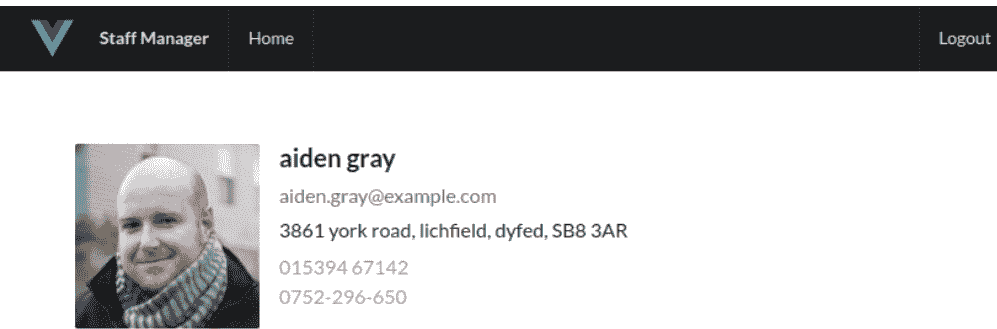

# 第 4 章：路由

如果你以前构建过服务端 Web 应用，你就会熟悉需要考虑应用程序的 URL 结构。

使用客户端路由器将为你的 SPA（单页应用）带来服务端 Web 应用的优势——即能够使用浏览器的后退和前进按钮在应用的各个画面之间移动，以及用户能够为应用的特定画面和/或状态添加书签。

Vue.js 的优势在于它拥有一个库，不仅功能极其强大、文档完善，而且也是 Vue 的官方路由解决方案，并保证会随着核心库的发展而得到维护和保持同步。

## 安装 Vue Router

你可以通过 npm（`npm install vue-router`）或 Vue CLI 轻松地将路由器添加到应用中。

为了本章的目的，让我们自己通过 npm 安装路由器，并逐步完成使一个基本示例运行起来所需的步骤。在这个过程中，我会简要解释每个必要部分，我们将在本章后面更深入地回顾这些内容。

如果你还没有创建项目，请使用 Vue CLI 创建一个基于“default”预设的新项目。安装完成后，进入项目的根文件夹并运行以下命令：

```
npm install vue-router
```

安装好路由器库后，我们需要配置它并添加一些路由，以将 URL 映射到组件。在 `src` 文件夹中创建一个名为 `router.js` 的文件，并添加以下内容。

在实例化路由器时，向它传递一个路由配置对象数组。

至少，我们需要为要定义的每个路由提供一个路径（即 URL）和一个组件：

```javascript
import HelloWorld from './components/HelloWorld';

const routes = [
  {
    path: '/hello-world',
    component: HelloWorld
  }
];
```

当用户导航到 `/hello-world` URL 时，上述路由将显示 `HelloWorld` 组件。

在创建路由时，你可能还想设置其他有用的选项。

- **name.** 你可以为路由提供名称。这是可选的，但我建议除了最简单的应用之外，所有应用都这样做。使用命名路由允许你更改 URL 结构而不会破坏应用，并且在处理动态路由时，可以更轻松地以编程方式进行导航。
- **redirect.** 在此处输入另一个路由的路径，即可在应用内创建重定向。
- **beforeEnter.** 你可以提供一个在路由变更前调用的函数，以便在继续或取消导航之前执行额外的逻辑。稍后，我们将研究如何使用它来让某些路由仅对已认证用户可用。
- **meta.** 你可以使用此选项提供一个自定义属性对象，供该路由使用。

> ### 其他选项
>
> 与路由器选项一样，在路由上还可以设置更多选项，这些我在这里就不一一介绍了。如果你想了解更多，建议*浏览*一下 API 文档。


`beforeEach()` 守卫，这意味着所有相同的检查和结果都是可能的。

## afterEach

顾名思义，`afterEach()` 回调会在导航被确认后运行。回调会接收 `to` 和 `from` 路由对象，但没有 `next()` 函数，因为在此阶段导航已经无法取消。

```
router.afterEach((to, from) => {
  // ...
});
```

例如，`afterEach` 钩子可用于向你的分析服务发送页面变更数据。

## 路由级守卫

路由级（以及组件内）守卫可用于有选择地将逻辑应用于特定路由，但你无法像使用全局守卫那样为一个钩子分配多个回调。

## beforeEnter

在添加路由时，将一个函数赋值给名为 `beforeEnter` 的属性，即可设置 `beforeEnter` 守卫。

```
{
  path: '/settings',
  component: SettingsPage,
  beforeEnter: (to, from, next) => {
    // ...
  }
}
```

我们接下来要讨论的其余守卫都是在页面组件（即由路由直接加载的组件）内部进行赋值的，就像生命周期方法一样。

## beforeRouteEnter

当路由被确认后（也就是在任何全局 `beforeEach` 或路由级 `beforeEnter` 守卫运行之后），但在组件本身被创建之前，会调用该守卫。

```
```html
href="https://cdnjs.cloudflare.com/ajax/libs/semantic-ui/2.3.1/semanti...

<style type="text/css">
  body {
    background-color: #FFFFFF;
  }
  .ui.menu .item img.logo {
    margin-right: 1.5em;
  }
  .main.container {
    margin-top: 7em;
  }
</style>
</head>
<body>
  <div id="app"></div>
</body>
</html>
```
```

这里没什么革命性的东西：只是一个指向 Semantic UI 库的 CDN 链接，以及一些额外的样式调整。

接下来，我们通过修改 `<App>` 组件来继续。

## src/App.vue

```
```vue
<template>
  <div>
    <div class="ui fixed inverted menu">
      <div class="ui container">
        <div class="header item">
          
          Jump Start Vue.js
        </div>
        <router-link class="item" to="/" exact>Home</router-link>
        <router-link class="item" to="/users">Users</router-link>
      </div>
    </div>
    <router-view></router-view>
  </div>
</template>

<script>
import { mapActions } from "vuex";

export default {
  name: "App",
  methods: {
    ...mapActions(["fetchUsers"])
  },
}
```
```

```
npx create-nuxt-app <project-name>
```

npx 命令是一个很方便的 npm 工具，它会加载并运行安装程序，而无需先将该模块安装到你的全局 node_modules 文件夹中。

## 使用 Yarn 安装

也可以通过 Yarn 运行安装程序，命令如下：

```
yarn create nuxt-app <my-project>
```

安装程序下载完成后，它会以与 Vue CLI 非常相似的方式，提示你为新项目配置一系列选项。

你将看到以下选项：

- **项目名称。** 默认是你为项目文件夹提供的名称，但如果你愿意，也可以在此处覆盖。
- **描述。** 项目的描述。此项和项目名称都会用于填充 package.json 文件。
- **使用自定义服务器框架。** 默认情况下，Nuxt 会将服务器功能隐藏起来，但你可以从少数几个 Node 框架中选择一个来代替。你可以选择 Express、Koa、Hapi、Feathers、Micro 和 Adonis。除非你有特定需求要自定义服务器端功能，否则你可能不会需要这个选项。
- **使用自定义 UI 框架。** 你还可以从几个 CSS UI 框架中选择一个，以便预配置一个给你。你可以选择 Bootstrap、Vuetify、Bulma、Tailwind、Element UI、Ant Design Vue 和 Vuefy。如果你想使用其中某个框架，这些选项会很方便，但之后自己添加也很容易。
- **渲染模式。** Nuxt 让你在标准 SPA（单页应用）和通用 Web 应用之间选择；后者会在服务器上预渲染每个请求，以获得更好的性能和 SEO。虽然 Nuxt 的约定和结构在构建 SPA 时仍然有用，但其主要卖点是 SSR/静态站点生成。

因此，这里默认选择 “universal”。

- **axios 模块**。该模块包装了 axios HTTP 库，并使其与 Nuxt 更好地集成。你不必使用它，但建议使用。
- **ESLint**。为你预装 ESLint。
- **Prettier**。为你预装 Prettier。
- **作者名称**。你的名字，用于 `package.json` 文件。
- **包管理器**。你可以选择 npm 或 Yarn，让 Nuxt 为你所选的包管理器进行配置。

如果你打算跟着本章的示例操作，那么接受所有默认选项即可，但对于 axios 模块，你应该选择“是”。

回答完所有问题后，Nuxt 会继续下载必要的依赖项，并创建一个包含一些样板代码的基本文件夹结构。在撰写本文时，其中一些文件会导致 lint 错误（如果你安装了 ESLint 和 Prettier），你可以通过运行 `npm run lint -- --fix` 或 `yarn run lint --fix` 来修复。

> **源代码管理**
> 
> 作为安装过程的一部分，Nuxt 会将你的新项目文件夹初始化为 Git 仓库。但与 Vue CLI 不同，它不会为你进行初始提交。建议你将其作为第一步！

要开始使用 Nuxt 构建应用，请启动内置的开发服务器：

```
npm run dev
```

在此进程运行时，如果检测到任何更改，它会自动重新构建你的应用。我们来看看 Nuxt 使用的文件夹结构。

## 项目结构

下面是 Nuxt 安装程序为你留下的默认文件夹结构。有一个

## 重载开发服务器

如果你要向 Nuxt 应用添加 Vuex store，在从组件中访问它之前，你需要重启开发服务器！

定义 store 的方式与非 Nuxt 应用略有不同：store 文件需要返回一个工厂函数，该函数在被调用时返回一个新的 store。

## store/index.js

```
import Vuex from 'vuex'

export default () => {
  return new Vuex.Store({
    state: () => ({
      // ...
    }),
    mutations: {
      // ...
    }
  })
}
```

还需要注意，state 属性必须是一个返回基础状态对象的函数。这是为了防止站点在服务器端渲染时出现共享状态的问题。

store 还可以定义一个特殊的 action，nuxtServerInit，每当页面在服务器端渲染时都会调用它：

```
actions: {
  nuxtServerInit ({ commit }, { req, res }) {
    // ...
  }
}
```

除了 action 通常接收的 Vuex context 对象之外，该方法还会接收一个 Nuxt context 对象作为其第二个参数。

该对象包含相当多的键（完整列表请参阅 PI 文档），包括服务器请求和响应对象——分别对应 req 和 res。这个

  
默认情况下，服务器运行在 3000 端口（虽然可以在 `nuxt.config.js` 中设置），因此你需要配置 Web 服务器，将传入的请求代理到该应用。  

Nuxt FAQ 网站提供了配置 NGINX 代理的示例，以及将 Nuxt 应用部署到主流平台的示例。  

## 静态站点

静态站点生成试图两全其美。  

在通用应用中，最初请求的页面由服务器渲染并返回浏览器，随后当用户浏览时，客户端代码接管应用其余部分的渲染。  

另一方面，静态站点生成会预先渲染所有可能的路由，并将输出保存为 HTML 文件。这一技术能带来快速响应的好处，且页面可被搜索引擎索引，同时无需负担运行 Node.js 服务器的开销。  

务必牢记，你的页面只会更新到最近一次运行 generate 命令时的状态，因此这种方法更适合数据变化不频繁的场景。对于依赖频繁变化数据的站点（例如实时新闻或股票数据），用户（以及搜索引擎爬虫）可能会看到过时的信息。  

你可以运行 `npm run generate` 来生成站点的静态版本，生成的文件会保存到 `dist` 文件夹中。  

在生成包含动态路由段的站点时，有一件重要的事情需要注意。默认情况下，这些动态路由段会被 Nuxt 忽略，因为它无法知道路由可能被调用的所有参数值。  

为了解决这个问题，Nuxt 允许你向其提供一个要渲染的路由列表，将这些路由以数组的形式添加到 `nuxt.config.js` 中：  

```
export default {
  // ...
  generate: {
    routes: [
      '/blog/my-first-post',
      '/blog/pictures-of-my-cat',
      '/blog/the-best-pie-ever'
    ]
```

```html
</template>

<style>
body {
  background-color: #ffffff;
}
.ui.menu .item img.logo {
  margin-right: 1.5em;
}
.main.container {
  margin-top: 7em;
}
</style>
```

与之前相比，这里唯一真正的区别是我们使用了 `<nuxt-link>` 组件作为菜单链接。请注意，logo 来自默认的 Vue CLI 项目，但你可以从我之前提到的 GitHub 仓库中获取一份副本。  

为了在我们的应用中加载 Semantic UI 样式，我们需要编辑 Nuxt 配置。  

## nuxt.config.js

```js
// ...
head: {
  title: pkg.name,
  meta: [
    { charset: 'utf-8' },
    { name: 'viewport', content: 'width=device-width, initial-scale=1' },
    { hid: 'description', name: 'description', content: pkg.description }
  ],
  link: [
    { rel: 'icon', type: 'image/x-icon', href: '/favicon.ico' },
    {
      rel: 'stylesheet',
      type: 'text/css',
      href:
        'https://cdnjs.cloudflare.com/ajax/libs/semantic-ui/2.3.1/semantic
    }
  ]
},
// ...
```

在这里，我们告诉 Nuxt，我们希望链接的 CDN 包含在全局的 `<head>` 部分中。  

`fetch()` 方法从路由参数中获取 ID，并分发 `getEmployee` 动作。一旦 `selectedEmployee` 状态属性发生变化，这一变化就会向下传递到我们的页面组件，并渲染到屏幕上。  

  

## 创建应用首页

为了完整性，我们需要为应用的基本路由（`/`）显示一些内容。让我们添加一个简单的首页。  

## `pages/index.vue`

```vue
<template>
  <div class="ui main text container">
    <h1 class="ui header">Chapter 7: Tying it all Together</h1>
    <p>This example builds upon everything we've covered in the book. It uses what we've learned to create a Nuxt.js app with a Vuex store and authentication that fetches data from a remote API and displays it in a custom component linking to a detail page for each item.</p>
    <p>Go to the <nuxt-link to="/users">Users page</nuxt-link>.</p>
  </div>
</template>
```

如果你正在编辑由 Nuxt 安装程序生成的 `index.vue` 页面，请务必删除其中的 script 和 style 代码块。它们不再需要，而且其中的 CSS 规则会与我们的应用样式冲突。  

至此，你应该已经有一个功能正常的应用，它可以加载一组……  
