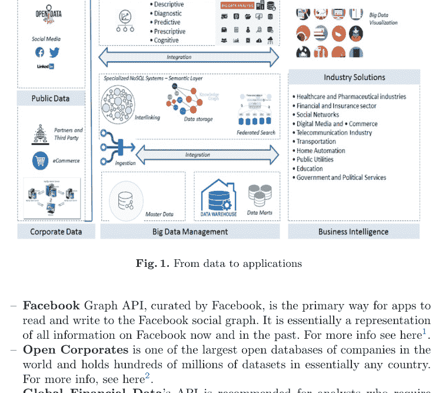
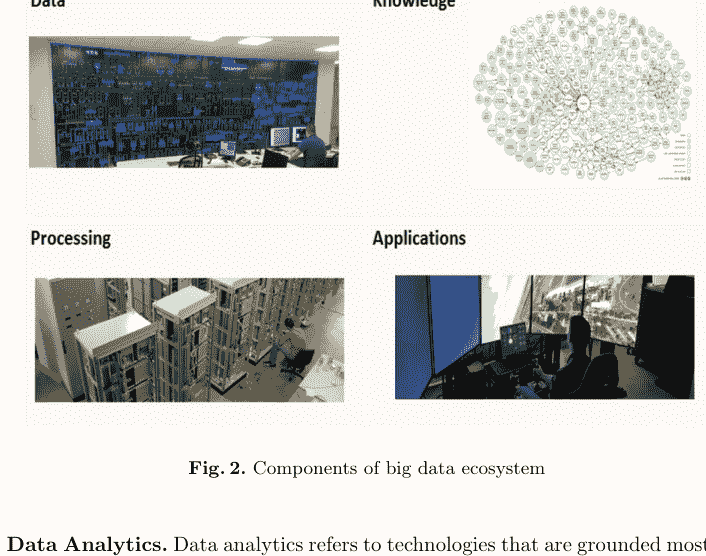
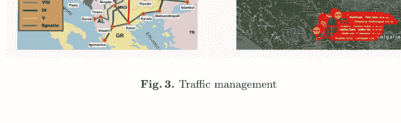

### 第1章. 大数据生态系统

Valentina Janev

贝尔格莱德大学，米哈尔·普品研究所，塞尔维亚贝尔格莱德
valentina.janev@institutepupin.com

#### 摘要

数字技术、物联网产品和连接平台、社交网络应用、视频、音频及地理位置服务的快速发展，为收集/积累大量数据创造了机遇。过去，企业处理的是来自不同来源的静态、集中存储的数据；随着 Web 和云服务的诞生，云计算正迅速取代传统的内部系统，成为可靠、可扩展且具有成本效益的信息技术解决方案。大规模的结构化与非结构化数据以分布式方式存储，加上数据来源的多样性，给数据/知识表示与集成、数据查询、业务分析和知识发现带来了问题。本导论章节旨在描述大数据生态系统的相关方面，包括大数据特征、实现端到端大数据处理所需的组件，以及使用语义学来改进数据管理、集成、处理和分析任务的需求。

#### 1 引言

2001年，为了表征和可视化未来可能出现的变革，META Group（现为Gartner）的 Douglas Laney [271] 提出了三个维度，用于表征日益增长的数据所带来的挑战和机遇：体量（Volume）、速度（Velocity）和多样性（Variety），即著名的“大数据3V”。因此，根据Gartner的观点：

> “大数据”是高体量、高速度、高多样性的信息资产，需要高效且创新的信息处理形式以增强洞察力和决策能力。

根据 Manyika 等人 [297] 的观点，该定义是主观的，并纳入了动态的定义，以说明数据集需要多大才能被视为大数据。沿着这一思路，对于亚马逊或谷歌而言的大数据（见表1），与中等规模的保险或电信公司的大数据截然不同。因此，随着时间推移出现了许多不同的定义（参见第3章），但总体上，它指的是“其规模超出了典型数据库软件工具捕获、存储、管理和分析能力的数据集”。

**表1.** 大数据特征

| V | 特征 | 描述 |
|---|---|---|
| 3V | 体量 (Volume) | 需要捕获、存储、处理和显示的庞大数量的数据 |
| 3V | 速度 (Velocity) | 数据生成或分析的速度 |
| 3V | 多样性 (Variety) | 数据结构（格式）的差异，或数据来源本身的差异（文本、图像、语音、地理空间数据） |
| 5V | 真实性 (Veracity) | 数据的真实性（不确定性）、真实性、来源、可问责性 |
| 5V | 有效性 (Validity) | 所选数据集对于给定应用的适用性，以及数据对其预期用途的准确性和正确性 |
| 7V | 易变性 (Volatility) | 数据的时效性和流利度，数据的新鲜度和可用性，并确保持续快速地检索信息 |
| 7V | 价值 (Value) | 提取的数据在决策中的有用性和相关性，以及将信息转化为行动的能力 |
| 10V | 可视化 (Visualization) | 数据表示及方法的可理解性（数据聚类或使用树图、日焰图、平行坐标、圆形网络图或锥形树） |
| 10V | 脆弱性 (Vulnerability) | 与数据处理相关的安全和隐私问题 |
| 10V | 可变性 (Variability) | 数据含义的变化，数据中的不一致性、偏差、歧义和噪声 |

#### 3 大数据生态系统的组件

为了在少数几个阶段中描绘信息处理流程，图1中从左到右，我们将处理工作流划分为三个层：

- 数据源；
- 数据管理（集成、存储和处理）；
- 数据分析、商业智能 (BI) 和知识发现 (KD)。

**表2.** 大数据生态系统的示例

| 生态系统 | 示例 |
|---|---|
| Facebook | Facebook (2018) 拥有超过二十亿用户，分布在数百万台服务器上，每天运行数千次配置变更，涉及数万亿次配置检查 [310] |
| LinkedIn | 支持全球4.67亿会员（2017年）需要大量的算力支持，特别是考虑到每位会员都获得个性化的体验，以及仅包含其联系人的网页。支持此负载的是分布在多个数据中心的大约100,000台服务器 [215] |
| Alibaba | 阿里巴巴（2017年）在中国分配的IP地址上托管的402,000台面向Web的计算机，仅凭这一规模就足以使阿里巴巴成为当今世界第二大托管公司 [321] |
| Google | 关于谷歌数据中心中有多少台服务器没有官方数据，但Gartner在2016年7月的一份报告中估计，当时的谷歌拥有250万台服务器。据Internet Live Stats报道 [390]，谷歌数据中心平均每秒处理4000万次搜索，导致每天35亿次搜索，每年1.2万亿次搜索 |
| Amazon | ... 估计AWS数据中心总数为87个，亚马逊云中的服务器数量在280万到560万之间（2014年） [301] |
| Twitter | Twitter（2013年）目前拥有1.5亿全球活跃用户，每秒处理30万条查询（QPS）以生成时间线，并且有一个每秒输出22 MB的管道（firehose）。每天约有4亿条推文流经系统，一条推文从Lady Gaga的手指到达她3100万粉丝可能需要长达5分钟 [197] |

这种划分将允许本书的作者从不同的角度讨论大数据主题。对于计算机科学家和工程师来说，大数据提出了

图 1. 从数据到应用

- **Facebook** Graph API 由Facebook管理，是应用读写Facebook社交图谱的主要方式。它本质上是对Facebook现在和过去所有信息的一种表示。更多信息请参见这里¹。
- **Open Corporates** 是世界上最大的公司开放数据库之一，在几乎任何国家都拥有数亿个数据集。更多信息，请参见这里²。
- **Global Financial Data** 的 API 被推荐给需要大量数据以满足广泛研究需求的分析师。它使研究人员能够研究不同数据系列、行业和数据类型之间的相互作用。该API支持R和Python，因此可以直接将数据上传到目标应用程序。更多信息，请参见这里³。
- **Open Street Map** 是一幅世界地图，由人们创建，并根据开放许可证免费使用。它为数千个网站、移动应用和硬件设备提供地图数据。更多信息，请参见这里⁴。
- **国家环境信息中心**（NCEI）负责托管和提供对地球上最重要的档案之一的访问，包含全面的海洋、大气和地球物理数据。有关数据访问的更多信息，请参见这里⁵。

1 https://developers.facebook.com/docs/graph-api.
2 https://opencorporates.com/.
3 https://www.globalfinancialdata.com/.
4 https://www.openstreetmap.org/.
5 https://www.ncdc.noaa.gov/data-access.

此外，为了确保不同流程和互联系统之间的互操作性，引入了数据源/流程的语义表示，其中知识图谱一方面有意义地描述数据管道，另一方面用于生成新知识（参见第4章）。

图 2. 大数据生态系统的组成部分

## 数据分析。

数据分析是指主要基于数据挖掘和统计分析的技术[76]。选择适当的处理模型和分析解决方案是一个具有挑战性的问题，取决于目标领域的业务问题[221]，例如电子商务[416]、市场情报、电子政务[220]、医疗保健、能源效率[47]、应急管理[309]、生产管理和/或安全（见图2右下象限，由Mihajlo Pupin Institute开发的模拟器和训练辅助设备示例）。根据所解决问题的类别（例如银行和金融部门的风险评估、风电场的预测性维护、生产工厂的感知与认知、控制室的自动响应等），数据分析解决方案还依赖于文本/网络/移动分析服务。这里使用了各种机器学习技术，如关联规则挖掘、决策树、回归、支持向量机等。

虽然基于数据仓库概念、跨不同预定义维度生成聚合度量的简单报告和商业智能应用在20世纪90年代已经足够，但自1995年以来，重点一直放在将并行性引入机器学习[435]。

## 4 在大数据处理中使用语义

**数据来源的多样性。** 为了设计和实施合适的大数据处理架构，除了数据量和速度，公司还必须考虑其获取各种可用数据源的能力。除了现有的企业资源管理系统外，来自传感器、智能设备和社交媒体等多种来源的数据，以原始、半结构化、非结构化和富媒体格式，进一步使数据的处理和存储复杂化。因此，需要针对分布式存储、云计算和数据融合的不同解决方案[286]。为了使数据对数据分析有用，公司使用不同的方法来降低复杂性、缩小数据规模（例如降维、采样、编码）并预处理数据（数据提取、数据清洗、数据集成、数据转换）[456]。因此，数据的异构性可以从几个维度来表征：

- **结构多样性**指数据表示形式；例如，卫星图像的格式与用于存储网络上生成的推文的格式截然不同；
- **媒体多样性**指数据传递的媒介；例如，演讲的音频与演讲的文字记录可能以两种不同媒介表示相同的信息；
- **语义多样性**指用于测量或描述数据所需的单位（术语）的含义，这些单位是解释或操作数据所必需的；例如，埃塞俄比亚某项服务的“高”薪水与美国类似服务的“高”薪水截然不同；
- **可用性变化**意味着数据可以持续访问；例如，来自交通摄像头，或者间歇性访问；例如，仅当卫星位于感兴趣区域上空时才能访问。

**语义多样性与标准需求。** 从20世纪中叶起，人们就开始尝试解释语义在逻辑和计算中的用途。在信息处理领域，*语义*指的是“数据的有意义及其有意义的使用”[472]，即有效使用数据对象来表示现实世界中的概念或对象。自1980年以来，人工智能界一直在提倡向智能系统和智能体提供通用的、形式化的世界知识这一理念（另见1997年的小组报告*数据语义：是什么、在哪里以及如何使用？*）[398]。2001年，万维网联盟主任蒂姆·伯纳斯-李爵士阐述了他对语义网的愿景，将其视为传统万维网的扩展，以及一个数据和服务易于互操作的世界性分布式架构。此外，2006年，伯纳斯-李提出了关联数据（Linked Data）基本原则，通过引用共同概念在Web上互连数据集[51]。描述概念的信息表示标准是RDF（资源描述框架）。与此同时，用于表示和查询语义信息的标准（如RDF(s)和SPARQL）得到更广泛采用，加上现代RDF存储库功能的增强和稳健性的提高，使得关联数据和语义技术在数据与知识管理领域得以确立。作为欧盟委员会‘欧洲公共行政互操作性解决方案’（ISA）⁹计划的一部分，在与W3C的合作下，核心词汇表已被采用，以表示与推动创新服务相关的高价值数据集。

**知识工程。** 此外，科学界投入了大量精力来展示知识工程[26,92,221]如何从语义感知方法[222]中获益，这些方法利用（大）数据中保存的知识，以便在数据上进行更好的推理，超越更传统的数据实例导向方法所提供的可能性。随着2012年谷歌知识图谱的发布，将通用世界知识表示为图谱再次引起了广泛关注[347]。

总之，语义原则可用于大数据处理中的：

- 表示（有模式和无模式的）数据；
- 表示元数据（关于文档、来源、信任、准确性和其他质量属性）；
- 对数据流程和流进行建模，即表示整个管道，使数据表示可共享和可验证。

知识图谱中数据的语义表示（见第2章）、语义处理管道（见第3章、第5章、第8章）、知识图谱中的推理（第6章）以及大数据的语义分析（第7章）是本书的主要主题，将在后续章节中更详细地解释。

### 5 大数据、标准与互操作性

互操作性仍然是大数据生态系统开发者面临的一个主要负担。在其欧盟2030愿景中，欧盟提出通过适用于所有成员国的标准化法律体系建立内部单一市场，并建立单一欧洲数据[85]空间——一个真正的数据单一市场，企业可以轻松访问几乎无限量的高质量工业数据。这一愿景还得到欧盟ICT标准化滚动计划[86]的支持，该计划确定了围绕五个优先领域——5G、云、网络安全、大数据和物联网——组织的170项行动。为了促进广泛的数据集成、数据交换和互操作性，并以促进基于数据的创新为总体目标，需要在不同层面（如元数据模式、数据表示格式和开放数据的许可条件）进行标准化。这涉及所有类型的（多语言）数据，包括结构化和非结构化数据，以及来自

> ⁹ https://ec.europa.eu/isa2/.

多种不同的领域，例如地理空间数据、统计数据、天气数据、公共部门信息（PSI）和研究数据，仅举几例。

在大数据领域，已经要求采取五项不同的行动，这些行动还涉及以下标准化组织：

- CEN（欧洲标准化委员会），支持和协助标准化进程，并与相关W3C小组协调，防止不兼容的变更以及确定标准的可用条件。这项工作将特别关注欧洲数据门户的互操作性需求，同时基于复用已建立的控制词表（如EuroVoc）以及到现有元数据词表（如SDMX、INSPIRE元数据、都柏林核心等）的映射，提供与其他应用的语义互操作性；
- CENELEC（欧洲电工标准化委员会），尤其是在个人数据管理和保护个人基本权利方面；
- ETSI（欧洲电信标准协会），协调各利益相关方，编制必要标准的详细路线图（如安全、互操作性、数据可移植性和可逆性），并与CEN合作，共同完成合理化电子签名标准框架所需的各种标准化交付成果；
- IEEE（电气与电子工程师协会）有一系列与大数据相关的新标准项目（移动健康、节能处理、个人代理和隐私），以及关于大数据和开放数据的预标准化活动；
- ISO/IEC JTC1 WG9——大数据，于2014年11月成立，涉及大数据的需求、用例、词汇和参考架构；
- OASIS（结构化信息标准促进组织），涉及跨不同应用和多个利益相关方查询和共享数据，以便在企业、云和移动设备中重用。OASIS OData TC中的规范开发基于2014年发布的核心OData协议V4，并解决了四份方向性白皮书中确定为扩展的额外需求：数据聚合、时态数据、JSON文档和XML文档作为流；
- OGC（开放地理空间联盟），定义并维护基于位置、时空数据和服务的标准。其工作包括，例如，允许描述时空传感器、图像、模拟和统计数据（如“数据立方体”）的模式；一套模块化的Web服务标准，允许摄取、提取、融合，以及（通过Web覆盖处理服务（WCPS）组件标准）对海量时空数据（如卫星和气候档案）进行分析。OGC还为INSPIRE项目做出贡献；
- W3C（万维网联盟）的W3C语义网活动组已将众多Web技术接受为构建语义应用的标准或建议，包括：RDF（资源描述框架）作为通用语言；RDF Schema作为定义RDF资源属性和类的元语言或词表；SPARQL作为查询RDF数据的标准语言；OWL（Web本体语言）用于有效推理。更多关于语义标准的内容可参见[223]。

**表3.** 大数据历史

| 年份 | 描述 |
|------|-------------|
| 1911 | 计算-制表-记录公司成立，并于1924年更名为“国际商业机器公司”（IBM）。 |
| 1929 | “超级计算”一词首次在《纽约世界》中使用，指的是IBM为哥伦比亚大学制造的大型定制制表机。 |
| 1937 | 美国引入了社会保障制度，随之出现了对2600万居民进行数据管理的需求。 |
| 1945 | 约翰·冯·诺依曼发表了一篇关于电子离散变量自动计算机（EDVAC）的论文，这是关于程序存储的首次“有记载”的讨论，并奠定了当今计算机架构的基础。 |
| 1957 | 一群工程师在明尼苏达州明尼阿波利斯市成立了控制数据公司（CDC）。 |
| 1960 | 西摩·克雷（CDC）完成了CDC 1604，这是最早的固态计算机之一，也是当时世界上最快的计算机，而当时大多数大型计算机仍使用真空管。 |
| 1965 | 世界上第一个数据中心被规划。 |
| 1969 | ARPANET：一条消息从加州大学洛杉矶分校的主机发送到斯坦福大学的主机。 |
| 1970 | 埃德加·弗兰克·科德发明了关系模型用于数据库管理。 |
| 1976 | SAS研究所交付了第一版“统计分析系统”。 |
| 1977 | 甲骨文公司在美国加利福尼亚州圣克拉拉市成立。 |
| 1989 | 万维网在欧洲核子研究中心（CERN）发明。 |
| 1998 | 谷歌在加利福尼亚州的斯坦福大学成立。 |
| 1999 | Apache软件基金会成立。 |
| 2003 | 谷歌文件系统（Google File System）被发明。 |
| 2004 | 万维网联盟（W3C），Web的主要国际标准组织，成立。 |
| 2005 | Apache Hadoop开始开发，并于2008年投入生产。 |
| 2007 | 柏林自由大学和莱比锡大学发布了DBpedia上第一个公开可用的数据集。 |
| 2009 | Yahoo发布了Pig，Facebook创建了Hive。 |
| 2011 | 使用Apache Storm和Spark的实时处理（相对于批处理）开始启动。 |
| 2012 | LinkedIn创建了Kafka；谷歌推出了其知识图谱项目。 |
| 2013 | 定义了用于高效大数据处理的Lambda架构。 |
| 2014 | Kappa架构的定义以及混合数据处理的开始。 |

## 6 大数据分析

### 6.1 分析的演进

在过去的50年里，**数据分析**已成为从业者和研究人员重要的研究领域。**分析1.0**时代始于20世纪50年代，持续了大约50年。作为一种软件方法，该领域随着20世纪70年代Edgar F. Codd发明关系数据库、人工智能发展成为一门独立的科学学科，以及1989年Tim Berners-Lee爵士发明万维网而发生了显著演变。随着21世纪初基于Web 2.0的社交和众包系统的发展，分析2.0时代开始了。在分析1.0时代，业务解决方案与关系型和多维数据库模型绑定，而**分析2.0**时代带来了NoSQL和大数据数据库模型，为分析大量半结构化和非结构化数据开辟了新的优先事项和技术可能性。公司和数据科学家将这两个时期称为大数据之前（BBD）和大数据之后（ABD）[100]。在第一个时代观察到的主要局限是，数据的潜在能力仅在组织内部被利用，即商业智能活动只处理过去发生的事情，对其未来趋势不提供预测。新一代工具具有快速处理引擎和NoSQL存储，使得将内部数据与来自互联网、各类传感器、公共数据计划（如人类基因组计划）以及音频和视频记录采集的外部来源数据整合成为可能。这一时期还显著发展了数据科学领域（由数学与统计学、计算机科学和领域特定知识交叉构成的多学科交叉领域），它提供了科学方法、探索过程、算法和工具，可以轻松地利用这些方法从各种形式的数据中提取知识和洞见。

**分析3.0**时代始于[23]“物联网”和云计算的发展，这为建立混合技术环境以实现数据存储、实时分析和面向客户的智能服务创造了可能性。分析3.0也被称为*影响时代*或*数据增强产品时代*，源于利用分析服务的无限机会。为了在数据经济中创造价值，Davenport [100] 提出需要妥善处理以下因素：

- 组合多种类型的数据
- 采用一套新的数据管理工具
- 引入新的“敏捷”分析方法和机器学习技术，以更快的速度产生见解
- 将分析和机器学习模型嵌入运营和决策流程
- 具备必要的技能和流程，以使用创新的数据探索发现工具
- 具备必要的技能和流程，以开发涉及大规模测试和优化的规范性模型，这是将分析嵌入关键流程的一种手段
- 利用新的决策和管理方法

如今，处于**分析4.0**时代或*消费者控制数据时代*，目标是让客户能够完全或部分控制数据。同时，与工业4.0运动保持一致，通过结合机器翻译、智能回复、聊天机器人和虚拟助手，存在多种自动化和增强人机通信的可能性。

## 6.2 不同类型的数据分析

总体而言，分析问题和技术可以分为：

- **描述性** – 发生了什么？
- **诊断性** – 为什么会发生？
- **预测性** – 很可能发生什么？
- **规范性** – 应该怎么办？
- **认知性** – 我们不知道什么？

**描述性分析**侧重于分析历史数据，以识别模式（*事后洞察*）或趋势。虽然统计理论和描述性方法论 [7] 在科学文献中已有充分记录，但在其他类型分析中并非如此，尤其是在观察大数据和云计算的背景下。

**诊断性分析** [364] 揭示问题的根本原因并提供*洞察*。这些方法被视为描述性分析的扩展，可对“为什么会发生？”这一问题提供解释。

**预测性分析**-based 服务应用预测和统计建模，基于监督、非监督和半监督学习模型，对“未来很可能发生什么”提供洞察（*前瞻*）。

**规范性分析**-based 服务 [281] 回答“该怎么做？”这一问题。为了基于提供的约束和上下文提供自动化、时间相关和最优决策，软件工具利用人工智能、优化算法和专家系统方法。

**认知分析**是最近在认知计算背景下引入的一个术语（另见 *Deloitte Tech Trends 2019*）。受人类思维能力以及智能设备、传感器和云计算能力等其他因素的推动，其目标是开发“能够像同类人类一样与人类互动、解释上下文含义、分析用户的历史记录并基于该交互会话得出推断”的“AI-based 服务” [174,176]。

## 7 利用大数据潜力的挑战

为了充分发挥潜力，大数据专业人员和研究人员必须解决不同数据和基础设施管理挑战，而这些挑战无法通过传统方法解决 [72]。因此，在过去十年中，不同的技术已在大数据价值链中涌现，用于采集、存储、处理和信息推导。

在 [404] 中，作者提出了三类主要挑战如下：

- **数据挑战**与数据本身的特征相关（例如数据量、种类、速度、真实性、波动性、质量、发现和教条主义）；
- **流程挑战**与技术相关（如何捕获数据、如何集成数据、如何转换数据、如何为分析选择合适的模型以及如何提供结果）；
- **管理挑战**与组织方面相关，例如隐私、安全、治理和伦理方面。

数据、流程和管理挑战相互关联并相互影响。

### 7.1 挑战

*大数据的 3V* 要求集成复杂的数据源（包括复杂类型、复杂结构和复杂模式），如前所述。因此，*可扩展性*被认为是大数据解决方案的关键瓶颈。继处理问题之后，*存储*管理是关于大数据的另一个不可避免的障碍。在其采集、处理和分析之间存储海量数据需要巨大的内存容量，从而使传统解决方案过时。

大数据固有的复杂性（*数据复杂性*）使其感知、表示、理解和计算变得更加困难，并且与基于总数据的传统计算模型相比，所需的*计算复杂性*急剧增加。系统架构、计算框架、处理模式以及高效能大数据处理平台基准的设计是需要解决的*系统复杂性*关键问题 [231]。当代基于云的解决方案也被认为处于可行性的边缘，因为*响应性*可能是一个关键问题，尤其是在实时应用中，其中上传速度被认为是主要瓶颈。

同时使用不同数据源时，所收集数据的*可靠性*不可避免地会波动，遗漏、部分和有缺陷的测量不可避免，这将在工作流程的后期，例如分析阶段，造成严重的潜在麻烦。因此，在流程开始时必须进行高质量的数据管理（即数据清洗、过滤、转换等）操作。除了可靠性之外，数据的*正确性*被认为是大数据处理的关键方面。高容量、无结构形式、NoSQL 数据管理系统中的数据分布式特性以及近实时响应的需求往往导致结果损坏，且没有任何方法能够保证其完全*有效性*。

其他影响大数据解决方案设计的质量维度包括*完整性、一致性、可信度、及时性*等。

例如，在实时应用中（例如股票市场、金融欺诈检测和交易解析、交通管理、能源优化等），需要快速响应并立即期望，因为如果检索到的信息相对于收集的数据存在高延迟，则可能完全无用。

文献中提到可视化是一个关键因素，因为如果没有结果的适当表示，所推导的知识将毫无用处。

根据处理的数据类型，*安全*有时可能是需要特别关注的关键组成部分。例如，在考虑天气预报或公共交通管理用例时，如果发生数据丢失或盗窃，可以认为实际上无关紧要，而在个人信息的姓名、地址、位置历史、社会保障信息或信用卡 PIN 码被盗的情况下，数据保护必须达到尽可能高的标准。

### 7.2 示例：交通管理挑战与解决方案分析

智能交通是大数据垂直应用的关键之一，是指在交通系统中集成现代技术和管理策略的应用。市场上可用的大数据平台在很大程度上促进了城市的智能化管理和智能交通系统的实施。为了展示不同类型数据分析的使用并加强对挑战的讨论，我们将指向用于监控塞尔维亚高速公路的交通管理系统 [366]。高速公路和快速路控制系统产生大量数据，与交通和环境部门、运输提供商、公民和警察等众多利益相关者相关。下图 3 指出 (a) 欧洲走廊，以及 (b) 由公共企业“塞尔维亚道路”使用 Mihajlo Pupin 研究所提供的控制系统管理的第 10 走廊。其整体监督功能和控制包括 (a) 收费和高速公路交通控制，以及 (b) 城市交通控制和管理。欧盟层面的主要挑战与以下相关：

*Fig. 3. Traffic management*

- **互操作性**整个欧盟道路网络的收费服务，因为从 1990 年代初开始在地方和国家层面引入的收费服务总体上仍然不可互操作；
- **智能出行**以及用户需要更实时地了解不同选项的需求；
- 由于改善环境空气质量，需要对**空气污染评估和管理**采取高效有效的方法。

交通控制系统的主要组成部分包括：

- 收费**征收系统**¹⁰，采用分层结构，完全模块化，基于 PC 技术和最新的实时操作系统、关系数据库系统以及数据传输的专用加密。收费线控制器基于工业 PC 技术和专用电子接口板。收费广场子系统是所有线路控制器的监督系统。它收集来自车道控制器的所有数据，包括财务交易、车辆数字图像、技术故障、线路操作员的操作和故障。所有关于收费流程和设备状态的数据都从广场计算机永久收集并存储在中央系统数据库中。收费征收系统还包括车辆检测和分类、车牌识别和基于微波的专用短程通信等功能。
- 主**控制中心**通过光纤通信链路与广场控制中心连接。此外，控制中心还通过计算机网络与银行、保险公司、处理信用卡和借记卡的机构、RF 标签供应商等各种机构不断交换数据。**数据分析**基于数据仓库架构，能够在接近实时下对大数据量进行统计和历史分析，实现最佳性能。报告基于优化的数据结构，允许既有预定义（标准化）报告，也有特设（动态）报告，这些报告使用 Oracle BI 平台高效生成。数据分析包括以下场景：
  - **预测和预防道路交通拥堵**分析用于改善拥堵诊断，并使交通管理人员能够主动管理交通，并在达到拥堵之前组织收费站的活动。
  - **战略环境影响评估**分析用于基于历史和实时分析研究高速公路对邻近动植物、空气、土壤、水、人、景观、文化遗产等环境影响和影响。被动污染监测涉及收集有关空气污染物扩散的数据，例如基于交通计数排放估算。被动污染监测已用于确定长期污染水平的趋势。道路交通污染监测和可视化需要将大量（历史）交通数据与其他参数（如车辆

排放因子、背景污染数据、气象数据和道路地形。

在这里，我们仅指出了交通运输和交通管理的一种模式，即高速公路和高速公路的控制。然而，如今，世界各地有越来越多的城市面临交通拥堵、优化公共交通、规划停车位和规划自行车路线等问题。这些问题需要新的方法来研究人类流动，利用机器学习技术 [406]、预测模型或通过复杂事件处理工具的应用 [135]。

## 8 结论

本章介绍了作者对 *大数据生态系统* 的愿景。它作为一篇介绍性章节，旨在指出与本书相关的若干方面。在过去二十年里，硬件和软件技术的进步，例如物联网、移动技术、数据存储和云计算，以及并行机器学习算法，使得能够轻松地从不同类型的定量和定性领域特定数据源获取、分析和存储大量数据。所监测和收集的数据带来了机遇和挑战，这些挑战除了关注体积、种类和速度这三个主要特征外，还需要研究有效性、价值和脆弱性等其他特征。为了自动化和加速处理，需要互操作的数据基础设施以及数据相关技术标准化，包括制定大数据管理元数据标准。实现数据集和服务之间互操作的一种方法是采用 W3C 数据网络最佳实践中定义的数据词汇表和标准，这些标准也应用于本书中介绍的工具（见第 4、5、6、7、8 和 9 章）。

为了阐述挑战并指出大数据的潜力，本章介绍了并讨论了来自交通领域的案例研究，而更多的大数据案例研究则列于第 9 章和第 10 章。

**开放获取** 本章采用知识共享署名 4.0 国际许可协议（http://creativecommons.org/licenses/by/4.0/）许可，允许在任何媒介或格式下使用、共享、改编、分发和复制，只要您对原作者和来源给予适当的署名，提供指向知识共享许可的链接并标明是否进行了更改。

除非材料中另有说明，本章中的图像或其他第三方材料均包含在本章的知识共享许可范围内。如果材料未包含在本章的知识共享许可范围内，并且您打算使用的范围未被法定法规允许或超出许可使用范围，您将需要直接向版权持有人获得许可。

