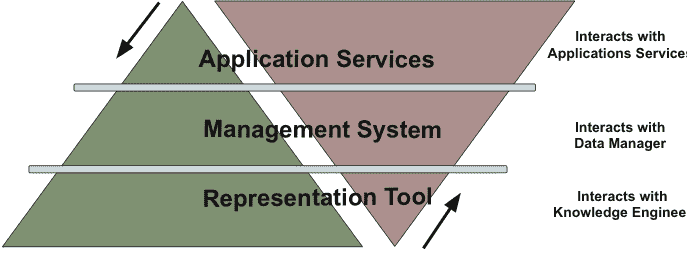

## 第 2 章：知识图谱：分层视角

Luigi Bellomarini¹, Emanuel Sallinger²,³(✉), and Sahar Vahdati³

¹ Banca d'Italia, Rome, Italy
² TU Wien, Vienna, Austria
sallinger@dbai.tuwien.ac.at
³ University of Oxford, Oxford, UK

摘要。知识图谱（KGs）是下一波技术中的关键趋势之一。存在许多关于什么是知识图谱的定义，在本章中，我们将持这样的观点：正是定义的多样性构成了该领域的优势之一。我们将选择一个特定的视角，我们称之为分层视角，以及三种关于知识图谱的观点。

## 1 引言

知识图谱（KGs）是下一波技术中的关键趋势之一 [340]。尽管在实践和研究中都强调了其重要性，并且该概念的定义多种多样，但仍然没有对什么是知识图谱达成共识。在本介绍中，我们不会选择知识图谱的一个定义。存在许多关于特定定义的优秀介绍，我们将在本章中引用其中一些。与其如此，我们将持这样的观点：正是定义的多样性构成了该领域的优势之一。

同时，我们的目标并不是对知识图谱的演变进行全面、历史性的描述，无论是术语还是概念。同样，优秀的历史性和详尽的描述已经存在，我们将在本章中引用其中一些。与其如此，我们将选择一个特定的视角，我们称之为分层视角，以及三种关于知识图谱的观点。

关于知识图谱的观点。虽然文献中对知识图谱类型的分类方式有很多种，但这里我们集中于以下三种观点：

- **知识表示工具：** 其重点在于知识图谱如何用于表示某种形式的知识。
- **知识管理系统：** 其重点在于管理知识图谱的系统，类似于数据库管理系统对数据库所起的作用。
- **知识应用服务：** 其重点在于在知识图谱之上提供一层应用程序。

*图 1.* 关于 KGs 的观点的有序金字塔。

**分层视角。** 虽然这三种观点各自具有独立价值，但当它们 *作为层一起* 放置时最有趣：在第一层是知识的 **表示**，在中间层是该知识的 **管理** 系统，在顶层是其所解决的 **应用**。这在图 1 中有所说明。这里还有三个额外的因素在起作用：

- 这些层顺序的一般有两种看法。一些社区倾向于 **自上而下** 地看待它，以 KG 解决的 *应用* 为重点，其他人则倾向于 **自下而上** 地看待它，以知识的 *表示* 为重点。有趣的是，还有另一种观点，即数据管理社区通常将中间的 *管理系统* 作为重点。
- 这些层之间的 **边界** 是模糊的。许多学术和工业系统涵盖其中两层或三层。在某些情况下，表示工具部分履行了管理系统部分特征。应用平台也同样如此。
- **推理** 的核心方面对这三层提出了截然不同的要求。第 6 章将完全致力于这一方面。

当然，很明显，要实现一个优秀的整体系统，必须考虑所有层及其交互；如果知识表示层不适合目的，很难提供一个良好的知识应用平台。

**组织。** 前三个部分涵盖了我们上面介绍的三种观点。在第 **2** 节中，我们将知识图谱视为知识表示工具；在第 **3** 节中，我们将知识图谱视为知识管理系统；在第 **4** 节中，我们将知识图谱视为知识应用平台。我们将以一个关于挑战和机遇的部分作为结尾。

## 2 KGs 作为知识表示工具

关于知识图谱最常见的观点之一，涵盖了大多数给出的定义，是主要将其视为知识表示工具。在本节中，我们将概述一些概念，特别关注它们如何融入分层视图。

这些定义共同之处在于，鉴于“知识图谱”这一术语，有某种形式的图由形式主义编码，并且其中编码了某种形式的知识。然而，就图而言，它们在很大程度上不同之处在于简单图是否是主要结构，还是我们实际上处理的是更丰富的设置，其中例如图的节点或边具有关联的属性，或者我们实际上处理的是超图（类似于完整的关联结构）。同样，就知识而言，它们在很大程度上不同之处在于图是否是知识，还是知识实际上生成了图的部分或全部。在计算机科学的某些特定社区中，知识图谱被明确视为关于实体的事实集合，通常源自 Babelnet、OpenCyc、DBpedia、Yago、Wikidata、NELL 及其共享特征 FreeBase [377] 等结构化数据源。以这种方式，用不同语言但相同结构表示的事实集合被称为 KG。

关键的是，形成与我们在引言中讨论内容的桥梁，在许多情况下，这些差异只是表面的，往往是表示问题，而非根本性的。例如，很明显，任意关联结构——或事实上任意数据结构——都可以编码为图，反之亦然。同样，在许多情况下，技术上知识是编码到图中、到单独的知识表示语言中，还是通过其他 AI 和 ML 框架提供，并不是根本性的差异。尽管如此，不同知识图谱概念之间仍然存在根本差异，正如我们在开始时提到的，我们的观点是这些多面定义是该领域优势之一。在本节中，我们将探讨知识图谱的这些不同定义，突出其共同点和差异。

关于数据表示工具的 KGs 观点。以下定义指向表示中的数据结构。它们大多以图表示为基线，并提供不同解释说明图结构如何有助于映射现实世界信息。

数学结构。这通常被认为是“知识图谱”一词首次出现的记录 [399]——尽管不一定是“知识图谱”概念的首次出现。在这里，将来自现实世界的知识作为教学-学习过程来捕获被视为构建知识图的方式。在这项工作中，学习的先决条件是一组必要的知识单元，通常应在向学习者（人类或机器）教授之前教授。在本文中，知识图谱本质上被定义为：

一种数学结构，其顶点作为知识单元，边表示先决条件关系。——Marchi 和 Miquel，1974 [298]

尽管这一定义是在学生与教师之间的互动学习背景下提出的，但该概念完全可以调整适用于当前的机器学习和机器教学 [488] 方法，其中知识图谱被视为智能的基础。在这个定义中，抽象程度隐藏在知识的数学表示中，即节点作为知识单元，边作为连接器。显然，由于上下文不同，没有讨论特定的语言或数据结构——因此，在我们的知识表示工具层中，它当然是一种非常抽象的表示形式。大致提到，学生学习的课程知识单元以博弈论的方式表示为图的节点。而节点之间的链接连接了知识单元，学生可以沿着这些链接遵循学习路径。这样，在基于图的结构中表示公共知识的想法在这一定义与当今的知识图谱之间以类似的方式运作。几乎在同一时间，也有类似的观点 [387]，即教师或学生可以被计算机取代。有人认为，知识以节点和带标签的链接表示的有向图可以影响数据分析目的的学习过程。

## 一组得到辩护的真信念。

在微软的一篇教程中，Yuqing Gao [146] 遵循柏拉图对知识的三分定义，将知识视为“得到辩护的真信念”的子集，即知识包含真值条件、信念条件以及由前两者推导出的辩护。这种“得到辩护的真信念”的一个例子是：A 为真。B 知道 A。B 知道 A 是有辩护的。知识图谱中的知识表示为 (主语, 谓语, 宾语) 三元组，其中主语和宾语指向实体，谓语表示关系。由这些三元组构建的图包含节点和边，节点指向作为主语和宾语的实体，边表示作为谓语的关系。还有额外信息，如每个实体的元数据，以属性形式显示。据此，知识图谱作为知识表示工具的一组关键概念被引入如下：

- **实体：** 现实世界中的实体
- **边：** 模式中实体间的关系
- **属性：** 关于实体的元数据
- **本体：** 对可能实体、关系和属性的定义
- Yuqing Gao，2018 [146]

在这个定义中，属性和本体这两个组成部分被认为是比其他基于图的观点额外的概念。事实上，将这些组成部分纳入知识表示增加了知识图谱的特性。实体和关系通常捕获存储在知识库（KB）中的信息。

## 无歧义图。

如前所述，大多数定义知识图谱的尝试都侧重于将知识图谱定义为在图结构中表示知识。因此，知识图谱通常由图的主要组成部分表示，即节点和边。这个图通常被视为有向且带标签的图，没有这些，图的结构就无法编码任何有意义的含义。当节点和边能够无歧义地识别时，该图就被认为是无歧义图。在此基础上，知识图谱可以定义为：

> “一个无歧义图，使用有限的关系集合来标记边，这些边编码了断言的来源，特别是辩护和归因。”——McCusker 等人，2018 [304]

这个定义试图超越仅将知识图谱表示为节点和关系。为了满足这一定义，知识图谱的所有知识单元（包括关系和节点）都应在全局范围内可识别。此外，有限关系集合的含义源自 [440]，指的是一组核心的基本类和关系，它们在任何上下文中都为真。这种抽象级别类似于使用唯一资源标识符的三元组格式的数据表示。

## 世界知识图谱与元数据。

在基本的观察层面上，数据将元素表示为从现实世界知识领域收集的原始值。元数据在第二个抽象层面上表示关于底层数据的信息。为了表示来自现实世界的知识：

- 现实世界的对象至少需要被观察一次，并表示为数据，
- 需要将此类数据的先前表示捕获为元数据，并且
- 所有这些在首要关注对象的抽象之上的元级定义都需要被连接起来。

在形式和技术层面上，需要形式化和数学化的数据结构、抽象程度以及句法和语义语言。因此，知识图谱的特性使得大多数社区将其视为在图模型中表示世界知识的工具，其中实体表示为节点，实体间的关系表示为有向边。更正式地，令 ℰ = {e₁,⋯,eₙₑ} 为实体集合，ℛ = {r₁,⋯,rₙᵣ} 为连接两个实体的关系集合，𝒟 = {d₁,⋯,dₙ𝒹} 为连接实体与字面量的关系集合，即数据关系，ℒ 为所有字面量值的集合。那么：

> “知识图谱 𝒦𝒢 是 (ℰ × ℛ × ℰ) ∪ (ℰ × 𝒟 × ℒ) 的一个子集，表示假定成立的事实。”——Wang 等人，2014 [462]。

然而，对于知识图谱概念的定义还有不同的尝试，我们将在本节以下部分介绍。

## 关于知识图谱作为知识表示工具的观点。

以下定义指向一种观点，即图表示的结构不是唯一优势，还包括知识的本体论方面。

真正的知识在于图中与数据层一起表示的本体的力量。这样，表示得到了丰富，以处理现实世界的复杂性（覆盖范围尚不完整），并增强学习、推理和推断能力。

## 一种特殊的语义网络。

“知识图谱”一词的更密集使用始于20世纪80年代初，当时引入了语义网络的概念 [13,410,482]。后来，荷兰的两所大学将其作为一个名为“知识图谱”的项目继续推进 [333,449]。根据语义网络的定义，即通过带标签的节点和节点之间的链接来表示知识的特定结构，知识图谱定义如下：

> 知识图谱是一种表示某种科学理论的语义网络。——Popping，2003 [357]

在这种观点下，显式知识的表示是通过其形式化（逻辑的或结构化的）来考虑的 [372]。虽然知识可以用文本、图像等多模态表示，但这一定义仅适用于文本提取和分析。语义网络是一种用于以节点和边表示知识的结构化形式主义。这类网络主要用于专家系统，该系统具有基于规则的语言、后台的知识库和推理引擎。由语义网络表示和推理的知识被称为作者图，其中点作为表示意义的概念单元，概念之间有带标签的链接。其他关于知识图谱（广义上）的观点与源自语义网络的观点之间的一个本质区别是，后者明确只选择少数几种类型的关系 [219,440]。

## 人类知识的表示。

尽管许多知识图谱的定义将该概念视为一种表示工具，但一些观点将知识图谱视为人类和机器的通用语言。知识图谱包含可供人工智能方法使用的信息，以提供语义搜索、问答、实体解析和表示学习等应用。

> “人类知识的图论表示，使得机器能够以语义方式摄取；一组三元组，每个三元组直观地表示一个断言。”——Kejriwal，2019 [237]

## 用多关系图表示的知识。

大量的人类知识可以用多关系图来表示。二元关系编码的事实可以用RDF类型的三元组（头；谓词；尾）表示，其中头和尾是实体，谓词是关系类型。所有三元组的组合形成一个多关系图，其中节点表示实体，有向边表示关系。由此产生的多关系图通常被称为知识图谱。知识

图（知识图谱，KG）提供了高效组织、管理和检索这类信息的方式，并且越来越多地被用作推荐系统、语言建模[2]、问答或图像分类等问题的外部知识来源。

需要强调的一个关键点是，尽管我们今天看到的许多知识图谱所含知识大多是简单的底层数据，但越来越多的应用需要可操作的知识表示。在某种程度上，现有的知识库管理系统已经如此，它们由本体支持，而针对这些本体的推理任务具有不同的计算复杂度和表达能力。支持隐式知识的重要性对知识图谱而言也变得核心，尤其是当它们作为企业级人工智能应用的组成部分时，以至于内延知识应被视为知识图谱本身的一部分。因此，推理（即将内延知识转化为派生的底层知识）本质上成为知识图谱定义的一部分。

例如，在金融企业人工智能应用中，监管知识体系和特定金融领域的运作规则至关重要。再如，在物流场景中，供应链中特定步骤如何相互作用的知识往往比供应链背后的纯数据更为重要。还可以举出更多类似的例子。

总体而言，在现代基于知识图谱的系统中，必须考虑并妥善处理丰富的知识表示，以便在增加的复杂性与诸多其他相关属性（如可用性、可扩展性、性能和知识图谱应用的健全性）之间取得平衡。我们以一个相对结构化、具体的定义来总结这些方面：

> “一种半结构化数据模型，具有三个组成部分：（i）地面外延组件，即用于模式和数据的关系统构造集合（可有效建模为图或其泛化形式）；（ii）内延组件，即针对地面外延组件构造的一组推理规则；（iii）派生外延组件，可通过将推理规则应用于地面外延组件（即所谓的‘推理’过程）而产生。” —— Bellomarini 等人，2019年 – [40]。

在此，我们重点关注该观点所涵盖的知识表示方面，在后续章节中，我们将讨论这一定义如何也将知识图谱视为管理系统和应用平台。

## 3 知识图谱作为知识管理系统

在本节中，我们提出将知识图谱视为知识管理系统的观点。此处明确的类比是数据库管理系统之于数据库：一个创建、操作和检索数据的系统。相对于上一节将知识图谱视为知识表示工具的观点，本节新增的是知识图谱作为知识管理系统必须提供的服务。具体而言，它必须为用户提供以下支持：（i）向知识图谱添加知识；（ii）利用现有知识推导新知识；以及（iii）通过某种通用查询语言检索数据。在（ii）和（iii）中，基于知识及关于知识的推理变得至关重要，我们将在第6章详细讨论。

## 一切事物的网络。

2012年知识图谱出现后的早期尝试之一，是澄清分类法、叙词表、本体和知识图谱含义的工作[54]。学者们使用这些概念时大多没有明确的界限。在某些情况下，它们甚至被互换使用。从简单知识组织系统（SKOS）作为构建抽象模型的标准出发，分类法被引入为用于对概念进行分类的受控词表，叙词表则用于表达概念及其标签（包括同义词）之间的关联和关系。当概念与关系之间的依赖性变得更加具体时，本体被视为这些领域概念化的复杂且更详细的版本。此外，还定义了用于表示知识的规则和约束，这些规则和约束将本体称为对任何存在的概念化的明确且系统的规范。由此，在构建世界或领域的抽象模型时，所有概念的含义都必须被正式定义，以便机器能够正确解释。关于概念的定义（如含义是否正确传递）也必须达成共识。在基于人工智能的方法中，事物的存在是在其可被表示时定义的[172]。遵循这些概念，最终知识图谱被引入为围绕上述概念更精确的丰富模型：

> “知识图谱可以被设想为与特定领域或组织相关的所有事物的网络。它们不仅限于抽象概念和关系，还可以包含文档和数据集等事物的实例。” —— Blumauer，2014年 [54]。

构建知识图谱的动机在于能够对来自不同来源的更广泛集成信息提出复杂查询，以进行知识发现和深入分析。知识图谱作为各种信息的网络，这种行业规模的集成，连同分类法、叙词表和本体的纳入，被视为企业知识图谱（EKG）。由于这一定义主要使用语义网技术，适合该定义的特定查询语言被建议为SPARQL，而资源描述框架（RDF）被用作数据和本体表示模型。

## 基于图的知识表示。

类似地，知识图谱被视为来自世界的一般信息的任何基于图的表示形式[348]。这包括考虑其他基于图的数据模型，例如语义网推动的RDF标准，或任何知识表示语言，如描述逻辑（DL）。这种图表示的一个简单三元组可以看作两个表示实体的节点，它们通过一条关系连接。还存在预定义的结构关系，例如表示实体类型的“is a”关系，或表示类层次结构的关系。如前所述，这类关系通常表示为本体。在普遍统一的层面上，这允许不同数据集之间的互联，从而在图表示中形成大数据，即所谓知识图谱。总体而言，这种观点主要遵循Web上知识库的语义表示基础。社区从未提出正式定义，但一般而言，在技术层面上，重叠的概念被合并在一起，并建立了对概念联系的总体理解。遵循这一观点，列出了四个特征的结构化列表，即“知识图谱：

- 1. 主要描述现实世界实体及其相互关系，并以图的形式组织，
- 2. 在模式中定义实体可能的类和关系，
- 3. 允许任意实体之间潜在相互关联，
- 4. 涵盖各种主题领域。” —— Pullheim，2017年 [348]

基本上，第一个特征指关于领域概念的术语知识，在描述逻辑中表示为TBox。第二个特征指关于个别实体的断言知识，表示为ABox。通过这样的定义，可以构建一个描述逻辑知识库，在此基础上，可以从已有知识中推导新知识。更通俗地说，没有实例的本体和没有本体的数据集不被视为知识图谱。由于这种知识表示方式涉及逻辑规则和本体，由此创建的知识图谱具有推理能力。凭借数据表示的能力和本体的存在，复杂查询成为可能。因此，这一定义也属于知识图谱作为管理系统的范畴。

## 有限的地面原子集合。

将知识图谱视为节点和链接的图，假设ℛ是关系集合，𝒞是实体集合，给出以下形式定义：

> “知识图谱𝒢是形如p(s, o)和c(s)的有限地面原子集合，基于ℛ ∪ 𝒞。以Σ_g = ⟨ℛ,𝒞⟩表示g的签名，我们用ℛ ∪ 𝒞中出现在g中的元素来指代。” —— Stepanova，2018年 [413]

这采用了一阶逻辑（FOL），将一组正确事实视为知识图谱。这些事实被表示为一元和二元三元组。除了这一定义带来的推理和查询能力外，这里还强调了可解释性的力量。对于作为基于人工智能的下游任务管理系统的知识图谱来说，这些特性如今是必需的。

## 旨在组合知识的数据图。

在（重新）定义知识图谱的尝试之一中[55]，数据集被视为图表示，其中节点表示实体，链接表示它们的关系。示例图表示可包括：

- 有向边标记图：实体作为节点之间的标记边；
- 属性图：边上的附加注释；
- 命名图：以有向边标记表示的数据集合。

在简洁的表述中，知识图谱的定义可总结为：

> “一个旨在构成知识的数据图。” – Hogan 等，2019 [55]

该定义引入了另一项管理行为，即 *构成知识*。这不仅关乎在图结构中表示知识，还关乎将该图用于特定目的。根据此定义构建知识图谱意味着促进复杂的管控步骤。

## 一个开放世界的概率数据库 [58]
概率数据库，常缩写为 PDBs，是处理大量不确定数据的最先进平台的统称，其结合了信息抽取、自然语言处理到关系学习的方法 [212]。

> “知识图谱被视为开放世界的概率数据库（OpenPDBs）。” – Borgwardt，2017 – [58]。

## 一个知识图谱管理系统 [42]
作者从主要系统能力角度为 *知识图谱管理系统*（KGMS）提出了若干要求或期望：

- *简单模块化语法*：易于添加和删除事实和规则
- *高表达能力*：至少与 Datalog 一样表达力强（即完全递归）
- *数值计算和聚合*：现实世界所需的功能
- *本体推理*：至少与 SPARQL 和 OWL 2 QL 一样表达力强
- *概率推理*：应支持某种形式的概率推理
- *低复杂度*：核心语言在数据复杂度上应可处理
- *规则库、管理和本体编辑器*：管理设施
- *动态编排*：允许编排复杂、现实世界的流程

他们还制定了若干访问/集成要求，其中一些是我们在本节中认为的核心能力，一些我们将在下一节 *应用服务* 中包含。对管理系统核心相关的要求是：

- *大数据访问*：必须能够消费大数据源并与此类系统接口
- *数据库和数据仓库访问*：必须能够与关系数据库、图存储、RDF 存储等无缝集成
- *基于本体的数据库访问（OBDA）*：允许在本体之上进行查询
- *多查询支持*：允许并行执行多个查询以相互受益
- *过程代码支持*：允许轻松集成过程代码

随后他们在更技术细节上介绍了 Vadalog 系统 [38]，重点关注算法和数据结构以同时满足高表达能力、本体推理和低复杂度的要求。后续论文讨论了高度可并行化的片段 [44,45,49]、如何实现可维护性 [64] 以及其他相关主题，包括更基础的方面 [43,162]。

链接是通过为工件描述的属性集合设计相似度度量而回溯生成的。此类元数据的互联提供了可共享、可扩展且易于重复使用的元数据形式，即知识图谱。我们还将学术领域作为示例应用之一。

## 规则挖掘与推理器
对知识图谱进行系统化定义的早期尝试之一超越了将其仅视为表示工具，而更将其视为接近数据库管理系统的管理系统。

> “知识图谱获取并整合信息到本体中，并应用推理器以推导出新知识。” – Ehrlinger，2016 – [121]。

这是以不同视角系统化定义知识图谱的早期尝试之一。同样，以下定义将知识图谱视为一种特定数据模型。围绕其设计纯粹用于消费本体并从知识图谱中挖掘关系模式的规则挖掘推理器有若干种。此类的一个例子是 AMIE [144]。我们将其归入此视角，因为它不仅仅是表示工具，还执行了一些数据管理步骤。它以 RDF 作为表示事实和规则的数据模型，并使用其自身的内部函数进行规则挖掘。

## 数据应用平台
VADA 项目 [257] 在其知识图谱管理系统 Vadalog [164] 之上构建了许多应用服务。在进入具体示例之前，让我们先检查 [42] 中给出的应用服务要求：

- *数据清洗、交换、集成*：常概括为“数据整理”
- *网络数据抽取、交互和物联网*：与外部世界交互
- *机器学习、文本挖掘、NLP、数据分析*：提供并与外部此类服务接口。一个有趣的旁注是，作者在此反转了视角：并非总是知识图谱系统提供应用服务，有时它也使用这些服务。
- *数据可视化*：为终端用户或分析师提供可消费的数据

现在让我们继续讨论这些抽象要求的具体示例。其中首要的是：

- *数据整理*，即将原始数据带入适合大数据分析的集成格式的整个过程 [141, 257, 258]。在数据获取阶段被视为关键的进一步服务是应用服务
- *数据抽取* [132, 262, 308]。进一步的关键应用服务是 *推荐系统* [82]，包括为下游机器学习应用需要特征工程的服务。一个相关但独立的应用平台要求是
- *社会选择* [89,90]，其中应用要求是从众多用户偏好中选择最佳联合解决方案。另一个尚有争议是否属于管理系统要求或应用服务的，是

– 机器学习 [41] 服务集成 - 在典型 KGMS 服务与机器学习服务之间架起桥梁。另一个有趣的案例是垂直应用服务集合，即

– 公司知识图谱 [24,39]，对于大流行病经济影响相关工作中提出的 COVID-19 视角尤其重要。

## 5 KGS 在实践中：挑战与机遇

KGS 的初始发布由 Google 在工业规模上启动，随后继续出版了 Facebook、Microsoft、Amazon、DBpedia、Wikidata 等其他大规模 KGS。随着知识图谱和先进 AI 驱动服务热度的不断提升，每个个人公司或组织都在适应知识图谱。知识图谱技术立即进入了行业，大公司开始构建自己的图，例如西门子 [206] 的工业知识图谱。在一项联合工作 [331] 中，作者分享了来自大规模工业知识图谱的想法，即 Microsoft、Google、Facebook、eBay 和 IBM，作者 than 600K 涉及研究和行业面临的广泛挑战。尽管这些知识图谱在内容上存在差异和相似之处，但讨论涉及由于来源异构性导致的数据获取和溯源问题以及底层管理系统可扩展性。在此我们介绍意大利中央银行的意大利公司企业知识图谱。

### 5.1 集成所有权与公司控制

我们可用的数据库包含 2005 年至 2018 年的数据，涉及未上市的公司及其股东（公司或个人）。如果我们将数据库视为图，其中公司和个人为节点，持股由边表示，平均而言，每年该图有 4.059M 个节点和 3.960M 条边。有 4.058M 个强连通分量（SCC），平均由一个节点组成，以及超过 600K 个弱连通分量（WCC），平均由 6 个节点组成，导致高度碎片化。有趣的是，最大的 SCC 仅有 15 个节点，而最大的 WCC 有超过一百万个节点。每个节点的平均入度和出度约为 ≈1，平均聚类系数约为 ≈0.0084，相对于节点和边的数量而言非常低。此外，有趣的是观察到节点的最大入度超过 5K，最大出度超过 28K 个节点。我们还观察到大量自环，几乎 3K，即公司直接持有自身股份以将其从市场中撤出。由此产生的图显示出无标度网络结构，如大多数真实世界网络 [148]：度分布遵循幂律，且网络中有若干节点充当枢纽。

中间商和附属机构登记册（RIAD），由欧洲中央银行运营的欧洲金融机构所有权网络，是一个很好的

这是欧洲层面公司控制拓扑的一个示例。它包含一个由 88 个节点组成的大型强连通分量（SCC），其余分量的节点数均少于 10 个；此外还有一个巨大的弱连通分量（WCC），包含了 57% 的节点，其余则分散在平均包含 11,968 个节点的小型 WCC 中（除了最大的那个之外，没有任何一个 WCC 的节点数超过 472 个）。

## 5.2 大规模学术知识图谱

学术数据的复杂性完全符合大数据的“6V”特征，从而有助于构建学术知识图谱 [405]。术语“大型学术数据”（Big Scholarly Data, BSD）[474] 的提出，旨在表示关于学术网络（包括利益相关者和作者、组织者、论文、引用、图表等产出物）的海量信息。分布于 Web 上的数据及其相关元数据的异质性和复杂性，使得该领域完全符合构建学术知识图谱所面临的挑战：

-   **体积（Volume）**：指摄取和存储超大数据集的能力；在学术元数据的背景下，仅 2014 年记录在案的可作为 PDF 格式提供的学术文档就超过 1.14 亿份 [240]。在计算机科学领域，不同类别的出版物总数正接近 400 万 [423]。其他科学学科每天也在不同格式中发布不同类型的出版物。
-   **速度（Velocity）**：指生成此类数据的增长率；科学出版物的平均增长率被测定为 8% 到 9% [61]。
-   **多样性（Variety）**：指多种数据格式和模型；学术传播领域是一个复杂的领域 [29]，包含许多不同类型的实体，且实体之间存在复杂的相互关系。
-   **价值（Value）**：指高质量数据分析对数据的影响；某些事实在研究利益相关者的声誉和基本生存中起着极其重要的作用。提供精确且全面的统计数据，可以支持研究者使用已有的成功衡量工具，例如引用次数。此外，深入挖掘的知识结合灵活的分析功能，可以为学术传播领域涉及的人和产出物提供新的见解。
-   **真实性（Veracity）**：指数据中的偏差、歧义和噪声；由于去重问题 [296] 以及各种学术产出物和人名存在的歧义问题，这一特征在学术传播领域的语境中尤为适用。
-   元数据意义的**可变性（Variability）** [474]。

发现高质量且相关的研究信息，对研究者及传播系统其他利益相关者的人生有一定影响 [109]。例如，学者搜索的“质量”是指“适用性”，如“研究者应参与的会议”或“应引用的论文”。虽然已有尝试协助研究者完成这项任务，但其结果往往导致推荐显得肤浅，且潜在过程忽视了作者重视的不同方面 [439]。在研究者搜索相关信息时，提供推荐服务及标准的综合列表至关重要。此外，能够访问论文作者及其所属机构的网络，并考虑人们参与的会议活动，可以确立衡量研究质量和相关性的新指标，而不仅仅基于引用计数 [438]。因此，大数据的每一个“V”都需要仔细管理，以便为学术社区提供此类服务。

## 6 结论

在本章中，我们从分层视角介绍了知识图谱：知识图谱作为（1）知识表示工具、（2）知识管理系统以及（3）知识应用服务。我们并未在此专注于单一的定义，而是呈现了多种定义，并将它们置于该分层视角的背景下。我们特意避免将本章写成详尽的历史综述，因为优秀的综述早已存在。

我们还指出了特别令人关注的方面：各个特定社区如何看待知识图谱（自上而下、自下而上，或者甚至侧重于中间层）。我们通过提供典型的工业和学术应用，得出了关于知识图谱实践挑战的结论。贯穿全章，我们讨论了“推理”作为这一“宏大视野”重点部分的自然对应物，我们将在第 6 章中更详细地考虑推理。

致谢。E. Sallinger 感谢维也纳科学与技术基金会（WWTF）资助项目 VRG18-013 以及英国工程与物理科学研究理事会（EPSRC）项目资助 EP/M025268/1 的支持。

开放获取 本章依据知识共享署名 4.0 国际许可协议（Creative Commons Attribution 4.0 International License，http://creativecommons.org/licenses/by/4.0/）获得授权。该协议允许在任何介质或格式中使用、分享、改编、分发和复制，只要您给予原作者和来源适当署名，提供指向知识共享许可协议的链接，并指出所做的修改即可。

本章中的图像或其他第三方材料均包含在本章的知识共享许可协议中，除非在材料的署名行中另有说明。如果材料未包含在本章的知识共享许可协议中，且您的预期用途未获法律允许或超出了允许的使用范围，则您需要直接从版权持有人处获得许可。

