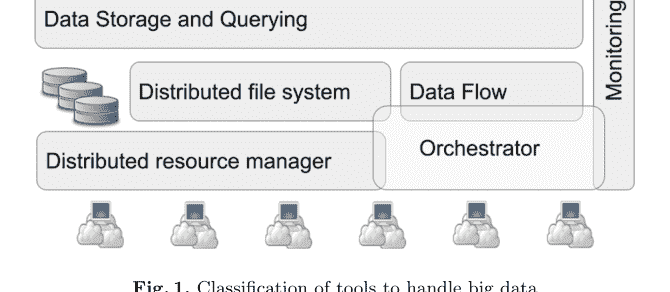

## 第 3 章
大数据展望、工具与架构

Hajira Jabeen(✉)

科隆大学植物研究所（CEPLAS），科隆，德国
hajira.jabeen@uni-koeln.de

**摘要.** 大数据是一种持续存在的现象，数据在众多的数字化场景中不断生成和处理。本章涵盖了“大数据”的历史，并旨在提供与大数据相关现有术语和赋能因素的概览。此外，本章还涵盖了为处理这种大规模数据而开发的知名技术、工具和架构。最后，本章回顾了解决大数据挑战（如异质性、互操作性、多样性）的知识图谱，这些挑战通过其专用表示方法得以解决。阅读本章后，读者可以建立起对大数据广泛谱系的理解，涵盖重要术语、挑战、处理技术及其与大规模知识图谱的联系。

## 1 引言

数字化转型影响了现代社会的几乎所有方面。过去十年间，自动化、移动性、互联网、物联网、健康及类似领域取得了巨大进步。这种增长导致了庞大的数据生成设施和数据捕获能力。

在第一部分“展望”中，我们回顾了大数据的定义和描述，讨论了大数据生成的驱动因素、大数据表现出的特征、大数据带来的挑战，以及通过创建数据价值链来处理这些数据的方法。在“工具和架构”部分，我们涵盖了用于实现大数据价值链的软件解决方案和架构。我们进一步介绍了与大数据相关的特征和挑战。部分“将大数据作为知识图谱进行利用”将知识图谱与大数据联系起来，阐述了处理大规模知识图谱的理由和现有工具。

## 2 大数据：展望

如今，大数据广泛存在于日常生活的各个方面及其之外。数据日益增长的趋势多年前已被预见并定义。值得注意的是，关于“大数据”这一术语的最早证据来自一篇 1997 年发表的论文 [87]，作者们在数据无法装入计算系统的主存（核心内存）或本地磁盘时，将其描述为*大数据*。根据《牛津英语词典》（OED），大数据的定义为：“规模非常大的数据，通常大到其操作和管理会带来重大的后勤挑战。”后来，当速度、多样性和体积这些术语被关联为大数据的特征时，“大数据”的新定义开始涵盖这些特征，如下所列：

-   1. “大数据是高容量、高速度和/或高多样性的信息资产，需要新的处理形式以实现增强决策、洞察发现和流程优化” [271,297]。
-   2. “当数据本身的大小成为问题的一部分，而传统的数据处理技术力不从心时” [288]。
-   3. 大数据是“其规模迫使我们要超越当时普遍采用的成熟方法的数据” [217]。
-   4. “大数据技术是一代新技术和架构，旨在通过实现高速度捕获、发现和/或分析，从大量和多样化的数据中提取价值” [470]。
-   5. “大数据是高容量、高速度和多样性的信息资产，需要具有成本效益的创新信息处理形式，以增强洞察和决策” [271]。
-   6. “大数据是一个涵盖使用技术来在合理时间范围内捕获、处理、分析和可视化潜在大型数据集的术语，而标准 IT 技术无法做到这一点。”由此延伸，用于此目的的平台、工具和软件统称为“大数据技术” [98]。
-   7. “大数据可以意味着大体积、大速度或大多样性” [414]。
-   8. “该术语用于指代如此庞大和复杂的数据集集合，以至于使用现有的数据库管理工具或传统数据处理应用程序难以处理”。
-   9. “大数据代表了具有如此高的容量、速度和多样性，需要特定技术和分析方法将其转化为价值的信息资产”²。

无论定义文本如何，大数据都是一种持续存在的现象并将持续下去。我们在下一节中简要概述了使大数据成为可能的关键赋能技术。

## 2.1 关键技术与业务驱动因素

早在 2000 年，数字信息仅占全球存储信息总量的四分之一³。其他信息主要是

¹ http://en.wikipedia.org/.
² http://en.wikipedia.org/.
³ https://www.foreignaffairs.com/articles/2013-04-03/rise-big-data.

存储在纸张、胶片或其他模拟介质上。相比之下，如今所有存储信息中只有不到2%是非数字的。大数据革命的关键推动因素是技术的进步，无论是互联网速度的提高、低成本手持移动设备的普及，还是从社交媒体到个人银行业务的无数应用。目前，各组织将数据的获取和拥有视为重要资产。世界经济论坛[315]的一份报告“大数据，大影响”宣称，“数据”是一种类似货币或黄金的资产。这一事实导致了商业模式的重大变化。此外，大规模获取和保留数据在组织中变得越来越普遍。突出的例子是谷歌、雅虎、亚马逊或脸书等互联网公司，它们由新的商业模式驱动。技术普及是大数据获取的主要推动因素之一。更廉价且易得的技术正被用于现代社会的几乎所有领域，无论是智能设备、移动设备、可穿戴设备，还是用于在云端存储数据的资源，这使客户能够购物、预订假期并实现其他功能。在下一节中，我们将介绍一些重要的大数据使能技术和关键驱动因素。

## 互联网。

互联网带宽和流媒体技术的进步使物理距离遥远的设备之间能够进行快速、高效的数据传输。全球各地的人们正通过移动设备访问互联网，联网设备的数量也在不断增加。互联网用户数量从2018年的40.21亿增加到2019年的43.9亿。截至2019年10月，活跃互联网用户接近44.8亿，占全球人口的58%[83]。在数字社会时代，需要一种能够快速传输大量数据的强大无线网络。目前，我们正从4G LTE向5G NR过渡，这将带来全新的应用和数据收集场景。5G不仅带宽更宽、速度更快，而且延迟更低。5G的低延迟在“指挥管弦乐队”⁴活动中得到了展示，该活动使不同地点的音乐家能够在布里斯托尔5G智慧旅游活动中进行表演。小提琴手安妮卡·萨克利夫在布里斯托尔演奏，米沙·多勒教授在伦敦市政厅演奏钢琴，歌手诺亚·多勒和小提琴手丽塔·费尔南德斯在伦敦尤斯顿的Digital Catapult。这些发展使人们能够以高速共享和管理大量数据。

## 自动化与数字化。

数字自动化是一个相对宽泛的术语，涵盖只需极少人工协助即可自动完成的任务，从而提高速度和准确性。企业越来越倾向于使用自动化工具来获得更高的吞吐量。例如，扫描系统等自动工具的进步不再需要人工录入，在实现更多可靠数据捕获的同时，简化并加速了流程。同样，在数字数据方面，相机和照片是另一个例子。2017年拍摄的数字照片数量估计为1.2万亿⁵，相当于居住在地球上的约75亿人每人约160张照片。随着越来越多的设备被数字化，越来越多的数据以机器可读的形式被创建和存储。行业和企业必须利用这些数据，使其为自己所用。

## 商品化计算。

商品化硬件，也称为现成的、非专有硬件，是指广泛可用的低成本设备。这些设备可以很容易地用类似设备替换，从而避免供应商锁定问题。“商品化集群计算”是指倾向于使用更多性能中等、成本较低的硬件进行并行工作（标量计算），而不是使用少数高性能、高成本的硬件。因此，商品化计算可以利用大量现有的计算资源进行并行和集群计算，而无需购买昂贵的超级计算机。商品化计算得到如下事实支持：可以使用软件解决方案在集群中构建多个冗余点，确保硬件故障时集群仍能保持运行。低成本的集群计算资源使在本地构建私有数据中心成为可能，并获得了内部大数据处理的好处。

## 移动计算。

手持智能设备越来越普遍，这得益于其可负担性的提高、相关性的增强和数字素养的提升。2018年有51.1亿独立移动用户，2019年有51.35亿，占全球人口的67%，据估计[83]，到2020年，全球近75%的人口将通过移动设备连接。移动计算的使用使几乎每个人都能访问和生成数据，在大数据的生成和共享中发挥着关键作用。

## 移动应用程序。

移动设备在当前的数据爆炸中发挥着关键作用。移动电话不再仅仅用于语音通话。目前，全球56%的网络访问来自移动设备。目前，全球超过57%的人口使用互联网，超过52%的人口使用移动设备[83]。企业开发移动应用不仅是为了辅助用户进行普适计算，也是为了生成和捕获感兴趣的数据。移动应用开发行业正在为几乎所有领域创建移动应用，现有移动应用涵盖了网上银行、网上购物、社交互动、旅行、餐饮、学习或娱乐等一系列任务。所有这些应用不仅有助于自动收集与任务相关的数据（例如订单），而且有助于生成以前难以生成的额外数据（例如将新订单与以前的购买行为关联起来）。

## 泛在设备（IoT）。

物联网（IoT）使网络连接和计算能力扩展到物体、传感器以及通常不被视为计算机的日常用品，从而使这些设备能够在最少人工干预的情况下生成、交换和消耗数据。这些设备不仅在数量上不断增加，以覆盖生活的不同方面，而且其灵敏度也在不断提高。根据GSMA报告[16]，2018年至2025年间，全球物联网连接数量将增长两倍，达到250亿。根据CGI[2]的估计，到2020年，物联网产生的数据总量将达到每年600泽字节（ZB）。

## 云基础设施。

云计算是指通过互联网在远程服务器上存储、访问和处理数据的术语。使用AWS [50]、Google Cloud Platform [264]、Cloudera [378]等云服务在云端存储和操作数据的能力，使得按需、按使用付费地存储和分析数据成为可能。云计算节省成本，提供更好的性能、可靠性、无限的容量和快速部署的可能性。云计算协助组织实现数据中心管理，并提供高效的数据处理设施。

## 2.2 大数据特征

在数字化转型的推动下，大数据具有几个关键属性。有趣的是，这些属性都以字母‘V’开头，因此也被称为大数据的V。随着技术的进步和底层业务需求的发展，特征属性的数量不断增加。在本节中，我们介绍用于描述大数据的主要V中的几个。

大数据的三个V [271, 489]

- 1. 体量：数据的规模正以前所未有的速度增长。它包括科学、教育、商业、技术和治理等所有领域产生的数据。以社交媒体巨头脸书（FB）为例，据报道，FB在24小时内产生约4PB数据，并拥有1亿小时的视频观看时间。FB用户每分钟创建400万个点赞，自成立以来已有超过2500亿张照片上传到脸书，相当于每天上传3.5亿张照片。除了应用程序外，网络、物联网和许多其他自动化工具也在不断产生海量数据。所有这些数据都必须被捕获、存储、处理和显示。

- 2. 速度：数据生成的速度多年来迅速提高。高速率和高速度得益于便携式设备使用量的增加，这些设备能够生成数据，以及不断增长的带宽能够实现快速数据传输。此外，数据生成的速率（来自物联网、社交媒体等）也在不断提高。例如，谷歌在任何一天每秒都会收到超过63000次搜索。而且，所有搜索中有15%是以前从未在谷歌上搜索过的。因此，

## 2.3 大数据的挑战

数据的特征与目标业务目标相结合，在处理大数据时带来了诸多挑战。本节简要介绍使用大数据所涉及的主要挑战。

异构性是大数据的主要特征之一，也被称为多样性。它是不同类型和格式的数据。异构数据给大数据分析带来了数据集成问题，使得难以获得期望的价值。数据异构的主要原因是数据来源分散，生成不同形式的数据。数据可以是来自电子邮件、推文或回复的文本数据；来自网络活动、传感和来自物联网的事件数据；以及其他形式。将这些数据集成以进行增值分析和积极决策是一个重要挑战。

### 数据的不确定性

从传感器、社交媒体、网络活动和内部记录等异构来源收集的数据由于噪声、不完整和不一致而本质上是不确定的（例如，社交网络中存在 80% - 90% 的缺失链接，而在诊所和健康领域，医生诊断的缺失属性值超过 90%）。从这些海量数据中发现价值的高效分析需要巨大的努力和资源。然而，随着数据量、多样性和速度的增加，数据固有的不确定性也在增加，导致对 resulting 分析和预测决策的信心存疑。

### 可扩展性

数据量正在急剧增加，因此处理数据的可扩展性是一个重要挑战。开发能够随数据增加而扩展，同时不影响准确性或效率的高效分析解决方案和架构也很重要。大多数现有学习算法无法适应新的大数据范式，例如处理缺失数据、处理部分数据访问或处理异构数据源。虽然大数据的问题复杂性正在以非常快的速度增加，但计算能力和解决方案能力并没有以类似的速度增加，这带来了一个关键挑战。

### 时效性

在寻找增值业务价值时，时机至关重要。它与在正确的时间捕获数据、执行分析和做出决策有关。在动态且快速发展的世界中，轻微的延迟（有时是微秒）可能导致错误的分析和预测。在虚假在线银行交易的一个案例中，必须及时否决交易以避免可能的资金损失。

### 数据安全

组织中数据的存储和交换造成了数据安全和隐私方面的挑战。随着数据量的增加，保护例如交易日志和数据、实时数据、访问控制数据、通信和加密数据变得很重要。此外，还必须跟踪数据来源，对日志和访问控制数据进行细粒度审计，以确定数据的任何滥用。此外，组织必须尊重合法使用数据与客户隐私之间的差异，并必须具备保护数据的正确机制。

## 2.4 大数据价值链

处理和处理大数据的能力对任何组织都至关重要。前面几节讨论了数据生成能力，以及处理大数据的特征和挑战。本节涵盖了为实现业务目标和目标而处理此类数据所需进行的活动和操作。价值链 [358] 一词用于定义组织为决策支持管理和服务交付产品而执行的活动链。价值链由一系列相互连接的子服务组成，每个子服务都有自己的输入、转换过程和输出。值得注意的服务如下所述。

- **数据采集。** 这是收集数据、过滤和清理数据以进行存储和分析的过程。数据采集至关重要，因为大数据采集所需的基础设施必须具有低、可预测的延迟以捕获数据以及回答查询。它应该能够在分布式可扩展环境中处理非常高的交易量，并且能够支持灵活和动态的异构数据。
- **数据分析。** 对原始数据进行解释并从数据中提取信息，以便可用于知情决策，这称为数据分析。根据数据的来源和使用情况，可能存在多种特定领域的分析。分析包括过滤、探索和转换数据以提取有用且通常隐藏的信息和模式。分析进一步分为商业智能、数据挖掘或机器学习。
- **数据策展。** 这是通过其生命周期对数据进行主动和持续管理 [350]。它包括从多个来源组织和集成数据，并确保数据满足其使用所需的质量要求。策展涵盖与受控数据创建、维护和管理相关的任务，例如内容创建、选择、验证或保存。
- **数据存储。** 这是持久的、可扩展的数据管理，能够满足需要频繁数据访问和查询的应用程序的需求。关系数据库管理系统几十年来一直是组织数据管理的事实标准；然而，其处理有限容量和结构良好的数据（ACID 属性，原子性、一致性、隔离性和持久性）的能力使其不适合处理具有多样性、除体积和速度之外的大数据。正在设计新型技术以专注于可扩展性并应对处理众多数据模型的各种解决方案。
- **数据使用。** 这是对数据的分析，涵盖协助业务决策制定的业务活动。分析是通过使用用于数据集成或查询的专用工具实现的。

## 3 工具和架构

### 3.1 大数据架构

已经提出了几种参考架构来支持大数据系统的设计。大数据架构是定义

用于摄取和处理“大数据”以达成业务目的的系统结构与行为。该架构可视为处理那些过于庞大或复杂、传统数据库系统难以应对的数据的摄取、处理和分析的蓝图。其目标是根据组织的业务需求设计解决方案。基于这些需求，所提出的解决方案必须能够处理不同类型的负载，如批处理或实时处理。此外，它还应能够对大规模数据执行分析和挖掘。

良好的架构设计可以帮助组织降低成本，助力更快、更好地做出决策，并预测未来需求或推荐新的解决方案。然而，创建这样一个系统并非易事，在设计最优架构时也存在某些挑战。

**数据质量：** 这是所有数据处理领域中的重要挑战之一。数据可能含有噪声、不完整或干脆缺失。需要大量的处理工作来确保最终数据的质量达到要求。众所周知，“数据准备工作约占数据科学家工作量的80%”。

**数据集成：** 架构必须能够处理来自不同来源的异构数据的集成。处理并整合来自多个来源、以不同速度到达的多种大小和形式的数据，是一项挑战。最终，系统应能对数据执行有意义的分析，以获取有价值的洞察。

**数据规模：** 设计一个能够在最优规模下运行且不过度预留资源的系统非常重要。同时，它还应能在不牺牲性能的情况下按需扩展。

为了符合数据价值链，任何大数据架构都包含能够执行所需操作的组件。

**数据源：** 组织的数据可能来自数据库、实时来源（如网络日志、活动数据、物联网设备）以及许多其他来源。架构中应包含数据摄取和集成组件，以处理这些数据源。

**数据摄取：** 如果数据来自实时来源，架构必须支持实时数据摄取机制。

**数据存储：** 根据数据源的数量和类型，高效的数据存储对大数据架构至关重要。在存在多种类型数据源的情况下，通常需要构建一个NoSQL“数据湖”。

**数据处理：** 系统中的数据需要被查询和分析，因此开发高效的数据查询解决方案或能够大规模处理数据的处理工具十分重要。这些处理解决方案可以是实时的，也可以是批量的，具体取决于数据来源和组织需求。

**数据分析：** 需要专门的分析工具用于商业智能分析，以从数据中提取有意义的洞察。

**数据报告与可视化：** 这些是用于根据分析数据制作报告并以可视化形式呈现结果的工具。

## 流程自动化：

在大数据架构管道中移动数据需要自动化编排。数据的摄取和转换、将其移至处理、存储、提取洞察以及生成报告，都必须在可重复的工作流中完成，以持续从数据中获取洞察。

根据数据类型和组织的具体需求，应通过选择相应的服务来处理所需的任务。为了支持这些任务和所选服务，需要设计实现数据价值链的整体架构。大数据架构主要分为以下三种主要类型：

## Lambda架构。

Lambda架构由Nathan [99]首次提出，解决了批次数据查询结果缓慢的问题，而实时数据则需要快速的查询结果。Lambda架构将实时（快速）查询结果与对较旧数据进行的批次分析查询（慢速）结合起来。Lambda架构为数据流创建了两条路径。所有进入系统的数据都经过这两条路径。批处理层：也称为冷路径，将所有传入数据以其原始形式存储，并对数据执行批处理。这为重新处理提供了便捷方式。该层执行长期运行的批处理过程，对大量历史数据进行分析。速度层：也称为热路径，对数据进行实时分析。该层专为低延迟而设计。该层根据所选时间窗口（例如1秒）对数据执行小型/迷你批处理，以分析最新数据。服务层：该层结合批处理和速度处理层的结果，使用户能够进行快速的交互式分析。

## Kappa架构。

Kappa架构由Jay Kreps [263]提出，作为Lambda架构的替代方案。与Lambda架构类似，Kappa架构中的所有数据都流经系统，但使用单一路径，即一个流处理系统。Kappa架构仅专注于数据流处理、实时处理或在线的离散事件处理。例如物联网事件、社交网络、日志文件或事务处理系统。该架构假设：事件是有序的，并记录到分布式文件系统中，并可随时按需读取。平台可以反复请求日志以在代码更新时进行重新处理。系统能够处理在线机器学习算法。

## 基于微服务的架构。

“微服务架构”在过去几年中兴起，用于描述一种特定的软件应用设计方式，即将应用设计为可独立部署的服务套件 [283]。微服务架构使用松散耦合的服务，这些服务可以独立开发、部署和维护。这些服务可以针对业务能力、自动化部署、端点智能以及语言和数据的去中心化控制而构建。

基于微服务的架构得益于众多技术进步，例如将应用程序实现为服务、用于服务部署的软件容器出现、容器编排、开发用于存储超出容器生命周期数据的对象存储、持续集成需求、自动化测试以及用于提高软件质量的代码分析。基于微服务的架构允许独立、快速地交付各个服务。在此架构中，大数据架构的所有组件均被视为可在集群上部署的服务。

## 3.2 大数据处理工具

为了处理大数据，人们创建了种类繁多的专门工具。本节将根据现有工具的功能对其进行概述。一个处理大数据的分布式平台由完成以下任务所需的组件构成。我们将在前面各节中介绍为执行这些特定任务而开发的工具（图1）。

资源编排。分布式协调和共识是分布式系统的支柱。分布式协调处理诸如告知每个节点集群中的其他节点以及促进通信和高可用性等任务。高可用性保证了调解节点的存在，并通过复制避免单点故障，从而形成容错系统。在分布式环境中，节点必须共享通用配置和运行时变量，并可能需要在分布式键值存储中存储配置数据。分布式协调负责管理节点间在运行时的锁、共享变量和实时配置的共享。

此外，容错分布式系统包含处理共识问题的方法，即分布式系统中的服务器或中介就某些值或变量达成一致，例如，可以达成这样的共识：一个由7台服务器组成的集群，如果有4台服务器宕机，即只有3台服务器成功运行时，仍能继续运作。流行的编排工具是 Apache ZooKeeper 和 etcd。这些系统是一致的，并提供可在复杂分布式系统中使用的基本原语。这类分布式编排器简化了分布式应用程序的开发，使其更通用且更具容错性。

Apache ZooKeeper：Apache ZooKeeper [209] 是一个起源于 Hadoop 生态系统的开源项目，已被许多顶级项目使用，包括 Ambari、Mesos、Yarn、Kafka、Storm、Solr 等（将在后续章节讨论）。ZooKeeper 是一种用于管理集群配置信息、命名以及分布式同步和协调的集中式服务。它是一个分布式键值存储，通过共享的分层数据寄存器（znodes）命名空间（类似于文件系统）来协调分布式进程。ZooKeeper 提供高吞吐量、低延迟、高可用性以及对 znodes 的严格有序访问。ZooKeeper 用于大型分布式集群，提供容错和高可用性。这些特点使其能够用于大型复杂系统，以实现高可用性和同步，从而保证弹性运行。在这些复杂的分布式系统中，ZooKeeper 可以被视为一个集中式存储库，分布式应用程序在此读写数据。它利用自身的同步、序列化和协调能力，使分布式应用程序作为一个整体协同运行。

Etcd：Etcd [1] 是一个强一致性的分布式可靠键值存储，简单、安全且快速。它提供了一种可靠的方式来存储需要被分布式系统访问的数据，以实现一致的集群协调和状态管理。etcd 这个名字源于 Unix 中用于全局配置的“/etc”目录的分布式化。它能优雅地处理领导者选举，并且能够容忍机器故障，即使是领导者节点出现故障也不例外。etcd 中的领导者处理所有需要共识的客户端请求。像读取这样的请求可以由任何集群节点处理。领导者接受新更改，并在跟随者验证收到后复制和提交这些更改。

Etcd 使用 Raft 协议来维护状态更改事件的日志。它采用全量复制，即每个节点上都有全部数据，从而使其具有高可用性。这也使得任何节点都可以充当领导者。应用程序可以向 etcd 读写数据，它可用于存储数据库连接详细信息或功能开关。这些值可以被监视，当值发生变化时，应用程序可以重新配置自身。此外，etcd 的一致性可用于实现领导者选举或分布式锁。etcd 被用作 Kubernetes 和 Cloud Foundry 的协调机制。AWS、Google Cloud Platform 和 Azure 也在生产环境中使用它。

## 资源管理。

大数据平台运行在一组分布式计算和内存资源之上。资源管理器负责以 CPU 时间和内存使用量来执行资源分配任务。在集群中，通常同时部署多个应用程序，例如，在同一集群中，像 Apache Spark 这样的分布式应用与像 Apache HBase 这样的分布式存储数据库并行运行是很常见的。资源管理器是一种在系统中所有应用程序之间仲裁资源的权威机构。此外，资源管理器还负责在调度器或应用程序主控器的帮助下进行作业调度。

### YARN：

又一个资源管理器（YARN）[444] 是 Hadoop 生态系统的重要组成部分，主要支持 Hadoop 工作负载。在 YARN 中，应用级资源管理器是一个专用调度器，它运行在主守护进程上，并将资源分配给请求的应用程序。它保持对集群中所有资源的全局视图，并通过调度请求和将资源分配给请求的应用程序来处理资源请求。它是 Hadoop 集群中的关键组件，运行在专用的主节点上。资源管理器有两个组件：调度器和应用程序管理器。应用程序管理器接收作业提交，寻找执行 ApplicationMaster 的容器，并在发生故障时帮助在另一个节点上重启 ApplicationMaster。ApplicationMaster 是为每个应用程序创建的，负责从调度器分配适当的资源、跟踪其状态并监控其进度。ApplicationMaster 与节点管理器协同工作。节点管理器运行在从守护进程上，负责在每个节点上执行任务。它监控节点的资源使用情况并报告给资源管理器。YARN 一次只关注一个方面的特点使其具有可扩展性、通用性，并能支持多租户集群。YARN 的高可用版本使用 ZooKeeper 来实现自动故障转移。

### Mesos：

Apache Mesos 是一个开源集群管理器 [233]，通过动态资源共享和隔离来处理分布式环境中的工作负载。它也被称为分布式系统内核。Mesos 工作在应用层和操作系统之间，通过资源管理使在大型分布式集群中管理和部署应用程序变得更加容易。它利用现代内核在资源隔离、优先级、限制和记账方面的特性，在更高的抽象层次上将集群转变为单一的大型资源池。Mesos 还使用 ZooKeeper 来实现高可用性和从主节点故障中恢复。由于 Mesos 作为微内核工作，它执行的是微缩级别的资源管理。

## 数据流：消息传递。

消息传递对于必须处理实时数据的分布式大数据应用至关重要。这些数据可能是事件日志、用户活动、传感器信号、股票交易、银行交易等等。高效且无故障地摄取这些实时数据对于实时应用至关重要。实时流式应用和数据流需要消息传递解决方案。

顾名思义，消息传递工具协助大数据处理管道的软件组件之间的通信。这些系统通常通过使用消息代理来解耦发送方和接收方，消息代理向应用接口隐藏了操作系统或网络接口等实现细节。这创建了一个通用的消息传递平台，也便于开发人员开发。消息传递管道的应用包括网站活动监控、指标收集、日志聚合等。下面我们简要讨论实时大数据应用中常用的 Apache Kafka。

**Apache Kafka：** Apache Kafka [147] 是一个使用发布-订阅机制的分布式消息传递系统。它最初在 LinkedIn 开发，用于支持高吞吐量的持续、弹性消息传输。Kafka 是一个快速、可扩展、持久且容错的系统。它以称为主题（topics）的类别来维护消息流。这些主题用于存储来自生产者的消息，并将其传递给订阅了该主题的消费者。

Kafka 是一个持久化、高容量的消息代理，使应用程序能够处理、持久化和重新处理流式数据。Kafka 具有简单的路由方法，使用路由键将消息发送到主题。Kafka 提供的性能远高于 RabbitMQ 等消息代理。其提升的性能使其适合在有限资源下实现高吞吐量（每秒数百万条消息）。

## 数据处理。

数据处理和获取有助于收集、选择、过滤和清理接收和生成的数据。这些数据随后可以存储在数据仓库或其他存储解决方案中，以便进一步处理并获取洞察。

**Apache Flume：** Apache Flume [198] 是一个从多个来源收集海量流式事件数据、聚合数据并将其移入 HDFS 的框架。它用于收集、聚合和移动大量流式数据（如日志文件、来自网络流量、社交媒体、电子邮件等各种来源的事件）到 HDFS。Flume 提供可靠的消息传递。Flume 中的事务基于通道，每条消息维护两个事务（一个发送方和一个接收方）。如果读取速率超过写入速率，Flume 会在读取和写入操作之间提供稳定的数据流。Flume 允许将来自多台服务器（和来源）的数据摄取到 Hadoop。

**Apache Sqoop：** 大多数较老的公司将其数据存储在 RDBMS 中，但随着数据量增长到超过 TB 级别，迁移到 HDFS 变得很重要。Apache Sqoop [428] 是一种旨在以高效方式在关系型数据存储（如 RDBMS）和 Hadoop 之间传输批量数据的工具。Sqoop 将数据从外部数据存储导入 HDFS，反之亦然。它还可以用于填充 Hive 和 HBase 中的表。Sqoop 使用基于连接器的架构，支持插件以提供与外部系统的平滑连接。

## 数据处理

数据流处理技术主要分为批量（历史数据）处理系统和流式（实时）处理系统两大类。

批量处理系统是高吞吐量系统，用于处理在一段时间内收集的大量数据。数据经过收集、输入、处理后生成批量结果，因此属于高延迟系统。

流式处理系统是高吞吐量且低延迟的系统，即系统持续接收不断变化的数据（例如交通控制、传感器数据、社交媒体），并实时处理数据以产生实时洞察。流式处理主要有三种方式：至少一次、至多一次和恰好一次。

直到几年前，这两种处理系统之间还存在明显区别。然而，近年来诸如 Apache Spark 和 Apache Flink 等技术能够同时处理这两种类型，从而削弱了这一区别。我们将在后续章节中讨论一些关键技术。

### Hadoop MapReduce

Hadoop 是一个用于分布式存储和分析超大数据集的平台。它有四个主要模块：Hadoop Common、HDFS、MapReduce 和 YARN [153]。MapReduce 是 Hadoop 的分布式数据处理引擎。它是一种编程模型，并提供了一个软件框架，用于编写并行处理超大量数据的分布式应用程序。MapReduce 分两个阶段处理数据：映射阶段和归约阶段。在映射阶段，框架从 HDFS 读取数据。每个数据集称为一个输入记录，并会被拆分为独立的数据块，由映射任务并行处理。在归约阶段，映射阶段的结果会被处理并存储。存储目标可以是数据库、HDFS 或其他系统。使用 MapReduce 需要低层次的专门设计，即数据需要以某种方式存储，以便在需要时能够快速访问。非传统的、相对较新的 NoSQL（不仅仅是 SQL）存储正是为高效且有效地处理这些大数据而设计的。

数据需求。不仅支持动态模式设计，而且与关系数据库相比，它们还提供了更高的灵活性、可扩展性和定制性。这些存储专为支持分布式环境而构建，能够随着需求增长通过添加新节点进行水平扩展。与CAP定理（该定理指出分布式系统只能在一致性、可用性和分区容错性中保证至多两个属性）一致，NoSQL存储以牺牲一致性为代价，换取高可用性和可扩展性。通常，NoSQL存储支持灵活的数据模型，提供简单的接口，并通过放弃ACID（原子性、一致性、隔离性和持久性）事务，转而采用BASE（基本可用、软状态、最终一致）事务模型来使用弱一致性模型。根据这些系统支持的数据模型，NoSQL数据库可分为四类：键值存储、文档存储、列式存储和图数据库。以下部分将更详细地描述这些NoSQL数据库模型，并列举每种模型的一些技术示例。

## 键值存储：

键值存储可归类为最简单的NoSQL数据库。这些存储专为以键值对的形式存储无模式数据而设计。键是数据的唯一标识符，也可用作访问数据的索引。值以属性或复杂对象的形式包含实际数据。并非所有值都必须具有相同的结构。

示例：Redis、Riak KV、Amazon DynamoDB、Memcached、Microsoft Azure Cosmos DB等。

## 文档存储：

文档存储建立在键值存储的概念之上。它们将每个键与一个描述为文档的复杂数据结构配对。这些文档可能包含不同的键值对、键数组对，甚至嵌套文档。文档存储专为存储、检索和管理面向文档的信息（也称为半结构化数据）而设计。与关系数据库中的记录不同，这里没有所有文档都必须遵循的模式。每个文档都被分配一个唯一键，用于检索该文档。但是，也可以通过查询文档的内部结构来访问文档，例如搜索具有指定值的字段。查询接口的能力通常取决于编码格式，如XML或JSON。

示例：CouchDB、MongoDB

## 列式存储：

列式存储也称为宽列存储和可扩展记录存储。它们连续存储每一列，即在磁盘或内存中，每一列以顺序块的形式存储。这些数据库不是按行存储数据，而是将数据表存储为数据列的区段。因此，与传统的面向行的数据库相比，这些存储能够实现更快的基于列的分析。

示例：Apache HBase、Cassandra

## 4 利用知识图谱驾驭大数据

如今，“大数据”一词可能具有误导性，因为数据规模只是数据众多重要方面之一。“大”这个词助长了一种误解，即更多的数据意味着更好的数据和更深刻的洞察。然而，重要的是要认识到，仅凭数据量并不足以获得良好的答案。我们分发、组织、整合和表示数据的方式，其重要性不亚于数据本身的大小，甚至可能更为重要。在本节中，我们将简要介绍数据的多样性或异质性，以及将数据组织为图的可能性。与其他数据模型（如数据库模型）相比，将数据组织为图具有若干优势。图在大多数领域为知识提供了更直观、更简洁的抽象。图将实体编码为节点，并将其关系编码为实体之间的边。例如，在社交互动中，边可以代表友谊、合著关系、同事关系或其他类型的关系，而人则表示为节点。图能够编码灵活、不完整、与模式无关的信息，这在关系场景中通常是不可能实现的。许多图查询语言不仅支持连接等标准操作，还支持任意路径查找等专用操作符。同时，基于本体论的形式化知识表示格式也可用于创建语义连贯、结构化的表示（RDF、RDFS）的图。“知识图谱”一词在2012年由谷歌推广，口号是“事物而非字符串”，其论点是字符串可能产生歧义，但在知识图谱中，实体（知识图谱中的节点）可以通过利用其与其他实体的关系（边/属性）更容易地消除歧义。文献中提出了许多知识图谱的定义，一个近期且通用的定义将“知识图谱描述为一种数据图，旨在积累和传达真实世界的知识，其节点代表感兴趣的主体，其边代表这些主体之间的关系”[199]。大量公共、开放、跨领域的知识图谱已被创建并发布在网上。示例包括DBPedia、Wikidata或YAGO，它们要么由社区创建，要么从维基百科提取知识。针对特定领域的开放知识图谱也已发布，涵盖地理、生命科学和旅游等领域。同时，许多企业知识图谱（大多是内部使用的）由IBM、Amazon、Facebook、LinkedIn等众多公司创建。这些知识图谱的创建主要涉及三种方法。

- **人工策展**，例如 Cyc、Wikidata、Freebase 等。
- **使用半结构化源创建**，例如 Wikipedia（来自维基百科信息框）、YAGO（WordNet、Wikipedia 等）、BabelNet 等。
- **从非结构化源创建**，例如 NELL（自由文本）、WebISA（自由文本）。

如上所述，这种图可以以与模式无关的方式创建，也可以使用正式的本体来创建，本体定义了给定领域中的概念和类别集合及其属性和关系。知识图谱中包含的知识可以围绕两个主要维度进行描述：a) 单一领域的覆盖范围，可以通过实例数量来定义。实例描述了给定知识图谱在特定领域所涵盖的细节，实例越多意味着细节越丰富。覆盖面还可以通过断言数量（即图中包含的关系）来进一步定义。此外，链接度（平均、中位数）也有助于估算图的覆盖范围。对于 b) 知识覆盖（多领域），可以考虑模式中的类数量、关系数量、类层次结构（深度和宽度），或者模式的复杂性，这些都有助于评估给定知识图谱所覆盖知识的广度和深度。在实践中，图的大小可能相差多个数量级，但较小图的复杂性（链接度）仍然可能更高。同样，底层模式可能很简单，也可能相当深入和详细。每个类的实例数量可能各不相同；相反，每个类的实例可能较少，但覆盖的类总数更多。总之，知识图谱在规模、覆盖范围和详细程度方面差异很大。

### 4.1 图存储

为了处理这种相对新潮的知识表示格式的大规模数据，已经开发了多种工具，可分为两类：一类较通用且简单，如图数据库；另一类相对正式，专门针对RDF数据，称为三元组存储。

**图数据库。** 图数据库基于图论，使用节点和边以图结构存储数据，节点和边通过关系相互连接。这些数据库专为包含相互关联元素的数据而设计，元素之间的关系数量不确定。图数据库通常提供免索引邻接，即每个元素包含指向其相邻元素的直接指针，无需进行索引查找。示例：Neo4J、FlockDB、HyperGraphDB。

**三元组存储。** 三元组存储是用于管理以RDF建模的数据的数据库管理系统。RDF数据可以被视为有向标记图，其中弧以主语URI开始，以谓语URI标记，最终指向宾语URI或标量值。可以使用SPARQL查询语言查询这些RDF数据。三元组存储可分为三类：原生三元组存储——从零开始利用RDF数据模型构建的三元组存储，以有效存储和访问RDF数据。示例：Stardog、Sesame、OWLIM。基于RDBMS的三元组存储——通过在现有RDBMS之上添加RDF专用层构建的三元组存储。示例：OpenLink Virtuoso。基于NoSQL的三元组存储——通过在现有NoSQL数据库之上添加RDF专用层构建的三元组存储。示例：CumulusRDF（构建在Cassandra之上）。

高效处理大规模知识图谱需要使用分布式文件系统、分布式数据存储和分区策略。除了几个集中式系统之外，许多最近的图处理系统都是基于现有的分布式框架构建的，例如 Jena-HBase [241] 和 H2RDF [341]、H2RDF+ [342] 使用 HBase，Rya [363] 使用 Accumulo，D-SPARQ [320] 使用 MongoDB，S2RDF [385]、S2X [384]、SPARQLGX [168] 和 SparkRDF [78] 使用 Apache Spark 处理 RDF 数据。将数据表示为图的主要思想不仅是查询数据，还包括高效的知识检索，包括推理、知识库补全、（从其他来源）丰富、实体链接与消歧、路径挖掘以及许多其他形式的分析。从最近的许多综述 [192, 235, 473] 可以看出，文献中已经提出了若干系统来处理大规模知识图谱处理的众多方面中的一个或几个。认识到这一差距以及需要一个可扩展的框架来满足大规模知识图谱的不同任务是很重要的。

## 5 结论

本章将大数据与知识图谱这两个术语联系起来。本章的第一节概述了大数据、其主要使能技术、大数据的关键特征、它带来的挑战，以及创建大数据价值链所需的必要活动。在第二节中，我们介绍了大数据架构，并提供了大数据处理引擎的分类。在最后一节中，我们将大数据与本书第1章和第2章所涵盖的大规模知识图谱联系起来。我们讨论了一些关键技术，并探讨了利用大规模知识图谱的可能性和关键挑战。

**开放获取** 本章采用知识共享署名4.0国际许可协议（http://creativecommons.org/licenses/by/4.0/）的条款授权，允许以任何媒介或格式使用、共享、改编、分发和复制，前提是您对原作者和来源给予适当的署名，提供知识共享许可协议的链接，并注明是否进行了修改。

本章中的图像或其他第三方材料包含在本章的知识共享许可协议中，除非在材料的署名行中另有说明。如果材料未包含在本章的知识共享许可协议中，并且您的预期用途不受法律法规允许或超出允许范围，您需要直接从版权持有人处获得许可。

架构
