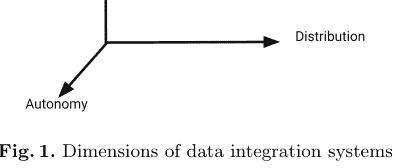
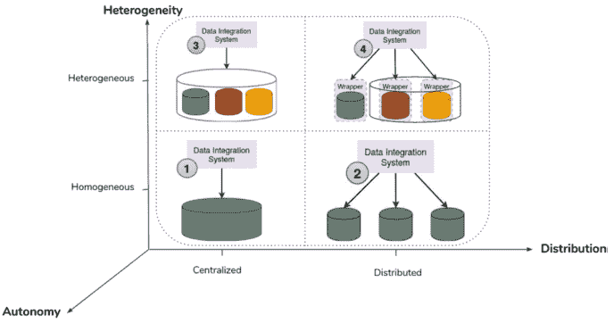
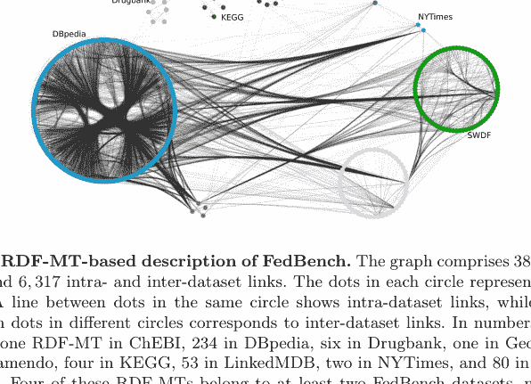

## 第5章
联邦查询处理

Kemele M. Endris¹²， Maria-Esther Vidal¹，以及 Damien Graux³

¹ 德国汉诺威TIB莱布尼茨科学技术信息中心
² 德国汉诺威L3S研究中心
endris@L3S.de
³ 爱尔兰都柏林圣三一学院ADAPT SFI研究中心

**摘要。** 大数据通过工业数字化和新兴的跨学科研究，在促进制造业和科学发展方面发挥着重要作用。语义网技术也取得了巨大进步，科学界和从业者通过本体模型、受控词表、关联数据集、数据模型、查询语言以及将大数据转化为可用于决策的知识的工具，为大数据管理问题做出了贡献。尽管大数据和语义网技术产生了重大影响，但我们正在进入一个新的时代，诸如基因组学等领域预计将在未来十年内快速增长。在这个新时代，整合大数据需要新颖且可扩展的工具，不仅要支持大数据摄取和治理，还要支持高效的大规模探索和发现。联邦查询处理技术提供了一种解决方案，可以扩展到分布在多个数据源中的海量数据。联邦查询处理技术借助源描述来识别与查询相关的数据源，并找到高效的执行计划，以最小化查询的总执行时间并最大化答案的完整性。本章总结了联邦查询引擎的主要特征，回顾了该领域的当前状态，并概述了仍然开放且代表该领域重大挑战的问题。

## 1 引言

近几十年来，数据集合的数量和种类呈指数级增长，预计未来几年还将保持类似的增长率。为了将海量异构数据转化为可据此采取行动的知识，必须解决数据集成和查询处理等基本问题。数据集成要求有效识别那些虽然描述不同但对应于同一现实世界实体的实体。此外，数据通常以无数非结构化格式摄取，并且可能因偏差、歧义和噪声而导致质量下降。这些问题影响了数据集成解决方案的复杂性。大数据的语义集成通过解决多种互操作性冲突来体现多样性 [159,446]，例如结构化冲突、模式冲突、表示冲突、完整性冲突、粒度冲突和实体匹配冲突。冲突的产生是因为数据源可能具有不同的数据模型或者根本没有模型，遵循不同的数据表示方案，并且包含互补的信息。此外，一个现实世界的实体可能使用不同的属性或以不同的详细程度来表示。因此，需要能够解决互操作性问题，同时应对大数据特征所带来的数据复杂性挑战的技术 [402]。

针对异构数据集上的查询处理问题，现有解决方案依赖于统一接口来克服互操作性问题，通常基于元模型 [224]。已经提出了不同的方法，主要关注数据摄取以及元数据提取和管理。典型的系统包括GEMMS [365]、PolyWeb [244]、BigDAWG [119]、Ontario [125] 和 Constance [179]。这些系统收集有关异构数据集合主要特征的元数据，例如格式和查询能力。此外，它们借助全局本体来描述数据集之间的上下文信息和关系。对数据属性和能力的丰富描述已被证明对于使这些系统能够有效执行查询处理至关重要。

在语义网的背景下，联邦查询处理问题也得到了积极研究。因此，已经定义了多种联邦SPARQL查询引擎，使用户能够在SPARQL端点的联合体上执行查询。最先进的技术包括FedX [389]、ANAPSID [6] 和 MULDER [124]。FedX实现了自适应技术来识别评估查询的相关数据源。它能够即时联系SPARQL端点，以确定原始查询的哪些子查询可以在联邦的端点上执行。ANAPSID利用关于RDF数据集上使用的词汇表的元数据来执行源选择。基于选定的源，ANAPSID分解原始查询，并找到有效的计划来增量地收集答案。最后，MULDER借助基于数据集词汇表的类和关系的RDF数据集描述。MULDER提出了RDF分子模板（RDF-MTs）的概念来描述数据集，并高效地执行源选择和查询规划。丰富的联邦查询引擎库恰恰揭示了针对RDF数据集查询处理的重要性，以及数据库和语义网社区对该问题的关注程度。

本工作的贡献总结如下：

-   描述了数据集成系统的概念，并分析了影响系统复杂性的不同参数。
-   刻画了联邦查询引擎面临的挑战，并分析了联邦查询处理领域的现状。
-   讨论了该领域重大挑战的分析和未来方向。

本章的其余部分结构如下：第2节概述了数据集成系统及其在异构数据源上访问和处理查询问题中所扮演的角色。

第3节描述了联邦查询处理的问题、联邦查询引擎需要解决的主要挑战以及当前技术水平。最后，第4节概述了重大挑战和未来方向。

## 2 数据集成系统

海量数据正在发布到网络上 [379]。此外，由于数据收集、生成和存储方面的技术进步，企业内部也在生成和存储不同的数据源。这些数据源彼此独立创建，可能属于不同的管理实体。因此，它们具有不同的数据表示格式以及访问接口。数据源的这些特性阻碍了对其中可用信息的利用。数据集成是为一组分布式的（或去中心化的）、自治的和异构的数据源提供统一访问的过程 [114]。数据集成系统提供一个全局模式（也称为中介模式），以提供对不同数据源中所有可用数据的协调视图。应建立全局模式与源模式之间的映射，以组合集成过程中所考虑的数据源中的数据。通常，数据集成系统形式化定义如下 [280]：

**定义 1 （数据集成系统）。**

*数据集成系统 I 被定义为一个三元组* ⟨G， S， M⟩, *其中：*

-   *G* 是全局模式，用语言 L_G 在字母表 A_G 上表达。该字母表包含 G 中每个元素对应的符号。
-   *S* 是源模式，用语言 L_S 在字母表 A_S 上表达。字母表 A_S 包含每个源元素对应的符号。
-   *M* 是 G 和 S 之间的映射，由一组以下形式的断言组成：q_S → q_G， q_G → q_S；其中 q_S 和 q_G 分别是源模式 S 上和全局模式 G 上的两个同元查询。断言规定了全局模式元素与源模式元素之间的联系。

定义模式映射是数据集成系统的主要任务之一。模式映射是对数据源中的数据与全局模式之间对应关系的规范说明。映射决定了用户使用全局模式提出的查询如何通过转换为存储数据的数据源的模式来回答。在数据集成系统的文献中，已经提出了两种基本的方法来指定这种映射，即*全局即视图 (GAV)* [140， 180] 和*局部即视图 (LAV)* [282， 433]。

使用全局即视图（GAV）方法定义的规则将全局模式中的概念定义为数据源上的一组视图。使用GAV方法，M中的映射规则用全局模式中的每个元素来定义源模式S中的概念。对全局模式G提出的查询需要通过使用在M中定义的视图重写查询来进行重构。这种重写也称为*查询展开*——即重写查询的过程。

将定义在全局模式上的查询转换为仅引用源模式的查询。从概念上讲，GAV 映射直接指定了如何从源中的元组计算全局模式关系元组。GAV 映射的这一特性使其更容易进行查询展开策略。然而，在 GAV 方法中添加和删除源可能涉及更新全局模式中的所有映射，这需要了解所有源。使用 Local-as-View（LAV）方法指定的映射将数据源描述为全局模式上的视图，与 GAV 方法相反，GAV 方法将全局模式定义为数据源上的视图。使用 LAV 方法，映射规则 M 将定义在全局模式 G 上的查询与源模式 S 的每个元素关联。在 LAV 中添加和删除源比 GAV 更容易，因为数据源是相互独立描述的。此外，它允许表达不完整的信息，因为全局模式表示一个数据库，其元组是未知的，即 LAV 方法定义的映射 M 可能不包含全局模式 G 中所有元素的对应源。因此，LAV 中的查询 answering 可能涉及查询不完整信息，这在计算上更昂贵 [114]。

在本章中，我们定义了一种源描述模型，RDF 分子模板（RDF-MT），基于 GAV 方法对具有相同特征的实体进行抽象描述。全局模式被定义为从联邦中每个数据源提取的 RDF-MT 的合并。基于规则的映射，例如 RML，用于定义异构数据源的 GAV 映射。RDF-MT 根据本体定义的语义描述进行合并，例如在 RDFS 中。

## 2.1 数据集成系统的分类

数据集成系统可以根据以下三个维度进行分类：自治性、分布性和异构性 [338]，图 1。自治性维度描述了集成系统允许集成中的每个数据源独立运行的程度。数据源对其数据模型、模式和演化具有自主权。此外，数据源可以在任何时候加入或离开集成系统，以及选择哪些数据片段可供集成系统及其用户访问。*分布*维度指定数据在计算机网络中物理分布。这种分布（或去中心化）可以通过受控分布或数据提供者的自主决策来实现。最后，*异构性*可能由于系统的自主开发导致不同的解决方案，原因例如对同一现实世界概念的不同理解和建模、技术环境以及应用的特定要求 [338]。尽管数据源存在不同类型的异构性，但与数据互操作性相关的重要的异构性与数据模型、语义和接口异构性有关。数据模型异构性捕获了由各种建模技术创建的异构性，使得每个数据模型具有不同的表达能力和限制，例如关系表、属性图和 RDF。语义异构性涉及每个源中数据和模式的语义。存储在每个源中的数据的语义通过其在模式元素中的含义的显式定义来定义。最后，如果集成系统中的数据源通过不同的查询语言访问，则存在接口异构性，例如 SQL、Cypher、SPARQL 和 API 调用。

图 1. 数据集成系统的维度

**图 2.** 数据集成系统的分类

图 2 显示了数据集成系统相对于分布性和异构性维度的不同分类。第一种类型的数据集成系统，图 2.(1)，在将异构数据从数据源加载到集中存储后，将其转换为通用数据表示格式。第二种类型的数据集成系统，图 2.(2)，支持跨网络分布的数据；然而，它们仅支持如果系统中的数据源在数据模型和访问方法方面是同构的。第三种类型的数据集成系统，图 2.(3)，支持集成系统中数据源之间的数据异构性。然而，这些数据集成系统以集中方式管理，并且数据存储在分布式文件系统（DFS）中，例如 Hadoop¹。最后，第四种类型的数据集成系统，图 2.(4)，支持跨网络分布的数据以及数据源的异构性。此类数据集成系统利用特殊软件组件使用本地查询语言和访问机制从数据源中提取数据。它们还可以将从源提取的数据转换为集成系统定义的数据表示。集成系统中的数据源也可能是自治的。此类系统与第三种类型不同之处在于数据如何分布和存储。虽然第四种类型支持任何存储管理，包括 DFS，但第三种类型的数据集成系统仅以集中方式支持 DFS。大部分分布任务由文件系统处理。例如，数据可能存储在多模态数据管理系统或仅基于分布式文件系统（DFS）的数据湖存储中。在第三种类型的数据集成系统中，数据从原始源加载到集中存储以进行进一步处理。联邦查询处理系统在数据源自治时属于第二种和第四种类型的集成系统。

数据集成系统还必须确保访问和集成的是当前（新鲜）的数据。特别是对于基于 DFS 的数据湖，图 2.(2)，和集中式，图 2.(4)，集成系统，原始数据源的更新应传播以保证数据的时效性。此外，当从提供者访问原始数据源受到限制，或管理本地副本中的数据是首选时，集成系统图 2.(1) 和 (3) 需要通过传播更改来保证数据新鲜度。

## 2.2 大数据时代的数据集成

在大数据的时代，结构化、半结构化和非结构化数据正以前所未有的速度产生。集成不同数据源的大数据系统需要高效有效地处理数据的这些特征。一般来说，大数据被定义为其体积、获取速度、数据表示、真实性和潜在价值超过传统数据管理系统处理能力的数据 [77]。大数据以 5V 模型为特征：*Volume* 表示数据生成和收集的规模越来越大。*Velocity* 表示数据被快速生成和收集。*Variety* 表示数据类型、格式、结构化和数据生成规模的异构性。*Veracity* 指数据中的噪声和质量问题。最后，*Value* 表示从处理和挖掘大数据中可以获得的好处和有用性。

数据集成的两种数据访问策略是：*schema-on-write* 和 *schema-on-read*。在 schema-on-write 策略中，数据在加载到存储库之前会根据预定义模式进行清洗、组织和转换。在 schema-on-read 策略中，原始数据按原样加载到存储库，模式仅在数据需要处理时才定义 [27]。数据仓库提供通用模式并要求提前进行数据清洗、聚合和转换，因此遵循 schema-on-write 策略。为了提供可扩展和灵活的数据发现、分析和报告，提出了 *数据湖*。与数据仓库不同，数据在转换到目标模式和数据表示后才加载到存储库，数据湖以原始格式存储数据，即 schema-on-read 策略。数据湖为原始数据提供中央存储库，使其立即可供用户使用，并将任何聚合或转换任务推迟到数据分析阶段，从而解决了信息孤岛断开的问题，这是由于孤立存储库中非集成的异构数据源具有多样化的模式和查询语言所致。此类中央存储库可能包括不同的数据管理系统，例如分布式文件系统、关系数据库管理系统、图数据管理系统以及用于专用数据模型和存储的 triple stores。

## 3 联邦查询处理

联邦查询处理系统²，为一组自治、分布和异构的数据源提供统一的访问接口。虽然分布式查询处理系统可以控制每个数据集，但联邦查询处理引擎对联邦中的数据集没有控制权，数据提供者可以随时加入或离开联邦并独立修改其数据集。在联邦中数据源的上下文中进行查询处理比集中式系统更困难，因为涉及影响查询处理引擎性能的不同参数 [114]。联邦中的数据源可能包含关于实体的片段数据，具有不同的处理能力，支持不同的访问模式、访问方法和操作符。联邦查询引擎的角色是将以全局模式表达的查询，即联邦查询，转换为以数据源模式表达的等价查询，即本地查询。本地查询代表联邦查询由联邦数据源实际执行的执行计划。联邦查询到本地查询的转换需要在有效性和效率方面都表现良好。查询转换是有效的，如果生成的查询与原始查询等价，即原始查询和转换后的查询产生相同的结果。另一方面，查询转换是高效的，如果转换后查询的执行策略使用最少的计算资源和通信成本。生成

**图 3.** 联邦查询处理的基本组件

选择高效的执行策略是很困难的，因为可以生成许多等价且正确的转换，每种等价执行策略都会导致不同的资源消耗 [338]。联邦查询处理的主要目标是将一个针对数据源联邦提出的查询，转换为由该联邦各个数据源上的子查询并集所组成的查询。此外，生成查询计划是为了加速所选数据源上每个子查询的处理，并将结果收集到查询答案中。在联邦数据源环境下，查询处理的一个重要部分是查询优化，因为许多执行计划都是同一联邦查询的正确转换。应保留能使资源消耗优化（最小化）的那个计划。查询处理性能可以通过查询处理所需的总成本和查询的响应时间（即执行查询所花费的时间）来衡量。

随着 RDF 数据模型日益流行，公开可用的 RDF 数据集在数量及规模上不断增长。这一趋势带来的挑战之一是如何在一组自主 RDF 数据集上高效且有效地执行查询。Saleem 等人 [380] 研究了具有 Web 访问接口的联邦 RDF 查询引擎。基于其调查结果，作者将联邦方法分为三大类：基于 SPARQL 端点的查询联邦、基于链接数据（通过 URI 查找）的查询联邦，以及基于分布式哈希表的查询联邦。此外，Acosta 等人 [5] 根据所支持的数据源类型，将联邦 RDF 查询处理引擎分为三类：SPARQL 端点联邦、RDF 文档联邦和三元组模式片段联邦。

从概念上讲，联邦查询处理涉及四个主要子问题（组件）：(i) 数据源描述，(ii) 查询分解与数据源选择，(iii) 查询规划与优化，以及 (iv) 查询执行。联邦查询引擎还包括两个额外的子问题：查询解析和结果协调。查询解析和结果协调子问题分别处理给定查询的语法问题，以及格式化查询执行返回的结果。下面我们概述数据源描述、查询分解与数据源选择、查询规划与优化以及查询执行等子问题。

### 3.1 数据源描述

数据源描述子问题涉及描述数据源中可用的数据，并管理有关参与联邦的数据源的目录。数据源描述编码了联邦中可用数据源的信息、每个数据源中的数据类型、数据源的访问方法，以及这些数据源的隐私和访问策略 [114]。数据源中存在哪些数据，以及数据源中使用的术语如何与全局模式相关联，由模式映射来规定。模式映射还表示隐私和访问控制限制，以及每个数据源中可用数据的统计信息。联邦查询引擎依赖联邦中的数据源描述，来选择可能有助于回答查询的相关数据源。数据源描述被数据源选择、查询分解和查询优化等子问题所利用。

数据源描述目录可以在离线时或查询运行时收集。根据所使用的数据源描述目录，SPARQL 联邦方法可分为三类 [380]：预计算目录辅助、即时目录辅助和混合（同时使用预计算和即时）解决方案。预计算目录辅助的联邦 SPARQL 查询引擎使用三类目录：服务描述、VoID（*互联数据集词汇表*）描述和谓词列表 [335]。前两类目录由数据源提供者计算并发布，包含所使用的词汇集描述、类和谓词列表，以及关于实例的一些统计信息，例如每个谓词或类的三元组数量。具体来说，在 VoID 描述中，有关于外部链接集的信息，这些链接集指示 *owl:sameAs* 和其他链接属性的存在。第三类目录，即谓词列表，通过联系数据源端点、发出 SPARQL 查询并从其他两类目录中提取谓词来生成。

FedX [389] 不需要预先计算的数据源描述目录，而是在查询时向数据源发送三元组模式级 ASK 查询。三元组模式级 ASK 查询是 SPARQL ASK 查询，其给定查询的图表达式中仅包含一个三元组模式。Desoil [4] 与 FedX 一样，使用即时目录解决方案进行数据源选择与分解。与 FedX 不同，LUSail 额外采取一步来检查成对的三元组模式是否可以在特定端点上作为单个子查询进行计算；LUSail 在查询分解和优化期间利用这一知识。发送过多的 SPARQL ASK 查询可能对计算资源有限的数据源造成负担，从而导致 DoS。可以使用预先计算的数据源描述目录来减少发送到数据源的请求数量。ANAPSID [6] 是一个采用混合解决方案的联邦查询处理引擎，它收集可由数据源回答的三元组模式的 RDF 谓词列表，并在查询期间需要时发送 ASK 查询。一些联邦查询处理引擎利用可公开获取的数据集元数据作为数据源描述目录。SPLENDID [160] 依赖以互联数据集词汇表（VoID）[10] 形式提供的实例级元数据来描述联邦中的数据源。SPLENDID 通过将用于数据源选择的 VoID 描述与运行时提交给每个数据集进行验证的 SPARQL ASK 查询相结合，提供了一种混合解决方案。数据集中每个谓词和类型的统计信息被组织为倒排索引，用于数据源选择和连接顺序优化。类似地，SemaGrow [75] 实现了与 SPLENDID 类似的混合解决方案，以及一种使用 VoID 描述（如果可用）和 SPARQL ASK 查询的三元组模式级数据源选择方法。

联邦查询引擎 MULDER [124] 和 Ontario [125] 采用基于 RDF 分子概念计算的数据源描述；共享相同主语值的一组三元组称为 RDF 分子。RDF 分子模板（RDF-MTs）编码了一组共享相似特征（如实体的语义类型）的 RDF 分子的抽象描述。基于 RDF-MT 的数据源描述利用了数据源中编码的语义。RDF-MT 由 RDF 分子共享的语义概念、一组映射规则、一个分子可以拥有的属性列表，以及与其他 RDF 分子模板之间的内部和相互连接列表组成。这种描述模型提供了联邦中数据源内实体集合及其关系的整体视图。例如，图 4 显示了由 10 个 RDF 数据源组成的 FedBench 基准测试的基于 RDF-MT 的描述。

### 3.2 查询分解与数据源选择

为给定查询选择相关数据源是联邦查询处理中的子问题之一。对于已解析且没有语法问题的联邦查询，首先检查该查询在全局模式方面是否语义正确。此步骤可及早消除产生无结果的错误查询。然后通过例如移除冗余谓词来简化查询。数据源选择的任务是在特定数据源上选择联邦中子查询的实际实现。源模式和全局模式由数据源描述作为该子问题的输入提供。查询分解与数据源选择子问题将联邦查询分解为若干子查询，这些子查询与联邦中被选定用于执行子查询的数据源相关联。纳入选择考虑的数据源数量受提供给联邦查询处理引擎的数据源描述限制。每个子查询可能与零个或多个数据源相关联，因此，如果查询包含至少一个没有关联数据源的子查询，则全局查询可能被拒绝。数据源选择任务是查询优化的关键部分。未能选择正确的数据源可能

图 4. 基于 RDF-MT 的 FedBench 描述。该图包含 387 个 RDF-MT 和 6,317 条数据集内及数据集间链接。每个圆圈中的圆点表示 RDF-MT。同一圆圈内圆点之间的连线表示数据集内链接，而不同圆圈内圆点之间的连线对应数据集间链接。从数量上看，ChEBI 中仅有 1 个 RDF-MT，DBpedia 中有 234 个，Drugbank 中有 6 个，Geonames 中有 1 个，Jamendo 中有 11 个，KEGG 中有 4 个，LinkedMDB 中有 53 个，NYTimes 中有 2 个，SWDF 数据集中有 80 个。其中 4 个 RDF-MT 至少属于两个 FedBench 数据集，被建模为独立的圆形圆点。

导致不完整的答案以及高响应时间和资源消耗。该组件的输出是将查询分解为与联邦中选定的数据源相关联的子查询。识别查询的相关数据源不仅能得到完整的答案，还能加快执行时间。

## 3.3 查询规划与优化

查询规划的目标是生成一个执行计划，表示查询如何执行以及使用哪些算法（运算符）。查询计划生成任务产生查询执行计划，例如，基于树的计划中，树的叶子对应于要在选定数据源中执行的子查询，内部节点对应于物理（代数）运算符，如连接、并、投影和过滤，由联邦查询处理引擎执行代数运算。通过排列运算符和子查询的顺序，可以找到许多语义等价的执行计划。然而，执行不同顺序的查询的代价并不总是相同的。在联邦环境中，中间结果的数量以及通信代价会影响查询执行的性能。联邦查询处理引擎应使用优化技术来选择最优执行计划，以减少执行时间和资源使用，如内存、通信等。查询执行计划的优化始于仅选择相关数据源、分解，最后

做出关于连接操作适当实现的选择。这些优化技术包括决定连接方法的选择、顺序，以及适应数据源的状态。规划与优化子问题的目标是找到一个执行计划，使处理给定查询的代价最小化，即找到查询中运算符的“最佳”顺序，使其接近最优解。找到最优解在计算上是难处理的 [210]。假设一个简化的代价函数，可以证明对于具有多个连接的查询，该代价函数的最小化是 NP 完全的。为了选择运算符的顺序，有必要估计备选候选顺序的执行代价。文献中有两种查询优化：基于代价的查询优化和基于启发式的查询优化。在基于代价的优化技术中，估计生成的计划（即候选顺序）的代价需要在查询执行前（静态优化）或查询执行期间（动态优化）收集每个数据源的统计信息。在数据源自治的联邦环境中，收集此类统计信息并不总是可能的。基于代价的方法往往不可行，因为数据源描述缺少所需的统计信息。基于启发式的优化技术可以利用从数据源收集的最少信息以及查询中运算符的属性（如谓词类型、运算符等）来估计执行代价。查询规划与优化的输出是一个优化后的查询，即查询执行计划，其中包含子查询之间的操作（连接、并）。

## 3.4 查询执行

查询执行由参与回答给定查询子查询的数据源完成。在每个数据源中执行的每个子查询随后使用该数据源的本地模式和索引（如果有）进行优化，然后执行。可以选择用于执行关系运算符（连接、并、过滤）的物理运算符（和算法）。联邦查询引擎使用五种不同的连接方法：嵌套循环连接、绑定连接、哈希连接、对称连接和多重连接 [335]。在嵌套循环连接（NLJ）中，对于连接的外部子查询产生的每个中间结果绑定，执行内部子查询。满足连接条件的绑定随后被包含在连接结果中。与 NLJ 类似，绑定连接针对一组绑定执行内部子查询，而 NLJ 则是针对来自外部子查询的中间结果的每一个单独绑定执行内部子查询。这组绑定可以作为 UNION 或 FILTER 发送；SPARQL 运算符可用于向内部子查询发送多个绑定。在哈希连接方法中，每个子查询（连接操作的操作数）并行执行，连接在查询引擎处使用单个哈希表本地执行。第四种连接方法，对称

（哈希）连接，是一种非阻塞的基于哈希的连接，它将操作数并行执行流水线化，并尽早生成连接操作的输出。该方法已有多种扩展版本，如 XJoin [436]、agjoin [6] 和 adjoin [6]。最后，多重（哈希）连接方法使用多个哈希表来连接同时运行的两个以上的子查询。

## 4 重大挑战与未来工作

在本节中，我们分析了针对分布式大数据源定义和实现联邦查询引擎所需应对的重大挑战。这些挑战可概括如下：

- 形式化模型的定义，不仅要能够描述数据源之间的属性和关系，还要能够表示和解释因果关系、偏差和可信度。
- 自适应查询处理技术，能够根据数据的可用性以及已发布数据的有效性和可信度来调整查询处理计划。
- 机器学习模型，能够预测集成不同来源的代价，以及新数据源融合为查询处理准确性、有效性和可信度带来的益处。
- 混合方法，将计算方法与人类知识相结合，以增强、验证和解释主要数据驱动任务（如模式匹配、数据整理与集成）的结果。
- 能够在查询执行期间进行互操作的查询处理。此外，需要数据质量评估和偏差检测方法，以产生确保有效性和可信度的答案。
- 能够追踪从所选来源消费的数据的方法，以及可解释的联邦系统，能够为在数据源联邦上产生查询答案所做出的所有决策进行解释。

仍然开放的问题的多样性为研究和开发带来了巨大机遇。该领域的进步不仅将带来更高效的工具，还将带来用户能够信任和理解的解决方案。因此，我们期待大数据集成和处理领域向可解释性和可信度转变范式——这些问题迄今为止阻碍了数据驱动工具的全球采用。

**开放获取** 本章采用知识共享署名 4.0 国际许可协议（http://creativecommons.org/licenses/by/4.0/）授权，该协议允许在任何媒介或格式中使用、共享、改编、分发和复制，前提是您对原作者和来源给予适当署名，提供知识共享许可协议的链接，并说明是否进行了修改。

本章中的图像或其他第三方材料均包含在本章的知识共享许可协议中，除非在材料的署名行中另有说明。如果材料未包含在本章的知识共享许可协议中，且您的预期用途不为法律法规所允许，或超出允许用途，您需要直接获得版权所有者的许可。

