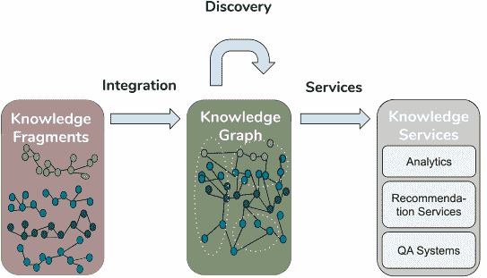

## 第6章
## 知识图谱中的推理：
### 嵌入视角

Luigi Bellomari$^{1}$, Emanuel Sallinger$^{2,3}(\text{E})$, and Sahar Vahdati$^{3}(\text{E})$
$^{1}$ Banca d'Italia, Rome, Italy
$^{2}$ TU Wien, Vienna, Austria
sallinger@dbai.tuwien.ac.at
$^{3}$ University of Oxford, Oxford, UK

摘要。本章我们介绍知识图谱中推理的方面。如第2章所述，我们将给出一个广泛的概述，聚焦于推理技术的多样性：涵盖基于逻辑的推理、基于嵌入的推理、基于神经网络的推理等。特别是，我们将讨论知识图谱中推理的三个维度。补充这些维度，我们将基于推理任务和推理任务族的实用视角来构建我们的探索：用于知识集成、知识发现和应用服务的推理。

## 1 引言

智能的概念与推理能力紧密交织。反过来，这种推理能力在人工智能算法中发挥着核心作用。这不仅适用于当今的人工智能，也适用于莱布尼茨于1677年所指出的任何形式的知识表示、理解和发现：“很明显，如果我们能找到适合表达我们所有思想的字符或符号，就像算术表达数字或几何表达线条那样清晰和精确，我们就能在所有受推理支配的事务中做到我们在算术和几何中所能做的一切。因为所有依赖推理的调查都将通过转换这些字符和一种演算来实现” [279]。

推理研究由数学家和逻辑学家进行，自然地被计算机科学家采纳并随后进行。关于拥有知识机器的具体参考至少可以追溯到1940年代——V. Bush 在其1945年的有影响力的论文“As We May Think” [65]中谈到了能够像人类一样思考的机器。后来在1950年，随着 Alan Turing 的开创性工作 [432]，人工智能的想法和向机器赋予令人印象深刻的思考能力开始于数学运用的推理。符号推理的发展继续朝着提供逻辑编程语言的数学语义 [303, 441] 和新的高效推理基础 [73, 234] 方向发展。关于信念网络事实的推理，如当今的知识图谱，在 [349] 中有所涉及。

然而，在设想的规模上，如果没有大规模的数据管理、处理、推理和检索，所有这些方法在实践中都是不可能的。过去十年见证了人工智能驱动技术在大数据出现推动下的技术提升。这在以知识图谱表示和管理的数据上创造了机器学习方法的大量工业规模应用。KG 的技术为设想的人工智能机器创造了一个实用的平台。

**视角。** 在第2章中，我们介绍了知识图谱的*分层视角*，并指出*推理*方面将在本章中特别考虑。很明显，第2章中引入的三个层面对推理的要求是不同的：

- 在最底层（**表示**），推理是实现表达能力和计算复杂性之间良好平衡的重要设计考虑。
- 在中间层（**管理**），类似于关系数据库管理系统，提供通用推理服务（或在 RDBMS 中：查询服务）至关重要。
- 在顶层（**应用**），应用程序所需或公开的特定推理服务成为焦点。

鉴于推理方法在计算机科学中的使用历史，以及它们在知识图谱的构建和使用中的具体应用，将它们按照在 KG 生命周期中的使用情况进行划分会很有诱惑力。这在图1中有所说明，我们看到知识片段被集成到知识图谱中，该 KG 通过发现得到丰富，最后基于知识图谱提供服务：



- **用于知识集成的推理：** 其重点是使用推理来处理从异构、互联和分布式数据中获取和集成知识。
- **用于知识发现的推理：** 其重点是使用推理来基于现有知识识别新的——并且可能隐藏的——知识。
- **用于应用服务的推理：** 其重点是采用推理技术直接在知识图谱的应用层提供服务。

我们在本章中采取的立场是，虽然生命周期的这三个阶段显然很重要，并且许多可用的推理技术落入某一类别或另一类别，但正如我们将看到的，许多其他技术渗透到这些生命周期阶段。我们因此更将其称为*维度*。

本章不应是对推理技术的综述，但对于每个维度，它将给出一个或两个突出示例，以让读者了解知识图谱上推理技术的广度和变化。

**组织。** 在第2节中，我们将考虑集成的维度；在第3节中，我们考虑发现的维度；在第4节中，我们考虑应用服务的维度。我们将以总结结束。

## 2 用于知识集成的推理

近年来，学术界和工业界构建了大量知识图谱。知识图谱的创建遵循从异构资源获取和集成数据的步骤。它需要全面的领域概念化和适当的数据表示模型。在许多情况下，从已有的格式进行数据转换形成了许多个人或企业代理的知识图谱。通过后处理阶段，这些知识图谱已被其他方法用于进一步研究而变得可用。

然而，考虑到可以从现实世界映射到此类知识图谱的信息的潜在数量，它们是极不完整的。用于数据补全任务的手工和自动数据整理、采集和集成技术已开发数十年。然而，考虑到知识图谱的特性，它们成为将机器学习方法应用于知识图谱补全的理想对象。因此，KG 补全任务获得了新的维度含义，即知识覆盖率的增加。因此，新研究社区合并或复兴，例如知识嵌入。应用此类模型的研究已在提供链接预测、资源分类和推荐服务的目标下进行调查。

上述表示是创建现实世界模型的尝试，其中缺乏完整覆盖和信息正确性问题将始终存在。因此，为知识图谱提出嵌入模型在巨头公司中获得了大量关注，并在近年来的研究中引起了极大关注。此类模型是基于概率的方法，用于预测图中的缺失关系。虽然早在2000年代初就已经提出了在以三元组建模的数据之上使用 ML 和此类概率链接预测模型，但此类模型的应用是在 KG 出现后才得以实践。构建此类知识图谱的三个冲突挑战维度已被提及 [146]，即*新鲜度*、*覆盖率*和*正确性*。

### 2.1 模式/本体匹配

本体匹配在寻找一个或多个知识图谱实体之间的语义关系意义上，在 KG 集成和构建中发挥着重要作用。由于 KG 的异构性，KG 集成和映射本体以高复杂性结束。因此，可扩展性是这方面的主要焦点之一。提供轻量级本体匹配工具的方法包括本体划分 [130]、使用数据和本体结构 [230,383]。方法主要有两大类：基于逻辑和基于图 [3]。在语义网社区的早期 [166,167]，一些基于逻辑的推理方法用于划分本体的关系，已被讨论。

另一组方法是本体驱动数据访问 OBDA [356] 方法，其中本体用于编码领域知识，从而实现新事实的推导。在 [58] 中，提出了一种基于 datalog 的 KG 补全任务方法。Datalog 是一种本体驱动的方法，应用于问答 [289]。

所提出的方法是一种划分模型，结合了本体图和提取的分布。在相关工作中，使用本体驱动方法进行推理用于查询概率知识库 [59,74]。此类本体驱动推理在与其他推理任务相关时的应用，例如最大后验 MAP 计算和最可能解释 MPE，对应于识别对满足观察查询贡献最大的元组。常识的概念在 [59] 中被引入为一种知识类型，关于封闭世界或开放世界假设。在封闭世界假设下，构建在知识库之上的问答系统无法回答任何需要直觉或演绎推理的问题。

一种基于逻辑的可扩展本体匹配系统在 [228] 中被引入，名为 LogMap。通过将 LogMap 的输出映射与输入本体集成而获得的本体是一致的。虽然它属于 KG 引入之前的时期，但其在处理语义丰富的本体方面的能力使其也值得在 KG 中应用。逻辑推理也在其他工作中用于源本体的并集，例如在医疗领域 [229]。


一般而言，知识图谱识别（KGI）被用作知识图谱构建中的推理技术。例如，[362] 讨论了从噪声抽取中自动化构建 KG 的挑战。为了处理扩展问题，对抽取进行分区是一种方法，它允许在从一组噪声信息中雕刻出有效 KG 时进行并行推理。KGIs 使用逻辑约束和实体解析，其结果可用于分类和链接预测任务。在一系列研究 [359,361,362] 中，概率软逻辑（PSL）被用于在从噪声信息集合中抽取知识的同时进行联合推理。所提出的方法基于一种本体感知技术，该技术使用全称量化的逻辑规则。它对使用 Web 本体语言（OWL）表示的本体和陈述丰富的 KG 进行高效推理。在推理过程中，使用频繁模式、约束或路径来推断新知识。

规则被定义为关联在抽取过程中发现的不确定信息。抽取的三元组被标记为候选关系或候选标签，并分配一个值以显示该三元组的可能真实性。该模型结合来自多个来源的权重，并检索分类或预测链接的列表。诸如域和范围约束之类的本体信息被用于进一步丰富推理。联合推理意味着逻辑规则以及实体解析被并行使用，使得 a) 逻辑规则关联构建的知识图谱谓词的本体知识，以及 b) 实体解析被注入预测中。

F-OWL 是在 [491] 中提出的另一个本体匹配引擎，最初是为知识库设计的。它是一种基于规则的推理引擎，也考虑实体解析以提取隐藏知识。Pellet，一个开源的 OWL-DL 推理器 [403]，采用增量推理机制。因此，这种用于表示和查询概率知识的形式主义的语义表达能力在近年来获得了显著的重要性。KG 集成 的另一个应用见于 [117]，其中解释了一系列流程，其中关于中国非物质文化遗产（ICH）的领域知识使用自然语言处理（NLP）技术从文本来源中抽取。抽取的知识使用领域本体和实例塑造为知识库。

## 2.2 实体解析

用于合并多个知识图谱所需的技巧之一是使用实体解析。在某些情况下，此任务变为目标 KG 集成之间的成对匹配任务。这可能带来由 KG 使用的不同本体引起的一系列挑战以及额外的复杂性。在 [360] 中，为 KG 集成任务提供了一个统一的实体解析模型。

其中一些推理技术用于数据集成过程后的知识图谱精炼。KG 领域的几位研究人员（例如，Paulheim、Dong）一直在使用 KG“精炼”概念来定义一系列技术应用，其目的在于 KG 丰富，包括补全和错误检测。在其他一些观点中，精炼通过考虑本体学习主要处理对领域的概念级描述来改善 KG。

## 2.3 数据交换和集成

虽然本章的重点应放在基于嵌入的推理上，但我们至少想对数据库和人工智能领域在基本上过去几十年中开发的庞大逻辑推理方法和技术做一个简要介绍，包括 IBM 研究等大型研究机构引领此类发展。

在知识图谱中充当知识的逻辑规则，并因此被推理，历史上通常被称为 *schema mappings*。该领域存在无数论文 [18,52,127,251,434]，关于模式映射推理的综述可在 [382] 找到。该领域的关键形式主义是 *tuple-generating dependencies*（tgds），即逻辑公式的形式为

```
φ(x̄) → ∃ȳ ψ(x̄, ȳ)
```

其中 φ 和 ψ 是关系原子的合取，并且所有自由变量都是全称量化的（我们将在下面以某种滥用符号的方式假设所有公式都如此），以及 *equality-generating dependencies*（egds），即逻辑公式的形式为

```
φ(x̄) → x_i = x_j
```

这些结合起来可以表达数据库约束中通常表达的大量知识，因此可用于数据交换和数据集成，或简单地作为知识图谱中的知识。

研究重点包括特定推理任务所需的更高表达能力，包括

- *second-order (SO) tgds* [128,133,134,161,163] 用于表达本体推理和组合，即逻辑公式在简化形式下具有结构

```
∃f̄((φ₁ → ψ₁) ∧ … ∧ (φₙ → ψₙ))
```

其中 f̄ 是函数符号。

- *nested tgds* [142,252] 用于表达对树状数据的推理，即形式为的正常 tgds

```
χ = φ(x̄) → ∃ȳ ψ(x̄, ȳ)
```

但扩展为 ψ 的每个合取除了关系原子外还可以是形式为 χ 的公式，即允许嵌套。

一个特别重要的限制是对合取查询（CQs）的推理研究，即逻辑规则的形式为

∃x̄ φ(x̄, ȳ) → Ans(ȳ)

其中 Ans 是表示查询答案的任意谓词名。这些 CQs 是几乎所有实际数据处理系统的核心，当然包括数据库和允许推理或查询几乎任何级别的知识图谱管理系统。在“投影视图”的名称下，对它们的推理已被深入研究，参见例如 [173]，但有无数论文研究这一对 KG 至关重要的形式主义。

虽然我们将避免让本节成为数据交换和集成中推理的全面综述，但我们确实想给出（有偏见的）选择，在我们看来，该领域特别有趣的推理问题：

- limits [253]：像数学中的极限一样，近似数据交换和集成场景时，在此上下文中推理极限也特别相关。类似于极限，其他算子如并集和交集也很重要 [20,351]。
- equivalence [355]：等价性是所有其他基于其构建的服务的根本推理问题，例如优化、近似等。
- inconsistency [19,22,353]：在数据或知识不一致的状态下进行推理是知识图谱的标准情况，需要细致处理。
- representability [21]：知识如何在知识图谱的不同部分中表示？

这里本可以提到许多其他主题——并且给出更多参考文献——因为这是对知识图谱这一重要子领域进行推理的特别丰富的领域。通向本章主要关注的基于嵌入的推理，我们最后提到，本节中介绍的逻辑推理形式主义的实质部分可以注入到基于嵌入的推理方法中，使其在知识图谱中不存在此类知识时表现得更好。

## 3 知识发现的推理

在本节中，我们对任务型 AI 挑战的推理方法进行结构化。有可能进入此类别的方法清单很长；然而，我们将重点关注用于链接预测的基于嵌入的推理。其他方法的例子可能是统计关系学习（SLRs），在几篇综述文章 [330,487] 中已有充分介绍，Markov Logic Networks（MLN）[250,373]，以及概率图模型 [8,254,317]。

### 3.1 链接预测

知识图谱中特定知识表示的强大功能使信息系统能够应对大数据挑战并支持解决


数据异质性带来的挑战。然而，知识图谱在正确性方面存在不完整、不准确和低数据质量的问题 [17, 326]。这严重影响了基于 AL 的方法的性能，这些方法被用于知识图谱之上以提供有效的服务。因此，图补全方法在知识图谱上的应用引起了极大兴趣。其中最流行的方法之一是知识图谱嵌入模型，这些模型获取实体和/或关系的向量表示，用于下游任务，如知识图谱补全任务。KGE 是一种通过在向量空间中发现新链接来进行演绎推理的方法。

对于具有一组形如 $(h, r, t)$ 的三元组（表示 (头实体, 关系, 尾实体)）的知识图谱，知识图谱嵌入的目标是将实体和关系映射到一个低维向量空间。然后，KGE 模型定义一个评分函数和损失函数，通过特定的嵌入表示进一步优化向量。实体和关系的嵌入通常在知识图谱内的现有正样本上学习。为了优化学习阶段并帮助 KGE 模型获得更强的能力，通常还会向模型中注入一组负样本。通过这种方式，评分函数在正样本和负样本上进行训练，为正样本分配高分，为负样本分配低分。每个嵌入模型还有一个损失函数来优化评分。在这里，我们将从知识发现中的推理能力的角度来审视现有的嵌入模型。知识图谱嵌入模型大致可以分为三个主要类别：

-   **基于平移和旋转的模型。** 大量 KGE 模型使用数学上的平移（加法）或旋转（Hadamard 乘积）来设计。这些模型的评分函数和损失函数优化向量的方式使得其合理性通过实体相对于关系的距离或程度来衡量。
-   **语义匹配模型。** 一些嵌入模型是基于逐元素乘法设计的。在这种情况下，通过评估向量的相似性来定义实体和关系的合理性。
-   **基于神经网络的模型。** 第三类 KGE 模型是在神经网络之上设计的。这些模型有两个学习阶段：一个用于计算和创建向量，第二个用于在基于层的学习方法中评估合理性，这种方法源于神经网络（NN）。

## 平移和旋转模型。

在这种模型中，三元组的合理性基于距离函数（例如基于欧几里得距离）来计算 [458]。接下来，我们将描述与本工作相关的 KGE 模型；不过，许多其他模型也已被提出。

TransE [57] 是早期的 KGE 模型之一，也是其他几个模型家族的基础。在这些模型中，评分函数将关系 $r$ 看作从头实体 $h$ 到尾实体 $t$ 的平移：

$$h + r \approx t$$                                                     (1)

为了衡量三元组的合理性，定义了以下评分函数：

$$f_r(h,t)=-\|h+r-t\|$$ (2)

TransE 模型极其简单且计算效率高。因此，它是大规模知识图谱上最常用的嵌入模型之一，用于知识发现的推理。然而，TransE 在建模 1-N、N-1 和 N-M 关系方面存在局限。为此，人们提出了多种扩展方法 [458]。由于这一原因，编码具有自反和对称模式的关系变得不可能，而这在新知识推理中是一个重要方面。因此，几个新模型试图解决这个问题，我们将在本节剩余部分讨论这些模型。

**TransH** [462] 是 TransE 的一种扩展，解决了 TransE 在建模 N-M 关系时的局限性。它使用关系特定的实体表示来编码这类关系模式。该模型使用一个额外的超平面来表示关系。然后，在关系特定的超平面中执行从头实体到尾实体的平移。这种方法被称为将头实体和尾实体投影到关系特定的超平面中。该方法的公式如下：

$$h_\perp=h-w_r^{\mathsf T}h w_r$$ (3)

$$t_\perp=t-w_r^{\mathsf T}t w_r$$ (4)

其中 $w_r$ 是超平面的法向量。三元组 $(h,r,t)$ 的合理性计算如下：

$$f_r(h,t)=-\|h_\perp+d_r-t_\perp\|_2^2$$ (5)

**TransR** 是另一个 KGE 模型，它遵循 TransE 的基础，作为 TransH 的扩展，区别在于它将实体和关系编码在不同的向量空间中。与 TransH 的超平面不同，这是一种关系特定的解决方案，平移发生在每个关系特定的空间中。关系以矩阵 $M_r$ 表示，该矩阵将实体投影到关系特定的空间中：

$$h_r=hM_r$$ (6)

$$t_r=tM_r$$ (7)

基于这种表示，评分函数设计如下：

$$f_r(h,t)=-\|h_r+r-t_r\|_2^2$$ (8)

该模型能够处理复杂关系，因为它使用了不同的空间；然而，由于所需参数数量较多，其计算成本非常高。

**TransD** [225] 是对 TransR 的一种改进尝试，通过消除矩阵向量乘法的需要来减少所需参数的数量。该模型的核心是使用两个向量来表示实体和关系。假设 $h, r, t$ 编码语义，$h_p, r_p, t_p$ 构建投影，实体在关系特定空间中的投影定义如下：

$M_{rh} = r_p h_p^T + I^{m \times n}$  (9)

$M_{rt} = r_p t_p^T + I^{m \times n},$  (10)

在此定义中，$I$ 是一个对角元素为 1、其余为 0 的矩阵。头实体和尾实体的计算如下：

$h_{\perp} = M_{rh} h$  (11)

$t_{\perp} = M_{rt} t$  (12)

然后，基于这些投影计算三元组 (h,r,t) 的得分：

$f_r(h,t) = -||h_{\perp} + r - t_{\perp}||_2^2$  (13)

## RotatE。

**RotatE。** [417] 是早期使用旋转而非平移的模型之一。该模型主要设计目标是对关系模式进行推理，这是其他平移模型未主要解决的问题。RotatE 基于欧拉公式 $e^{i\theta} = \cos(\theta) + i \sin(\theta)$ 来推理新知识。根据其评分函数，对于每个正确的三元组 $(h, r, t)$，应当满足 $h_j r_j = t_j$，该式对所有 $j \in \{0, \ldots, d\}$ 成立。$h_j, r_j, t_j$ 是嵌入向量 $\mathbf{h}, \mathbf{r}, \mathbf{t} \in \mathbb{C}^d$ 的第 $j$ 个元素。由于它涉及复空间，$r_i$ 被设为 1，即 $|r_j| = \sqrt{Re(r_j)^2 + Im(r_j)^2} = 1$。该模型通过关系向量 $\mathbf{r}$ 的第 $j$ 个元素 $r_j = e^{i\theta_r^j}$ 旋转头向量 $\mathbf{h}$ 的第 $j$ 个元素 $h_j$，得到尾向量 $\mathbf{t}$ 的第 $j$ 个元素 $t_j$，其中 $\theta_{r_j}$ 是关系 $r$ 的相位。因此，RotatE 的评分函数被设计为使用 $\circ$ 进行旋转，$\circ$ 是两个向量的 Hadamard 乘积：

$f_{h,t}^r = ||\mathbf{h} \circ \mathbf{r} - \mathbf{t}||,$  (14)

通过这种方式，RotatE 模型能够编码对称、逆和组合关系模式。由于其这一能力，它的性能很高，并且由于推理过程中新发现链接的高质量，它优于所有先前的模型。

## 语义匹配模型。

如前所述，嵌入模型的第二类在对知识图谱进行推理时，通过比较实体和关系的潜在特征的相似性来确定三元组的合理性。许多 KGE 模型属于这一类别；我们将讨论其中一些性能最好的模型。


**RESCAL** [327] 是一种基于嵌入的推理模型，将每个实体表示为向量，将每个关系表示为矩阵 \(M_r\) 以捕捉潜在语义。三元组的分数由以下公式衡量：

\[f_r(h,t)=h^T M_r t\tag{15}\]

其中 \(M_r\) 是与关系相关联的矩阵，它对头部和尾部实体的特征之间的成对交互进行编码。

**DistMult** 是一种专注于捕捉关系语义和由矩阵乘法表征的关系组合的模型 [476]。该模型考虑在底层知识图谱中学习实体和关系的表示。DistMult [476] 通过仅允许对角矩阵作为 \(diag(r)\) 来简化 RESCAL。该模型的分数函数设计为通过潜在特征的成对交互对三元组进行排序：

\[f_r(h,t)=h^T diag(r)t\tag{16}\]

其中 \(r\in R^d\) 且 \(M_r=diag(r)\)。对对角矩阵的限制使 DistMult 比 RESCAL 更具计算效率，但表达能力较弱。

**ComplEx** ComplEx [430] 是 DistMult 向复数空间的扩展。考虑到 DistMult 的评分函数，可以观察到它在表示反对称关系方面存在局限性，因为 \(h^Tdiag(r)t\) 等价于 \(t^Tdiag(r)h\)。公式 16 可以用 \(h,r,t\) 的 Hadamard 积表示：\(\langle h,r,t\rangle=\sum_{i=1}^{d}h_i*r_i*t_i\)，其中 \(h,r,t\in R^d\)。ComplEx 的评分函数在复数空间中使用 Hadamard 积，即 \(h,r,t\in C^d\)：

\[f_r(h,t)=\Re\left(\sum_{i=1}^{d}h_i*r_i*\overline{t_i}\right)\tag{17}\]

其中 \(\Re(x)\) 表示复数的实部，\(\overline{x}\) 表示其共轭。可以很容易地证明 \(f_r(h,t)\ne f_r(t,h)\)，即 ComplEx 能够建模反对称关系。

**基于神经网络的模型。** 作为我们在此讨论的嵌入模型的最后一类，我们考虑建立在神经网络之上的模型。此类模型在学习阶段从神经网络继承了第二层。该类别也被称为神经链接预测器，这是在下游任务层面，此类模型的最终目标。此类模型包含一种多层学习方法，具有两个主要组成部分：即向量的编码和向量的评分。

**ConvE** [107] 是一种建立在神经网络之上的多层嵌入模型。

\[f(h,t)=g(\operatorname{Vec}(g([h;\overline{r}]\ast\omega))W)t\tag{18}\]

**神经张量网络 (NTN)。** [408] 是较早的方法之一，其中包含文本信息在嵌入中。它从语料库中学习词向量，并通过与实体相关联的词向量的平均值来初始化每个实体。

```
vec{w}_r^T tanh(vec{h}^T W_r vec{t} + W_r^{(1)} vec{h} + W_r^{(2)} vec{t} + vec{b}_r) (19)
```

## LogicENN. [323] 是一种基于神经网络的模型，通过联合学习知识图谱中实体 (h, t) 和关系 (β_r) 的嵌入以及神经网络的权重/偏置 (w/b) 在知识图谱之上执行推理。

给定三元组 (h, r, t)，网络将实体向量 (h, t) 通过一个具有 L 个节点的通用共享隐藏层传递，以获得实体的联合特征映射 (h, t) 即 Φ_{h,t}^T = [φ_{h,t}(w_1, b_1), ..., φ_{h,t}(w_L, b_L)] = [φ(⟨w_1, [h, t] + b_1⟩), ..., φ(⟨w_L, [h, t] + b_L⟩)]。网络将输出节点的权重（即 β_r）视为关系 r 的嵌入。三元组 (h, r, t) 的分数通过 Φ_{h,t} 与 β_r 的内积计算如下

```
f(h, r, t) = Σ_{i=1}^L φ(⟨w_i, [h, t] + b_i⟩)β_i^r = Σ_{i=1}^L φ_{h,t}(w_i, b_i)β_i^r (20) = Φ_{h,t}^T β^r.
```

考虑到分数函数的公式，对应的代数公式（代数约束）——即对称、逆、传递、否定、蕴含、等价等逻辑规则——被推导出来。这些公式随后被用作惩罚项添加到损失函数中以进行优化。这使得规则能够注入到网络的学习过程中。因此，模型的性能得到改善。

总体而言，该网络具有以下优点：

- 该模型被证明能够表达知识图谱中 n 个事实的任何真实情况。
- 该网络将实体空间 (φ_{h,t}) 与关系 β_r 分开。因此，对称、逆、蕴含和等价规则对应的基于分数的代数约束不需要实体的接地。此特性使模型能够以更低的计算成本更好地注入规则，因为消除了接地。
- 该模型已被证明在多个标准数据集上获得了最先进的性能。

## 总结。 到目前为止，我们已经详细描述了一些嵌入式推理方法中突出的方法。更多信息可在 [326, 459] 中找到。

尽管大多数嵌入仅考虑知识图谱的关系和实体，但仍有几种类型的互补知识（例如，文本、逻辑规则、本体、互补知识图谱），可用于改进嵌入模型。在 [328] 中，本体知识被引入为互补知识，可用于嵌入模型的分解过程。在一些更专注的工作中，本体知识如实体类型被用作约束 [201,265,460,475]，这提高了嵌入模型的性能。近年来，基于逻辑的推理和基于嵌入的推理走到了一起并吸引了大量学术关注。一些初步工作使用逻辑规则作为嵌入后的后处理任务 [460,465]。 [375] 使用一阶逻辑规则优化嵌入以获得实体对和关系。 [202] 提供了一个通用框架，将逻辑规则中的信息转移到不同类型神经网络的权重中。

## 4 应用服务的推理

上述方法的最终目标是提供更好的知识感知服务，例如智能分析、推荐和预测服务，以及促进查询回答。在许多知识管理任务中，学习和推理是提供此类服务的重要组成部分。还有混合系统，集成许多此类模型，消耗不同的学习表示和学习方法。此类方法通常被定义为高层任务，其目的是在知识图谱中实现某个实际步骤，使其准备好进行低层任务。本节包括一些具有底层知识感知学习和推理引擎的 AI 驱动应用。

### 4.1 推荐系统

在与知识图谱相关的许多高层任务中，学习和推理方法被认为非常适合提供推荐服务。推荐服务是推理用于知识发现和链接预测方法的典型应用。基于逻辑的推理提供可解释的推荐，而基于嵌入的推理主要探索知识图谱内的互联。两种方法的学习阶段主要关于实体和关系之间连通性的分析，以便发现可能的新闻路径。这可以通过丰富和互补的信息来促进。这些方法揭示了实体和关系的语义，并促进推荐服务理解最终用户兴趣。

在领域应用层面，此类方法可应用于任何基于图的场景。例如，社交网络的知识图谱 [457] 是学习框架应用的最有趣的应用领域之一。在线购物中的商品推荐是链接预测的典型应用。此类问题通常在知识图谱中被表述为基于机器学习的问题并采用链接预测方法。另一个典型例子是学术知识图谱中合著者之间的链接预测。此类推荐的可行性是基于对未来的预测，可能不会发生。通过为此类推荐添加时间特征，使知识图谱具有时间感知能力，可使此类应用更具吸引力。


### 4.2 问答

大量为智能系统构建的基于推理的应用都归于问答系统（QA）的范畴。除了普通的搜索引擎和基于查询的系统外，涵盖此类范畴的还有对话式人工智能系统、语音助手和聊天机器人。此类系统的例子有苹果的 Siri、微软的 Cortana 和亚马逊的 Alexa，其知识来源是底层知识图谱。尽管在构建此类系统方面取得了巨大成功，但可能的错误答案以及它们在检索特定知识查询水平方面的局限性是不可避免的。其原因有很多，例如知识图谱不完整或数据方面的其他质量问题，导致语义理解最小化。然而，对于实践中数据完整部分而言，任何简单问题都可能需要复杂的查询，从而需要多步计算的复杂推理 [277]。因此，所有这些系统都借助推理和推断技术来检索隐藏信息。

近年来，推理在问答方面的热门应用之一是具有多样化数据模态的知识图谱。这是因为，本质上，知识图谱包含不同类型的信息，从图像、文本、数值数据甚至视频等。主要的挑战是，在应用层面，大多数学习方法主要关注一种模态。虽然计算机视觉社区在音频和视频处理方面取得了很多进展，但这种跨学科研究仍处于早期阶段。此类知识图谱被称为多模态知识图谱（MKGs），与其它视觉关系资源存在根本差异。最近有关于多模态知识图谱构建以及在这些知识图谱之上应用机器学习相关模型的工作。视觉问答系统是专门为 MKGs 设计的 [66]。

由于基于规则的推理技术具有可解释性，因此它们也是问答系统的重要组成部分。对于需要多步的复杂问题，更容易提供可解释且确定的陈述。多跳推理是此类问题的解决方案，其由端到端可微分（深度学习）模型提升 [108,464]。

## 5 挑战与机遇

在本章中，我们从多个维度考虑了知识图谱中的推理：即集成、发现和应用。对于每一项，我们挑选了一些技术来展示知识图谱中遇到的推理技术多样性。作为一项宏大挑战，我们看到多种推理技术的集成，例如基于逻辑的推理技术和基于嵌入的推理技术，以及基于神经网络的推理和其他推理技术。显然，我们在本章中介绍的每个单独的推理问题都允许列出挑战和机遇，但这将超出本章的范围。

**致谢。** E. Sallinger 感谢维也纳科学与技术基金（WWTF）资助 VRG18-013 以及 EPSRC 项目资助 EP/M025268/1 的支持。

**开放获取** 本章根据知识共享署名 4.0 国际许可协议（http://creativecommons.org/licenses/by/4.0/）许可，该许可允许在任何媒介或格式下使用、共享、改编、分发和复制，只要您对原作者和来源给予适当的署名，提供指向知识共享许可的链接并标明是否进行了修改。

本章中的图像或其他第三方材料包含在本章的知识共享许可中，除非材料中另有说明。如果材料未包含在本章的知识共享许可中，并且您的预期用途未被法定法规允许或超出允许范围，您将需要直接向版权持有人获得许可。


## 方法与解决方案
