## 第 7 章：使用 SANSA 进行可扩展知识图谱处理

Hajira Jabeen¹, Damien Graux³, and Gezim Sejdiu²,⁴

¹ CEPLAS, Botanical Institute, University of Cologne, Cologne, Germany  
hajira.jabeen@uni-koeln.de  
² Smart Data Analytics, University of Bonn, Bonn, Germany  
³ ADAPT SFI Research Centre, Trinity College, Dublin, Ireland  
⁴ Deutsche Post DHL Group, Bonn, Germany

**摘要。** 近年来，知识图谱的规模和数量急剧增加。与此同时，分布式数据处理技术也取得了进步，以应对大数据和大规模知识图谱。本章介绍了可扩展语义分析栈（SANSA），它解决了处理大规模 RDF 数据的挑战，并为链接预测、知识库补全、查询和推理等应用提供统一框架。我们讨论了 SANSA 的动机、背景和架构。SANSA 使用通用处理引擎 Apache Spark 和 Apache Flink 构建。阅读完本章后，读者应了解使用 SANSA 在大规模处理知识图谱时可用的不同层级和相应 API。

### 1 引言

在过去十年中，随着语义知识图谱在各种应用领域中使用语义技术的日益普及，可通过机器读取的结构化信息呈爆炸式增长，包括通用知识 [25, 448]、生命科学 [468]、学术数据 [129]、开源项目 [266]、专利 [261] 或甚至食品推荐 [189]。这些知识库变得越来越普遍，预计这一趋势在未来会继续。

知识图谱的规模已达到集中式分析方法变得不可行或成本过高的程度。最近的技术进步使得强大的分布式内存分析成为可能，已被证明在简单数据结构上效果良好。然而，将此类分布式分析方法应用于语义知识图谱的进展明显滞后。为了将大规模知识图谱分析的可扩展性和准确性提升到新水平，关于利用分布式内存计算和语义技术相结合以及分析方法进步的方法进行基础研究是不可或缺的。在本章中，我们介绍了可扩展语义分析栈（SANSA），它解决了处理大规模 RDF 数据的挑战，并为设计复杂的语义应用提供统一框架。

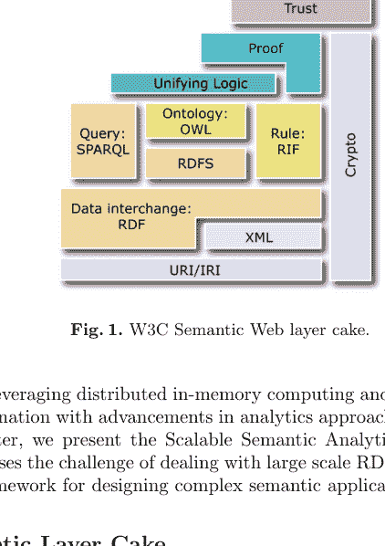

图 1. W3C 语义网分层结构。

### 2 语义分层结构

如前几章所述，存在许多不同类型的数据源，它们以不同的格式收集和提供结构化信息。此外，其中大多数都可在 Web 上获取，并且经常共享关于相同概念或实体的信息；因此，允许源之间对齐的需求日益增加。这一动机推动了语义网倡议，其主要思想是实现远程数据实体之间的链接，以便一次提供多个信息方面。语义网主要依赖于反向引用概念，其中标识符（IRI - 国际化资源标识符）用于表示实体，因此用于从一个信息片段导航到另一个信息片段。

语义网主要由万维网联盟（W3C）推动，该组织提出了一套标准来技术上支持这一运动。实际上，这些标准遵循“分层蛋糕”结构构建，其中标准建立在其他标准之上（见图 1）。特别是，整个栈完全建立在标识符概念之上，该概念作为基础然后使用以下 RDF 结构表示数据。


他们的知识。首先，RDF 带有相应的查询语言（SPARQL）以从源中提取数据。此外，还有多个标准规定了如何结构化数据：

- 1. RDF 模式（RDFS）列出了一组使用 RDF 表示数据模型的一定属性的类，并为本体描述提供了基本元素。
- 2. Web 本体语言（OWL）是一组用于编写本体的知识表示语言，本体是描述分类法和分类网络的正式方式，本质上定义了各个领域的知识结构。
- 3. Shapes 约束语言（SHACL）允许针对一组条件对基于图的数据进行验证设计。其中包括表达约束属性可能具有的值的数量、此类值类型、数值范围等条件的特性。 . . .

这些规范随后允许用户指定关于语义网数据的若干属性，因此人们可以用它们来扩展自己的知识。事实上，本体是围绕从一组三元组推断数据所做的所有研究的核心，例如使用图的<|message|>
结构，可以“物化”额外的陈述，从而扩展一般知识。

因此，W3C——通过其制定的各种标准和建议——允许用户结构化信息片段。然而，绝大多数现有工具一次只关注一两个标准，这意味着它们通常不能涵盖语义网本应提供和支持的全部范围。事实上，设计这样一个“广范围”的语义网工具是具有挑战性的。最近，有这样一个倡议被创建：SANSA [411]；此外，SANSA 还关注语义网的大数据背景并采用完全分布式策略。

## 3 使用 SANSA 处理大型知识图

简而言之，SANSA¹ 提供了：

- 1. 用于知识图的高效数据分发技术和语义感知的潜在资源嵌入计算；
- 2. 自适应分布式查询；
- 3. 高效的自优化推理执行计划；以及
- 4. 对极大规模语义知识图的高效分布式机器学习。

### 3.1 知识表示和分发

SANSA 遵循模块化架构，其中每一层代表 SANSA 框架中可被其他层使用的独特功能组件。知识表示和分发是最底层

位于现有分布式计算框架之上（即 Apache Spark $ ^{2} $ 或 Apache Flink $ ^{3} $ ）。在此层中，SANSA 提供从 HDFS 或本地文件读取和写入原生 RDF 或 OWL 数据的功能，并将其表示为框架的原生分布式数据结构。目前，它支持不同的 RDF 和 OWL 序列化/语法格式。此外，它还提供专用序列化机制以实现更快的 I/O。该层还支持 Jena 和 OWL API 接口分别用于处理 RDF 和 OWL 数据。这特别针对可用性，因为许多用户已经熟悉相应的库。

该层还提供对 RDF 数据压缩机制的访问，以便在查询 RDF 数据时降低空间和处理时间（参见第 3.2 节）。它还提供不同的分区策略，以便于更好地维护和更快地访问这种规模的数据。对 RDF 数据进行分区是将数据集划分为特定的逻辑和/或物理表示的过程，以便于更快地访问和更好地维护。经常，此过程是为了提高系统可用性、负载均衡和查询处理时间。文献中提出了许多不同的数据分区技术。在 SANSA 中，我们提供 1) 基于语义的分区 [392]，2) 基于垂直的分区 [411]，以及 3) 基于图的分区。

*基于语义的分区* – 语义分区事实是一个元组 $(S, R)$，包含关于同一 $S$ 的信息 $R \in (P, O)$，其中 $S$ 是 RDF 图上的唯一主体，$R$ 表示其所有关联事实，即谓词 $P$ 和对象 $O$。这种分区技术是在 SHARD [376] 系统中提出的。我们使用内存处理引擎 Apache Spark 实现了该技术以获得更好的性能。

*垂直分区* – SANSA 中的垂直分区方法旨在支持 RDF 数据的可扩展分区。不是处理单个三列表 $(s, p, o)$，数据是根据使用的 RDF 谓词、RDF 术语类型和文字数据类型划分为多个表。这些表的第一列始终是表示主体的字符串。第二列始终表示为 Scala/Java 数据类型的文字值。用于存储带语言标签的文字的表具有额外的第三个字符串列用于语言标签。

此外，SANSA 的这一层允许用户以分布式方式计算 RDF 统计信息 [391] 并应用质量评估 [393]。更具体地说，它提供了一种通过所谓的 DistLODStats [392] 软件组件以分布式方式计算不同 RDF 数据集统计信息的方法。它描述了使用 Apache Spark 计算 RDF 数据集 32 个不同统计标准的首个分布式内存中方法。统计标准的计算包括三个步骤：（1）将 RDF 数据保存到可扩展存储中，（2）解析并将 RDF 数据映射到 *主数据集* – 由三个元素组成的 RDD 数据结构：*Subject*、*Property* 和 *Object*，以及（3）在 *主数据集* 上执行统计标准评估并生成结果。

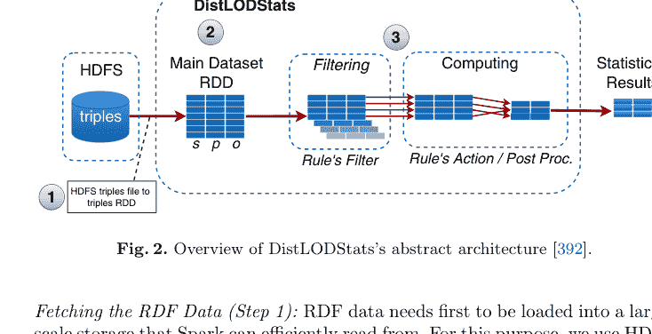

图 2. DistLODStats 的抽象架构概述 [392]。

获取 RDF 数据（步骤 1）：RDF 数据首先需要加载到 Spark 可以高效读取的大规模存储中。为此，我们使用 HDFS（Hadoop 分布式文件系统）。HDFS 能够以原始格式容纳任何类型的数据，水平扩展到任意数量的节点，并在集群节点之间复制数据以实现容错。在这种分布式环境中，Spark 采用不同的数据局部性策略，尽可能在 HDFS 中靠近所需数据执行计算，从而避免数据传输开销。

解析并将 RDF 映射到主数据集（步骤 2）：在 Spark 执行过程中，数据被解析为三元组并加载到以下格式的 RDD 中：Triple<Subj,Pred,Obj>（通过使用 Spark map 转换）。

统计标准评估（步骤 3）：对于每个标准，Spark 生成一个执行计划，该计划由一个或多个以下 Spark 转换组成：map、filter、reduce 和 group-by。过滤操作应用规则的 Filter 并生成新的过滤 RDD。过滤后的 RDD 将作为下一步的输入：计算，其中规则的操作和/或后处理被有效应用。计算阶段的输出将是统计结果，以人类可读的格式表示，例如 VoID，或行数据。

在设计和执行大规模 RDF 处理任务时，数据的质量是需要考虑的关键组件之一。现有解决方案无法处理如此大量的数据，因此需要分布式质量检查解决方案。为此，在 SANSA 中我们提出了 DistQualityAssessment [393]——一种用于大规模 RDF 数据集质量评估的开源实现，可以扩展到机器集群。这是使用 Apache Spark 计算大型 RDF 数据集不同质量指标的首个分布式内存中方法。我们还提供了一种质量评估模式，可用于生成可应用于大数据的新的可扩展指标。下面给出了该方法的更详细概述。使用 Spark 框架进行质量评估的计算包括四个步骤：


## 定义质量度量参数。

度量定义保存在一个专用文件中，其中包含系统评估质量度量并收集结果集所需的大部分配置。

## 检索RDF数据。

RDF数据首先需要加载到Spark可以高效读取的大规模存储中。我们使用Hadoop分布式文件系统（HDFS）。HDFS能够以Hadoop原生格式适配并存储任何类型的数据，在集群中并行处理它们，同时通过复制实现容错。在这种分布式环境中，Spark会自动采用不同的数据局部性策略，尽可能在HDFS中靠近所需数据的位置执行计算，从而避免数据传输开销。

## 解析RDF并将其映射到主数据集。

我们首先创建一个名为主数据集的分布式数据集，将HDFS文件表示为一个三元组集合。在Spark中，该数据集被解析并加载到三元组RDD中，其格式为`Triple<(s,p,o)>`。

## 质量度量评估。

针对特定的质量度量，Spark会生成一个执行计划，该计划由一个或多个Spark转换和动作组成。最终动作的数值输出即为输入RDF对应给定度量的质量。

## 3.2 查询

如前所述，语义网在RDF之上设计了多个标准。其中之一是用于操作RDF数据的SPARQL。简而言之，SPARQL已成为RDF数据事实上的查询语言，并由此为提取、创建或展示信息提供了广泛的可能性。

近二十年来，SPARQL的评估一直是语义网社区深入研究的课题；数十种评估器已被实现，采用了多种不同的RDF数据存储和组织方法⁴。近年来，随着基于云的应用程序增加，出现了一系列遵循分布式范式的新评估器，这些范式通常适合大数据应用⁵。

## 分布式RDF数据。

作为SANSA栈的一部分，一个以分布式方式处理SPARQL查询的层已被开发出来，并提供多种策略以满足用户需求。实际上，根据文献中的现有研究，开发者默认依赖Apache Spark SQL引擎：在实践中，用户发出的SPARQL查询会被自动转换为SQL，以从RDF数据集创建的内存虚拟表（Sparkify [411]方法）中检索信息。这种方法使SANSA能够利用Spark的关系引擎，该引擎专为处理分布式大数据而设计。与此同时，其他评估

⁴ 关于单节点RDF三元组存储的全面综述，参见[131]。

⁵ 关于基于云的SPARQL评估器的广泛回顾，参见[235]或[169]。

使用SML定义的主要实体是*视图定义*。例如，参见图3中的*步骤5*。实际的视图定义由第一行中的*Create View ... As*声明。视图的其余部分包含以下部分：（1）*From*指令基于分区表定义逻辑表（参见*步骤2*）。（2）*Construct*块中定义了一个RDF模板，包含URI、空白节点或字面量常量（例如*ex:worksAt*）以及变量（例如*?emp, ?institute*）。*With*块通过RDF项构造表达式定义模板中使用的变量，其参数引用逻辑表的列。

*查询翻译。* 该过程利用映射/视图构建阶段确定的绑定，从SPARQL查询生成SQL查询。它使用Jena ARQ⁶遍历SPARQL查询（*步骤4*），并生成SPARQL代数表达式树（AET）。本质上，重写SPARQL基本图模式和对视图的过滤会产生由JOIN的UNION组成的AET。此外，这些AET会被规范化并剪枝，以移除已知会产生空结果的UNION成员，例如基于具有不交叠已知命名空间集合的IRI的连接，或不同RDF项类型（如字面量和IRI）之间的连接。最后，使用与视图对应的绑定（*步骤5*）生成SQL（*步骤6*）。

*查询评估。* 最后，按上一节所述创建的SQL查询现在可以直接在Spark SQL引擎中进行评估。该SQL查询的结果集是Spark的分布式数据结构（例如DataFrame）（*步骤7*），随后被映射为SPARQL绑定。结果集可进一步使用SANSA-Notebooks⁷进行分析和可视化（*步骤8*）。

## 数据湖。

SANSA还有一个DataLake组件，允许其使用SPARQL查询异构数据源，涵盖不同的数据库、存储在HDFS中的大文件以及NoSQL存储。SANSA DataLake目前支持CSV、Parquet文件、Cassandra、MongoDB、Couchbase、ElasticSearch以及各种JDBC数据源，例如MySQL、SQL Server。从技术上讲，给定的SPARQL查询会在内部被分解为子查询，每个子查询提取结果集的一个子集。

DataLake层由四个主要组件组成（参见图4中的编号框）。为清晰起见，我们在此使用通用的ParSets和DEE概念，而非各引擎不相同的底层等效具体术语。ParSet源自并行数据集（Parallel dataSet），是一种可分布式并行操作的数据结构。它遵循特定的数据模型，如表格数据库中的表、图数据库中的图或文档数据库中的文档。DEE源自分布式执行环境（Distributed Execution Environment），是ParSets可以被转换、聚合和连接在一起的共享物理空间。该架构接受三种用户输入：

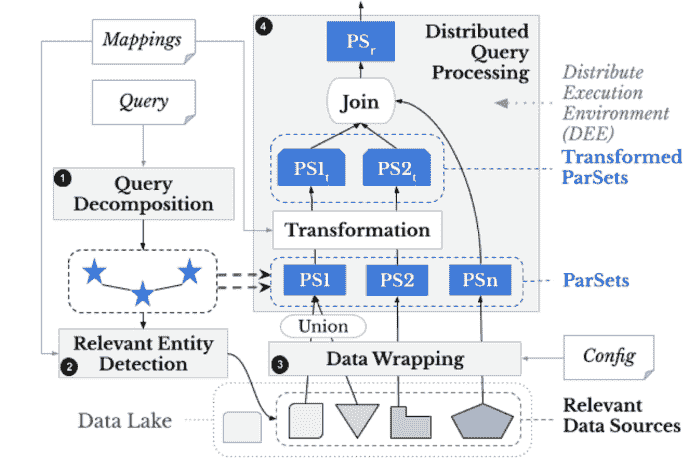

图4. SANSA的DataLake层内部架构[295]。

- **映射：** 它包含数据源实体⁸及属性与本体属性和类之间的关联。
- **配置：** 它包含连接到异构数据源所需的访问信息，*例如*用户名、密码，或集群设置，*例如*主机、端口、集群名称等。
- **查询：** 使用SPARQL查询语言的查询。

该架构的四个组件描述如下：

**查询分解器。** 该组件常见于OBDA和查询联邦系统。它将查询的基本图模式（BGP，即where子句中三元组模式的合取集合）分解为一组星形子BGP，其中每个子BGP包含共享同一主语变量的所有三元组模式。为简洁起见，我们称这些子BGP为星形（见下图左侧；星形以不同颜色的框显示）。

**相关实体提取器。** 对于每个提取的星形，该组件在映射中查找那些属性映射到星形各属性的实体。这些实体与该星形相关。

⁸ 这些实体可以是例如表格数据库中的表和列，或文档数据库中的集合和文档。

```sparql
?k bibo:isbn ?i .
?k dc:title ?t .
?k schema:author ?a .
?k bibo:editor ?e .

?a foaf:firstName ?fn .
?a foaf:lastName ?ln .
?a rdf:type niem:Author .
?a drm:worksFor ?in .

?in rdfs:label ?nl .
?in rdf:type vivo:Institute .
?e rdfs:label ?nl2 .
?e rdf:type saws:Editor .

?c rdf:type swc:Chair .
?c dul:introduces ?r .
?c foaf:firstName ?cfm .
?r schema:reviews ?k .
```

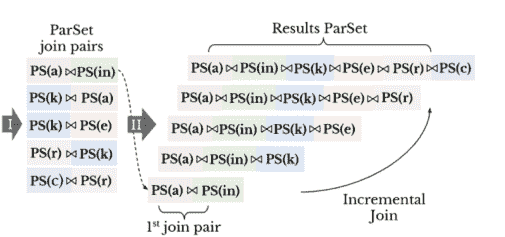

**图5.** 从查询到ParSet，再到ParSet之间的连接。

**数据包装器。** 在经典OBDA中，SPARQL查询必须被转换为相关数据源的查询语言。实际上，在高度异构的数据湖环境中这很难实现。因此，最近的许多出版物主张使用中间查询语言。在我们的案例中，中间查询语言是DEE的查询语言，由其内部数据结构决定。数据包装器在查询时以POA的数据结构生成数据，从而允许并行执行昂贵操作，*例如*连接。必须存在包装器，将数据实体从源转换为DEE的数据结构，可以是完全转换，或在部分数据可下推到原始源时进行部分转换。步骤(1)中识别的每个星形将恰好生成一个ParSet。如果多个实体相关，则ParSet以联合形式形成。辅助用户输入Config用于指导转换过程，*例如*身份验证或部署规范。

**分布式查询处理器。** 最后，ParSet被连接在一起形成最终结果。DEE中的ParSet可以执行任何查询操作，*例如*选择、聚合、排序等。然而，由于我们关注的是查询多个数据源，重点在于连接操作。星形之间的连接转化为ParSet之间的连接（图5阶段I）。接下来，所有ParSet对都会被迭代连接，形成结果ParSet（图5阶段II）。简而言之，提取出的连接对最初存储在一个数组中。第一对连接后，算法遍历其余每一对，尝试进一步连接，否则将其加入队列。接着，队列被类似地迭代；当一对连接成功时，它被入队。当队列为空时算法完成。由于结果ParSet是ParSet，它也可以执行查询操作。DEE中ParSet的连接能力弥补了众多NoSQL数据库（如Cassandra、MongoDB）中缺乏连接操作的不足。有时，由于属性值之间的语法不匹配，ParSet无法直接连接；不过，SANSA提供了一种纠正这些不匹配的方法，从而实现了连接。


## 3.3 推理

RDFS 和 OWL 除了不同资源之间的链接外，还包含模式信息。这种额外的信息和规则允许用户对知识库进行推理，以推断新知识并扩展现有知识。推理过程的核心是不断地将模式相关的规则应用于输入数据以推断新事实。该过程有助于推导出新知识并检测不一致。SANSA 提供了一个自适应规则引擎，可以使用给定的任意规则集并从中推导出高效的执行计划。随后，该执行计划会被评估并在底层引擎上运行，即 Spark SQL，以实现高效且可扩展的推理过程。

## 3.4 机器学习

SANSA-ML 是 SANSA 中的机器学习库。该存储库中的算法可直接在 RDF/OWL 输入数据上执行各种机器学习任务。虽然大多数机器学习算法基于处理简单特征，但 SANSA-ML 中的机器学习算法利用了使用 RDF 和 OWL 标准指定的背景知识的图结构和语义。在许多情况下，这使得用户能够获得更准确或更易于人类理解的结果。与支持背景知识的大多数其他算法相比，SANSA 中的算法使用 Apache Spark 水平扩展。ML 层目前支持用于聚类、实体相似性评估、实体链接、异常检测以及使用图核的分类的众多算法。我们将在下一节中在知识图谱的背景下介绍这些算法。

## 3.5 语义相似性度量

SANSA 涵盖了用于估计本体中定义的概念相似性、从而评估其所索引资源的语义接近度的语义相似性。大多数 SANSA 相似性评估模块中涵盖的方法都是基于特征的。特征模型要求语义对象表示为特征集。Tversky 最先使用特征模型提出了语义相似性的概念，由此派生出一系列语义度量。在此上下文中，相似性度量被定义为对所评估对象的共同特征的函数（基于集合或基于距离的度量）。

**Jaccard 相似性。** 对于数据集中的任意两个节点 u 和 v，Jaccard 相似性定义为：

Sim_Jaccard(u, v) = |f(u) ∩ f(v)| / |f(u) ∪ f(v)|  (1)

这里，f(u) 是节点 u 的所有邻居的子集，|f(u)| 是 f(u) 的基数，表示 f(u) 中元素的数量。

### Rodríguez 和 Egenhofer 相似性。

SANSA 中实现的另一种基于特征的度量是由 Rodriguez 和 Egenhofer [181] 提出的。

```
Sim_RE(u, v) = |f(u) ∩ f(v)| / (γ·|f(u) \ f(v)| + (1 - γ)·|f(v) \ f(u)| + |f(u) ∩ f(v)|) (2)
```

其中 γ ∈ [0,1] 可用于调整度量对称性。

### 比率模型。

Tversky 定义了一种参数化语义相似性度量，称为比率模型（SimRM）[181]。它可以通过各自的特征集 U 和 V 来比较两个语义对象（u；v）：

```
Sim_RM(u, v) = |f(u) ∩ f(v)| / (α|f(u) \ f(v)| + β|f(v) \ f(u)| + γ|f(u) ∩ f(v)|) (3)
```

其中 α、β 和 γ ≥ 0。

这里，|f(u)| 是由 u 的所有邻居组成的集合 f(u) 的基数。设置 Sim_RM 使 α = β = 1 可得到 Jaccard 指数，而设置 α = β = 0.5 可得到 Dice 系数。换句话说，基于集合的度量可用于轻松表达相似性度量的抽象公式。在这里，我们设置 α = β = 0.5。

### Batet 相似性。

Batet 等人将分类距离表示为不同特征与共享特征之比 [31]。Batet 相似性可定义如下：

```
Sim_Batet(u, v) = log₂(1 + (|f(u) \ f(v)| + |f(v) \ f(u)|) / (|f(u) \ f(v)| + |f(v) \ f(u)| + |f(u) ∩ f(v)|)) (4)
```

对于任意节点 u，记号 f(u) 表示 u 的所有邻居的集合。

## 3.6 聚类

聚类是一类无监督学习算法，无需训练数据即可学习。聚类旨在搜索知识图谱中的常见模式和相似趋势。模式的相似性大多由给定的相似性度量来衡量，例如上一节中涵盖的度量。下面，我们介绍 SANSA 为知识图谱实现的聚类算法。

### PowerIteration 聚类。

PowerIteration (PIC) [284] 是一种快速谱聚类技术。它是一种简单（仅需要矩阵-向量乘法过程）和可扩展的算法，时间复杂度为 O(n)。PIC 需要成对顶点及其相似度作为输入，并通过图的归一化亲和矩阵的伪特征向量输出顶点的聚类。虽然 PowerIteration 方法仅近似矩阵的一个特征值，但它对于某些计算问题仍然有用。例如，Google 使用它来计算其搜索引擎中文档的 PageRank，Twitter 使用它来显示关注推荐。Spark.mllib 包含使用 GraphX 实现的 PIC。它接受一个元组 RDD，即边的顶点，以及两个顶点之间的相似度，并输出具有聚类分配的模型。

### BorderFlow 聚类。

BorderFlow [325] 是一种局部图聚类，它以每个节点作为起始种子开始，并通过使用 BorderFlow 比率迭代合并节点来构建聚类。聚类必须具有最大化的簇内密度和簇间稀疏性。当将图视为流程系统的描述时，聚类的定义意味着聚类 X 是一个节点集，使得 X 内的流程最大化，而从 X 到外部的流程最小化。在每一步中，如果边界流比率最大化，则会合并一对节点，并且该过程会重复进行，直到满足终止条件。BorderFlow 是一种无参数算法，它已成功应用于多种应用，包括聚类蛋白质-蛋白质相互作用（PPI）数据 [324] 和用于基准测试的查询聚类 [313]。

### 基于链接的聚类。

链接信息在从数据中发现知识方面发挥着重要作用。基于链接的图聚类 [156] 算法会产生重叠的聚类。最初，每个链接代表其自己的组；该算法递归地使用相似性标准合并链接，以优化划分密度，直到所有链接合并为一个，或直到满足终止条件。为了优化性能，算法在合并时只考虑共享一个节点的链接对。

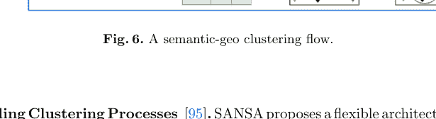

图 6. 语义-地理聚类流程。

### 构建聚类流程 [95]。

SANSA 提出了一种灵活的架构来设计聚类管道。例如，对于兴趣点（POI）数据集，SANSA 可以在一个管道中根据多个维度对其进行聚合：一方面是它们的标签，另一方面是它们的位置。这种架构如图 6 所示。

该方法包含多达五个主要组件（如果需要可以启用/禁用），即：数据预处理、SPARQL 过滤、词嵌入、语义聚类和地理聚类。在语义聚类算法中（这些算法不考虑 POI 位置，而是旨在根据共享标签对 POI 进行分组），需要将 POI 的分类值转换为数值向量以找到它们之间的距离。到目前为止，可以在三种可用技术中选择任何一种词嵌入技术，即独热编码、Word2Vec 和多维缩放。上述所有方法都将分类变量转换为可提供给语义聚类算法以形成非位置相似性组的格式。例如，所有餐馆都在一个聚类中，而所有 ATM 都在另一个聚类中。另一方面，地理聚类方法有助于在每个语义聚类内对空间上接近的坐标进行分组。

更一般地说，SANSA 的架构和实现允许用户设计他们想要的任何类型的聚类组合。实际上，该解决方案足够灵活，可以将两个以上的聚类“块”串联起来，甚至在多次聚类轮次后将额外的 RDF 数据集添加到流程中。

## 3.7 异常检测

随着数据集成和数据湖概念的最新进展，庞大的异构数据池正被整理为知识图谱（KG）。除了数据收集之外，从这种复合数据中获得有意义的见解也至关重要。然而，鉴于图状表示、多模态性质和数据规模庞大，大多数传统分析方法已不再直接适用。传统方法收集特定属性的所有值，例如身高，并对该属性执行异常检测。然而，将代表不同实体的一个属性进行比较在概念上是不准确的，例如将建筑物的高度与动物的高度进行比较。因此，迫切需要开发用于 KG 中离群点检测的全新方法。SANSA 提出了一种可扩展的方法，可以处理多模态数据，并根据它们所代表的类别队列进行自适应异常检测，其中队列是一组基于所选属性相似的类别。SANSA 中可扩展的异常检测 [216] 的概述如图 7 所示。

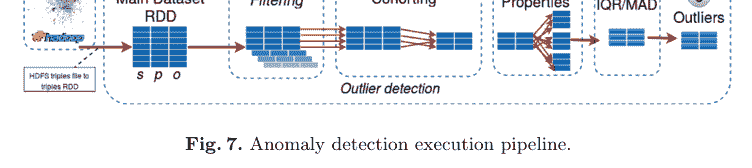

图 7. 异常检测执行管道。


### 3.8 实体链接

实体解析是识别并链接指向各种信息空间中同一现实世界对象的实体的关键任务。实体链接在众多任务中得到应用，如在与医学、金融、交通、商业和执法等相关的联邦数据集中去重实体。随着网络在体量和速度方面的增长，在异构数据集合中链接记录的任务变得更加复杂。在包含噪声数据和缺失值且模式绑定松散的不同数据集之间，很难找到实体间的语义关系。同时，对大型数据集上实体的成对比较意味着并表现出二次复杂度。一些最新方法通过将相似实体聚合到块中来降低这种复杂度。在 SANSA 中，我们实现了一种更通用的实体解析方法，该方法不使用阻塞并显著减少了二次比较。在 SANSA 中，我们使用诸如使用 HashingTF 的向量化、计数向量化和局部敏感哈希 [190] 等可扩展技术来实现大规模实体解析的近线性性能。SANSA 中使用的方法概述见图 8。

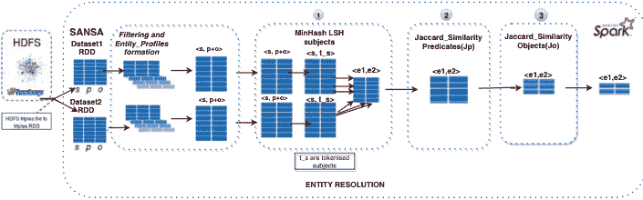

**图 8.** 可扩展实体链接概述。

### 3.9 RDF 的图核

许多机器学习算法强烈依赖于数据的特定结构，这迫使用户将观察结果适配到特定的预定义设置中，或重新实现算法以满足其需求。对于可以操作无模式结构的动态数据模型如知识图谱，采用的技术包括命题化或图核。受 [287] 的启发，我们在 SANSA 中开发了图核。游走核对应于长度上限为给定值的游走基数的加权和。游走的数量可以通过广度优先搜索或邻接矩阵的乘法来计算。路径核与游走核类似，但它计算的是路径的数量而非游走。不同于游走，路径必须由不同的顶点组成。子树核试图通过选择以中心实体标识并共享共同结构的子图来限制核的计算。这使得可以用其他合适的结构替代交集图。完整的子树核基于交集图中所包含的完整子树的数量。总体而言，核返回实体的特征向量集合，这些向量可进一步用于神经网络、支持向量机或类似处理数值数据的算法。

除本节提及的分析外，SANSA 还提供规则挖掘、聚类评估、图核等额外算法。所有这些算法都在不断扩展和改进。此外，随着时间的推移，还会添加更多算法。

## 4 宏大挑战与结论

在本章中，我们提供了 SANSA 功能的概述：一种试图填补第 3 章指出的空白的引擎。SANSA 是唯一全面的系统，它解决了多个挑战并提供了用于开发知识图谱价值链的库，该价值链涵盖从获取、分布和查询到复杂分析的各个环节（参见例如 [170,415]，其中使用 SANSA 在以太坊区块链上成功计算了复杂分析）。

SANSA 栈是朝着为用户处理大型知识图谱提供无缝解决方案方向迈出的一步。因此，仍有宏大的挑战需要面对：

- RDF 数据的可用性。这一挑战需要与联邦查询的研究方向（第 5 章）相联系，并与映射的设计（第 4 章）相联系，为 Mami 等人 [295] 所提出的类似数据湖导向的解决方案铺平道路。虽然数据作为知识图谱的表示已获得大量关注，并且正在创建大规模知识图谱，但所创建和存储的大多数数据是非 RDF 的，因此诸如数据清洗所需的工作和/或数据维护等挑战应被考虑在内。

- RDF 和查询层。分布式环境需要智能的分区方法（参见 [53] 和 [235] 的详细分类）与查询策略保持一致。一个可能性是具有动态分区范式，可根据数据形状和/或查询模式自动选择，如 [14] 中设想的那样。

- 在分布式环境中，进程通常与并发进程共享资源，因此“好的”查询响应时间本身的定义可能会有所不同，如 Graux 等人在 [169] 中对分布式 RDF 解决方案的回顾所述。可以考虑基于用例来评估这种性能。

- 机器学习与对数据的部分访问。大多数机器学习算法通常需要访问所有训练数据，并通过迭代训练数据来拟合期望的损失函数。在分布式环境中，这具有挑战性，因为可能需要使用多个本地学习器或查询处理器（每个都在数据子集上工作）并在全局上优化（或收集）部分本地结果。对于非常大规模的分布式数据，这种工作模式可能不合适 [343]。因此，迫切需要开发能够在数据部分访问的情况下工作的全新算法。

- 对语义网本身的挑战。目前，使用 W3C 标准，很难像属性图那样具有表达性。这导致了 RDF* [184,185] 的创建，以便允许语义网用户在 RDF 扩展中表达关于陈述的陈述。这些新可能性意味着当前的环境必须整合这一扩展，同时保证与之前相同的性能。

**开放获取** 本章根据知识共享署名 4.0 国际许可协议（http://creativecommons.org/licenses/by/4.0/）许可，该许可允许在任何媒介或格式下使用、共享、改编、分发和复制，只要您对原作者和来源给予适当的署名，提供指向知识共享许可的链接并标明是否进行了更改。

本章中的图像或其他第三方材料包含在本章的知识共享许可中，除非材料中的署名行另有说明。如果材料未包含在本章的知识共享许可中，并且您的预期使用未被法定法规允许或超过了允许的使用范围，您将需要直接从版权持有者获得许可。


随着时间的推移而引入的集合。在某个时间点，数字数据的唯一来源是电子表格和数据库。今天数据是从电子邮件、照片、数字文档或音频中收集的。非结构化和半结构化数据的多样性在数据分析期间造成了问题。因此，这些不同形式的数据必须集成以实现存储、挖掘和分析的一致性。集成这些复杂和半结构化数据的过程本身就带来了一系列挑战。例如，同一个现实世界对象可能在不同的数据源中被表示为不同的实体；因此，很难识别指代同一现实世界对象的实体。

资源描述框架（RDF）数据模型使从异构数据源集成的数据的描述成为可能。RDF 被设计为具有简单数据模型和形式语义，以提供推理能力。RDF 的语法描述了一个简单的基于图的 data 模型，以及形式语义，这允许定义良好的蕴含机制，为逻辑演绎提供基础。RDF 作为描述 Web 元数据的方法具有以下主要用例：（i）允许应用程序使用开放而非受限的信息模型；（ii）允许 Web 数据可被机器处理；以及（iii）从多个来源增量地组合和集成数据。RDF 被设计为以最小限制和灵活的方式表示信息；它可用于孤立的应用程序，其中单独设计的格式可能易于理解，而 RDF 的通用性在共享时提供了更高的价值。因此，RDF 数据的价值随着其变得可供整个互联网上的更多应用程序访问而增加。

RDF 是一种半结构化数据模型，允许在同一图中对实体的多个上下文进行编码。上下文描述了限制特定信息有效性的情况。所谓的“上下文即盒子”方法 [63] 将上下文视为定义某条信息是否准确的条件和约束。上下文信息（或元信息）表示描述上下文情况的条件和约束。例如，事实“唐纳德·特朗普是美利坚合众国总统”仅在“2017 年至 2021 年的总统任期”这一上下文中有效。RDF 数据模型允许以不同属性表示同一类型的实体。这反过来允许在同一图中对实体的多个上下文进行编码。例如，RDF 图中的实体 *唐纳德·特朗普* 可以具有与其作为政治家的职业相关的属性，也可以具有描述其作为真人秀明星角色的属性。RDF 的这一特性对于解决数据复杂性挑战中的多样性问题非常有用——这是大数据时代数据的主要维度 [218]。然而，使同一实体的多样化表示成为可能在 RDF 图的分析期间带来了新的挑战。这在需要考虑特定上下文以有效识别相似实体的情况下尤为普遍 [35]。两个实体在一个上下文中可能相似，但在另一个上下文中可能不相似。在本章¹ 中，我们提出了一种新颖的方法来解决


Fig. 1. Motivation Example. The top row shows three entities across two datasets. The bottom row shows two matching scenarios, the left one not considering context during entity matching, and the right one taking context into consideration.

the problem of entity matching considering context as a new dimension of the matching algorithm.

## 1.1 Motivating Example

Following the principle of the web of linked data, RDF allows for the representation of different contexts of an entity within the same graph. This means that applications attempting to match entities from different graphs have to deal with entities that are valid in different contexts. In order to match entities in such a way that they comply with the context specified by the user of the application, the system context must be taken into account. A system’s context represents any kind of information that describes the system and its requirements. If this system context is not considered, the entity matching operation will match entities that are not relevant or valid under the definition of system context.

This can be demonstrated using the example of a context-based entity matching scenario using RDF entities representing persons. Arnold Schwarzenegger is a person with an extensive career in both politics and acting. Consequently, there is data available regarding both his career in politics and his achievements in the movie industry. Consider a system that contains data about American politicians and is searching other data sources to match relevant data. The system’s

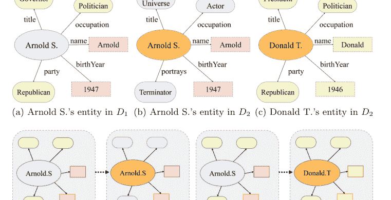

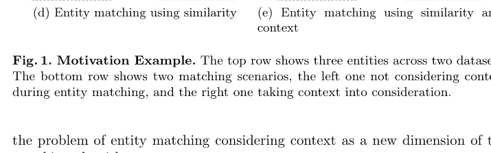

dataset D₁ contains information about Arnold Schwarzenegger and his political career. In another dataset D₂ available on the web there exists information about Arnold’s acting career, e.g. the movies he has acted in and the roles he has played. The same dataset D₂ also contains information about other celebrities, like Donald Trump, President of the United States. These entities are presented in Figs. 1a, 1b and 1c, respectively.

In a typical entity matching scenario where context is not considered, entities are matched to the ones that are most similar to them. In such a case, Arnold Schwarzenegger’s entity from D₁ will be matched with the entity in D₂ containing information about his acting career, as shown in Fig. 1d. However, in the context of politics, Arnold’s political career is more similar to Donald Trump’s than his own career in acting. They are politicians of almost the same age who both support the Republican party. In a political context, their careers are far more similar than when Arnold’s post as the Governor of California is compared with his portrayal of the Terminator in Terminator 2. Therefore, when the context of American politics is considered, the entity of Arnold S. from D₁ should be matched with the Donald T. entity from D₂. This is an example of context-aware entity matching.

## 1.2 Challenges and Problems

To match entities from heterogeneous sources in a unified way, Bellazi et al. [37] explain the importance of analyzing all data sources to identify interoperability conflicts. Vidal et al. [447] characterize the interoperability conflicts into six categories. We summarize the main characteristics of each interoperability conflict.

- 1. Structuredness (C1): data sources may be described at different levels of structuredness, i.e. structured, semi-structured, and unstructured. The entities in a structured data source are described in terms of fixed schema and attributes, e.g. the entity-relationship model. In semi-structured data sources, a fixed schema is not required, and entities can be represented using different attributes and properties. Examples of semi-structured data models are the Resource Description Framework (RDF) or XML. Lastly, in unstructured data sources, no data model is used, so the data does not follow any structure. Typically unstructured data formats are: textual, numerical, images, or videos.

- 2. Schematic (C2): the following conflicts arise when data sources are modeled with different schema. i) the same entity is represented by different attributes; ii) different structures model the same entity, e.g., classes versus properties; iii) the same property is represented with different data types, e.g., string versus integer; iv) different levels of specialization/generalization describe the same entity; v) the same entity is named differently; and vi) different ontologies are used, e.g., to describe a gene function the following ontologies may be used UMLS, SNOMED-CT, NCIT, or GO.

- 3. Domain (C3): various interpretations of the same domain exist on different data sources. These interpretations include: homonyms, synonyms, acronyms, and semantic constraints—different integrity constraints are used to model a concept.

- 4. Representation (C4): different representations are used to model the same entity. These representation conflicts include: different scales and units, values of precision, incorrect spellings, different identifiers, and various encodings.

- 5. Language (C5): the data and schema may be specified using different languages, e.g. English and Spanish.

- 6. Granularity (C6): the data may be collected under different levels of granularity, e.g. samples of the same measurement observed at different time-frequency, various criteria of aggregation, and data model at different levels of detail.

## 2 Applications of Entity Matching

Entity Matching (EM) is an important operation in the field of data science and data management, and as such there are many practical applications where entity matching is necessary. In this section, we explore two applications of entity matching, namely *Data Integration* and *Knowledge Summarization*.

### 2.1 Semantic Data Integration

Semantic data integration is a research field that deals with integrating and reconciling *semantic heterogeneity* in different data sources. Towards this goal, the inclusion of semantics as a tool to aid data integration makes the entire process more powerful [101]. Using semantics in data integration means building data integration systems where the semantics of data are explicitly defined, and these semantics are used in turn during all the phases of data integration. It is unrealistic to entertain the idea that various data sources across the web will publish data using the same set of rules and conventions. Indeed, in reality data available across the World Wide Web have very different representations of the same information and concepts (entities). The stack of semantic technologies allows the opportunity for describing data semantically, and for interlinking disparate data sources. Thus, semantic integration is a useful approach for integrating semantically heterogeneous data. The bulk of the work done surrounding semantic data integration revolves around three aspects [332]. The first aspect is *mapping discovery*, or the process of automatically finding similarities between two ontologies and mapping properties that present the same real-world concept. The second is *mapping representation*, which is concerned with the specific method of representing mappings between two ontologies. The third and final aspect is *enabling reasoning*, which concerns itself with the process of performing reasoning over ontologies once the mapping has been established.

An example of an approach to achieve semantic data integration is the MINTE framework proposed by Collarana et al. [84]. MINTE is a *semantic integration technique* that is able to match and merge semantically equivalent RDF entities in a single step through the utilization of semantics present in the vocabularies. MINTE uses both semantic similarity measures and the implicit knowledge present in the RDF vocabularies in order to match and merge RDF graphs that refer to the same real-world entity. MINTE’s performance is powered by semantic similarity measures, ontologies, and fusion policies that consider not only textual data content but also logical axioms encoded into the graphs.

MINTE implements a two-step approach for determining the similarity between two RDF entities and then merging them. In the first step, MINTE implements a 1-1 weighted perfect matching algorithm to identify semantically equivalent RDF entities in input data sources. Then MINTE relies on fusion policies to merge triples from these semantically equivalent RDF entities. Fusion policies are rules operating on RDF triples, which are triggered by certain configurations of predicates and objects. Fusion policies can also resort to an ontology O to resolve possible conflicts. Collarana et al. define multiple fusion policies, e.g. union policy, subproperty policy and authoritative graph policy, which are each designed for flexible management and targeted control of an integrated knowledge graph. Figure MINTE architecture depicts the main components of the MINTE architecture. The accuracy of the process of determining when two RDF molecules are semantically equivalent in MINTE is impacted by the characteristics of the similarity measure Simf. Collarana et al. report the best performance when the GADES [371] similarity metric is used.

### 2.2 Summarization of Knowledge Graph

Another application of entity matching lies in the summarization of knowledge graphs. A knowledge graph is an ontology combined with a collection of instances that represents a collection of interlinked descriptions of entities. Knowledge graphs often capture domain-specific knowledge in the form of a graph. It has a data layer that contains the actual information and a semantic layer that represents the schema or the ontology. Typically knowledge graphs contain millions of entities and billions of properties describing these entities. This can lead to information overload, and therefore it is important to compress and summarize knowledge graphs for efficient representation of data [175].

The task of entity summarization is an essential part of knowledge graph summarization. Entity summaries allow the concise representation of the most important information about a certain real-world object. In the process of entity summarization, entity matching plays an important role. In order to summarize entities that either refer to the same real-world entity or are similar according to some summarization paradigm, it is first necessary to identify entities that belong in the same summary unit. For example, several knowledge graphs contain information about Marie Curie, each containing hundreds of facts about her life. For typical use cases, a summary containing a few basic items of information, namely her name, birth year, occupation and notable contributions, is enough to distinguish the most relevant aspects about her. To achieve this goal, it is first required to isolate entities from each knowledge graph that refer to Marie Curie. This is done using an entity matching technique. Knowledge graph


摘要可以是*简洁的*——仅包含原始事实的子集，也可以是*全面的*——包含所有原始事实的概览。选择简洁还是全面的摘要取决于具体情况。

知识图谱也可以沿不同轴进行摘要。例如，可以基于语义层（即本体）对信息进行摘要。还可以沿不同的上下文层进行摘要，例如时间、地理位置等。在*用例*一章中，描述了使用COMET对知识图谱实体进行时间摘要的技术。

## 3 新颖的实体匹配方法

不同数据源之间的实体匹配问题对于数据集成领域至关重要。这是因为数据集成的主要任务之一是协调不同的模式，从而在不同数据源之间创建映射实体。在关系数据库和图数据库社区中，存在多种模式间映射的方法。对于实体摘要——实体匹配的另一个应用——也存在多种方法。

关于上下文及其在数据驱动任务中的作用，也进行了大量研究，特别是在语义网中，数据的概念与其语义密切相关。这些研究大部分局限于上下文的正式化，尽管在实际实现这一概念方面所做的工作并不多。以下是一些在形式化上下文方面开展的相关工作，以及一些面向数据集成和实体摘要的实用方法。

### 3.1 语义网中的上下文

**形式化上下文的原则：**

Bozzato等人[63]提出，在语义网和开放关联数据（LOD）中，上下文需要以更高级的方式表示。他们进一步定义了上下文表示*应当*遵守的一组属性。这些属性使上下文成为RDF数据及其推理的组成部分。属性如下：

1. *封装*：共享相同上下文的数据必须被封装，以便于访问和识别。
2. *显式元知识*：上下文信息必须用逻辑语言表示。
3. *分离*：必须有办法清晰地区分元知识与对象知识。
4. *关系*：上下文之间的关系必须被显式表示。
5. *封装*：共享相同上下文的数据必须被封装，以便于访问和识别。
6. *上下文推理*：表示应允许利用上下文知识进行推理。
7. *局部性*：每个上下文表示单元应允许定义仅在局部范围内有效的公理。
8. *知识提升*：应该能够重用来自一个上下文的知识并将其应用于另一个上下文。
9. *重叠*：表示应允许不同上下文之间的知识重叠。
10. *复杂性不变性*：添加此上下文层不应增加推理的复杂性。

COMET中上下文的定义受上述原则指导。我们的定义特别侧重于实现*显式元知识*和*上下文推理*的属性。

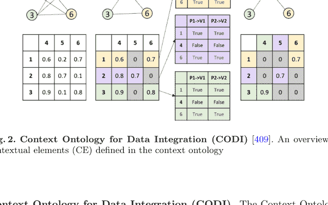

Fig. 2. 用于数据集成的上下文本体（CODI）[409]。上下文本体中定义的上下文元素（CE）概述。

**用于数据集成的上下文本体（CODI）。**

用于数据集成的上下文本体[409]由Souza等人开发，用于在数据集成过程中形式化地表示上下文。他们首先定义了上下文元素（CE）的概念，以表示任何特定领域场景的上下文。如图2所示。然后，在与领域专家会面后，他们构建了一个适合特定领域场景的上下文本体。该上下文本体随后在数据集成期间用于模式协调。尽管这种方法适用于数据集成场景中上下文的形式化定义，但它仍然相当昂贵，因为在上下文本体的建模中，如果没有领域专家的大量输入，它就无法工作。它也没有利用数据实例中已有的语义来指导其上下文的建模。

### 3.2 实体匹配方法

**在数据集成中的应用。**

数据集成（DI）是最需要实体匹配的最常见应用之一。这种匹配在模式级别或实例级别进行。有许多方法旨在集成不同的RDF数据源。我们根据这些工作是匹配本体还是匹配实例本身来划分。

**本体匹配方法。**

许多基于RDF数据的数据集成方法应用了将异构数据源映射到公共本体的概念。使用本体的一种方法是KARMA，由Knoblock等人[247]提出。这是一个用于集成各种数据源（包括数据库、电子表格、XML、JSON和Web API）的框架。KARMA实现了一种混合方法，依靠监督机器学习算法来识别从结构化源到本体的映射规则；用户可以通过用户界面完善这些映射规则。

Schultz等人[388]提出了另一种方法，他们描述了关联数据集成框架（LDIF）。LDIF面向集成来自Web的RDF数据集，并提供一组独立工具来支持互链任务。LDIF提供了一种表达力丰富的映射语言，用于将来自各种词汇表的数据转换为统一的本体。LDIF通过使用SILK工具[213]定义链接规则来解决身份解析问题。根据定义的规则，SILK识别两个数据集实体之间的`owl:sameAs`链接。

**实例匹配方法。**

在识别给定实体是否指向同一现实世界实体的任务中，关系数据库领域越来越关注众包机制[242, 445]。然而，尽管这些方法报告了令人印象深刻的结果，但在具有多种上下文的复杂领域中，由于缺乏能够可靠提供必要示例数据的人类专家，它们可能会遇到困难。

ODCleanStore [307]和UnifiedViews [246]是用于集成RDF数据的ETL框架。ODCleanStore依靠SILK执行实例匹配，并提供自定义数据融合模块来合并已发现匹配的数据。

Collarana等人[84]提出的MINTe框架也通过利用数据本身编码的语义来处理不同数据集中对应于同一现实世界实体的实体匹配任务。他们首先应用语义相似度度量来识别来自两个不同RDF图的语义等价实体。接下来，他们利用一组新颖的融合策略来合并这些语义等价的实体。尽管MINTe利用了RDF图本身编码的语义，但它在实体匹配步骤中没有考虑上下文。COMET所做的工作本质上是对MINTe的基于上下文的扩展（图3）。

Fig. 3. 实体摘要。LinkSum [424]所设想的对单个实体进行摘要。

**在实体摘要中的应用。**

实体摘要是为描述整个实体而创建实体简洁表示的过程。已经制定了许多方法来生成实体摘要[175]。其中一种方法是Cheng等人[79]提出的RELIN，他们定义了使用RDF图进行实体摘要的问题，并展示了其在实体识别中的实用性。RELIN利用PageRank算法在创建摘要实体时选择相关特征。2014年，Thalhammer和Rettinger提出了SUMMARUM [425]，这是一个基于dbpedia的实体摘要框架，也使用PageRank对实体的特征进行排序。它还使用DBPedia资源对应其Wikipedia页面的全局流行度。他们后来提出了LinkSum [424]，除了PageRank之外，它还使用了BackLink方法的改编版本，并结合了新的谓词选择方法。这些实体摘要框架侧重于特征（属性）的排名以创建摘要，但没有考虑数据的任何上下文维度。上述集成框架旨在映射可能具有不同模式的不同数据源，即它们执行模式间映射。在这些框架中，基于上下文的集成只能通过过滤查询结果在表面上得到支持，而无需应用许多固有语义。类似地，实体摘要框架旨在通过某种属性顺序进行摘要，而不是考虑数据中存在的上下文信息。因此，我们认识到需要基于上下文的实体匹配机制，并提出了我们的方法，该方法可适用于RDF数据的集成和摘要（图4）。


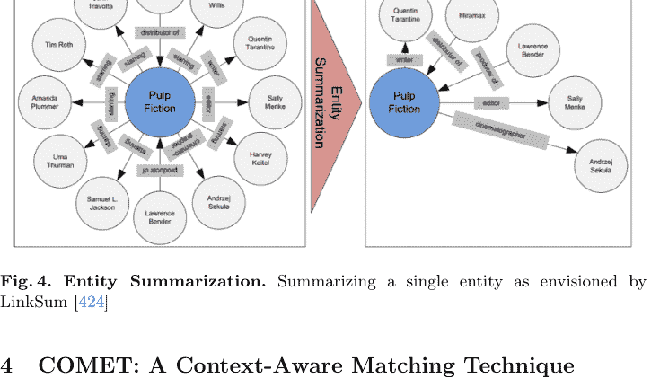

Fig. 4. Entity Summarization. Summarizing a single entity as envisioned by LinkSum [424]

## 4 COMET: A Context-Aware Matching Technique

为了解决上下文匹配 RDF 实体的问题，提出了 COMET —— 一种上下文感知的 RDF 分子匹配技术。该技术基于 Collarana 等人 [84] 提出的语义数据集成技术，其工作涉及使用语义相似度度量和融合策略来匹配和合并语义相似的 RDF 分子。本工作使用了 RDF 分子的概念，但提出了一种新的方法，即在匹配实体时考虑系统的上下文。COMET 是一个实体匹配框架，旨在创建、识别和匹配上下文等价的 RDF 实体。基于 Collarana 等人 [84] 提出的数据集成技术中的实体匹配组件，我们提出了 COMET，一种基于上下文合并等价 RDF 实体的实体匹配方法。因此，提供了上下文匹配实体的解决方案（图 5）。

### 4.1 Problem Definition

RDF Molecule [84] – 若 Φ(G) 是一个给定的 RDF 图，我们定义 RDF 分子 M 为 Φ(G) 的一个子图，使得，

```
M = {t₁, ..., tₙ}
∀ i, j ∈ {1, ..., n} (subject(tᵢ) = subject(tⱼ))
```

其中 t₁, t₂, ..., tₙ 表示 M 中的三元组。换句话说，RDF 分子 M 由具有相同主体的三元组组成。也就是说，它可以表示为一个元组 M = (R, T)，其中 R 表示分子的 URI，

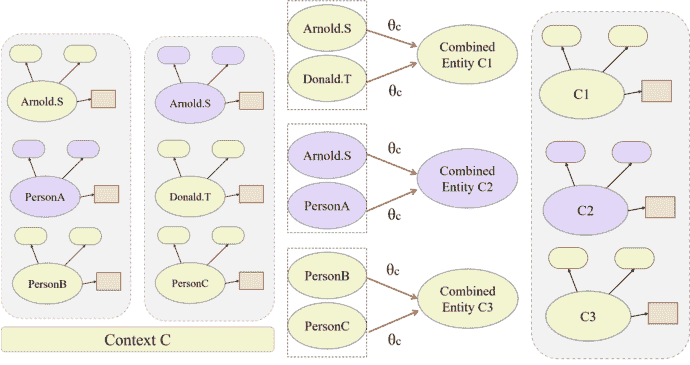

**Fig. 5. Problem Definition.** The left side shows two RDF Graphs the system Context. The right side shows the application of homomorphism $\theta_C$ on the RDF graphs, resulting in the formation of Contextualized RDF Graph $F_C$.

主体，T 表示属性和值对的集合 $p=(prop,val)$，使得三元组 $(R, prop, val)$ 属于 M。例如，*Arnold Schwarzenegger* 的 RDF 分子为 $(dbr:Arnold-Schwarzenegger, \{(dbo:occupation, Politician), (dbp:title, Governor)\})$。用 RDF 分子描述的 RDF 图 Φ(G) 定义如下：

```
$$\Phi(G)=\{M=(R,T)\mid t=(R,prop,val)\in G\land(prop,val)\in T\}$$
```

*Context* – 我们定义上下文 $C$ 为任何表示系统标准的布尔表达式。两个实体，例如 RDF 分子 $M_1$ 和 $M_2$，相对于给定的上下文可以相似或不相似。也就是说，$C$ 是一个布尔函数，以两个分子 $M_1$ 和 $M_2$ 作为输入，如果它们根据系统上下文相似则返回 true，否则返回 false。下面是上下文 $C$ 的一个示例，模仿图 1 中呈现的示例，其中两个分子如果具有相同的职业则相似。如果 $P=(p,v)$ 是表示分子职业属性的谓词，则上下文。

```
$$C(M_1,M_2)=\begin{cases}\text{true},&\text{if }P\in M_1\land P\in M_2.\\\text{false},&\text{otherwise.}\end{cases}$$
```

根据集成场景的要求，此上下文可以是任何布尔表达式。

*Semantic Similarity Function* – 设 $M_1$ 和 $M_2$ 为任意两个 RDF 分子。那么 *semantic similarity function* $Sim_f$ 是一个函数，用于衡量这两个分子之间的 *semantic similarity* 并返回 [0, 1] 之间的值。0 的值表示两个分子完全不相似，1 表示分子相同。GADES [371] 中定义了此类相似度函数。

Contextually Equivalent RDF Molecule - 设 Φ(G) 和 Φ(D) 为两个 RDF 分子集合。设 $M_G$ 和 $M_D$ 分别来自 Φ(G) 和 Φ(D) 的两个 RDF 分子。那么，$M_G$ 和 $M_D$ 被定义为上下文等价当且仅当

- 1. 它们处于同一上下文中。也就是说，$C(M_1, M_2) = \textbf{true}$
- 2. 它们具有最高的相似度值，即，
- $Sim_f(M_G, M_D) = max(\forall m \in \Phi(D) Sim_f(M_G, m))$

设 $F_c$ 为来自 Φ(G) 和 Φ(D) 的 *contextually integrated* RDF 分子的理想集合。设 $\theta_c$ 为一个同态，使得 $\theta_c: \Phi(G) \cup \Phi(D) \rightarrow F_c$。那么存在一个来自 $F_c$ 的 RDF 分子 $M_F$ 使得 $\theta(M_D) = \theta(M_G) = M_F$。从动机示例来看，这意味着政治家 *Arnold Schwarzenegger* 的分子与 *Donald Trump* 的分子是 *contextually equivalent*，因为它们相似 *并且* 满足具有相同职业的上下文条件。

在本工作中，我们解决了显式建模上下文然后匹配来自 RDF 图的 RDF 分子的难题，这些分子在相似性方面都很高并且在该上下文方面等价。该问题定义如下：给定 RDF 图 Φ(G) 和 Φ(D)，设 $M_G$ 和 $M_D$ 为两个 RDF 分子，使得 $M_G \in \Phi(G)$ 且 $M_D \in \Phi(D)$。系统提供了一个上下文参数 $C$，它是一个布尔函数，用于评估两个分子是否处于同一上下文中。它还提供了一个相似度函数 $Sim_f$，用于评估 $M_G$ 和 $M_D$ 之间的语义相似度。

创建上下文图 Φ_C 的问题在于构建一个同态 $\theta_c: \Phi(G) \cup \Phi(D) \rightarrow F_c$，使得对于属于 Φ_C 的每对 RDF 分子，都不存在根据系统上下文 $C$ *contextually equivalent* 的分子。如果 $M_G$ 和 $M_D$ 是属于 $F_c$ 的上下文等价分子，则 $\theta_c(M_G) = \theta_c(M_G)$，否则 $\theta_c(M_G) \neq \theta_c(M_D)$。

该问题的示例在图 X 中说明，该图描绘了一个使用两个 RDF 图和单个上下文参数 $C$ 的用例。相对于 $C$，来自 Φ(G) 的 RDF 分子 *Arnold.S* 与来自 Φ(D) 的 *Donald.T* 处于同一上下文中，但不与来自 Φ(G) 的分子 *Arnold.S* 处于同一上下文中。因此，该问题是要识别一个同态 $\theta_c$，该同态根据系统上下文评估 RDF 分子并以一种方式映射这些 RDF 分子，以便它们可以集成到上下文图中。

### 4.2 The COMET Architecture

我们提出了 COMET，一种根据给定上下文匹配上下文等价 RDF 图的方法，从而为 *contextually matching* RDF 图的问题提供了解决方案。图 6 描述了 COMET 架构的主要组件。COMET 采用双重方法以上下文感知的方式解决 RDF 图中的实体匹配问题：首先，COMET 计算 RDF 实体之间的相似度度量，并利用形式概念分析算法来映射上下文等价的 RDF 实体。最后，COMET 结合第一步的结果并执行 1-1 完美匹配算法，根据组合得分匹配 RDF 实体，最终将匹配综合为上下文 RDF 图。

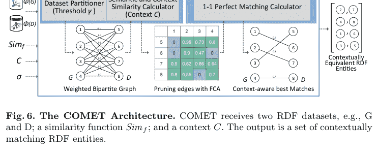

Fig. 6. The COMET Architecture. COMET receives two RDF datasets, e.g., G and D; a similarity function Sim_f; and a context C. The output is a set of contextually matching RDF entities.

### 4.3 Identifying Contextually Equivalent Entities

Building a Bipartite Graph. COMET 管道接收两个 RDF 图 Φ(G)、Φ(D) 作为输入，以及上下文参数 C 和相似度函数 Sim_f。COMET 首先在集合 φ(G) 和 φ(D) 之间构建一个二部图。数据集分区器采用相似度函数 Sim_f 和本体 O 来计算 φ(G) 和 φ(D) 中 RDF 分子之间的相似度，并将相似度分数分配为二部图中的顶点权重。COMET 允许任意用户提供的相似度函数，利用不同的算法来估计 RDF 分子之间的相似度。因此，COMET 支持多种相似度函数，包括简单的字符串相似度。然而，如 [84] 所示，语义相似度度量是推荐的（在本工作的实现中我们特别使用 GADES [371]），因为它们通过考虑 RDF 图中编码的语义而取得更好的结果。

在 RDF 分子相似度比较之后，相似度函数的结果会针对阈值 γ 进行测试，以确定实体相似度（相似度阈值的最低可接受分数）。因此，权重低于 γ 的边会被从二部图中丢弃。等于 0.0 的阈值不对相似度值施加任何限制；因此二部图包含所有边。较高的阈值，例如 0.8，限制相似度值，导致二部图仅包含少数几条边。


(a) 应用阈值 γ = 0.5 后的二分图
(b) 使用 FCA 进行上下文验证
(c) 完美 1-1 匹配

图 7. 上下文验证。左侧展示了应用阈值后的二分图。剩余的边通过一种特殊的 1-1 匹配算法进行处理，该算法利用 FCA 考虑系统上下文。结果是上下文等价的分子之间的完美匹配。

### 根据上下文剪除 RDF 实体

COMET 流水线的主要步骤是验证并剪除不符合输入上下文 C 的 RDF 分子对，这使 COMET 成为一种上下文感知的方法。为了识别上下文等价的 RDF 实体，上下文验证器组件采用了形式概念分析（Formal Concept Analysis, FCA）算法。FCA 研究描述对象及其属性之间关系的二元数据表。对 RDF 分子应用此上下文验证步骤，可确保只保留与上下文相关的元组。在 COMET 中，上下文被建模为任意布尔函数。两个分子如果满足该条件则匹配，否则不匹配。COMET 应用了 V. Vychodil [451] 的算法；该算法执行形式概念分析，以计算一组对象及其属性中的形式概念。我们的方法扩展了该算法，用于验证复杂的布尔条件。典型的形式概念分析表如表 1 所示。

**表 1. 执行 FCA 的对象-属性表。**

| | 属性 1 | 属性 2 | 属性 3 |
|---|---|---|---|
| 对象 1 |  | X | X |
| 对象 2 |  | X |  |
| 对象 3 | X |  | X |

在我们的方法中，不是使用 FCA 矩阵列中的属性，而是将属性替换为布尔条件 C。这与我们方法中使用的上下文条件 C 相同。例如，来自动机示例的上下文 C 可以分解为 C = C1 ∧ C2，其中 C1 = “包含属性 dbo:occupation”，C2 = “对于属性 dbo:occupation 具有相同的值”。由于 FCA 的输入格式仍然是二元矩阵，因此这种调整不会改变 FCA 算法的执行。

当应用于 RDF 分子时，形式概念分析返回一组形式概念 < M, C >，其中 M 是包含 C 中所有条件的所有分子的集合。也就是说，通过应用 FCA，可以获得满足特定上下文条件的分子集合。因此，不满足上下文条件的分子将被剪除。图 7 展示了上下文验证的示例。二分图中的边根据阈值 γ 进行过滤，如前一节所述。接下来，通过根据上下文条件 C 构建 FCA 矩阵来验证剩余的边。FCA 算法返回满足上下文条件的边。不满足上下文条件的边将被丢弃。

### 4.4 1-1 完美匹配计算器

COMET 通过计算 RDF 分子集合之间的 1-1 加权完美匹配来解决上下文感知的实体匹配问题。1-1 加权完美匹配组件的输入是上一步创建的加权二分图。由于两个 RDF 分子之间每条边的权重对应于语义相似性和上下文等价值的组合得分，我们称其为 1-1 上下文感知匹配计算器。该 1-1 上下文感知匹配计算器的效果在图 9 中展示。最后，利用诸如匈牙利算法 [267] 之类的组合优化算法来计算匹配。

### 4.5 集成用例：应用融合策略

为了将此上下文感知实体匹配流水线应用于数据集成场景，我们设想使用 Collarana 等人 [84] 定义的融合策略。为了整合被识别为上下文等价的实体，COMET 可以利用合成策略，即用户提供的函数，该函数定义如何组合 RDF 分子以形成一个连接的整体。COMET 可以采用以下合成策略：

- 1. *并集策略*（Union Policy），包含所有谓词-对象对，并移除语法上相同的对；
- 2. *链接策略*（Linking Policy），在上下文等价的 RDF 分子之间生成 `owl:sameAs` 链接；
- 3. *权威策略*（Authoritative Policy），允许将一个 RDF 图定义为优先来源，在属性冲突时选择其属性，即标注为 `owl:FunctionalProperty` 的属性、等价属性 `owl:equivalentProperty` 以及标注了 `owl:sameAs` 或 `owl:equivalentClass` 的等价类。

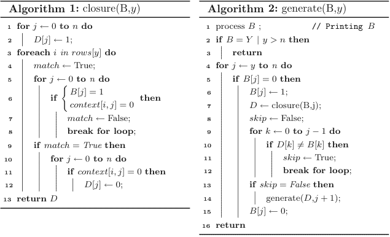

**图 8.** 实现的算法（扩展自 [451]）。

通过应用这些策略，最终输出是一个合成图，其中的链接实体是 *上下文等价* 的。在下一章中，我们将探讨上下文感知实体匹配的另一个用例：知识图谱实体的时间摘要。

## 5 实证评估

本节概述了实证评估中的技术细节、执行过程和所得结果。

### 5.1 研究问题

我们进行了实证评估，以研究 COMET 在解决 RDF 图之间的实体匹配问题时的有效性和性能。我们解决以下研究问题：

- (**RQ1**) COMET 是否能够比 MINTE [84] 实体匹配组件更准确地根据上下文执行实体匹配？
- (**RQ2**) 数据集的内容相对于上下文条件是否会影响 COMET 的准确性？
- (**RQ3**) COMET 中的上下文评估步骤会给整个流水线增加多少开销？

(**RQ1**) 和 (**RQ2**) 结合起来进行**实验 1**，以评估 COMET 的有效性或准确性。(**RQ3**) 由**实验 2** 解决，其中测量了上下文评估步骤的开销。

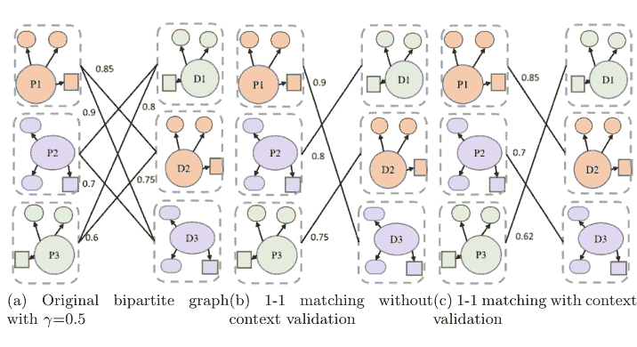

**图 9. 1-1 完美匹配。** COMET 应用一种特殊的 1-1 完美匹配算法，该算法同时评估两个分子之间的上下文和相似性。传统的 1-1 完美匹配算法只考虑相似性（边的权重）。如果不评估上下文，1-1 匹配算法会匹配不在同一上下文中的分子。当上下文与相似性一起评估时，同一上下文中的分子会被匹配。

### 5.2 实现

实际上，COMET 使用 Python 实现，并托管在 GitHub$^{2}$ 上，同时提供了本次评估中使用的数据集和日志。实验在 Windows 10（64 位）机器上执行，CPU：Intel Core i7-8650U 1.9 GHz（4 个物理核心），16 GB RAM。对于 COMET 流水线，我们使用语义相似性度量 *GADES* [371]，Collarana 等人先前已证明，将其添加到他们的 MINTE 流水线 [84] 中时，在准确性方面具有最佳性能。*GADES* 依赖于本体中编码的语义描述来确定相关性。*GADES* 通过利用图邻域来检查字符串相似性和层次相似性。

$^{2}$ https://github.com/RDF-Molecules/COMET.

**表 2. 基准描述。** 评估中使用的数据集，包括：RDF 分子数量（M）、三元组数量（T）、评估的上下文（C）。

| 配置 | **实验 1：有效性** |
|---|---|
| 数据集 | A1, A2, B1, B2, C1, C2 |
| 分子数 | 1000, 1000, 1000, 1000, 1000, 1000 |
| 三元组数 | 70,660; 70,660; 70,776; 70,776; 71,124; 71,124 |
| 上下文 | *C(MD₁, MD₂) = true*，如果 dbo:occupation 匹配 |

| **实验 2：运行时** | XS1 | XS2 | S1 | S2 | M1 | M2 | L1 | L2 |
|---|---:|---:|---:|---:|---:|---:|---:|---:|
| 分子数 | 100 | 100 | 500 | 500 | 1,000 | 1,000 | 2,000 | 2,000 |
| 三元组数 | 7,084 | 7,084 | 33,916 | 33,916 | 71,124 | 71,124 | 138,856 | 138,856 |

### 5.3 基线

作为基线，我们将 COMET 的有效性与 Collarana 等人 [84] 提出的 MINTE 流水线进行比较。针对 (**RQ1**) 和 (**RQ2**)，我们设计了一个实验来测量 COMET 与 MINTE 相比的 *精确率*、*召回率* 和 *F 值*。我们还在相对上下文具有不同分子组成的数据集上运行 COMET 和 MINTE，以观察数据集的上下文内容对 COMET 有效性的影响。针对 (**RQ3**)，我们观察 COMET 上下文评估步骤对时间和内存性能的影响。

### 5.4 有效性评估

**指标。** 尽管每个实验都有不同的数据集和黄金标准，但我们在所有实验中使用相同的指标：*精确率*、*召回率* 和 *F 值*。*精确率* 衡量所执行的实体匹配中实际正确的比例。也就是说，*精确率* 是 COMET（C）识别为上下文等价的 RDF 分子与黄金标准（GS）相交的比例。另一方面，*召回率* 衡量被正确识别的已集成 RDF 分子的总体比例。也就是说，*召回率* 是通过相对于黄金标准正确识别的相似分子的比例来衡量的，即 **精确率 = |C ∩ GS| / |C|** 和 **召回率 = |C ∩ GS| / |GS|**。*F 值* 是 *精确率* 和 *召回率* 的调和平均值。

**数据集。** 对于此实验，我们使用包含来自 DBpedia 的 1,000 个人物实体的数据集。为了测试上下文数据内容对 COMET 准确性的影响，分别使用配置 *A*、*B* 和 *C* 生成了三对数据集 (*A1*, *A2*)、(*B1*, *B2*) 和 (*C1*, *C2*)。这些配置如下：


+   1. **配置 A：** 数据集 A1 中的每个分子 *a1* 在数据集 A2 中都有 **2** 个 *高度相似* 的分子 *a2* 和 *a3*，其中 *a2* 满足上下文条件，但 *a3* 不满足。也就是说，*C(a1, a2) = true* 且 *C(a1, a3) = false*。
+   2. **配置 B：** 数据集 B1 中的每个分子 *b1* 在数据集 B2 中都有 **3** 个 *高度相似* 的分子 *b2, b3* 和 *b4*，其中 *b2* 和 *b3* 满足上下文，但 *b4* 不满足。
+   3. **配置 C：** 数据集 C1 中的每个分子 *c1* 在数据集 C2 中都有 **4** 个 *高度相似* 的分子，其中两个满足上下文条件，两个不满足。

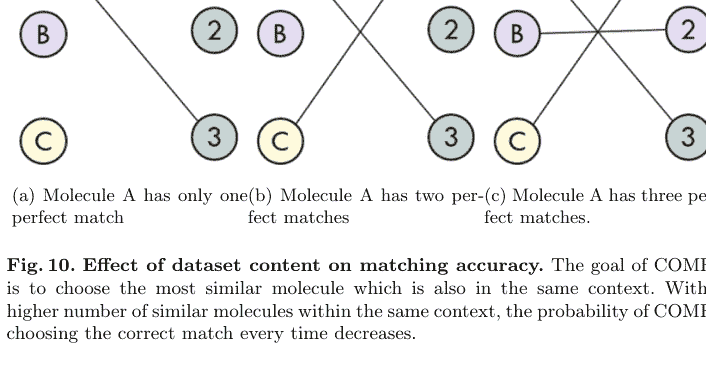

(a) 分子 A 只有一个完美匹配 (b) 分子 A 有两个完美匹配 (c) 分子 A 有三个完美匹配。

**图 10. 数据集内容对匹配准确率的影响。** COMET 的目标是选择最相似且也在同一上下文中的分子。随着同一上下文中相似分子的数量增加，COMET 每次都选择正确匹配的概率会降低。

使用这三种配置对数据集进行整理的动机如下：如第 4 节所示，COMET 应用一种特殊的 1-1 完美匹配算法，根据相似度和上下文条件找到最佳匹配。因此，处于同一上下文中的高度相似分子的数量变化会影响 COMET 在数据集上的表现。同一上下文中相似分子数量越多，COMET 识别出正确匹配的机会就越小。

这在图 10 中得到了证明。这里，显示相同颜色的圆表示它们处于同一上下文中的分子。在图 10a 中，分子 A 在匹配数据集中只有一个完美匹配可用，COMET 相应地进行此匹配。但在图 10b 和 10c 中，同一上下文中的完美匹配数量分别增加到两个和三个。这意味着 COMET 识别出分子 A 的真实匹配的概率降低。因此，我们旨在评估数据集中的相似分子数量变化如何影响 COMET 的准确性。

## 表 3. COMET 的有效性评估。

| Configuration | COMET | | | MINTE | | |
| | Precision | Recall | F-Measure | Precision | Recall | F-Measure |
| A | 1.0 | 1.0 | 1.0 | 0.54 | 0.54 | 0.54 |
| B | 0.708 | 0.708 | 0.708 | 0.449 | 0.449 | 0.449 |
| C | 0.558 | 0.558 | 0.558 | 0.408 | 0.408 | 0.408 |

每对数据集的合成方式如下：首先，根据配置条件复制原始 1,000 个 DBpedia 人物实体集合中的分子，以在第二个数据集中创建 n 个高度相似的分子。然后随机编辑和删除相似分子中的谓词以创建相似度的变化。然后编辑谓词以确保第二个数据集中满足上下文的相似分子数量与原始数据集一致。

## 上下文和金标准。

类似于图 1 中所示的动机示例，本实验中使用的上下文 C 检查两个分子是否对谓词 dbo:occupation 具有相同的值。金标准包含分子之间的匹配，这些匹配 (i) 满足上下文条件；并且 (ii) 在所有其他分子中相似度最高。对于属于三种配置的每对数据集，即配置 A、B 和 C，都有对应的金标准 GA、GB 和 GC。数据集、金标准和实验代码均可在 GitHub 上获得。

## 实验 1：上下文匹配 DBpedia RDF 分子。

表 2 描述了评估期间使用的的数据集。本实验对 MINTE 和 COMET 在每对数据集 (A1, A2)、(B1, B2) 和 (C1, C2) 上各进行一次，上下文条件要求每对匹配的分子必须对 dbo:occupation 属性具有相同的值。本实验的阈值 γ 在每种情况下均应用于第 97 百分位。然后与配置 A、B 和 C 的金标准 GA、GB 和 GC 相比较，每次计算指标 Precision 和 Recall。结果呈现在表 3 中。

## 实验 2：上下文评估对性能的影响。

除了之前报告的侧重于有效性的实验外，我们还特别关注性能的评估。事实上，我们专门设计了一个实验来分析 COMET 在其实体匹配管道中评估上下文相对于 MINTE 所增加的开销，而 MINTE 不评估上下文。

## 指标。

在我们的测试中，我们通过测量不仅执行时间而且更广泛的一组指标来监控每个任务：

- *Time*（秒）：衡量处理与我们研究相关的各种任务和子任务所使用的时间；
- *Memory (& SWAP)*（字节）：允许跟踪实验期间的内存分配；其思想是寻找由于在我们的方法中添加上下文评估而可能导致瓶颈的情况。
- *CPU usage*（百分比）：简单地记录处理活动。

**数据集。** 表 2 报告了本组实验中使用的的数据集。如图所示，我们向 COMET 提供了四个数据集，每个数据集涉及的 triples 比前一个更多；它们包含从 7 000 到 100,000 个 triples。分子范围从 100 到 2,000 个。

由于 COMET 在其创建二部图和上下文评估步骤中对分子进行分析，我们希望观察分子数量增加时性能如何受到影响。

**时间性能。** 在图 11 中，我们展示了使用数据集 XS、S、M 和 L 所获得的结果。这种表示是双重的。首先，条形图代表每个数据集的时间分布，根据 COMET 涉及的各个阶段：即在二部图中计算相似度、使用 FCA 计算评估上下文、以及执行 1-1 完美匹配，分别用蓝色、紫色和黄色表示。其次，红色曲线为每个数据集运行实验所需的总时间；请注意，我们使用对数刻度。因此，我们在实验上成功发现上下文评估步骤花费的时间并不比其他阶段更多。如图 11 的条形所示，表示上下文评估步骤的紫色部分随着数据集大小的增加占据总运行时间的百分比更大，但它消耗的时间仍不到其他阶段的一半。

**内存消耗。** 为了分析 COMET 在其实验运行期间如何使用内存，我们关注每个测试数据集的 RAM & SWAP 消耗；此外我们还记录了 CPU 使用情况。COMET 在使用这些数据集运行实验时并未使用太多资源。此外，我们还观察到，系统在每秒钟的 CPU 压力和内存使用量几乎对所有考虑的数据集都相同。这因此意味着 COMET 的当前实现更倾向于将计算沿时间展开（再次参见图 11 的红色曲线），而不是在数据集大小增加时分配更多资源。

## 5.5 观察结果的讨论

根据实验 1 中报告的 Precision、Recall 和 F-measure 值（表 3），我们可以肯定地回答 (**RQ1**)，和 (**RQ2**)，即 COMET 能够根据上下文在 RDF 图之间有效匹配实体，并且数据集的内容确实会影响准确性。在每种情况下，COMET 的表现都优于 MINTE，原因很清楚——MINTE 在其 1-1 完美匹配中不考虑上下文，而 COMET 会考虑。

此外，随着数据集中高度相似分子数量的增加，COMET 的精确度和召回率下降也是有意义的。可供选择的相似分子数量越多，COMET 正确识别完美匹配的机会就越小。另一方面，在配置 A 的情况下，精确度和召回率是完美的。这是因为配置 A 中的数据集只提供 1 个完美选项（一个高度相似且也满足上下文的分子）。完美的精确度和召回率证明，在只有 1 个完美选项的理想条件下，COMET 总是能正确匹配。

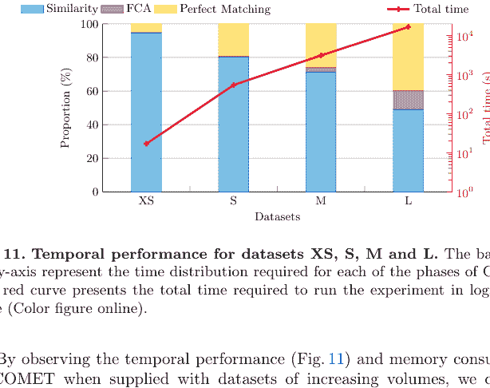

图 11. 数据集 XS、S、M 和 L 的时间性能。y 轴上的条形表示 COMET 各阶段所需的 时间分布。红色曲线以对数刻度呈现运行实验所需的总时间（彩色图在线）。

通过观察 COMET 在使用日益增大的数据集时的时间性能（图 11）和内存消耗，我们也可以回答 (RQ3)，即测量 COMET 的上下文评估步骤为整体管道增加的开销量。我们表明，上下文评估步骤相对于传统的 1-1 匹配算法而言只增加了时间开销的一部分，并且在内存消耗方面没有可观察到的开销。

## 6 宏伟挑战与结论

在数据多样化的时代，添加和考虑数据上下文比以往任何时候都更重要。上下文为其有效范围提供信息，并影响大多数数据驱动任务，例如数据集成。在本章中，我们提出了 COMET——一种将来自不同来源的上下文等价 RDF 实体匹配为实体之间 1-1 完美匹配集的方法。COMET 遵循双重方法，首先根据语义和上下文相似度的综合评分识别上下文等价的 RDF 分子。然后执行 1-1 完美匹配以产生考虑上下文的匹配集。COMET 利用形式概念分析算法来决定两个 RDF 分子是否上下文等价。COMET 的行为


在两个真实世界的RDF图上，针对不同的上下文配置进行了实证研究。观察结果表明，与不考虑上下文的基线框架相比，COMET能够有效地识别和合并上下文等效的实体。我们还设想了一种从知识图谱的不同时间版本自动创建实体摘要的方法。为此，所提出的方法利用了RDF分子、形式概念分析和融合策略的概念。该方法创建的实体演化摘要可用于创建文档、显示实体演化的可视化或进行变更分析。

这项工作是在形式化上下文及其对数据驱动任务影响的方向上迈出的第一步。因此，要巩固基于上下文的相似性方法，仍面临巨大挑战。由此，我们提出了下一步应解决的四大挑战，即：1）用概率函数度量上下文；2）上下文感知匹配算法的性能；3）充分利用实体作为知识图谱的语义表示；此外，4）将上下文感知实体匹配应用于各种数据驱动任务。

我们现在对其进行详细描述：

+   1. **用概率函数度量上下文：** 在本章中，我们采用了上下文条件的简单定义，即将上下文建模为实体的布尔函数。根据该模型，实体在某个上下文中要么有效，要么无效。上下文的实际含义和范围要广泛得多，因此上下文应以更通用的方式进行建模。例如，关于不同上下文的实体有效性度量可以是一个概率函数。这意味着上下文函数的取值范围可以是区间[0,1]中的任意值，而不仅仅是0或1。我们建议使用概率软逻辑（PSL）来实现这一概念。
+   2. **性能：** 虽然在本章中我们关注的是大数据的多样性维度，但基于上下文的方法也应适用于体量维度。例如，在COMET中，一对一匹配算法的复杂度是二次方的，因为COMET采用了原始的形式概念分析算法。因此，可以评估一种分布式版本的形式概念分析算法，它可能会改善本工作中的运行时开销。Hadoop和Spark等大数据框架可用于实现这种分布式版本的COMET。
+   3. **利用实体的语义表示：** 本章提出的方法利用RDF图本身编码的知识来创建上下文参数。然而，为了提高基于上下文的匹配方法的准确性，并非所有语义潜力都已被研究。例如，一个自然的下一步是利用RDF知识图谱中编码的隐式知识。通过使用推理器，可以推断出额外的上下文数据，从而增强上下文的建模和评估。

4. **将上下文感知匹配应用于各种数据驱动任务：** 在本章中，我们提到了COMET方法在实体摘要用例中的应用。Tasnim等人[422]展示了为了沿一个上下文轴（即时间轴）生成摘要而对COMET进行的架构和流程修改。该方法可以适用于其他上下文轴，例如地理位置、层级位置等。根据上下文轴的不同，可以探索更多上下文感知实体匹配的用例。此外，创建实体演化摘要所用的元素（例如本体）也可以被研究并进一步发展，以增强该方法。

**开放获取** 本章根据知识共享署名4.0国际许可协议（http://creativecommons.org/licenses/by/4.0/）的条款获得许可，该协议允许以任何媒介或格式进行使用、共享、改编、分发和复制，前提是你给予原作者和来源适当的署名，提供知识共享许可协议的链接，并注明是否作了修改。

本章中的图片或其他第三方材料包含在本章的知识共享许可协议范围内，除非在材料的署名行中另有说明。如果材料不在本章的知识共享许可协议范围内，或者你的预期使用不在法律法规允许范围内，或者超出了允许使用范围，你需要直接获得版权所有者的许可。


## 应用
