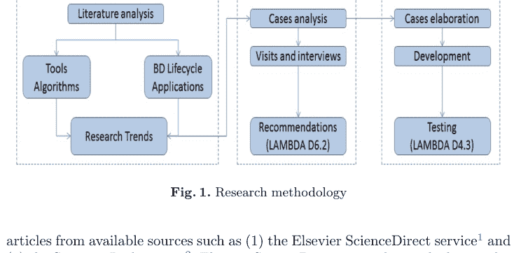
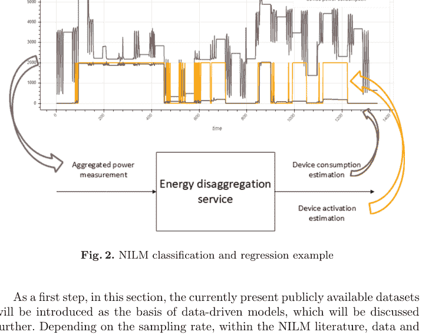
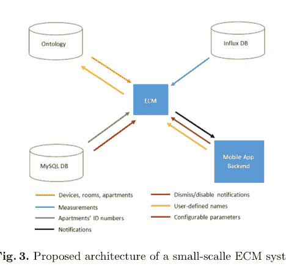
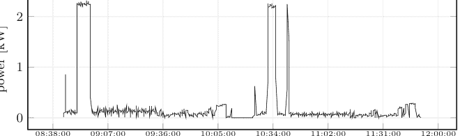
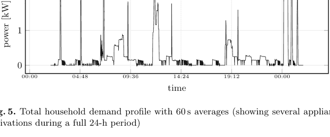
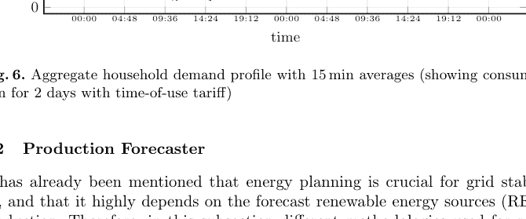

# 第9章
大数据应用综述

Valentina Janev¹✉️、Dea Pujić¹、Marko Jelić¹ 和 Maria-Esther Vidal²
¹ Institute Mihajlo Pupin, University of Belgrade, Belgrade, Serbia
valentina.janev@institutepupin.com
² TIB Leibniz Information Centre For Science and Technology, Hannover, Germany

摘要：本章旨在阐明各行业所需的不同类型的大数据应用，包括医疗保健、交通运输、能源、银行与保险、数字媒体与电子商务、环境、安全与安保、电信和制造业。为了应对大规模数据分析问题，已经开发了不同的工具、方法和技术，并可供实验使用。在我们的分析中，我们重点关注近年来（主要是过去二十年）可通过Elsevier ScienceDirect服务和Springer Link服务获取的文献（综述文章）。对于选定的行业，本章还讨论了使用本书中讨论的语义处理方法和知识推理方法可以应对和克服的挑战。

# 1 引言

在过去十年中，大数据范式获得了发展势头，并被企业大规模采用，以创造超过数据投资和维护成本的价值。针对不同行业已经创建了新颖的应用，使得能够（1）以经济高效的方式存储尽可能多的数据（基于体量的价值）；（2）快速分析能力（基于速度的价值）；（3）同时采集、存储和使用结构化和非结构化数据（基于多样性的价值）；（4）数据处理的准确性（基于真实性的价值）；等等。在未来十年中，数据量将继续增长，预计到2025年将达到175泽字节[85]。这将对全球企业产生根本性影响。本章旨在识别：

+   - RQ1：大数据分析的主要应用领域是什么？哪些具体的数据处理方面为选定的行业领域带来价值？
+   - RQ2：大数据分析领域中有哪些主要的工具、方法和技术可供实验使用？

2018年12月，在LAMBDA项目框架内启动了一项文献综述，其中包括对期刊

# 图1. 研究方法

文章进行广泛而全面的分析，这些文章来自可用来源，例如（1）Elsevier ScienceDirect服务¹和（2）Springer Link服务²。Elsevier ScienceDirect是一个网站，提供基于订阅的科学和医学研究大型数据库的访问。它托管着来自3500种学术期刊和34000本电子书的超过1200万条内容。SpringerLink是世界上最全面的在线科学、技术和医学期刊、书籍和参考著作合集，均由Springer-Verlag出版。与此同时，对可用的商业和开源工具市场进行了调查和监测³。由于大数据是当前一个非常活跃的研究领域，我们也参与了不同行业案例研究的分析，如图1所示的研究方法所述。本章概述了研究方法以及筛选与我们研究相关文章的过程（见第2节），并讨论了不同行业中大数据应用的主要研究趋势（见第3节）。为了回答第二个研究问题，作者们建立了大数据工具目录，可在LAMBDA项目网页⁴上获取。

# 2 文献综述

本节介绍了为确定大数据技术的相关应用领域而采用的文献综述方法。2020年4月，对术语“大数据分析”进行简单的基于关键词的查询返回：

+   - 在ScienceDirect中有180,736条结果（比2019年12月的174,470条结果多3%），其中10,042条为综述文章。最早的2篇论文来自1989年，它们讨论了计算科学面临的挑战，以及在关键科学和工程领域（例如）使用超级计算机进行实验的问题

大气科学、天文学、材料科学、分子生物学、空气动力学以及基本粒子物理学 [467]；

- SpringerLink 中有 40,317 条结果（或比 2019 年 12 月多 7%，33,249 条结果），其中最古老的出版物可追溯至 1950 年代，与数学相关。

**大数据分析** 是一个宽泛的主题，根据研究目标的不同，一方面可以与数据科学和机器学习相关联，另一方面与数据和软件工程相关联。鉴于我们对分析在商业战略中发挥的作用感兴趣，我们将搜索范围限定在商业智能领域的文章。商业智能涉及对过去和现在数据的分析，以创建可操作的洞察力，用于知情决策。因此，搜索与 **大数据分析** 和 **商业智能** 相关的 *综述文章* 得出 615 篇文章。如果我们寻找 **商业智能**（BI）和 **NoSQL** 解决方案，结果甚至更少——见表 1。这意味着 **商业智能** 的概念在科学文献中仍然占主导地位，但基于关系数据库驱动的应用。进一步来看出版年份，作者发现 1930 年代也有与 **大数据** 主题相关的文章，尽管主要与医学研究相关。在我们的分析中，我们主要关注最近几年、尤其是过去二十年的综述文章。

**表 1. ScienceDirect 数据库中综述文章的数量**

| 关键词 | 1995–1999 | 2000–2005 | 2006–2009 | 2010–2015 | 2016–2020 | 总计 |
|---|---|---|---|---|---|---|
| BDA | 388 | 718 | 1349 | 2190 | 4,605 | 10,042 |
| BDA and BI | 12 | 15 | 45 | 80 | 437 | 615 |
| BDA and BI and NoSQL |  |  |  | 3 | 31 | 35 |
| BDA and Apps and NoSQL |  |  |  | 8 | 46 | 54 |

因此，为了确定主要应用领域，我们首先确定了期刊（使用 ScienceDirect 服务），这些期刊最频繁地发表关于 **大数据分析**、**商业智能** 和 **工业应用** 的研究文章。下表列出了 2015 年至 2019 年间在国际期刊上发表的文章数量，以及与搜索标准相关的期刊。可以注意到，与 **大数据和应用** 相关的文章数量是 **大数据分析和应用** 的三倍。如果引入“商业智能”主题，检索结果会急剧减少。

表 2 中列出的一些期刊涉及的科学领域与 LAMBDA 项目中开展的研究没有直接关系，例如核物理和天体物理学、材料科学、建筑和建筑学、化学和色谱学。这些学科中开展大数据研究，需要增强的统计算法、建模和仿真方法；然而，这些科学领域目前超出了我们研究的范围，将不会在以下章节中讨论。

**表 2. 符合搜索标准的期刊**

| 搜索标准 | 期刊 |
|---|---|
| ‘Big Data’ and ‘Application’ (128,033) | Neurocomputing, Journal of Cleaner Production, Procedia Computer Science, IFAC Proceedings Volumes, Expert Systems with Applications, Physica A: Statistical Mechanics and its Applications, Sensors and Actuators B: Chemical, Journal of Chromatography A, Nuclear Physics B, European Journal of Operational Research |
| ‘Big Data’ and ‘Industry’ (59,734) | Journal of Cleaner Production, Future Generation Computer Systems, Energy Policy, Journal of Membrane Science, Expert Systems with Applications, Procedia Computer Science, Journal of Banking and Finance, Research Policy, European Journal of Operational Research |
| ‘Big Data Analytics’ and ‘Applications’ (41,031) | Journal of Cleaner Production, Future Generation Computer Systems, Neurocomputing, Journal of Chromatography A, IFAC Proceedings Volumes, Physica A: Statistical Mechanics and its Applications, Sensors and Actuators B: Chemical, Analytica Chimica Acta, Journal of Membrane Science, Nuclear Physics B |
| ‘Big Data Analytics’ and ‘Business Intelligence’ (3,539) | Future Generation Computer Systems, Procedia Computer Science, Technological Forecasting and Social Change, Expert Systems with Applications, Decision Support Systems, IFAC Proceedings Volumes, Accounting, Organizations and Society |

**趋势：** 对检索到的关于 **BDA and Apps and NoSQL** 的综述（54 篇论文）进行的详细分析表明，关注点已从运营数据管理系统、数据仓库和商业智能解决方案（例如 1990 年代在金融和保险领域出现）[336] 转向并行和分布式计算 [478]，以及用于在云中存储和处理数据的可扩展架构（“云中分析” [368]）。物联网 [120, 369] 和区块链等新兴范式也影响了云计算系统 [157]。射频识别 RFID 和 WSAN（无线传感器和执行器网络）等互联技术使得智能环境的发展成为可能 [122]，将在后续章节中进一步探讨。近年来廉价处理能力的广泛可用性和海量数据使得机器学习 [123, 178, 269]、语义计算 [222, 316]、人工神经网络和多模态情感分析 [400] 取得了令人印象深刻的突破。

## 3 工业部门中的大数据分析

本节介绍的分析研究了跨越医疗保健、交通、电信、能源生产和智能电网、能源消费和家庭自动化、金融、媒体、电子政务 [220] 以及其他公共事业的 BDA 驱动应用。研究的动机是 Mihajlo Pupin 研究所需要创新现有的产品组合，该组合目前主要集中于为控制、监测和管理大型设施构建先进的分析服务，例如来自交通和能源部门的设施。

### 医疗保健和制药

**医疗保健与数据工程。** 物联网（IoT）和传感器设备的进步使得能够以实时方式从多样化的医疗保健数据源进行集成数据处理 [339]。除了现有来源（电子健康记录和临床报告）之外，医疗服务提供者还可以使用新的数据源，例如社交媒体平台、远程信息处理和可穿戴设备，以便个性化治疗计划。然而，医疗保健组织在开发和实施基于使用功能强大的计算能力的远程云服务器的智能健康概念 [11] 时面临独特挑战。除了要考虑引发可扩展性、效率、速度、透明度、可用性、可靠性、安全性和其他问题的 3V（体量、速度和多样性）之外，真实性维度也很重要，因为健康信息价值直接取决于确定所涉数据质量（准确性、正确性、可靠性）能力。因此，提出了雾支持的智能健康解决方案，其中雾节点创建异构雾网络层并补充集中式云服务器的一部分计算和存储 [421]。

**个性化医疗** 是医学实践的一种方法，它使用有关患者独特基因构成和环境的信息来定制其医疗护理以满足其个人需求。最近，表观遗传学作为一种新型科学而日益流行，它指的是对细胞核中 DNA 和染色质的化学修饰的集合，这些修饰深刻影响基因组的输出功能。在单细胞水平上识别新的个体表观遗传敏感轨迹可能为建立预测性、诊断性和预后性生物标志物以及药物靶点提供额外机会 [386]。基于新兴趋势，患者护理可以通过以下方式在许多方面得到改善，包括使用：

- 现代医疗保健应用，几乎每部智能手机都拥有，如 Apple Health⁵、Google Health⁶ 或 Samsung Health⁷ 用于发现趋势和模式；

⁵ https://www.apple.com/ios/health/
⁶ https://health.google/
⁷ https://www.samsung.com/global/galaxy/apps/samsung-health/.

- 通过无线体域网（WBANs）获得的数据，在用户以适当权限实施的情况下，可以与临床试验、病历、各种检测结果及其他类似数据进行整合和分析，以提高医疗机构的效能并辅助医生决策；
- 先进的数据管理和处理（患者相似性、风险分层和治疗比较 [345]）用于提供更好的处方建议并优化药品供应链，从而减少损失并提高效率。

多年来，人工智能在医学中的作用变得日益重要，例如用于图像处理和诊断目的。深度学习神经网络也已被证明对于提取患者状况与可能原因之间的关联非常有用。为了总结在医疗保健中使用创新大数据工具的机会和挑战，我们在表 2 中指出了今年发生的 COVID-19 爆发（表 3）。

## 表 3. 案例研究：2019冠状病毒病（COVID-19）

| 描述 | 2019新型冠状病毒病（COVID-19）的爆发已导致超过 500 万人感染和数十万人死亡。在抗击该疾病的斗争中，几乎所有国家都采取了激进措施，利用大数据技术。[485] |
| 关键挑战 | - 异构数据的整合，需要政府、企业和学术机构共同推动相关政策的制定
- 多源大数据的快速收集和汇总
- 用于疫情信息快速可视化的 GIS 技术
- 确诊病例的空间追踪和人口流动估计
- 区域传播预测、疫情风险和防控等级的空间划分
- 物资资源供需的平衡与管理 |
|  | https://coronavirus-monitor.com/ （核查日期 22/05/2020）。 |

**制药。** 制药研究的新趋势（如基因组计算 [370]）使发现疾病模式、早期疫情和大流行检测与预测变得更加容易。Das、Rautaray 和 Pandey [96] 概述了大数据在医学中的一般潜在用途，如心梗预测、脑部疾病预测、慢性肾病诊断、特定疾病数据分析、结核病预测、早期心脏病阶段检测、HIV/AIDS 预测以及疾病爆发和疾病结局预测等一般方面。Lee 和 Yoon [275] 讨论了一些大数据在医学应用中的技术方面，如缺失值、高维度的效应以及偏差控制。Ristevski 和 Chen [374] 提及大数据在医疗保健中的隐私和安全问题，而 Tafti [420] 提供了用于生物医学句子分类的开源工具包。移动医疗相关的现代概念在 [214] 中有所讨论，Bayne [32] 探索了大数据在新生儿保健中的应用。

## 交通运输与智慧城市

如第 1 章所述，智慧交通是除医疗保健、政府、能源和公用事业、制造和自然资源、银行和保险、金融行业、通信和媒体、环境和教育之外的大数据垂直应用的关键领域之一。与该主题相关的文章集合可能是所有应用中最大的。Zhang [483] 提出了一种现代交通拥堵城市的票价降低方法，Liu [285] 讨论了车联网，Grant-Muller [165] 讨论了从交通领域提取的数据对其他领域的影响，Torre-Bastida [429] 讨论了交通领域现代大数据应用的最新进展和挑战，而 Imawan [211] 分析了道路交通应用中可视化这一重要概念。相关方面，Ghofrani [154] 调查了铁路的大数据应用，Gohar [158] 讨论了智能交通系统中的数据驱动建模，而 Wang [454] 尝试了该领域中的模糊控制应用。在此，我们将讨论路线规划应用以及与自动驾驶汽车和用户行为分析相关的未来挑战。

## 路线规划应用。

例如，使用全球定位系统（GPS）数据，大量智能手机用户可从路由系统受益，接收两点之间最短或最快路线的相关信息。某些应用如 Waze 依赖于直接用户输入以定位封闭街道、测速陷阱等，但在最基本层面上，这种方法仅使用原始 GPS 数据即可工作，计算每条街道路段的平均行驶时间，从而形成实时拥堵地图。当然，如果系统不够精确，对终端用户而言将毫无益处，但由于最终呈现的聚合结果是基于许多不同来源获得的，将其归类为大数据处理任务，数据不确定性被平均化，准确的结果往往会被呈现。为了提供快速响应，还使用了地理分布的边缘设备，也称为边缘服务器，可形成边缘云，为捕获点周围的大数据分析提供计算、存储和网络资源 [91]。

## 自动驾驶汽车

依赖于用户不断提供的海量数据，并用于训练控制车辆在自动驾驶模式下运行的算法。坚持自动化方面，交通领域的大数据处理甚至可用于管理交通信号灯调度，这将对该行业产生重大影响，至少在所有车辆都实现自主驾驶且不再需要交通信号灯之前如此。

## 用户行为分析。

此外，交通领域可通过基于模型并源自

供应链的优化规划来优化，该供应链几乎所有现代设备都依赖其运行。在这些情况下使用的分析方法或算法有：1）统计方法；2）信号处理方法；3）监督回归预测（短期和长期预测）；4）聚类算法；4）降维技术；以及 5）特征选择和提取。Tu [431] 和 Ghorbanian [155] 提出了智能电网未来各种开放性问题和挑战的长清单，例如

- 缺乏全面且通用的标准，特别是集中于 SGs 中的大数据管理；
- 处理 SGs 中使用的海量数据的智能设备的互操作性；
- 由于数据集规模不断增大和实时处理需求，工作必须使用近似分析法和数据不确定性 [354]；
- 安全和隐私问题，以及在大数据分析中更容易的数据处理与数据访问控制之间的平衡等。

有关大数据导向工具和分析技术在能源领域潜在应用的更多见解，请参见第 10 章。

## 能源消耗与家庭自动化

当讨论大数据应用时，一个不可避免的话题是家庭自动化。当今世界面临的挑战之一是减少能源消耗并提高能源效率。作为现代传感设备网络，物联网在家庭自动化解决方案中发挥着关键作用，这些解决方案基于此数据能够处理并提供准确预测和节能建议。家庭自动化解决方案提供最佳设备调度以最大化舒适度并最小化成本，甚至可从操作方面扩展到规划并提供可能的家庭调整，或在认为地点合适时建议投资可再生能源。智能家电最初提出了人机通信的概念，但受大数据处理支配，该概念已通过人机通信进一步普及，移除了人工输入，减少了干扰。预测性维护和自动故障检测也可从传感器数据中获得，既适用于基本家用电器，也适用于汽车、电机、发电机等大型机械系统。物联网应用需要适当的云框架 [456]。Ge [151] 提供了物联网领域大数据应用的全面综述，Martis [300] 将机器学习引入其中。Kumari [270] 提供了综述，但主要关注多媒体，而 Kobusińska [248] 讨论了当前趋势和问题。

## 银行和保险

商业智能工具自 1990 年代以来一直被用于推动盈利能力、降低风险并创造竞争优势。20 世纪 90 年代末，许多银行和保险公司开始使用机器学习技术对客户进行分类和优先级排序，评估个人客户或公司的信用风险，

与用户相关。一些搜索引擎公司甚至公开表示，它们的基础架构依赖于大数据架构，考虑到需要处理的数据量，这并不令人惊讶。

## 环境监测

环境监测涉及收集一个或多个用于评估环境状况的测量数据。卫星和雷达技术在遥感方面的进步在海洋学、气象学、林业、农业和建设（城市规划）领域创造了新的可能性。基于传感器与被监测区域之间的距离，环境遥感可以分为三大类 [139]。第一类是基于卫星的测量系统，主要用于研究地球及其不断变化的环境。此类中最有价值的数据来源是美国地质调查局（USGS）和美国国家航空航天局（NASA）联合开展的遥感卫星计划“陆地卫星”（Landsat），该计划自 1972 年至今一直在连续观测地球。可以通过 NASA 网站⁸ 和 Google Earth Engine 数据目录⁹ 访问超过 800 万张图像 [207]。此外，欧盟哥白尼计划（Copernicus Programme）的地球观测任务每天产生 12 太字节的观测数据（针对陆地和沿海水域的高空间分辨率光学影像），这些数据可自由访问并使用 DIAS（数据与信息访问服务）¹⁰ 进行分析。

遥感的第二大类别包括搭载在飞机上的仪器，例如光探测与测距（LIDAR）系统，该系统能够更好地监测重要的大气成分，如臭氧、一氧化碳、水蒸气、碳氢化合物和氧化亚氮，以及大气密度、气压和温度等气象参数 [139]。

基于地面的仪器（例如气溶胶测量仪器）和无线传感器网络（WSN）[397] 是户外监测技术的第三大类，它们为监测农场、热带雨林、牛群、农业（土壤湿度）、水质、火山爆发和地震等创造了新的机遇。

下表指出了一些由大数据、物联网和遥感技术赋能的社会经济和自然环境应用（表 4）。

**表 4.** 环境监测应用（示例）

| 智慧农业 | 智慧农业中的大数据研究仍处于早期发展阶段。预见到的挑战既涉及技术问题，也涉及组织问题。技术挑战包括数据获取过程的自动化、数据的可用性和质量，以及来自多样化来源（种植、喷洒、物资、产量、季中影像、土壤类型、天气及其他实践信息）的数据的语义集成。尽管从业务角度来看，农民正在寻求提高盈利能力和效率的方法，但在将农场整合到整个食品供应链中时，仍面临与治理（包括数据所有权、隐私和安全）以及业务模式相关的挑战 [469] |
| 热带雨林监测 | 环境科学家深知世界热带雨林在减缓气候变化影响方面的贡献，因此已启动项目，整合各种低成本传感器以测量湿度、温度、总太阳辐射（TSR）和光合有效辐射（PAR）等参数 [68] |
| 生物多样性规划 | - 事实证明，机器学习和统计算法在同时预测多个数值目标属性方面非常有用，例如帮助自然资源管理者评估植被状况并规划生物多样性保护 [249] |

## 自然灾害、安全与保障

大数据分析技术的应用对安全与保障行业尤为重要，因为它能从安全相关数据中提取隐藏价值（例如，早期预警、触发机制、预测），推导可操作的情报，并提出新的监视和预防形式。此外，随着 AI 定义的 5G 网络的使用，预计未来几年连接设备的数量将迅速增加 [477]。

### 自然灾害。

由于气候条件的变化，洪水、滑坡、干旱、地震等自然灾害如今正变得日益常见。这些事件产生大量需要实时处理的数据，从而避免例如受影响人群的痛苦和/或死亡。物联网、机器学习、大数据、遥感和移动应用领域的进展可以提高灾害管理策略的有效性，并促进疏散流程的实施。信息通信技术（ICT）开发者面临的需求与之前讨论的其他领域类似：

- 需要整合多模态数据（来自 Twitter 和 Facebook 等社交网站的照片、音频、文本）；
- 需要协调参与应急四个阶段（准备、响应、缓解和恢复）的众多利益相关者的活动；
- 需要安装测量设备以进行数据收集和实时分析，从而理解变化（例如水位、海浪、地面运动等）；
- 需要可视化信息；
- 需要与人们（第一响应者和/或受影响人员）进行沟通（并跟踪其响应和行为），或向官员发出警报以启动救援措施。

全球市场提供了广泛的多应急解决方案（以网页和/或移动解决方案的形式），具备直观的地图展示、现场实时监测和多媒体数据共享功能，例如 CommandWear¹¹、TRACmate¹² 和 Track24¹³。然而，前几章讨论的关联数据原则和数据管理技术在相当程度上可以促进整合和监测；例如基于关联开放数据的*智能火灾风险监测器* [442]。

### 关键基础设施的安全与保障。

大数据处理对于保护机场、铁路/地铁系统和电网等关键基础设施尤为重要。大型基础设施由于其复杂的布局以及包含的实体多样性（如不同大小的房间和大厅、限制区域、商店等），监测起来十分困难。在紧急情况下，各种控制和监测系统，例如消防系统、暖通空调系统、疏散和门禁系统以及航班信息显示系统等，每秒可共同向控制室发送数千个事件 [309]。通过流式传输这些低级别事件并以有意义的方式组合它们，可以提高态势感知能力。利用大数据工具、流处理解决方案、复杂事件处理/事件条件动作（CEP/ECA）范式，并结合事件、状态和应急处理程序，可以预定义广泛的紧急场景和紧急程序。除了处理从多个来源提取的大量异构数据并考虑规模、速度和多样性方面的挑战外，当今还面临挑战的是：

- 实时可视化以及随后与计算模块的交互，以增进理解并加快决策制定；
- 开发先进的语义分析和机器学习技术，以进行新的模式识别，这些技术将建立在预定义的紧急场景（例如基于规则）之上，并生成新的早期预警程序或可靠的行动计划。

## 电信业

继前文提到的使用智能手机作为数据源的影响之后，在讨论大数据时，电信行业也必须予以考虑。目前已在 24 个市场投入使用的第五代蜂窝网络（5G）（GSMA 预测到 2025 年其将占全球连接的 20%）将提供实时数据收集和分析，并为基于商业智能和人工智能的系统打开可能性。

移动、电视和互联网服务提供商的核心利益在于客户留存，以维持可持续的业务。因此，为了防止客户流失，会分析行为模式，以预测打算更换服务提供商的客户，从而让公司能够及时采取行动，适时提供各种激励措施或合同优惠。

例如，在这里，不同的预测模型和优化算法用于改善端到端性能、终端用户能效，并允许将越来越多的可再生能源源嵌入配电网（例如太阳能光伏（PV）、风力发电厂）。接下来，对实时数据流结合GIS和天气数据的分析，能够改进对重大事件的检测，增强态势感知，并帮助识别危险路况（如雪），这可以协助驾驶员和应急响应人员避开这些情况，并实现更快的应急车辆路线规划和更短的响应时间。解决多样性维度、异构数据源（包括开放数据和社会媒体数据）集成以及先进机器学习算法的解决方案，已在客户关系管理和欺诈检测（金融、保险、电信）中得到应用。例如，将有关消费者偏好和产品的私人信息与来自Facebook、推文、博客、产品评价及其他来源的信息进行交叉关联的能力，为组织理解客户需求、预测其需要和要求并优化资源使用开辟了广泛的可能性。本章还讨论了可以利用本书中讨论的语义处理方法和知识推理方法来应对和克服的挑战。

## 开放获取

本章依据知识共享署名4.0国际许可协议（http://creativecommons.org/licenses/by/4.0/）授权，该协议允许以任何媒介或格式进行使用、共享、改编、分发和复制，但需您给予原作者和来源适当的署名，提供知识共享许可协议的链接，并标明是否作了修改。

本章中的图片或其他第三方材料均包含在本章的知识共享许可协议中，除非在材料署名行中另有说明。如果材料未包含在本章的知识共享许可协议中，且您的预期使用不被法律规定允许或超出了允许范围，您需要直接获得版权所有者的许可。

变电站，以及来自用户侧的（例如安装在家庭和建筑物中的）设备，是前提条件。为了根据用户（即能源消费者）的需求和电网状态来明确、建议和提供适当的服务，配电系统运营商（DSO）和电网运营商应采用各种形式的能源数据分析，例如精确的短期和长期能源生产与消费预测。为了提供此类能源分析，必须考虑来自可再生能源（RES）的历史能源生产数据，以及基于用户场所和低压/中压（LV/MV）变电站智能计量得到的历史消费数据。

提供先进智能电网服务的主要挑战与海量异构数据源的集成和互操作性以及对所获取数据的充分处理有关。此外，基于Linked Data API使这些数据互操作，并与其他数据源（如用于可再生能源（RES）生产分析的天气数据、每户居民数量等）进行互联，对于提供额外的高效用户定制分析服务（如节能行动建议、与其他同类型消费者比较等）至关重要。

另一个挑战与电网运行分析、故障诊断和检测有关。为了提供这样的高级分析，需要对来自计量设备和电网元件（如开关、变压器等）的海量数据流进行实时集成和大数据分析，这可以通过Linked Data原则来解决。最后，为了支持可再生能源占比增加的智能电网的下一代技术，有必要提供高度模块化和可适应的电网。此外，应部署适当的电力系统优化设计离线分析工具。这些分析工具还应包含电网元件最优重构的分配，以提供可靠、灵活的运行，应对不断变化的运行条件。用于规划和重构配电网络的工具需要考虑电站基础设施及其设计、电力线路的数量和容量等。为了提供这种先进的电网能力，需要与历史电网数据、检测到的告警记录和其他相关运行数据（如智能计量数据、消费数据等）集成。因此，主要挑战是为电网基础设施规划的批量处理大数据分析提供经过整理消化的输入。

考虑到所有这些，大数据处理技术的重要性是显而易见的。另一方面，在本章后续部分将介绍和讨论分析服务的示例。

## 3 节能大数据分析服务

如今，通过高级分析改善生活质量在各个领域都很常见。因此，在能源领域，从大量智能电表收集数据、处理数据并得出结论，是开发节能服务领域中的常见概念。数据量

图2. NILM分类和回归示例

作为第一步，本节将介绍当前公开可用的数据集，作为数据驱动模型的基础，这些模型将在后面进一步讨论。根据采样率，在NILM文献中，数据和相应的进一步方法通常分为两组——高频和低频。对于高频，考虑采样时间小于1 ms的测量。这类数据在日常实践中通常不可用，因为通常的住宅计量设备的采样周期约为1 s，并被归为低频组。这种采样率的差异进一步影响了分解方法论和实时输入数据预处理方法的选择。

在讨论公开可用的数据集时，方法论并非严格按照所选采样率划分，而是按地理位置划分。换句话说，测量通常对应于某个局部街区，在同一数据集中可能同时存在高频和低频数据。我们引用的第一个已发表数据集是REDD（参考能量分解数据集，2011）[256]。它包含美国六户家庭的低频和高频采样测量数据。对于低频组，涵盖了16种不同设备的单独和总功率测量，使得能够开发各种需要标记数据的模型。相比之下，高频测量仅包含家庭的总用电数据，因此开发者必须使用无监督技术。另一个广泛传播和使用、随[238]发表的数据集是UK-DALE（英国家用电表级电力），从英国五户家庭收集。它同样覆盖了所有采样率范围，并且与REDD类似，仅有采样周期大于1秒的数据包含标记数据。其他需要提及的数据集包括用于低采样率的REFIT [318]、ECO（电力消耗与占用）[33]、IHEPCDS（单户家庭电力消耗数据集）[319]，以及用于高采样率的BLUED [137]和PLAID [145]¹。

在介绍可用数据之后，将讨论作为大数据主题一部分的数据处理中潜在和常见的问题。第一个问题出现在大多数数据集中，即**缺失数据**的存在。根据数据集和具体的家用电器，该问题的规模有所不同。例如，对于冰箱，这是一个可以忽略的小问题，因为它循环工作，大约每20分钟开启或关闭一次，从而提供了大量活跃和不活跃工作周期的实例。相比之下，例如，对于洗衣机，丢失其启动序列是不可接受的，因为在一个家庭中平均每周才开启两次，因此很难为训练目的收集足够的数据。因此，不同论文中采用了不同的技术来合成额外数据，从简单地在某些时段（当所考虑的电器未工作时）将设备消耗的现有单独测量值加到总功率测量值上，到更复杂的方法，如生成建模，用于丰富商业部门测量的数据[193]。

这里值得一提的是，来自这些不同数据集的数据特征在某些方面存在显著差异，这些差异源于地点、习惯、家用电器的选择、居住人数、居住者平均年龄等。NILM文献试图解决这个**泛化问题**。尽管在机器学习（ML）和大数据的许多研究领域中，在测试领域而非训练领域上尽可能取得高性能是一个热门话题，但泛化问题对NILM更为关键。因为不同的房屋可能包含不同类型的相同电器，对于测量数据未参与训练过程的房屋，其数据上的性能可能明显低于预估性能。此外，很明显，NILM模型的唯一应用将是在未参与训练阶段的房屋中，因为它们没有标记数据（否则就不需要NILM）。考虑到所有这些，使用测量数据已参与训练过程的房屋来验证结果被认为是不充分的。因此，公认的做法是为了验证和测试目的，留出一个所谓的未见过的房屋，并且

所有进一步的验证和测试都是针对该特定房屋进行的。然而，某些公开可用的数据集所涵盖的房屋通常位于同一社区，这导致数据驱动的模型学习到的是领域特征而非问题本身的模式。因此，将房屋与同一数据集分离可能是合适的。最后，最后一种选择是使用不同的数据集对房屋的测量数据进行验证和测试。

本节稍后将介绍最先进的NILM方法及其相应的性能评估。从历史上看，最早的是隐马尔可夫模型及其改进。它们被设计用于对具有不可观测状态的过程进行建模，而NILM问题正是如此。换句话说，目标是根据可观测的输出（总能耗）来估计单个设备的能耗。这种方法及其改进已在众多论文中得到应用，如[227, 245, 255, 293, 294]和[56]。然而，在上述所有涉及将多种HMM改进应用于NILM问题的论文中，都存在误差传播的问题。也就是说，由于HMM假设当前状态依赖于前一个状态，估计前一个状态时的错误会对预测当前状态产生显著影响。

除HMM外，还有许多无监督技术被应用于NILM。这主要是因为，正如前面所讨论的，对于将要安装服务的房屋，无法获得标记数据。因此，许多作者选择使用无监督学习技术，而不是在监督学习上提高泛化能力。这些尝试的例子见[194]——在使用条件随机场方法之前进行了聚类和直方图分析；[344]——对未标记数据进行自适应以提高在目标房屋上的性能；以及[136]——将分解描述为单通道源分离问题，并使用非负矩阵分解和张量/矩阵分解分离方法。这些方法大多与基于HMM的方法进行了比较，并显示出显著的改进。文献中另一种尽可能获得最佳泛化能力的方法是半监督概念，即监督学习和无监督学习的结合。在[30]中，利用内部和外部信息进行了自训练，以减少对标记数据的需求。此外，[208]提出应用迁移学习和盲学习，利用训练和测试房屋的数据。

最后，监督技术在文献中也得到了广泛应用。目前，各种机器学习算法在监督方法中占据重要地位，因为它们已被证明是解决所讨论问题的合适方案，如[419]所综述。目前文献中最流行的一大类是神经网络（NN）。它们从输入序列中提取复杂特征的能力被证实能提高最终的预测性能。其中，有两个类别最为常用：以长短期记忆（LSTM）为重点的循环神经网络（RNN）[302]，以及包含去噪自编码器这一特定子类别的卷积神经网络（CNN）[239]。

在介绍了解决NILM问题的各种分析方法之后，本节最后需要得出的结论是，该服务获得的结果可以进一步后处理和利用。也就是说，设备级别的分解能耗可与其他异构数据配合，用于开发故障检测服务。

## 3.2 节能措施（ECM）

在讨论终端用户（尤其是住宅用户）对节能和能源节约的兴趣和收益时，当提到潜在的成本节省时，用户反应最为积极和热烈，这并不令人意外。当然，当这是主要关注点时，改造旧技术、改善保温材料、更换窗户以及安装更新、更节能的技术通常被纳入首选行动方案。这主要是因为这些改造所涉及的方面是潜在热量损失和能源转换效率低下的最大来源。然而，通过纠正用户行为的某些方面，仍有巨大且尚未开发的节能潜力。

除了材料低效之外，不良习惯也是高能源损耗的主要原因之一，尤其是在供暖和制冷应用中；由于住宅部门在热需求上消耗了大量能源，热需求成为一个突出问题。找到用户在无谓浪费能源时表现出的关键行为模式是有效缓解的关键，因此，提出了智能家居的概念，以分析用户行为并促进必要的改变。为了获得数据以提出节能措施，应部署一组智能传感器来监测各种参数。其中一些传感器可能包括但不限于：

- 智能外部电表接口（实时测量总能耗）；
- 智能电源插头和线缆（实时测量每个电器的能耗并支持开关控制）；
- 智能恒温器（测量并连续控制参考温度以及可能的能耗）；
- 占用传感器（测量占用情况和运动，以及环境温度）；
- 窗户传感器（测量门窗的开关状态以及环境温度）；
- 挥发性有机化合物（VOC）传感器（测量空气质量和环境温度）

在某些情况下，如果安装智能插头和线缆被认为不经济，可以使用第3.1小节中描述的NILM算法，仅利用外部电表的数据来推断单个电器的活动状态。当此类传感器大规模部署时，需要收集、存储和处理的数据量会迅速增长，因为每个房间要部署多个传感器，而且每个传感器通常会报告多种测量数据（例如，窗户传感器除了报告开关状态外，还报告温度，同时还有一组设备运行状态测量数据，如网络信号强度、电池状态等，这些数据也应被监控，因为它们提供了关于设备本身健康状态的关键信息）。因此，应采用高效的解决方案（可能来自大数据领域），以促进数据的高效存储和处理，因为问题性用户行为是时间敏感的，应在问题事件持续期间及时向用户指出。

这种系统的一个小规模用例曾在法国莱尔斯郊外的约二十多套公寓中进行了测试，系统的提议架构如图3所示。使用这种架构，系统的后端

图3. 小型ECM系统的提议架构

采用MySQL数据库存储有关公寓ID和自定义通知设置的静态数据，并结合本体论来存储房间布局和详细的传感器部署数据，为主要的ECM引擎提供支持。该引擎分析来自实时物联网优化的NoSQL Influx数据库的数据，并通过交叉关联来自不同传感器的不同测量结果，向终端用户发送推送通知，告知他们能源低效的行为。例如，当观察到供暖或制冷设备在无人空间开启时，用户会收到警告。如果用户根据该信息采取行动并解决了问题，通知将自动消失；如果用户没有反应，问题事件仍未解决，则会在预定义时间段后再次通知用户。这些事件将被分析

针对单个房间的不同范围，也适用于整个公寓。此外，由于智能传感器已经部署，节能分析还可以扩展到安全（门或窗打开时无人占用）和健康（空气质量差且窗户关闭）等方面。当然，每个事件都是单独分析的，并向终端用户发出适当的通知和纠正措施。

## 3.3 用户基准

除了最明显的节能动机因素——货币节省之外，另一个可能极大影响用户行为的因素是社会压力。也就是说，在一个假设的场景中，不同的用户被置于类似竞争的环境中，主要目标是尽可能节能，或者换句话说，每个用户的分数由其能源消耗效率决定，那么这些用户更有可能努力表现更好，从而以更环保的方式消耗能源。为了促进这种环境，必须开发一个基准引擎，以提供一个对用户进行排名的算法。

文献中 [81,113] 和 [329] 指出，住宅领域的基准程序长期以来都被忽视，而工业应用则备受青睐。提出的作为核心的不同算法和技术包括：

- 简单归一化
- 普通最小二乘法（OLS）
- 随机前沿分析（SFA）
- 数据包络分析（DEA）
- 仿真（基于模型）排名
- 人工神经网络（ANNs）
- 模糊推理

相关文献 [171] 提供了数十种用于多准则决策制定（MCDM）的额外相关算法。文献中上述算法的应用通常集中在学校、其他公共建筑和办公室，而很少有论文，如 [259,291] 和 [461]，分析住宅领域。

能源效率排名中最突出的标准之一是备受推崇的 Energy Star 项目 [182]，该项目根据美国能源信息署（EIA）的数据库进行的统计分析模型和归一化方法，对建筑物按 1 到 100 的等级进行评级。然而，Energy Star 评级并未考虑通过观察居民持续行为获得的动态数据。这正是物联网驱动的智能家居概念可以通过对人们如何使用空间和可用家电的实时数据进行分析，为能源效率基准提供新维度的地方。

每种排名算法的基础都是一组静态参数，大致决定了所考虑物业的热需求。这些参数

通常包括：总供暖面积、总供暖体积、外墙面积、墙体厚度、墙体导热系数或材料、报告的租户数量。该数据通常在体积上并不庞大，并且足以用于一些基础排名方法。然而，仅考虑这些数据的能源效率评级只需要在建筑物建成后或进行重大翻新或改造时计算一次。因此，它将无法促进一种动态的基于竞争的环境，在这种环境中，用户可以按日或按周竞争，看谁以最经济的方式消耗能源。

鉴于上述理由，静态的建筑和占用参数被扩展为一组基于智能家居收集的传感器数据推断的动态参数。这些数据例如可以包括：总消耗能量、整个家庭的占用情况、制冷和供暖度日、对用户定制行为纠正信息的响应程度、负荷与可再生能源生产的一致性等。由于这些参数每天都在变化，其动态特性将提供一个快速变化的来源，推动单个用户能源效率分数的波动，并最终帮助用户看到他们的行为变化对其排名产生了影响。此外，值得一提的是，当同一微气候内的用户进行排名时，使用供暖和制冷度日可能显得冗余，因为所有用户在该方面具有相同的参数。因此，可以使用室内环境温度测量来增强该数据，以便监测冬季过热和夏季过冷的情况。

在用户基准解决方案中应进行的最重要程序，以便在具有不同习惯和日常例行程序的不同用户之间提供公平比较，是提供所谓的能源消耗归一化。这意味着，例如，更大的消费者不应仅基于更高的消耗而受到歧视；相反，还应考虑其他因素，例如需要空调的空间量或使用所考虑空间的人数。在这方面，简单地将总消耗能量除以，例如，供暖面积，可以很好地初步估计不同用户每单位面积的能源效率，但也意味着假设面积与能源之间存在线性关系，而这可能并非其固有关系。为了缓解这一问题，应使用物联网传感器从单个家庭收集大量数据并进行分析，以便推导出归一化所需的适当关系，或为上述算法（DEA、SFA 等）提供基础，这些算法为所考虑的每个参数分配不同的权重。

## 4 预测器

随着风力涡轮机、光伏板、地热源、生物质发电厂、太阳能热收集器等可再生能源的广泛部署，主要是由于各种政府强制实施的计划、项目和适用的上网电价，电网的稳定性受到了显著影响。这些新型能源的整合被证明是一项相对繁琐的任务，因为它们具有随机性和可变生产特征，这将在第 4.2 小节中更深入地介绍。由于大多数这些能源的生产与气象数据高度相关（风力涡轮机生产与风速相关，光伏生产与辐照度和云覆盖相关），具有不同功率输出状态之间瞬态显著更短的传统电力发电能力（煤炭、核能和水力发电厂）必须平衡可再生能源引入带来的快速发电变化。由于总发电量是计划用于满足将要要求的总需求的，能够提前知道未来需要多少能源以及将有多少能源可用，可以为通过优化资源规划实现潜在的能源和成本节约提供基础。

### 4.1 需求预测器

鉴于需求预测的重要性，预计会有不少作者在他们的已发表研究中涵盖这一主题。然而，尽管在这方面有大量出版物，能源需求预测的主题及其估计方法仍然似乎未被充分探索，没有统一的建议方法，并且大多数研究都是案例特定的。在这方面，[322] 分析了峰值需求生产的概率方法，[450] 中的逐小时和小时需求的自回归模型，以及 [401] 中的 ANN 驱动的短期预测。短期预测也在 [9] 中使用 MARS、SVR 和 ARIMA 模型进行分析，而 [463] 提出了预测性 ML 方法。深度学习框架由 [34] 和 [466] 讨论。DSM 与分时电价的联系由 [200] 分析，以及智能电网中电力价格和需求的同步预测在 [314] 中。

一些作者如 [105, 149, 195] 和 [12] 也讨论了需求预测，但将研究重点放在可用于预测和与需求值相关的预测因子上。在这方面，[486] 分析了室内热性能与能源消耗的相关性。然而，同样，很少有研究关注住宅用户，即家庭和公寓，特别是关于描述该家庭持续使用的动态数据。

与其它作者在他们的工作中指出的内容一致，影响需求并在构建预测模型时需要考虑的关键因素是分析地点的气象条件。从本质上讲，这种相关性并非直接的，而是温度、风速和风向以及辐照度对供暖和制冷设备的使用有显著影响，而这些设备通常是住宅家庭（无集中供暖和制冷）中最大的能源消费者。此外，在温和气候中，当前年份的季节在很大程度上决定了可以预期的气候条件，因此，分析地点的地理特性必须

应被纳入考虑，因为该位置决定了气候条件的季节性变化将有多严重。至于静态数据，总楼面面积或供暖体积也被认为与总消耗量密切相关，但无法用于以高时间分辨率动态估算需求。这时，大量直接从家庭收集的物联网传感器数据对于提高预测模型的精度可以发挥很大的作用。也就是说，室内环境温度与室外气象条件相结合，再加上实时的占用数据，可以提供对消费曲线的精确短期估算。此外，如果将过去的行为纳入考虑（以先前需求曲线的形式，既包括过去较长时间段的平均值，也包括前几天的较新数据），并结合当日指标（即是否为工作日或周末/节假日），就可以生成相对精确的逐小时甚至亚小时级的曲线。

以智能插头和智能线缆形式存在的智能测量设备能够报告家庭中每个电器的实时消耗量，或者用第3.1小节中描述的NILM算法替代它们（在这种替代方案中，因泛化不足导致的性能不佳不是问题），这为在单个电器层面预测需求提供了可能性。这种方法在当代研究文章中很少被描述，只有像[28,312]和[226]等少数论文探讨了这一主题。另一方面，需求预测问题最常从聚合的角度来处理，即通过预测社区、城市或州级消费来实现，而数据的可用性通常是最终决定将估算何种需求类型的驱动因素。图4、图5和图6中的时间序列展示了来自单个电器、一个家庭的所有电器以及多个聚合家庭的需求信号的不同动态。由于这些应用通常需要不同的预测精度水平，用于这些图示的原始数据按照适当的使用场景采用了不同的采样间隔（15秒、60秒和15分钟）进行平均。

图4. 采用15秒平均值的典型洗衣机需求曲线（显示在4小时的时间跨度内似乎有两次启动）

图5. 采用60秒平均值的家庭总需求曲线（显示在完整的24小时期间内有多次电器启动）

图6. 采用15分钟平均值的聚合家庭需求曲线（显示采用分时电价的两天消费情况）

## 4.2 产量预测器

前面已经提到，能源规划对于电网稳定性至关重要，并且它在很大程度上依赖于可再生能源（RES）产量的预测。因此，本小节将涵盖用于产量预测的不同方法，以及它们与大数据领域的关系。

RES技术的产量在很大程度上受天气条件的影响。例如，光伏（PV）发电量与太阳辐射之间存在非常高的依赖性，这与风力涡轮机与风速和风向之间的关系类似。表1给出了所选天气服务及其主要特征。也就是说，根据实际应用的不同，产量预测器可以具有不同的时间分辨率和预测范围，这决定了所需的气象预报参数。因此，从上述表格可以看出，Darksky可以提供以分钟为单位的估算，而其预测范围作为一种折衷，仅有7天。此外，根据所采用方法的不同，历史天气数据对于训练过程可能是必要的，因为目前最流行的方法

## 4.3 价格预测

预测算法在能源领域的另一个重要应用是价格预测。随着全球能源行业日益放松管制，能源交易中的可变定价正变得越来越突出，一些人设想在不远的将来，批发市场甚至零售市场的能源成本将每15分钟变化一次，而如今的标准通常最多是按小时变化。对批发市场价格进行准确预测为大型能源交易商提供了关键信息，因为它能够像股价预测一样提供对未来趋势的洞察，并允许进行合理的投资规划。

批发价格的变动极大地影响了零售价格，而零售价格反过来又对最终用户预期需求曲线的形状产生关键影响。从固定定价转向首次分时电价，再到后来的按小时可变定价，使得能源零售商能够通过本质上属于隐式需求响应（DR）的机制对负荷水平进行精细控制，其中负荷增加或减少事件由当前价格决定。能源价格还受到可再生能源可用性的影响。例如，光伏渗透率高的系统在正午的发电高峰期往往价格较低，以试图激励用户在系统出现盈余时消耗更多能源。这样，需求预测、产量预测和价格预测相互关联，从而形成一个供需平衡的均衡系统。

## 5 结论

本章的简要概述提供了对大数据工具和分析技术在能源领域的一些潜在应用的洞察。随着减缓气候变化的重要性与日俱增，致力于提高能源效率和负责任能源使用的解决方案数量只会不断增加。因此，该领域为新颖的研究方法提供了一个有趣且具有挑战性的领域。

**开放获取** 本章依据知识共享署名4.0国际许可协议（http://creativecommons.org/licenses/by/4.0/）的条款获得许可，该协议允许以任何媒介或格式进行使用、共享、改编、分发和复制，前提是您适当注明原作者和来源，提供知识共享许可协议的链接，并注明是否进行了修改。

本章中的图像或其他第三方材料包含在本章的知识共享许可协议范围内，除非在材料的署名行中另有说明。如果材料未包含在本章的知识共享许可协议中，并且您的预期使用不受法律法规允许或超出允许的使用范围，您需要直接获得版权所有者的许可。

## 参考文献

- 1. OZON Open Source Projects: A distributed, reliable key-value store for the most critical data of a distributed system (2014)
- 2. CGI Inc.: Internet of things (2015). https://www.cgi-group.co.uk/sites/default/files/files.uk/brochures/uk_iot_overview_brochure.nov.15.pdf
- 3. Abadi, M.J.S., Zamanifar, K.: Producing complete modules in ontology partitioning. In: 2011 International Conference on Semantic Technology and Information Retrieval, pp. 137–143. IEEE (2011)
- 4. Abdelaziz, L., Mansour, E., Ouzzani, M., Abounaga, A., Kalnis, P.: Lusail: a system for querying linked data at scale. Proc. VLDB Endowment **11**(4), 485–498 (2017)
- 5. Acosta, M., Hartig, O., Sequeda, J.F.: Federated RDF query processing. In: Sakr, S., Zomaya, A.Y. (eds.) Encyclopedia of Big Data Technologies. Springer, Cham (2019). https://doi.org/10.1007/978-3-319-77525-8
- 6. Acosta, M., Vidal, M., Lampo, T., Castillo, J., Ruckhaus E.: ANAPSID: an adaptive query processing engine for SPARQL endpoints. In: The Semantic Web - ISWC 2011–10th International Semantic Web Conference, Bonn, Germany, 23–27 October 2011, Proceedings Part I, pp. 18–34 (2011)
- 7. Agarwal, B.L.: Basic Statistics, 6th edn. New Age International, New Delhi (2015)
- 8. Al Hasan, M., Zaki, M.J.: A survey of link prediction in social networks. In: Aggarwal, C. (ed.) Social Network Data Analytics, pp. 243–275. Springer, Boston (2011). https://doi.org/10.1007/978-1-4419-8462-3_9
- 9. Al-Musaylh, M.S., Deo, R.C., Adamowski, J.F., Li, Y.: Short-term electricity demand forecasting with MARS, SVR and ARIMA models using aggregated demand data in queensland, australia. Adv. Eng. Inform. **35**, 1–16 (2016)
- 10. Alexander, K., Cyganiak, R., Hausenblas, M., Zhao, J.: Describing linked datasets. In: Proceedings of the WWW2009 Workshop on Linked Data on the Web, LDOW 2009, Madrid, Spain, 20 April 2009 (2009)
- 11. Alharthi, H.: Healthcare predictive analytics: an overview with a focus on Saudi Arabia. J. Infection Public Health **11**(6), 749–756 (2018)
- 12. Ali, M., Iqbal, M.J., Sharif, M.: Relationship between extreme temperature and electricity demand in Pakistan. Int. J. Energy Environ. Eng. **4**(1), 36 (2013)
- 13. Allen, J.F., Frisch, A.M.: What's in a semantic network? In: Proceedings of the 20th Annual Meeting on Association for Computational Linguistics, pp. 19–27. Association for Computational Linguistics (1982)
- 14. Aluc, G., Ozu, M.T., Daudjee, K., Hartig, O.: Chameleon-DB: a workload-aware robust RDF data management system. University of Waterloo, Technical report CS-2013-10 (2013)
- 15. Amin, A., Al-Obiedat, F., Shah, B., Adnan, A., Loo, J., Anwar, S.: Customer churn prediction in telecommunication industry using data certainty. J. Bus. Res. **94**, 290–301 (2019)
- 16. Ancin, D., Almirall, G.: 5G to account for 15 percentage of global mobile industry by 2025 as 5G network launches accelerate (2019)
- 17. Angeli, G., Manning, C.: Philosophers are mortal: inferring the truth of unseen facts. In: Proceedings of the Seventeenth Conference on Computational Natural Language Learning, pp. 133–142 (2013)

## 参考文献
- 18. Arenas, M., Barceló, P., Libkin, L., Murlak, F.: 数据交换基础. Cambridge University Press, Cambridge (2014)
- 19. Arenas, M., Bertossi, L.E., Chomicki, J.: 不一致数据库中的一致查询答案. In: PODS, pp. 68–79. ACM Press (1999)
- 20. Arenas, M., Pérez, J., Reutter, J.L., Riveros, C.: 模式映射管理的理论基础. In: PODS, pp. 227–238. ACM (2010)
- 21. Arenas, M., Pérez, J., Sallinger, E.: 知识交换中的通用可表示性研究. In: AMW, CEUR Workshop Proceedings, vol. 1087. CEUR-WS.org (2013)
- 22. Arming, S., Pichler, R., Sallinger, E.: 修复检查和一致查询回答的组合复杂性. In: AMW, CEUR Workshop Proceedings, vol. 1189. CEUR-WS.org (2014)
- 23. Assunção, M.D.: 大数据计算与云：趋势与未来方向. J. Parallel Distrib. Comput. 79–80, 3–15 (2015)
- 24. Atzeni, P., Bellomarini, L., Lezzi, M., Sallinger, E., Vlad, A.: 编织企业知识图谱：公司所有权图谱案例. In: EDBT, pp. 555–566. OpenProceedings.org (2020)
- 25. Auer, S., Bizer, C., Kobilarov, G., Lehmann, J., Cyganiak, R., Ives, Z.: DBpedia：开放数据网络的核心. In: Aberer, K., et al. (eds.) ASWC/ISWC -2007. LNCS, vol. 4825, pp. 722–735. Springer, Heidelberg (2007). https://doi.org/10.1007/978-3-540-76298-0_52
- 26. Auer, S., et al.: 使用 LOD2 堆栈管理链接数据的生命周期. In: Cudré-Mauroux, P., et al. (eds.) ISWC 2012. LNCS, vol. 7650, pp. 1–16. Springer, Heidelberg (2012). https://doi.org/10.1007/978-3-642-35173-0_1
- 27. Auer, S., et al.: Bigdata.europa 平台——支持大数据多样性维度. In: Web Engineering - 17th International Conference, ICWE 2017, Rome, Italy, 5–8 June 2017, Proceedings, pp. 41–59 (2017)
- 28. Barbato, A., Capone, A., Rodolfi, M., Tagliaferri, D.: 通过智能电网需求管理的家庭电器使用预测——基于电力计量传感器. In: 2011 IEEE International Conference on Smart Grid Communications, SmartGridComm 2011 (2011)
- 29. Bardi, A., Manghi, P.: 增强出版物：数据模型和信息系统. Liber Q. 23(4), 240–273 (2014)
- 30. Barsim, K.S., Yang, B.: 面向基于事件的能量分解的半监督非侵入式负荷监测系统研究. In: 2015 IEEE Global Conference on Signal and Information Processing (GlobalSIP), pp. 58–62 (2015). ISBN 978-1-4799-7591-4
- 31. Batet, M., Sánchez, D., Valls, A.: 基于本体的方法计算生物医学中的语义相似性. J. Biomed. Inform. 44(1), 118–125 (2011)
- 32. Bayne, L.E.: 新生儿健康护理中的大数据：巨大影响，巨大回报？ critical nursing clinics of North America. Crit. Care Nurs. Clin. North Am. 30(4), 481–497 (2018)
- 33. Beckel, C., Kleiminger, W., Cicchetti, R., Staake, T., Santini, S.: Eco 数据集及非侵入式负荷监测算法的性能. In: Proceedings of the 1st ACM Conference on Embedded Systems for Energy-Efficient Buildings, pp. 80–89 (2014)
- 34. Bedi, J., Toshniwal, D.: 预测电力需求的深度学习框架. Appl. Energy 238, 1312–1326 (2019)
- 35. Beek, W., Schlobach, S., van Harmelen, F.: OWL 的情境化语义：sameAs. In: The Semantic Web. Latest Advances and New Domains - 13th International Conference, ESWC, pp. 405–419 (2016)
- 36. Begenau, J., Farboodi, M., Veldkamp, L.: 金融中的大数据与大企业的增长. J. Monetary Econ. 97, 71–87 (2018)
- 37. Bellazzi, R.: 大数据与生物医学信息学：充满挑战的机会. Yearb Med. Inform. 9(1), 8–13 (2014)
- 38. Bellomarini, L., Sallinger, E., Gottlob, G.: Vadalog 系统：用于知识图谱的 Datalog 基于推理. In: Proceedings of the VLDB Endowment, vol. 11 (2018)
- 39. Bellomarini, L., et al.: COVID-19 与公司知识图谱：通过 AI 推理评估黄金权力及选择性封锁的经济影响. CoRR, abs/2004.10119 (2020)
- 40. Bellomarini, L., Fakhoury, D., Gottlob, G., Sallinger, E.: 知识图谱与企业 AI：一种使能技术的承诺. In: 2019 IEEE 35th International Conference on Data Engineering (ICDE), pp. 26–37. IEEE (2019)
- 41. Bellomarini, L., et al.: Vadalog 中的数据科学：弥合机器学习与推理. In: Abdelwahed, E.H., Bellatreche, L., Golfarelli, M., Méry, D., Ordonez, C. (eds.) MEDI 2018. LNCS, vol. 11163, pp. 3–21. Springer, Cham (2018). https://doi.org/10.1007/978-3-030-00856-7_1
- 42. Bellomarini, L., Gottlob, G., Pieris, A., Sallinger, E.: 用于大数据和知识图谱的 Swift Logic. In: IJCAI, pp. 2–10. ijcai.org (2017)
- 43. Bellomarini, L., Gottlob, G., Pieris, A., Sallinger, E.: 用于大数据和知识图谱的 Swift Logic. In: Tjoa, A.M., Bellatreche, L., Biffi, S., van Leeuwen, J., Wiedermann, J. (eds.) SOFSEM 2018. LNCS, vol. 10706, pp. 3–16. Springer, Cham (2018). https://doi.org/10.1007/978-3-319-73117-9_1
- 44. Bellomarini, L., Gottlob, G., Pieris, A., Sallinger, E.: Vadalog 系统：用于大数据和企业知识图谱的 Swift Logic. In: AMW, CEUR Workshop Proceedings, vol. 2100. CEUR-WS.org (2018)
- 45. Bellomarini, L., Gottlob, G., Sallinger, E.: 用于知识图谱的 Datalog 基于推理. In: AMW, CEUR Workshop Proceedings, vol. 2369. CEUR-WS.org (2019)
- 46. Ben-Kiki, O., Evans, C., Ingerson, B.: YAML Ain’t Markup Language (YAML). Ghent University, Working Draft (2004)
- 47. Berbakov, L., Tomasevic, N., Batic, M.: 节能生活物联网系统的架构与实现. In: 26th Telecommunications Forum, TELFOR 2018, Belgrade, Serbia (2018)
- 48. Berbers, Y., Zwaenepoel, W. (eds.): Google Dataset Search：构建开放网络生态系统中的数据集搜索引擎. ACM (2019)
- 49. Berger, G., Gottlob, G., Pieris, A., Sallinger, E.: Vadalog 的空间高效核心. In: PODS, pp. 270–284. ACM (2019)
- 50. Bermudez, I., Traverso, S., Mellia, M., Munafo, M.: 从被动测量探索云：以 Amazon AWS 为例. In: 2013 Proceedings IEEE INFOCOM, pp. 230–234. IEEE (2013)
- 51. Berners-Lee, T.: 链接数据 (2006). https://www.w3.org/DesignIssues/LinkedData.html
- 52. Bernstein, P.A., Melnik, S.: 模型管理 2.0：操作更丰富的映射. In: SIGMOD Conference, pp. 1–12. ACM (2007)
- 53. Blin, G., Curé, O., Faye, D.C.: RDF 存储方法综述. Revue Africaine de la Recherche en Informatique et Mathématiques Appliquées, 15 (2012)
- 54. Blumauer, A.: 从分类法到本体再到知识图谱 (2014)
- 55. Bonatti, P.A., Decker, S., Polleres, A., Presutti, V.: 知识图谱：语义网知识表示的新方向 (Dagstuhl Seminar 18371). Dagstuhl Rep. 8(9), 29–111 (2019)
- 75. Charalambidis, A., Troumpoukis, A., Konstantopoulos, S.: Semagrow：优化联邦 SPARQL 查询. In: Polleres, A., Pellegrini, T., Hellmann, S., Parreira, J.X. (eds.) Proceedings of the 11th International Conference on Semantic Systems, SEMANTICS 2015, Vienna, Austria, 15–17 September 2015, pp. 121–128. ACM (2015)
- 76. Chen, C., Chiang, R., Storey, V.: 商业智能与分析：从大数据到大影响. MIS Q. 36(4), 1165–1188 (2012)
- 77. Chen, M., Mao, S., Liu, Y.: 大数据：综述. MONET 19(2), 171–209 (2014)
- 78. Chen, X., Chen, H., Zhang, N., Zhang, S.: SparkRDF：基于分布式内存的弹性离散化 RDF 图处理引擎. In: 2015 IEEE/WIC/ACM International Conference on Web Intelligence and Intelligent Agent Technology (WI-IAT), vol. 1, pp. 292–300. IEEE (2015)
- 79. Cheng, G., Tran, T., Qu, Y.: RELIN：基于相关性和信息性的中心性用于实体摘要. In: Aroyo, L., et al. (eds.) ISWC 2011. LNCS, vol. 7031, pp. 114–129. Springer, Heidelberg (2011). https://doi.org/10.1007/978-3-642-25073-6_8
- 80. Chow, T.: 光伏热收集器性能的显式动态模型分析. Sol. Energy 75(2), 143–152 (2003)
- 81. Chung, W.: 建筑能源使用性能基准方法综述. Appl. Energy 88(5), 1470–1479 (2011)
- 82. Clearman, J., et al.: Vadalog 中的特征工程与可解释性：推荐系统应用. In: Datalog, volume 2368 of CEUR Workshop Proceedings, pp. 39–43. CEUR-WS.org (2019)
- 83. Clement, J.: 截至 2020 年 4 月全球数字人口 (2020)
- 84. D.ollarana, D., Galkin, M., Ribón, I.T., Vidal, M., Lange, C., Auer, S.: MINTE：语义集成 RDF 图. In: Proceedings of the 7th International Conference on Web Intelligence, Mining and Semantics, WIMS, pp. 22:1–22:11 (2017)
- 85. European Commission. 委员会致欧洲议会、理事会、欧洲经济社会委员会和地区委员会的通信：欧洲数据战略，com (2020) 66 final. https://ec.europa.eu/digital-single-market/en/policies/75981/3489
- 86. European Commission: ICT 标准化滚动计划 (2020). https://ec.europa.eu/digital-single-market/en/news/rolling-plan-ict-standardisation
- 87. Cox, M., Ellsworth, D.: 应用控制的缺页置换用于超大可视化. In: Proceedings of the Visualization 1997 (Cat. No. 97CB36155), pp. 235–244. IEEE (1997)
- 88. Rea, C., Granetz, R.S.: 使用 DIII-D 大型数据库进行不稳定预测的探索性机器学习研究. Fusion Sci. Technol. 74(1–2), 89–100 (2017)
- 89. Csar, T., Lackner, M., Pichler, R., Sallinger, E.: 云中的计算社会选择. In: BTW (Workshops), LNI, vol. P-266, pp. 163–167. GI (2017)
- 90. Csar, T., Lackner, M., Pichler, R., Sallinger, E.: 使用 MapReduce 进行巨大选举的获胜者判定. In: AAAI, pp. 451–458. AAAI Press (2017)
- 91. Cui, Q., et al.: 移动边缘计算的随机在线学习：从变化中学习. IEEE Commun. Mag. 57(3), 63–69 (2019)
- 92. Cuzzocrea, A., Sellis, T.: 大数据工程的语义感知方法. J. Data Semant. 6, 55–56 (2017)
- 93. Cyganiak, R., Bizer, C., Garbers, J., Maresch, O., Becker, C.: D2RQ 映射语言. Technical report, FU Berlin, DERI, UCB, JP Morgan Chase, AGFA, HP Labs, Johannes Kepler Universität Linz (2012)

+   94. Cyganiak, R., Wood, D., Lanthaler, M.: RDF 1.1 Concepts and Abstract Syntax. Recommendation, World Wide Web Consortium (W3C) (2014)

+   95. Dacvald, A., Graux, D., Sejdijc, G., Jabeen, H., Lehmann, J.: Clustering pipelines of large RDF POI data. In: Hitzler, P., et al. (eds.) ESWC 2019. LNCS, vol. 11762, pp. 24–27. Springer, Cham (2019). https://doi.org/10.1007/978-3-030-33327-1_5

+   96. Das, N., Rautaray, S., Pandey, M.: Big data analytics for medical applications. Int. J. Modern Educ. Comput. Sci. 10, 2 (2018)

+   97. Das, S., Sundara, S., Cyganiak, R.: R2RML: RDB to RDF mapping language. In: Working group recommendation, World Wide Web Consortium (W3C) (2012)

+   98. Big Data: A new world of opportunities. NESSI White Paper, pp. 1–25 (2012)

+   99. Big Data: Principles and best practices of scalable realtime data systems. N. Marz J. Warren, Henning (2014)

+   100. Davenport, T.H.: Analytics 3.0 (2013). https://hbr.org/2013/12/analytics-30

+   101. De Giacomo, G., Lembo, D., Lenzerini, M., Poggi, A., Rosati, R.: Using ontologies for semantic data integration. In: Flesca, S., Greco, S., Mascaroli, E., Saccà, D. (eds.) A Comprehensive Guide Through the Italian Database Research Over the Last 25 Years. SBD, vol. 31, pp. 187–202. Springer, Cham (2018). https://doi.org/10.1007/978-3-319-61893-7_11

+   102. De Meester, B., Dimou, A.: The Function Ontology. Ghent University - imc - IDLab, Unofficial Draft (2016)

+   103. De Meester, B., Heyvaert, P., Dimou, A.: YARRRML. Unofficial draft, imc - Ghent University - IDLab, August 2019

+   104. De Meester, B., Maroy, W., Dimou, A., Verborgh, R., Mannens, E.: Declarative data transformations for linked data generation: the case of DBpedia. In: Bloomqvist, E., Maynard, D., Gangemi, A., Hoekstra, R., Hitzler, P., Hartig, O. (eds.) ESWC 2017. LNCS, vol. 10250, pp. 33–48. Springer, Cham (2017). https://doi.org/10.1007/978-3-319-58451-5_3

+   105. Dedinec, A., Dedinec, A.: Correlation of variables with electricity consumption data. In: Konjović, Z., Zdravković, M., Trajanović, M. (Eds.) ICIST 2016 Proceedings, vol. 1, pp. 118–123. Eventonic (2016)

+   106. der Scheer, W. V.: 4 vs (2015)

+   107. Dettmers, T., Minervini, P., Stenetorp, P., Riedel, S.: Convolutional 2D knowledge graph embeddings. In: Thirty-Second AAAI Conference on Artificial Intelligence (2018)

+   108. Dhingra, B., Jin, Q., Yang, Z., Cohen, W.W., Salakhutdinov, R.: Neural models for reasoning over multiple mentions using coreference. arXiv preprint arXiv:1804.05922 (2018)

+   109. Dimou, A., Vahdati, S., Di Iorio, A., Lange, C., Verborgh, R., Mannens, E.: Challenges as enablers for high quality linked data: insights from the semantic publishing challenge. PeerJ Comput. Sci. 3, e105 (2017)

+   110. Dimou, A., Vander Sande, M.: RDF Mapping Language (RML). Unofficial draft, Ghent University - iMinds - Multimedia Lab, September 2014

+   111. Dimou, A., Vander Sande, M., Colpaert, P., Verborgh, R., Mannens, E., Van de Walle, R.: RML: a generic language for integrated RDF mappings of heterogeneous data. In: Proceedings of the 7th Workshop on Linked Data on the Web, CEUR Workshop Proceedings, CEUR, vol. 1184 (2014)

+   112. Dimou, A., Verborgh, R., Sande, M.V., Mannens, E., Van de Walle, R.: Machine-interpretable dataset and service descriptions for heterogeneous data access and retrieval. In: Proceedings of the 11th International Conference on Semantic Systems, New York, NY, USA. ACM (2015)

113. Do, H., Cetin, K.S.: Residential building energy consumption: a review of energy data availability, characteristics, and energy performance prediction methods. Current Sust. Renew. Energy Rep. 5(1), 76–85 (2018)

114. Doan, A., Halevy, A.Y., Ives, Z.G.: Principles of Data Integration. Morgan Kaufmann, San Francisco (2012)

115. Dolara, A., Leva, S., Manzolini, G.: Comparison of different physical models for PV power output prediction. Sol. Energy 119, 83–99 (2015)

116. Dong, X.L., Gabrilovich, E., Heitz, G., Horn, W., Murphy, K., Sun, S., Zhang, W.: From data fusion to knowledge fusion. Proc. VLDB Endowment 7(10), 881–892 (2014)

117. Dou, J., Qin, J., Jin, Z., Li, Z.: Knowledge graph based on domain ontology and natural language processing technology for chinese intangible cultural heritage. J Vis. Lang. Comput 48, 19–28 (2018)

118. Duerst, M., Suignard, M.: Internationalized Resource Identifiers (IRIs). Standard track, IETF (2005)

119. Duggan, J., et al.: The BigDAWG polystore system. SIGMOD Rec. 44(2), 11–16 (2015)

120. Díaz, M., Martín, C., Rubio, B.: State-of-the-art, challenges, and open issues in the integration of internet of things and cloud computing. J. Network Comput. Appl. 67, 99–117 (2016)

121. Ehrlinger, L., Wöß, W.: Towards a definition of knowledge graphs. SEMANTiCS (Posters, Demos, SuCCESS), p. 48 (2016)

122. Elazhary, H.: Internet of things (IoT), mobile cloud, cloudlet, mobile IoT, IoT cloud, fog, mobile edge, and edge emerging computing paradigms: Disambiguation and research directions. J. Network Comput. Appl. 128, 105–140 (2019)

123. Elshawi, R., Sakr, S., Talia, D., Trunfio, P.: Big data systems meet machine learning challenges: towards big data science as a service. Big Data Res. 14, 1–11 (2018)

124. Endris, K.M., Galkin, M., Lytra, I., Mami, M.N., Vidal, M., Auer, S.: MULDER: querying the linked data web by bridging RDF molecule templates. Database Exp. Syst. Appl. 2017, 3–18 (2017)

125. Endris, K.M., Rohde, P.D., Vidal, M., Auer, S.: Ontario: federated query processing against a semantic data lake. In: Database and Expert Systems Applications - 30th International Conference, DEXA 2019, Linz, Austria, 26–29 August 2019, Proceedings, Part I, pp. 379–395 (2019)

126. Euzenat, J., Shvaiko, P.: Ontology Matching. Springer, Heidelberg (2013). https://doi.org/10.1007/978-3-642-38721-0

127. Fagin, R., Haas, L.M., Hernández, M., Miller, R.J., Popa, L., Velegrakis, Y.: Clio: schema mapping creation and data exchange. In: Borgida, A.T., Chaudhri, V.K., Giorgini, P., Yu, E.S. (eds.) Conceptual Modeling: Foundations and Applications. LNCS, vol. 5600, pp. 198–236. Springer, Heidelberg (2009). https://doi.org/10.1007/978-3-642-02463-4_12

128. Fagin, R., Kolaitis, P.G., Popa, L., Tan, W.C.: Composing schema mappings: second-order dependencies to the rescue. ACM Trans. Database Syst. 30(4), 994–1055 (2005)

129. Färber, M.: The Microsoft academic knowledge graph: a linked data source with 8 billion triples of scholarly data. In: Ghidini, C., et al. (eds.) ISWC 2019. LNCS, vol. 11779, pp. 113–129. Springer, Cham (2019). https://doi.org/10.1007/978-3-030-30796-7_8

130. Faria, D., Pesquita, C., Santos, E., Palmonari, M., Cruz, I.F., Couto, F.M.: The agreementmakerlight ontology matching system. In: Meersman, R., et al. (eds.) OTM 2013. LNCS, vol. 8185, pp. 527–541. Springer, Heidelberg (2013). https://doi.org/10.1007/978-3-642-41030-7_38

131. Faye, D.C., Cure, O., Blin, G.: A survey of RDF storage approaches. ARIMA J. 15, 11–35 (2012)

132. Fayzrakhmanov, R.R., Sallinger, E., Spencer, B., Furche, T., Gottlob, G.: Browserless web data extraction: challenges and opportunities. In: WWW, pp. 1095–1104. ACM (2018)

133. Feinerer, I., Pichler, R., Sallinger, E., Savenkov, V.: On the undecidability of the equivalence of second-order tuple generating dependencies. In: AMW, CEUR Workshop Proceedings, vol. 749. CEUR-WS.org (2011)

134. Feinerer, I., Pichler, R., Sallinger, E., Savenkov, V.: On the undecidability of the equivalence of second-order tuple generating dependencies. Inf. Syst. 48, 113–129 (2015)

135. Figueiras, P., Antunes, H., Guerreiro, G., Costa, R., Jardim-Gonçalves, R.: Visualisation and detection of road traffic events using complex event processing. In: Volume 2: Advanced Manufacturing, ASME International Mechanical Engineering Congress and Exposition, 11 (2018). V002T02A081

136. Figueiredo, M., Ribeiro, B., de Almeida, A.: Electrical signal source separation via nonnegative tensor factorization using on site measurements in a smart home. IEEE Trans. Instrum. Meas. 63(2), 364–373 (2014)

137. Filip, A.: Blued: a fully labeled public dataset for event-based nonintrusive load monitoring research. In: 2nd Workshop on Data Mining Applications in Sustainability (SustKDD), p. 2012 (2011)

138. Firican, G.: The 10 vs of big data (2017). https://tdwi.org/articles/2017/02/08/10-vs-of-big-data.aspx

139. Friedman, D.: Iv.1 - the changing face of environmental monitoring. In: Twardowska, I. (ed.) Solid Waste: Assessment, Monitoring and Remediation, Waste Management Series, vol. 4, pp. 453–464. Elsevier (2004)

140. Friedman, M., Levy, A.Y., Millstein, T.D.: Navigational plans for data integration. In: Proceedings of the IJCAI-99 Workshop on Intelligent Information Integration, Held on July 31: in conjunction with the Sixteenth International Joint Conference on Artificial Intelligence City Conference Center, p. 1999. Stockholm, Sweden (1999)

141. Furche, T., Gottlob, G., Neumayr, B., Sallinger, E.: Data wrangling for big data: towards a lingua franca for data wrangling. In: AMW, CEUR Workshop Proceedings, vol. 1644. CEUR-WS.org (2016)

142. Fuxman, A., Hernández, M.A., Ho, C.T.H., Miller, R.J., Papotti, P., Popa, L.: Nested mappings: schema mapping reloaded. In: VLDB, pp. 67–78. ACM (2006)

143. Gadedpally, V., Kepner, J.: Big data dimensional analysis. In: IEEE High Performance Extreme Computing Conference (2014)

144. Galárraga, L.A., Teflioudi, C., Hose, K., Suchanek, F.: Amie: association rule mining under incomplete evidence in ontological knowledge bases. In: Proceedings of the 22nd International Conference on World Wide Web, pp. 413–422 (2013)

145. Gao, J., Giri, S., Kara, E.C., Bergès, M.: Plaid: a public dataset of high-resolution electrical appliance measurements for load identification research: demo abstract. In: Proceedings of the 1st ACM Conference on Embedded Systems for Energy-Efficient Buildings, pp. 198–199 (2014)

146. Gao, Y., Liang, J., Han, B., Yakout, M., Mohamed, A.: Building a large-scale, accurate and fresh knowledge graph. In: SigKDD (2018)

147. Garg, N.: Apache Kafka. Packt Publishing Ltd., Birmingham (2013)

148. Garlaschelli, D., Battiston, S., Castri, M., Servedio, V., Caldarelli, G.: The scale-free topology of market investments. 技术报告. http://www.lps.ens.fr/~battiston/SF_TopoShareNets.pdf

149. Gastli, A., Charabi, Y., Alammari, R.A., Al-Ali, A.M.: Correlation between climate data and maximum electricity demand in Qatar. 在: 2013 7th IEEE GCC Conference and Exhibition (GCC), 页 565–570 (2013). ISBN 978-1-4799-0721-2

150. Gates, A., Dai, D.: Programming Pig: Dataflow Scripting with Hadoop. O’Reilly Media Inc., Sebastopol (2016)

151. Ge, M., Bangui, H., Buhnova, B.: Big data for Internet of Things: a survey. Fut. Gener. Comput. Syst. 87, 601–614 (2018)

152. Ghani, N.A., Hamid, S., Hashem, I.A.T., Ahmed, E.: Social media big data analytics: a survey. Comput. Hum. Behav. 101, 417–428 (2019)

153. Ghazi, M.R., Gangodkar, D.: Hadoop, mapreduce and HDFS: a developers perspective. Procedia Comput. Sci. 48(C), 45–50 (2015)

154. Ghofrani, F., He, Q., Verde, R.M., Liu, X.: Recent applications of big data analytics in railway transportation systems: a survey. Transp. Res. Part C: Emerg. Technol. 90, 226–246 (2018)

155. Ghorbanian, M., Hacopian Dolatabadi, S., Siano, P.: Big data issues in smart grids: a survey. IEEE Syst. J. PP, 1–12 (2019)

156. Giannini, S.: RDF data clustering. 在: Abramowicz, W. (编) BIS 2013. LNBIP, 卷 160, 页 220–231. Springer, Heidelberg (2013). https://doi.org/10.1007/978-3-642-41687-3_21

157. Gill, S.S., et al.: Transformative effects of iot, blockchain and artificial intelligence on cloud computing: evolution, vision, trends and open challenges. Internet Things 8, 100118 (2019)

158. Gohar, M., Muzammal, M., Rahman, A.U.: Mart TSS: defining transportation system behavior using big data analytics in smart cities. Sustain. Cities Soc. 41, 114–119 (2018)

159. Golshan, B., Halevy, A.Y., Mihaila, G.A., Tan, W.: Data integration: after the teenage years. 在: Proceedings of the 36th ACM SIGMOD-SIGACT-SIGAI Symposium on Principles of Database Systems, PODS 2017, Chicago, IL, USA, 14–19 May 2017, 页 101–106 (2017)

160. Görlitz, O., Staab, S.: SPLENDID: SPARQL endpoint federation exploiting VOID descriptions. 在: Proceedings of the Second International Workshop on Consuming Linked Data (COLD2011), Bonn, Germany, 23 October 2011 (2011)

161. Gottlob, G., Pichler, R., Sallinger, E.: Function symbols in tuple-generating dependencies: expressive power and computability. 在: PODS, 页 65–77. ACM (2015)

162. Gottlob, G., Pichler, R., Sallinger, E.: Function symbols in tuple-generating dependencies: expressive power and computability. 在: AMW, CEUR Workshop Proceedings, 卷 1912. CEUR-WS.org (2017)

163. Gottlob, G., Pichler, R., Sallinger, E.: Function symbols in tuple-generating dependencies: expressive power and computability. 在: AMW, CEUR Workshop Proceedings, 卷 1912. CEUR-WS.org (2017)

164. Gottlob, G., Pieris, A., Sallinger, E.: Vatalog: recent advances and applications. 在: Calimeri, F., Leone, N., Manna, M. (编) JELIA 2019. LNCS (LNAI), 卷 11468, 页 21–37. Springer, Cham (2019). https://doi.org/10.1007/978-3-030-19570-0_2

165. Grant-Muller, S., Hodgson, F., Malleson, N.: Enhancing energy, health and security policy by extracting, enriching and interfacing next generation data in the transport domain (a study on the use of big data in cross-sectoral policy development). 在: IEEE International Congress on Big Data (BigData Congress), Honolulu, HI, USA, 2017

166. Grau, B.C., Horrocks, I., Kazakov, Y., Sattler, U.: A logical framework for modularity of ontologies. 在: IJCAI 2007, 页 298–303 (2007)

167. Grau, B.C., Horrocks, I., Kazakov, Y., Sattler, U.: Modular reuse of ontologies: theory and practice. J. Artif. Intell. Res. 31, 273–318 (2008)

168. Graux, D., Jachiet, L., Genevès, P., Layaïda, N.: SPARQLGX: efficient distributed evaluation of SPARQL with Apache Spark. 在: Groth, P., et al. (编) ISWC 2016. LNCS, 卷 9982, 页 80–87. Springer, Cham (2016). https://doi.org/10.1007/978-3-319-46547-0_9

169. Graux, D., Jachiet, L., Geneves, P., Layaïda, N.: A multi-criteria experimental ranking of distributed SPARQL evaluators. 在: 2018 IEEE International Conference on Big Data (Big Data), 页 693–702. IEEE (2018)

170. Graux, D., et al.: Profiting from kitties on Ethereum: leveraging blockchain RDF data with SANSA. 在: SEMANTiCS Conference (2018)

171. Figueira, J.É., Greco, S., Ehrgott, M.: Multiple Criteria Decision Analysis: State of the Art Surveys. International Series in Operations Research & Management Science. Springer, New York (2005). https://doi.org/10.1007/b100605

172. Gruber, T.R.: A translation approach to portable ontology specifications. Knowl. Acquisition 5(2), 199–220 (1993)

173. Guagliardo, P., Pichler, R., Sallinger, E.: Enhancing the updatability of projective views. 在: AMW. CEUR Workshop Proceedings, 卷 1087. CEUR-WS.org (2013)

174. Gudivada, V., Irfan, M., Fathi, E., Rao, D.L.: Cognitive analytics: going beyond big data analytics and machine learning, Chap. 5. Elsevier (2016)

175. Gunarathna, K.: Semantics-based summarization of entities in knowledge graphs. Ph.D. thesis, Wright State University (2017)

176. Gupta, S., Arpan Kumar Kar, A., Baabdullah, A., Al-Khowaiter, W.: Big data with cognitive computing: a review for the future. Int. J. Inf. Manage. 42, 78–89 (2018)

177. Haase, P.: Hybrid enterprise knowledge graphs. 技术报告, metaphacts GmbH, October 2019

178. Habeeb, R.A.A., Nasaruddin, F., Gani, A., Hashem, I.A.T., Ahmed, E., Imran, M.: Real-time big data processing for anomaly detection: a survey. Int. J. Inf. Manage. 45, 289–307 (2019)

179. Hai, R., Geisler, S., Quix, C.: Constance: an intelligent data lake system. 在: Proceedings of the 2016 International Conference on Management of Data, SIGMOD Conference 2016, San Francisco, CA, USA, 26 June–01 July 2016, 页 2097–2100 (2016)

180. Halevy, A.Y.: Answering queries using views: a survey. VLDB J. 10(4), 270–294 (2001)

181. Harispe, S., Sánchez, D., Ranwez, S., Janaqi, S., Montmain, J.: A framework for unifying ontology-based semantic similarity measures: a study in the biomedical domain. J. Biomed. Inform. 48, 38–53 (2014)

182. Harris, R.: Energy star - the power to protect the environment through energy efficiency (2003)

183. Hart, G.: Nonintrusive appliance load monitoring. Proc. IEEE 80(12), 1870–1891 (1992)

184. Hartig, O.: Reconciliation of RDF* and property graphs. arXiv preprint arXiv:1409.3288 (2014)

185. Hartig, O., Thompson, B.: Foundations of an alternative approach to reification in RDF. arXiv preprint arXiv:1406.3399 (2014)

186. Hasan, A., Kalipsiz, O., Akyokus, S.: Predicting financial market in big data: deep learning. 在: 2017 International Conference on Computer Science and Engineering (UBMK), 页 510–515 (2017)

187. Hashem, I.A.T., Yaqoob, I., Anuar, N.B., Mokhtar, S., Gani, A., Khan, S.U.: The rise of “big data” on cloud computing: review and open research issues. Inf. Syst. 47, 98–115 (2015)

188. Haselhofer, B., Isaac, A., Simon, R.: Knowledge graphs in the libraries and digital humanities domain. arXiv preprint arXiv:1803.03198 (2018)

189. Haussmann, S., et al.: FoodKG: a semantics-driven knowledge graph for food recommendation. 在: Ghidini, C., et al. (编) ISWC 2019. LNCS, 卷 11779, 页 146–162. Springer, Cham (2019). https://doi.org/10.1007/978-3-030-30796-7_10

190. Havrlant, L., Kreinovich, V.: A simple probabilistic explanation of term frequency-inverse document frequency (tf-idf) heuristic (and variations motivated by this explanation). Int. J. Gen Syst 46(1), 27–36 (2017)

191. He, Y., Yu, F.R., Zhao, N., Yin, H., Yao, H., Qiu, R.C.: Big data analytics in mobile cellular networks. IEEE Access 4, 1985–1996 (2016)

192. Heidari, S., Simmhan, Y., Calheiros, R.N., Buyya, R.: Scalable graph processing frameworks: a taxonomy and open challenges. ACM Comput. Sur. (CSUR) 51(3), 1–53 (2018)

193. Henriet, S., Simsekli, U., Richard, G., Fuentes, B.: Synthetic dataset generation for non-intrusive load monitoring in commercial buildings. 在: Proceedings of the 4th ACM International Conference on Systems for Energy-Efficient Built Environments, 页 1–2 (2017)

194. Heracleous, P., Angkititrakul, P., Kitaoka, N., Takeda, K.: Unsupervised energy disaggregation using conditional random fields. 在: IEEE PES Innovative Smart Grid Technologies, Europe, 页 1–5 (2014). ISSN: 2165-4824

195. Hernández, L., et al.: A study of the relationship between weather variables and electric power demand inside a smart grid/smart world framework. Sens. (Basel, Switz.) 12(9), 11571–11591 (2012)

196. Heyvaert, P., De Meester, B., Dimou, A., Verborgh, R.: Declarative rules for linked data generation at your fingertips! 在 Proceedings of the 15th ESWC: Posters and Demos (2018)

197. Hoff, T.: The architecture Twitter uses to deal with 150M active users, 300K QPS, a 22 MB/s firehose, and send tweets in under 5 seconds (2013). http://highscalability.com/blog/2013/7/8/the-architecture-twitter-uses-to-deal-with-150m-active-users.html

198. Hoffman, S.: Apache Flume: Distributed Log Collection for Hadoop. Packt Publishing Ltd., Birmingham (2013)

199. Hogan, A., et al.: Knowledge graphs. arXiv preprint arXiv:2003.02320 (2020)

200. Hoiles, W., Krishnamurthy, V.: Nonparametric demand forecasting and detection of energy aware consumers. IEEE Trans. Smart Grid 6(2), 695–704 (2015)

201. Hu, Z., Huang, P., Deng, Y., Gao, Y., Xing, E.: Entity hierarchy embedding. 在: Proceedings of the 53rd Annual Meeting of the Association for Computational Linguistics and the 7th International Joint Conference on Natural Language Processing (Volume 1: Long Papers), 卷 1, 页 1292–1300 (2015)

202. Hu, Z., Ma, X., Liu, Z., Hovy, E., Xing, E.: Harnessing deep neural networks with logic rules. arXiv preprint arXiv:1603.06318 (2016)

203. Huai, Y., et al.: Major technical advancements in Apache Hive. In: Proceedings of the 2014 ACM SIGMOD international conference on Management of Data, pp. 1235–1246 (2014)

204. Huang, W., Chen, A., Hsu, Y., Chang, H., Tsai, M.: Applying market profile theory to analyze financial big data and discover financial market trading behavior - a case study of Taiwan futures market. In: 2016 7th International Conference on Cloud Computing and Big Data (CCBD), pp. 166–169 (2016)

205. Huang, Y., Lu, J., Liu, C., Xu, X., Wang, W., Zhou, X.: Comparative study of power forecasting methods for PV stations. In: 2010 International Conference on Power System Technology, pp. 1–6. IEEE (2010)

206. Hubauer, T., Lamparter, S., Haase, P., Herzig, D.M.: Use cases of the industrial knowledge graph at Siemens. In: International Semantic Web Conference (P&D/Industry/BlueSky) (2018)

207. Hult, J.: Image of the week - 8 million landsat scenes! (2018). https://www.usgs.gov/media/videos/image-week-8-million-landsat-scenes

208. Humala, B., Nambi, A., Prasad, V.: UniversalNILM: a semi-supervised energy disaggregation framework using general appliance models. In: e-Energy (2018)

209. Hunt, P., Konar, M., Junqueira, F.P., Reed, B.: ZooKeeper: wait-free coordination for internet-scale systems. In: USENIX Annual Technical Conference, vol. 8, no. 9 (2010)

210. Ibaraki, T., Kameda, T.: On the optimal nesting order for computing n-relational joins. ACM Trans. Database Syst. 9(3), 482–502 (1984)

211. Imawan, A., Kwon, J.: A timeline visualization system for road traffic big data. In: IEEE International Conference on Big Data (Big Data), Santa Clara, CA, USA (2015)

212. Imieliński, T., Lipski Jr., W.: Incomplete information in relational databases. In: Readings in Artificial Intelligence and Databases, pp. 342–360. Elsevier (1989)

213. Isele, R., Bizer, C.: Active learning of expressive linkage rules using genetic programming. J. Web Semant. 23, 2–15 (2013)

214. Istepanian, R.S., Al-Anzi, T.: m-Health 2.0: new perspectives on mobile health, machine learning and big data analytics. Methods 151, 34–40 (2018)

215. Dix, D.: Linkedin pumps water down to its server racks, uses an interesting spine and leaf network fabric (2017). https://www.networkworld.com/article/3161184/linkedin-pumps-water-down-to-its-server-racks-uses-an-interesting-spine-and-leaf-network-fabric.html

216. Jabeen, H., Dadwal, R., Sejdiu, G., Lehmann, J.: Divided we stand out! Forging Cohorts fOr Numeric Outlier Detection in large scale knowledge graphs (CONOD). In: Faron Zucker, C., Ghidini, C., Napoli, A., Toussaint, Y. (eds.) EKAW 2018. LNCS (LNAI), vol. 11313, pp. 534–548. Springer, Cham (2018). https://doi.org/10.1007/978-3-030-03667-6_34

217. Jacobs, A.: The pathologies of big data. ACM Queue 7, 10–19 (2009)

218. Jagadish, H.V., et al.: Big data and its technical challenges. Commun. ACM 57(7), 86–94 (2014)

219. James, P.: Linguistic instruments in knowledge engineering. In: van de Riet, R.P, Meersman, R.A. (eds.) 1992 Elsevier Science publishers bv all rights reserved. 97. In: Linguistic Instruments in Knowledge Engineering: Proceedings of the 1991 Workshop on Linguistic Instruments in Knowledge Engineering, Tilburg, The Netherlands, 17–18 January 1991, p. 97. North Holland (1992)

220. Janev, V., Mijovic, V., Vranes, S.: Using the linked data approach in European e-government systems: example from Serbia. Int. J. Semant. Web Inf. Syst. 14(2), 27–46 (2018)

221. Janev, V., Vraneš, S.: The role of knowledge management solutions in enterprise business processes. J. Univ. Comput. Sci. 11(4), 526–546 (2005)

222. Janev, V., Vraneš, S.: Applicability assessment of semantic web technologies. Inf. Process. Manag. 47, 507–517 (2011)

223. Janev, V., Vraneš, S.: Semantic web. In: Encyclopedia of Information Systems and Technology, vol. 2. Taylor and Francis (2015)

224. Jeusfeld, M.A., Jarke, M., Mylopoulos, J.: Metamodeling for Method Engineering. MIT Press, Cambridge (2010)

225. Ji, G., He, S., Xu, L., Liu, K., Zhao, J.: Knowledge graph embedding via dynamic mapping matrix. In: Proceedings of the 53rd Annual Meeting of the Association for Computational Linguistics and the 7th International Joint Conference on Natural Language Processing (Volume 1: Long Papers), vol. 1, pp. 687–696 (2015)

226. Ji, Y., Buechler, E., Rajagopal, R.: Data-driven load modeling and forecasting of residential appliances. [arXiv:1810.03727](https://arxiv.org/abs/1810.03727) [stat] (2018)

227. Jia, R., Gao, Y., Spanos, C.J.: A fully unsupervised non-intrusive load monitoring framework. In: 2015 IEEE International Conference on Smart Grid Communications (SmartGridComm), pp. 872–878 (2015)

228. Jiménez-Ruiz, E., Cuenca Grau, B.: LogMap: logic-based and scalable ontology matching. In: Aroyo, L. et al. (eds.) ISWC 2011. LNCS, vol. 7031, pp. 273–288. Springer, Heidelberg (2011). https://doi.org/10.1007/978-3-642-25073-6_18

229. Jiménez-Ruiz, E., Grau, B.C., Horrocks, I., Berlanga, R.: Logic-based assessment of the compatibility of umls ontology sources. J. Biomed. Semant. 2(1), S2 (2011)

230. Jiménez-Ruiz, E., Grau, B.C., Zhou, Y., Horrocks, I.: Large-scale interactive ontology matching: algorithms and implementation. In: ECAI, vol. 242, pp. 444–449 (2012)

231. Jin, X., Wah, B., Cheng, X., Wang, Y.: Significance and challenges of big data research. Big Data Res. 2(2), 59–64 (2015)

232. Junior, A.C., Debruyne, C., Brennan, R., O’Sullivan, D.: FunUL: a method to incorporate functions into uplift mapping languages. In: Proceedings of the 18th International Conference on Information Integration and Web-Based Applications and Services. ACM, New York (2016)

233. Kakadia, D.: Apache Mesos Essentials. Packt Publishing Ltd., Birmingham (2015)

234. Kakas, A.C., Kowalski, R.A., Toni, F.: Abductive logic programming. J. Logic Comput. 2(6), 719–770 (1992)

235. Kaoudi, Z., Manolescu, I.: Rdf in the clouds: a survey. VLDB J. Int. J. Very Large Data Bases 24(1), 67–91 (2015)

236. Kardakos, E.G., Alexiadis, M.C., Vagropoulos, S.I., Simoglou, C.K., Biskas, P.N., Bakirtzis, A.G.: Application of time series and artificial neural network models in short-term forecasting of PV power generation. In: 2013 48th International Universities’ Power Engineering Conference (UPEC), pp. 1–6. IEEE (2013)

237. Kejriwal, M.: What is a knowledge graph? In: Kejriwal, M. (ed.) Domain-Specific Knowledge Graph Construction, pp. 1–7. Springer, Cham (2019). https://doi.org/10.1007/978-3-030-12375-8_1

238. Kelly, J., Knottenbelt, W.: The uk-dale dataset, domestic appliance-level electricity demand and whole-house demand from five uk homes. Sci. Data 2(1), 1–14 (2015)

239. Kelly, J., Knottenbelt, W.: Neural NILM: deep neural networks applied to energy disaggregation. In: BuildSys@SenSys (2015)

240. Khabsa, M., Giles, C.L.: The number of scholarly documents on the public web. PLoS ONE 9(5), e93949 (2014)
