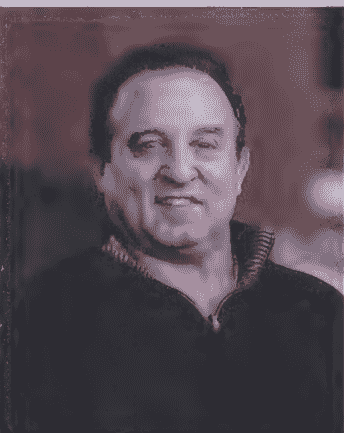
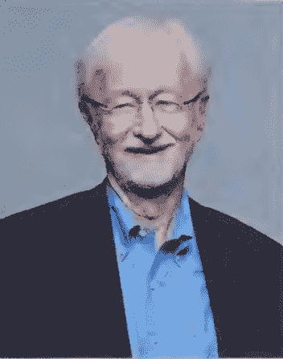

# 组织的领导力 v2.0

由互联网档案馆于 2024 年数字化

## 关于作者

### David A. Waldman

**David A. Waldman** 是亚利桑那州立大学 W. P. Carey 商学院管理学教授。他的研究兴趣主要集中在领导力过程上，特别是组织高层和全球背景下的领导力，并被 Web of Science（基于文章标题中包含 "leader" 或 "leadership" 的出版物数量）誉为全球顶尖十位领导力研究者之一。他是 2020 年领导力学者网络杰出领导力学者奖的获得者。他的大部分研究具有跨学科性质。例如，他在组织神经科学领域的近期工作在学术界和实务界都广受关注，包括在《管理学院期刊》、《应用心理学杂志》和《人事心理学》等期刊发表文章，以及在《华尔街日报》、《Inc. 杂志》和《金融时报》等媒体刊载报道。就这些努力而言，他是管理学院组织神经科学兴趣小组 2021 年终身成就奖的获得者。此外，他被公认为主要开创了负责任领导力概念，该概念涉及在企业社会责任领域理解领导力过程。最后，他开创了研究，以解决与技术转让工作相关的管理和组织问题，包括在《Research Policy》上发表的高引用率工作。

除上述期刊外，Waldman 教授的成就还包括在《管理学院评论》、《管理学院视角》、《行政科学季刊》、《组织科学》、《管理杂志》、《组织研究方法》和《领导力季刊》等期刊上发表超过 130 篇文章。根据 Google Scholar，他的作品被引用超过 34,000 次，他在引用影响力方面位列全球前 2% 的科学家之列。他还分别出版了关于 360 度反馈、领导力与开放沟通、组织神经科学、企业社会责任和组织领导力的五本书。他曾作为主要研究者获得来自国家科学基金会（NSF）、国防先进研究计划署（DARPA）和 Kauffman 基金会等机构约 200 万美元的资助。Waldman 教授是《管理学院期刊》、《管理学院评论》、《管理学院视角》、《应用心理学杂志》、《人事心理学》和《领导力季刊》等期刊的编辑委员会成员。他是管理学院、美国心理学会和工业与组织心理学学会的会员。

Waldman 教授曾为美国、加拿大和墨西哥的多家公司和政府机构提供咨询并进行演示。这些公司包括 IBM、Nortel、墨西哥固特异、Homestake Mining Organization、亚利桑那州公共安全部和信息技术联盟。他在这些活动中的主要重点包括：(1) 帮助领导者更好地理解并应对他们日益面临的悖论，以及 (2) 意识到并基于其领导能力的神经基础采取行动。

### Charles O'Reilly

Charles O'Reilly，得克萨斯大学埃尔帕索分校化学学士；加州大学伯克利分校信息系统工商管理硕士、组织行为学博士。他曾在 UCLA、伯克利执教，并担任哈佛商学院访问教授。他在伯克利和斯坦福获得过教学奖项，并从管理学院同时获得终身成就奖和杰出学术贡献奖。

Charles 目前的研究聚焦于领导力、创新以及组织文化和变革。他还开发并担任众多高管教育项目的教职主管，包括《引领变革与组织更新》和《人力资源高管项目》。他广泛为美国、欧洲和亚洲的公司提供咨询。2002 年，他与 Michael Tushman 和 Andrew Binns 共同创立了 Change Logic，这是一家帮助公司引领颠覆的咨询公司。

Charles 已发表超过 100 篇文章和五本书。他的最新著作《Lead and Disrupt: How to Solve the Innovator's Dilemma》（斯坦福大学出版社，第 2 版，2021 年）探讨了成功企业为何有时会失败——以及领导者需要做什么才能帮助其组织在较长时期内生存和繁荣。他的下一本书《Corporate Explorers: How Corporations Can Beat Startups at the Innovation Game》（与 Andy Binns 和 Michael Tushman 合著）描述了大公司要超越小公司创新所需具备的条件。

## 奉献与致谢

我（David A. Waldman）想把这本书献给我的母亲 Ida Waldman 和已故的父亲 Lester Waldman。如果一个人幸运的话，人生中经历的领导力始于家庭。我非常幸运，有两位父母共同为我树立了领导力榜样。对于这种领导力，我将永远感激。我还想把这本书献给三位领导力思想领域的标志性巨人——Bernard Bass、Robert House 和 Boas Shamir——他们三人都在我成长为领导力学者的过程中担任导师。最后，我想感谢我过去和现在的所有学生。学习是双向通行的，许多我从学生那里学到的想法和例子都出现在了本书中。

Charles O'Reilly 想把这本书献给所有过去学生，他们后来担任领导角色，并因此对他人的希望、梦想，以及在某些情况下，对他人生命本身承担责任。

我们共同想要承认 Susan Feland 在斯坦福大学商学院所做出的非凡努力，她一直是本书中所展示的视频案例开发、制作和分发的推动力。此外，Michael Anderson 和 Matt Downs 是两名斯坦福毕业生，他们开发了最初的一组视频，并证明这些视频可以成为帮助学生了解和发展领导力的一种强大方式。

## 前言

我们为什么要写这本书？我们认识到，已经有其他教材涉及组织领导力问题。除呈现领导力内容（即，基于理论、研究和实践）之外，传统教材的常见做法还包括以书面案例和练习形式提供经验性材料（例如，自我评估工具）。然而，我们认为这种传统方法虽然有帮助，但不足以充分吸引学生学习。

我们都通过经验学习。话虽如此，许多学生在领导力发展方面经验有限。因此，我们的做法是分享真实生活领导者的经验，这些领导者曾面对涉及本书所介绍学习概念类型的挑战性情境。这种分享有助于学生通过他人的领导行动间接学习。我们通过一种讲故事的方法来实现这一点，该方法采用基于视频的案例教学法来调动学生的视觉和听觉感官，这对他们的学习至关重要。具体来说，我们包括二十三个视频案例，讲述的是身处领导职位的人描述他们所处理的各种各样问题的例子——有时成功，有时不成功。这些视频案例分别旨在：(1) 揭示身处领导职位的人的信念和价值观；以及 (2) 提供这些现实世界领导者所面临的领导挑战案例。视频中出现的个人来自多个领域，包括商业和公共部门（例如，军队）。此外，他们代表了不同组织层级和不同职业阶段的领导者。

每个视频案例的总长度约为5到10分钟。它通常包括单独的部分，领导者在其中描述一个问题，谈论该人如何处理该问题，报告所采取行动的结果，并反思所学到的教训。视频案例的一项独特优势是，它们可以用于突出各章节的学习材料，并可以激发学生回答论述题。这些项目专门编写，以加强每章涵盖的主要主题，并与FlatWorld Homework和文中测试项目保持一致。测试项目文件问题也可采用预格式形式提供，以便轻松导出到流行的学习管理系统，例如Canvas或Blackboard。

## 测试生成器——由Cognero提供支持

FlatWorld很高兴提供由领先评估提供商Cognero提供支持的计算机生成的测试程序，以帮助教师选择、随机化、格式化、在线加载或打印考试。如需更多信息或请求该程序，请联系您当地的FlatWorld代表或FlatWorld支持团队(support@flatworld.com)。

## FlatWorld Homework

本教材配套的FlatWorld Homework通过易于使用的界面提供。可用多项选择题、填空题、匹配题和其他题型，且均可自动评分。利用作业题目的学生应该能看到他们在使用采纳者提供的Word文档或LMS包中的测试项目文件问题所进行的考试中的表现有所提高。

## 在线测验

本教材在线版本的各章节和各部分均提供用于学生自我评估的测验问题。学生可以使用测验在阅读不同部分时或在完成一章后测试自己的理解情况。
