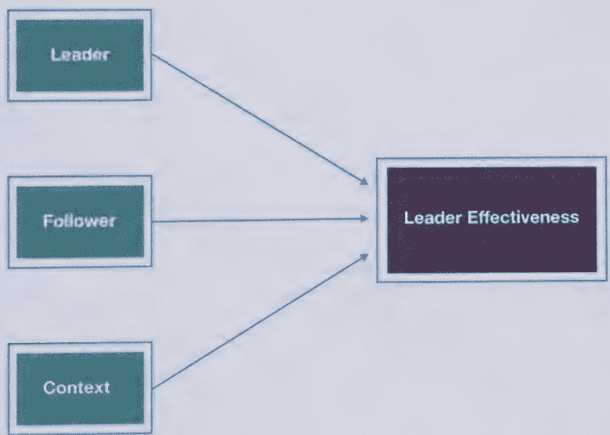

## 第1章

## 简介

> "在你成为领导者之前，成功在于成就自己。当你成为领导者，成功在于成就他人。——杰克·韦尔奇，GE前首席执行官

> "领导力是让别人想做你希望他做的事情的艺术。——德怀特·艾森豪威尔总统兼将军

### 学习目标

- 1. 定义组织领导力。
- 2. 描述领导力与管理之间的区别。
- 3. 总结领导者既是天生的也是后天造就的方式。
- 4. 解释组织如何从领导力中受益。
- 5. 讨论情境对领导力的重要性。
- 6. 描述领导力如何既可基于科学学习，也可作为一门艺术来学习。

各类作家、评论家和高管一直认为，领导力是组织——无论在美国还是国际上——保持竞争优势的关键。另一方面，许多人对公共和私营部门现任领导职位人员持愤世嫉俗态度。鉴于近年来令人震惊的企业丑闻、身处领导职位的个人缺乏问责制，以及主管、中层经理和高管不道德或滥用管理行为的故事，这种愤世嫉俗并不奇怪。尽管如此，研究表明，越来越多地，拥有领导素质和展示有效领导行为是组织有效性以及个人在其职业生涯中试图晋升到管理职位的要求。[1] 因此，有志于成为管理者的人了解有效领导实践的本质以及如何在此领域发展自身能力很重要。简而言之，领导素质既是你自身，也是你将要关联的组织的竞争优势来源。但什么是有效的领导力呢？

### 1.1 定义组织领导力

**领导力**
出于他人自愿，向着组织目标或愿景，对他人思想、信念/价值观、能力和行为施加有意影响的过程。

文献中可以找到对**领导力**的各种定义。例如，著名领导力学者Gary Yukl将领导力定义为“一种对他人施加有意影响，以引导、组织和促进群体或组织中活动与关系的过程”。[2] 我们自己的定义更具体地阐明了这种影响的内容：出于他人自愿，向着组织目标或愿景，对他人思想、信念/价值观、能力和行为施加有意影响的过程。

关于我们的定义，有几点应当注意。首先，尽管“领导力”一词也被用于非人格组织（例如，XYZ公司是计算机行业的技术领导者），但我们认为领导力是由个人展现的，而非整个组织。换句话说，是人展现领导力，而不是组织。

其次，领导力是一个过程，而不仅仅是指处于正式领导职位的人。日常用语可能仅仅因为某人的职位头衔，就将其所在组织中的特定个人称为“领导者”。但我们认为，仅仅因为个人担任正式领导职务（例如，主管或经理），并不一定意味着该人展现了领导力。

第三，除了处于正式领导职位的人之外，领导力还可能涉及其他个人，或者所谓的“非正式”领导者。你可能认识这样一些人，尽管他们没有正式的领导头衔，却经常影响着同事。我们将在第8章详细探讨非正式领导力。

第四，组织有各种层级可能展现领导力。这些层级包括个人层面、群体或团队层面以及组织层面。我们将在某些章节中聚焦于特定层级。例如，我们在第3章中针对个人层面，即一对一的领导力。团队层面的领导力是第8章的主题。组织或战略领导力在第12章和第13章中被探讨。尽管在这些各个层面上，有效的领导行为存在共性，但也存在差异。例如，我们在第11章中讨论的远见型领导力，在高管或战略层面最为相关。但是，在领导个人和团队时，它同样相关。

第五，也许最重要的是，领导力是一个主动的过程，并且是积极的，因为个人是自愿受影响，而不是被强迫或欺凌。因此，所谓的放任自由式领导不是领导力，因为它在避免与追随者互动、需要时不在场或不做决策方面是不作为的。[3] 放任自由式领导的一个好例子可以在HBO系列剧，*兄弟连*中少校诺曼·戴克 Jr. 的不作为中看到。[4] 当其指挥下的士兵需要支持或指导时，戴克少校经常不在场。最重要的是，他未能做出决策，而这是一种重要的领导行为。此外，强迫、欺凌和虐待等消极行为并不构成领导力的实质。例如，在同伴面前嘲笑追随者等行为与有效领导背道而驰。[5]

### 1.2 一些重要的入门问题

当人们思考领导力和领导者时，常会出现一些经典问题。这些问题包括：

- 1. 领导力与管理有何不同？
- 2. 领导者是天生的，还是后天造就的？
- 3. 领导力究竟对组织为何如此重要？
- 4. 情境如何有助于领导力？

### 领导力与管理：它们有何不同？

关于“管理”是否真的与“领导力”不同，一直存在一个悠久且持续的讨论。有人可能会认为这只是语义问题。但我们认为存在一些关键差异，下面我们将加以阐述。

管理者把事情做对。领导者做正确的事情。**管理**在很大程度上是关于效率的，即处理人员、成本、设备以及各种系统，以实现组织目标。因此，管理者试图完善能够实现此类效率的程序或流程。另一方面，领导者不断质疑程序、流程甚至目标是否恰当。此外，他们还不断监督自己和他人行为的道德性。

**管理**

在很大程度上是关于效率的，即处理人员、成本、设备以及各种系统，以实现组织目标。

管理者面对现状。领导者改变现状。管理者大多接受现状，即事物原本的样子。例如，如果有一项处理客户投诉的程序或政策，管理者会找到实施该程序或政策的最有效方式，并确保他人（例如，下属）执行它。有一句老话说：“如果它没有坏，就不要去修它。”管理的对应概念是例外管理。换句话说，管理者只有在事情明显出错时才可能采取行动。然而，领导者并不仅仅接受现状；相反，他们不断寻找改变现状的方法，以持续改进。如果现有的处理客户投诉的方式可以得到改进，领导者会尝试这样做——即使这意味着要改变正式的程序或政策。

你可能听过这样的话：“现状即现状。”经常使用这种表达的人，更多地处于管理的模式中。他们认为，通过接受并处理现状，自己只是在务实。然而，领导者可能会承认“现状即现状”，但随后会迅速补充“它不应该是这个样子，也可能不是应该的样子”。换句话说，领导者并不会简单地安于现状，相反，他们更多地思考可能性和改变现状。

可以通过将政客和领导者进行对比来做出另一种区分。政客们往往出于失去选民支持的恐惧而推迟决策。相比之下，领导者会做出决策，即使这些决策有风险且不受欢迎。也许这正是为何许多政客不被视为领导者。

我们曾有一名学生是伊拉克战争的退伍军人。他说，一名上级军官（即管理者）能让士兵携带作战所需的全部装备上悍马车。然而，只有领导者才能让他们下车并全身心投入战斗。软件公司Intuit的前首席执行官兼董事长Bill Campbell常说：“你的头衔让你成为管理者。你的员工让你成为领导者。”医疗保健公司DaVita的首席执行官Kent Thiry也表达了同样的观点，他指出：“正如美在于观者的眼中，领导力在于被领导者的眼中。除非人们认可你是领导者，否则你就不是领导者。”[6]

在他的经典著作《从优秀到卓越》[7]中，Jim Collins用巴士的比喻来描述有效领导力。他说，真正卓越的领导者能够先让合适的人上车，让不合适的人下车，然后让合适的人坐在他们最适合的座位上。此外，这些领导者随后会确定驱车前往何处。这个比喻有趣的一点在于，它实际上同时涉及良好的管理和领导力。管理，尤其是人力资源管理，部分是关于找到合适的人并将他们安排在合适的工作岗位和团队中。然而，确定目标和愿景是领导者的职责。归根结底，管理与领导力的区别主要是出于教学目的，在现实中，两者对于有效的组织都是必要的。此外，领导力和管理潜在上都可以由同一个人展现，尽管有些人在日常组织行为中可能倾向于展现其中之一而非另一。

### 领导者是天生的，还是后天造就的？

这个问题确实很经典，在媒体和大众文化中一再被提出。领导者天生论的支持者会认为，领导素质在基因上是预先决定的。在第2章，我们将探讨领导者特征，其中一些特征偏向特质，暗示只有部分人可能具备领导的倾向。事实上，一项关于分开抚养的同卵双胞胎的有趣研究表明，同一对双胞胎中，两人要么都倾向于在后来担任领导职位，要么都不倾向于。[8] 换句话说，双胞胎更有可能最终担任相似的角色（即两人都成为领导者，或两人都不成为领导者），而不是最终处于不同的领导角色中，即一人担任领导职务，另一人不担任。既然对于这样分开抚养的同卵双胞胎来说，天性与教养二分法中只有“天性”部分是恒定的，那么逻辑结论就是领导者是天生的，而非后天造就的。然而，我们必须再次强调，这项研究只识别了谁最终会担任领导职务，而非双胞胎是否会践行本章所定义的有效领导。

与天性论相矛盾的是，每年都有数十亿美元投入，其前提是领导者和领导力可以被塑造。换句话说，其想法是，在合适的条件下（例如，正确的培训或发展方法），会涌现出更好的领导者。近年来，为了培养领导者，已经使用了大量技术。这些技术包括更传统的方法，例如让担任领导职位的个人接受咨询或高管辅导，或聆听关于领导力本质和重要性的演讲者。但也可能包括更极端的方法，例如让高管经历开阔眼界、提高意识的经历，例如在贫困或发展中经济体中花费大量时间生活（即，为了增强一个人对更具道德感或更具社会责任感的组织需求的视角）。[9]

那么到底是怎样；领导者是天生的，还是后天造就的？如果你猜测两个选项都正确，那你可能是准确的。换句话说，领导者既是天生的，也是后天造就的。一个折中的答案会认为，人天生具备某些领导素质，尽管这些素质可以根据人生经历被塑造成形。

考虑以下示例。研究表明，存在内在且相对稳定的脑结构，它们表现为大脑中持续的电能模式。事实上，可识别的脑结构已与各种形式的领导素质和行为相关联，例如远见型领导和道德领导。[10] 这些脑结构在起源上可能带有某种遗传性，尽管基于神经可塑性原理，它们可以被塑造

通过生活经验和系统性干预，例如神经反馈。神经反馈是一种旨在指导个体改变大脑神经通路，使其走向更健康或巅峰表现状态的技术。像神经反馈这样的技术能否用于帮助培养更好的领导能力？目前答案尚不明确，尽管神经反馈最终可能与其他更传统的领导力发展技术（如高管教练）结合使用。[12]

我们得出结论，尽管有些人天生具有某些有利于最终展现有效领导力的先天倾向，但领导能力仍然在很大程度上是可塑的。换言之，领导素质和行为在一个人的一生中在很大程度上可以被学习和发展。前海军陆战队将军、现任国防部长吉姆·马蒂斯声称：“领导力并非瞬间产生，而是针对那个特定时刻的训练与准备的最终体现。”[13] 这一结论构成了本书方法的基础。

## 为什么领导力对组织至关重要？

对许多人来说，组织中的领导力很重要这似乎不言而喻。但让我们来拆解一些原因。从组织的角度来看，几个具体方面凸显了领导力的重要性。首先，更好的领导力与吸引和留住更优秀的表现者相关联。[14] 当一家公司拥有更好的领导力时，消息往往会传遍该公司所在的行业，并逐渐形成一个人们希望受雇于此的声誉。该公司随后在各个职位类别中拥有更优秀的人才申请池，从而具有优势。此外，一旦受雇，员工倾向于不离开拥有高效领导者的公司。西南航空就是一个很好的例子，该公司将有效的领导力和人力资源实践相结合，以最大限度地提高员工保留率。[15]

其次，员工倾向于与拥有高效领导者的公司产生认同并承诺。这种认同和承诺不仅带来员工保留，还带来客户服务和生产率等其他积极成果。此外，还会产生团队协同效应。也就是说，与其拥有一群仅在组织框架内追求个人目标的个体，不如有效的领导者能够让人们围绕基于团队的目标和更大组织的利益团结起来。

第三，如前所述，组织绩效和创新往往源于更好的领导力。但这里我们讨论的并非财务绩效。越来越多，公司被其利益相关者（例如客户以及公司运营所在的社区）期望展示社会绩效。换言之，他们被期望环保、慈善，并为员工提供安全稳定的就业。研究越来越表明，更高效的领导者与这种社会绩效相关联。[16]

你可能认为，领导力与积极的团队和组织成果相关联这有些直观。但这一切对你个人意味着什么？成为更好的领导者是否以某种特定方式帮助你作为个人？答案是肯定的——无论是职业上还是个人方面。在职业方面，你可能会走企业路线，试图攀登那座俗称“公司阶梯”的高峰。或者，你可能会尝试成为一名成功的企业家。无论哪种情况，你都需要人际交往技能来影响他人，以实现目标或愿景。事实上，领导能力与职业进步相关。[17]

在个人层面，实践本书所讨论的那种领导素质的人往往更加充实、更快乐、也更高效。管理在很大程度上涉及指导和控制，然而，如果一个人长期不断从事此类行为，很可能会让其身心疲惫。也就是说，该个体会对自己始终需要盯着试图影响的他人看紧感到厌倦。反过来，那些受其影响的人也会对被微观管理感到厌倦。对所有人来说，这种整体情况既不健康，甚至也缺乏生产力。相比之下，通过本书所描绘的那种领导实践——即授权、激励和恰当的人际行为——他人的自我领导力会随时间积累。最终，通过‘领导’，个体不再觉得需要始终对他人进行微观管理，这反过来有助于领导者和追随者双方获得更大的满足感和更高的生产力。一个典型的例子是里卡多·塞姆勒，这位非常成功的巴西商人，其职业生涯起初采取高度指令和专制的模式，但后来以更具授权性的方式收尾。[18] 塞姆勒将这种风格的转变归功于自己身体更加健康，甚至延长了寿命。

## 背景如何影响领导力？

context

领导者所处的各种情境。这些情境可以涉及决策需要做出的快速程度（而非构成不那么紧急的情况）、领导者面临的任务或工作环境的性质，甚至包括文化或地理环境。

当人们思考有效领导力的核心时，首先想到的可能是它完全取决于情境或背景。**背景**是指领导者所处的各种情境。这些情境可以涉及决策需要做出的快速程度（而非构成不那么紧急的情况）、领导者面临的任务或工作环境的性质，甚至包括文化或地理环境。但为什么有些人在某些情境中可能被视为领袖，而在其他情境中却不是？不幸的是，这个问题的答案并不容易或直截了当，事实上，我们在第5章中深入探讨了背景和情境的问题。暂且可以这样说，背景在领导力实践中以两种关键方式发挥作用。首先，根据背景或情境，需要采用不同的领导方法或风格才能取得成效。也许不难想象，某些追随者、工作、行业甚至机构可能会决定采取不同的领导方法。例如，对于海军陆战队教练军士来说，更具指令性的方法更为常见，而对于在谷歌或IBM工作的员工则不然。但是，即使在给定的背景下，合适的领导行为也可能因特定时间点的情境而有所不同。例如，即使在谷歌，新入职员工可能比更资深的员工需要更具指令性的领导。

上述解释和示例相对直观且易于理解。但不太明显的是，某些组织的背景要么会扼杀领导行为，要么会促进领导行为。著名的领导力学者沃伦·本尼斯在其著作*为什么领导者无法领导*[19]中写到了这一现象。在一些组织中，随着时间的推移形成了一种阻碍领导力实践的文化。例如，高度机械化或基于规则的组织（即官僚制组织）往往强调强化现状的行为规范。显然，由于领导者倾向于持续改进和变革，他们会发现这种文化是压抑且令人沮丧的。最终结果是，具有领导倾向的个人要么顺从并感到沮丧，要么最终离开该组织。然而，其他类型的组织文化（例如，倾向于实验和适应的文化）往往会鼓励导向变革的领导行为。我们将在第12章中更详细地探讨这一问题。

### 1.3 本书各章的方法与组织

## 领导力既是一门科学也是一门艺术

有些人可能会声称，对领导力的理解不过是常识。但话说回来，有一句谚语：“常识就像除臭剂。最需要它的人却不用它。”也许关于领导力也可以这么说。开玩笑归开玩笑，虽然本书中报告的某些内容可能看似常识，但依赖常识的一个大问题是，常识在不同个体之间可能有所不同。换言之，对某个个体来说可能是常识的事情，对另一个个体来说却可能看起来是错误的或不合时宜的。举例来说，设想一位处于主管职位的人，他或她有一位追随者，该追随者家里有了新生儿，而婴儿让他或她夜不能寐。看似常识的是，主管应给予追随者高度支持，甚至允许追随者的工作表现在一段时间内下滑。另一方面，另一个人的常识可能更持怀疑态度，并说这一切都取决于情况以及该个人的表现是否对团队至关重要。尽管关于领导力的某些研究在很大程度上证实了许多人可能直觉或视为常识的事情，但大量研究也识别出有效领导力中看似反直觉的方面。简而言之，本书在很大程度上依赖基于科学的研究来梳理我们对有效领导力的理解。

此外，我们认识到领导力可以通过榜样示范、实践、反馈和经验来理解和学习。话虽如此，我们认为，将经验作为了解有效领导力的一种方式可能是一把双刃剑。我们认识一些人，他们试图通过自己的视角和个人经验来教授领导力。在许多情况下，个人拥有丰富的良好经验，可以从中汲取以帮助他人发展自己的领导力。不过，还有另一句老话：“通过经验学习固然好，但从他人的经验中学习更好。”这意味着，即使是经验最丰富的领导者，也不应仅根据自己的经验过度概括良好领导力的原则。相反，最明智的方法是考虑他人的经验，以及系统研究揭示的内容。

总结来说，我们的方法基于三个关键原则或技巧。首先，本书中写下的大部分内容都基于系统研究。其次，我们使用案例视频，帮助学生通过实际、真实生活领导者的榜样示范来学习。榜样示范被认为是培养领导者的有效手段，而我们的视频导向方法具备利用这一原则的条件。视频中出现的许多领导者担任初任或较低级别的领导职务，许多学生很容易与之产生共鸣。学生可以利用本书中的材料，帮助分析视频中个人所描述的情境和领导难题。第三，学生将通过讲故事来学习，这不仅是一种练习领导力的有效手段，也能培养自身的领导能力。换言之，学生可以通过听取那些面临过领导挑战，并随后做出决策或采取行动来应对这些挑战的个人的故事，来形成见解和技能（以及榜样）。

有效领导力的榜样（无论是正面还是负面）可以在各种媒体或来源中找到。一个突出的来源是电影，包括电影和迷你剧。换言之，电影作品常常描绘与本书中许多内容相一致的领导者和领导原则。这样的一部电影作品是《兄弟连》（Band of Brothers），它是一部在 HBO 播出的迷你剧。它描绘了一群人及其领导者在二战美国空降步兵中的故事。关于这部迷你剧的性质及其角色如何体现有效和无效领导力的示例，可以在第 5 节找到。《红尾》（Red Tails）是另一部也在第 5 节中描述的电影作品。它讲述了塔斯基吉飞行员（Tuskegee Airmen，黑人飞行员和支持人员）的故事，他们在二战与德国空军（Luftwaffe）作战中表现出色，红尾中的两位领导者在第 5 节中有介绍。

## 本书的组织结构

各章分为三个部分：

- I. 有效领导力的基础
- II. 领导力的当代问题
- III. 远见卓识与战略领导力

在第一部分中，我们主要概述了在领导力领域长期受到广泛关注的主题。这些主题包括领导特征（例如，特质和行为风格）、关系建立、追随者以及情境/权变领导力。尽管这些领域在领导力思维中有些传统，但我们会加入一些新的视角。例如，我们将描述“以爱领导”的原则，作为展示以人为本或以关系为导向的领导力的一种方式。我们还将进一步介绍政治敏锐度，作为领导者在直接下属或团队成员之外考虑关系建立的一种思维方式。

在第二部分中，我们将深入探讨受到更多当代关注的领域。换言之，这些领域在关于有效领导力的较新思维中很突出。它们包括道德/负责任的领导力、反馈流程、团队和共享领导力，以及多元环境中的领导力。一些尤其有趣且及时的问题将受到关注。例如，我们将强调领导力如何与企业社会责任相交叉，如何接收反馈对领导者来说与给予反馈同样重要，以及领导者的多元化问题既可以从国内角度也可以从跨文化角度来考虑。

在第三部分中，我们关注与领导力相关的更具战略性的问题。我们以激励性/远见卓识的领导力开始本部分，虽然它适用于所有层级，但在战略层级的领导力中具有特殊的重要性。然后我们以关于领导者如何帮助形成或塑造组织文化，以及如何领导组织变革的章节结束。

## 本书的视频案例

视频案例是本书及相关学习的不可或缺的一部分。这些视频不仅让各章内容生动起来，而且基于两个关键学习原则。首先，学生将通过视频中实际领导者的榜样示范来学习。榜样示范被认为是培养领导者的有效手段，而我们的视频导向方法具备利用这一原则的条件。其次，学生将通过讲故事来学习，这不仅是一种练习领导力的有效手段，也能培养自身的领导能力。换言之，学生可以通过听取视频中那些面临过领导挑战，并随后做出决策或采取行动来应对这些挑战的个人的故事，来形成见解和技能（以及榜样）。

本书中呈现的视频案例有两种类型。首先，顶峰案例描绘的是通常在其组织中处于很高层级（例如，首席执行官）的领导者，他们简要谈及领导力过程、素质或特定事件。其次，事件案例通常描绘较低层级的领导者，以及他们对所经历的特定事件的描述、他们如何处理这些事件、其行动的结果，以及他们吸取的教训。

## 展望未来

我们的一位同事经常向他的学生坦承，几年修完他的课程后，学生会忘记所学内容的 99%。他进一步指出，这种情况适用于学生修读的所有课程，而不仅仅是他自己的课程。如此大的比例可能有些夸张，并且可能因课程而异。尽管如此，他的基本观点是有道理的。我们的同事进一步向学生解释，尽管随着时间的推移，大量课程内容会被遗忘，但他希望一些关键原则能在学生的多年生涯和职业生涯中被记住。我们同意这位同事的观点，并据此制定了我们自己的 6 条有效领导力原则清单，希望学生在参加本课程多年后仍能记住。这些原则将在课程和视频中反复强调：

1. 考虑领导者、追随者和情境。对许多人来说，有效领导力全在于有效的领导者。毫无疑问，个体领导者的方面（例如，个人特征和行为）在领导力过程中很重要。但也许出乎一些人的意料，追随者的方面同样非常重要。这可能看起来反直觉，但至少在某种程度上，领导者只有在追随者允许的情况下才能产生影响。²⁰ 此外，当追随者展示我们在第 4 章中考虑的那种追随者行为时，担任领导职务的人更有可能成为更好的领导者。正如俗话所说，“单手难拍响”。此外，如上文所述并在第 5 章中得到强调，如果不了解领导者和追随者互动的情境或情况，我们就无法真正理解有效领导力。很容易想象，日常的“正常”情境可能需要与危机发生时不同的形式的领导力。简言之，理解有效的领导力过程固然需要同时考虑领导者、追随者和情境。这种组合在图 1.1 中显示。

图 1.1 领导者有效性的决定因素

- 2. 以身作则。有效的领导者从不期望追随者去做他们自己不愿意做的事。在历史上，最鼓舞人心的作战领导者都是那些身先士卒、走在士兵前面的人。现代组织当然不能与作战类比，但尽管如此，以身作则的原则仍然有效。例如，在更好的服务型组织中，看到领导职位的人参与一线客户服务活动（尤其是在高峰期）并不令人惊讶。另一个例子是，在2020年和2021年的COVID-19疫情期间，我们看到一些政治领导人强烈建议，为了避免病毒传播，公民应避免在节日期间旅行。然而，他们自己却被发现去探亲或仅仅是出于娱乐而旅行。这种不一致的行为无法激发信心；也无法促使追随者（在此例中为公民）遵守可能发布的其他指令。伪君子不能（或至少不应该）被视为领导者。

- 3. 走动式管理。出于某种原因，担任领导职务的人有时认为他们可以与被领导的人保持物理上的分离。再错不过了。最好的领导者是那些走到被领导者中间的人。他们这么做并非为了监督他们，而是为了表明他们关心他人，并希望为追随者服务或提供帮助。一位以走访式管理著称的人是沃尔玛（Walmart）的创始人山姆·沃尔顿（Sam Walton）。沃尔顿以开着他的皮卡车四处走访各个沃尔玛门店，而不是局限于公司总部而闻名。

- 4. 给予认可。担任领导职务的人在给予赞扬或认可方面往往很吝啬。富国银行（Wells Fargo）前首席执行官迪克·科瓦塞维奇（Dick Kovacevich）声称：“认可是美国回报最高、最被低估的管理工具。”[22] 简单的赞扬不花一分钱，而且很难找到觉得自己在工作中得到了足够赞扬的人。归根结底，简单的赞扬，只要真诚，对人们具有高度激励作用，而有效的领导者不会吝于给予赞扬。

- 5. 辩证思考和行动。悖论涉及两个看似对立、似乎相互冲突且无法调和的现象。尽管如此，这两个现象（或悖论的两个极点）是相互依存的，并需要随时间和谐地调和，以达到有效性。[22] 当领导者辩证地思考和行动时，那个人不会在悖论的两个极点之间进行“二选一”的选择，而是以“两者兼得”的方式同时拥抱两个极点。例如，在第2章中，我们将看到，领导者获得控制权的最佳方式往往是放弃控制。表面上，这些观念似乎无法调和。然而，在现实中，领导者发现，获得组织有效性的控制权最好的方式是将大部分控制权交给追随者——或者允许更多的自主权。我们将在本书中探讨许多其他领导力悖论。

- 6. 活在当下。20世纪70年代，Ram Dass写了一本名为《活在当下》（Be Here Now）的书。[23] 在许多方面，Dass超前于他的时代，因为他谈到了人们真正体验当下并保持正念的必要性。从那以后，技术的进步（例如手机）和文化规范（例如多任务处理）推动人们远离体验当下；也就是说，在意识中不再体验处于某个时间和地点。换句话说，使用更现代的术语，现代世界推动我们不体验正念。例如，在与在场的人进行口头交谈时，一个人可能同时看着手机并回复短信。明显的结果是注意力分散。然而，在很大程度上，领导力并非分散注意力的游戏。布什总统的幕僚长安迪·卡德（Andy Card）说：“在门关上之前，你不应该离开房间，”意思是领导者需要完全专注于手头的对话。[24] 在上述例子中，如果领导者正与面临绩效或个人问题的追随者交谈，那位追随者需要领导者不分心的关注和正念。此时，为了“活在当下”，领导者需要关闭手机，完全为追随者提供便利。

这些原则在本书及相关案例视频中不断强化。我们希望，当你在本课程中学习的大多数其他内容都被遗忘时，你能记住并践行这些原则。如果是这样，你就已经在成为一名有效领导者的道路上了。

### 1.4 讨论问题

- 1. 领导与管理有何不同？每种功能各自以何种方式很重要？
- 2. 领导力可以在不同层面（个人、团队和组织层面）被理解和应用，这是什么意思？
- 3. 对你个人来说，培养领导力技能为什么很重要？
- 4. 情境如何与有效领导力的展现相关？
- 5. 认识到先前的研究结果并据此了解有效领导力是什么意思？为什么这种学习比仅基于个人经验的理解更好？
- 6. 在本章末列出的六项原则中，你认为多年后你会最清晰地记住哪一项（或哪几项），为什么？

### 1.5 附录：二战中的榜样式领导——《兄弟连》和《红尾》的案例

### 《兄弟连》

《兄弟连》是HBO制作的一部迷你系列剧，讲述了二战期间美国陆军第101空降师第506伞步兵团的故事。[25] 具体来说，它是对该团某个连队（“E”连或“易”连）中个人的戏剧性再现。迷你系列剧中出现的几位人物展示了本书中强调的领导力或领导—成员关系的各个方面。

以下是我们列出的这些人物，以及他们在本书中尤其描绘的概念。

**理查德·温特斯少校。** 温特斯少校是迷你系列剧的主角。他展示了有效领导力的多个方面，包括以下内容：

  - **关系导向型领导**——如第2章所述，关系导向型领导是有效领导者所表现出的行为主要维度。温特斯少校在多个场合展示了这种领导力，例如当他安慰一名士兵阿尔伯特·布莱斯（Albert Blithe）时，后者似乎表现出战斗疲劳的迹象。这也是个别化关怀的一个例子，如第11章所述。

  - **任务导向型领导**——如第2章所述，任务导向型领导对有效领导者至关重要。整个迷你系列剧中，温特斯少校展示了他作为军事战术家的能力。他以一种能够取得成果并尽可能减少伤亡的方式指挥部队执行一些困难的机动行动。他以自信、清晰的方式展示任务导向型领导，同时不显得过于专制。

  - 领导—成员交换——如第3章所述，领导者与追随者建立良好的一对一关系（即领导—成员交换，LMX）很重要。总的来说，温特斯少校与他的部下建立了高质量的关系（即高质量LMX）工作做得不错。然而，有一个特定的人，军士长比尔·格纳雷（Bill Guarnere），被吸引到了第3章中所说的温特斯少校的“外部群体”（即低质量关系）。格纳雷的性格和举止与温特斯不同，格纳雷更喧闹，喜欢饮酒等等。相比之下，温特斯相对安静或内向，并且不饮酒。格纳雷错误地认为温特斯是一个虔诚的贵格会教徒，甚至可能不愿意在战斗中开枪。在D日那天，温特斯证明了自己作为领导者和战士的价值。在那个重要日子结束时，一个场景显示，尽管不饮酒，温特斯愿意和格纳雷一起象征性地喝一杯，以庆祝他们连队的胜利。从那时起，温特斯和格纳雷之间的关系得到了改善。

### 赫伯特·索贝尔上尉。

索贝尔上尉是易连在基础训练期间的第一任指挥官。索贝尔上尉没有表现出任何关系导向型领导的迹象。虽然他注重任务，但与温特斯不同，他以贬低和专制的方式行事。此外，要成为一名有效的任务导向型领导者，必须具备与任务相关的知识和技能。然而，索贝尔上尉在实际战斗前的战争游戏中展示了他缺乏军事战术能力。此外，索贝尔未能认识到共享领导的价值（如本书第8章所述）。具体来说，在基础训练期间，温特斯是中尉，也是易连的副指挥官。索贝尔能够认识到温特斯的领导能力，但感到受到了威胁，而不是对温特斯作为易连的次要领导者感到自在。

### 罗纳德·斯皮尔斯上尉。

斯皮尔斯上尉在整部迷你系列剧中作为一种魅力人物（见第11章）出现，其所在团的部下既敬畏又钦佩他。人们敬畏他是因为他以不可预测著称；例如，处决德国战俘，甚至处决他自己的一名士兵（因醉酒违抗命令）。这种行为通常被视为不道德。另一方面，斯皮尔斯上尉和其他人可能会认为，他的行为符合当时的情境。情境对于理解有效领导力的重要性在本章前面部分有所描述。无论如何，他也因其个人勇气而受到钦佩（见第2章），并且因为他能够在特定战斗（比利时福伊镇战斗）中迅速接管易连的指挥权而鼓舞人心（见第11章）。

### 林恩·“巴克”·康普顿中尉。

康普顿中尉被描绘为一位有效的作战领导者，深受部下爱戴。确实，他喜欢与士兵和士官们一起闲逛并建立亲密的个人关系。然而，如第2章所述，康普顿中尉过于渴望社交。迷你系列剧早期，温特斯少校与康普顿进行了一次谈话，警告他不应与部下关系过于亲密。确实，在系列剧中段，康普顿在看到许多部下死亡或受重伤后情绪崩溃。由于这次崩溃，他在战争余下的时间里被免职。

### 诺曼·戴克斯中尉。

戴克斯中尉是本章前面所述的那种“放任自流”型领导者的良好例子。在迷你系列剧的一部分中，他是易连的指挥官。但当他指挥的部下需要他的支持或指导时，他经常缺席。最重要的是，他未能做出决策，而决策是一种重要的领导行为。此类人可以被视为“非领导者”，这对担任领导职位的人来说通常是一件坏事。

### 卡伍德·利普顿中尉。

虽然利普顿中尉是一名军官，但在迷你系列剧中，他更多被描绘为一名非正式领导者（见第8章），基本上弥补了戴克斯中尉缺乏领导力的不足。利普顿中尉展现出的具体领导素质包括关系导向型和任务导向型领导（见第2章）。

## 红尾

Red Tails is a movie about the Tuskegee Airmen, 332nd fighter group of the U.S. Air Force in WWII.[26] They were referred to as the “red tails” because the tails of their airplanes were painted bright red. Despite prior racism in the U.S. military, this group was formed during WWII, but faced initial resistance and lack of confidence from the military bureaucracy. Gradually, the Tuskegee Airmen gained that confidence because of their success in escorting B-17 Flying Fortress bombers to their targets, and safely back to their bases. In the years since WWII, the Tuskegee Airmen have continually received praise and recognition for their accomplishments, despite racism and prejudice in the military at the time.[27] In addition, as a testimony to their character, Tuskegee Airmen typically harbored little ill will toward the military and others, and instead, proclaimed their enduring patriotism toward the U.S. in later years.[28]

Below, we list two leaders who are featured in Red Tails, and the concepts in this book that they especially depict.

### Colonel A. J. Bullard.

Colonel Bullard is the commanding officer in charge of the 332nd fighter group. In the movie, he demonstrates a number of aspects of effective leadership, including the following:

- **Political savvy**—As described in Chapter 3 of this book, it is sometimes necessary for leaders to influence individuals over whom they do not have formal authority. They may do so in order to get resources and prerogatives for their subordinates. In this movie, Colonel Bullard is depicted in his interactions with other high-level officers in the U.S. military as he struggles to get better airplanes for his fighter group and better or more involved assignments in fighting the enemy. Because of his political savvy, he is successful on both counts.

- **Inspirational leadership**—In one scene, Colonel Bullard is giving a speech to his pilots during which he tells them about how their mission will change from engaging enemy fighters or ground targets to defending the heavy bombers. He experiences some degree of pushback from one of the pilots who is more favorable toward the older mission of engaging the enemy in aerial “dog fights.” But Colonel Bullard’s visionary depiction of their new role (see Chapter 11), combined with his announcements that the fighter group will receive new airplanes, serves to inspire the pilots.

- **Specialized language to build organizational culture**—It is clear in the movie that Colonel Bullard has attempted to build a tight-knit culture with shared values and beliefs. He does so through one of the mechanisms that is considered in Chapter 12 of this book, specifically the creation of specialized language. The best example is how despite the challenges that the group faces, and its changing mission, one slogan (or principle) remains the same: “we fight, we fight, we fight.”

- **Coaching and individualized consideration**—In one scene, Colonel Bullard meets with one of his pilots, First Lieutenant Joe “Lightning” Little. Although Lieutenant Little is an excellent pilot, he sometimes does not follow orders, and he has a temper. When faced with overt discrimination from a white serviceman, Lieutenant Little gets in a fight and is temporarily imprisoned. During a follow-up coaching session (see Chapter 7) with Colonel Bullard, he receives feedback that is negative, but constructive. Despite providing a reprimand, Bullard nevertheless displays individualized consideration toward Little (see Chapter 11).

### Major Emanuel Stance.

Major Stance provides good back-up leadership to Colonel Bullard, which is a demonstration of what is referred to as shared leadership in Chapter 8. As described above, Colonel Bullard is often back in the U.S. attempting to provide support for the 332nd fighter group. Major Stance remains in Italy, where the group is based, in order to hold down the fort, so to speak. It is clear in the movie that Major Stance is an effective, loyal follower of Colonel Bullard (see Chapter 4). But at the same time, he is an effective leader in his own right. For example, at the beginning of the movie, he is shown providing an inspirational speech to the pilots (see Chapter 11).

## Endnotes

1. As examples, see Judge, T., & Piccolo, R. (2004). Transformational and transactional leadership: A meta-analytic test of their relative validity. *Journal of Applied Psychology*, 89, 755–768.; also see Sully de Luque, M., Washburn, N. T., Waldman, D. A., & House, R. J. (2008). Unrequited profit: How stakeholder and economic values relate to subordinates’ perceptions of leadership and firm performance. *Administrative Science Quarterly*, 53, 626–654.

2. Yukl, G. (2010). *Leadership in organizations* (8th ed.). Upper Saddle River, NJ: Pearson Education.

3. For more information on laissez-faire and its problems in relation to effective leadership, see the work of Welman, N., Newton, D. W., Wang, D., Wei, W., Waldman, D. A., & LePine, J. A. (2019). Meeting the need or falling in line? The effect of laissez-faire formal leaders on informal leadership. *Personnel Psychology*, 72, 337–359. DOI:10.1111/peps.12308.

4. See https://wikiofbrothers.fandom.com/wiki/1st_Lieutenant_Norman_S._Dike_Jr.

5. For more information on abusive supervision, see Waldman, D. A., Wang, D., Hannah, S. T., Owens, B. P., & Balthazard, P. A. (2018). Psychological and neurological predictors of supervisor abusiveness. *Personnel Psychology*, 71, 395–421.

6. Personal communication.

7. See Collins, J.C. (2001). *Good to great: Why some companies make the leap ... and others don’t*. New York: Harper Business.

8. See Avey, R. D., Rotundo, M., Johnson, W., Zhang, Z., & McGue, M. (2006). The determinants of leadership role occupancy: Genetic and personality factors. *The Leadership Quarterly*, 17, 1–20.; see also Avey, R. D., Zhang, Z., Avolio, B. J., & Kruger, R. F. (2007). Developmental and genetic determinants of leadership role occupancy among females. *Journal of Applied Psychology*, 92, 693–706.

9. See Mirvis, P. (2008). Executive development through consciousness-raising experiences. *Academy of Management Learning and Education*, 7(2), 173–188.

10. See the work of Waldman, D. A., Balthazard, P. A., & Peterson, S. (2011). The neuroscience of leadership: Can we revolutionize the way that leaders are identified and developed? *Academy of Management Perspectives*, 25(1), 60–74; see also Waldman, D. A., Wang, D., Hannah, S. T., & Balthazard, P. A. (in press). A neurological and ideological perspective of ethical leadership. *Academy of Management Journal*, DOI: 10.5465/amj.2014.0644.

11. For more information on neurofeedback, see Waldman et al. (2011).†

12. See Waldman et al. (2011).

13. Personal communication.

14. As an example, see the work of Waldman, D. A., Carter, M., & Hom, P. (2015). A multilevel investigation of leadership and turnover behavior. *Journal of Management*, 41, 1724–1744. DOI: 10.1177/0149206312460679.

15. See http://yousigma.com/benchmarking/southwesternairlineemployeeedevelopmentandretention.html

16. See the work of Waldman, D. A., Siegel, D., & Javidan, M. (2006). Components of transformational leadership and corporate social responsibility. *Journal of Management Studies*, 43, 1703–1725.; and Pless, N. M., Maak, T., & Waldman, D. A. (2012). Different approaches toward doing the right thing: Mapping the responsibility orientations of leaders. *Academy of Management Perspectives*, 26(4), 51-65.

17. You might also be thinking that there are exceptions. In other words, isn’t it possible for people to make career progress based simply upon their business acumen, or even by being manipulative (which is not what effective leadership is all about)? The answer is yes; such qualities can potentially help to make one successful. However, all other things equal, the same can be said about leadership qualities.

18. See Ricardo Semler: *A revolutionary model of leadership*. Fontainebleau, France: INSEAD.

19. See Bennis, W. (1997). *Why leaders can’t lead: The unconscious conspiracy continues*. San Francisco: Jossey-Bass.

20. The idea that it is important for followers to grant leadership influence to leaders is considered in the following article: DeRue, D. S., & Ashford, S. J. (2010). Who will lead and who will follow? A social process of leadership identity construction in organizations. *Academy of Management Review*, 35(4), 627–647.

21. Personal communication.

22. For more information on paradoxes, especially as applied to leadership, see Zhang, Y., Waldman, D. A., Han, Y., & Li, X. (2015). Paradoxical leader behaviors in people management: Antecedents and consequences. *Academy of Management Journal*, 58, 538–566. Also see Waldman, D. A., & Bowen, D. E. (2016). Learning to be a paradox-savvy leader. *Academy of Management Perspectives*, 30, 316–327.

23. See Dass, R. (1971). *Be here now*. New York: The Crown Publishing Group.

24. Personal communication.

25. For a summary description of *Band of Brothers*, see https://en.wikipedia.org/wiki/Band_of_Brothers_(miniseries).

26. See https://en.wikipedia.org/wiki/Red_Tails.

27. For example, see https://www.nasa.gov/centers/langley/news/researchnews/r_Red_Tails.htm#https://www.nbcchicago.com/news/local/tuskegee-airman-world-war-retrial-reunion/2061006/.

28. As an example, see https://www.dla.mil/AboutDLA/News/NewsArticle-View/Article/2086993/tuskegee-airman-94-honored-at-hoc-black-history-month-observance/.

