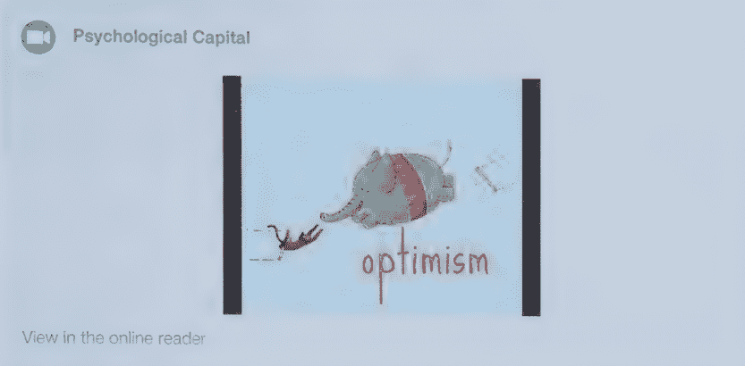
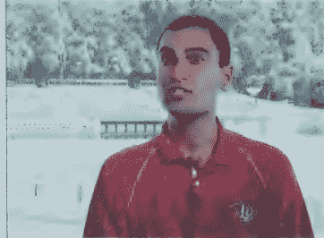
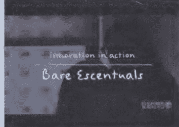

## CHAPTER 2
领导者特质与特征

> "无法断言一个人能走多远，如果他愿意让别人获得功劳。” —罗伯特·伍德拉夫，可口可乐公司首席执行官

> "管好自己，要用头脑；管好别人，要用心。” —埃莉诺·罗斯福

> "他们嘲笑我，因为我与众不同。我嘲笑他们，因为他们都一样。” —库尔特·科本

> "我在生活和事业中失败过很多次，正因为如此，我学到了很多。与其无数次感到挫败，不如将其作为燃料，驱使自己更加努力工作。所以今天，请与我一起接受我们的失败。让我们利用失败，激励自己更加努力。” —菲尔·米克尔逊（2021年5月11日推特——在2021年5月23日赢得PGA锦标赛之前）

## 学习目标

- 1. 总结与有效领导者相关的心理和情感特质。
- 2. 描述领导力品质的悖论性。
- 3. 从普遍行为与决策行为的角度对比领导者的行为风格。
- 4. 指出以爱领导的理念是成为更注重关系的领导者的关键。
- 5. 描述有效领导者特质和行为的神经基础。

想象这样一个人：当你想到此人时，“领导者”一词在你脑中凸显。换句话说，你认为此人体现了领导力的含义。此人可能是你过去有过实际接触的人，或者，此人可能是你从远处观察到的人（例如，通过阅读、媒体报道、纪录片等）。你脑中凸显的哪一种特质或特征，让你想要将此人视为领导者？很可能，你想到的是本章中将要介绍的品质。

如第1章所述，要真正理解领导力过程的含义，我们必须考虑领导者、追随者以及领导力发生的背景。显然，起点是领导者，因此有必要将大量精力放在什么样的品质能让人成为有效领导者，以及个人如何试图领导。在本章中，我们区分了：领导者特质与领导者行为。

### 2.1 领导者特质

特质
一种区分性的品质或特征（即，生理的、认知的、情感的）。

特质是一种区分性的品质或特征（即，生理的、认知的、情感的）。多年来，研究者与从业者（例如，领导力教练和培训师）一直试图识别能够将领导者与非领导者区分开来的个体特质，或一组特质。正式而言，这已被称为理解有效领导力的“伟人法”。[1] 随着时间推移，已识别出多种潜在特质，包括生理特质和心理特质。作为前者的例子，研究者们探讨了性别、身高和外貌等生理品质。从“伟人法”这一术语可以看出，这种方法最初的思路（或偏见）是只有男性才能真正成为领导者。如我们在本书中将看到的，事实远非如此，而且女性拥有与男性同等甚至更大的有效领导力潜力。总体而言，寻找能将可能成为有效领导者的人分离出来的生理品质的努力并不十分成功或一致。但话虽如此，一些研究表明，某些心理或情感特质，或此类品质的组合具有相关性。我们将这些特质分为以下几类。

- 心理资本
- 自我与他人觉知 [包括情绪智力]
- 动机特征
- 品格
- 复杂性与悖论性

### 心理资本

被视为领导者的人往往积极乐观。换言之，他们绝非“扫兴者”。

心理资本是一个指代领导者积极特质的术语。

让我们来看看构成领导者心理资本的四个因素。[2] 首先，领导者倾向于拥有并保持希望。许多因素会削弱希望，例如经济不确定性、社会混乱或分裂等。但即便如此，拥有强大心理资本的领导者仍能保留希望。

其次，领导者保持强大的自我效能感。也就是说，他们对自己能做什么以及能完成什么充满信心。如果没有这样的信心，他们可能不会尝试“挑战性”目标，即将自身和追随者推向原本认为不可能实现的领域之外的目标。在电影《永不屈服》中，纳尔逊·曼德拉（摩根·弗里曼饰）询问国家橄榄球队队长弗朗索瓦·皮纳尔（马特·达蒙饰），领导者如何激励人们实现超出其预期的成就。首先，领导者本身必须具备自我效能感，才能提升其追随者的自我效能感。我们将在第11章进一步探讨鼓舞人心的领导力。

> **毅力**
> 勇气与决心。

第三，领导者保持韧性，并在面对挫折时坚持不懈。在人们追求目标的过程中，失望和缺乏成功是难免的。然而，有效的领导者明白失败是不可避免的，并且是学习的一部分。他们拥有韧性，这使他们能够在面对挫折时坚持，而不是轻易放弃。有句名言：“赢家从不放弃，放弃者从不赢。”领导者将这句话铭记于心。简而言之，共同点在于领导者拥有毅力——换句话说，就是勇气和决心。另一方面，领导者需要理解韧性与坚持（一方面）和“及时止损”（另一方面）之间微妙的界限。话虽如此，领导者通常不会过早“及时止损”。

第四，领导者展现乐观。前陆军将军兼国务卿科林·鲍威尔曾声称：“持久的乐观是力量倍增器。”[45] 乐观对领导力至关重要，因为它能给可能追随领导者的人带来希望感，并且与变革型领导力的概念密切相关，我们将在本书第11章中探讨这一点。

贯穿心理资本所有因素的一个主题是：拥有这些因素的领导者对其追求的目标充满热情。这种热情伴随着高度的精力。当两者结合时，他们的热情和精力往往具有感染力，这是其他人追随他们领导的关键原因之一。苹果联合创始人史蒂夫·乔布斯以其对生产高科技产品的深厚热情和精力而闻名，这些产品可以对消费者既有用又简单。尽管他有时倾向于苛刻甚至粗暴，但他的追随者深受他影响。[46] 他们沉浸在他的想法、热情和动力中，希望这些想法在个人电脑、手机和其他产品方面得以实现。

需要注意的是，所有这些品质不仅与领导者相关，也与企业家相关。成功的企业家以其热情、精力、乐观、韧性和坚持而闻名。如果没有这些品质，他们可能会屈服于那些质疑其想法并不提供必要支持（例如初始资金支持）的反对者或怀疑者。

**内控点**

这是一种信念，即一个人生命中发生的大部分事情归因于他或她自己的行动和努力。另一方面，具有外部控制点的人相信，运气、命运或外部力量（例如，他人或事件）是他或她生活结果的决定因素。

**内控点**与上述描述的品质相关。这一特征涉及个人对命运或运气与个人控制的信念。具有强烈控制点的人相信，一个人生命中发生的大部分事情归因于他或她自己的行动和努力。另一方面，具有外部控制点的人相信，运气、命运或外部力量（例如，他人或事件）是他或她人生选择的决定因素。你能猜出哪种人更可能被视为领导者吗？如果你猜测是内控点，那么你是正确的。人们倾向于追随那些相信自己是命运主人的人。

以纳尔逊·曼德拉为例，他在被监禁二十七年期间，始终保持着自己是命运主人而非囚禁者的心态。这种心态不仅激励他自己忍受监狱的苦难，也激励了他周围的人。在与南非罗本岛的狱友交流中，他经常引用温斯顿·丘吉尔的话：“我们仍然是命运的主人。我们仍然是灵魂的船长。”[5] 大卫·尼尔曼是捷蓝航空的创始人兼首席执行官，但2007年他被解雇了。克服震惊后，他说：“生活中最糟糕的事是成为受害者。”他移居巴西，创办了一家名为Azul的新航空公司，该公司现在非常成功。他的韧性源于他的内控点。

### 自我与他人觉知

领导者不仅意识到自身，也意识到与以某种方式相关的其他人。自我觉知意味着理解自己的信念、情绪、价值观、优势和劣势。以一个高度重视社区服务和社会责任的人为例。如果该个人不明白自己为何持有这些价值观，就很难向他人（即可能追随该人领导的人）解释或说服他们某些行动是必要的。此外，通过理解个人的社会责任价值观如何与公司的受托责任相结合，领导者更有可能向员工、客户、股东等“推销”这些价值观。

另一方面，有效的领导者也意识到他人的优势、动机和欲望，以及恐惧和自我怀疑。最重要的是，领导者能够认识到这些因素在不同个体之间的差异。凭借这种能力，领导者能够更好地影响人们朝着目标努力。丽兹·史密斯是布鲁明品牌公司的首席执行官，该公司是一家拥有1500家门店和10万名员工、价值40亿美元的连锁餐厅。当被问及她认为领导者最重要的特质是什么时，她回答：“作为领导者，你最需要的东西莫过于自我觉知。”[7]

### 情绪智力

在第1章中，我们探讨了“管理”与“领导”之间的差异。一个关键差异涉及情感或情绪。在管理术语中，情绪可能被视为一种麻烦，在工作场所中要么被忽视，要么被认为无关紧要而被驳回。换句话说，管理者倾向于以更注重任务的方式思考如何尽可能高效地完成工作。但对领导者而言，情绪应被接纳和利用，并且是理解自身以及如何影响他人的关键。情绪有多种形式——包括积极情绪和消极情绪。积极情绪包括喜悦、兴奋和热情等，而消极情绪则涉及悲伤、恐惧、愤怒和焦虑。因此，能够处理自己和他人情绪的能力，即所谓的情绪智力，是与有效领导力相关的关键个人特质，这不足为奇。[8]

如表2.1所示，情绪智力有几个关键组成部分，涉及：(1) 对自己及他人情绪的觉知，以及(2) 针对自身情绪采取的行动和

与他人相比。在意识方面，有两个要素。首先，是自我意识。有自我意识的人对自己的情绪以及这些情绪对自身表现的影响非常敏感。因此，一个有自我意识的人可能意识到自己非常焦虑，并且这种焦虑被他人（如追随者）察觉。鉴于追随者会从领导者那里获取线索，大量的焦虑，尤其是在危机时期，对追随者来说会非常消极和压力大。其次，是社会意识。有社会意识的人能够识别并对他人所感受到的情绪表现出同理心。例如，领导者可能会察觉到追随者在变革时期（例如，组织重组）表现出很多忧虑，因此会试图成为追随者的安抚力量，让他们相信变革最终将对所有人有益。

| | 意识 | 采取的行动 |
|---|---|---|
| 关注自我 | 自我意识 | 自我管理 |
| 关注他人 | 社会意识 | 关系管理 |

在采取的行动方面，同样，情商既关乎自己的情绪，也关乎他人的情绪。首先，是自我管理。情商高的人能够控制自己的情绪。例如，虽然追随者可能会犯下涉及客户的看似粗心的错误，但情商高的领导者在与该追随者交谈或提供反馈时不会“发火”。Sun Microsystems 的创始人兼首席执行官 Scott McNealy 说：“作为首席执行官，你必须削弱而不是放大……你不能惊慌失措。”[6] 虽然这可能看起来违反直觉，但领导者有时也需要控制更积极的情绪。例如，在团队会议上考虑涉及道德问题时，领导者可能需要保持有些沉静，从而避免过度的喜悦或兴奋，因为在那种情境下这并非恰当的情绪反应。其次，是关系管理，它涉及通过激励性信息和表现出同情等行动，在情感上与他人建立联系的能力。领导者有时也需要处理追随者之间紧张的情绪，例如当追随者彼此争吵时。第 5 节展示了一份情商自评量表。参加测试，看看你自己在这一特质上的得分。

总而言之，情商既关乎领导者自身，也关乎与他人的联系。正如我们在本书中将看到的，它对领导力的许多方面至关重要，例如与他人建立良好的关系（例如，追随者、自己的上司、同事和客户）。可以提出的一个问题是：什么更重要：基本智力（即 IQ）还是情商？虽然答案并不简单，但基本智力对领导者来说可能实际上不如情商重要。[10] 但再次强调，正如第 1 章所强调的，情境可能会发挥作用。显然，IQ 与领导效能之间的关系在涉及知识工作者（例如，科学家和工程师）的情境中可能更大。

## 基本需求概况

所有人都有需求。其中一些需求非常基本，例如通过食物和水获取生存资源的需求。但除了这些基本需求之外，人们还有可能影响其作为领导者潜在效能的高阶需求。有三个与领导者相关的关键需求：[11]

- 1. 成就需求。这种需求涉及取得成就、获得精通以及为成就获得个人认可的欲望。虽然适度的成就需求对领导者来说是一件好事，但如果一个人拥有过多的这种需求，她将无法让他人“分享聚光灯”。换句话说，为了激励追随者，领导者与追随者分享成就的认可非常重要。

- 2. 归属需求。有强烈归属需求的人渴望拥有许多亲密的关系和友谊，同时希望避免冲突。乍一看，似乎领导者需要有如此强烈的需求。然而，强烈的归属需求可能导致领导者想要与追随者成为亲密朋友，同时回避可能需要做出的艰难决定（例如，训斥甚至解雇员工）。教授、《混蛋法则》一书的作者 Bob Sutton 指出：“从绩效角度来看，过度喜欢你管理的人比喜欢得太少是一个更大的问题。”[12] 同样，Zillow（一家在线房地产公司）首席执行官 Spencer Rascoff 曾表示：“我喜欢被人喜欢，但有时管理人员并不是一场受欢迎程度的竞赛。”[13] 因此，虽然领导者当然不应显得冷漠或不友好，但更适度的归属需求通常是最好的。

- 3. 权力需求。这种需求涉及影响或控制他人的欲望。同样，乍一看，最有效的领导者似乎权力需求较低，或者最多是适度。但在现实中，一些最好的领导者拥有强烈的权力需求。理解这一观点的关键在于首先意识到，权力可以是个体化的，也可以是社会化的。个体化权力完全围绕领导者及其个人利益。因此，在使用个体化权力时，领导者试图为了自身利益获取资源或操纵局势。最终，追随者会看穿带有个体化权力动机的领导者，他们会对领导者缺乏信任，并不受其启发。DaVita 首席执行官 Kent Thiry 通过以下观点说明了这一点：“意图至关重要。人们能闻出你的意图——你的关系是出于推动职业生涯的手段，还是本身就是一种目的。”[14] 相比之下，社会化权力涉及获取权力，以便让他人受益。例如，马丁·路德·金利用他与各个群体（例如，政府官员）的权力，以造福他的众多选民。同样，在商业世界中，西南航空公司创始人 Herb Kelleher 等领导者以如何利用权力来造福员工而闻名。简而言之，强烈的社会化权力需求对领导者来说是一种良好的组合。

总而言之，领导者的最佳概况可能是：适度的成就需求、适度的归属需求和强烈的社会化权力需求。有效的领导者应该有适度的成就需求，但如果走得太远，该需求可能会忽略或掩盖追随者的类似需求。此外，有效的领导者需要是一位“人缘好的人”，但不能与自己领导的人过于亲近。最后，与某些人的直觉相反，有效的领导者确实拥有强烈的权力需求。然而，他们能够将这一需求引导到使用权力来帮助和造福他人。

## 品格

品格
领导者的道德卓越与坚定。

领导者需要有品格。这一说法可能显而易见，但它究竟意味着什么？词典将品格定义为道德卓越和坚定。[15] 我们将在第 6 章更详细地探讨道德和伦理领导力。但目前，可以说，有几个与领导者品格相关的关键特征。

首先，你在本章开头考虑的领导者很可能表现出了诚信，这就是为什么你把他或她视为领导者。的确，当人们听到“领导者”这个词时，诚信往往是他们首先考虑的特征之一。关于诚信的一个有趣之处在于，它既涉及作为也涉及不作为。作为可能是我们在评估个人诚信时首先考虑的事项。例如，我们会想到所说的话，以及这些话是否与所采取的行动一致。当它们一致时，我们会说这个人是“言行一致”，并很可能得出该个人有诚信的结论。例如，一位恳求员工加班以确保客户的

需求得到满足，但本人也加班到很晚，会被视为有正直。但正直也可能涉及遗漏。例如，员工可能希望尽早了解工作环境中可能的重组（*e.g.*，重新分配或裁员）。然而，如果他们只有在重组开始实施时才从领导那里得到信息，他们可能会认为领导缺乏正直。在这种情况下，未说出口的内容才是对追随者来说重要的。美敦力前首席执行官、《真实领导力》一书作者比尔·乔治说：“正直不是‘不撒谎’——而是讲出全部真相。”[16]

第二，被认为是真诚或真实的人。简而言之，真实领导者不会伪装外表，也不会试图以不反映其真实本性的方式行事。换句话说，他们不是虚假的；相反，他们就是他们自己。这似乎显而易见，但令人惊讶的是，尤其是当人们担任领导角色时，他们常常试图改变自己。例如，一个人的口音、举止等等。追随者往往对保持真实性的领导者更有信心，或受到其启发。

第三，领导者有强烈的内部问责意识。在历史日本，武士如果在战败中给自己和天皇带来耻辱，会 literally 自刎。这显然构成了一种极端的问责行为。但总的来说，接受问责意味着一个人对他人或某个事业有强烈的责任感，如果绩效标准未达到，个人会接受负面的个人后果，并最终试图纠正低标准的绩效。不幸的是，个人问责在现代组织中大多不是常态，相反，人们会想方设法将绩效失败归咎于他人。例如，在2008年金融危机期间，像雷曼兄弟这样的金融公司的领导职位人员通常不会对他们造成的（至少部分）对客户的痛苦承担责任。相反，这些人将责任归咎于更广泛的经济、政府政策，甚至客户本身（*e.g.*，那些 supposedly 轻率承担了太多债务的客户）。简而言之，领导者不会对失败归咎于他人；相反，他们承担个人责任。

## 复杂性与悖论性质

 truly 好的领导者是复杂的，有时甚至看起来是矛盾的个体。确实，他们在品质和领导方式上可能具有悖论性。如第1章所述，**悖论**涉及看似矛盾的元素，在单独考虑时似乎合乎逻辑。但那些元素并置时乍一看也似乎不合逻辑、不一致，甚至荒谬。换句话说，至少在表面上，它们似乎无法调和。话虽如此，悖论式领导的理念是展示看似矛盾的元素如何可以同时和谐地共存，从而有助于领导者的有效性。[17] 下面是一些例子。

> **悖论**
> 
> 看似矛盾的元素同时存在，并在单独考虑时似乎合乎逻辑。但那些元素并置时乍一看也似乎不合逻辑、不一致，甚至荒谬。

自恋，但又谦逊。自恋的人非常自我陶醉，并且要求他人关注和赞美。乍一看，自恋似乎总是一种不好的领导品质。确实，自恋可能会有不良影响，因为自恋者可能会虐待他人，包括潜在的追随者。[18] 换句话说，似乎很清楚自恋表明了所谓的领导力的“黑暗面”。但与此同时，我们知道自恋者有动力做出决策并领导他人（*e.g.*，提供愿景），并且他们把自己视为天生的领导者。这一事实本身就很重要，因为有些人根本不想做决定或领导，然而决策者和带头的人在组织中是必要的。此外，与非自恋者相比，自恋领导者的愿景往往相当大胆，而大胆或新的愿景通常是组织所需要的。[19]

令人惊讶的是，最近的研究表明，自恋领导者也可能谦逊，或者至少会被他人认为具有谦逊。[20] 在这种情况下，领导者会自我陶醉并相信自己的伟大。但与此同时，这位领导者会承认其他人也很优秀，并且他或她会倾听他人并吸收他们的反馈。换句话说，这样的自恋者能够看到或至少传达他或她并不是一切事物的专家或大师，而是其他人拥有自恋者不具备的自己的特殊品质。迈克尔·马考比将这类人称为“高效自恋者”。[21] 研究表明，这种自恋与谦逊看似悖论的混合最终会为领导者和追随者带来有利的绩效结果。[22]

通过放弃控制来获得控制。管理全都是关于控制——如何获得、使用和维护它。领导则不同。从悖论意义上说，有效的领导者认识到，获得控制（或至少控制感）的唯一真正方式就是放弃它。这样的领导者的好例子是里卡多·塞姆勒，一位来自巴西的成功商人。职业生涯早期，塞姆勒以威权方式领导。但随着时间的推移，塞姆勒发现，当他将控制权交给员工来处理广泛的事务（e.g.，薪资、工作时间、运营决策等）时，领导工作更令人满意，他的组织实际上运行得更好。换句话说，从悖论意义上说，通过放弃控制，他实际上获得了真正的控制。[23]

分析性，但直觉性。管理人员非常擅长使用分析工具做决策。领导者在某种程度上依赖分析。但与此同时，他们不害怕依赖自己的“直觉”——或使用直觉和本能。使用直觉和本能显然比使用涉及量化和系统化的工具更模糊。尽管如此，有效的领导者会找到方法将所有这些工具和流程结合起来。

造反派，但有宗旨。詹姆斯·迪恩是20世纪50年代初成名的演员。他的一部主要电影是《无因的反叛者》。就像电影中一样，迪恩在现实生活中以造反者著称，并且像大多数造反者一样，他的叛逆本性没有特定的目标或宗旨。他就是单纯地反叛，简单明了。领导者往往也是造反者。他们有时穿着不同，做一些不同的事，说一些有时可能显得“离谱”或“离经叛道”的话。但有一个关键点将领导者与詹姆斯·迪恩区分开来——他们是有宗旨的造反者。换句话说，领导者是同时也拥有目标或愿景的造反者。此外，他们试图让其他人认同他们的目标、想法和使命感。

### 2.2 领导者行为

对有效领导者特质的考察很有趣，并且经常是学术界和大众文化圈讨论的话题。然而，特质不容易发展或修改。这一事实与第1章中我们强调的有效领导者至少在某种程度上是“后天造就”而非“天生”的观念形成对比。那么，究竟可以“造就”什么呢？

**领导者行为**
在追求影响他人和实现目标过程中采取的行动。

为了回答这个问题，领导力思想家多年来一直转向行为。[24] 换句话说，目标是识别与有效领导者可能相关的特定行为或行为类别。**领导者行为**涉及在追求影响他人和实现目标过程中采取的行动。可以从两种方式来思考：(1) 一般化的，和 (2) 决策性的。

### 一般化的领导者行为

在日常工作中，领导者可能与追随者有多次互动。在这些互动中，更有效的领导者可能会表现出以关系为导向的行为，其中可能包括：

- 尊重想法和情感，

- 建立信任，
- 倾听问题，以及
- 解决个人或人际问题。

领导者还可能表现出可称为 _任务导向_ 的行为，其中包括：

- 工作安排，
- 指导工作活动，
- 保持效率，以及
- 执行规则。

总体而言，关系导向与任务导向行为的结合是领导者有效性的关键。然而，如在第5章中将看到的，在某些情况下应强调关系导向行为，而在其他情况下，任务导向行为效果最佳。

## 决策制定

比起日常行为和举止（或泛指的领导行为）更具体，领导者天生就是决策者。换句话说，领导者所从事的一项具体而重要的行为就是决策制定。在第1章中，我们将领导力定义为影响过程。因此，在试图理解有效领导力时，我们寻求确定领导者决策制定的风格，而非决策本身的性质或基础。例如，领导者可能会做出强调股东或生产利益，而非客户利益的决策。虽然此类决策的性质对领导者的组织有影响，但它们本身并不涉及领导过程。

已确定四种基本的领导者决策制定风格。[25] 首先，领导者可能以 _独断_ 的方式处理决策过程，即她自行做出决策，然后简单地通知追随者。其次，领导者可能先与追随者 _协商_，获取他们的想法和建议，然后由她自己做出决策。第三，领导者可以使用 _参与/促进_，即她向追随者呈现问题的性质、可能的决策或解决方案边界，然后领导者与追随者共同就决策达成共识。第四，领导者可能会 _授权_，即由一名或多名追随者自行针对某个问题得出决策。领导者在决策过程中不扮演任何角色，但她可能会担任支持角色，为追随者在其自身决策中提供建议、鼓励、信息和资源。在考虑每种风格最有益的具体情境或情况时，我们将在第5章中回到这些风格。

## 以爱领导

如果我们假设关系导向型领导确实很重要，并且可能一直被领导岗位的人低估，那么问题就变成了：身为领导者，如何才能更关系导向呢？近年来提出的一种理念是“以爱领导”的概念。[26] 比喻地说，**以爱领导**可以被视为“加强版”的关系导向型领导，旨在展现同情心、让工作充满乐趣，并减少工作场所的恐惧。在以爱领导时，通过展现深层理解、同情和关怀，与追随者建立关系。以爱领导包括承认他人的价值，并不预设对方怀有负面动机。

> **以爱领导**
> 关系导向型领导“加强版”，旨在展现同情心、让工作充满乐趣，并减少工作场所的恐惧。

2020年开始的COVID-19危机使领导者展现同情心变得更加重要。员工们在生活中面临各种新的压力源，例如孩子在家上学，或自身或重要他人实际感染病毒。这些情况使以爱领导的需求变得更加重要。

以爱领导的另一个方面是尝试为工作注入乐趣和兴奋感。“驼峰日”指的是周三。意思是工作周过了一半，周五下班后就可以开始享乐了。潜在的观念是工作就是工作，乐趣就是乐趣，两者不会交汇。以爱领导包括打破关于工作与乐趣的此类刻板印象。以爱领导的理念是，工作与游戏之间的界限应该变得模糊。史蒂夫·德宁是General Atlantic Partners的董事长，这是一家200亿美元的私募股权公司。他说：“没有乐趣的成功不算真正的成功，没有成功的乐趣也不算真正的乐趣。”[27] 两者缺一不可。

要更好地理解以爱领导，思考其相反面——以恐惧、焦虑和负面情绪领导——是很有启发的。以恐惧领导过去一直是影响实践的常态，无论是公开的还是更被动的方式。组织中的恐惧以多种方式表现出来，例如害怕表现不佳、害怕个人损失、害怕被评判，等等。

为何有人会通过恐惧领导，而不是通过以爱领导？这个问题的答案可以从所谓的理论X与理论Y假设中找到。[28] 持有理论X假设的领导者认为，人们倾向于不喜欢工作并想要避免工作。因此，为了完成工作，追随者（或下属）需要受到严格控制，这包括一种恐惧感：如果表现或行为不佳，将受到严厉惩罚。另一方面，持有理论Y假设的领导者认为，普通人并不讨厌工作，会接受甚至寻求更多责任，并且可以被委以制定自己的方向或保持自控的职责。显而易见，持有强烈理论X哲学的领导者可能会通过恐惧领导，而持有强烈理论Y哲学的领导者则更倾向于以爱领导。

以爱领导与以恐惧领导的可能结果是什么？当通过恐惧领导时，短期生产目标或许能实现，但从长远来看，追随者会非常犹豫尝试新事物或进行创新。因此，他们会非常规避风险，只勉强达到最低期望。另一方面，以爱领导的可能结果包括信任与承诺、情感投入、创新以及持续的客户服务。

尽管以爱领导可能带来益处，但无疑存在持怀疑态度和反对意见的人，他们可能会认为这反映了一种“天方夜谭”的心态，没有考虑到员工队伍常常尚未准备好接受以爱领导的现实。这种思维会暗示，以爱领导仅仅反映了所谓的“无条件的积极关注”。但在现实中，这远非事实。例如，以爱领导并不意味着领导者永远不会与追随者意见不合或提供批评。然而，当他这样做时，其目的并非嘲笑或证明追随者是错的。相反，目标是帮助追随者成长、学习并成功。

### 2.3 探根溯源：领导者特质与行为的神经基础

很大程度上，大脑是领导者特质与行为的主要来源。换言之，大脑支撑着认知与情绪，以及领导者倾向于展现的行为。研究人员、治疗师和医师通常通过血流变化和电活动来测量大脑中的生理现象。这种活动以两种方式之一发生。首先，大脑会对环境中的刺激产生生理反应。例如，如果一只老虎走进你的身边，你的大脑会立即发生与恐惧和逃跑相关的血流和电活动变化。其次，当你的大脑处于警觉但休息状态（即未受到刺激）时，它具有所谓的独特固有电结构或模式。就像身高、体重、性格等一样，我们每个人都有独特的固有结构，可以通过所谓的定量脑电图（qEEG）[29]来评估。此类神经结构因人而异，并且随时间相对稳定。然而，根据大脑可塑性的概念，这些结构可能会因生活经历、创伤性损伤甚至系统性训练而随时间改变。

## 领导者的大脑内部

神经重塑能提升领导力技能吗？https://www.inc.com/magazine/201306/eric-markowitz/brain-leadership-inside.html

近年来，研究表明，大脑中固有结构与有效领导力的各个方面相关，例如具有远见、道德/伦理、非虐待性以及复杂推理形式的领导力。[30] 换句话说，我们在这些固有结构上存在差异，这些差异与我们是否倾向于成为有效的领导者相关。这项研究的实际影响尚不明确。一种可能性是，神经反馈等技术可用于帮助开发更好领导行为的潜力。通过神经反馈，大脑可能会被训练得更有利于有效的领导者认知、情绪和行为。[31] 神经反馈并非对有志领导者的“灵丹妙药”，但或许可以与其他领导者发展方法相结合，例如本书第7章中考虑的360度反馈过程。另一种可能性是，实际上使用基于神经学的数据，以帮助形成将个人选拔或晋升到领导职位的基础。确实，商业界和媒体开始关注神经科学的这些潜在影响。[32]

然而，这两项潜在影响都引发了伦理问题（例如隐私问题），随着这项研究的推进，这些问题未来几年很可能会浮现。例如，试图通过改变个人的电脑结构来让他们成为更好的领导者，这是否符合伦理？谁来决定基于大脑的数据何时、如何被用于帮助选拔和晋升领导者？尽管存在这些棘手的问题，但可以肯定的是：大脑既是理解也是开发领导力潜力的新前沿。

## 本章视频案例

本章的视频案例分别探讨了有效领导者的两个相关品质：(1) 尽管经历挫折，仍坚持追求目标；以及 (2) 强调工作场所中的幽默与游戏的以爱领导主题。在《梦幻球场》中，戴夫·卡瓦尔被描绘为一名企业家，尽管遭遇挫折，但在创办小联盟棒球组织的过程中展现出了巨大的韧性。

## Dave Kaval—梦想球场

Dave Kaval 被描述为一位企业家，在创建小联盟棒球组织的过程中，尽管遭遇挫折，但表现出了极大的韧性。

在在线阅读器中查看

## Leslie Blodgett—幽默的裸露力量

Bare Escentuals 首席执行官 Leslie Blodgett 展示了她如何通过让工作变得有趣和幽默来激发创造力。

在在线阅读器中查看

## 结论

在本章中，我们概述了一系列与有效领导力相关的特质和特征。这些特质和特征在很大程度上属于心理层面，涉及个性、价值观、信念等等。虽然特质很有趣且富有信息量，但我们也指出，识别行为或行为风格对于我们理解领导力可能有所帮助。最近，我们开始更深入地挖掘，以识别大脑中作为领导者特质、特征和行为来源的结构。

## 2.4 讨论问题

- 1. 领导者的自恋可能被视为一件坏事，因为它往往涉及高度的自我沉浸、对他人的赞美需求以及极端（或过度）自信。另一方面，对于处于领导职位的人来说，自恋也有一些积极方面。这些积极方面是什么？一个人如何能够，甚至有必要，悖论地同时表现出自恋和谦逊？

- 2. 历史上有哪些“怀抱理想的反叛者”式领导者的例子？他们为什么符合这个标签？

- 3. 为什么对权力的高度需求实际上可能是领导者的良好动机，这取决于权力如何被使用？

- 4. 在完成第 5 节的调查后，你个人觉得情绪智力的哪个组成部分有时对你来说最具挑战性？你可以做些什么来更好地掌握这一组成部分？

- 5. 如果你可以通过神经反馈过程让自己成为一名更有效的领导者，你会这么做吗？为什么或为什么不？如果你有疑虑，你想了解什么来减轻你的担忧？

## 2.5 附录：情绪智力调查

回答以下陈述。如果该陈述对你来说大多是正确的，则回答“T”。如果该陈述对你来说大多是错误的，则回答“F”。

| 陈述 | 答案 |
| :--- | :--- |
| 1. 我意识到自己的情绪以及可能引起这些情绪的原因。 | |
| 2. 我意识到自己的情绪如何在身体上影响我。 | |
| 3. 我意识到自己的情绪如何影响他人。 | |
| 4. 我意识到自己的情绪如何影响我的行为。 | |
| 5. 我能轻易识别某人是否正在经历特别美好或糟糕的一天。 | |
| 6. 我能在情感上与他人产生共鸣。 | |
| 7. 对我来说，理解他人可能经历的情绪压力很容易。 | |
| 8. 我能轻易判断一群人的整体情绪氛围。 | |
| 9. 我不会仅仅因为自己可能感到沮丧就“责备他人”。 | |
| 10. 我能控制自己的情绪。 | |
| 11. 如果需要，我可以隐藏自己的负面情绪，让别人不知道我的感受。 | |
| 12. 如果必要，我可以避免表现出过度的喜悦或兴奋。 | |
| 13. 我能在情感上与他人建立联系。 | |
| 14. 我擅长对他人表现出同情心。 | |
| 15. 当其他人之间存在过多充满情绪的争议时，我能充当“调解人”。 | |
| 16. 我知道如何选择用词，以积极的方式“在情感上触动他人”。 | |

### 评分

问题 1–4 反映自我认知。问题 5–8 反映社会认知，问题 9–12 反映自我管理，问题 13–16 反映关系管理。计算你在每个维度上的“T”回答数量。如果某个维度的得分是 3 或 4，这意味着你在该维度上尤其强。

## 尾注

- 1. 有关领导者特质以及所谓“伟人方法”的更多信息，请参阅 Yuki, G. (2010). Leadership in organizations. Upper Saddle River, NJ: Prentice Hall。
- 2. 关于心理资本及其四个特征的详细讨论见 Peterson, S., Balthazard, P. A., Waldman, D. A., & Thatcher, R. W. (2008). Neuroscientific implications of psychological capital: Are the brains of optimistic, hopeful, confident, and resilient leaders different? Organizational Dynamics, 37(4), 342–353。
- 3. https://www.goodreads.com/quotes/22067-perpetual-optimism-is-a-force-multiplier
- 4. 参见 Isaacson。
- 5. 这种内控点心态在电影 Invictus 中表现得很明显。另请参见 https://en.wikipedia.org/wiki/Invictus。
- 6. 个人通信。
- 7. 个人通信。
- 8. 关于组织中的情绪和情感（包括情绪智力）已有大量论述。如需查看良好的摘要，请参阅 Barsade, S. G., & Gibson, D. E. (2007). Why does affect matter in organizations? Academy of Management Perspectives, 21(1), 36–59。另请参见 Goleman, D. (1995). Emotional Intelligence: Why it can matter more than IQ. New York: Bantam Books。
- 9. 个人通信。
- 10. 参见 Ronald Riggio 在 https://www.psychologytoday.com/us/blog/cutting-edge-leadership/201310/the-three-types-intelligence-you-need-success 中的工作。
- 11. 参见 McClelland, D. C. (1985). Human motivation. New York: Scott, Foresman。
- 12. Robert Sutton, The No Asshole Rule, Business Plus, 2007。
- 13. 个人通信。
- 14. 个人通信。
- 15. 参见 https://www.merriam-webster.com/dictionary/character
- 16. 个人通信。
- 17. 有关悖论和悖论式领导的更多信息，请参阅 Zhang, Y., Waldman, D. A., Han, Y., & Li, X. (2015). Paradoxical leader behaviors in people management: Antecedents and consequences. Academy of Management Journal, 58, 538–566. DOI: 10.5465/amj.2012.0995。
- 18. 参见 Moff, C. C., & Rhodewalt, F. (2001). Unraveling the paradoxes of narcissism: A dynamic self-regulatory processing model. Psychological Inquiry, 12, 177–196。
- 19. 参见 Galvin, B., Waldman, D. A., & Balthazard, P. A. (2010). Visionary communication qualities as mediators of the relationship between narcissism and follower perceptions of charismatic leadership. Personnel Psychology, 63, 509–537 的研究。
- 20. 参见 Owens, B. P., Wallace, A. S., & Waldman, D. A. (2015). Leader narcissism and follower outcomes: The counterbalancing effect of leader humility. Journal of Applied Psychology, 100, 1203–1213. DOI: 10.1037/a0036698。
- 21. 参见 Maccoby, M. (2003). The productive narcissist: The promise and peril of visionary leadership. New York, NY: Broadway Books。
- 22. 参见 Owens et al. (2015)。
- 23. 参见 Ricardo Semler: A revolutionary model of leadership. Fontainebleau, France: INSEAD。
- 24. 例如，请参阅 Yuki (2010)。
- 25. 参见 Vroom, V. H. (2000). Leadership and the decision-making process. Organizational Dynamic, 28(4), 82–94。
- 26. “以爱领导”这一术语可以追溯到 Alexander Strauch 的一本书，该书于 2006 年由 Lewis & Roth Publishers 出版。虽然该书关注圣经领导力和现代教会领导，但在近来，它已被应用于组织领导力。
- 27. 个人通信。
- 28. 参见 McGregor, D. (1960). The human side of enterprise. New York: McGraw-Hill。
- 29. 参见 Waldman, D. A., Ward, M. K., & Becker, W. J. (2017). Neuroscience in organizational behavior. Annual Review of Organizational Psychology and Organizational Behavior, 4, 225–444。
- 30. 参见 Waldman, D. A., Balthazard, P. A., & Peterson, S. (2011). The neuroscience of leadership: Can we revolutionize the way that leaders are identified and developed? Academy of Management Perspectives, 25(1), 60–74; Balthazard, P. A., Waldman, D. A., Thatcher, R. W., & Hannah, S. T. (2012). Differentiating transformational and non-transformational leaders on the basis of neurological imaging. The Leadership Quarterly, 23, 244–258; Hannah, S. T., Balthazard, P. A., Waldman, D. A., Jennings, P., & Thatcher, R. (2013). The psychological and neurological bases of leader self-complexity and effects on adaptive decision-making. Journal of Applied Psychology, 98, 393–411; Waldman, D. A., Wang, D., Hannah, S. T., & Balthazard, P. A. (2017). A neurological and ideological perspective of ethical leadership. Academy of Management Journal, DOI: 10.5465/amj.2014.0644。
- 31. 参见 Waldman et al. (2011)。
- 32. 请参阅以下文章，了解商业界如何开始审视神经科学对管理和领导力的实际应用：https://www.inc.com/magazine/201306/eric-markowitz/brain-leadership-inside.html; https://www.wsj.com/articles/the-inner-workings-of-the-executive-brain-1398358537。

