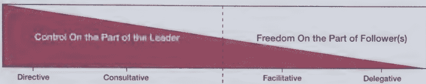
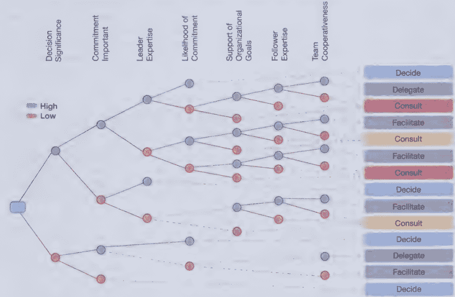
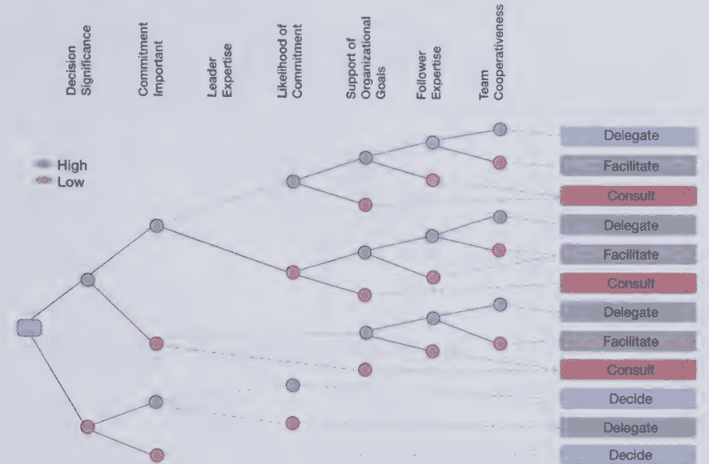

## 第 5 章

### 情境领导

> > "动机取决于你作为个人带来的东西。对某人有激励作用的东西，对另一个人未必有激励作用。” —鲍勃·尼尔森，作家兼管理顾问

### 学习目标

- 1. 解释为什么灵活的情境领导方法更实用。
- 2. 将情境领导应用于涉及日常领导行为的情况，以及具体的决策制定。
- 3. 评估应用情境领导原则可能带来的问题。
- 4. 陈述情境领导方法未考虑到的其他重要领导问题。

本书不断探讨的一个问题是：什么构成了有效领导？多年来，理解有效领导的主流方法是识别任何优秀领导者在各种情境和环境下都应实践的行为因素。换句话说，主流方法是通用的。因此，第 2 章中识别的领导风格，例如关系导向和任务导向的领导，被认为是应在各种情境和环境下实践的普遍行为素质。

另一方面，当被问及有效领导到底是什么时，许多人可能会想到一件事：“这取决于情况。”并且说得对——在很大程度上，这确实取决于情况。有效领导，更具体地说，应强调的行为风格，部分取决于领导者试图领导的人的性质，即追随者。如第 1 章所述，这也可能取决于领导者和追随者所处的更广泛环境。该更广泛环境可以包括许多因素，例如行业、机构或工作类型，甚至地理环境。

在本章中，我们将探讨“这取决于情况”具体指什么。正如我们将看到的，这种关于有效领导的情境观点对领导者如何在日常或逐个问题的基础上领导具有许多实际影响。另一方面，它也为领导者带来许多挑战。例如，准确了解追随者及其需求和期望可能具有挑战性。然而，如果情境领导要有效，这种了解至关重要。

考虑情境领导有两种方式。第一种是不灵活的方法。它基本上假设领导者有一种不灵活的主导风格。换句话说，领导者会试图使用一种期望的或“舒适”的风格，无论情况如何。例如，一种以任务为导向、指令式的主导风格的领导者，无论他或她所领导的追随者的性质如何，无论环境如何，都会想要使用这种风格。因此，即使情况需要一种更以人为本的方法，领导者仍然希望保持任务导向或指令式。一种可能性是简单地将这样的领导者放在某种环境中，该环境至少在大部分情况下会从任务导向、指令式的领导者中受益。示例可能包括工作标准或行为变得松弛的情况、工人过去习惯于这种领导的情况，以及在某些工作或机构中，指令式领导是常态（例如，军事或准军事组织）。

### 不灵活

因此，不灵活的方法有时也是有道理的。如果某位领导者以任务导向或指令式著称，这种风格可能与某些情况很匹配，而更以人为本或参与式的领导者在其他情况下可能更合适。换句话说，情况是静态的，领导者在向追随者展示的风格类型方面不需要太多灵活性。

话虽如此，情境领导的不灵活方法存在两个关键问题。首先，一般情况或环境可能会随时间而变化。例如，当领导者最初被分配到某个特定环境时，追随者通常可能需要并期望一种更威权的方法。但是，随着时间的推移，追随者可能会成熟和发展，从而使指令式方法不再那么合适，同时要求领导者具备更多以人为本的特质，例如参与式行为。然而，仅仅为了适应特定环境或环境随时间的变化而解雇或调动领导者，可能不切实际或不可取。其次，大多数情况是流动的，并且在特定时间点上所需的领导方法基本上可能会“之字形”变化。有些追随者有时可能需要更多的“人性化关怀”，即以人为本的领导，或者他们可能有需求和能力更充分地参与决策。然而，其他追随者可能需要更指令式的方法。此外，领导者本人可能没有足够的知识或专业知识来独自解决某些问题，因此，可能需要追随者的一些参与，具体取决于要做出的问题或决定。

### 灵活

情境领导的一种方法，即任何给定的领导者都可以在不同的时间点处理并适应不同追随者和情况的各种需求和能力。

简言之，更有必要采用灵活的情境领导方法，即任何给定的领导者都可以在不同的时间点处理并适应不同追随者和情况的各种需求和能力。因此，我们在本章余下部分描述了三种此类方法：（1）路径—目标，（2）Hersey/Blanchard 情境领导，以及（3）Vroom/Jago 权变领导。虽然它们都代表了灵活方法的不同形式，但表 5.1 描绘了这些模型的不同方面和重点。也许在目标行为方面最重要的是，路径—目标代表了一种普遍形式的灵活领导，因为它涉及与追随者的日常互动，以及他们面临的可能涉及或不涉及决策过程的问题或议题。范围稍窄一些，Hersey/Blanchard 和 Vroom/Jago 方法更具体地涉及领导者如何做出影响或可能包括追随者的决策。我们将在下面更详细地考虑这些不同的方法。

| | 目标行为 | 情境因素 | 可能的领导风格 |
|---|---|---|---|
| 路径—目标 | 追随者面临的日常互动以及问题或议题 | 追随者和领导者的需求，以及工作环境的要求 | 指令式、支持式、参与式、成就导向 |
| Hersey/Blanchard | 决策制定 | 追随者在能力和动机方面的准备程度 | 指令式、咨询式、促进式、授权式 |
| Vroom/Jago | 决策制定 | 决策性质、追随者的情境准备程度以及领导者的专业知识 | 指令式、咨询式、促进式、授权式 |

### 5.1 路径-目标领导力

在基本层面，领导者与追随者之间的关系全在于交易。领导者及其所代表的组织从交易中获得某种东西（即，员工绩效），同时，追随者也从交易中受益（即，各种奖励，如持续雇佣和更好的工作分配）。问题是，日常工作中可能出现各种问题或困难，阻碍这些交易让每个人都满意地实施。为此，路径-目标领导力的总体目的是让领导者调整其风格，以适应追随者及其工作环境的情境需求。[8] 目标是让领导者使用合适的风格来澄清追随者需要采取的行动（即“路径”），以便他们能实现自己的奖励，同时避免诸如训斥等问题。但同时，为了使交易有效，必须满足工作环境的需求，包括领导者本人的需求。

让我们根据表 5.2 中显示的追随者需求来考虑一些示例。如果追随者在工作上相对新手，或者面临她没有经验的任务，采取指令式领导将有所帮助。这种指令式领导将提供清晰度，使追随者更加确信她的努力会带来有效的绩效和奖励（例如，工作保障、更多责任的可能性等）。此外，如果完成某项工作面临巨大时间压力，领导者可能会感到有必要采取指令式领导，以实现组织目标以及追随者的个人目标。

### 表 5.2 情境需求、路径-目标领导风格及对追随者的影响

| 追随者需求 | 领导风格 | 对追随者的影响 |
|---|---|---|
| 追随者的工作模棱两可；工作环境中存在时间压力 | 指令式 | 澄清为获得奖励需要做什么 |
| 追随者缺乏信心或需要个人支持 | 支持式 | 增强追随者的信心或实现工作结果的情感能力 |
| 追随者既渴望，也应该拥有更多发言权或参与度 | 参与式 | 允许一种控制感，以确保结果得到实现，奖励得到获得 |
| 工作对追随者来说不具挑战性 | 成就导向型 | 允许追随者为更高级别的目标而努力 |

如果追随者缺乏信心，领导者应专注于支持性行为，以帮助增强追随者的自信心。新员工往往就是这种情况。尽管积极强化应适用于所有追随者，但对于可能缺乏信心的新员工来说，它可能尤其重要。此外，不时地，追随者可能会经历个人困难（例如，问题个人关系、重要他人去世等），这些可能在情感上伤害他们，并威胁他们完成工作目标的能力。在这种情况下，领导者理应表现出支持性行为：

如表 5.2 所示，有时追随者渴望更多参与或发言权，这本身就可能反映一个个人目标（即，追随者可能有在工作环境中参与的切实需求）。例如，追随者可能觉得有必要参与一系列决策，甚至超出其工作任务的执行方式，例如团队排班、生产标准、质量改进工作等。通过更具参与性并允许员工发声，领导者增强了追随者的控制感，并确保其需求得到满足。另一方面，正如本章后面将详细阐述的那样，追随者对更多参与的渴望与其有效处理该参与的准备或能力之间可能存在冲突——至少在领导者看来是这样。

从路径-目标视角来看，追随者发声还可以带来超出任务相关或工作场所决策的额外优势。当领导者允许追随者说话或发声时，他们可以更多地了解追随者的个人目标或需求。例如，小联盟棒球联盟负责人 Dave Kavalk 向我们描述了一次关于一名未遵循其指示的员工的对话。他没有只是训斥员工，而是抓住机会让员工有了发言权，从而了解到该员工有一个特殊的愿望，即扮演球队吉祥物的角色。在路径-目标模型中，Kavalk 与员工协商，如果员工学会更认真地遵循指示，该愿望如何才能得到满足。这样一来，Kavalk 和员工的目标都得以实现。

最后，当追随者没有得到适当挑战时，可能需要采用成就导向型领导。如果没有得到适当挑战，追随者可能会感到无聊和沮丧，这最终可能导致人员流失。但同样，有可能追随者觉得自己需要更具挑战性的工作，甚至可能为此向领导者游说，但领导者可能持不同意见，或者组织环境中根本没有这样的机会。这通常发生在相对新入职的员工，或刚从学校“毕业”的员工身上。领导者可能觉得新员工尚未准备好迎接更大的挑战，或者新员工在执行低级任务上花费的时间还没有“付出足够的代价”。

应强调的一点是，这些风格既不是相互排斥的，也不是在应用上死板的。换句话说，在给定情况下，领导者相对同时地应用不止一种风格可能最能服务于追随者，尽管其中一种风格可能占主导地位。例如，领导者可能选择主要采取指令式，但仍带有某种支持性。此外，如果在给定情况下，领导者表现出强烈的支持性倾向，但在实现追随者或组织目标方面效果不佳，那么随着时间的推移，始终有可能转向另一种风格（例如，变得更加指令式）。

作为关于路径-目标领导力的最后说明，上述讨论应清楚地表明，它在很大程度上关乎追随者，具体是处理个别追随者的需求。但是，追随者不是唯一有需求的人。为了使交易有效，必须满足组织以及领导者的需求。各方的需求完全可能发生冲突。例如，可能存在这样的情况：追随者需要个人支持，但组织或领导者的需求表明更偏向指令式的方法更为合适。极度不确定或危机条件会让人想到，即使追随者有个人问题（这可能暗示需要支持性领导），领导者也可能觉得没有时间提供这种支持，或者组织有更紧迫的要求。因此，在这种情况下，领导者可能会变得高度指令式，并对追随者提出高要求，同时表现出较少的支持关切。

### 5.2 Hersey/Blanchard 情境领导方法

决策显然是领导者的一项重要任务。从领导力角度来看，我们关注领导者做出决策的过程，而不是实际做出的决策的性质。⁴ 我们特别考虑他们在这一过程中让追随者参与的程度。Hersey 和 Blanchard 提出了一种情境领导方法，主要用于帮助领导者确定在面临的各种情境下的决策风格。⁵ 基本问题是，追随者是否应该，以及在什么程度上应该参与决策。

决策风格。如图 5.1 所示，可能使用四种基本风格。第一种风格是指令式，即领导者替追随者做出决策并提供明确的

指令或指示。第二种风格是咨询式，即领导者征求追随者的意见，允许提问，并总体上让追随者在决策过程中拥有一定程度的“发言权”。实际上，领导者甚至可能经历不止一次迭代：提出问题解决方案，追随者提供意见，领导者重新制定修改后的方案，追随者提供更多意见，如此循环。第三种，领导者可能采用促进式风格，鼓励与追随者在决策过程中平等参与。因此，直到领导者和追随者达成共识后，才会做出决定或行动计划。在此过程中，领导者可能充当讨论协调者，但领导者明确表示他或她只有一票，追随者拥有同等话语权。最后，领导者可以选择授权式风格，即将决策过程及其实施交给追随者。

## FIGURE 5.1 领导者决策风格

来源：改编自 Vroom, V.H. (2000). Leadership and the decision-making process. Organizational Dynamics, 28(4), 82–94.

关于这些风格，应注意两点。首先，每一种风格都可能适用于单个追随者，也可能适用于整个大团队。例如，如果某个决策或任务只涉及单个追随者，且领导者认为咨询式是合适的风格，领导者将只与该追随者单独商议。但是，如果决策或任务涉及整个大团队，领导者将与团队中的多个成员进行咨询。取决于领导者的偏好，这种咨询可以一对一进行，或者也可以在团队会议上进行。

其次，图 5.1 显示了一条虚线，表示“控制权划分”。其核心在于，决策本质上是关于控制，还是放弃控制。虚线标志着决策控制权转移到追随者手中的点，具体是指领导者使用促进式和授权式风格。有趣的是，咨询式风格在领导者中非常流行，因为它让他们觉得自己正在让追随者参与决策，并赋予他们发言权。然而，咨询式风格并不反映所谓的“真正参与”，因为权威或控制权仍掌握在领导者手中。有些领导者可能会认为，无论情况如何，控制权应始终掌握在领导者手中。毕竟，最终，领导者将对其团队作出的决策和行动负责。然而，情境领导观点表明，在某些时候或情境下，促进式甚至授权式领导风格可能更为合适。但是，这些情境因素是什么呢？

> ### 控制权划分
> 
> 决策控制权从领导者转移到追随者的点，具体是指领导者使用促进式和授权式风格。

采用 Hersey/Blanchard 方法时，需要考虑的关键情境变量是追随者准备度，它既考虑追随者的能力，也考虑其信心或积极性。如表 5.3 所示，共有四个准备度等级。在等级 1，追随者能力低，信心或积极性也低。因此，推荐的领导风格是领导者采用指令式。因此，当追随者刚接触一项工作，且既缺乏能力又缺乏信心时，指令式风格可能最为合适。在等级 2 准备度下，咨询式效果最好。追随者缺乏做出决策所需的高度能力或专业知识，但他们表现出一定的信心、积极性或责任感，愿意参与决策。例如，在工作一段时间后，追随者可能开始提升其在某些决策方面的能力和专业知识，但仍未达到足以通过促进式流程充分参与决策的程度。然而，在等级 3 准备度下，追随者拥有参与决策过程所需的能力、信息或专业知识，甚至能达到与领导者平等发言的程度。话虽如此，他们也可能缺乏一些信心来独立做出决策并付诸实施。因此，领导者应该 *促进* 决策过程。最后，在 *第 4 级* 准备度下，追随者具备足够的能力、意愿和信心，基本上可以接管或承担决策过程的责任。采用这种 *授权式* 方法，领导者可能只需提供一个总体目标、愿景或需要完成的一般参数。但实际的决策和实施则留给追随者。

## TABLE 5.3 基于追随者准备度的有效领导风格

| 领导风格 | 追随者准备度等级 |
| :--- | :--- |
| 指令式 | 第 1 级：对手头问题缺乏能力和信心 |
| 咨询式 | 第 2 级：缺乏能力，但有信心、积极性或责任感参与决策 |
| 促进式 | 第 3 级：对手头问题具备较强能力或信息，但缺乏独立决策的信心 |
| 授权式 | 第 4 级：在能力、信心和责任感方面准备度非常高，能够处理手头问题 |

例如，考虑以下发生在一位刚毕业的 MBA 获得者身上的情况，她被任命为肾脏透析诊所的经理。虽然她有多年教师和教育管理人员的经验，但在医疗保健方面经验不足。该诊所共有四十名员工，包括肾脏透析技术员、护士、行政人员和社工，他们都拥有较长的任期和深厚的技术技能。新经理面临的问题是一个复杂的排班问题，需要兼顾休假、个人休假和意外缺勤。经理的第一反应是利用她出色的电子表格技能，为诊所制定最优排班表。以 *指令式* 模式快速完成这项工作既快速又高效。然而，反思之后，她意识到员工——尽管可能缺乏她的建模技能——却愿意、有能力且有足够的信心自己制定排班表。虽然花费的时间更长，但通过将任务和决策 *授权* 给员工，她最终得到了员工“认可”的排班表。换句话说，他们愿意接受自己制定的排班表，而如果她仅凭自己的专业知识来解决问题并做出决策，这种情况可能就不会发生。

### 流动性

**流动性** 是需要澄清的一点，关于 Hersey/Blanchard 方法在现实世界中的应用，以及下文将要介绍的 Vroom/Jago 方法。也就是说，不同的领导风格可能会对相同的追随者展现出来，用于不同的决策情境。例如，随着时间的推移，追随者可能在其自身工作的技术方面达到相对较高的准备度；因此，领导者在这些方面可能采用促进式或授权式风格。然而，对于更广泛的组织问题（例如，单位级排班和工作标准），追随者可能尚未准备好承担决策控制权。在这种情况下，指令式或咨询式方法将是最佳的。即使对于某个给定的决策过程，也取决于事情的进展，领导者可能感到需要随时间改变方向。例如，领导者可能最初确定授权是为员工制定假期排班表的方法。但在员工之间开会几次后，他们发现由于对排班参数缺乏信心、责任感或知识，无法达成一致。如果发生这种情况，领导者可能感到需要回退，并采用更促进式或咨询式方法来解决问题并做出决策。当然，如本章后面将讨论的那样，追随者可能不理解或不欣赏领导者决策中的流动性，这可能导致他们质疑甚至不接受领导者的情境方法。

### 5.3 Vroom/Jago 情境式领导方法

尽管赫西和布兰查德的工作有助于理解情境式领导，但需要考虑的情境因素——追随者准备度——有些过于简单或不完整。还有其他因素也会发挥作用，包括手头问题或决策的重要性、领导者独立处理问题的专业知识、追随者所需承诺的程度，以及追随者作为团队共同解决问题的能力（假设该问题是基于团队而非个人的）。所有这些因素都由 Vroom 和 Jago 撰写的一种情境式领导方法同时考虑。[6]

如表 5.4 所示，在任何给定的决策情境中，都有七个问题与确定追随者参与程度相关。根据这些问题的答案，领导者在决策过程中会或多或少地被推向追随者参与。这一过程的一个显著特点是，领导者遵循图 5.2 和图 5.3 所示的决策树分析。决策树允许根据表 5.4 中描绘的不同问题向不同方向分支。在决策树中所走的路径取决于表 5.4 中前一个问题的答案。例如，在上面描述的排班问题中，尽管诊所经理拥有足够的信息来做出决策，但她也意识到下属的接受度至关重要，并且他们具备提出良好解决方案的技能。使用图 5.2 和图 5.3 中描绘的模型，这些情况会促使经理采取促进式或授权式风格。

| 情境问题 | 对追随者参与的启示 |
|---|---|
| 1. 决策或问题与组织效能相关的重要程度如何？ | 如果决策不重要，那么其余大多数问题将不相关。在大多数情况下，领导者应该简单地自行做出决策，尽管并非总是如此。但是，如果决策很重要，那么其余问题就变得更加相关，根据其余问题的回答方式，不同的风格可能更合适。 |
| 2. 为了实施目的，追随者对执行任何已做决策的承诺程度有多重要？ | 即使追随者未参与或未承诺其实施，某些决策也可以执行。但是，如果实施需要追随者承诺，则需要在决策中高度参与追随者。 |
| 3. 领导者对手头决策或问题拥有多少专业知识或信息？ | 如果领导者的专业知识或信息很少，他或她应该让追随者参与决策。 |
| 4. 如果领导者独自做出决策，追随者只是随波逐流吗？ | 在某些情境下，追随者习惯于领导者独自做决策，而追随者只是随波逐流。如果是这样，那么在手头的决策中，追随者参与就不那么重要了。 |
| 5. 追随者支持与手头决策或问题相关的组织目标的程度如何？ | 如果追随者对组织目标支持度低，那么他们在决策中的参与应该最小化。 |
| 6. 追随者在与手头决策或问题相关方面的专业知识或信息水平如何？ | 如果追随者的专业知识或信息丰富，那么让他们更多地参与决策是有意义的。 |
| 7. 追随者在共同解决问题方面的技能和承诺程度如何？ | 如果追随者能够彼此合作，或与领导者合作来解决问题，那么他们应该更多地参与决策。 |

### 图 5.2 时间敏感模型：适当的决策风格

### 图 5.3 追随者发展模型：适当的决策风格

图 5.2 和图 5.3 中有两点值得特别注意。首先，如虚线所示，某些问题可以跳过。Vroom 和 Jago 的研究表明，根据某些问题的答案，其他问题可能会被跳过。其次，图 5.2 指的是时间敏感型模型，而图 5.3 涉及追随者发展模型。领导者面临的一些决策非常具有时间敏感性，即必须相对较快地做出决策，这最容易通过指令式或咨询式风格实现。另一方面，如果决策不那么紧迫，则可能会使用追随者发展模型。领导者职责的一部分是发展追随者的能力，包括决策和问题解决能力。允许更多地参与决策过程，代表了领导者帮助追随者更好地理解工作和组织问题的一种方式，甚至可能导致积极的结果，例如提高追随者的组织承诺和投入。

仔细检查图 5.2 和图 5.3 可以发现，以发展为导向的模型会为领导者制定更多促进式和授权式风格的实例。这不应令人惊讶，因为这些风格的特点是追随者参与度最高。话虽如此，在某些情况下，两种模型会趋同并得出相同的规定风格。第 6 节列出了样例书面案例。每个案例都提供了足够的信息，以使用图 5.2 和图 5.3 中所示的决策树模型，得出规定的领导风格。

检查图 5.2 和图 5.3 后，关于使用这些相对复杂的决策树来确定追随者应在决策中参与到何种程度的必要性和实用性，会产生两个逻辑问题。首先，这些决策树为何比简单权衡表 5.4 中提出的七个问题更好？换句话说，如果更多问题的答案指向更多追随者参与的方向，那么领导者只需在决策策略中选择促进或授权。答案是，Vroom 和 Jago 已进行了大量研究，对各个问题的答案进行权衡和平衡，在某些情况下，某些问题在确定最佳策略方面比其他问题更重要。决策树考虑了这些研究。[7] 请记住，如第 1 节所讨论的，有效领导既是一门艺术也是一门科学。决策树清楚地代表了理解和实践有效领导的更科学方式。

其次，经理真的会停下手中的一切来坐下来研究这些模型吗？从实际角度来看，领导者是忙碌的人，有时在路上，或者正在从事所谓的“多任务处理”。那么，他们实际上会有时间或能力使用 Vroom 和 Jago 模型吗？根据我们自己的经验，答案实际上是肯定的，尤其是对于更重要的决策，领导者可能有时间思考处理它的最佳方式。至少，这些模型可以作为一种更系统的方式，来检查领导者关于如何处理决策过程可能产生的“凭直觉”的反应。确实，第 6 节中的案例要求你将自己“凭直觉”或凭第一印象选择的决策风格，与 Vroom/Jago 模型所建议的内容进行比较。在某些情况下，它们可能是同一件事。但在其他情况下，模型可能与你的“凭直觉”选择相矛盾。如果发生这种情况，那么模型很可能捕捉到了你对案例的第一印象可能遗漏的某些内容。

### 5.4 将情境式领导放在合适视角下

情境式领导代表了领导者的一种实用的日常工具。本章中我们描述的模型有助于回答“全凭情况”这一问题，帮助那些在涉及追随者的各种情境中不知道如何推进的领导者。话虽如此，在结束本章之前，我们需要解决情境式领导的三个主要局限性：(1) 领导者灵活性的程度，(2) 领导者与追随者认知的差异，以及 (3) 适用范围有限。

领导者灵活性。一个领导者能在多大程度上真正展现本章所介绍的各种风格，尚有争议。例如，有些领导者可能天生倾向于任务导向或指令式，而另一些领导者则更愿意采取支持式或参与式。换句话说，他们无法轻易改变风格以适应特定情境的需求。本章前文提到的情境式领导僵化观点的最初倡导者强调了这一问题。总体而言，尽管潜在的僵化可能会带来问题，但我们认为，领导者至少应尝试根据情境，使自己的风格更加灵活。

认知差异。本章中描述的模型和方法取决于领导者关于如何在各种情境中推进的认知，这一点应当是清楚的。虽然模型有助于指导领导者，但最终，这取决于领导者对情境因素的认知。然而，追随者可能并不持有相同的认知。因此，在特定情况下，领导者可能会使用本章中描述的一个或多个模型，并确定应采取指令式或咨询式方法。但追随者可能认为，采取促进式，甚至授权式方法对他们更好。如果存在差异，谁才是对的？

从某种意义上说，这个问题已无实际意义，因为领导者会选择他认为最好的方法。尽管如此，至少在某种程度上，领导是一种授权过程。也就是说，除非追随者授予或接受领导者领导他们的权利，否则领导者无法领导。[8] 可以肯定的是，Vroom/Jago 模型在某种程度上也考虑到了这一授权过程。具体来说，他们的模型询问：如果领导者独自做出决策，追随者是否会服从领导者的指令。但是，这再次回到了认知问题。如果领导者对此问题回答“是”，但实际上追随者未必会服从专制式做出的决策，那么在实际落实决策方面就可能出现问题。

归根结底，领导者需要不断质疑自己对情境的看法，以确定这些看法在多大程度上可能被他人（尤其是追随者）所共享。

范围有限。情境领导力通常代表一种相对被动的、短期的或维持现状的有效领导方式。但在现实中，某些领导行动应更具长期性并面向变革。此外，情境领导力根本不考虑（至少不是直接考虑）许多当代领导力问题。这些问题将在本书余下部分中讨论，它们包括以下主题：

- 道德与责任
- 教练与提供和接受反馈
- 多样性
- 领导团队——无论是面对面还是虚拟
- 远景与变革
- 塑造文化

## 本章视频案例

本章的视频案例最贴近情境领导力的路径—目标方法。它涉及一位首席执行官，他正处理一位下属经理，该经理在组织面临的危机中缺乏投入，这最终可能威胁到他个人的目标实现，以及组织的目标。因此，领导者必须确定在这种情况下应强调哪种领导风格。

### Brian NeSmith——缺乏动力的下属

在这个视频中，Brian NeSmith 面临着与一位下属项目经理的情境，该经理似乎在关键时点（即“重启模式”）缺乏活力和热情，而此时公司的未来岌岌可危。

## 结论

在本章中，我们阐述了关于情境领导力的僵化和灵活两种思维方式。我们得出结论，更灵活的方法可能是最实用的。灵活情境领导方法的基本理念是，领导者应改变其领导风格以适应情境的需求。此处概述了几种情境领导方法。它们共同有助于构建有效领导的基础。然而，如同也强调的那样，情境领导力并未解决成为有效领导者意味着什么的整个难题。在本书余下部分，我们将探讨关于领导者有效性的更多当代和战略性理念。

### 5.5 讨论问题

1. 在教材第 1 章末尾，描述了几条有效领导的共同原则。第一条原则是，有效领导是领导者、追随者和情境的函数。本章如何在这一特定原则的基础上进行拓展？换句话说，本章如何说明有效领导是领导者、追随者和情境的函数？

2. 本章中权变/情境领导方法的一个共同要素是，领导者需要充当“诊断者”。这是什么意思？换句话说，领导者在情境中预期要诊断什么？领导者诊断情境的方式可能与追随者不同吗，如果这样会带来什么问题？

3. Hersey/Blanchard 和 Vroom/Jago 对权变/情境领导的方法有哪些共同点？另一方面，Hersey/Blanchard 和 Vroom/Jago 方法之间有何不同？

4. 图 5.1 在一个连续体上展示了四种领导风格。无论情境需求如何，哪种领导风格在现实中可能最常被使用？换句话说，哪一种最受欢迎，你认为它为何如此受欢迎？

### 5.6 附录：情境领导案例

### 这些案例的指导说明

1. 对于下面的每个书面案例，尝试确定一个第一印象或“直觉”反应，即图 5.1 中所示的哪种领导风格应被使用。然后使用本章文本中的 Vroom/Jago 模型分析该案例。确定规定的领导或决策风格。以两种方式分别进行：(a) 时间驱动，(b) 发展驱动。请注意，在所有决策情境中，理想的信息很可能缺失。尽管如此，每个案例中都有足够的信息，使你能够使用 Vroom/Jago 模型。

2. 你最初的或“直觉”的反应是否与 Vroom-Jago 模型确定的反应不同？如果不同，为什么？这些模型是否捕捉到了你的第一印象可能遗漏的内容？

### 注释

1. 如前所述，咨询/推销与促进/参与存在显著差异。领导者与追随者之间共享权力的程度是关键区别。咨询在经理中非常受欢迎，因为它相对容易，在许多情况下都合理，并且在允许经理保持对决策过程控制的同时提供员工意见。然而，它不涉及真正的参与，尽管看起来经理似乎至少在某种程度上让员工参与了其决策过程。通过控制决策来维持权力，与共享决策权力（如促进/参与风格所做的那样）存在显著差异。

2. 案例 4 和 5 具有个人性质（即领导者与个别追随者之间的一对一），而其他案例则涉及整个群体。本章文本中的诊断问题可以应用于这两种类型的案例。

### 示例

阅读案例 1，然后返回此处。

> 响应：在时间驱动模型中，应确定决策的重要性较低。所有地毯颜色的色调均可接受，而且销售人员不会太在意，因为他们大部分时间都在办公室外。还应确定来自助手的承诺重要性也较低——一旦安装完毕，销售人员的业务将不再考虑地毯问题而继续进行。这只导致一种有效的情境领导选项——Decide。

在基于发展的模型中，这些相同的确定也导致同一选项——Decide。因此，对于第 6 节，时间驱动和发展驱动模型导致相同的情境领导方法。然而，在其他情况下，这两种模型在规定的选项方面通常会有所不同。一般而言，时间驱动模型倾向于将可行的选项推向图 5.1 所示连续体的左侧。反之，发展驱动模型将可行的选项推向连续体的右侧。

### 案例 1：办公室地毯

你是一组销售人员的办公室经理，这些销售人员大部分时间在办公室外进行销售拜访（即“外勤”销售人员）。你的办公室正在进行装修，需要就办公室新地毯的确切色调做出决定。为了与建筑物其他部分的地毯相匹配，你已经知道它将是中性色，例如米色的一种色调。负责装修的公司已向你发送了带有地毯样品的色卡。需要很快做出决定，以便安装可以继续进行。问题是你应在多大程度上让其他人参与此次决策。

### 案例 2：边境巡逻

你是美国边境巡逻队的资深指挥官。你手下有许多人员，专长包括执法（空中和地面）、法医信息管理和医疗。你单位的主要任务是执行边境安全。但有时还包括搜救在沙漠中迷失或面临危及生命状况（例如饥饿或脱水）的非法移民。因此，你的边境巡逻员会接触到各类人员，其中一些人可能非常危险（例如携带武器的贩毒和贩卖人口者）。

现在是六月中旬，气温高于平均水平，即使对于一年中的这个时候也是如此。今晚 9 点，你的单位收到情报，称在你的管辖走廊内发现了一群非法移民。该通信中的“情报”表明，该群体中的一些人可能正遭受紧急医疗问题，例如脱水。此外，还有信息表明，该群体的女性成员已经是或可能成为性侵害的受害者。然而，该群体中的其他人被认为携带武器且危险，这将使任何救援尝试复杂化。鉴于季节关系，如果不迅速采取行动，可能会丧失生命。另一方面，必须考虑你团队的安全，尤其是因为现在是深夜，这总是会制造更危险的情况。由于你的团队目前人手不足，夜间救援更加危险，因此你团队的安全问题更加突出。

你以前成功处理过此类救援情况，并且自己拥有处理这类决策情境的丰富经验。必须很快做出决定：是否迅速开展救援尝试，这可能同时涉及对危险人员的逮捕和“制服”。如果将尝试推迟到天亮，那么很可能会丧失生命，或遭受严重伤害，且相关的非法移民群体可能会分散，使得救援和逮捕变得困难得多。然而，如果迅速行动，你将大大增加团队的风险。

你对团队在个人技术能力以及对职责和使命的敬业程度方面充满信心。然而，你在以前的场合中见过他们在团队决策中存在一些分裂性和适得其反的冲突（例如，关于实际救援/制服应如何进行的意见）。因此，在此次情况下，你认为他们可能在是否以及如何规划和执行立即救援的问题上存在分歧。由此产生的冲突在这些情境中只会导致时间浪费。你的决策过程应如何进行，以及你的团队应在多大程度上参与该过程？

### 案例 3：运营问题

你是美国中西部一家枕头工厂的工厂经理。大约一年前，显而易见你的工厂以及公司内其他工厂在生产和质量方面都可以做得更好。公司层级的运营专家寻求提高公司工厂生产和质量的方法。他们最近游说，并获得高层管理人员同意，在公司工厂实施一种新的工作系统，该系统在多个方面通过使工作任务更具重复性来简化任务。但令他们惊讶的是，预期的生产率提高至少在你的工厂并未实现。事实上，生产和质量下降了，更糟糕的是，员工流失率上升了，这只会增加你的成本。

你怀疑新工作系统的某些方面可能对绩效恶化负有责任。这一观点在你的管理团队中大体共享，该团队包括几位生产主管（每人负责工厂的一个区域），以及你的供应链经理、人力资源经理和总会计师。他们在运营、财务和人员导向问题方面拥有丰富的专业知识。在与你的一对一讨论中，他们指出，生产和质量下降（以及流失率上升）可能归因于诸如操作员培训不足、工作任务重复过多、执行任务时无法与同事交谈以及士气低落等因素。显然，这是一个在知识、情感和关注方面都有相当深度的问题。在过去，

你工厂的管理团队已经表明，他们真心希望组织取得成功，若有机会，他们能够通力合作，将其变为现实。此外，在过去，你曾表现出将管理团队纳入你的决策过程的倾向，他们已习惯于这种参与。

今天，你与该公司的首席运营官进行了电话沟通。她刚收到你过去六个月的产量数据，致电表达她的担忧。她指出，问题由你来解决，方式由你自行决定，即使这意味着要报废那种或多或少被强加给你工厂的新工作系统。但与此同时，她希望在不久的将来看到产量和质量方面都有明确的改善。

你与她有相同的担忧，并且知道你的管理团队也很担忧，希望情况有所改善。问题在于确定应当采取什么措施来纠正当前状况，以及如何通过适当的决策过程将其付诸实施。在这种情况下，你应该如何行事？

## CASE 4: Problematic Accountant

你是一家地区会计师事务所的经理。与大型会计师事务所相比，你们公司以提供更具“家乡风情”或个性化的客户服务而自豪。你有八名初级会计向你汇报，他们每个人都在现场与客户打交道。你最近收到一位长期客户关于这些人员之一的投诉。很明显，该客户对这位特定的会计感到不满，并举了一些错过截止日期和其他表现不佳方面的具体例子。显然，你很担心，因为你希望留住该客户的业务。

这位问题会计在事务所工作多年。他专攻信息系统如何与会计相关联，过去在工作中表现非常出色。他习惯于自行做决定，而不是听从他人指示。但最近，他的举止发生了很大变化。虽然他过去对事务所很有承诺，但现在不太清楚他到底有多在意自己的工作和职责。确实，显然问题不只出在这个客户身上。不久前，另一位客户告诉你，该人似乎行为异常，甚至暗示可能存在酗酒或药物滥用问题。

毫无疑问，这位问题人员拥有宝贵的技能和经验，要找到合适的替代者将非常困难。你的直觉告诉你，这个人可以得到帮助，其绩效可以恢复到从前的水平，但你不知道问题是什么，也不知道如何辅导他。你是否应该直接告诉他该做什么或需要改变什么？你是否应该先与他商议，然后制定一份关于他如何行动的行动计划？你是否应该与他促成一次讨论，由你们共同制定一个双方都能接受的行动计划？你是否应该向他陈述你对问题的看法，然后就让他独自解决问题？

## CASE 5: Replacing an Employee

六个月前，你被聘为一家管理咨询公司的总监。你的任命部分是由于决定逐步消除你控制下的一个小型单位，该单位主要处理基于政府的合同和补助金。你拥有此类精简工作的经验。从一开始，情况就很棘手，因为如果自然流失不能相当迅速地发生，就必须让该单位的人员离职。

来到新工作岗位后，你逐渐发现，自然流失无法在合理时间内消除该单位。因此，你不得不告知该单位剩余员工，他们只有几个月时间寻找新工作。出乎意料的是，一个完全独立的单位的员工开始认为自己的单位将是下一个被消除的对象（尽管事实并非如此）。虽然你不想失去这个人，但她声称找到了一份薪水更好的更好工作，并辞职，只提前两周通知。你曾劝说这个人（人员 A）重新考虑此事，但很明显，这个人担心在没有充分预警的情况下失去工作。此外，她似乎很高兴离开你的组织，继续前行。尽管如此，由于人员 A 出色的技术技能，她的离开仍将是一项损失。

你立即开始寻找新员工来替换人员 A，希望找到能尽早入职的人，甚至在人员 A 离职之前就开始工作。你需要一个能够胜任各种统计分析和数据库管理、精通使用 SPSS 等计算机统计软件，并且能够并有动力与客户合作帮助解决他们问题的人。

通过你的一些个人关系，你了解了三位有前途的候选人。他们似乎具备你所要求的教育背景，但你很少了解他们对工作所需计算机软件及其他技术能力方面的熟悉程度。这些要求确实超出了你个人的专业领域。就这些问题而言，至少在短期内，最了解这些问题、最能评估求职者能力的人是你目前的数据分析专家，人员 A。你希望在下周前从 3 名候选人中做出决定。你心中思考的问题是，你是否以及如何，或者在什么程度上，应该尝试让人员 A 参与关于她替换者的决策。

## CASE 6: Leading a Research Project

你是一家总部位于美国的跨国社交媒体公司研究项目的指定负责人。你的老板明确表示，你的项目应在相对较短的时间内直接推出可上市产品非常重要。但与此同时，你意识到自己所在的组织汇报线不明确，像你这样的项目领导人没有太多权力自行做决策。

你本人作为研究人员和项目负责人，在该类项目方面拥有丰富经验。那些项目通常为你的公司带来成功的可上市产品，你也因这一成功得到过个人认可。因此，你对为使项目取得成功而需要采取的行动和方向的评估非常有信心。

项目中还有其他四个人。虽然你位于美国，但这些其他人员位于中国（并且是中国国民）。其中一人非常果断，她试图承担项目的非正式领导角色。事实上，团队中其他中国成员往往将这位个人视为非正式领导者，并且在各种问题上经常站在她一边，而不是站在你一边。然而，根据你的评估，她（以及其他 3 个人）在涉及本项目的问题上的判断力和经验都不足。此外，这位非正式领导者试图施加影响正在拖慢整个团队的进展。更复杂的是，她对影响团队的自身决策非常自信，尽管你认为这种自信是误导性的。如果她继续如此激进地施加影响，该项目很可能不会成功，也无法在紧张的日程内完成。另一方面，一个好消息是，你们都希望项目和组织取得成功。

重要的是，让团队所有成员都致力于团队采取的同一行动方案，否则可能会出现挫折，使团队偏离计划。你心中思考的问题是：是否应该试图通过攫取对团队成员（尤其是非正式领导者）的影响力来强加自己的观点，还是应该在行动中更具促进性？

## CASE 7: Planning a Doctoral Program

你是一所主要州立大学相对较新的商学院院长。到目前为止，该学院只提供本科和硕士课程。然而，随着学院的成长和成熟，越来越清楚地表明，你应该开始考虑是否应将博士项目纳入学院的课程设置。如果做出这样的决定，将对教师、学校资源的使用以及大学结构内其他单位的关系产生影响。此外，学院可能采取多种方向，例如建立自己的独立博士项目，或者尝试与校园内的其他单位，甚至另一所大学合作来提供该项目。

你召集了学院内的教职员工和其他管理人员（例如，系主任和研究生项目主任）组成一个委员会来研究可能性。目标是决定学校是否确实应该推进博士项目，如果是，在规划过程中应采取哪个方向。这些人员是学院中最成就斐然的教职成员之一。此外，他们通常同意组织的目标和新举措，并且能够相对有效地作为一个团队合作。

任何制定的计划都需要委员会中这类教职人员的承诺，以确保其得到正确实施。如果出现抵制或冷漠，计划可能会失败（即，一个不成功的博士项目）。你估计，如果你尝试基于自身权威来规划或做出关于博士项目的决定，这种抵制或冷漠是有可能出现的。现实地说，你在博士项目方面只有中等程度的经验/专业知识，因为你职业生涯中大部分时间工作的大学并没有这样的项目。此外，个人监督或指导对博士项目至关重要，而你本人从未指导过博士生。同时，委员会中有许多人拥有更多经验，包括在他们工作过的其他大学指导博士生的经验。尽管有这些考虑，与学院的其他举措一样，你最终将对任何可能建立的博士项目的成败负责。

问题是你应该如何行事。你是否应该自己制定计划？你是否应该先与委员会商议，然后设计学校应如何推进的行动计划？你是否应该与委员会促成一次讨论，由你们共同制定行动计划？你是否应该向委员会陈述你对问题的看法，简要讨论潜在的替代方向，然后就让他们自行解决问题，即提出他们自己的计划？

## CASE 8: Vacation Scheduling

你是一家相对较大的汽车服务中心的负责人。在大多数情况下，你允许你的机械师和技术人员在技术处理其在你设施内待服务的特定汽车的服务任务方面享有高度自主权。如果他们需要帮助

或就具体事例寻求建议，鼓励他们彼此咨询，或咨询您。

另一方面，当涉及到影响服务中心整体的决策或政策制定时，您在决策方式上几乎总是更加专制。这些决策涉及工作标准（即生产率）、个人时间安排和休假安排等事项。您注意到的一件事是，虽然您的员工对工作认真负责，但他们往往对自己的需求非常自私，而不是理解或关心更大组织或同事的需求。例如，您最近允许员工如果愿意可以改为每周四天工作制。其想法是，他们将有更多空间安排自己的个人时间活动（例如，医生预约）。然而，一些员工试图将安排的工作时间用于此类个人时间活动，没有意识到（或不在意）这对排班和服务中心绩效所带来的压力。

您最近参加了一个领导力发展研讨会，研讨会强调了做一位参与式领导者的价值。作为研讨会的结果，您开始思考在制定工作标准或排班等事项的决策中，是否应该尝试更加让员工参与。现在是春末，您需要处理夏季假期安排，这在过去您有丰富经验。在往年，您非常担心人们同时休假、资深员工要求仅在特定时间休假（即使他们的表现并不特别出色）以此篡夺权力，等等。因此，您一直自己制定夏季假期计划，人们也习惯了您这样做。但由于参加了研讨会，您现在开始质疑自己的专制做法。现在是否应该允许员工有一定程度的参与；是否应该让他们作为平等的伙伴进入决策过程；或者是否应该直接将制定单位假期计划的任务作为团队授权给他们？

## 尾注

- 1. 在本章中，我们通常使用“情境式”领导这一术语。关于领导力的各种作者也使用了其他类似术语，例如权变领导。本质上，这些术语是同义的且可互换的。

- 2. 应当指出，若干年前，领导力学者弗雷德·菲德勒（Fred Fiedler）基于情境的有利性提出了一种关于情境式领导的僵化方法。尽管他的研究得到了某些支持，但其工作的实际意义并不十分明确。因此，我们在此不介绍他的理论。但有关菲德勒工作的更多信息（包括批评），请参见 Yukl, G. (2010). Leadership In Organizations (7th ed.), pp. 223–228. Upper Saddle River, NJ: Prentice Hall.

- 3. 路径—目标领导理论已经存在一段时间了，尽管它今天仍然与有效领导力相关。在本章中，我们在现有的路径—目标领导思维基础上进行拓展，但将概念进一步推进以反映更现代的时代。关于此主题的经典文章，请参见 House, R. J. (1971). A path-goal theory of leadership effectiveness. Administrative Science Quarterly, 16, 321–338；以及 House, R. J., & Mitchell, T. R. 1974. A path-goal theory of leadership. Journal of Contemporary Business, Autumn, 81–97。

- 4. 经济学、金融学和战略管理等学科更多关注领导者所做实际决策的性质或质量。

- 5. 请参见 Hersey, P., & Blanchard, K. H. (1982). Management of organizational behavior: Utilizing human resources (4th ed.). Upper Saddle River, NJ: Prentice Hall.

- 6. 我们在此的介绍改编自以下著作：Vroom, V. H., & Jago, A. G. (1988). The new leadership: Managing participation in organizations. Englewood Cliffs, NJ: Prentice Hall；以及 Vroom, V. H. (2000). Leadership and the decision-making process. Organizational Dynamics, 28(4), 82–94。

- 7. 请参见 Vroom 和 Jago (1988) 以及 Vroom (2000)。

- 8. 有关领导力授予过程的更多信息，请参见 DeRue, D. S., & Ashford, S. J. (2010). Who will lead and who will follow? A social process of leadership identity construction in organizations. Academy of Management Review, 35, 627–647。
