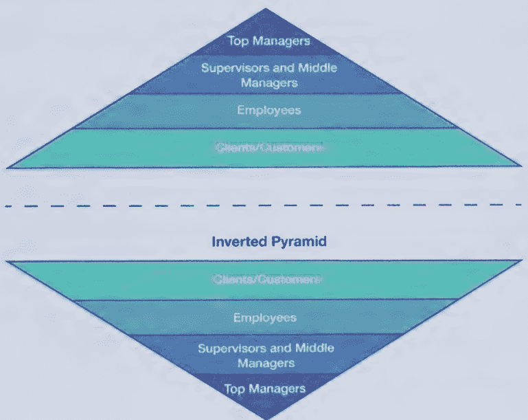
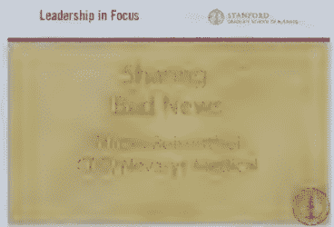
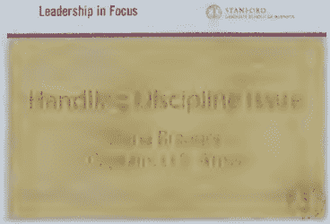
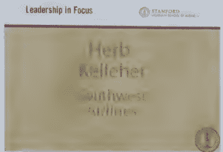
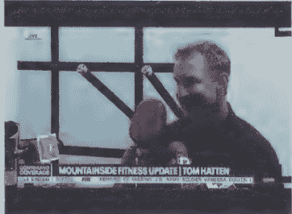

## 道德、伦理与负责任的领导

> “让为你工作的人感到重要。如果你尊重并服务他们，他们就会尊重并服务你。”——玛丽·凯·阿什，玛丽·凯化妆品公司创始人

> “如果你不向人们提供信息，他们就会编造一些东西来填补真空。”——卡拉·奥德尔，奥德尔及其合伙公司总裁

### 学习目标

- 1. 阐述道德与伦理领导的关键原则。
- 2. 比较不同道德发展水平的领导者，以及这些水平对其行为和绩效的影响。
- 3. 从主要的道德发展水平来评估自己。
- 4. 讨论领导者可以采取哪些行动来体现道德与伦理领导。
- 5. 评估可能使道德与伦理领导考虑复杂化的问题类型。
- 6. 思考什么是仆人型领导者，以及它与领导者面临的控制悖论有何关联。

近年来，道德与伦理领导（EML）这一话题的重要性日益凸显。我们经常在媒体上看到各级管理层领导者行为不道德或不负责任的故事。这些人中的一些人付出了沉重的个人代价。例如，安然公司前首席财务官兼首席执行官杰夫·斯基林（Jeff Skilling）因其在那场丑闻中的角色而服刑超过10年。此类个人不仅给自己，也给其组织以及更广泛管理行业的形象带来问题。总体而言，组织领导者（尤其是大公司高层领导者）的公众形象不佳并不令人意外。事实上，公众往往对这些人缺乏信心，并且在很大程度上不信任他们会说实话。

然而，研究表明，存在由拥有更强道德/伦理指南针的领导者引导的组织，这些组织往往能超越竞争对手。这些组织首先通过建立一种强调诸如**程序正义**（即在员工待遇方面建立公平和一致性）等因素的组织氛围来实现这一点。具有这种氛围的组织的特点是决策不受偏见、裙带关系和个人利益的影响。高层领导者是建立和强化这种氛围的人。

**程序正义**
在员工待遇方面建立公平和一致性。

然而，与EML相关的问题和挑战与组织各级领导者都息息相关。对于高层高管而言，这包括制定政策、做出战略决策以及以身作则——所有这些都有助于建立道德氛围。这种氛围体现在低层经理的行为中，对他们来说，EML与树立榜样、执行道德标准、以公开和真诚的方式行事以及避免虐待行为相关。

EML究竟涵盖哪些内容？在表6.1中，我们列出了EML的核心七项原则。它们涉及价值观和信念，以及道德与伦理领导者所采取的行为。以下将详细描述这些原则中的每一项。一个指导性前提是，EML不仅仅关乎领导者脑海中的内容（例如价值观）；它也关乎领导者所做的决策和采取的行动。在本章中牢记这些原则，我们将从以下几个方面组织对EML的讨论：(1) 道德/伦理人，(2) 作为领导者的道德/伦理行动，(3) 责任与问责，(4) 复杂问题。

| # | 原则 |
|---|---|
| 1 | 按照自己（已发展的）关于正义和正当行为的价值观或原则行事 |
| 2 | 言行诚实——具有正直 |
| 3 | 展现勇气，在必要时对抗既定规范或主流舆论 |
| 4 | 以透明的方式真诚行事——例如，公开沟通且不隐瞒重要信息 |
| 5 | 采取措施主动识别道德/伦理问题并执行标准 |
| 6 | 服务他人利益，而非仅仅服务自己——对广泛的利益相关者负责 |
| 7 | 对涉及所有利益相关者的结果承担个人问责 |

### 6.1 道德/伦理人

美国海军陆战队将军詹姆斯·马蒂斯（前美国国防部长）认为：“你不能临时做出道德决策。它必须贯穿你的一生铭记于心。”他还指出：“如果你在道德边线附近奔跑，很可能会越界。你必须指导你自己和团队在道德的中场奔跑。”如果不了解可以称为“道德/伦理人”的基础，就很难思考EML究竟涵盖什么。换句话说，理解什么是道德或伦理领导者，始于对该人道德发展的考量，这触及了道德/伦理人的核心。布鲁斯·李曾说：“知识带给你力量，但品格赢得你尊重。”品格是一个人发展出来的东西，在很大程度上体现在其道德推理中。如表6.2所示，个人的道德发展和推理可能暗示三种可能的水平。

## 表 6.2 道德发展水平

### 第 3 级 -- 后习俗级
- 不一定遵循他人认为的是非对错
- 拥有强烈的、内化的是非对错感
- 倾向于将他人的关切或更大的善置于自身利益之上

### 第 2 级 -- 习俗级
- 屈从于与其有认同感的群体（例如宗教派别、俱乐部、职业等）的期望、义务和规范
- 遵守社会法律

### 第 1 级 -- 前习俗级
- 按照自身利益行事
- 遵守规则或法律以避免惹上麻烦

在**前习俗级**，个人主要关注遵守规则或法律，以避免惩罚或处罚。这些规则和法律可以涉及个人关联的不同实体，例如组织或整个社会。在**习俗级**，个人遵循其认同的群体（例如兄弟会、女联会、俱乐部等）或社会实体（例如宗教派别、文化规范等）。个人也非常倾向于简单地将现有的规则和法律与道德相关联。换句话说，习俗道德发展会认为，合法即道德。**后习俗级**的人遵循表 6.2 中的原则，即按照自己（已发展的）价值观或关于正义与是非的原则行事。处于这一发展水平的人在伦理或道德价值方面独立行事，如果他们感到有必要，后习俗级的人甚至可能违反法律，以追求他们自己对正义、是非对错等的认知。

> **前习俗级**
>
> 个人主要关注遵守规则或法律以避免惩罚或处罚的道德发展水平。

这些不同的层次不应被视为阶段，即个人在其发展中仅处于单一层次。相反，一个人可能主要处于一个层次，同时显示出处于另外两个层次的迹象。例如，一个人在大多数生活领域可能表现出自己处于后习俗级。然而，在诸如个人纳税申报之类的事情上，她可能更习俗级甚至前习俗级，即听从会计师的建议，申报那些虽然可争议但只是其他纳税人常态的扣除（即习俗道德）。或者，她也许使用那些可以在没有任何美国国税局惩罚可能性的情况下申报的扣除（即前习俗道德）。尽管如此，在涉及大多数其他个人或事业的行为中，她大多是后习俗级。另一个例子是，罪犯大多处于前习俗道德水平。但是，对于某些问题（例如，他们遇到的其他罪犯，如儿童掠食者），他们实际上可能表现出关于是非对错的后习俗级思维迹象。

> **习俗级**
>
> 个人遵循其认同的群体（例如兄弟会、女联会、俱乐部等）或社会实体（例如宗教派别、文化规范等）的道德发展水平。

> **后习俗级**
>
> 个人按照自己（已发展的）价值观或关于正义与是非的原则行事的道德发展水平。

在这些不同的发展层次中，习俗级可能是最普遍的，这在生活的许多不同领域以及人们承担的不同角色中都是如此。想想 2008 年和 2009 年的金融危机，以及随后房地产市场引发的后果。许多房主发现自己处于这样的境地：他们的房屋价值远低于抵押贷款欠款。许多房主简单地“弃房逃贷”，即停止向贷款人付款。虽然这些人中的许多在某种程度上意识到这样做是错误的（即第 3 级推理），但他们仍然认定，许多人弃房逃贷却未受到即时惩罚。所以，为什么不随大流呢？这种推理反映了第 1 级或第 2 级推理。

许多领导角色中的人也参与习俗级或第 2 级推理和行为。例如，2005 年，宝洁公司收购了吉列公司。时任吉列首席执行官吉姆·基尔茨最终获得了一份 1.6 亿美元的“金伞”协议。这些协议涉及高管任期开始时的合同，规定如果公司被另一家公司收购且高管的雇佣关系终止，将会发生什么。在吉列的案例中，他最初的雇佣合同中包含一个金伞条款，规定如果他通过另一家公司的收购而被解雇，将获得 1.6 亿美元的补偿。对天真的观察者来说，这似乎是一笔巨款。甚至可能被视为不道德或不公正，因为与所有收购交易一样，吉列至少有一些员工在没有有利遣散费的情况下被解雇。然而，在首席执行官圈子以及许多金融分析师的眼中，这样的金伞协议被视为只是符合首席执行官文化的期望，至少就同样规模公司的首席执行官而言。换句话说，吉列的首席执行官所做的，不过是任何首席执行官在他那个位置上都会做的事。简而言之，他遵循的是习俗道德发展。

上述示例中有两点应当很明显。首先，道德发展至少在一定程度上取决于观察者的视角。有些人视为习俗道德或仅仅是“随大流”的事情，可能被其他人视为不道德。确实，使伦理/道德领导力考量复杂化的一点在于，它在很大程度上取决于观察者的视角。一个人可能视为杰出领导者的人，另一个人可能对他心存疑虑。

其次，习俗道德是一种流动的现象。也就是说，它会随时代而改变。社会、政治和商业领导者最好通过其历史时代的习俗道德来评判，而不是通过当下的时代。例如，当通过 18 世纪的规范和价值观（即习俗道德）来看待时，美国开国元勋可能总体上会被积极地看待。然而，如果通过当今的视角来看待，他们中的一些行为（例如拥有奴隶）肯定会显得可憎且不可原谅。此外，也许在某些方面，社会和各种机构（例如首席执行官和高管管理机构）中习俗道德可能出现当今的粗俗化。换句话说，仅仅“追随由其同龄人组成的人群”的高管，可能越来越成为许多人可能视为不道德或不道德的人。换言之，从伦理/道德角度来看，“新常态”不一定总是一件好事。

我们还应当注意，后习俗道德至少在某种程度上也取决于观察者的视角。例如，在最近的大流行病中，关于疫苗接种和程序（例如各级政府发布的疫苗接种强制令）存在混合意见。有些人可能会认为强制令在道德上是错误的。这些人可能出于他们的是非感而这样做：例如，强制令过度侵犯个人公民自由或自由的观念。此外，持这种观点的人可能会声称，他们试图代表更大的善，而不仅仅是自身利益。话虽如此，光谱的另一端也有人基于他们自己的后习俗道德，为疫苗接种强制令辩护。我们的观点是，由于人们珍视的不同价值观或优先事项，后习俗道德可能有些模糊不清。

那么，在道德发展的这三个层次方面，你个人处于什么水平？要回答这个问题，请完成本章末尾第 4 节中所示的调查。这个工具强迫你在三个选项中做出选择，每个选项对你来说可能都有些真实。但你需要选出最符合你自己的一个，然后是其次符合你的一个，最后是最不符合你的一个。为了使工具准确，重要的是你要根据自己真实的样子来回答，而不是你希望自己是什么样子。换句话说，不要根据你希望看到的自己来回答；要诚实，根据你日常实际的样子来回答。

## 作为领导者的行为

作为领导者，个人可以采取（或不采取）多种行动来展示 EML。我们在此考虑几个关键行动：（1）作为伦理价值观的榜样，（2）展示勇气，（3）执行道德/伦理标准，（4）公开沟通和共享信息，以及（5）避免虐待行为。首先，一般来说的有效领导者，特别是道德领导者，意识到他们始终处于“舞台上”，可以说。所以，其他人都在观察他们的所作所为，或不作为。道德领导者“言行一致”。他们不指望别人去做他们自己不愿意做的事。例如，如果领导者期望销售代表在向客户收取的费用（例如餐饮或差旅费）方面不铺张浪费，那么领导者本人也应实践这种节俭。

其次，道德勇气涉及克服可能涉及道德原则或不确定性的挑战和恐惧的力量。通常，这意味着不随波逐流，并在感知到不道德行为时敢于发声。这对领导者来说显然是一件困难的事。例如，领导者（或任何组织成员）可能会观察到，雇佣、晋升、有利的工作分配等，可能会偏向大多数群体成员。然而，有色人种和不同族裔群体被排除在外。敢于发声并至少提出不公的可能性，可能需要勇气。[9]

第三，与勇气相关的是，EMLs 会做出涉及伦理和伦理违规的决策。具体而言，他们会执行道德标准，即使这可能给领导者带来问题或不受欢迎。因此，领导者在执行伦理违规行为时会保持一致性，同时避免破例。伴随这种一致性，领导者在监测其所处环境中的伦理违规行为时，会表现出“像哨兵一样”的特质。在某些情况下，仅仅采纳“见无恶，闻无恶”的格言可能更容易。然而，EML 的思考和行动方式会不同。同时，伦理领导者应小心不要过分强调采取行动的执行方面。如果过分强调执行，组织内部可能会出现负面后果，例如员工恐惧、缺乏主动性和缺乏风险承担意愿。

乍一看，执行道德标准似乎与以爱领导（见第2章）背道而驰，反而更类似于通过恐惧来领导。但实际上，领导者需要维护和执行道德标准，以造福于整个组织以及个别追随者的根本利益。例如，如果一个追随者持续违反道德标准，仅仅让问题拖下去并没有好处。为了展示“严明的爱”，领导者需要直面问题，甚至可能需要实施纪律程序。

第四，EML 将倾向于开放沟通和共享信息。[10] 担任领导职务的人往往比组织较低层级的其他人更了解某些信息。尽管如此，这些信息可能与这些较低层级人员的个人需求和安全相关。示例包括组织即将进行的重组（例如裁员）、可能影响公司未来的负面信息、公司用于完成工作的技术的重大变革等等。倾向于不进行公开沟通的组织及其领导者可能喜欢使用诸如“仅限知情者”之类的表达，这意味着只有特定个人（即，通常是组织较高层级的人）才应该了解重要信息。公平地说，只有特定人员才应了解某些信息（尤其是涉及组织潜在变革的信息）可能有合理的理由。具体而言，如果某些信息（例如即将进行的裁员）被公开宣布，可能会引发广泛恐慌的担忧。话虽如此，EML 会尽可能通过在可能的情况下共享信息来保持开放。通过这样做，他或她将是以爱而非恐惧来领导。

简而言之，其思想是尽量避免幽默地被称为“蘑菇式领导”的做法：“让他们待在黑暗中，喂他们一堆废话，并希望他们能够茁壮成长并富有成效。”问题在于，作为领导者，避免成为“蘑菇农场主”并不容易。共享或不共享信息可能导致的两难困境示例，可以在本章末尾第5节的案例中看到。

作为开放沟通者共享信息，与表6.2中关于真诚言行或拥有诚信的原则相关。事实上，当被问及理想领导者的品质时，人们往往首先考虑的是诚信。真诚言行既包括作为也包括不作为。当领导者公开撒谎时，该人正在实施作为；当领导者未能传递与他人利益相关的信息时，该领导者正在实施不作为。无论哪种情况，领导者的诚信都会受到质疑。

第五，EMLs 试图避免虐待或剥削性行为。虐待行为涉及主管表现出敌对的言语和非言语行为的程度，不包括身体接触。据估计，虐待型领导的负面影响每年高达 23.8 亿美元，包括增加员工医疗费用、缺勤和生产力下降。[1] 重要的是要注意，虐待行为可以是公开嘲弄下属等公开形式的行为。然而，它也可以是不那么公开（或被动攻击性）的形式，例如忽视下属或给予下属“冷暴力”。[2] 无论如何，我们将此类行为视为最好是不当的，最坏是不道德的。

虐待行为与通过恐惧领导（而非以爱领导）的问题相关，我们在第2章中考虑过这一点。虐待行为会引发恐惧，进而导致一系列负面副作用，例如缺乏创新、人们不愿就问题发声，以及人们不愿意承担风险。有人可能会认为，通过执行道德标准，领导者可能会引发恐惧。另一方面，如果标准以公正和仁慈的方式执行，则很可能被视为合理的“严明的爱”，而非虐待行为。

## 关于道德/伦理领导的其他注意事项：一些令人困扰的问题

EML 可能会因一些棘手的问题而变得复杂。我们在此考虑其中的一些问题。

- 1. **道德/伦理领导是否涉及普适的价值观和行为，还是特定于某个情境（例如文化情境）？**

### 普遍主义 versus 相对主义

这涉及领导者是否相信存在可以跨情境应用于其行为的道德价值观/原则，还是此类行为取决于情境。

**普遍主义 versus 相对主义** 的概念涉及领导者是否相信存在可以跨情境应用于其行为的道德价值观/原则，还是此类行为取决于情境。例如，领导者是否应始终选择说实话（即普遍主义），或者是否存在领导者应“歪曲”或“包装”真相以最好地服务于组织需求的情境（即相对主义）？至少在美国，研究实际上表明，具有更多普遍主义价值观、信念和行为的领导者往往比相对主义者被视为更具道德性。[3]

另一方面，在跨文化情境中，普遍主义和相对主义的问题对领导者来说可能变得棘手。以贿赂为例。在各种文化情境中，贿赂传统上被视为一种正常的商业方式。它可以发生在商业伙伴之间、商业与政府代表之间等等。然而，在其他情境中，贿赂会被认为既违法又不道德。作为另一个例子，饮酒的使用，尤其是在商务情境中，可能会有所不同。在某些西方情境中，在商务过程中，少量或“社交性”饮酒可能被视为合适。但在某些东方文化情境中，更过量的饮酒很常见。我们将在更详细地考虑跨文化情境对领导的影响在第10章。

- 2. 谁来决定什么是“道德的”或“伦理的”？例如，在一个世俗社会（如美国）中，宗教在确定组织中如何实践道德/伦理领导方面应该扮演什么角色，或者在法律上可以扮演什么角色？

这些是棘手的问题，在美国，宗教有时确实会与领导和组织实践相关的问题交织在一起。在这方面备受关注的公司包括 Chick-fil-A 和 Hobby Lobby。鉴于美国法律，Chick-fil-A 的原始创始人 S. Truett Cathy 有权根据他所称的“圣经原则”领导他的公司。例如，他有权不在周日开店。与此同时，Chick-fil-A 必须按照美国法律运营，这些法律在很大程度上性质更为世俗。例如，根据平等就业机会法律，该公司在招聘和晋升方面不能基于宗教进行歧视。归根结底，在确定如何实际实践 EML 时，在宗教自由和世俗社会之间存在着一条需要小心走好的钢丝。

- 3. 在组织环境中成为一名道德/伦理领导者，是否有必要让领导者也在其个人生活或个人言论中展示道德和道德？谁来决定个人生活中什么是“道德的”或“伦理的”？

让我们以一位中年领导职位的男士为例。假设这位领导在工作环境中对待员工、客户等方面表现得非常道德或道德。但在他的个人生活中，尽管他已婚，他却喜欢“狂欢”并追求年轻女性（甚至年轻男性）的欢心。这种行为是否会让我们无法将此人视为 EML？或者，该人在个人生活中的行为是否不影响我们是否（或应该）将他视为在基于工作的领导角色中具有道德/伦理性？一些组织实际上试图将此作为诉讼问题，迫使员工签署合同，规定他们不会在工作环境之外从事可能以某种方式使雇佣公司难堪的活动。当然，什么可能被视为对公司的合法难堪，与个人在工作之外按自己选择行为的权利相比，往往并不完全清楚。

### 6.2 负责任且可问责的领导

如表6.1所示，道德/伦理领导的一个重要要素在于服务他人的利益，而不仅仅是服务于个人自身利益。换言之，EML 涉及对他人负责。对于组织领导者而言，这些他人可以包括一系列人员和实体，包括追随者、所有者或股东、客户，以及更广泛的社区或社会。此处的关键术语是“可以包括”。领导者在确定其将承认并对之承担责任的“他人”的范围和性质时，可能存在差异。

## 仆人式领导

### 仆人式领导

领导者通过承担仆人的角色，向他人（尤其是追随者）展示责任，具体方式包括指导他人、提供必要的工具和信息、帮助他人发展，并关心他们的福祉。

领导者向他人展示责任，并以爱领导的一种方式，就是该领导者承担仆人的角色。**仆人式领导**在领导者与追随者的关系中表现得最为清晰。它为领导者展示对他人责任提供了一种机制。在追随者的具体情形下，这意味着指导追随者、提供必要的工具和信息、帮助追随者发展，并关心他们的福祉。[14]

正如 Mary Kay 化妆品创始人 Mary Kay Ash 所说：“让为你工作的人感到自己很重要。如果你尊重和服务他们，他们也会尊重和服务你。”当承担这一角色时，领导者将帮助追随者成长和发展，并处理追随者可能 otherwise 无法处理的问题（与工作相关，甚至可能是个人问题）。图 6.1 展示了仆人式领导与传统自上而下结构的对比。在图 6.1 的顶部，我们可以看到传统的金字塔式自上而下组织。专制领导是与这种结构最可能相关的主要领导模式。可能会对客户或客户群口头表示重视，但在许多此类组织中，客户/客户群似乎真的处于层级结构的底部。相比之下，图的底部展示了如何将这种结构颠倒过来，成为一个倒置金字塔，其中员工和客户/客户群位于金字塔的顶部。

**图 6.1 传统与倒置金字塔结构**

仆人式领导仅仅是“空中楼阁”吗？或者说，它能在组织中实际实施吗？怀疑者可能会指出，鉴于短期生产力或业务需求、劳动力的性质以及组织中常见的金字塔结构，仆人式领导并不真正现实。换句话说，他们可能会争辩说，短期需求和大体上不负责任（甚至懒惰）的劳动力排除了对仆人式领导的任何认真考虑。我们认为，仆人式领导可以在组织中发挥作用，但前提是传统的金字塔结构和倒置金字塔结构能够找到融合的方式。换句话说，我们认识到大多数组织都会有一个正式的金字塔结构。但某些组织还能够在日常工作中，同时将一个更非正式的倒置金字塔结构融入其文化中。

## 不负责任的公司及其领导人

- AIG 首席执行官因奖金引发争议
  https://www.huffpost.com/entry/aig-bonuses-benmosche-deep-south_n_3981911
- 大众首席执行官因“严重危机”辞职
  https://money.cnn.com/2015/09/23/news/companies/volkswagen-emissions-crisis/
- 大众前首席执行官 Martin Winterkorn 因柴油排放作弊案被控欺诈和共谋
  https://www.forbes.com/sites/joannmuller/2018/05/03/vws-former-ceo-martin-winterkorn-charged-with-fraud-and-conspiracy-in-diesel-cheating-case/?sh=6ae7e6ac4e90

要同时应对图 6.1 中所示的传统金字塔结构以及倒置金字塔结构，领导者面临着控制悖论（我们在第 2 章中也提到过）。该悖论在实践中的例子：

- 在保持对局势整体控制的同时，向追随者提供自主权；
- 强调工作应如何完成的一致性，同时允许例外；明确告诉追随者事情应如何完成，但同时不吹毛求疵或微观管理；
- 对追随者提出高要求，但同时也允许他们犯错；以及
- 从整体上看，认识到保持控制的最佳方式是放弃控制。

如果领导者能够同时处理这些看似对立的行为，他们就能有效地处理控制悖论，并展现出仆人式领导。西南航空公司就是一个例子。像大多数组织一样，西南航空公司设有传统的金字塔结构，包括员工、低级经理和高级经理。因此，从正式意义上说，像其他组织一样，低级员工向高级经理汇报。但同时，它拥有仆人式领导文化。作为该公司悖论在实践中体现的一个例子，虽然经理们强调高客户服务要求，但追随者在如何服务客户方面拥有余地。此外，只要员工试图满足客户的需求，就容忍错误。从这个悖论的真正意义上讲，管理层能够通过放弃控制来获得控制。

## 负责任的领导取向

特别是在高层领导中，高管们越来越多地处理与企业社会责任（CSR）相关的问题。CSR 本质上涉及企业为推进某种社会公益，或默许其推广所采取的行动，这些行动超出了企业及其股东的直接受托利益，也超出了法律要求的范围。此类行动可能导致公司在其产品或服务中体现社会责任属性（例如，使用有机成分、不对产品进行动物测试，以及提供安全的产品或服务）。还应注意，“社会公益”可能涉及一系列可能的利益相关者，包括员工、供应商和社区团体（例如，慈善机构）。关于 CSR 政策和行动的选择，包括各利益相关者利益将得到处理的程度和方式，掌握在企业领导者手中。也就是说，不同的企业将追求不同的 CSR 路径。这些路径取决于领导者做出的选择，而这些选择又取决于他们的个人责任取向。

在考虑这些取向之前，首先反思 CSR 为何以及如何与领导者、其政策和决策相关是很重要的。首先，也许最重要的是，CSR 可以提升企业的收入，因为消费者对“绿色”产品和服务、慈善企业等有需求。如果企业的 CSR 声誉良好，甚至可能能够为其产品和服务收取溢价。其次，领导者可以将 CSR 用作表达自身服务他人和社会价值的方式。换句话说，一些领导者可能将 CSR 视为一种载体或机制，通过它他们可以实现自己的价值观。

第三，除了与领导者和 CSR 相关的责任感之外，区分问责感也很重要。领导者可能感到有义务尝试服务于一个或多个利益相关者群体的利益。我们称之为责任感。但在另一方面，领导者可能也可能不会对自己所承担责任的利益相关者群体所关联的绩效结果承担个人责任。确实，如果领导者真正感到一种问责感，在绩效不佳的情况下，领导者将接受负面的个人后果，并尝试通过纠正利益相关者所经历的负面结果来弥补。

考虑客户服务主管的例子。该人员可能感到有责任服务于客户的需求。然而，为了也展示问责，当客户的需求得不到满足时，该人员需要接受责备，而不是责备他人（例如，她的下属）。此外，该人员会通过采取措施确保客户的问题得到解决来展示问责。但是，再次说明，如上所述，责任感不一定等同于问责感。领导者可能对某个特定的利益相关者群体感到有责任，但同时，可能并不真正拥有针对这些利益相关者的积极成果要求自己负责的问责感。

带着这些问题，我们看到领导者可能拥有三种主要的取向：（a）传统经济学家，（b）机会寻求者，和（c）整合者。[8] 传统经济学家取向核心在于相信，企业及其领导者应仅对企业的一个狭义组成部分负责，即所有者或股东。这种取向实际上是 CSR 的一种非常防御性的方法，其特征是领导者相信，尽管可能存在受托优势，CSR 计划和举措可能成本高昂，因此通常不应采取。一种可能的例外是，在归因于企业的环境或消费者灾难之后恢复企业的声誉。在下面的视频中，Kevin O'Leary 展示了传统经济学家责任取向的一个有趣示例。

## 比尔·克林顿的大胆商业预测

前总统比尔·克林顿预测，未来美国企业将更加关心员工和客户，而非股东。收盘钟声小组对此进行了评论。

http://video.cnbc.com/gallery/?video=3000313195#

机会寻求者取向涉及认识到一系列利益相关者的关切，包括所有者或股东之外的利益相关者。因此，尽管机会寻求者可能对至少一些其他利益相关者群体（例如，员工）感到相当广泛的责任感，但他或她仅对所有者或股东感到一种问责感。这种较为狭窄的问责感也为传统经济学家取向所共享。对于机会寻求者，采取 CSR 举措出于两个关键原因：（1）道德信号传递，（2）所有者或股东的受托利益。当领导者进行道德信号传递时，有一

公开表达的观点、意见或情绪，旨在展示领导者、其公司或两者的良好品格。因此，作为一种塑造形象的机制，领导者利用 CSR 举措，尽管这些举措的真实性和后续行动可能有缺失。换句话说，美德通过领导者的修辞来传递，但实际行动可能不会跟进。第二，机会型寻求者在实际将支出定向到 CSR 举措之前，试图为公司获得明确的受托责任利益保证。因此，成本效益分析被仔细考虑。

第三，整合型导向涉及领导者广泛的责任感和问责意识。这类领导者很可能根据本章前文所述的后传统道德来定义。他们不进行美德信号传递，而是出于对广泛利益相关者的真正关切而参与 CSR 举措。此外，他们不纠结于 CSR 的成本效益问题，而是意识到这种“分析性瘫痪”可能只会导致不行动，以及自身缺乏问责。作为机会型寻求者与整合型导向的示例，假设上文 Gillette 案例中描述的收购和金色降落伞情景。机会型寻求者可能会对员工产生责任感，并采取行动服务于员工利益（例如，更好的工作条件），尤其是当这些行动带来的成果有利于公司时，例如提高生产力。但在收购及相关员工安置的情况下，机会型寻求者对这些员工几乎感受不到任何问责责任。另一方面，整合者可能会通过个人承担责任，例如，提供其金色降落伞方案的一部分来帮助这些被安置的员工。领导圈中的近期运动，例如被称为自觉资本主义的运动，都指出，如果公众要对我们的资本主义制度保持信心，就需要整合型导向。[107] Howard Schultz，星巴克的创始人，在下方引用的视频中展示了他的整合型导向。

### Howard Schultz：整合型导向

首席执行官 Howard Schultz 描述了星巴克为其所有员工支付大学学费的计划，并探讨了大企业的人性面。
https://www.cc.com/video/4lqlz1/the-daily-show-with-jon-stewart-howard-schultz

不幸的是，组织高管队伍中整合者太少。近年来，许多商业领袖似乎缺乏适当的责任感和问责意识。例如，在回应有关 AIG 高管所获奖金（AIG 是 2008–2009 年金融危机后获得政府救助的公司）的批评时，请考虑 AIG 首席执行官 Robert Benmosche 的以下引语：“这些批评旨在煽动公众愤怒，让每个人都拿着镰刀和绞索冲出来，诸如此类——有点像我们在[几十年前]的深南部所做的事。我认为这同样糟糕，同样错误。”[108] 这段引语令人担忧，原因有多个。例如，它将无辜者被暴民绞死与高管可能拿不到数百万美元奖金的情况视为道德等同。此外，它缺乏对美国纳税人的责任感和问责意识，救助资金正是由纳税人提供，用于支付此类奖金。另一个示例，请考虑大众汽车首席执行官（Martin Winterkorn）的以下引语，他在排放测试造假丑闻公开后辞职：“我这样做是出于公司的利益，尽管我不知道自己有任何不当行为。”[109] 本质上，这位首席执行官通过辞职采取了非常有限的问责态度，但实际上并未承认个人对大众汽车发生的事件负有责任。

第 6 节包含一个案例研究，涉及本章中强调的多个概念。该案例涉及亚利桑那州凤凰城地区 Mountainside Fitness 的创始人 Tom Hatten。Tom Hatten 如何展示本章所讨论的道德、合乎道德和负责任的领导力品质？

## 本章的视频案例

本章的总结性视频案例和事件视频案例涵盖了一系列与道德、合乎道德和负责任的领导力相关的主题。这些问题涉及信息共享、执行道德标准以及充当仆人式领导者。视频案例中展示了组织各个层级的领导者。在很大程度上，这些视频案例说明了领导者在进行道德/合乎道德/负责任的决策和行动时，经常面临的相互竞争的需求或压力。

### Debra Reisenthal——分享坏消息

Debra Reisenthal 是一家小型医疗器械公司的首席执行官，她正为是否应向员工分享有关美国食品药品监督管理局未批准该公司开发的女性尿失禁设备的信息而苦恼。该设备对公司的可持续发展至关重要，政府的这一行为可能导致公司大规模裁员。

在在线阅读器中查看

### Dena Braeger——破例处理

在此视频中，美国陆军指挥官（或上尉）Dena Braeger 描述了一种情境，她正在争论是否应当执行一项基于伦理的标准，该标准被她手下一名原本表现出色的士兵违反了。

在在线阅读器中查看

### Herb Kelleher——愿景、价值观与文化

在此总结性视频中，西南航空的传奇创始人 Herb Kelleher 阐述了他对仆人式领导重要性的看法。

在在线阅读器中查看

## 结论

道德、合乎道德和负责任的领导力形式显然非常重要，也是领导者、追随者以及整个社会关注的焦点。正如本章所见，与这些领导力方面相关的问题既复杂，有时也不够明确。领导者可以采取多种行动来展示这种领导力。但与此同时，领导者需要做出选择，这些选择最终将塑造其在工作场所中的道德、合乎道德和责任方式。总体而言，这一话题在未来几年可能变得更加重要。

### 6.3 讨论问题

- 1. 在第 4 节中，你会找到标有“行为规范与价值观调查”的内容。完成此调查。对各项进行排名时，请尽量根据你日常行为的实际情况来回答，而不是你希望成为的样子。请注意，你将获得三个得分，每个栏目一个（即 Level 1、Level 2 和 Level 3）。阅读评分解释，然后将你的得分与本章前文关于道德发展水平的说明进行比较（例如，见表 6.2）。你个人在 Levels 1–3 方面表现如何，你认为自己为什么会得这样的分？

- 2. 正如第 5 节案例所示，信息共享是道德和合乎道德领导力的重要原则（另见表 6.1）。另一方面，在现实世界中，信息共享对领导者来说可能非常困难或具有挑战性。如前所述的案例所示，为什么信息共享往往是领导者的两难困境？

- 3. 本章第 6 节展示了 Tom Hatten 和 Mountainside Fitness 的案例。你如何评价 Tom Hatten 作为一位道德/合乎道德/负责任的领导者，以及理由是什么？请注意，后面有两个视频链接（在他的第一次法庭裁决之前和第二次法庭裁决之后）。第一个视频的前几分钟和第二个视频的全部内容，结合本

本周的讲座和阅读材料，将帮助你解决这个问题。此外，Hatten如何体现本书第2章中讨论的一个或多个领导特质？

## 汤姆·哈顿 – 山麓健身中心

在在线阅读器中查看

- 4. 仆人式领导的悖论究竟是指什么？
- 5. 对于高管而言，在成为“负责任”的领导者方面，如何区分“机会寻求者”和“整合者”，这为何重要？

### 6.4 附录A：行为规范与价值观调查

### 量表

- 1 = 最符合我的情况
- 2 = 第二符合我的情况
- 3 = 最不符合我的情况

| | |
|---|---|
| **请使用上述量表回答第1–3题。** | |
| 1. [ ] 我日常的行为和人生选择反映了我自己在内心中认真（且经常）思考过的更大的道德目标或一套价值观。 | |
| 2. [ ] 至少在某种程度上，我遵守规则或法律以避免惹上麻烦。 | |
| 3. [ ] 我倾向于追随我所属或认同的群体或组织[例如，种族群体、宗教、商业组织等]的道德信念和规范。 | |
| **请使用上述量表回答第4–6题。** | |
| 4. [ ] 很大程度上，我努力在做“正确”的事或避免做“错误”的事方面满足他人的期望。 | |
| 5. [ ] 我始终将公共利益和他人（超出家庭范围）的关切置于我自身利益甚至家庭利益之上。 | |
| 6. [ ] 在很大程度上，我服从权威人士的意愿，因为最好是接受权威，而不是承受反抗的后果。 | |
| **请使用上述量表回答第7–9题。** | |
| 7. [ ] 大部分时候，我关注照顾好自己和我的家人，即使这意味着有时在做“正确”的事上会走捷径。 | |
| 8. [ ] 我经常公开反对我在组织或整个社会中观察到的不公正或其他道德错误——即使公开发声会让我面临个人风险。 | |
| 9. [ ] 如果其他人能够从“系统”中获益或“利用”系统，我会尝试做同样的事，而不是被甩在后面成为“冤大头”。 | |
| **请使用上述量表回答第10–12题。** | |
| 10. [ ] 我总是做“正确”的事，即使对我重要的其他人（例如，我的老板、同事、同学、家人等）不做“正确”的事。 | |
| 11. [ ] 一般来说，只要能避免惹上麻烦，我会做大多数需要做的事情来实现我的目标。 | |
| 12. [ ] 如果我认真想想，我通常会追随我所关联的群体或组织的规范，而不会仔细考虑那些规范是“正确”还是“错误”。 | |

### 评分

将下列各项的分数相加，如下所示：

| 第1水平（习前） | 第2水平（习俗） | 第3水平（后习俗） |
|---|---|---|
| 2 | 3 | 1 |
| 6 | 4 | 5 |
| 7 | 9 | 8 |
| 11 | 12 | 10 |

例如，如果第2、6、7和11项的得分都为1，则你的第1水平总分将等于4。请注意，每一列或每个水平的可能得分范围为4–12，且所有三列的总和应为24。对于每一列：

- * 得分4–6 = 该水平非常强
- * 得分7–9 = 该水平中等
- * 得分10–12 = 该水平较弱

### 6.5 附录B：和谐公司的信息共享（或不共享）

和谐公司（虚构名称）是一种日益增长的天然加工食品产品线的生产商和分销商。该公司以在生产中使用全天然成分并尽量减少加工来制作食物而自豪。他们的食品大多包括包装或瓶装物品，例如谷物、薯片、饼干、花生酱和果酱以及果汁。他们的产品主要在美国各地的天然食品商店和杂货店销售，最近还扩展到了加拿大和欧洲。

该公司雇佣约1000名员工，其设施位于美国西南部地区。该公司30年前由四位合伙人创立，至今仍是一家私营公司，此前曾抵制公开上市的机会。创始合伙人坚信尊重自然环境、帮助流浪汉（例如捐赠公司产品）以及为员工维持健康的工作环境。此外，他们还提供了良好的医疗保健福利、优厚的退休福利、为员工子女提供日托服务以及员工工作保障。管理层认为，这些政策和做法已经形成了一支敬业且忠诚的员工队伍。

该公司实现了强劲的销售增长，尤其是近年来，随着健康意识消费者需求的增加。此外，利润也很强劲，这在很大程度上归功于公司员工的效率和创新理念。管理层还考虑将产品线扩展到易腐食品、化妆品等领域。此外，还计划直接与一家专门经营天然食品的杂货店连锁合作，生产带有该连锁店标签的产品。总的来说，和谐公司的未来前景光明。另一方面，所有合伙人都快到退休年龄，且没有家庭成员准备接手公司。

### 收购提案

近日，Dynamic Foods, Inc.（虚构名称）的官员以收购提案接近了和谐公司的创始合伙人。Dynamic Foods是一家总部位于伊利诺伊州芝加哥的大型上市食品加工公司。它注意到市场向天然加工食品发展的趋势，并希望在此市场占据一席之地。因此，收购和谐公司似乎颇具吸引力。此外，Dynamic Foods将能够获得关于天然食品加工的技术知识，这些知识甚至可以转移到其主营业务的食品加工中。

和谐公司的合伙人对最初的提案颇感兴趣。如上所述，他们都最近在考虑退休，Dynamic Foods, Inc.的报价似乎非常有前景。看来经过一些努力，可能会达成一项交易。确实，两家公司正越来越接近达成一项初步协议，交易达成的可能性相当大。

Dynamic Foods, Inc.过去曾因其他收购交易而启动重组和裁员。因此，如果发生收购，它可能会利用和谐公司的资源来寻找改善其盈利能力的方法，即使这意味着裁员和解雇。作为交易中的收购方，他们随后如何管理目标公司（即和谐公司）将由Dynamic Foods, Inc.决定，而不是由和谐公司决定。确实，如果发生收购，和谐公司很可能会出现大规模裁员。

合伙人之间对于如何就Dynamic Foods, Inc.的提案与员工和其他人分享信息存在分歧。其中几位合伙人认为，谨慎的做法是不泄露任何信息。换句话说，和谐公司的这些合伙人希望将即将发生的收购消息对员工和媒体保密。他们的想法是，如果员工知道即将达成的交易，他们可能会大声抗议，谈论他们的恐惧以及对自身和社区的潜在负面影响。此外，他们可能会向当地媒体投诉，试图传播他们的不满。尽管员工在过去受到了良好的对待，但被Dynamic Foods收购的可能性甚至可能引发工作放缓或破坏公司设施。此类员工负面行为的结果是，最终达成交易可能会变得困难甚至不可能。

相比之下，对于其他合伙人来说，谨慎的做法是向员工披露即将达成的交易的信息，目的是让他们了解情况，了解他们对相关替代方案的意见，并保持积极的士气。毕竟，这种行为更符合该公司在过去开展员工关系的方式。

### 即将召开的会议

虽然你们公司没有工会，但一位合伙人每周与员工代表会面，讨论员工关切和管理层的新计划。合伙人和基层经理通常认为，这种主动的员工关系方式使员工没有寻求工会代表。最近，员工代表为本周的会议向该合伙人发送了一封电子邮件。在这封信中，他表示，他听说工厂里Dynamic Foods, Inc.的访客最近参观了公司场地并参观了工厂。他只是想知道此次访问是怎么回事，并且表示希望将此事列为本周会议的首要议程。在会议中，他肯定会问一些尖锐的问题。

想象你正在扮演即将与员工代表开会的这位合伙人的角色。同时，想象代表在会议开始时问道：“Dynamic Foods, Inc.代表的此次访问是否意味着和谐公司的合伙人可能正在考虑出售公司？”请考虑以下问题。

- 1. 你认为应该向代表透露哪些信息（如果有的话）？
- 2. 你将如何报告该信息（即，你会使用哪些具体措辞）？
- 3. 你对待该代表的方法有哪些利弊？

注意，在回答这些问题时，不要假设存在任何本身要求你对员工代表保密的法律义务。但也要假设，你向这个人报告的任何信息都可能迅速传播给员工。正如俗话所说，“人们会议论……”

### 6.6 附录 C：山景健身（大流行病背景下创业领导力的一个案例研究）

> “谁能想到你只凭一条小毛巾和一个大梦想就能创建一家公司？”——汤姆·哈滕，山景健身创始人兼首席执行官

汤姆·哈滕在1991年于亚利桑那州立大学就读大三期间，于凤凰城地区创立了山景健身。在越来越受“企业”健身连锁（如 LA Fitness、Lifetime Fitness 等）主导的市场中，哈滕的基本理念是让他的健身房对会员更友好、更贴心。他的第一家健身房位于阿瓦图基。作为他领导力和客户服务方法的一个例子，他通过提供免费毛巾来表达对会员的感谢，并且每月在俱乐部举办包含披萨、啤酒和软饮的社交活动。到2020年春季，山景健身已发展到十八家分店和超过90,000名会员。哈滕最近撰写了一本关于其业务演变的自传，书名为 *永远梦想*。

## 2020年大流行病

2020年3月中旬，COVID-19 病毒大流行在全球爆发。在美国，被认定为“必要”的企业（如杂货店）获政府行政命令允许继续营业。然而，其他被认定为“非必要”的企业被迫关闭。健身房和健身俱乐部属于后一类企业。这一分类从一开始就引起争议，因为健身房和健身俱乐部显然有助于会员的身心健康，从而可能使人们不易感染 COVID-19 或其他疾病。确实，全国各地的一些健身房业主曾强烈抗议关闭其业务。

为遵守亚利桑那州州长杜西的行政命令，山景健身关闭了运营，并将大部分员工停薪留职近两个月。到2020年5月中旬，亚利桑那州州长办公室允许健身房和健身俱乐部重新开放，但仅限于遵守美国疾病控制与预防中心（CDC）制定的社交距离指导方针。山景健身勤勉地试图遵守这些指导方针，并重新开放了其设施。然而，到2020年6月底，亚利桑那州的 COVID-19 病例数似乎在“激增”。不清楚病例数增加的原因，但这可能归因于多种因素，例如增加检测以发现现有病例。尽管病例数增加，医院 ICU 仍未接近最大容量，而对 ICU 容量的担忧最初正是关闭“非必要”企业的关键原因。

为应对病例“激增”，2020年6月29日下午约3点，州长道格·杜西下令针对包括健身房/健身俱乐部、酒吧、电影院和水上乐园在内的特定行业，当晚8点前恢复关闭。该命令预计至少持续到2020年7月27日。汤姆·哈滕最初决定忽略新的行政命令，继续营业。这导致其设施被多次开出各2,500美元的罚单，并且哈滕面临被捕的可能性。

哈滕立即起诉州长办公室，试图获得针对行政命令的禁令。他举行了一场新闻发布会，解释自己的行为。然而，在2020年7月7日（星期二），亚利桑那州巡回法院作出不利于他的裁决，决定不推翻州长的行政命令。当天，哈滕宣布他将遵守法院的决定，并于下午2点前停止运营。他还宣布，至少到2020年7月27日，他将继续支付员工工资。

但与此同时，哈滕向亚利桑那州上诉法院提起上诉。2020年8月4日，该法院作出如下裁决：“行政命令（按其实施方式）违反了程序正当法律程序……健身中心必须获得及时机会申请重新开放。该流程必须在本命令生效之日起一周内建立。”本质上，哈滕赢得了诉讼，他随即宣布将于一周后，即2020年8月11日重新开放其健身房。但实际上，截至2020年8月12日，由于州长办公室缺乏明确指导方针，他尚未重新开放。哈滕在接受当地新闻台采访时描述了自己的情况。

2020年8月12日之后，在一份新的法庭文件中，哈滕似乎超越了其自身组织甚至其所属行业（健身俱乐部），承担起更广泛的事业。具体来说，他说：“我们最终是正确的，我想我代表所有小企业主发言，无论是健身俱乐部、水上乐园还是其他企业。以新冠病毒为名滥用职权、对小企业所为的事必须停止。我们当然都了解病毒的严重性，但我们都必须被允许共同前进并保持企业运营。否则，我们将继续看到企业倒闭，整个行业被消灭。”

## 尾注

- 1. 参见 Colvin, G. 2003. Corporate crooks are not all created equal. Fortune, 27: 64.
- 2. http://www.harrisinteractive.com/vault/Harris-Interactive-Poll-Research-FT-2009-Business-leaders-4.pdf
- 3. 关于对高管不信任的更多信息，请参阅 Shahi, G. K., & Sully de Luque, M. 2014. Antecedents of responsible leader behavior: A research synthesis, conceptual framework, and agenda for future research. The Academy of Management Perspectives, 28(3): 235–254.
- 4. 参见 Shin, Y., Sung, S., Choi, J., & Kim, M. (2014). Top management ethical leadership and firm performance: Mediating role of ethical and procedural justice climate. Journal of Business Ethics, 129, DOI: 10.1007/s10551-014-2144-5.
- 5. 参见 Shin 等人 (2014)。
- 6. 关于伦理/道德领导力领域的综述，请参阅：Brown, M. E., & Treviño, L. K. 2006. Ethical leadership: A review and future directions. The Leadership Quarterly, 17: 595–616.
- 7. 个人通信。
- 8. 参见 Kohlberg 的研究，例如 Kohlberg, L. 1976. Moral stages and moralization: The cognitive-developmental approach. In T. Lickona (ed.), Moral development and behavior: Theory, research, and social issues, pp. 31–53. Austin, TX: Holt, Rinehart, and Winston.
- 9. 这并不是说这种公开表态可能会因考虑语境而有所缓和。也就是说，有效的 EML 始终会考虑其发表关于对错行为看法的语境。例如，如果一位领导在可能会让雇主在同行或选民面前难堪的语境中公开反对某项被认为的不公，这种行为可能不被视为道德勇气的良好示范。
- 10. 关于开放沟通和信息保密的广泛讨论可参见：Atwater, L. E., & Waldman, D. A. 2008. Leadership, feedback and the open communication gap. New York: Lawrence Erlbaum Associates.
- 11. 参见 Tepper, B. J., Duffy, M. K., Henle, C. A., & Lambert, L. S. (2006). Procedural injustice, victim precipitation, and abusive supervision. Personnel Psychology, 59, 101–123.
- 12. 参见 Aryee, S., Chen, Z. X., Sun, L. Y., & Debrah, Y. A. (2007). Antecedents and outcomes of abusive supervision: test of a trickle-down model. Journal of Applied Psychology, 92, 191–201.
- 13. 相对主义的一个问题是，这种领导者可能被视为虚伪或缺乏一致标准——这两者都不鼓舞人心。参见 Waldman, D. A., Wang, D., Hannah, S. T., & Balthazard, P. A. (2017). A neurobiological and ideological perspective of ethical leadership. Academy of Management Journal, 60, 1285–1306. DOI: 10.5465/amj.2014.0644
- 14. 关于仆人式领导力的更多信息，请参见 Liden, R. C., Wayne, S. J., Zhao, H., & Henderson, D. (2008). Servant leadership development: a multidimensional measure and multi-level assessment. The Leadership Quarterly, 19, 161–177.
- 15. 该定义源自 Waldman, D. A., Siegel, D., & Javidan, M. 2006. Components of transformational leadership and corporate social responsibility. Journal of Management Studies, 43: 1703–1725.
- 16. 我们对这些不同取向的考察基于 Fiess, N. M., Maak, T., & Waldman, D. A. 2012. Different approaches towards doing the right thing: Mapping the responsibility orientations of leaders. Academy of Management Perspectives, 26(4): 51–65 所提供的分类。
- 17. 参见 http://www.consciouscapitalism.org/.
- 18. 参见 http://www.huffingtonpost.com/2013/09/24/aig-bonuses-ben-mosche-deep-so-th_n_3981911.html.
- 19. 参见 http://money.cnn.com/2015/09/23/news/companies/volkswagen-emissions-crisis.

