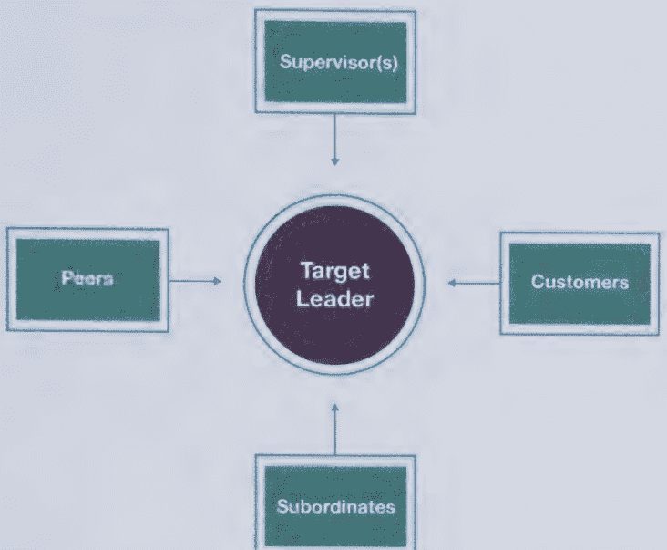
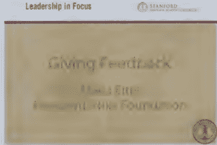
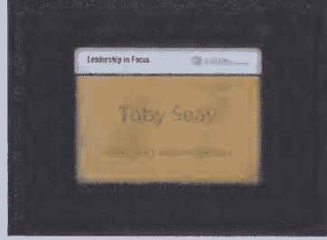

## 寻求、接收和提供反馈

> "人们渴望的东西比性爱和金钱更多的有两样东西……认可和赞扬。你遇到的每个人脖子上都挂着一块牌子，上面写着‘让我觉得自己很重要。’如果你能做到这一点，你不仅在商业上会成功，在生活中也会成功。”——玛丽·凯·阿什，玛丽·凯化妆品公司创始人

> "我们周围的高科技越多，就越需要人性化的关怀。”——约翰·尼斯比特，《大趋势》作者

> "积极强化的实施方式比强化的数量更重要。”——B.F.斯金纳，作者兼心理学家

### 学习目标

- 1. 阐明作为领导者不仅要提供反馈，还要寻求和接收反馈的重要性。
- 2. 在领导者角色中识别并运用有效倾听的要素。
- 3. 描述有效提供反馈的主要挑战。
- 4. 解释并演示一对一辅导的步骤。
- 5. 总结360度反馈作为反馈接收和辅导机制的价值与用途。

玛丽·凯·阿什，玛丽·凯化妆品公司创始人，堪称一位杰出的领导者。她在上述引语中绝对说到了点子上，强调了领导者作为反馈提供者的重要作用，尤其是作为提供积极强化的一种手段。但反馈不是单行道。领导者寻求并适当接收反馈同样重要。反馈的这三个方面——寻求、接收和提供——都可能给领导者带来挑战。例如，如果领导者不能适当提供反馈，追随者可能会缺乏动力。

另一方面，如果领导者不寻求和接收反馈，他们就无法不断了解自己和他人。[1]

约翰·多诺休是ServiceNow的首席执行官，该公司是一家拥有6000名员工的云计算公司，也是eBay的前任首席执行官。他深信反馈的重要性，并宣称“反馈是一份礼物……如果你过于骄傲而不愿学习和成长——你就完了。”[2]

Hamid Moghadam，Prologis（全球领先的工业房地产公司）的首席执行官，指出“领导者听到真相的频率和详细程度远低于他们所需的程度。”[1]

唯一有效的解决方案是领导者主动寻求并吸纳他人的反馈。

在本章中，我们首先探讨领导者对寻求和接收反馈的关注。然后我们着重讨论提供反馈，包括可能出现的潜在问题。在考虑反馈提供时，我们特别关注一对一辅导的过程。最后，我们考虑领导者在一种名为360度反馈的流行反馈流程中，作为接收者和提供者的角色。

### 7.1 作为领导者寻求和接收反馈

**回避型取向**
一种旨在避免失败和他人负面评价的接收反馈的取向。

领导者试图影响他人，而仅凭这一点，领导者就尤为需要了解自己在他人眼中的形象。领导者形成准确认知的途径是通过寻求和接收反馈。不幸的是，事情并非总是如此简单。人们在寻求和建设性地接收反馈的动机程度上各不相同。就接收反馈时的潜在目标而言，反馈寻求者基本有三种类型：(1) 回避型、(2) 绩效证明型和(3) 学习型。[4] 回避型取向涉及避免失败和他人的负面评价。换句话说，反馈接收者会采取措施避免负面反馈。绩效证明型取向与此类似，只不过这些个人确实会试图寻求和筛选能够证实其能力的反馈。无论哪种情况，这两种学习取向都只允许摄入正面反馈。然而，领导者可能最能从并非总是积极的反馈中学习。

**绩效证明型取向**
一种以寻求和筛选能够证实自身能力的反馈为重点的接收反馈的取向。

事实上，回避型或绩效证明型反馈寻求者很可能会有所谓的“盲点”。这些是领导者可能未意识到，但却可能阻碍其有效性或职业发展的问题。盲点显然可能涉及一个人行为中更消极的方面，如优柔寡断，甚至是攻击性和虐待行为。但它甚至可能指行为中看似积极的方面，例如过分做个“好人”，拒绝采取可能伤害他人的行动，即使这些行动会促进更大的利益。例如，一位领导者可能没有意识到，他需要面对并处理一名给其他团队成员制造问题、从而损害团队其余成员士气的员工。

**学习型取向**
一种通过广泛努力寻求和接收正面和负面反馈，来追求进步（即在行为、知识和技术方面）的接收反馈的取向。

因此，对一般人来说，也许对领导者来说尤其如此，最具建设性的反馈寻求和接收形式被称为学习型取向。这种取向涉及通过广泛努力寻求和接收正面和负面反馈，来追求进步（即在行为、知识和技术方面）。具有学习型取向的个人不太可能长期存在盲点，因为他们是积极的反馈寻求者和接收者。为了更好地了解这些取向与您个人的关系，请尝试回答第4节中提出的陈述。您个人是否希望通过反馈学习，还是反馈是应该回避的东西，或者只是用来确认您的价值和成就？

### 通过倾听接收反馈

学习型取向会让一个人更倾向于从负面反馈中学习。换句话说，它表明基于反馈进行改进的意愿或动机。然而，学习型取向并不能保证这种学习会发生。要真正做到并成为一名优秀的反馈接收者，你还必须是一名优秀的倾听者。在现代世界，“倾听”的概念已不再局限于面对面的互动，还包括一个人如何处理和回应在聊天或电子邮件等虚拟媒介中接收到的信息。

倾听涉及许多要素，但这里我们强调三点：(1) 积极倾听并避免分心，(2) 多听少说，(3) 避免快速下结论。[5] 积极倾听包括眼神交流和偶尔点头回应对方所说的话等明显事项。但它还包括提出探询或澄清性问题。此类提问的目的不应该是“抓把柄”或“争胜”。相反，目标应该是更好地理解所传达的内容。此外，倾听者应避免分心。在这个日益科技化、多任务并行的世界里，避免分心说来容易做来难。包括领导者在内的个人，都面临多重需求或项目，手机始终处于活跃状态，等等。因此，要专注当下，也就是所谓的正念，[6]并不容易实现，但尽管如此，这是有效倾听和接收反馈的必要条件。

当人们倾听负面反馈时，往往倾向于立即用澄清、借口或反驳信息进行反击——甚至在反馈提供者说话时打断对方。然而，至关重要的是要基本上“克制不发”，仅仅吸收反馈。通过这样做，领导者或反馈接收者对反馈提供者表示尊重。

除了允许对方提供反馈而不立即反击之外，领导者还应避免对反馈提供者快速下结论。人们普遍倾向于对他人的动机和行为快速形成判断或归因。例如，在接收负面反馈时，个人可能会迅速将反馈提供者评价为冷酷、缺乏信息、不公平等等。问题是，此类快速判断会模糊我们对所接收信息的理解和积极运用。如下文更详细所述，沟通发送者应避免使用判断和归因来表达。但同时，当领导者作为沟通接收者时，他们应努力超越判断和归因，以便从反馈中学习。

### 7.2 作为领导者提供反馈

领导工作中涉及的一项关键活动是提供反馈，这并不奇怪。但不那么清楚的是，领导者在提供反馈时面临的挑战，以及反馈提供与其他流程（如辅导）之间的关系。在这里，我们首先描述此类挑战。然后我们将考虑一对一辅导个人的流程，以及作为教练时提供反馈的作用。我们还将考虑一个与反馈提供和接收都相关的系统性反馈计划，即360度反馈。

### 提供反馈时面临的挑战

试图向追随者提供反馈的领导者面临许多挑战。其中一些挑战涉及追随者的各个方面。毕竟，正如本书一再强调的，“独舞难成”——换句话说，有效的领导涉及领导者和追随者。例如，如果追随者本身具有回避型或绩效证明型目标取向，那么无论反馈多么建设性，提供反馈都可能非常困难。但在这里，我们将强调两个特别重要的问题：(1) 沟通媒介，以及(2) 判断和归因。

## 沟通媒介

随着时间的推移，沟通媒介的选择在数量和复杂性上都有所增长。一百多年前，领导者只有一种简单的选择：面对面沟通。随后随着电话的发明，领导者有了与追随者沟通的额外手段。在最近时期，选择进一步增加。不到三十年前，电话仅限于固定电话功能，但如今手机在全世界极为普及，使得电话沟通更加普遍和便捷。此外，电子邮件、短信、视频会议和“聊天”也提供了额外的沟通媒介可能性。因此，每当领导者感到需要向一名或多名追随者沟通或提供反馈时，逻辑问题就变成了：应该选择哪种媒介？

这不是一个容易回答的问题。COVID-19 大流行病往往限制了面对面的选项，并在许多情况下使虚拟沟通方式不可避免。但在更正常的情况下，领导者可能会仅仅因为方便就错误地使用电子虚拟媒介，例如电子邮件或短信。换言之，领导者可能正度过忙碌的一天，觉得有必要向追随者发送一条简短消息，于是就发了一封电子邮件或短信。然而，合适的媒介取决于沟通或反馈的性质。需要考虑的关键因素是沟通媒介的“丰富性”，以及这种丰富性是否与要给出的反馈性质相匹配。本质上，丰富性是指沟通不仅传递信息，而且恰当地考虑双方（发送者和接收者）情感的程度。如第2章所述，有效的领导者不会忽视情绪；相反，他们会接纳情绪。

电子或虚拟媒介（如电子邮件、聊天或短信）可以有效高效地发送信息，有时一条消息就能发送给数千甚至数百万人。[7] 但这些媒介可能无法妥善处理情绪或可能引发争议的事项。换言之，沟通发送者的情绪可能无法清晰传达，更重要的是，接收者的情绪可能无法被电子媒介恰当理解或处理。相比之下，电话或面对面接触等媒介在有效处理情绪方面要好得多。沟通者可以充分表达自己的情绪，接收者可以充分展示沟通所引发的情绪。总的来说，如果领导者是反馈的发送者，那么通过电话，甚至更是通过面对面沟通，他/她处于更有效处理情绪的位置。

考虑到所有这些，以下是领导者作为反馈提供者在电子及其他沟通媒介方面应遵守的一些建议：

- 仔细考虑所给反馈的性质。如果它具有争议性、带有潜在的负面情绪（无论是发送者表达的情绪，还是接收者可能产生的情绪），或者非常复杂，那么电子沟通形式并非最佳。相反，领导者应直接拿起电话或进行面对面沟通。
- 如果使用电子邮件：(a) 使用合适的主题行来吸引接收者的注意力，(b) 保持消息相对简短、重点突出。
- 如果电子邮件或短信在预期反馈效果方面似乎效果不佳，那就直接拿起电话给反馈接收者打个电话。这个电话可能有助于快速澄清混乱或平息负面情绪。
- 注意不要在电子邮件中发送你可能不希望广泛传播的信息。即使你已将电子邮件适当限制为仅发送给一名或少数几个人，电子邮件也有可能落入非预期受众手中。
- 在点击电子邮件或短信的“发送”按钮之前，请三思而后行。有时，电子邮件或短信被视为一种快速、轻松地“发泄”的方式。这并不是此类沟通媒介的正确用途。
- 考虑反馈接收者的性质。如果此人是你已有较长期、友好关系的人，那么使用电子沟通时产生误解或负面情绪的可能性较小。然而，如果沟通接收者与发送者不太熟悉，或没有密切的工作关系，那么电子沟通中出现问题的空间就大得多。[8]

这些建议的一个有趣之处在于，它们不仅适用于领导者向追随者提供反馈，还可以适用于同事，甚至个人关系。例如，在与配偶（如丈夫或妻子）沟通时，人们可以考虑这些建议。

## 判断与归因

人们天生倾向于评判。他们会评判或揣测情况，更重要的是，他们会评判他人。领导者也不例外。他们会评估追随者的行为，并就这些行为背后的原因或动机形成判断或归因。

**归因**本质上是对某人动机或个性的一种判断，被视为该人行为或表现原因的感知解释。一方面，归因也可能是外部的。在这种情况下，原因（或责任）不归于个人，而归于个人的境况（例如家庭问题、同事缺乏合作、追随者所遭受的不公平程序等等）。

格雷格·鲍神父（Father Greg Boyle）运营着Homeboy Industries，这是洛杉矶的一个在职培训计划，旨在帮助前帮派成员。他不断与那些行为容易引发负面情绪的人打交道。他描述自己的方法是“敬畏——而非评判”[9]。他并不评判他们，而是理解他们所处的困境，并体会这对他们来说有多么艰难。

**归因**  
对某人动机或个性的一种判断，被视为该人行为或表现原因的感知解释。

另一方面，我们经常做出相当内部的（即归因于某人的动机、本性或个性）且性质为负面的归因。确实，我们高估内部因素影响、低估外部因素影响的倾向，传统上被称为基本归因错误。[10] 做出强内部归因并实际传达这些归因的一些示例包括：

- “你迟到上课是因为你不关心这门课或你的教育。”
- “当你如此强烈地表达观点时，这表明你并不真正重视他人的观点，而且你很傲慢。”
- “当你不关心我的沮丧时，这只能说明你不关心他人的感受。”
- “在谈判中，来自亚洲文化（如日本）的人避免眼神接触，因为他们试图通过欺骗来操纵局势。”

作为反馈提供者，负面归因对领导者来说似乎具有宣泄作用。也就是说，传达归因有助于快速“发泄”。此外，领导者可能觉得自己切中要点，并以追随者能够快速理解并采取行动的方式陈述反馈。然而，领导者的归因沟通可能会非常棘手。具体来说，人们不喜欢被评判，传达归因很可能会让反馈接收者变得非常防御，而不是成功地导致行为改变。如果一个人变得防御，那么反馈目标（即绩效改进）成功的可能性就很小。

NBA全明星、加利福尼亚州萨克拉门托前市长凯文·约翰逊（Kevin Johnson）在提出“坚持你的原则，但放弃你的假设”[11]时，给出了避免此类负面归因的建议。海军陆战队将军詹姆斯·马蒂斯（James Mattis）稍有不同地表达了同样的意思：“不要为你的价值观道歉，但不要假设它们是正确的。”[12]

与其向追随者施加负面归因，解决之道又是什么呢？这个问题并不容易回答，尤其因为一般而言，人们并不喜欢接收负面反馈。尽管如此，领导者的负面反馈有时是必要的，不仅为了满足组织目标，也是为了帮助追随者发展。但负面反馈不必以判断或归因的形式传达。作为替代方案，领导者可以具体指出消极行为，说明该行为对自己和组织的影响，并共同寻求解决方案。以上文中提到的迟到上课为例，领导者可能会：

- a. 向追随者描述该行为（“我注意到你今天上课迟到了”）。
- b. 描述该行为让领导者有何感受（例如，沮丧），或其对组织的影响（例如，干扰课堂流程）。
- c. 询问该行为发生的原因，并共同确定如何在未来预防该行为。正如沃尔特·惠特曼所说，“保持好奇，而非批判性。”

请注意，上述领导者的行为既不涉及判断，也不涉及动机归因。但与此同时，领导者正在反馈自己的担忧，同时也在倾听追随者。虽然无法保证追随者会改变行为，但成功的机会至少更大，同时也减少了防御性反应的倾向。简而言之，在与追随者和同事互动，甚至在个人关系中，比归因沟通更精确、更基于行为且非批判性的替代方案是值得的。广受史蒂夫·乔布斯、拉里·佩奇、谢尔盖·布林以及众多其他硅谷CEO尊敬的比尔·坎贝尔非常简单地说：“直接——不要刻薄。”[13]

## 一对一辅导

辅导在生活的许多领域都很常见，包括体育和组织。我们在此介绍辅导的原因在于，它是领导者提供反馈、追随者接收反馈的主要方式。为了描述领导技巧，我们将辅导分为领导者与追随者之间的一对一互动，以及领导者对整个团队提供的辅导。后一种形式的辅导在下一章中被强调。当然，在现实中，这两种形式的辅导可以以流畅的方式混合在一起。例如，领导者可能会在某一时刻对单个追随者提供辅导，而不久之后，辅导则针对整个团队。共同点在于，辅导总体上旨在提升绩效。

如表7.1所示，一对一辅导可以被视为步骤的逻辑排序。[14] 首先，教练必须在自己心中建立绩效目标或标准，然后将其传达给被辅导者。这看似直观，但如果没有所有相关方对有效绩效是什么有一个清晰的理解，辅导工作很可能会变成那句众所周知的“盲人领路盲人”。

## 表 7.1 一对一辅导的关键步骤

| 一对一辅导的关键步骤 |
| :--- |
| 1. 建立并传达绩效目标或标准 |
| 2. 收集绩效数据或进行观察 |
| 3. 分析绩效，包括“差距” |
| -期望绩效与实际绩效 |
| -自我评估与他人评估 |
| 4. 提供反馈、建议和鼓励 |
| -遵循“活在当下”原则 |
| -及时、具体、基于行为、平衡且“负责” |
| -避免负面归因或判断 |
| 5. 获得追随者对问题存在的认同 |
| 6. 共同制定并实施发展计划 |

其次，有效的辅导基于良好的数据。至少，此类数据可能由教练的系统性、持续观察组成。但是，它也可能涉及来自其他来源的系统性收集的数据。例如，下文我们将探讨360度反馈流程如何为教练提供反馈所需的数据。需要提醒的是，依赖传闻是一件有害的事情。当教练的反馈基于传闻或“我听说你……”时，被辅导者很可能会产生防御性反应。那个人自然会对传闻证据背后的动机或有效性提出质疑。

第三，教练需要处理或分析已收集的数据。应重点关注潜在差距。最值得关注的主要差距是第一步中确定的期望或首选绩效，与第二步收集的数据所暗示的实际绩效之间的差异。然而，一个不那么明显但同样重要的差距是，被辅导者看待事物的方式与他人有多大不同。例如，如果一个人认为自己在某个维度（例如，绩效质量）上已经处于高水平，但教练或其他人不认为处于如此高水平，那么教练面临着明显的挑战，即要使该个人的认知与他人的认知更加一致。

第四，基于前三个步骤，辅导的关键在于提供反馈、建议和鼓励。换句话说，这一步触及了辅导的核心，但另一方面，如果忽略了前三个步骤，这一步不太可能成功。为了成功实施这一步，教练需要遵循第一章中强调的“活在当下”原则。也就是说，教练需要提供反馈，并以最小的干扰关注被辅导者的提示，同时全神贯注于该人（例如，既处于倾听模式，也处于反馈给予模式）。此外，反馈和建议需要及时、具体、基于行为、平衡且“负责”。也就是说，反馈和建议应当：(a) 在观察到任何负面绩效指标后尽快提供；(b) 性质上具体且基于行为，而非模糊且充满一般性判断或归因；(c) 包含正面反馈以实现平衡；以及(d) “负责”，即教练相信反馈，而非仅仅转述他人的信息。关于后一点，即使反馈基础的大部分数据来自其他个人或来源，教练也必须表明他或她相信数据的有效性，而不仅仅是传声筒。

平衡反馈的理念是，被辅导者不应被负面反馈压垮。回到本章开头的引言，玛丽·凯·艾什是向追随者提供认可和赞扬的倡导者，以让他们感到受重视和重要。虽然如果有必要，不应回避负面反馈，但教练需要确保反馈接收者感到受重视，而做到这一点的最佳方式是确保任何负面反馈都与正面强化相平衡。

如上所述，领导者倾听，而不仅仅是提供反馈，这一点很重要。这可能包括穿插针对被辅导者行为的建设性问题，然后仔细倾听该人的回答。总体目标是确保所提供的反馈被理解。

第五，教练必须获得口头确认或同意，即存在绩效问题。这常常是一个被遗忘的步骤，因为辅导互动常常瓦解为单向沟通练习，教练说话，而被辅导者保持安静。然而，重要的是，反馈不仅要被理解，而且被辅导者必须认识到问题；确实，是一个需要纠正的问题。

最后，为了完成辅导过程，教练和被辅导者需要共同同意辅导过程完成后将采取哪些行动。如果没有这一最终步骤，可能不清楚为确保绩效提升应采取的具体行动步骤。

## 360度反馈

组织员工通过绩效考核系统等机制接收关于其绩效的正式反馈，这非常普遍。典型的流程是，此类反馈以书面形式正式从主管处接收，并通过面对面会议进行，通常每年一次。通常会应用数字评估（例如，5点评分制，5分表示最高绩效评级）。随着人们进入领导岗位，绩效（以及因此的绩效反馈）变得更加复杂。也就是说，个人越来越不仅影响客观绩效指标（例如，销售、生产率等），还会影响广泛的其他人，例如他们监督的员工。此外，随着人们进入领导岗位，沟通和反馈变得更加重要。如前所述，虽然我们通常认为领导者是沟通的发送者，但同样重要的是将领导者视为沟通的接收者。如果领导者不能通过反馈很好地接收和吸收沟通，他们不太可能成功——尤其是当他们试图晋升到更高职位时。

组织中360度反馈的实践在很大程度上被构想为一种领导者发展手段。[15] 如图7.1所示，其底层概念是，领导者来自各种层级和横向来源（包括老板、下属、同事和客户）的反馈值得接收并从中学习（因此称为“360度”）。尽管一些360度反馈工作包括多个来源，但向上反馈最为常见。确实，鉴于领导者-追随者关系的重要性，看到对向上反馈的强调并不奇怪。[16]

## 图 7.1 360度反馈

典型的360度反馈系统会将调查发送给除上司以外的至少一类人员（例如，追随者）。它也通常包括自我认知。该调查通常侧重于本书中讨论的领导素质和行为类型。它可以包含评分项目和/或撰写评论的空间。除上司以外，完成调查的个人身份保持匿名，以力求征得诚实的反馈。这些反馈会被汇总并制成反馈报告，随后由上司或外部教练/顾问通过教练流程交付给反馈接收者。因此，虽然360度反馈主要与领导者的反馈接收方面相关，但如果由领导者的上司会同推动，它也可能与反馈提供相关。反馈报告可以包含评分项目的数值分数，以及转录的书面评论。关于数值分数，可以反馈给定调查项目的平均分，以及频率（例如，在5点量表上，有多少人将该个人评为1、2、3、4或5分）。

理论上，360度反馈的基本理念是：接收者将接收反馈，分析并仔细考虑，然后根据反馈尝试改进其领导行为。对于某些接收者，确实如此，如一些研究所示。[17] 然而，在许多情况下，360度反馈的影响最多也微乎其微。有两个关键原因可能导致360度反馈流程潜在的不成功。首先，接收者可能对反馈持消极态度，或者具有本章前面讨论过的那种表现证明型目标导向。例如，如果部分反馈来自仅被视为“下属”的追随者，那么处于正式领导职位、接收反馈的人可能认为这并不重要。他们甚至可能觉得下属没有“权利”提供此类反馈。另一个例子是，反馈接收者在各个维度上的自我评分可能远高于他人的评分。更令这些问题雪上加霜的是，360度反馈系统通常仅作为更正式的绩效考核流程的开发性附加项来实施。换句话说，它仅用于领导者发展目的。然而，在特定的组织环境中，它可能在直接决定加薪、晋升以及留任（或晋升至）领导职位方面没有“约束力”。

其次，反馈报告可能在没有适当后续教练的情况下交付给接收者，该教练可能由上司或外部人员（例如，HR专家、顾问和高管教练）提供。360度反馈的一个关键优势是它提供系统收集的数据，而不是基于道听途说的反馈。因此，这类流程可以提供非常具体的数据，供教练开展工作。然而，并不能保证教练确实会伴随360度反馈流程。例如，上司可能交付反馈报告，但不实际帮助接收者梳理反馈，以确定可以学习和改变的内容，以及改变为何重要（例如，从反馈中学习以获得更高级别的领导职位）。由于领导力和教练是双向的，如果反馈接收者对流程持消极态度，主管/教练指导起来就会更加困难。因此，要使流程成功，教练需要帮助接收者从反馈中学习，而接收者需要基于反馈保持开放态度以改变。

最后，即使有教练伴随反馈，如果反馈接收者不采取后续措施进行改进，那么360度反馈流程也可能付诸东流。一种可能的方法是，反馈接收者从数据中选取三到四个项目或问题，并与提供反馈的人开会。目的是了解这些项目/问题为何被评价较低，或者接收者如何改进。显然，目标不应该是找出调查中是谁说了什么，或者辩论调查流程的有效性。相反，反馈接收者只需倾听、做笔记，并就如何改进提出建设性问题。在我们对360度反馈的经验中，如果反馈接收者要学习并改变行为，这一后续步骤至关重要。

总之，虽然360度反馈可以在领导者沟通的接收方面帮助发展领导者，但其实施面临挑战。反馈可以揭示领导者未意识到的盲点，如果加以改进，将极大地促进领导者的发展。另一方面，领导者的自身特质以及实施反馈的背景，共同决定360度反馈是否会成功。

### 本章视频案例

本章视频案例描绘了领导者在反馈寻求/接收以及反馈提供方面的情况。这些视频反映了反馈寻求/接收和提供可能有些非正式或即兴的例子。它们还展示了如何通过教练以更系统的方式传递和接收反馈。

### Lisa Dawe——从错误中学习

在这个视频中，DaVita公司的Lisa Dawe是一位有抱负的年轻领导者，她收到了未经请求且出乎意料的负面反馈。她可以选择忽略反馈，也可以尝试利用反馈来学习和成长。

在在线阅读器中查看

### Maria Eitel——提供反馈

耐克公司的Maria Eitel描述了一个实例：她在某人完成演示后立即向其提供反馈并进行教练指导。

在在线阅读器中查看

### Toby Seay——教练直接下属

Bechtel公司高级副总裁Toby Seay描述了一种情况：他系统性地向一位在与客户合作中遇到困难的个人提供教练指导。

在在线阅读器中查看

## 结论

本章的目标是强调反馈对领导者的重要性。虽然我们通常认为领导者是反馈提供者，但同样重要的是考虑高效领导者如何寻求和接收反馈。他们这样做是为了不断学习和发展。我们强调了诸如教练和360度反馈等正式机制或计划，如何用于帮助领导者既接收又提供反馈。

### 7.3 讨论问题

- 1. 为什么反馈寻求和接收对领导者很重要，领导者需要做什么才能在反馈寻求和接收方面有效？有哪些例子（真实或假设）？

- 2. 就本章第4节中的反馈取向而言，你的表现如何？你对自己的分数满意吗？如果不满意，为了获得不同的分数，你可能会怎么做（或思考）？

- 3. 如果有人试图对你进行教练辅导，你认为表7.1中的哪个步骤对确保你的发展最关键？为什么？

- 4. 表7.1中的自我与他人“差距”是什么，为什么对教练来说理解这一点很重要？

- 5. 领导者（或其他人）进行归因性沟通是什么意思，在向他人提供反馈时，它为什么或如何可能是个问题？同样，有哪些例子（真实或假设）？

- 6. 归因性沟通的替代方案是什么？换句话说，可以使用哪些反馈特征来代替归因性沟通？同样，有哪些例子（真实或假设）？

### 7.4 附录：反馈取向调查

针对以下陈述进行回应。如果该陈述在很大程度上符合你或你的信念，请回答 "T"。如果该陈述在很大程度上与你或你的信念不符，请回答 "F"。

| Statement | Answer |
|---|---|
| 1. 我无法忍受听到关于我的失败。 | |
| 2. 如果有人想给我负面反馈，我宁愿他们只留在自己心里。 | |
| 3. 当我听到关于自己的不利或消极的事情时，我往往会生理上的不适。 | |
| 4. 我尽量避免他人可能看到我的失败或不足的情况。 | |
| 5. 如果我必须接受反馈，我宁愿它揭示我的能力，而不是暴露我的不足。 | |
| 6. 我相信，获取反馈的唯一正当理由是为了从他人那里得到关于自身积极特质或表现的认可。 | |
| 7. 我知道自己很有能力，并且喜欢听到他人确认我对自己的看法。 | |
| 8. 我只想听到别人对我好话说。 | |
| 9. 我觉得当别人给我负面反馈时，我肯定能学到东西。 | |
| 10. 获取反馈的首要目标应该是学习和改进，而不是从他人那里得到赞扬。 | |
| 11. 除非反馈能提供让我改进自己的信息，否则获取反馈并不那么重要。 | |
| 12. 我尽量拥抱而非回避那些会揭示我弱点或缺点的信息。 | |

### 评分

第 1–4 个问题反映回避取向；第 5–8 个问题反映表现证明取向；第 9–12 个问题反映学习取向。统计每个取向下“T”回答的数量。如果某个取向的得分为 3 或 4，这意味着你在寻求和接受反馈方面尤其倾向于该方向。例如，学习取向得分为 4 表明你真正渴望反馈，即使是负面反馈。

## 尾注

- 1. 有关领导力与反馈之间联系的综合指南，请参见 Atwater, L. E. & Waldman, D. A. (2008). *领导力、反馈与开放式沟通差距*。New York: Lawrence Erlbaum Associates
- 2. 个人通信。
- 3. 个人通信。
- 4. 要了解有关学习取向的更多信息，请参见 Vandewalle, D. (1997). 工作领域目标取向工具的开发与验证。*教育与心理测量*，6，995–1015。另参见 Payne, S. C., Youngcourt, S. S. Beaubien, J. M. (2007). 目标取向规范网的元分析考察。*应用心理学杂志*，92，128–150；以及 Button, S. B., Mathieu, J. E., & Zajac, D. M. (1996). 组织行为学研究中的目标取向：概念与经验基础。*组织行为与人类决策过程*，67(1)，26–48。
- 5. 有关倾听艺术的更多想法，请参见 Ferrari, B. T. (2012). 高管更好倾听指南。*麦肯锡季刊*，第 2 期，50–60。
- 6. 要了解有关正念及其改善方法的最新讨论，请参见 Creswell, J. D. (2017). 正念干预。*心理学年度评论*，68。
- 7. 作为单条消息即可触达数百万人的示例，Twitter 等社交媒体平台让高知名度的政客、名人等能够快速触达大量追随者。
- 8. 有关更多信息和解释，请参见 http://www.maximumadvantage.com/when-not-to-use-email.html; Pulley, M. L., & hittery, J. (2007). *聪明一点！电子邮件能成就或毁掉你的职业生涯和组织*。Colorado Springs, CO: Get Smart! Publishing: Poe, A. C. (2001). 不要触碰发送按钮。*HR 杂志*，7 月，74–80。
- 9. 个人通信。
- 10. 参见 Ross, L. (1977). “直觉心理学家及其不足：归因过程中的扭曲”。载于 Berkowitz, L. (编), *实验社会心理学进展*，第 173–220 页。New York: Academic Press。
- 11. 个人通信。
- 12. 个人通信。
- 13. 个人通信。
- 14. 各位作者对辅导中涉及的不同步骤或顺序提出了不同看法。例如，请参见 https://www.entrepreneur.com/article/220133#。
- 15. 有关 360 度反馈性质及其目标的更多信息，请参见 Waldman, D. A. & Atwater, L. E. (1998). *360 度反馈的力量：如何利用绩效评估提升生产力*。Houston, TX: Gulf Publishing Company; 另请参见 Bracken, D. W., Timmreck, C. W., & Church, A. H. (eds.). (2001). *多源反馈手册：设计和实施 MSE 过程的综合资源*。San Francisco: Jossey-Bass。
- 16. 参见 Atwater, L. E., Waldman, D. A., Atwater, D., & Cartier, P. (2000). 向上反馈田野实验：主管的愤世嫉俗、跟进及对下属的承诺。*人事心理学*，53，275–297。
- 17. 参见 Atwater 等人 (2000)。
