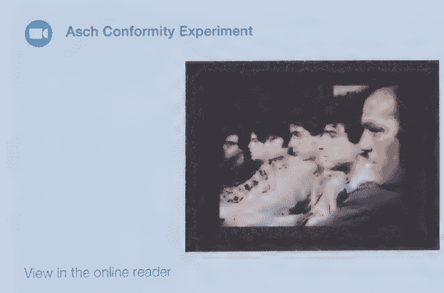
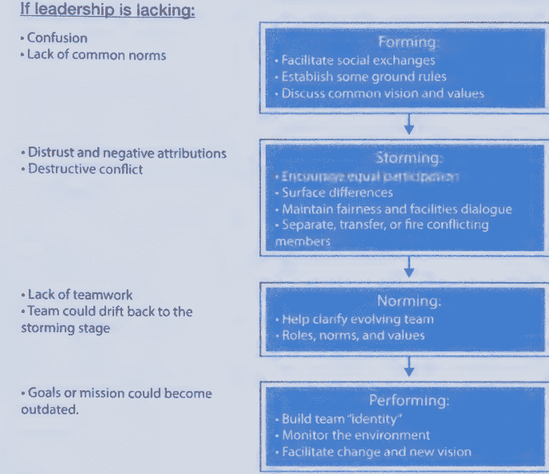

## 团队与共享领导

> “如果你想走得快，就独自前行。但如果你想走得远，就结伴同行。”——非洲古谚

> “真正的领导者不是共识的寻求者，而是共识的塑造者。”——马丁·路德·金 (Martin Luther King, Jr.)

### 学习目标

- 1. 阐释团队导向型领导的关键要素。
- 2. 比较领导力在团队发展各阶段的必要性，以及缺乏领导力时如何产生问题。
- 3. 描述共享领导在团队中的作用和重要性。
- 4. 识别虚拟团队的性质与相关性，以及如何有效领导虚拟团队。

领导力的核心在于影响人们朝着共同的目标或愿景努力。有时，这种影响是一对一的，正如本书第 3 章所强调的。通过建立关系，领导者能够影响个人。但是，领导者的影响也可以指向整个团队或群体。群体只是执行类似任务的个体集合，这些任务加在一起有助于推动群体的整体目标。但团队不仅仅是执行类似任务的个体集合。它涉及协作和合作的个人，以实现共同持有的目标或愿景。

团队的规模、目的、持续时间和地点各不相同。例如，有些团队是为相对长期运作而组建的，而其他团队则仅为了解决特定问题而组建，随后解散。有些团队大部分或完全位于同一地理位置附近，而其他团队则地理分布较广，主要通过虚拟媒体（例如，电子邮件和视频会议）运作。

高绩效团队具有凝聚力，但凝聚力不会强到无法适应其环境中变化的信息或情况（例如，新技术或服务客户的新方式）。此外，高绩效团队能够利用其成员多样化的背景、动机和能力，同时处理出现的冲突和分歧。简而言之，尽管团队有可能超越单纯执行类似任务的个人集体，但它们也面临挑战。领导者的职责是确保满足团队的需求。这些包括确保团队拥有清晰的愿景和任务方向，承认并处理支持性和关系导向的（即，社会情感的）需求，并在必要时解决变化导向的需求。

在本章中，我们强调有效领导者致力于建立高绩效团队，而不仅仅是维护个人群体。为此，我们将强调与团队领导相关的三个问题：(1) 定义团队领导的关键要素或因素，

**group**
执行类似任务的个人集合，这些任务合在一起有助于推动群体的整体目标。

**team**
为了实现共同持有的目标或愿景而协作和合作的个人集合。

(2) 团队领导力如何与团队发展阶段相关联，以及 (3) 共享领导的作用。我们还将探讨团队日益虚拟化的特点，及其对领导者和领导过程的影响。

### 8.1 面向团队的教练与领导力的关键要素

团队领导力涉及一些基本要素。下文描述的要素是领导者开发或辅导团队以实现最大绩效的基础。在首先描述这些要素后，我们将考虑它们如何在团队发展的各个阶段中发挥作用。

## 避免外群体关系

在第 3 章中，我们考虑了领导者与个别团队成员之间外群体关系可能带来的问题。如果可以在基本上无视与领导者关系较差的追随者的情况下形成有效团队，那么对于试图构建团队的领导者来说，外群体成员资格可能不是什么大问题。然而，在现实中，出于多种原因，外群体成员资格是团队领导力的大忌。首先，其他团队成员往往会与外群体成员出现问题。事实上，公平问题可能会浮现出来，即内群体成员可能会开始认为外群体成员在“搭便车”。如果发生这种情况，领导者将难以形成一个致力于共同目标、协同工作的统一团队。

其次，即使公平问题没有浮现，老话“一个烂苹果会坏掉整筐苹果”也可能发挥作用。换句话说，外群体成员可能会将他或她对领导者的问题传播给团队的其他成员，基本上会用对领导者甚至整个团队的消极态度或情感“感染”他们。结果是，领导者将难以形成一个统一的团队。因此，如前所述，领导者应努力从一开始就避免外群体的形成。但如果外群体或某个单独的“烂苹果”不知何故出现，领导者应采取措施来补救这一情况。

## 共享价值观、目标和愿景

“大家都在同一页面上。”这是对团队本质基础的比喻。无论团队是在体育、商业界、政府等领域，如果一群人要作为一个团队发挥作用，那么该团队的每个人都必须在同一页面上。但这到底是什么意思？我们认为，这意味着共享的价值观、目标和愿景。

共享价值观的一个例子是大学篮球中对防守的共同重视。球员，尤其是那些最终希望加入全国篮球协会（NBA）的球员，从高中毕业时就渴望展示他们跑动、投篮、扣篮——换句话说，进攻的能力。然而，要在大学篮球中赢得冠军，球队在防守方面也必须表现出色。肯塔基大学主教练约翰·卡利帕里展现出了招募高水平球员的能力，这些球员通常在大学打球仅一年后就加入了NBA。然而，通过说服、奖励和纪律制度，他也能够灌输与防守相关的价值观和技能。9

同样，在商业世界中，领导者需要灌输他们希望在所带领的团队中看到的价值观。他们可以通过以身作则、大谈（例如在团队会议上）共享价值观，并奖励与期望价值观一致的行为来做到这一点。安妮·斯陶斯博尔是美国最大退休基金之一（CalPERS）的首席执行官。她说：“这完全取决于你如何构建团队、赋权和欣赏。你花在培育和发展上的时间越多，你的职业生涯就会越成功。”（4）

以客户服务为例。如果领导者希望将客户服务作为团队的核心价值观，领导者必须通过自己的行动来展示客户服务的价值和重要性。此外，领导者在个人和团队层面奖励客户服务的方式上需要保持一致。领导者和组织经常大谈某一组行为的重要性，但实际上奖励的却是另一组行为。换句话说，领导者可能会大谈某一组行为或结果的重要性，但实际上得到奖励的却是一套完全不同的行为或结果。（5）例如，领导者可能会宣称“客户及其需求应驱动我们所做的一切。”但在现实中，领导者和组织更广泛的奖励体系仅仅根据向客户销售的数量提供奖励。这种不一致将无法帮助领导者建立一个团结有效的团队。

共享价值观构成共享目标和愿景的基础。如后文章节所述，目标更加短期且具体（例如，在未来一年内将客户满意度评分提高20%）。愿景往往不那么具体，并且跨越更长的时间范围（例如，通过神经反馈程序彻底改变未来领导者的发展方式）。在20世纪80年代初，史蒂夫·乔布斯负责了发明Macintosh的团队。虽然乔布斯从未被视为技术天才，但他人视他，他本人也以自己为“愿景的守护者”而自豪。（6）换句话说，在他所带领的各个项目团队中，他在推动愿景的形成方面发挥了关键作用，并且即使在团队内部可能爆发冲突且错过截止日期时，他仍能维持愿景。Macintosh的初始开发就是一个很好的例子。（7）

## 应对相互依赖与个体性之间的悖论

团队领导者有时会面临目标冲突。一方面，他们希望团队成员具备一定的相互依赖性，协同努力朝着团队目标和愿景前进。但另一方面，他们又希望鼓励个人出类拔萃并展现主动性。诚然，尽管这两个目标看似相互冲突，但实际上它们是相互依赖的。换句话说，没有出类拔萃的个人，就很难拥有一个出色的整体团队。另一方面，个人在支持性和协作性的团队环境中更容易出类拔萃。那么，如何具体管理或领导这种看似矛盾的情况呢？并没有简单的答案。例如，领导者可能会很自然地只与那些表现出色的个人建立牢固的联系或关系，而对其他团队成员则保持疏远。然而，如前文所述，对追随者这种差异化对待往往会导致内群体与外群体的对立，这不利于团队发展。

此外，第10章后面将讨论的跨文化问题也可能发挥作用。例如，在高度集体主义的社会（如日本），团队领导者往往会强调相互依赖，而不是个人主动性。因此，相互依赖与个体性之间的悖论就不那么成问题了。相比之下，在美国等文化背景下，个人主义和集体主义都受到强调。因此，当领导者试图最大限度地提高团队效能时，相互依赖与个体性之间的悖论变得更加相关和具有挑战性。

解决这一悖论的一个可能办法是，领导者找到让团队中每个人都能出类拔萃的方式。这意味着了解每个团队成员，以及他们分别在技能和动机方面能带来什么。一旦了解了这些，领导者就可以与每个个人合作，让其出类拔萃，同时鼓励朝着共同目标或愿景进行相互依赖和协作。菲尔·杰克逊是职业篮球界一个有争议的人物。但大多数人都同意，在他执教的早期岁月中，他会找到处理球队中明星或巨星的方法，并让他们作为一个团队协同工作。此外，他会利用那些不如球星的球员的天赋，让他们在团队中发挥重要作用。他说：“当团队成员彼此信任到足以为了‘我们’而放弃‘我’时，好团队就能成为伟大团队。”[8]

## 预防或处理团队“疾病”

- **groupthink**：当与团队既定思维和行动方式相悖的信息以及相关的少数派异议基本上被大多数人关闭或忽视时发生的现象。
- **free-riding/social loafing**：一种现象，即团队中的某些成员可能会在为团队目标工作时不够勤奋或不够努力，仅仅因为他们意识到团队中有其他人会弥补不足。

团队尤其容易受到系统性的“疾病”或“疾患”影响。这里我们考虑两个主要问题：(1) **groupthink**，以及 (2) **free-riding/social loafing**。团队倾向于追求和谐或缺乏冲突。但是，不和谐或冲突的一个关键来源是与团队思考问题的方式或规范相悖的信息或思考过程。**groupthink** 发生在与团队既定思维和行动方式相悖的信息以及相关的少数派异议基本上被大多数人关闭或忽视时。[9] 当团队中的大部分人（往往是领导者的内群体）变得过于团结时，**groupthink** 倾向于发生。在这种情况下，它就停止了对问题的创造性思考，并忽视了可能与团队做事或解决问题的方式相悖的信息。因此，新的挑战不太可能得到成功应对。

要开始理解规范是什么以及它们如何影响 groupthink 的运作，让我们来考虑一个著名的实验，乍一看可能令人困惑。在这个实验中，一群大学生被要求估计投影在屏幕上的线段长度。观看“阿希 conformity 实验”。真实受试者不知道的是，其他参与者都是实验的一部分，他们给出了明显不准确的估计（太长或太短）。当天真的受试者被要求给出他的估计时，他或她只是随波逐流。[10] 同样的情况也发生在 groupthink 中。由于规范压力，成员们倾向于随团队的方向走，即使有相反的证据。如果引入这种证据，可能会有压力去忽略它，甚至羞辱引入它的人。

领导者可以做些什么来预防或处理 groupthink？显然，首要挑战是认识到，就像可能影响个人的疾病一样，没有任何团队能免受 groupthink 的影响。换句话说，领导者需要意识到 groupthink 可能会悄悄渗入团队，如果不加检查，它很可能会发生。但更重要的是，领导者必须采取措施积极预防 groupthink，或在发生时加以处理。一种可能性是将反对者的角色委派给一个人

或更多团队成员。也就是说，可以指定某位特定团队成员担任团队的反方论证者，在处理问题和议题时，提出与团队普遍思路相悖的信息或观点。也许被选中的个人已经有点“异类”的名声，但他仍然是一名优秀员工，心怀组织的目标或使命。

群体思维并非团队面临的唯一潜在问题，也并非领导者应处理的唯一问题。搭便车和社会惰性是高度相似的现象：团队中某些成员可能意识到团队里有其他人会“补齐差额”，因此在为团队目标工作时不够勤奋或投入较少努力。[11] 搭便车/社会惰性的一个潜在原因被称为“责任分散”。多年来，责任分散在社会情境中被研究过：旁观者可能不会去帮助需要援助的人（例如，街上遭到袭击的人），因为他们觉得其他人也在观察同一事件，这可能会让人想，“我为什么要采取行动或承担责任；为什么不让别人去做呢？”[12] 但是，在组织团队追求目标的过程中，也可能发生同样的情况：一些团队成员可能仅仅因为意识到有其他团队成员可以“补齐差额”，而感到行动的责任减轻。搭便车/社会惰性的问题有两个方面。首先，当一个或多个成员不做贡献时，团队的整体绩效很可能会受损。其次，不公平或不公正的感知可能会出现，表现高的成员可能会开始觉得自己是“受骗者”，被搭便车者或社会惰性者占便宜。

领导者可以做什么来预防或应对搭便车/社会惰性？与群体思维一样，第一步就是简单地认识到该现象发生的可能性。换句话说，领导者应留意团队成员中是否存在搭便车/社会惰性现象。领导者还可以采取的其他措施是，确保个人理解最低标准，然后采取监控措施，确保团队中的每个人都在做贡献。最后，这个问题与外群体成员身份有关，因为外群体成员更有可能成为搭便车者或社会惰性者。因此，该现象的潜在损害只是领导者还应尝试预防或纠正外群体形成的又一个原因。

### 8.2 领导力与团队发展阶段

团队在随时间发展的过程中，往往会经历某些阶段。四个主要阶段如图 8.1 所示。[13] 还有一个阶段，即休止期，已被一些作者认可。[14] 在此最后阶段，团队基本上正在解散。这一阶段可能与临时项目团队最相关。在此分析中，我们将关注图 8.1 所示的阶段，因为它们直接涉及团队绩效及其使命的完成。

### 图 8.1 团队领导力与团队发展阶段

关于图 8.1 应注意三点。首先，团队领导的目标应是尽快将团队推向第 4 阶段——执行期。在该阶段，团队运作完善且富有成效。这并非说任何阶段都可以忽略或仓促跳过。例如，虽然第 2 阶段“风暴期”看起来应尽可能快，甚至被忽略，但它在摆出分歧和识别潜在人际问题方面有其作用。

其次，虽然从第 1 阶段到第 4 阶段有自然的前进过程，但团队也可能倒退到早期阶段。例如，团队可能正处于规范期或执行期，并经历一件重大事件，该事件可能在团队内部引发冲突（例如，一名其他团队成员在人际上不喜欢的新团队成员）。在这种情况下，团队可能会迅速倒退回风暴期。另一个例子是，一名新领导可能被引入团队，他试图剔除（无论自愿还是非自愿）他认为对团队有害的成员。由于人员流动，团队在本质上可能被迫回到形成期的发展阶段。

第三，上述后一个例子展示了领导力在各发展阶段可能产生的影响。在形成期，领导者试图制定行为基本规则。例如，在相对临时的问题解决团队中，领导者可能会将头脑风暴作为一项基本规则，即几乎不会一概而解地否决任何解决问题的想法。领导者还可能提出对团队最终产品或解决方案的愿景。如本章后文所述，该愿景可以通过与团队成员的共享领导力流程来最初制定或完善。

在风暴期，应努力浮现可能导致冲突的潜在分歧，同时鼓励对话，而非争论性讨论。通过对话，判断和先入之见被搁置，人们被要求倾听，而不仅仅是说话或推销自己的想法，所有声音都会被听到。话虽如此，团队中的所有冲突都能通过对话解决并不现实，在涉及根深蒂固或个人问题的一些情况下，团队成员可能需要被分开、调岗甚至解雇。不幸的是，为了避免正视冲突，领导者可能会试图只是把冲突“掩盖于桌底”。换句话说，领导者可能只是回避一个日益严重的冲突，例如两个似乎不断争吵或相互破坏的团队成员。然而，这种回避行为很少奏效，冲突可能会蔓延到其他团队成员，甚至导致团队内部形成不同的派系。

在 *规范期* 阶段，领导者试图对团队的角色、规范和价值进行澄清。例如，领导者可以帮助澄清不同成员可以帮助满足的各种义务和团队需求。另一个例子是，领导者可能会强调按时参加会议（即面对面或虚拟会议）的规范。

最后，在 *执行期* 阶段，领导者致力于帮助建立团队身份认同，特别是如果团队将长期存在。例如，可以鼓励团队成员穿着印有团队标志或昵称的 T 恤上班（至少在某些日子）。或许更重要的是，当团队处于 *执行期* 阶段时，领导者监控团队环境中可能影响团队目标或使命的任何变化非常重要。如果需要变化，领导者引入新想法或愿景非常重要。

### 当领导力缺失时

图 8.1 还展示了如果在团队发展的任何四个阶段中缺乏领导力会发生什么。在 *形成期*，领导力缺失可能导致混乱，以及团队缺乏共同方向或规范。当团队处于 *风暴期* 时，领导力缺失可能滋生不信任，以及本书第 7 章中讨论过的那种团队成员之间的负面判断和归因。传达此类判断和归因会导致冲突高度破坏性，而不是促进问题的建设性解决。例如，如果领导者观察到一名团队成员指责另一名成员懒惰或不理智，领导者可以坚持此类指控不应成为团队话语的一部分，而是强调对话，以尊重的方式考虑和讨论具体的问题行为。如果领导者在 *规范期* 没有澄清角色、规范和价值，可能会导致缺乏朝着共同目标的团队合作，团队甚至可能倒退回 *风暴期*。

最后，如果在 *执行期* 缺乏领导力，团队的目标和使命可能与其环境的需求（例如客户）相比变得过时。有趣的是，通常如果一支团队显然正全速运转，换句话说，领导者可能会倾向于采取放手或放任自由的做法。领导者可能会更多地进入管理或行政模式，但不会展示本章和本书其他地方所描述的那种领导力。不幸的是，这就是许多团队开始陷入群体思维的关键原因，群体思维在执行阶段经常发生，很可能不可避免地损害团队的可行性。

### 8.3 共享领导

### 共享领导

团队成员之间的相互影响和共同责任，他们彼此引领，朝着团队目标前进。

团队领导者的最终目标应该是培养团队成员，使其能够分担领导角色。教练菲尔·杰克逊（Phil Jackson）曾说道：“领导力不是向他人强加你的意志，而是掌握放手的艺术。”[15] 当团队成员之间存在相互影响和共同责任，彼此引领朝着团队目标前进时，共享领导便发生了。[16] 但是，为什么共享领导在团队和组织中如此重要呢？这个问题的答案其实很简单。团队在完成任务、处理团队成员的个人或情感需求以及在必要时推动变革等方面的各种功能，通常无法由单一领导者轻易处理，尤其是在较大的团队中。相反，将团队的整体领导能力视为其多个成员的总和会更有帮助。[17]

让我们举个例子。假设你参与了一个项目团队，而团队的正式领导者已将一些重要决策及其执行控制权下放给团队成员。团队中你有一位同事，出于某种原因似乎缺乏动力。然而，如果项目要取得成功，这个人及其合作至关重要。在这种情况下，你或其他团队成员尝试展示领导影响力以激励该个人，而不是等待正式领导者采取行动，这是至关重要的。

这个特定例子反映了许多团队成员目前所面临的情况，因为组织越来越多地以半自治团队的形式构建。在这种情况下，团队在很大程度上不受正式领导者的控制而具有自主权。相反，团队成员自我组织和自我领导。[18] 虽然半自治团队可以提高成员的积极性和心理福祉，但它们也要求成员分享领导职能。

在整本书中，我们一直强调，正式领导者领导职能的重要部分之一，是培养追随者，不仅在其技术能力方面，而且在其自行决策、解决问题以及承担越来越多责任的能力方面也是如此。例如，在第5章中，我们强调了弗鲁姆和雅戈提出的决策发展模型如何被用来尝试培养追随者的问题解决和决策技能。[19] 正式领导者的总体目标应该是使决策能够成功地下放给追随者。Netflix的创始人兼首席执行官里德·哈斯廷斯（Reed Hastings）曾表示：“我引以为豪的是尽可能少做决策。”[20] 在他看来，伟大的领导者通过统筹适当的情境（即，选拔合适的人、以身作则、强化正确的行为），而不是试图控制所有决策来获得出色的绩效。但是，除了决策之外，目标还应该包括下放领导角色的其他方面，包括激励团队中的其他成员。我们并不是建议正式领导者实行放任自由，这意味着在需要他们时缺席，或在团队可能需要协助的重要问题出现时不介入。[21] 尽管如此，如果能够培养追随者承担更多领导角色，团队和组织将处于更有利的位置以实现有效性。

### 8.4 领导虚拟团队

### **虚拟团队**

一个在地理上分布、性质通常相对临时，并且在很大程度上依赖虚拟媒体进行沟通的团队。

越来越多的人从事既允许甚至要求地理分散的工作，即远程工作。各种力量推动了这一趋势。最近，COVID-19 大流行迫使个人和团队使用虚拟技术进行远程工作。大流行期间，大学生们通过使用Zoom等技术清楚地看到了这种情况。[22] 但是，即使超出教育领域，大流行之后远程工作也很可能会继续增加。[23] 即使在大流行之前，远程工作就已经呈现出趋势，包括面向全球的业务、个人希望至少部分时间在家工作的愿望，以及允许分散办公的虚拟技术。其结果是，团队已经是，并且将越来越是地理上分布的。换句话说，成员分散在国家或世界的广阔不同地区。这样的团队通常性质相对临时，或许专注于特定的问题或项目。由于分散，这类团队被迫通过虚拟媒体（如电子邮件、聊天系统和视频会议）进行沟通。因此，**虚拟团队**这一标签经常被使用。

领导虚拟团队既有优势也有潜在劣势。虚拟团队通常是临时组建的。在这种情况下，团队成员来自组织的不同地点，他们具备实现团队目标所需的正确技能、专业知识和积极性的组合。因此，从一开始，领导者就面临这样一种情况：他或她可能不必担心拥有完成团队使命所需的全部技能和专业知识。这样的组合很可能在选拔时就已经设计进了团队。

另一方面，在领导虚拟团队（包括临时团队和更永久的团队）时，可能会面临挑战。研究表明，与面对面团队相比，虚拟团队中较少发生变革型领导，或者至少不太容易被感知到。[24] 正如我们将在第11章中更详细地讨论的那样，变革型领导是一种特别有效的领导形式，强调激励、变革和发展。然而，领导者在虚拟环境中展示这种领导力可能很困难。

在高度虚拟的团队中，还存在“眼不见心易忘”的问题。也就是说，虚拟团队特别容易出现本章前面讨论过的那种搭便车/社会懈散问题。由于成员与领导者或其他团队成员几乎没有或没有面对面接触，他们可能会变得缺乏动力，或者简单地被遗漏掉。这一问题因虚拟团队通常采用矩阵结构而更加突出，即团队成员在另一个单元或团队中拥有永久成员身份，同时被分配到虚拟团队承担更临时的成员身份。当这种情况发生时，虚拟团队成员可能会在其永久团队中出现更紧急事务时试图搭便车。[25]

作为另一个例子，在第7章中，我们讨论了通过虚拟媒体沟通可能导致的一些问题。在本质上并非高度虚拟的团队（即，地理上相近的团队）中，即使可以轻松进行面对面接触，电子邮件等沟通方式仍可能被使用。然而，虚拟团队根据定义主要依赖虚拟媒体进行沟通。因此，它们极易出现第7章中讨论过的那类沟通问题。这样，复杂的、人际的或情感化的沟通在虚拟团队中可能尤其困难和成问题。总的来说，搭便车/社会懈散和沟通不畅等问题会导致虚拟团队在团队流程（即团队动力学）方面出现困难的倾向。[26]

领导者如何应对其中一些挑战？虽然在某些方面，有效领导虚拟团队与领导一般团队相似，但虚拟团队领导者应特别关注一些事项。*首先*，如果可能，虚拟团队最好尽早（例如，在形成阶段）进行面对面会面，以培养信任关系并作为团队'凝聚'在一起。此外，领导者可以利用最初的面对面会议（例如，

通过团队退修) 来确立团队的角色、期望和愿景，以及哪些事情应当通过虚拟方式沟通，哪些应当通过电话或在随后的面对面会议中沟通。在这样的初次面对面会面之后，依赖虚拟沟通应该更加可行。

第二，领导者应尽可能鼓励包含视频会议的沟通，而不仅仅依赖于电子邮件、短信或聊天等“丰富”程度较低的媒体。过去十年来，视频会议已变得高效且成本效益高。使用它后，上述与贫乏媒体相关的典型问题可以最大限度地减少，至少可以在一定程度上减少。这些问题可能包括基于情绪的冲突，以及关于目标、使命和个人职责的不明确。虽然视频会议并非解决此类问题的万能药，但它无论如何都能提供帮助。

第三，领导者需要提醒成员注意关于高度敏感（例如，情感敏感）或复杂信息的沟通基本规则。具体来说，此类信息应通过电话、视频会议或偶尔的面对面会议机会来沟通。

最后，与许多其他类型的团队相比，高度分散的虚拟团队往往没有正式领导者。因此，本章前面讨论的共享领导流程可能尤其相关和必要。换句话说，也许尤其是在虚拟团队中，所有成员都应承担领导角色。

# 本章视频案例

# 鲍勃·霍尔顿——接手一个困难团队

在本视频中，Rent.com 的鲍勃·霍尔顿接手了一个困难的团队，这主要归因于之前糟糕的领导。他致力于制定共同愿景并重振士气。

在在线阅读器中查看

## 结论

本章的目的是强调领导团队的重要性和性质。虽然领导个人与领导团队之间存在一些共同要素，但团队领导也有一些独特之处。在本章中，我们阐述了团队领导的基本要素、这种领导在团队发展各个阶段如何发生，以及团队中缺乏领导时可能出现的负面情况。此外，我们还描述了共享领导及其重要性。最后，我们探讨了在虚拟环境中领导的日益重要性和方法。

### 8.5 讨论问题

- 1. 领导力中许多悖论之一，就是在鼓励团队协作的同时，又鼓励个人出类拔萃。这个悖论对团队领导者来说为何是一个挑战，他们如何最好地应对？有哪些真实或假设的例子？

- 2. 什么是“共享”领导，为什么它在许多团队中如此重要，在团队中共享领导为何可能面临挑战？有哪些真实或假设的例子？

- 3. 如何判断是否发生了群体思维，为什么领导者应该关注这一现象？

- 4. 当似乎发生群体思维时，领导者可以做些什么来预防或缓解它？

- 5. 在“虚拟”团队环境中领导和影响他人时面临哪些挑战？你能否想到你亲身经历过的例子，也许是在学生团队中？如果有，你是如何应对的，如果重来一次，你会做些不同的事情吗？

## 尾注

- 1. 关于团队性质和潜力的更多信息，请参见 Katzenbach, J. R., & Smith, D. K. (1993). 《团队的智慧：创建高绩效组织》. Boston: Harvard Business School Publishing.

- 2. 关于团队需求和领导力的更多信息，请参见 Morgeson, F. P., DeRue, D. S., & Karam, E. P. (2010) 的团队领导功能理论：《团队中的领导力：理解领导结构和流程的功能方法》. Journal of Management, 36, 5–39.

- 3. 参见 https://www.aeseeafblue.com/2012/10/14/35026848/kentucky-basketball-caliparis-calling-card-defense.

- 4. 个人通信。

- 5. 奖励一组行为却期望另一种行为的问题在管理文献中已存在很长时间。关于此主题的经典文章是：Kerr, S. (1995). 《关于奖励 A 却希望得到 B 的愚蠢行为》. Academy of Management Executive, 9(1), 7–14.

- 6. 参见 https://hightechnstroy.wordpress.com/2012/01/20/steve-jobs-keeper-of-the-vision/.

- 7. 关于史蒂夫·乔布斯如何在 Macintosh 和其他项目中担任“愿景守护者”的更多细节，请参见 Isaacson, W. (2011) 《史蒂夫·乔布斯》. New York: Simon & Schuster.

- 8. http://www.azquotes.com/author/7275-Phil_Jackson

- 9. 参见 Turner, M. E.; Pratkanis, A. R. (1998). 《群体思维理论与研究二十五年：来自理论评估的教训》. Organizational Behavior and Human Decision Processes, 73, 105–115.

- 10. Asch, S.E. (1951). 《群体压力对判断修改和扭曲的影响》. In H. Guetzkow (Ed.), Groups, leadership and men. Carnegie Press.

- 11. 参见 Karau, S. J., & Williams, K. D. (1993). 《社会懈怠：一项元分析综述与理论整合》. Journal of Personality and Social Psychology, 65, 681–706.

- 12. 例如，请参见 Derley, J. M., & Latané, B. (1968). 《紧急情况下的旁观者干预：责任分散》. Journal of Personality and Social Psychology, 8, 377–383.

- 13. 这四个阶段最初由 Tuckman, B. W. (1965) 确定：《小群体中的发展序列》. Psychological Bulletin, 63, 384–399.

- 14. Tuckman, B. W. & Jensen, M. A. (1977). 《小群体发展阶段回顾》. Group Org. Studies 2:419–27

- 15. http://www.azquotes.com/author/7275-Phil_Jackson

- 16. 参见 Wang, D., Waldman, D. A., & Zhang, Z. (2014). 《共享领导与团队效能的元分析》. Journal of Applied Psychology, 99, 181–196. DOI: 10.1037/a0034531.

- 17. 关于团队中非正式和共享领导的必要性的更多信息，请参见 Morgeson 等人 (2010)。另请参见 Day, D. V., Gronn, P., & Salas, E. (2004). 《团队中的领导能力》. The Leadership Quarterly, 15, 857–880.

- 18. 参见 Cordery, J. L., Muller, w. S., & Smith, L. M. (1991). 《自主群体工作的态度和行为影响：一项纵向田野研究》. Academy of Management Journal, 34, 464–476. 另请参见 Mochalski, M., & Weber W. G. (1998). 《工业群体工作的“三浪”：对当前群体工作研究的历史反思》. Human Relations, 51, 347–388.

- 19. 参见 Vroom, V. H. (2000). 《领导力与决策过程》. Organizational Dynamics, 28(4), 82–94.

- 20. 个人通信。

- 21. 参见 Bass, B. M. & Avolio, B. J. (1997). 《多因素领导问卷全程领导力开发手册》. Palo Alto, CA: Mindgarden.

- 22. 参见 https://www.highergedjobs.com/articles/articleDisplay.cfm?ID=2600.

- 23. 参见 https://www.bbc.com/worklife/article/20201023-coronavirus-how-will-the-pandemic-change-the-way-we-work.

- 24. 参见 Balthazard, P. A., Waldman, D. A., & Warren, J. (2009). 《虚拟决策团队中变革型领导力出现的预测因素》. The Leadership Quarterly, 20, 651–663.

- 25. 关于虚拟团队及其领导者面临的挑战的更多信息，请参见 Lojeski, K. S. (2010). 《领导虚拟员工队伍：伟大的领导者如何在21世纪转型组织》. Hoboken, NJ: John Wiley & Sons.

- 26. 参见 Balthazard 等人 (2009)。

