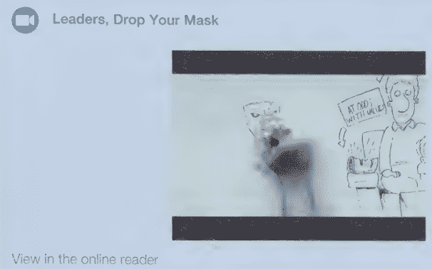
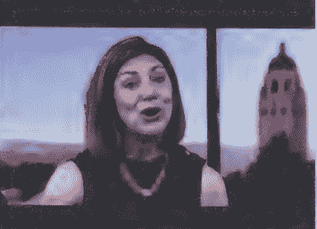

## 第 9 章

## 领导角色中的男性和女性

> "多元化：应对刻板印象或对自身权威挑战的艺术s必须以真实的方式处理。无论领导者的性别、强势或侵略性行为

领导者一方必须被追随者视为真实，才能取得成效。事实上，真实性对女性领导者来说可能更是一种要求，因为强势或好斗的行为可能被视为不协调。下方视频突出了真实性对所有领导者的优势，尤其是女性领导者。

顺便说一句，感知到的角色不协调问题并非仅限于女性领导者。某些种族背景的领导者也可能遇到此类问题。例如，具有亚洲背景的人发现要进入美国公司的领导岗位以及一旦获得后保持这些职位都存在困难。[10] 换句话说，玻璃天花板和玻璃悬崖都可能适用于具有亚洲种族背景的人。导致此类困难的原因同样可能包括感知到的角色不协调。北美文化中随时间发展起来的、强力驱动、强势且直接的有效领导原型，基于与白人男性相关的传统行为。具有亚洲背景的人，无论男女，往往与该原型不一致。也就是说，他们在领导角色中往往更加审慎、较不强势、较不直接。事实上，此类人可能被贴上技术专家、分析型人才等标签——但不被视为领导者。毫不奇怪，他们要么无法获得领导职位，要么在获得后难以保住这些职位。同样，这种不协调并非基于实际的角色要求，而是基于他人（例如，多数群体成员）对领导角色所需个人素质的认知。

### 9.2 在日益多元化的环境中男性领导者面临的挑战

传统上，大多数北美组织中的权力、控制和影响力掌握在男性，具体来说是白人男性手中。如前所述，我们不对组织中权力、控制和影响力传统上倾向于掌握在白人男性手中的确切方式或原因进行归因。在很大程度上，我们将此类分析留给历史学家、社会学家、政治分析人士、人类学家等等。我们的目标是简单地将这一传统作为既定事实，并向前迈进，解决男性在日益多元化的环境中尝试领导时所面临的挑战。这些挑战大体上归结为三个问题：(1) 缺乏包容性思维；(2) 在最大化多样性益处的同时降低其潜在负面影响；以及 (3) 在允许多样性的同时应对构建文化同质性的悖论。

### 缺乏包容性思维

我们对多样性都有不同的取向，这最终会影响我们如何尝试领导拥有不同背景（即在种族、年龄、性别等方面不同）的他人。我们建议，在继续往下阅读之前，请前往第 4 节并完成包容性思维量表。如你将看到，拥有包容性思维与三个维度相关：(1) 对来自不同背景的他人的好奇心；(2) 与来自不同背景的人接触；(3) 对多样性的勇气与承诺。

如表 9.1 所示，包容性思维的三个维度在很大程度上归结为三个包容性水平及与每个水平相关的行为。[10] 在最低水平，领导者倾向于淡化差异。领导者不会真正好奇来自不同背景的人如何以不同的方式思考、感知或行动，反而倾向于简单地回避与自己不同的人，而与相似的人为伴。在中等包容性水平，领导者对与自己不同的人有一定程度的接受，但并不真正拥抱多样性的价值，也不会对基于多样性的不同思维方式、感知方式和行为方式表现出太多好奇心。最后，在最高包容性水平，领导者主动对拥有不同背景的人表现出兴趣，并尝试与他们进行人际互动。或许最重要的是，对多样性的主动取向意味着领导者会监控并尝试纠正他遇到的违背多样性价值观的态度或行为情况。

| 包容性水平 | 示例性行为 |
|---|---|
| 主动包容 | —主动且尊重地对来自不同背景的人表现出兴趣 —积极尝试与来自不同于自身背景的人进行人际互动 —明确监控并对抗违背多样性价值观的态度或行为 |
| 中等接受 | —对来自不同背景的人表现出中等程度的好奇心 —对来自不同背景的人表示一定程度的接受，但不会不遗余力地拥抱或与他们接触 —在观察到不包容性或多样性被低估时，倾向于保持沉默 |
| 淡化差异 | —对了解来自不同背景的人表现出很少的好奇心 —轻视文化或种族差异的重要性，至少在多样性对工作环境潜在影响方面是这样 —倾向于只与在种族背景、年龄组、性别等方面与自己相似的人交往 |

包容性取向或思维对试图在日益多元化的环境中领导他人为何重要？让我们举一个很可能经常发生的例子。也许一个工作团队传统上由中年男性组成。由于退休或其他原因导致人员流动，一名团队成员离开组织，并由一名年轻女性取代。此人不仅在年龄上，而且在性别方面都与团队中的其他人有显著不同。[12] 在一次团队会议上，一名老成员甚至开玩笑说新成员：“你知道，你让我想起我的女儿……”或者更糟，一名老成员可能会做出性骚扰评论，例如：“我希望你总是穿着这样性感的裙子上班……”接着，随着会议的进行，团队试图解决其面临的各种问题时，新团队成员试图不时发言并提供意见。但她的意见反复遭到缺乏眼神交流，各个团队成员在她还没能表达完想法时就打断她。

此类团队动态可能有多种原因。一个关键解释是刻板印象，当个人对某群体持有僵化且往往是负面的信念时就会发生刻板印象。在上述例子中，中年男性团队成员可能会在很大程度上将年轻女性刻板印象化为天真，或者仅仅是另一个“千禧一代”。此外，权力篡夺可能也在起作用，即年长男性试图把新成员“放到她应该在的位置”。结果是，她的意见被驳回或忽视，她没有得到像其他团队成员那样得到的尊重。

无论原因如何，这种性质的团队动态反映了多样性可能伴随的微妙（甚至不那么微妙），但不公平且甚至适得其反的权力差异。如果此类动态持续下去，可能会出现一系列负面结果。例如，新团队成员可能会感到沮丧，以至于在团队会议上基本上“关闭”自己。在生产力和创新方面，新团队成员可能能够从不同的视角或框架来看待团队的问题。如果她被有效地“关闭”，团队将无法利用她可能提供的有帮助或新颖的想法。此外，新成员可能开始退缩，或成为我们在第 4 章中考虑过的那种疏远型追随者。

在上述例子中，淡化个体背景差异的领导者甚至可能不会察觉这些团队动态。也就是说，领导者不会意识到新加入团队的人可能被打断甚至可能被不尊重（例如，“你让我想起我的女儿……”）的可能性。另一方面，对包容性持主动取向的领导者会对这种微妙权力差异的表现保持敏感。此人将以身作则，在出现这些表现时予以识别，尝试减少团队中的任何此类行为，并对女性团队成员的观点表现出个人兴趣。总的来说，他将试图在团队中灌输一种规范或价值观：尽管性别或背景存在差异，所有团队成员及其想法都应受到尊重。

### 在最大化多样性益处的同时降低其潜在负面影响

先前的研究清楚地表明，多样性为团队和整个组织带来益处。[13] 具体来说，多样性为问题解决和决策提供了更深入的基础。之所以发生这种情况，是因为多样性与更广泛的视角和经验基础相关联。此外，多样性往往能降低团队思维发生的风险，我们在第 8 章中对此进行了讨论。

与此同时，有效的多样性领导者会意识到多样性至少存在潜在的负面影响，这种影响应予以避免或最小化。多样性可能会给团队增加压力和破坏性冲突的潜在可能性。当来自不同背景的人聚集在一起时，误解、刻板印象和不信任的潜在可能性会更大。借用第 8 章和团队发展中的一个术语，停留在或回归到“风暴阶段”的可能性会增加。因此，领导者面临的明显挑战是同时最大化多样性带来的益处，同时最小化其潜在的负面影响。

一个良好的第一步是领导者应像上面描述的那样拥有包容性思维。这样的领导者不仅会寻找多样性如何提供价值，而且还会意识到多样性问题如何形成，以及如何得到缓解。通过拥有包容性思维，领导者所树立的榜样向其他团队成员传递的信息是，对……的不当行为 a

针对女性或种族群体成员的行为，无论是有意为之还是更为隐蔽，都不应被容忍。同时，包容型领导者会对其他群体成员（例如白人男性）保持敏感，这些成员可能认为存在逆向歧视。领导者的责任是向这些多数群体成员保证，对少数群体成员的优待或支持行为并非源于逆向歧视，而是源于这些少数群体成员的功绩。

另一方面，组织中的领导者必须明白，在大多数情况下，他们领导的是一系列不同的个体，而不仅仅是女性或少数群体成员。因此，领导者必须对逆向歧视等问题以及被领导的多元个体之间对公平的不同理解保持敏感。2020年夏季美国发生的社会事件凸显了社会中关于对待少数群体（尤其是黑人）的持续问题。为在社会和组织中带来积极变革而做出的努力值得赞扬。然而，如果这些努力被用作借口来“羞辱”多数群体成员或以某种方式对其进行逆向歧视，则可能在组织中适得其反。此类政策和领导努力只会破坏团队导向的发展以及接下来所讨论的那种文化同质性或统一性的建设。

## 悖论：在允许多元化的同时建立统一性

正如本书反复强调的那样，有效的领导力很大程度上在于处理悖论。在领导多元化方面，一个关键的悖论是平衡领导者创建统一团队文化和目标感的愿望与拥抱多元化的愿望。领导者努力让追随者在价值观和规范等方面达成一致（即统一）。例如，客户支持与服务可能是许多领导者的关键价值观，他们试图将其作为所有团队成员文化不可分割的一部分。换言之，他们试图在其领导的团队或组织中构建一种强大的、统一的文化，因为随之而来的是凝聚力和目标感。[44] 另一方面，在拥抱多元化的精神下，领导者也希望允许员工基于其背景、性格、风格和性别之间的个体差异。

因此，调和这一悖论的方法是认识到包容性可能存在的问题（例如，公然或无意的歧视性做法），同时公平对待每个人（无论是少数群体成员还是非少数群体成员）。此外，领导者应设定团队的目标或总体价值观，同时允许员工有一定的余地以独特的方式追求这些目标或价值观。例如，再次考虑西南航空自成立以来一直秉持的客户服务与支持这一价值/目标。西南航空允许员工以自己独特的方式追求客户服务与支持。有些员工可能会使用幽默来丰富客户的飞行体验，而另一些员工则较为内敛，但同样能帮助客户解决问题或提供愉快的飞行体验。[55] 此外，鉴于许多组织越来越多元化的客户群，拥有多元化员工可以帮助企业更好地理解并调整其做法，以满足客户需求。

## 本章视频案例

本章的视频案例都涉及担任领导角色的女性，以及她们在各种情况下面临的挑战和机遇。这些挑战中，有些涉及对其权威的公然对抗，而另一些则来自男性同事发表的较为隐蔽或随意，但 nevertheless 具有贬义且带有刻板印象的言论。无论如何，此类挑战都可能导致女性从“玻璃悬崖”上跌落。在很大程度上，情境决定了视频案例中的女性领导者如何应对这些挑战。所有这些领导者的共同点是她们似乎很真诚，因此为女性领导者提供了良好的榜样。此外，在某种程度上，这些视频展示了认识到担任领导角色的女性积极一面的领导者。

### 德娜·布雷格——权力挑战

德娜·布雷格是美国陆军的一名上尉，她描述了一种情况：下属直接就她的性别与其领导角色相关的问题与她发生对抗。

在在线阅读器中查看

### 玛丽亚·艾特尔——性别刻板印象

玛丽亚·艾特尔是耐克公司的一位副总裁，她描述了一个实例，其中她面对一位同事的性别刻板印象。该刻板印象并非针对她个人，尽管它仍可能被视为具有冒犯性。

在在线阅读器中查看

### 达娜·布鲁姆——培养茁壮成长的行为

达娜·布鲁姆是管理顾问，她谈论了担任领导角色的女性的优势，尤其是当该女性显得真诚时。

在在线阅读器中查看

## 结论

在本章中，我们关注了在北美日益多元化的工作环境中尝试领导的多数群体和少数群体（或女性）领导者所面临的挑战。尽管这些挑战的性质在很大程度上有所不同，但它们凸显了在尝试理解有效领导力时考虑多元化的重要性。此外，我们应当注意，尽管此处提出的大多数示例涉及女性领导者，但玻璃天花板和玻璃悬崖等现象也与各种种族和族群相关。在下一章中，我们将继续探讨多元化问题。然而，我们的重点将转向国际背景和全球领导力。

### 9.3 讨论问题

- 1. 本章中又出现了一个悖论：平衡领导者形成统一团队/组织文化的愿望与追求或拥抱多元文化的愿望。关于这一悖论：(a) 这一悖论具体是指什么，(b) 为什么这会成为领导者或其组织的困境，(c) 领导者/组织如何最好地处理这一悖论？

- 2. 这是另一个三部分问题：(a) 什么是“玻璃悬崖”，它与“玻璃天花板”有何不同，(b) 为什么“玻璃悬崖”有时会发生，(c) 为什么它是一个潜在问题？

- 3. 在第4节中，有一个“包容性思维”调查。完成此调查，并谈谈结果对您个人意味着什么。您的得分与表9.1中显示的多元化包容性取向相比如何？

### 9.4 附录：包容性思维

对于以下每个问题，请使用下面的量表对自己进行评分：

### 量表

1 = 完全不
2 = 很少
3 = 也许有时
4 = 大部分时间
5 = 在很大程度上或总是

| | | |
|---|---|---|
| 1. | [ ] | 我积极主动地学习其他文化和种族的知识。 |
| 2. | [ ] | 我天生好奇，渴望了解关于他人的新事物。 |
| 3. | [ ] | 当来自与我不同背景的人表达观点时，我会专注倾听。 |
| 4. | [ ] | 我会进行尊重且好奇的提问，以更好地了解与我背景不同的人的观点。 |
| 5. | [ ] | 我与与我不同的人交往时感到自在。 |
| 6. | [ ] | 我会预见并采取适当行动，解决似乎基于人员背景差异的团队冲突。 |
| 7. | [ ] | 我努力创造一个安全的环境，让来自各种背景的人都感到自在并敢于发言。 |
| 8. | [ ] | 我有能力倾听并与来自不同背景的人沟通。 |
| 9. | [ ] | 我要求他人对不包容性行为负责。 |
| 10. | [ ] | 我希望来自不同背景的个人感到他们的独特性得到认可和欣赏。 |
| 11. | [ ] | 我挑战那些宣扬每个人都必须一样的固守组织态度和做法。 |
| 12. | [ ] | 我清晰且真诚地阐述多元化与包容的价值。 |

### 评分

此量表评估以下维度和项目：
关于多元背景他人的好奇心，项目1–4
与多元背景人士互动，项目5–8
对多元化的勇气与承诺，项目9–12

对于每个维度，将您的评分相加并除以4。某个维度得分4分或以上表示得分较高。3到4分之间表示中等。低于3分表示得分较低。

## Endnotes

- 1. 参见 Harrison, D. A. & Klein, J. K. (2007). What's the difference? Diversity constructs as separation, variety, or disparity in organizations. Academy of Management Review, 32, 1199-1228. 另请参见 van Knippenberg, D., & Schippers, M. C. 2007. Work group diversity. Annual Review of Psychology, 58, 515-541.
- 2. 参见 http://fortune.com/2017/06/07/fortune-500-women-ceos/.
- 3. 例如，参见 Lyness, K. S., & Thompson, D. E. (2000). Climbing the corporate ladder: Do female and male executives follow the same route? Journal of Applied Psychology, 85, 86-101.
- 4. 另请参见：Bruckmüller, S., & Branscombe, N. R. (2011). How women end up on the 'glass cliff'. Harvard Business Review, January-February.
- 5. 另请参见：Cook, A., & Glass, C. (2013). Glass cliffs and organizational saviors: Barriers to minority leadership in work organizations? Social Problems, 60(2), 168–187.
- 6. 关于领导隐性理论的更多信息，参见 Offermann, L. R., Kennedy, J. K. Jr., & Wirtz, P. W. (1994). Implicit leadership theories: Content, structure, and generalizability. The Leadership Quarterly, 5, 43-58.
- 7. 参见 Rosener, J. B. (1995). America's competitive secret: Women managers. New York: Oxford University Press.
- 8. 参见 Atwater, L. E., Carey, J. & Waldman, D. A. (2001). Gender and discipline in the workplace. Wait until your father gets home. Journal of Management, 27, 537-561.
- 9. 应该注意的是，女性或其他少数族裔领导者可能遇到的更微妙的刻板印象或随意贬低的言论通常被称为微侵犯。
- 10. 参见 Hyun, J. (2005). Breaking the bamboo ceiling: Career strategies for Asians. New York: HarperCollins.
- 11. 类似模型已被用于描述个人如何看待多样性。例如，以下文章涉及多样化意识水平：Bennett, M. (1986). A developmental approach to training for intercultural sensitivity. International Journal of Intercultural Relations, 10, 179-196.
- 12. 当团队内的个人在多个多样性方面存在差异时，可能会出现所谓的团队断层。有关更多信息，请参见 Li, J. T. & Hambrick, D. C. (2007). Factional groups: A new variant on demographic faultlines, conflict, and disintegration in work teams. Academy of Management Journal, 48, 794-813.
- 13. 参见 Wooley, A. & Malone, T. (2011). What makes a team smarter? More women. Harvard Business Review, June, 32-33. 另请参见 Richard, O. C. (2000). Racial diversity, business strategy, and firm performance: A resource-based view. Academy of management Journal, 43, 164-177.
- 14. 参见 Arogyaswamy, B. & Byles, C. M. (1987). Organizational culture: Internal and external fits. Journal of Management, 13, 647-659.
- 15. 参见 Gittell, J. H. (2003). The Southwest Airlines way. New York: McGraw Hill.
