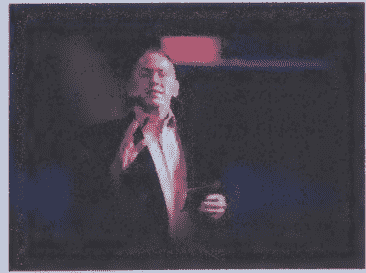
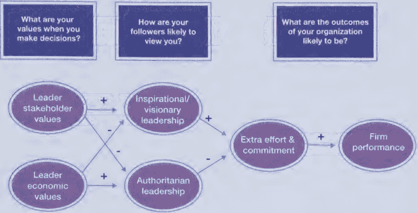
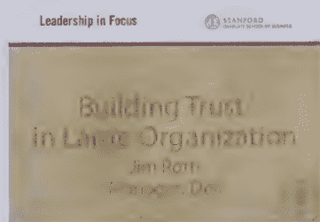
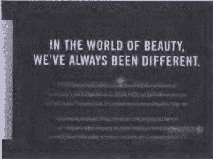

## 鼓舞人心与远见卓识的领导力

> “你如何激励人们实现超出他们自己预期的成就？”——纳尔逊·曼德拉（由摩根·弗里曼饰演）对弗朗索瓦·皮纳尔（由马特·达蒙饰演）说，出自电影《不可战胜》

> “领导力与职位的关系不如与个人气质重大。”——约翰·麦克斯韦，天际卫斯理教会高级牧师

> “人们放弃权力的最常见方式，是认为自己没有任何权力。”——艾丽丝·沃克，美国小说家及普利策奖获奖者

> “没有异象，民众就会灭亡。”——《圣经》

### 学习目标

- 1. 描述领导者可以拥有不同的权力基础，以及其权力如何影响领导者影响他人的方式。
- 2. 总结魅力型和变革型领导力的内涵，以及它们与激励的关系。
- 3. 解释组织使命如何以更具或更少鼓舞性和可持续性的方式有所不同。
- 4. 识别有效领导者愿景的要素。
- 5. 绘制领导者价值观、鼓舞性/远见卓识领导以及可能的企业结果如何结合在一起的图表。

在许多方面，领导力的本质在于能够鼓舞人心。当一个人鼓舞另一个人时，那个人以一种特殊的方式施加影响。这种影响不是源于恐惧、胁迫、职位或金钱交换。相反，它出于积极且往往非常无形的原因。你是否真正被另一个人鼓舞过？如果有，是什么让那个人似乎能鼓舞你，以及这种鼓舞导致你采取了什么行动或行为？

在本章中，我们将揭开围绕鼓舞人心和具有远见领导力的一些神秘面纱。在此过程中，我们还将考虑领导者鼓舞他人的一个关键方式，即通过远见。我们还将探讨与鼓舞相关的一些流行概念，包括变革型领导。我们还将探讨一种更具争议的理解领导者鼓舞力的方式，即魅力。此外，我们将解释使命或目标感如何构成新愿景的基础，以及非常狭窄、基于产品或经济的使命如何限制未来的愿景。最后，我们将探讨什么确切地构成了有效的领导者愿景。

### 11.1 权力基础与影响力之间的联系

权力基本上是以符合自身目标的方式办成事情的能力。权力对领导者很重要，因为它构成了影响力的基础。图 11.1 展示了权力与影响力之间的关系。

图 11.1 领导者的权力基础与影响策略

| 权力基础 | 影响策略 |
| :--- | :--- |
| • 胁迫 • 正式或合法 • 奖励/资源 | • 惩罚 • 清楚地说明你想要或寻求什么 • 等价交换 |
| • 专家 • 个人（“参照”） | • 理性说服 • 诉诸愿景或更高目标 • 让人与你相处感到愉快（即，让人钦佩、尊重和信任你） |

#### 硬实力与软实力

> **硬实力**
> 胁迫、正式/合法以及奖励/资源等权力来源，通常基于个人在组织层级中的职位而产生。

在图的左侧，我们可以看到权力基础。[1] 虚线上方是三种可称为**硬实力**的基础：（1）胁迫，（2）正式/合法，（3）奖励/资源。在组织中，这些硬性权力来源通常基于个人在层级中的职位。基于经理的职位，该人可以胁迫他人表现得更好，否则这些人将面临惩罚或训斥（例如，降薪、工作分配更差、工作保障降低）。在更积极的基础上，硬实力可用于为期望行为提供奖励和资源（例如，加薪、更好的培训或设备）。胁迫被标红，因为从许多方面来说，它与领导力的本质背道而驰。这并不是说经理永远不应考虑胁迫。然而，过度使用只会导致追随者产生抵抗或无助感，这两者都不是好事。

虚线下方，我们看到了两种**软权力**基础：（1）专业，以及（2）个人。它们被称为软权力，因为它们并不依赖于一个人在组织中的职位，实际上，这些权力基础可以由任何层级的人应用。此外，使用软权力会带来承诺和被影响的强烈意愿，而不仅仅是顺从。

专业知识可以有多种形式，具体取决于情境。例如，在运动队中，教练和球员都可以展示他们对比赛的了解，从而相对于他人（如其他球员）拥有强大的权力基础。此外，球员可以展示与其运动相关的卓越身体能力，这有助于增强其影响力。

个人权力或参照权力稍显模糊，但作为影响力基础仍然非常重要。它涉及对领导者的尊重或钦佩，这可能出于多种原因；例如：

**软权力** 指不依赖于一个人在组织中职位的专家或个人权力来源，实际上，这些权力基础可以由任何层级的人应用。

- 基于个人的成就；
- 基于他人往往认为有利的个人特征（例如，表现出谦逊并认可他人的努力）；以及
- 通过展示他人希望效仿的行为。

将所有这些权力基础结合起来，需要强调的是，它们都各有其用武之地。即使是胁迫，在面对某些个人时也可能需要使用，尽管它不体现领导力，且应仅被视为一种短期的权力基础。尽管如此，很明显，较为柔和的权力形式，具体来说，专业知识和个人/参照权力，共同构成了长期权力与影响力的更好基础。

## 影响策略

一个人所强调的权力基础与其选择影响他人的方式之间存在明显的联系。领导者最突出的影响策略显示在图 11.1 的右侧。右侧虚线上方的策略往往与左侧虚线上方的权力基础相吻合。例如，惩罚的使用源于强制性权力基础，在这两种情况下，都未体现领导力本身。但如前所述，领导职位中的人偶尔可能需要使用惩罚。此外，惩罚并不一定具有报复性或威胁性。例如，它可以以更具纠正性的方式使用，以帮助追随者从错误和失误中吸取教训。[2]

影响他人的一种常被遗忘或忽视的方法，就是简单明了地说清你想要或寻求什么。例如，学生对教授没有正式权力，但他们确实拥有一种合法权力。也就是说，教授有责任为学生创造良好的学习体验。根据我们的经验，当学生为了影响教授以某种方式而与其接触时，学生确切想要或寻求什么可能并不明确。更清晰和直接往往会有助于学生的诉求。

*等价交换* 的概念全在于交易，以及能够以奖励为交换来影响他人行为。这显然源于领导者拥有奖赏权。因此，它构成了交易型领导形式的基础，这种形式有时非常有效。[8] 尽管等价交换可能有效，但对领导者来说也可能有些局限。也就是说，在许多情况下，领导者可能只有有限的有形物品（例如，加薪）可用于影响追随者的行为。因此，领导者考虑较少有形的影响手段是有道理的。

如图 11.1 右侧方框中虚线下方所示，领导者可以使用较少有形的影响手段，这些手段源于专家权力或参照权力。拥有强大专业知识的人更擅长通过理性说服来影响他人。在试图理性说服某个方向时，他们会发挥自己的专业知识。例如，如果领导者试图说服追随者采用一种新方法来处理客户，她可以展示自己在多种方法（包括她正在主张的新方法）方面拥有专业知识。虽然仅凭专业知识并不能保证别人会“接受”一个论点，但它当然有助于说服。

领导者还可以诉诸愿景或更高的使命感。我们将在本章后面讨论领导者愿景究竟是什么。我们还将考虑拥有更高使命感意味着什么，以及为什么它可以影响他人。

最后，领导者可以利用其参照权力来影响他人，让人觉得与他们在一起很愉快。这听起来可能很简单，但实际上对领导者来说并不容易实现。当人们感到被理解、被接受、被重视，并且不必一直担心自己在领导者眼中会显得如何时，他们往往会在领导者身边感到愉快（例如，他们觉得可以随意“放松自我”）。当人们在领导者身边感到愉快时，他们也会尊重和信任那个人。这种影响力对领导者来说非常有效。

总而言之，领导者可以使用许多源于其权力基础的影响策略。虽然图 11.1 中虚线下方的策略似乎最可取，但虚线上方的策略也可能有效。领导者的关键在于发展一整套权力基础，然后根据被影响的人和情境，使用所有这些影响策略。

**影响力的目标。** 领导者可以有多个影响力目标。首先，最明显的目标是直接下属（即向领导者汇报的个人）。确实，本书很大程度上是关于领导者如何影响直接下属的考量。但是，除了下属之外，领导者通常还需要影响那些可能影响其成功或其下属成功的其他人。具体来说，特别是在组织的高层，他们可以通过在其直接团队之外建立盟友和网络联系来施加影响。换句话说，领导者意识到，仅仅依靠直接下属的合作是无法成功的。相反，他们通常需要影响其他人（例如，供应商、高级领导、客户、政府官员等等），因此，需要建立超越直接团队的盟友和网络联系。

在第 3 章中，我们探讨了政治敏锐度的重要性，这在很大程度上涉及这种影响策略。政治敏锐的领导者同时使用专家权力和参照权力作为建立盟友和网络联系的手段。此外，奖赏权和等价交换也是政治敏锐领导者工具箱的一部分。图 11.1 中虚线上方和下方显示的影响策略并非相互排斥。没有规定禁止领导者使用等价交换等策略来帮助巩固网络联系的发展。另一方面，领导者能够基于专业知识和亲和力（即参照权力）来影响潜在盟友和网络中的人也是有帮助的。例如，领导者可以通过明确表示能够确保及时支付所提供产品或服务的款项——换句话说，等价交换——来部分影响供应商。然而，领导者还可以展示自己在供应链及供应商面临的挑战方面的专业知识，并以一种赢得供应商钦佩和信任的方式这样做（即参照权力）。综上所述，领导者正在使用多种权力基础来影响供应商，并将其发展为强大的网络联系。

### 11.2 魅力型与变革型领导

启发是图 11.1 中虚线下方影响策略的共同分母。当领导者能够理性说服、展示愿景和更高的使命感，并让人觉得与其在一起很愉快时，他们就能够启发他人。有两种相关的领导形式共享这种以启发为核心的能力：（1）魅力型，以及（2）变革型。

## 魅力型领导

魅力型领导是一个通常用于描述那些被视为非凡人物（无论是作为人还是在其领导方式上）的领导者的术语。关于魅力型领导已经有大量论述，该术语在日常用语中常被用来描述某些领导者。[4] 通常与魅力型领导者相关联的一些素质包括：

- 基于他人可以认同的坚定信念和价值观的自信与信念
- 对领导者想要奋斗的愿景或使命感的高能量和热情
- 既诉诸追随者的思考过程，也诉诸其情感
- 被视为榜样
- 追随者的强烈喜爱或崇拜

需要澄清的一点是，上述许多内容取决于观察者的主观看法。换句话说，一些潜在的追随者可能会钦佩领导者的信念/价值观、愿景和使命感，而另一些人可能不会。这在政治或政府领导人身上尤其明显。例如，如果某个人的意识形态或政治价值观大体偏向右翼，他或她很难将极左翼的政治领导人视为具有魅力，反之亦然。话虽如此，本书的重点在于组织领导，在该领域，追随者与领导者之间这种基于意识形态的差异不太可能与对魅力型领导的感知相关。在接下来的讨论中，我们将看到一大群潜在追随者可以围绕其团结起来的价值观和愿景的示例。

此外，如果领导者在危机时期采取坚决果断的行动，他们往往会具有更大的魅力号召力并更具效能。[5] 危机可以是个人的（例如，担心永受诅咒），也可以是组织的（例如，对销售和市场份额下降的焦虑）。魅力型领导者能够通过向追随者提供信心，让他们相信通过领导者的愿景和行动可以解决危机，从而缓解这些恐惧和焦虑。温斯顿·丘吉尔、纳尔逊·曼德拉、约翰·F·肯尼迪总统、菲德尔·卡斯特罗和马丁·路德·金 Jr. 经常被视为在危机时期团结其同胞的魅力型政治或社会领导人。史蒂夫·乔布斯（苹果公司）、赫布·凯勒赫（西南航空公司）和艾伦·穆拉利（福特公司）等人经常被视为组织领导者，他们在不确定和危机时期能够帮助拯救公司免于毁灭。

但是，魅力型领导可能是一把“双刃剑”。换句话说，魅力及其潜在的强大效应可以用于行善。或者，魅力也有黑暗的一面，因为它可以用于不良甚至邪恶的目的。那些以导致对他人造成巨大伤害的方式使用其魅力的领导者包括吉姆·琼斯等人。琼斯是一位宗教领袖，具备上述许多特质。在20世纪70年代，他能够说服大约1000名追随者从美国北加利福尼亚州迁移到位于南美洲北部的圭亚那。最终，他还操纵其中900多名追随者通过饮用掺入氰化物的可乐-艾进行集体自杀。[6]“可乐-艾饮用者”这一术语源于这场可怕的悲剧，意指一个人将在很大程度上基于对魅力型领导者的盲目服从，而未经仔细考虑就从事危险行为。

是什么区分了这两类魅力型领导者？在很大程度上，我们可以回到第2章中讨论的两种权力需求与使用方式：(1) 社会化，与 (2) 个人化。那些权力需求主要社会化的魅力型领导者将利用其魅力影响力及相关权力来造福他人。相比之下，权力需求主要个人化的领导者将利用其魅力来获取资源或操纵局势以谋取私利。个人化魅力型领导者常常利用那些可能脆弱、缺乏自信或强大自我概念的追随者，正如吉姆·琼斯的情况一样。[7] 或许组织世界中没有领导者是纯粹社会化的，或纯粹个人化的。但希望是，表现出魅力特质和行为的领导者，其行为主要是出于社会化而非个人化的目的。

## 变革型领导

变革型领导与魅力存在重叠元素，因为两者都能激发追随者的灵感。伯纳德·巴斯被广泛认为首先将变革型领导概念应用于组织。[8] 随后，研究人员发现变革型领导与组织绩效高度相关。[9] 我们在此关注所谓的变革型领导的“三个I”，包括：(1) 激励性激励，(2) 个性化关怀，和 (3) 智力激发。[10]

### 激励
描绘引人入胜的未来愿景，拥有强烈的使命感，表现出热情和乐观，并建立信任。

**激励**是变革型领导的核心。通过激励性激励，领导者描绘引人入胜的未来愿景，并具有强烈的使命感。他们对未来和目标的追求充满热情与乐观。此外，他们试图通过将人们围绕其愿景和使命团结起来，来集体激励他人。的确，领导者似乎将群体利益置于自身利益之上，从而激励他人。通用电气前任首席执行官杰夫·伊梅尔特这样描述变革型领导中激励性成分的必要性：“人们希望成为持久事物的一部分。”[11] 联合利华的荷兰籍首席执行官保罗·波尔曼说：“人们希望在生活中做出比仅仅增长市场份额或改进产品更大的贡献。”[12] 这两位领导者都试图诉诸人们为更大社会做出贡献的愿望。因此，变革型领导者的权力需求更偏向于社会化，而非个人化。激励的一个关键要素是信任。人们倾向于被那些他们信任会将自身最大利益放在心上的领导者所激励。

### 个性化关怀
将每个追随者视为个体，而非仅仅是群体的一员。

在第2章中，我们考虑了各种领导风格，包括以关系为导向和体谅他人。体谅他人的领导者对追随者表现出友善并提供支持。然而，仅有体谅本身并不意味着领导者将追随者视为独特的个体。**个性化关怀**超越了这种风格，因为领导者将每个追随者视为个体，而非仅仅是群体的一员。领导者可以通过了解每位成员来实践个性化关怀，从他们的姓名、兴趣、发展需求和抱负开始。像第7章中描述的那样有效地指导追随者的领导者，很可能会表现出个性化关怀。有时，通过在指导过程中展示“严爱”，领导者在展示这种领导形式，只要追随者明显感受到领导者这样做是出于对其发展和个人需求的关心。与激励一样，领导者的个性化关怀在很大程度上有助于建立追随者的信任。

### 智力激发
帮助追随者以新的方式思考问题和议题。

**智力激发**是变革型领导“三个I”中的第三个“I”。与更侧重于领导情感层面的激励性激励和个性化关怀不同，智力激发更偏向认知。也就是说，它涉及帮助追随者以新的方式思考问题和议题。具有智力启发性的领导者会质疑假设，并始终警惕第8章中提到的“群体思维”问题。

变革型领导的核心在于其主要面向变革。既然领导力的核心在很大程度上就是关于变革，那么变革型领导者成为领导力典范也就不足为奇了。激励性激励通过引人入胜的愿景强调变革的价值。个性化关怀试图帮助追随者在个人层面上改变和发展自己。智力激发涉及改变思维过程以及追随者解决问题的方式。我们将在第13章中继续探讨变革主题，届时将显而易见，要完成变革，组织需要变革型领导者。

除了变革之外，变革型领导还关乎在领导者与追随者之间建立联系，这在很大程度上是通过建立信任来实现的。更具交易性的领导形式，例如我们在第2章中讨论过的路径—目标方法，侧重于当下完成目标。虽然交易型领导可能有益，但它无法帮助建立伴随变革型领导的长期联系和信任。

### 11.3 以使命为基础创建新愿景

**使命** 代表组织的相对持久的核心宗旨，由创始领导者确立，是组织存在的理由。

如前所述，愿景是使领导者具有鼓舞人心的核心要素。在描述领导愿景的本质之前，考虑其与组织使命的联系非常重要。使命（也称为核心宗旨）代表由组织创始领导者确立的相对持久的组织特质。尽管技术、经济环境以及组织环境的其他变化在不断更迭，使命仍然延续。[13] 本质上，使命是组织的广泛目的或存在的理由。虽然它本身不算是愿景，但使命为组织随时间发展而创造新愿景提供了基础。

企业使命的性质各不相同，这影响其管理方式，以及关键利益相关者（例如，投资者、潜在员工和客户）是否会被企业吸引。此外，使命的性质会随时间影响企业绩效。那么，企业使命究竟可以如何变化，又为何会影响绩效？可以将使命视为从狭窄到宽泛的一个连续体。当狭窄时，使命以特定产品或货币目标（例如，利润）来界定。当更宽泛时，使命可以表述为：（1）创新，（2）卓越，或（3）以社会为基础的核心宗旨。表11.1中给出了一些示例。[14]

### 表11.1 替代性核心宗旨（使命）声明

| 狭窄，非实际（但可能发生） | 更广泛，实际 |
| :--- | :--- |
| Mary Kay：销售化妆品 | Mary Kay：丰富女性的生活 |
| 3M：制造粘合剂和磨料 | 3M：永不停歇地追求解决问题 |
| Dollar General：以不到1美元的价格销售商品并仍能获利 | Dollar General：为低收入人群提供实惠的商品 |
| Liberty Mutual：销售保险 | Liberty Mutual：帮助人们过上更安全、更安心的生活 |
| General Electric：在其经营的每个行业中具有竞争力 | General Electric：在其经营的每个行业中都要排第一或第二 |
| Motorola：制造电视 | Motorola：运用技术造福公众 |
| Starbucks：销售外带咖啡杯（或店内饮用） | Starbucks：??? |
| Apple：制造个人电脑 | Apple：??? |

表11.1左侧的“狭窄，非实际”使命声明均为假设性的。换句话说，它们本可以是这些组织的实际使命声明，但由于这些企业的创始及后续领导者，那些“狭窄，非实际”声明并未成为这些企业随时间的实际使命基础。相比之下，表11.1右侧的“更广泛，实际”使命声明在现实中得以实施。展示表格左侧的目的，仅仅是与右侧这些企业的实际使命形成假设性比较。

左侧假设性声明的共同点在于它们关注特定产品或利润。在表11.1的右侧，我们看到不同的故事或主题。所有这些声明都以各自的方式更广泛。3M就是创新主题的一个例子。GE的使命在其或许最著名的CEO杰克·韦尔奇的领导下被重塑。它明确代表卓越主题。其中一些主题明显具有社会目的性质。例如，玛丽·凯·阿什建立她的公司，其核心宗旨是丰富女性的生活。“丰富”在某种程度上具有了字面含义，因为她强调员工如何通过自身努力赚钱，从而获得安全感。当她的公司在20世纪70和80年代初期发展时，这一点非常重要，因为当时女性在劳动力市场中为了赚取大笔金钱并通过工作获得安全感而几乎没有选择。应当指出，有时企业可能希望结合这些主题，正如摩托罗拉使命所做的那样，它结合了创新和社会目的。

在比较表11.1左侧的潜在（但假设性）使命与右侧的使命时，需要强调三点。第一，右侧的使命更具吸引力和鼓舞性。例如，Joel Peterson是一家大型房地产公司的前首席执行官，现任捷蓝航空董事长，也是斯坦福大学教授。他说：“人们拥有价值观、梦想和目标。如果人们相信你能帮助他们实现这些目标并做些有意义的事情，他们就会追随你。”[15] Intuit首席执行官布拉德·史密斯则表示：“人们希望成为比自身更伟大的事业的一部分。他们希望解决对其父母、朋友……有意义的重要问题……所以要有事业，而不仅仅是一款产品。”[16] NBA全明星、加利福尼亚州萨克拉门托前市长凯文·约翰逊说过：“你需要让人们感觉自己在做比个人工作更伟大的事情。”[17] 确实，潜在员工、客户甚至投资者往往会对右侧那些“更宏大”的声明更加兴奋。就Liberty Mutual而言，被单纯的销售保险使命所指导是平庸的。另一方面，由于其总体使命实际上是帮助人们过上更安全、更安心的生活，员工和其他利益相关者更可能受到鼓舞。当然，这假设组织领导者和实践（例如人力资源实践）强化了使命，而非将其视为简单的口号。

第二，表11.1右侧的使命往往更具长期可持续性。以摩托罗拉为例。在早期，摩托罗拉最初仅专注于电视产品线。一家主要竞争对手是Zenith。但与摩托罗拉不同，Zenith的领导者将其使命仅聚焦于制造更好的电视，而摩托罗拉的使命则更广泛。当其他企业（主要来自日本）在电视市场变得高度竞争时，Zenith无法抗衡，最终被总部位于韩国的LG电子收购。在现代，大部分情况下，LG已将Zenith品牌从其产品组合中移除。另一方面，摩托罗拉利用其使命持续创新并生产电视以外的产品。它作为一个组织持续繁荣。

第三，建立狭窄使命，如表11.1左侧所示，往往会限制变革和新愿景。当狭窄使命或核心宗旨深植于组织文化时，人们不会思考或可能不会接受根本性的新愿景。尽管如此，正如我们将在第13章中看到的，此类新愿景对于企业的复兴乃至生存至关重要。

作为表11.1的最后说明，星巴克和苹果的实际使命用问号表示。根据您自己的经验，您如何描述它们的使命？您对其使命的描述与表11.1左侧看到的有何不同？苹果公司始于20世纪70年代末，生产并销售个人电脑。在公司创立之初，这确实是其使命。然而，就苹果而言，其使命随时间发生了变化。如果它没有改变呢？苹果会成为我们今天看到的庞大公司吗？

### 11.4 有效的领导愿景

与目标一样，愿景代表领导者面向未来的表述。然而，目标往往非常具体且短期（例如，利润或市场份额等货币目标），而愿景较为抽象，面向长期。因此，愿景型领导的一个基本特征是面向未来。你在面向未来的方向上表现如何？为了帮助回答这个问题，尝试参加第6节中的调查。

作为领导愿景的经典示例，1961年，约翰·肯尼迪总统在国会面前发表讲话，随后又向公众发表演讲，描述了他设想中的美国在本十年末将人类送上月球并安全返回地球。下面，我们将描述有效领导愿景的五个关键要素。在考虑这些要素时，我们将回顾肯尼迪总统的愿景。

- 1. 长期且大胆。在其著作《基业长青：愿景型公司的成功习惯》中，柯林斯和波拉斯创造了缩写词 **BHAG**，代表“大胆而宏大的冒险目标”。[18] BHAG在很大程度上概括了愿景的含义。它既长期又大胆。如果肯尼迪总统宣称美国应该将人类送入太空并安全返回地球，那既不长期也不大胆，因为当时美国已处于这样做的边缘。但将人类送上月球的想法是一项大胆而勇敢的跨越。

- 2. 导向变革。愿景并不涉及对现状的相对渐进式微调。相反，它高度导向变革，甚至可以被描述为具有根本性。此外，为了证明根本性变革的合理性，愿景型领导者会指向重要的环境变化和威胁。例如，作为其愿景的理由，肯尼迪总统指向了来自苏联的威胁，以及当时被称为“太空竞赛”的现象。

- 3. 反映高尚理想与价值观，提供意义，并激发活力。与表11.1右侧的核心宗旨或使命声明类似，愿景关乎崇高的理想与价值观。追求这些理想与价值观，反过来为人们提供意义，在情感上激发他们，并将他们凝聚为一个整体。就肯尼迪总统的愿景而言，创新和探索等本已深植于美国国民心智的价值观被发挥出来。结果，美国各地的人们感到充满活力并兴奋，想要将愿景变为现实。

BHAG 大胆而宏大的冒险目标；常被用来表征愿景的含义，因为它既长期又大胆。

4. 可实现且在可接受范围内。远见与疯狂之间可能只有一线之隔。远见可以以看似天方夜谭且充满风险的方式拓展一个人的视野。但如果远见走得太远，可能会显得荒谬且不值得考虑。如果肯尼迪总统说过，到20世纪60年代末，美国应该致力于将人送上火星，并安全送回地球，人们可能会认为他是在开玩笑或者已经失去理智。简而言之，虽然远见拓展了人们的想象力，但它仍然被视为可实现的，因而可以接受。有趣的是，像埃隆·马斯克这样的近代领导者正在倡导一种包括火星殖民化，并可能将火星访问者安全送回地球的远见。[19] 这种远见虽然仍然大胆，但现在被视为可实现且在可接受范围内。

5. 广泛共享，但由个人分担。愿景被“共享”的理念是一条双向街道。也就是说，领导者在追随者中广泛分享或传达愿景很重要，但追随者切实接受并分享这一愿景同样重要。换句话说，如果要最终实施一个愿景，广泛的追随者需要在情感上对该愿景承诺。确保这种承诺的一种方法是不将其仅仅视为“领导者的愿景”。也就是说，最好让追随者与领导者共同创建愿景，或者至少在愿景如何形成方面拥有发言权。例如，领导者可能会“抛出”一个新愿景。然后追随者与领导者合作来完善或修改该愿景。此外，为了实现共享愿景，追随者或追随者群体了解该愿景如何适用于他们自己的工作或组织单位非常重要。以肯尼迪总统的愿景为例，NASA、军队（例如，美国海军）和私营组织（例如，NASA的承包商）的各个单位各自都有自己的角色，以确保愿景的实现。

前述要素概述了有效领导者愿景的性质。然而，重要的是不仅仅是言辞，还有领导者与言辞相关的行为方式。有远见的领导者充满激情和活力地热情沟通。此外，他们为自己的愿景树立了榜样。例如，设想一位领导者引入了一个新愿景，该愿景包括大幅改善对客户及其需求的关注。追随者需要看到行动或信号，这些行动或信号体现在领导者自身的行为中，表明对客户的关注确实变得更加重要，甚至可能以牺牲其他更短期的目标（例如，实现季度利润目标）为代价。

## 极致智慧

在在线阅读器中查看

## 领导者价值观与灵感/愿景如何联系？

价值观涉及人们强烈持有的信念，这些信念倾向于指导个人的行为。具体到领导者，价值观与其做出的决策相关。到现在应该很明显，价值观与灵感/愿景之间存在联系，但这个联系究竟是什么？Sully de Luque 及其同事的一项研究直接解决了这个问题。[20] 研究人员考察了来自几个不同大洲十七个国家的500多家公司。首先，他们询问这些公司的首席执行官在制定战略决策时，应给予各种考虑因素或群体/实体多大的重要性。他们将这些考虑因素的重要性标记为决策价值观。一组项目涉及利益相关者，包括员工、客户、物理环境以及公司运营所在的更大社区或国家。这些人或实体被称为利益相关者，因为他们都对公司的运营方式或其所取得的成果（无论是好坏）有利害关系。在决策中将这些项目评为非常重要的首席执行官，被研究人员描述为利益相关者导向价值观强。

第二组项目涉及经济问题，例如考虑利润、销售量和成本控制的重要性。当首席执行官报告说此类问题应在其战略决策中占主导地位时，研究人员将这些首席执行官描述为经济价值观强。在评估利益相关者和经济价值观时，首席执行官被问到哪些应该占主导地位，哪些更次要。在继续之前，请尝试第7节中的调查，了解您个人如何看待利益相关者与经济价值观。

研究人员还询问了每位首席执行官的追随者或下属关于该人的领导力。首席执行官在鼓舞人心/有远见的领导力方面评价很高，被追随者视为精力充沛、热情高涨，并对未来可能发生的事情有很好的洞察力。此外，这些追随者对他们的首席执行官在专制领导力方面进行了评分。在专制领导力方面评价很高的首席执行官，被视为以命令方式告诉下属该做什么，并将其想法强加给他人。

该研究结果如图11.2所示。如图所示，该研究连接了三个问题：

- 1. 首席执行官在制定战略决策时强调哪些价值观？对于特定的首席执行官，利益相关者价值观是否占主导地位，还是首席执行官最强调经济价值观？
- 2. 追随者如何看待首席执行官的鼓舞人心/有远见的领导力与专制领导力？
- 3. 该公司经历了哪些结果？

## 图11.2 连接领导者价值观、灵感/愿景和公司结果

该研究的几项发现帮助我们了解领导者的价值观如何与灵感/愿景联系起来。首先，在战略决策中持有强烈利益相关者价值观的领导者，更可能被视为鼓舞人心/有远见，而不太可能被追随者视为专制。相反，持有强烈经济价值观的领导者，更可能被视为专制，而不太可能被视为鼓舞人心/有远见。其次，拥有鼓舞人心/有远见的首席执行官的组织，倾向于从员工那里获得更多的承诺和额外努力，而拥有专制首席执行官的组织则较少。第三，作为最终结果，拥有鼓舞人心/有远见的首席执行官（以及持有利益相关者价值观的组织）的组织，相对于竞争对手，在投资回报率和销售增长方面取得更好财务结果的机会更大。

我们可以从这项研究中学到什么？我们看到以下几个关键收获：

- * 利益相关者价值观会产生更好的领导力认知。领导力在很大程度上取决于观察者的视角。换句话说，真正重要的是其他人如何看待个人的领导力。请问自己以下问题：在领导角色中，你更希望被视为鼓舞人心/有远见，还是更希望被视为专制？大多数想要了解更多并发展自身领导力的人可能会说是前者——鼓舞人心/有远见。也许在日常工作中，一位领导者如果表现出在决策时试图考虑广泛的利益相关者，那么他或她正在展示追随者认为鼓舞人心的长期、有远见的视角。反之，当领导者似乎更狭隘地强调利润、控制成本等时，他或她很可能是在以专制的方式行事，并且不那么鼓舞人心。

- * 利益相关者价值观与鼓舞人心的核心宗旨以及面向责任的整合者导向相关。关于利益相关者价值观，我们注意到两点。首先，这些价值观与表11.1右侧所示的基于社会的核心宗旨高度一致，个人也认为这些宗旨鼓舞人心。其次，强烈的利益相关者价值观与第6章中讨论的面向负责任领导力的整合者导向一致。也就是说，领导者持有强烈而广泛的利益相关者导向价值观，与面向责任的整合者导向相一致。

- * 利益相关者价值观和鼓舞人心/有远见的领导力可能会带来良好的结果。这些价值观和领导力可能实现的结果，不仅体现在对员工的直接影响（即承诺和额外努力）上，还体现在领导者所在公司的最终财务成果上。

- * 利益相关者价值观和鼓舞人心/有远见的领导力是全球性的。这项研究的一个有趣方面是，它涉及许多国家和大洲（包括非洲）的公司。

因此，研究结果与世界各地的地点相关，而不仅仅是西方国家的公司。

- 经济价值很重要，但不应占主导地位。Sully de Luque 及其同事的研究中，没有任何内容暗示领导者不应关注利润和控制成本。如果没有积极的财务结果，一家公司无法生存。然而，如果经济价值过于主导，而对利益相关者（股东以外）的关注过于次要，那么从长远来看，该公司在利润方面可能会受损。这项研究标题的一部分是“无酬利润”。具有讽刺意味的是，过分强调利润的领导者，恰恰是那些不太可能持续实现这些利润的人。换言之，他们的价值观和由此产生的努力是“无酬”的。

## 本章视频案例

本章的第一个视频案例展示了一位领导者，他通过将组织中的人视为个体来了解他们并建立信任，从而激励他人。第二个视频案例探讨了愿景与讲故事之间的联系。

## Jim Roth——建立信任

Jim Roth 是戴尔公司的一名中层经理，他描述了自己如何尝试在所有层级的员工中（包括一线工人）建立信任。通过将人视为个体来了解他们、以身作则以及亲自走访（管理之走动法），他能够建立信任并激励他人。

在在线阅读器中查看

## Leslie Blodgett——故事的赤裸力量

Leslie Blodgett 是 Bare Escentuals 的创始人兼首席执行官，该美妆产品公司已被资生堂收购。她展示了如何通过故事创建形成愿景，以及如何让追随者参与其中。

## 结论

激励和愿景触及了有效领导力的核心。富有激励意义/富有远见的领导者拥有巨大的影响他人的力量。但最有效的领导者会利用这种力量来造福他人，而非造福自己。有些人可能会认为，从最基本的元素来看，领导力实际上关乎变革。本章阐述了强大使命和愿景的含义，并为思考领导者如何帮助塑造组织文化和实施变革奠定了基础，而这正是接下来两章的主题。

### 11.5 讨论问题

- 1. 本章提到了许多影响他人的策略。您认为其中哪一项策略对您个人来说尤其合适、有趣或相关，原因是什么？

- 2. 人们可以激励他人的方式或理由有多种。其中哪一种方式/理由对您尤其突出？您能成为更具激励性的领导者吗？如果是，如何做到？请举例说明。

- 3. 完成第 6 节中的简短调查后，它对您的未来导向意味着什么？这项调查对您作为他人领导者是否有任何启示，还是仅仅局限于您个人以及您如何看待自己生活中的未来？

- 4. 图 11.2 展示了一个模型，试图将战略领导者的价值观、领导行为和公司成果联系起来。围绕该模型，以下是一个三部分问题：
  - a. 该模型对战略领导者有效性有何建议？
  - b. 完成第 7 节中的调查后，您可能如何融入该模型，这对您作为远见型领导者可能有何影响？
  - c. 下面的视频涉及 Whole Foods 的创始人 John Mackey，他谈论自己作为战略领导者的价值观，以及这些价值观如何与远见型/鼓舞人心的领导力相关：http://www.youtube.com/watch?v=CYlj3DOMGM8。这个战略领导力的例子如何体现您在图 11.2 中看到的模型？请注意，您只需观看视频的前 4 分钟即可回答这个问题。

### 11.6 附录 A：未来导向量表

对于下面的每个项目，请根据您实际的状况诚实地为自己评分，而不是根据您希望成为的样子。请使用以下量表。

### 量表

- 1 = 完全不
- 2 = 偶尔
- 3 = 有时
- 4 = 相当经常
- 5 = 经常，如果不是总是的话

| 1. | [ ] | 我会根据未来目标制定计划并采取行动。 |
| --- | --- | --- |
| 2. | [ ] | 我清楚地知道自己在人生中要去往何方。 |
| 3. | [ ] | 我能清晰地阐述我对未来的个人愿景。 |
| 4. | [ ] | 我能轻松谈论未来。 |
| 5. | [ ] | 我经常谈论未来。 |

### 评分

将这些项目的得分相加并除以 5。得分为 4 或以上代表强烈的未来导向。介于 3 和 4 之间的得分为中等。低于 3 的得分为低。

### 11.7 附录 B：战略决策价值观

### 量表

- 1 = 我头等优先的事项
- 2 = 我次要优先的事项

在下面的所有排序中，请根据您在经营企业时实际会如何优先排序来回答，而不是根据您希望如何优先排序。

| 内容 |
|---|
| **针对第 1–2 项，请想象自己在经营一家企业。请使用上面显示的量表。** |
| 1. [ ] 我员工的福祉。 |
| 2. [ ] 维持利润率。 |
| **针对第 3–4 项，请想象自己在经营一家企业。请使用上面显示的量表。** |
| 3. [ ] 确保运营效率。 |
| 4. [ ] 我公司对环境的影响。 |
| **针对第 5–6 项，请想象自己在经营一家企业。请使用上面显示的量表。** |
| 5. [ ] 确保我的公司为更广泛的社区服务。 |
| 6. [ ] 争取更大的市场份额或销售额。 |
| **针对第 7–8 项，请想象自己在经营一家企业。请使用上面显示的量表。** |
| 7. [ ] 控制成本。 |
| 8. [ ] 我客户或顾客的福祉。 |

### 评分

按照以下方式加总各项目得分：

| 经济价值 | 利益相关者价值 |
|---|---|
| 2 | 1 |
| 3 | 4 |
| 6 | 5 |
| 7 | 8 |

请注意，每一列的可能得分范围为 4–8，且两列总分应为 12。例如，如果第 2、3、6 和 7 项每项得分均为 1，那么您的经济价值得分将等于 4。对于每一列：

- 得分 4–5 = 强烈优先
- 得分 6 = 中等优先
- 得分 7–8 = 较弱优先

## 尾注

- 1. 对这些权力基础的最初考察是由 French, J. R. P., Jr., & Raven, B. (1960) 提出的。《社会权力的基础》。收于 D. Cartwright 和 A. F. Zander（编），《群体动力学》，第 607–623 页。伊万斯顿，伊利诺伊州：Row Peterson。
- 2. 有关更多解释，请参见 Zhao, B. (2011). 从错误中学习：情境、情绪和个性的作用。《组织行为杂志》，32，435–463。
- 3. 请参见 Judge, T., & Piccolo, R. (2004). 变革型领导与交易型领导：对其相对效度的元分析检验。《应用心理学杂志》，89，755–768。
- 4. 关于魅力型领导的深入探讨，请参见 Shamir, B., House, R. J., & Arthur, M. B. (1993). 魅力型领导的激励效应：一种基于自我概念的理论。《组织科学》，4，577–594。
- 5. 例如，请参见 Waldman, D. A., Ramirez, G., House, R. J., & Puranam, P. (2001). 领导力重要吗？：在感知环境不确定性条件下，CEO 领导属性与盈利能力。《管理学院期刊》，44，134–144。
- 6. 有关 Jim Jones 及其追随者的更多信息，请参见 https://www.biography.com/people/jim-jones-10367607。
- 7. 有关个性化魅力型领导者和自我概念低的追随者的更多信息，请参见 Howell, J. M., & Shamir, B. (2005). 追随者在魅力型领导过程中的作用：关系及其后果。《管理学院评论》，30，96–112。
- 8. 请参见 Bass, B. M. (1985). 超越期望的领导与绩效。纽约：Free Press。
- 9. 请参见 Judge 和 Piccolo, R. (2004)。
- 10. 应当指出，此处介绍的是变革型领导力的缩写版本。在其他著作中，Bass 及其同事建议了变革型领导力的其他要素，包括“理想化影响”和“归属魅力”。我们认为这些组成部分与激励性激励组成部分高度重叠。有关变革型领导力组成部分的更多信息，请参见 Bass, B. M., & Avolio, B. J.（编）。(1994). 通过变革型领导提高组织效能。Thousand Oaks, CA：Sage Publications。
- 11. 个人通信。
- 12. 个人通信。
- 13. 组织的使命是可能发生变化的。但是，由于使命倾向于渗透到组织 DNA 的各个方面（包括其文化），因此很难改变。如我们在第 12 章中将看到的，文化并非是可以轻易改变的东西。
- 14. “更广泛和实际”陈述主要来源于 James Collins 及其同事。请参见 Collins, J. C., & Porras, J. I. (1996). 建立您公司的愿景。《哈佛商业评论》，9月–10月，65–77。另请参见 Collins, J. C. (2011). 你代表什么？这不仅仅是关于你制造什么。《领导力卓越》，10月，第 5 页。
- 15. 个人通信。
- 16. 个人通信。
- 17. 个人通信。
- 18. 请参见 Collins, Jim & Porras, Jerry I. (1994). 《卓越公司的习惯：远见卓识公司的成功习惯》。纽约：Harper Business。
- 19. 请参见 http://www.businessinsider.com/elon-musk-colonization-of-marsxsw-2018-3。
- 20. 请参见 Sully de Luque, M., Washburn, N. T., Waldman, D. A., & House, R. J. (2008). 无与伦比的利润：利益相关者价值和经济价值如何与下属对领导力和公司绩效的看法相关。《行政科学季刊》，53，826–854。

