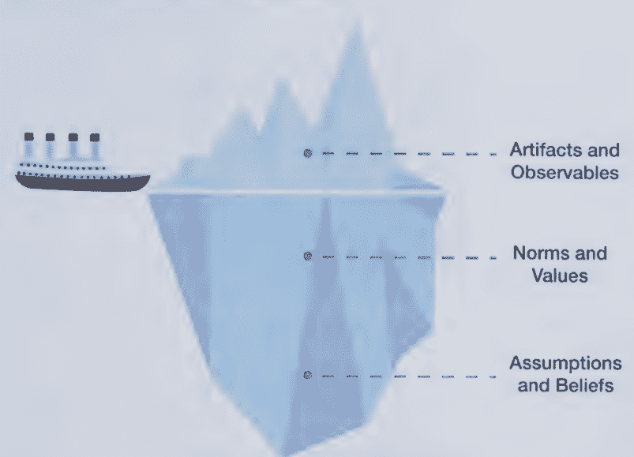
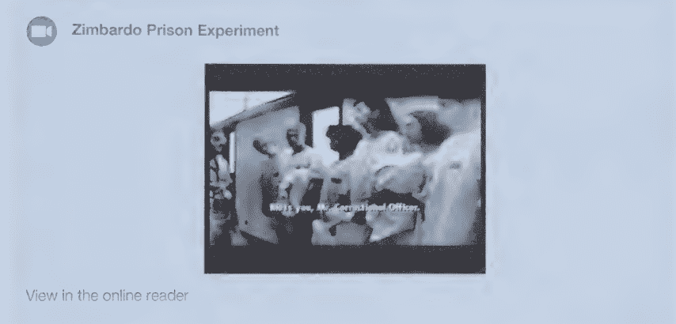
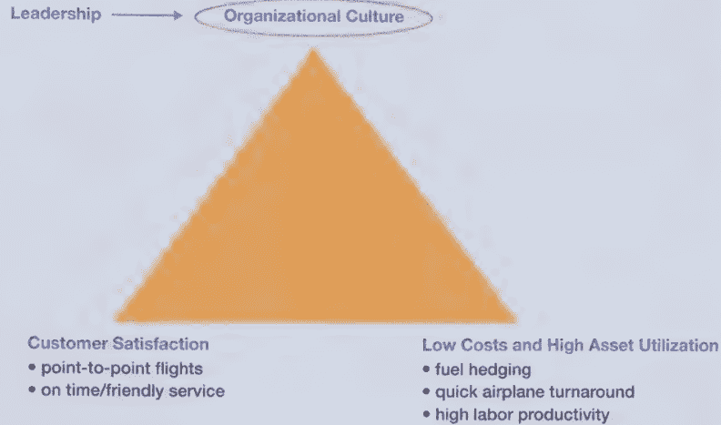
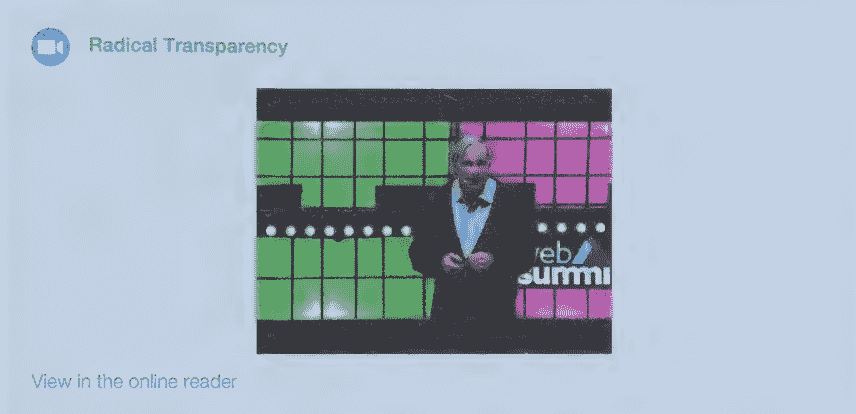
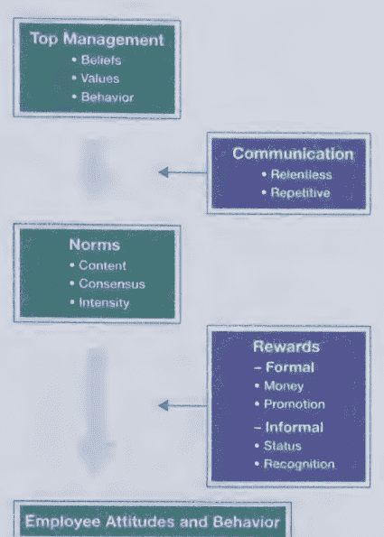
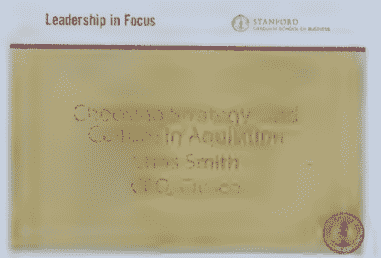

## 第 12 章 战略领导力与塑造组织文化

> “如果您真的要转型一个企业，就必须了解文化……我花了五十五岁的年纪才明白这一点。文化就是一切。”——IBM 1993–2002 年首席执行官 Lou Gerstner

### 学习目标

- 1. 解释竞争优势的关键要素，以及塑造组织文化与实现此类优势的相关性。
- 2. 描述将文化与愿景、使命和战略保持一致所涉及的问题。
- 3. 确定文化强度可能是好事也可能是坏事。
- 4. 解释并管理领导者创建和强化文化所采取的步骤。

在本书的前几章中，我们主要考虑了组织中不同管理层级相关的领导素质和行为。在第 10 章中，我们开始在考察核心宗旨和愿景时，将注意力转向更具战略性或更高层级的管理层。在本章和下一章中，我们继续关注战略领导力。战略领导力的宏观目标是为企业创造 **竞争优势**。什么是竞争优势？回答这个问题的一种方法是采用基于资源的视角，以理解企业的宝贵资源，以及这些资源如何用于创造竞争优势。如果资源满足以下条件，则可创造此类优势：

- 有价值，能使企业提高效率和效能；
- 稀有且不易被其他企业模仿；以及
- 非替代性或不易被其他非稀缺资源取替。[1]

**竞争优势**

企业基于有价值、稀有且不易模仿、非替代性资源为自身创造的优势。

组织文化是企业实现竞争优势的一种途径。文化可以很有价值；例如，在可能激励员工、帮助服务客户以及激发创新方面。但是，仅有价值并不能保证竞争优势。如果某个有价值的东西可以被竞争对手轻易复制或模仿，那么它就不能作为竞争优势。尽管如此，文化不容易被复制或模仿，因为它涉及价值观、信念和规范等要素，这些要素需要长时间发展，并在组织成员中深植和共享。此外，文化及其创造的潜在价值是非替代性的。换句话说，它不能轻易被非稀缺资源（例如培训计划）所取代。换句话说，文化可以创造的有价值效果在很大程度上仅属于文化本身。本章后面在讨论领导文化的机制时，我们将看到培训计划如何帮助巩固或深植文化。但是，培训本身不应被视为文化作为竞争优势的替代品。

本章所描绘的，战略领导者的职责是识别、保护和培育符合上述竞争优势标准的资源。领导者通过以下三个关键步骤来做到这一点：

- 1. 建立或重新定向使命（或核心宗旨）以及共同愿景
- 2. 制定战略
- 3. 实施使命、愿景和战略

第 2 步，制定战略，是战略管理书籍和课程中主要讨论的问题。第 1 步和第 3 步涉及战略领导力，这就是为什么我们在这本书中关注这两个步骤。在一定程度上，我们在第 11 章中解决了第 1 步，我们将在第 13 章中继续讨论“重新定向”，因为我们正在考虑战略领导力在组织变革中的作用。在本章中，我们考虑战略领导者如何利用第 3 步来塑造组织文化，以建立、实施，有时还要重新定向使命、愿景和战略——最终帮助实现竞争优势。在进一步描述领导力、文化和竞争优势之间的联系之前，我们首先关注组织的背景或环境如何创造持续需要积极的战略领导力，包括构建和塑造组织文化。

### 12.1 环境背景、竞争优势与组织文化

将战略领导力置于背景中很重要；具体来说，是企业的环境背景。在很多方面，战略领导力关乎持续监控或扫描组织的环境背景，以确定新趋势、威胁和机遇——所有这些都可能（积极或消极）影响竞争优势。该背景大致可沿三个维度来描述：

- 1. 经济（即全球化趋势、竞争加剧）；
- 2. 监管（即可能影响企业开展业务方式的不断变化的地方、国家和全球法律/法规）；以及
- 3. 技术（即不断变化的技术如何影响工作流程、产品和服务）。

环境的某些方面对特定企业的相关性程度不一，取决于其业务和客户的性质。例如，监管问题尤其与医疗保健和能源行业相关。技术问题尤其与电子行业的企业相关。无论企业在哪个行业竞争，战略领导者的职责都是持续关注可能挑战现状的趋势和变化，即组织当前如何在其环境中运作以保持竞争优势。在本章中，我们的重点是战略领导者如何构建或塑造组织文化，以帮助确保其企业在环境中保持竞争力。如果存在文化差距，那么组织的价值观、规范和行为将不会与其环境的需求或要求保持一致，这可能会导致竞争劣势。换句话说，理想文化与实际行为之间会存在差异。战略领导者的职责是识别何时出现此类差距，然后采取措施缩小差距。

让我们举个例子。20 世纪 90 年代初，IBM 公司正在走下坡路。其股价暴跌，许多华尔街分析师呼吁拆分该公司并分块出售。到 1992 年，已有超过 60,000 个工作岗位流失，尽管前任首席执行官努力推动转型，公司似乎已走投无路。1993 年，Lou Gerstner 成为 IBM 历史上首位被任命为首席执行官的外部人士。在接下来的十年里，在他的领导下，该公司从一家失败的电脑制造商转型为一家成功的软件和服务企业。在描述这次转型时，Gerstner 声称，之前的管理层无法转型 IBM 的主要原因并非由于尝试执行新战略。相反，情况是价值观和文化是为早期的时间点和其他战略而创建的。他主张：“直到我们解决了文化、价值观和行为问题，我们才能改变 IBM。”[4]

### 组织文化与竞争优势

举几个例子，可以说明在航空业取得成功有多难，这就是为什么组织文化（以及随之而来的领导力）可能成为竞争优势。
http://en.wikipedia.org/wiki/Timeline_of_airline_bankruptcies
https://www.cnn.com/2017/04/10/travel/passenger-removed-united-flight-trnd/index.html

IBM 的故事只是众多例子之一，在这些例子中，组织文化和领导力被视为竞争优势的来源（例如西南航空、谷歌、诺德斯特龙、Zappos），或者作为变革的障碍和竞争劣势的来源（例如 IBM、富国银行、柯达、安然）。德勤最近的一项研究揭示，86% 的美国高管认为文化是潜在的竞争优势，对企业成功至关重要。[5] 对高管的另一项最近调查发现，78% 的财富 1000 强首席执行官和首席财务官将文化视为影响企业价值的前三个因素之一。[6] 研究人员对该主题的回顾揭示了该话题上超过 4,600 项研究。[7] 然而，尽管受到所有这些关注，人们对什么是文化以及如何管理文化仍缺乏清晰认识。例如，在德勤研究中，68% 的受访者表示他们不理解文化，只有 19% 认为其组织拥有正确的文化。

公司领导显然认为文化很重要，但文化究竟是什么？为什么它对于创造竞争优势如此重要？也许最重要的是，领导者如何创建、管理和改变文化？如果我们不清楚什么是文化，那么就很难看出它可能对竞争优势有何重要性，更重要的是，领导者如何创建和改变它。我们将在本章中解决这些问题。通过这样做，您将看到当文化与战略正确对齐时，它可以成为竞争优势的明确来源。或者，当文化不匹配时，它会阻碍战略的实施并成为竞争劣势。

### 西捷航空与竞争优势

在线阅读器中查看

## 解决冲突

WestJet 作为一家经历过一些内部冲突（例如，管理层与飞行员之间）的公司，但由于其深植的文化，能够以最小的损害解决这些冲突。

https://www.thestar.com/calgary/2018/05/14/westjets-pilot-troubles-might-be-just-the-beginning-of-a-very-bumpy-ride-.html

https://globalnews.ca/news/4232716/westjet-pilots-settlement-agreement/

### 12.2 组织文化究竟关乎什么？

组织文化
组织成员共享的关于如何思考和行动的期望。

文化可以在不同层面上加以考察。例如，社会或国家具有可识别的文化。[8] 但我们在此关注的是组织层面的文化理解与识别。广义上，**组织文化**是指组织成员共享的关于如何思考和行动的期望。这些期望基于共享的假设、价值观和信念来确定，这些假设、价值观和信念定义了什么是重要的，同时还包括定义组织成员适当态度和行为的规范。因此，这些社会期望在无人监督或无人可咨询指导时，充当着成员应如何行为的重要指南。总之，组织文化代表共享的价值观（定义什么是重要的）以及规范或共享的社会期望，这些规范或期望定义了组织成员适当的态度和行为。

思考组织文化的一个有用方法是由埃德·沙因（Ed Schein）提出的，他或许是组织文化领域最重要的学者。[9] 遵循冰山隐喻（参见图 12.1），他建议我们将文化视为发生在三个不同层面：（1）关于组织的基本潜在假设和信念，这些可能是无意识的或被视为理所当然的（例如，人们是自私自利的，需要被仔细监视，与人们本性善良且可信赖的观点相对），（2）可以宣称的规范和价值观（例如，员工是我们最重要的资产且可信赖，与我们确实不信任员工的观点相对），以及（3）像公司象征物、着装和语言这样的文化产物，这些是可见的，但有时难以解读。在他的开创性著作中，沙因首先断言：“领导者做的真正重要的唯一事情就是创造和管理文化（第 2 页）。”大约 300 页之后，他得出结论：“领导力独特而本质的特征是操纵文化（第 317 页）。”

## 图 12.1 沟通的冰山模型

规范显然是组织文化的一个关键方面。根据公司不同，这些规范可能包括我们如何处理以下重要事项：

- 彼此相处
- 与客户打交道
- 处理分歧
- 关注把事情做对（例如，注意细节）
- 尝试做新事物或进行创新
- 对待他人

它们还可能告诉我们其他一些更具体的事情，例如：

- 如何着装
- 我们彼此之间是多正式或多非正式（例如，使用头衔 versus 使用名字）
- 组织的物理布局是什么样子（例如，私人办公室 versus 卡位间）
- 我们使用哪些类型的术语（例如，非常正式 versus 更口语化或流行文化术语）

例如，在某些组织中，人们被期望彬彬有礼，绝不挑战老板。如果有人这样做，我们可能会观察到其他人警告那个人：“我们这里不是这样做事的。”如果该个体继续发言并表达不同意见，那个人甚至可能受到制裁或被要求离开。而在其他组织中，比如英特尔（一家大型半导体公司）或麦肯锡（一家主要的咨询公司），则期望完全相反的行为。英特尔的员工被教导“建设性对抗”，即他们被期望在每次不同意时都挑战他人。在麦肯锡，所有员工都通过文化规范被教导，如果他们不同意他人，即使对方是高级管理人员，他们也有“提出异议的义务”。

在 Zappos 和 Nordstrom，人们期望高水平的客户服务，员工被通过规范和价值观鼓励，尽力帮助客户，即使这意味着将他们推荐给竞争对手。例如，在 Nordstrom，员工手册（即一个可以在隐喻冰山表面之上观察到的产物）只有一页，只有一条规则：“在所有情况下都运用你的良好判断。没有其他规则。”这意味着，员工被期望通过规范和价值观，在合理范围内尽其所能满足客户，即使这意味着无条件接受退货商品。其他公司可能有不同的规范和价值观，客户就不那么重要了。例如，想想你上一次致电客户服务热线，等待了 20 分钟，而录音提醒你“您的通话对我们非常重要”时的情形。

但是，一位有兴趣建立和塑造文化的领导者应该从哪里开始？虽然图 12.1 所描绘的所有三个层面都有大量有趣的研究，并且每个层面都可能很重要，但从领导角度来看，我们最有用的关注点是规范和价值观，因为这些可以被直接塑造和管理。[10] 从这个角度来看，文化规范和价值观可以通过领导者及其建立的系统得到强化（例如，绩效考核系统中衡量和奖励的内容）。

## 规范如何影响行为

在 1970 年代，斯坦福大学教授菲利普·津巴多（Phil Zimbardo）进行了一项实验，扮演狱卒的学生开始在模拟监狱中虐待扮演囚犯的其他学生。[11]

在著名的 1960 年代米尔格拉姆实验中，当另一个人回答不正确时，受试者被要求对其施加越来越高的电击。[12] 结果通常显示，当受到权威人物（即实验者）的压力时，超过 60% 的参与者准备施加他们认为可能是致命的电击。人们为什么会这样行为？

## 米尔格拉姆实验

在在线阅读器中查看

答案在于规范（或社会期望）的力量，以及在许多情况下，我们如何寻求来自情境或领导职位人士的指导，以了解自己应如何感受和行动。在上述监狱实验中，被安置在狱卒位置的受试者开始感到强大，并对其他被安置为囚犯的受试者采取胁迫方式行事。在米尔格拉姆实验中，受试者对实验者表现出服从，即使他们自己感到不自在并质疑自己的行为。在社会环境中，包括我们工作的组织，我们常常依赖来自情境和他人（例如，领导者）的信息来指导我们自己的行为。这种影响有两种形式：（1）信息性社会影响或描述性规范（例如，这里没人戴领带），或（2）规范性社会影响或命令性规范，即对以特定方式行为或不行为存在赞同或不赞同（例如，我们嘲笑那些戴领带的人）。虽然这种一致性可能看起来无关紧要，但压倒性的证据表明，描述性规范和命令性规范是组织中人们行为的强大决定因素。组织成员之间关于如何思考和行为的一致性，有助于人们融入并协调行动。不遵守可能导致个人在社会和心理上被孤立或排除在群体之外。

> **强文化**
>
> 组织成员之间紧密共享的规范、信念和价值观。

当组织成员同意某些行为很重要（即对规范内容存在一致性），并且人们感到强烈并愿意对他人不遵守行为进行制裁（即对规范存在强度）时，就存在一种强文化。也就是说，强文化是指组织成员之间关于适当行为的规范、信念和价值观紧密共享的文化。在这种情况下，新成员有两种选择：（1）他们可以选择遵守并融入，或（2）不遵守，并且很可能在社会和心理上被排斥。许多人低估的一点是，文化对行为的影响有多么强大。通常，我们倾向于认为行为是个人价值观、需求和人格的函数，而不是他人的期望。虽然人格可能是在无约束情况下行为的一个重要决定因素，但在存在非常强大规范和价值观的群体和组织中（例如，宗教组织、军队），它的重要性要小得多。在这些情况下，行为很大程度上由他人的期望驱动。或许最重要的是，领导者可以对规范和价值观——及其执行——产生巨大影响。因此，领导者有必要了解在其组织中发展起来并可能根植于文化中的规范和价值观。强文化可以既积极又有价值。但正如上述实验所示，强文化也可能是消极和破坏性的。

### 12.3 将文化与愿景、使命和战略保持一致

是否存在“正确”或最佳的组织文化？换个说法，是否存在某些特定的规范和价值观，能使任何组织变得有效，从而领导者应致力于推动这些规范和价值观？总体而言，答案是一个“有条件”的不。话虽如此，也许某些被强烈共享的规范和价值观类型，对几乎任何公司都能证明是有效的。例如，有人可能会争论，从长远来看，以共享的道德规范和价值观为特征的组织文化，比道德较差的文化更有可能维持竞争优势。

除了道德规范和价值观之外，组织文化可以用多个维度来描述。一种流行的描述方式考虑以下四个维度及其相关的规范和价值观：

- 1. 秩序与一致性——遵守规则和程序，强调稳定而非变化，自上而下的命令与控制，依赖经过验证的方法；
- 2. 成就——成为最佳（例如，在行业中占据领先的市场份额），采取积极行动，强调完成“业绩指标”，强调个人主动性，竞争性；
- 3. 氏族——强调建立共识和团队合作，平等地位，对他人的需求保持敏感，拥有友好或“家庭”式环境；
- 4. 适应性——强调实验、创新、创造力和冒险精神。[64]

关于这些维度，应特别注意两个问题。首先，虽然有些组织会强调或将上述某个维度作为其文化中的主要维度，但其他组织可能试图同时强调多个维度。此外，在某种程度上，一个组织的文化中可能至少包含上述每个维度的一些元素。其次，有证据表明，那些促进创新（即适应性）和协作（即氏族文化）的组织，更有可能在财务上取得更好的业绩，并且员工对工作体验更加积极。[65] 相反，以高度秩序和一致性为特征的文化可能变得过于墨守成规或官僚化，因此在应对不断变化的环境需求时缺乏灵活性。话虽如此，真正的关键在于：企业文化中强调的维度与追求竞争优势之间应当保持一致。换句话说，应将文化作为一种机制，以确保追求能够实现竞争优势的愿景、使命和战略。

有些公司规模相当大，这使得构建和塑造文化的任务更加困难。例如，沃尔玛在美国拥有140万名员工。在如此大型的公司中，领导者如何确保这些员工协调一致并做正确的事情？答案是，任何战略领导者的基本任务是协调大量从事相互依赖活动的人的工作。为了实现这一目标，战略领导者设计控制系统，帮助员工了解什么很重要以及如何行为。这意味着既要使用正式控制系统（例如，绩效管理系统、预算系统、库存控制系统等），也要使用社会控制系统（例如，组织的文化），以及正式与社会控制系统的一致性。

要取得成功，领导者需要设计支持或与企业使命和文化以及领导者的愿景和战略目标保持一致的控制系统。如果某人是追求向客户提供低成本产品的组织中的领导者，那么该领导者可能需要能够监控成本和开支并在必要时采取措施降低它们的控制系统。至少在某种程度上，领导者可能需要建立秩序与一致性文化。如果领导者的战略是成为创新者，那么此人需要能够促进创新的控制系统和*适应性*文化（例如，为新产品提供资源并衡量新产品与旧产品的销售额）。此外，如果创新是关键战略目标，“控制”可能会开始类似于前几章讨论的悖论。也就是说，领导者通常通过放弃控制来获得控制。无论如何，大量研究证实，战略、控制系统和文化的一致性与组织绩效相关。[16]

最后，需要指出的是，上面描述的四个维度仅代表理解组织文化的一个框架或一组维度。例如，文化还可以根据规范、价值观和信念的道德或伦理程度来描述。我们将在本章后面提到的视频案例中看到道德/伦理文化的一个示例。

## 案例示例

### 西南航空。

由于组织文化可以被视为一种社会控制系统，因此将文化与愿景、使命和战略保持一致的相同逻辑也适用。如果领导者的战略强调低成本，组织文化是否支持这一点？为了说明这一观点，请考虑西南航空，这是美国最大且最成功的低成本航空公司。西南航空发展了何种文化来确保低成本？航空业是资本密集型业务，在任何资本密集型业务（例如，航空公司、酒店、炼油厂、半导体制造）中，成功的关键之一是高资产利用率。在西南航空的情况中，这意味着让飞机保持在空中。这一问题的一部分通过正式控制系统以及高效安排飞机的*秩序与一致性文化*的某些方面来处理。但同样重要，甚至更重要的是，通过快速周转飞机并对客户做出响应。在这里，关键是一种促进所有员工灵活性和创造力（即*适应性文化*）以及团队合作（即*氏族文化*）的文化。

团队合作的一个例子是，西南航空的员工并不严格划分各自的角色。为了快速周转飞机，飞行员、地勤人员和乘务员通常会共同努力，让停放的飞机为下一班飞行做好准备。简而言之，因为员工彼此关心并关心公司，他们更愿意出手帮忙、互相支持，并在出现问题时主动采取行动解决问题。[17]

图12.2描绘了西南航空的“成功三角”，组织文化是三角形的一个顶点。但是，如图12.2所示，在该公司的历史上，已经执行了一些关键决策或战略，以实施其将客户满意度与低成本追求相结合的强调。*首先*，客户满意度不仅仅是一句口号，而是通过多种政策和策略得以实施。例如，西南航空试图在城市之间提供点对点（或直达）航班。尽管在行业中并非完全独特，但这种调度策略与达美和联合等大型航空公司的枢纽辐射模式形成对比，后者依赖于将乘客通过一个或多个枢纽机场集中，再通过联程航班飞往目的地城市。虽然作为一种调度手段有些高效，但枢纽辐射模式的缺点在于，它迫使乘客乘坐不理想的额外联程航班。此外，西南航空强调准点率，并鼓励员工提供友好的服务。

### 图12.2 西南航空的成功三角：将文化与战略保持一致

其次，西南航空强调低成本和高资产利用率。航空业代表高固定资产行业，因此成功的关键是高效利用资产。例如，西南航空现任首席执行官加里·凯利是燃料对冲技术的架构师，该公司多年来一直使用该技术大幅降低成本。[8] 确实，燃料是航空公司的主要成本之一，控制此类成本的独特策略或技术可以代表竞争优势。此外，在地面上，西南航空能够快速周转飞机，使其准备好再次起飞。这在一定程度上归功于员工合作（例如，飞行员帮助打扫机舱），而文化强调了这一点。这也归因于与行业规范相比相对较低的劳动力成本。

随着时间的推移，西南航空取得了什么样的结果？如图12.2所示，西南航空的文化是其战略成功的关键部分，尽管并非唯一原因。该文化与其产生客户满意度、保持低成本并有效利用资产的能力相互关联。在其历史上，西南航空的战略领导者一直做出明智的选择并实施政策，以不断将文化和战略保持一致，从而实现竞争优势。有趣的是，自数十年前成立以来，西南航空从未出现过亏损的季度——也就是说，直到2020年疫情爆发，航空业基本陷入瘫痪。除了2020年，其竞争对手当然不能这么说，他们不仅在疫情前和疫情期间都未能实现季度盈利，而且多年来还经历了多次破产。[9]

### Zappos。

文化如何成为竞争优势来源的另一个类似例证可以在Zappos（一家成功的在线鞋类公司）中看到。1998年，托尼·谢伊将他的第一家互联网公司以2.85亿美元的价格出售给微软。1999年，他投资了一家正在线上销售鞋子的新公司。尽管起初持怀疑态度，但他很快意识到这可能是一个巨大的市场。但要取得成功，该公司需要做到五件事：（1）储备巨量库存，（2）提供全天候访问，（3）提供快速配送，（4）为客户提供便捷的退货服务，（5）最重要的是，提供卓越的客户服务。

从一开始，谢伊就强调了文化的重要性：“我们的全部信念是，如果把文化搞对了，提供优质客户服务或打造长期持久品牌等大部分其他事情都会自然而然地发生……Zappos是一家碰巧卖鞋子的服务公司。”[10] Zappos的文化建立在10个价值观之上，其中包括提供WOW级服务、拥抱变化、以及创造乐趣和一点点古怪。

Zappos 强调只雇佣符合其文化的人，用 Zappos 的方式培训所有新员工，并鼓励所有员工始终帮助他们的客户（内部或外部）。这意味着客服代表与客户通话的时间没有限制（最长的客户通话接近六小时）。到 2008 年，公司销售额超过 10 亿美元。近年来，Zappos 超过 75% 的客户是回头客，公司已从仅销售鞋类扩展到家居用品和其他服装产品。这种客户忠诚度直接源于他们的文化。

赛普拉斯半导体。除了帮助执行愿景、使命和策略之外，组织文化在吸引、激励和留住员工方面也很有价值。如果一家公司有非常强烈的规范和价值观，这些可以作为信号传递给潜在员工，帮助他们决定该公司是否适合他们。赛普拉斯半导体是一家有时被称为“硅谷海军陆战队”的公司。(21) 它在很大程度上具有成就文化，强调非常高的个人绩效水平、高度关注细节以及完全的透明和开放。它不强调协作（即，不是氏族文化）或客户。尽管如此，由于文化非常清晰，赛普拉斯可以吸引喜欢这种工作环境的人，并能够筛选出不合适的人。有些人可能会发现赛普拉斯的文化过于侵略性和限制性，但对于喜欢这种文化的人来说，赛普拉斯是一个理想的工作场所。

## “强势”文化与竞争优势

通过明确规范和价值观，强势文化也可以成为员工极佳的激励来源。如果员工喜欢该文化以及组织所代表的东西，他们可能会认同该公司；也就是说，他们钦佩公司所代表的东西，并为自己在那里工作而自豪。此外，他们可能会将公司的规范和价值观内化为自己的；也就是说，他们自己的行为规范和价值观与组织的相同。如果员工认同或内化组织的规范和价值观，研究表明他们更有可能高度积极并愿意为公司多付出努力。(22)

总而言之，文化之所以对领导者及其组织很重要，有多方面的原因。首先，作为一种社会控制系统，它可以帮助（或阻碍）战略的执行。其次，当组织拥有强势文化时，它能更好地吸引、激励和留住合适类型的员工，并更有可能筛选出那些不合适的人。但总体而言，当文化强势时（即组织成员之间紧密共享规范、信念和价值观），它可以帮助创造竞争优势。具体来说，强势文化可以满足竞争优势的要求，因为它提供了价值，不容易被其他公司模仿，也难以用其他非稀缺资源替代。

话虽如此，我们也应该承认，如前所述，强势或紧密的文化并不总是一件好事。强势文化可能会鼓励对公司及其员工都有破坏性的规范和价值观，多年前的安然公司就是这样的案例。(23) 安然拥有一种强势文化，但其特征是不道德的规范和价值观。尽管这些规范和价值观被员工广泛共享，但由此产生的行为和行动并未在长远中带来竞争优势。作为另一个例子，一家公司随时间发展可能形成一种强势文化，这种文化不仅未能将适应性作为一个维度，反而包含阻碍灵活性和变革的规范和价值观。在一个越来越要求公司不断变革的世界中，这种强势文化可能会适得其反。下一节将描述领导者如何利用这些见解来创造和塑造竞争优势的文化。

### 12.4 领导者如何创建和强化文化？

战略领导者如何在其组织中创建和塑造规范和价值观？表 12.1 展示了世界各地的一组强势文化公司。它们包括丹麦的马士基、日本的发那科以及美国的 Zappos 和 Walmart。它们包括大小公司、私人公司、上市公司和军事组织。它们涵盖从高科技到低科技、金融服务、制造公司和医疗保健等行业。尽管定义它们的规范和价值观往往各不相同，但其领导者创建和塑造它们的过程和技术高度相似。

| Company | Company |
|---|---|
| Nordstrom | Google |
| Walmart | Oracle |
| First Republic bank | Southwest Airlines |
| Bridgewater Associates | United States Marine Corps |
| SAS Institute | Fanuc |
| IDEO | Nike |
| Mars | Intel |
| Lululemon | DaVita |
| Zappos | Netflix |
| Facebook | Trader Joe's |
| Commerce Bank | McKinsey |
| Mary Kay | Maersk |
| Special Forces | The Ritz Carlton |
| JetBlue Airways | SEALs |
| Publix | ISS |
| Sewell | NetApp |
| Cypress Semiconductor | REI |
| P&G | USAA |
| Disney | Apple |
| Chick-Fil-A | Twitter |
| Costco | Patagonia |
| Whole Foods | Samsung |

如前所述，如果文化通过规范性影响和信息性影响发挥作用，从而指导员工关注什么以及如何行动，那么战略领导者的工作就是确保人们获得非常清晰的信号，告诉他们什么重要以及如何行动。从这个意义上说，这全部关乎所谓的社会建构；也就是说，战略领导者的根本任务是帮助员工解释和理解他们正在做什么以及为什么这样做。这听起来可能有点难以理解，但正如我们将看到的，它实际上非常简单。

从新员工的角度来看待这个挑战。想象你刚刚加入一家新公司。你可能在想什么？你的首要关注点之一就是弄清楚你需要如何行为才能融入并取得成功。你将如何决定如何行为才能被群体接受并在工作中取得成功？可以肯定的是，你可能会观察他人，仔细聆听高级领导者说什么和做什么，看看谁得到了奖励，并向他人寻求关于该做什么或避免做什么的建议。你可能很快就会开始了解文化的方方面面。我应该早点来晚点走吗？我应该如何着装？我应该如何对待其他员工或客户/客人？可以走捷径吗？我可以反对老板吗？可以犯错误吗？随着时间的推移，这些问题的答案会变得清晰。正如我们所指出的，在强势文化中，你将需要如何行为才能融入并取得成功会更加清晰。在弱势文化中，适当的行为方式就不那么清晰了。

另一个值得注意的有趣现象是，如果直接询问，组织中老资格员工（即任职时间较长的人）很少有人能公开阐述公司共享的规范和价值观。由于文化（如规范和价值观）大部分比喻上都在表面之下，组织老兵可能无法阐述其组织文化的某些方面。他们日复一日地生活在那种文化中。但就像鱼在水中一样，人们学会了视文化为理所当然。[24] 本书第 10 章讨论的社会层面的文化类型也是如此。

### 领导文化的机制

如果文化通过规范和价值观运作，领导者可以做些什么来塑造和改变它们呢？了解文化通过规范和价值观运作，结果发现这些组织的领导者使用五种常见的机制或杠杆。这些杠杆都基于以下心理学：当人们处于对“正确”行为方式有非常明确期望的环境中时，很难不遵守。在这种情况下，我们通常只有两种选择：（1）遵守并按预期行事，因此融入并被接受；或者（2）不按预期行事，在大多数情况下，会在心理上或身体上被排除在组织之外。以下是五个关键杠杆：

- 1. 领导者的日常行为。

大多数人都希望融入并被所在的群体或组织接受。为了做到这一点，我们会关注领导者。我们聆听他们说的话，观察他们做的事。换句话说，我们“观察老板”。我们试图弄清楚他们认为什么重要，以便自己能够取得成功。我们会注意他们花时间在哪里、提出什么问题、喜欢和不喜欢什么，以及他们认为什么是高优先级。我们也会注意他们是否以身作则（而非虚伪或不一致）以及是否走基层。我们利用这些信息来决定自己如何行动、关注什么和忽略什么，以及如何被视为一名好员工。可以把领导者视为向组织发送信号的信号发生器，这反过来又帮助员工解读自己应该如何行动。当他们的信号清晰且一致时，员工会很快学会如何行动。例如，在 Zappos，已故首席执行官托尼·谢伊（Tony Hsieh）没有私人办公室——只是他人中间的一个普通隔间。领导者的沟通和行为是领导文化的第一个，也许也是最重要的杠杆。

- 2. 社会活动和仪式。

强势文化领导者通常鼓励社会活动和仪式，以在组织成员之间建立联系。他们强调内在奖励和外在奖励（成为群体的一部分本身就是一种奖励），并利用群体认可来传递群体成员身份。他们甚至可能让家人、朋友和客户参与这些活动。例如，Mary Kay Ash（Mary Kay 化妆品创始人）在举办精心策划的活动方面非常有效

华丽的年度颁奖典礼，奖励包括珠宝、皮草、豪车等等，以此奖励员工。[25]

## 3. 通过故事、专业语言和符号传递明确信号。

强文化组织通常在传达对人员行为的期望方面非常清晰，有时甚至会暗示该组织并不适合每个人，或许只有特殊的人才能成功（例如，“少数人。骄傲的人。海军陆战队。”）。这些信息通过故事不断传达，故事生动地描绘了那些态度和行为体现企业文化的员工。他们庆祝这些个人，并常常将他们塑造成英雄。有时故事由领导者本人讲述，尽管文化信息也可能由员工、客户和其他领导者的代理人传播。[26] 此外，领导者和员工可能会使用某些专属于组织的短语、口号或术语，以强化成员身份感和归属感（例如，“谷歌员工”，“一人为所有人，所有人为一人”）。此外，符号或象征性行动可以传达文化的某些方面。例如，想象一家公司总部大楼，其中包括高层管理团队成员、人力资源（HR）专家和客户服务员工。如果高层管理成员位于顶层，而人力资源和客户服务员工位于较低楼层，这会传递关于文化的什么信号？或者，如果高层管理成员位于第一层或中间楼层，而人力资源和客户服务员工位于顶层，又会传递什么信号？简而言之，实体建筑内部员工和部门的布局甚至可以象征一种文化。

- 4. 选拔与社会化。

强文化组织的战略领导者喜欢使用选拔和社会化程序，以帮助确保文化不断得到加强。毕竟，古老的谚语“造就一个地方的是人”是正确的。[27] 如果人确实造就一个地方，那么就必须以文化为宗旨正确选拔他们，并建立机制让他们学习或被社会化到公司的特定规范和价值观中。例如，强文化公司（例如，Google、西南航空、Zappos、Bridgewater 和 Cypress）的招聘流程通常包含多个步骤，而这些流程中有两点是共同的。首先，新员工的选拔在很大程度上（或甚至更多）基于他们与公司文化价值观的契合度，而非仅仅基于其技术技能或工作经验。其次，选拔过程不仅涉及人力资源专家，实际团队成员或同事也会参与（例如，现有团队成员面试潜在候选人）。此类程序的设计既帮助筛选文化契合的人员，也让申请人有机会主动退出。例如，在 Zappos 培训计划接近尾声时，新员工会被提供 3,000 美元辞职，以确保留下的人不仅仅是为了薪水。2015 年，Zappos 收到了超过 250,000 份申请，而只有 250 个职位空缺。[28] 我们应该注意，选拔和社会化对于公司基层管理层可能尤为重要。如果战略领导者无法指望基层领导者帮助朝着统一的方向构建和塑造文化，那么形成与战略领导者愿景相符的强文化的可能性将微乎其微。

培训是实现技能发展和社会化的关键机制。然而，回到本章开头提出的竞争优势要素，培训不应被视为文化的替代品；相反，它仅仅是另一种帮助植根文化的机制。让我们以客户服务为例。关于客户服务的价值观和信念，随着时间的推移，可以基于本节中提到的其他领导文化机制（例如领导者的日常行动和沟通）成为文化的一部分。如果客户服务不能通过这些其他机制在文化中不断植根或加强，那么客户服务培训对员工行为产生积极影响的可能性就不大。简而言之，培训本身不应被视为文化的替代品。

- 5. 精心对齐的奖励系统。

最后，强文化组织的领导者确保奖励系统与预期行为精确对齐。显然，金钱是一种重要的激励因素，但它不是塑造文化的好方法。通常，货币奖励的频率过低，无法强化特定行为。相反，强文化公司的领导者更可能使用认可、赞许和地位来表明符合规范。有时这些象征性奖励（例如，本月员工、感谢证书）可能看起来微不足道，但当它们被真诚地颁发时，可以作为强化文化的强大力量。许多组织面临的巨大危险是，正式奖励系统（例如，金钱和晋升）可能与期望的行为不一致。例如，当领导者声称团队合作或创新很重要，但员工看到非团队合作者却得到晋升，或者那些尝试创新却失败的人受到惩罚时，他们很快就会形成这样的信念：他们的领导者要么脱离现实，要么更糟，是操纵者。简而言之，如果领导者实际上奖励 A，却口头声称期望 B，那么文化期望将变得不清晰，员工也会变得缺乏动力。[29]

总之，这五种机制基于这样一个观点：要塑造文化并使其强大，领导者需要就预期的态度和行为发出强烈信号。通过始终如一地传递关于预期行为的相同信息，让人们参与进来，提供文化的生动示例，并公开地选拔、社会化和奖励那些践行价值观的人，领导者帮助员工理解成功所需条件。随着时间的推移，这些期望可以植根于组织中，以至于新员工能迅速理解对他们的期望。

## 案例示例

从战略领导者的角度来看，关键是向组织成员发送清晰的信号。图 12.3 提供了实现这一目标的大致框架。首先，战略领导者的信念和价值观可以作为其行动的基础。在美国最大的对冲基金 Bridgewater Associates（桥水基金）中，CEO 雷·达利奥（Ray Dalio）相信他所谓的“激进透明”。[80] 他希望公司里每个人都始终彼此完全诚实，即使说真话让人不舒服。因此，所有会议都会被录像，并提供给所有员工观看。新员工通常会对批评的直截了当感到震惊，但达利奥认为，完全诚实是建立理想精英制度的唯一方式。他的价值观和信念塑造了他的行为。

这些行为（包括他的行为以及他在组织设计方面所做的选择）向员工传达了什么重要以及如何行事。

## 图 12.3 文化是如何被领导的

其次，达利奥和他的团队不断地向他人传达什么重要以及他们应当如何行为。研究表明，当一条信息反复传达时，人们更有可能相信它。当战略领导者不断强化某些价值观和行动重要的信号时，我们开始明白他们是认真的。通用电气公司前任首席执行官杰克·韦尔奇（Jack Welch）曾说过，如果领导者想要有效地管理文化，就必须做两件事：(1) 不遗余力地传递相同的信息，以及 (2) 不断重复——即反复传达同一条信息。

如果战略领导者在传递文化内涵方面不遗余力，并且员工能看到其他人因行为得当而获得奖励（或受到惩罚），那么就会形成规范，告诉新人某些行为和态度是被期望的。随着时间的推移，这些规范会变得根深蒂固。例如，在桥水基金，员工使用 iPad 不断地相互评估以及评估他们的主管。这些评估会被录入员工的永久记录中，并公开供人查阅。被称为“队长”的指定经理会不断监控文化，以确保遵守原则。达利奥承认他的文化并不适合所有人，但他相信这是公司成功的核心。

桥水基金和其他强文化公司的共同点在于，其战略领导者在传达融入并取得成功所需的态度和行为方面非常清晰。他们还确保组织内的人力资源系统保持一致，包括他们寻求雇佣的人才类型、招聘方式、新员工的培训和发展方式、奖励哪些行为，以及晋升哪种类型的人。清晰的领导信号与一致的人力资源系统相结合，使人们对预期行为有了清晰的认识。

## 本章视频案例

本章视频案例强调了构建道德文化、以身作则以及作为领导者保持可见性的重要性。

## 克里斯·史密斯——文化、优先事项与收购

克里斯·史密斯是一家中型设备租赁公司的首席执行官，他描述了一个情景：他曾考虑收购一家文化似乎与其现有公司文化不一致的公司的利弊。

在在线阅读器中查看

## 结论

正如本章所见，组织文化可以是竞争优势的来源（例如，Zappos），也可以在与战略不一致时成为竞争劣势（例如，20 世纪 90 年代初的 IBM）。它也可以是员工之间自豪感和动力的来源，或是愤世嫉俗和人员流动的来源。把文化做对（即，创建或塑造文化）是战略领导者的一项基本任务。正如我们所示，如果领导者将文化视为共享的规范和价值观，以及由人和系统强化的行为模式，那么文化可以随时间被创建、塑造，甚至改变。在下一章中，我们将把注意力转向组织变革，包括显著重塑文化的可能性。

### 12.5 讨论问题

- 1. 什么使资源（或组织的其他方面）成为公司的竞争优势？组织文化如何/为何可以成为竞争优势？

- 2. 组织文化究竟是什么，为什么冰山模型（参见图 12.1）是文化的一个好隐喻？

- 3. 本章前面列出了组织文化的四个常见维度。你的组织（或你的大学）在这些维度上表现如何？你个人更希望在你所在的组织中看到哪些维度得到强调，为什么？

- 4. 什么是“强”组织文化？强文化是好事、坏事，还是取决于情况？请解释。

- 5. 领导力与文化之间有何联系？换句话说，领导者可以做些什么来帮助塑造组织文化？你在所在的组织中是否经历过任何示例？请解释。

## 尾注

- 1. 有关基于资源的企业观和竞争优势的更多信息，请参见 Barney, J. B. (1991). Firm resources and sustained competitive advantage. Journal of Management, 17, 99–120. 另参见 Barney, J. B. (2001). Is the resource-based “view” a useful perspective for strategic management research? Yes. Academy of Management Review, 26, 41–55.
- 2. 参见 Shoemaker, J. H., Krupp, S., & Howland, S. (2013). Strategic leadership: The essential skills. Harvard Business Review, January–February, 131–134.
- 3. 参见 Kilmann, R. H., Saxton, M. J., & Serpa, R. (1985). Gaining control of the corporate culture. San Francisco: Jossey-Bass.
- 4. Gerstner, L. V. (2016). Who says elephants can’t dance? Inside IBM’s historic turnaround. HarperCollins, 2003.
- 5. Deloitte Human Capital Trends (2016)
- 6. Graham, J.R., Harvey, C.R., Popadak, J. & Raigopal, S. (2016). Corporate culture: Evidence from the field. SSRN Paper. Abstract=2650602.
- 7. Hartnell, C., Ou, A. & Kinicki, A. (2011). Organizational culture and organizational effectiveness: A meta-analytic investigation of the competing values framework’s theoretical suppositions. Journal of Applied Psychology, 96, 677–694.
- 8. 为例，另参见 House, R. J., Dorfman, P. W., Javidan, M., Hanges, P. J., & Sully de Luque, M. F. (2014). Strategic leadership across cultures: The GLOBE study of CEO leadership behavior and effectiveness in 24 countries. Los Angeles: Sage.
- 9. Schein, E.H. (1985). Organizational culture and leadership. Jossey-Bass.
- 10. Chatman, J.A & O’Reilly, C.A. (2016). Paradigm lost: Reinvigorating the study of organizational culture. Research in Organizational Behavior, 36, 199–224.
- 11. Zimbardo, P. (1972). Stanford prison experiment: A simulation study of the psychology of imprisonment.
- 12. Milgram, S. (1964). Obedience to authority. Harper.
- 13. 参见 Arogyaswamy, B. & Byles, C. M. (1987). Organizational culture: Internal and external fits. Journal of Management, 13, 647–659.

- 14. 我们对这些维度的考察改编自 McDonald, P., Gandz, J. (1992). Getting value from shared values. Organizational Dynamics, 21(3), 64–76. 的工作。另参见 Denison, D. R., & Mishra, A. K. (1995). Toward a theory of organizational culture and effectiveness. Organization Science, 6, 204–223.
- 15. O’Reilly,C.A., Caldwell, D.F., Doerr, B. & Chatman, J. A. (2014). The promise and problems of organizational culture: CEO personality, culture and firm performance. Group & Organization Management, 39, 596–625.
- 16. O’Reilly, C. A. & Tushman, M.L. (2016). Lead and disrupt: How to solve the innovator’s dilemma. Stanford University Press.
- 17. 有关西南航空的更多信息，请参见 Gittell, J. H. (2003). The Southwest Airlines way. New York: McGraw Hill.
- 18. 参见 https://www.nytimes.com/2007/11/28/business/worldbusiness/28iht-hedge.4.8157580.html
- 19. 参见 http://airlines.datavisuals-u-s-bankruptcies-and-services-cessations/
- 20. Tony Hsieh, Delivering Happiness: A Path to Profits, Passion, and Purpose. Hachette Book Group, 2010
- 21. Caldwell, D. F. & O’Reilly, C. A. (2012). Cypress Semiconductor: A Fadervan of Entrepreneurs. Stanford Graduate School of Business Case OB-84.
- 22. Kristoff-Brown, A.L., Zimmerman, R.D. & Johnson, E.J. (2005). Consequences of individuals’ fit at work: A meta-analysis. Personnel Psychology, 58, 281–342.
- 23. 参见 https://www.forbes.com/sites/karstenstrauss/2013/05/14/enron-ethics-and-todays-corporate-values/#614ec36d5a6
- 24. 我们感谢本书的一位匿名评审提供了这一见解。
- 25. 参见 Farhan, A. (1993). Mary Kay’s lessons in leadership. Fortune (September 20), 68–77.
- 26. 参见 Gavin, B., Bakundi, P., & Waldman, D. A. (2010). Spreading the word: The role of surrogates in charismatic leadership processes. Academy of Management Review, 35, 477–494
- 27. 一篇沿着此思路的信息丰富且经典的文章是 Schneider, B. (1987). The people make the place. Personnel Psychology, 40, 437–453.
- 28. 参见 https://hbr.org/2010/07/how-i-did-it-zappos-ceo-on-going-to-extremes-for-customers
- 29. 一篇关于此主题的经典文章由 Kerr, S. (1995). On the folly of rewarding A, while hoping for B. Academy of Management Executive, 9(1), 7–14. 撰写。
- 30. Ray Dalio, Principles, Simon & Schuster, 2017.
