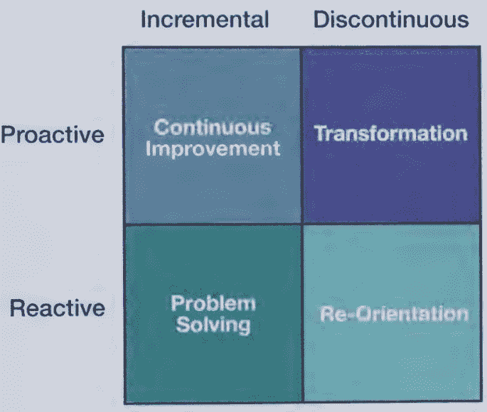
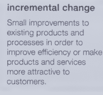
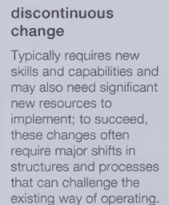
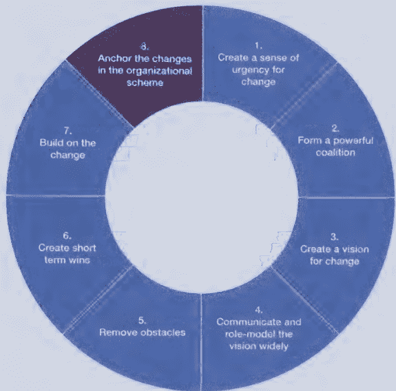
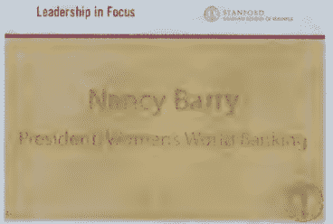

## 第 13 章

## 通过战略领导力推动组织变革

> > “如果你不喜欢变革，那么你将更不喜欢无足轻重。”——艾伦·穆拉利，2006–2014 年福特汽车公司首席执行官

> > “领导力是将愿景转化为现实的能力。”——沃伦·本尼斯，作者和管理顾问

### 学习目标

- 1. 解释由于技术、竞争和监管因素导致的变革步伐加快如何增加战略领导力的重要性。
- 2. 对比不同类型的组织变革，以及这些变革可能需要不同的领导策略。
- 3. 描述用于诊断和领导组织变革的变革框架。
- 4. 识别对变革抵制的主要原因，以及领导者如何应对这种抵制。

### 13.1 为何领导变革变得如此重要

以下公司有何共同点：IBM（计算机）、Ingram（电子产品分销）、强生（制药）；诺基亚（手机）、Vivendi（媒体）和丰田（汽车）？答案可能不太明显，因为这些公司来自不同国家，在不同行业竞争。但有一点将它们联系在一起：这些都是古老的公司（平均年龄 135 岁），之所以今天仍然存在，仅仅是因为在面对剧烈变革的需求时，它们有能够帮助其进入新业务的领导者。这些公司各自最初从事不同的业务，现在则在新的行业中竞争。现在请考虑以下公司：宝丽来、DEC、美国钢铁公司、史密斯-科罗纳、柯达和通用汽车。这些曾是知名公司，但在面对变革时失败，要么破产，要么被收购

被其他更成功的公司超越。这两份名单之间的关键区别是什么？答案是领导力。能够适应和改变的公司拥有能够发现新商业机会并使必要的改变发生的领导者，而失败的公司拥有面对变革需求时无法适应的领导者。

我们都知道我们生活在一个前所未有的变革时代。但有趣的是，最近的研究记录了两个管理人员必须理解的重要洞察。首先，证据表明变革的步伐正在加快。[1] 互联网、移动性和人工智能等新技术的渗透速度比历史上任何时候都快。今天平均汽车的计算能力比1969年首次将尼尔·阿姆斯特朗送上月球的阿波罗任务还要强大。Netscape，第一个广泛使用的网页浏览器，于1993年推出。二十五年后，超过三十亿人正在使用互联网。Flip Video摄像机首次出现于2006年，是2007年最热销的圣诞礼物。四年后，该公司基本上已经过时，被手机取代。这些技术转型已经毁掉了像柯达（数字成像）、Blockbuster（视频流媒体）、Borders（电子书）、芝加哥论坛报（在线新闻）和Circuit City（在线购物）这样的伟大公司。

但当今扰乱商业的不仅仅是技术变革。我们也在看到消费者偏好（通信、交通）、政府监管（银行、航空）、竞争（离岸外包、低成本生产商）和新商业模式（酒店业、交通）方面的重大转变。例如，拼车（Uber、Lyft、ZipCar）的兴起与自动驾驶汽车相结合，再加上千禧一代对拥有汽车需求的降低，正在威胁汽车制造商，尤其是出租车公司。全球航空业的放松管制导致廉价航空公司广泛可用，迫使许多航空公司破产，并威胁其他全服务航空公司。网上银行和电子支付正在威胁银行和金融服务公司。面对这些变化，证据也表明公司以越来越快的速度倒闭。一项估计显示，标准普尔500指数（大型美国公司）中公司的平均寿命大约为十二年。[2] 面对变化，大型公司正以越来越快的速度倒闭。

最近，我们都见证了COVID-19大流行。许多“非必要”企业被迫关闭较长时间。其他设法继续营业的企业只能在做出重大改变的情况下获准这样做，例如针对员工和客户的社交距离规则和限制容量。还有其他一些企业已永久关闭。

可以肯定的是，在许多情况下，与领导实践无关的原因可以被归咎于企业失败或关闭。然而，在其他情况下，企业失败的原因超出了技术、疾病等。相反，它们包括公司领导者无法推动变革。对企业失败的分析表明，很多时候，公司并非错过了技术或市场的转变，而是领导者未能足够快地适应这些转变。例如，将近五十年来，Smith Corona一直是世界上最大的打字机公司。当手动打字机被文字处理器和个人电脑取代时，他们失败了。具有讽刺意味的是，Smith Corona拥有最早的文字处理器之一。然而，他们的领导者忽视了这一点，专注于从打字机业务赚钱，而不是积极推广文字处理。柯达的领导者知道数字成像威胁胶卷销售，尽管公司发明了第一台数码相机，但他们专注于胶卷销售，直到为时已晚。Blockbuster的领导者等到为时已晚才进入邮寄视频租赁业务。证据表明，这些失败并非源于对新技术缺乏理解，而是这些公司的领导者无法、不愿、或缺乏勇气或洞察力来帮助他们的公司适应这些变化。本章的总体目标是帮助您理解为什么高级领导者似乎觉得管理变革如此困难，并为您提供几个框架和建议，告诉您作为一名领导者，现在或未来，该如何思考领导组织变革。

### 13.2 组织变革的四个基本框架

在将注意力转向领导变革之前，首先有必要区分几种不同类型的变革。组织变革的二维模型如图13.1所示。无论变革源于技术转变、新商业模式还是市场变化，组织变革都可以分为两种方式：被动 vs. 主动。除了这个维度，变革还可以被认为是渐进式 vs. 不连续式。

图 13.1 组织变革类型

### 被动变革

第一种变革发生在公司面临某些绩效威胁（例如，收入和利润下降、新竞争对手抢走客户、使现有产品吸引力下降的技术变化）之后，当威胁影响到现有业务时，公司才进行变革。例如，当西南航空等廉价航空公司开始吸引客户时，美国主要航空公司（例如联合航空、达美航空和美国航空）的最初反应是无所作为。只有在他们看到重大财务损失和多家破产后，主要航空公司才开始通过削减成本、提高效率，并在某些情况下创办自己的廉价航空公司来积极回应。最近，我们看到沃尔玛等实体店开始对在线销售的威胁做出反应，积极加强自身的在线能力。

作为一个更近期的例子，COVID-19大流行导致了公司经营方式方面的大规模运营变革。以下是我们所见证的一些变革：

- 1. 零售店员工和客户佩戴口罩；
- 2. 客户和员工广泛提供和使用消毒剂；
- 3. 员工和客户保持社交距离；
- 4. 员工在家办公的使用增加。

**被动变革**
在威胁影响到现有业务后发生的变革。

从领导者的角度来看，**被动变革**往往很困难，因为它始于一个弱势地位。公司可能可用资源较少，没有时间进行实验，如果反应迟钝，可能不如竞争对手拥有深厚的专业知识。虽然率先行动并不总能给公司带来战略优势，但入局太晚可能会让领导者更难追赶。然而，被动变革可能带来的一小部分优势是存在“燃烧的平台”。也就是说，领导者可以指向利润下降、市场份额流失、失业或竞争对手的成功，作为激励和专注员工认识到变革必要性的方式。

### 主动变革

**主动变革**
在竞争对手之前预见即将到来的变革并积极拥抱它。

通过**主动变革**，领导者预见即将到来的变革，并在竞争对手之前积极拥抱它。换句话说，他们看到一个希望填补的机会差距。Reed Hastings，Netflix的创始人兼CEO，最初是通过邮寄出租录像带和DVD开始他的业务的。但他预计，随着宽带变得更快、更普及，客户将能够流式传输视频内容，而不是出租录像带，因此他主动投资于技术以允许订阅者流式传输内容，尽管他知道这会削弱他现有的分销业务。随后，他预计新内容的生产将成为未来成功的关键，于是他开始积极制定开发自有内容的战略。

Amazon最初是一家网上书店，但其创始人Jeff Bezos积极进军其他业务，销售从尿布到工业机器人的一切，以及杂货（Amazon Fresh）、电子硬件（Kindle, Echo）、计算服务（Amazon Web Services, Twitch）、制作电影和电视内容（Amazon Studios）以及提供交通服务（Prime Air, Amazon Flex）。Hearst是一家价值100亿美元的媒体公司，始于1880年的报纸公司，但已转型为数字媒体公司。在这些转型中，公司的领导者都看到了即将到来的颠覆，并主动投资于新业务，有时利用现有资产和能力，有时通过收购其他公司。

主动变革（即在颠覆发生前进行改变）显然是一件好事。但具有讽刺意味的是，主动变革也比被动变革更难。这是因为成功的公司会形成对变革的惯性或抵制。O’Reilly和Tushman将此称为“成功综合征”。[3] 他们描述了成功公司如何发展技能、系统、流程、结构、指标和文化，使其随时间变得更加高效。但产生成功的同样的人员、结构和文化的一致性，也让变革变得更加困难。当成功时，人们既看不到变革的必要性，也不愿改变使他们成功的公式，尤其是当这种变化可能导致负面个人结果时（例如，至少在短期内减少薪酬和奖金）。更令人复杂的是，当成功时，公司内部的人看不到任何改变的有力理由。没有“燃烧的平台”来激励改变的必要性。人们经常问：“为什么我们需要改变？我们已经很成功了。为什么要把资源投入到一个可能利润较低的新业务中去？”因此，虽然成功的公司可能有资源投资于新举措，但它们往往对做出这些改变持抵制态度。这使得领导者有责任为*为什么*改变很重要创造一个引人注目的愿景，并确保稳定性和惯性的力量不会阻碍主动变革的努力。

## 渐进式变革

大多数组织变革是**渐进式**的，涉及对现有产品和流程进行小幅改进，以提高效率或使产品和服务对客户更具吸引力。例如，通过改进现有流程，制造商可能会找到改进生产流程或降低成本的方法。互联网服务提供商可以通过优化代码来学习如何提高交付速度。当苹果公司营销新款 iPhone 时，尽管广告可能试图表明情况并非如此，但新版本之所以更好或更具吸引力，是因为其工作原理和外观方面有相对较小的改进。这些改进基于现有的能力和技术，这些能力和技术会随着时间的推移而逐步改进。通常，这些进步基于像六西格玛或改进（kaizen）这样的系统化持续改进流程，依赖于计划-执行-检查-行动（plan-do-check-act）的有纪律方法。[4]

从领导力和变革的角度来看，这里有两点值得注意。*首先*，渐进式变革是日常活动的预期部分，不一定需要领导者付出非凡的努力。*其次*，由于渐进式变革通常基于现有知识和能力，它们最常在现有组织结构内完成。

## 非连续性变革

与渐进式变革建立在已知流程之上不同，**非连续性变革**通常需要新的技能、能力和视角，并且可能还需要大量新资源来实施。要取得成功，这些变革通常需要在结构和流程方面进行重大转变，这可能会挑战现有的运作方式。例如，当 Netflix 开始视频流媒体服务时，它需要一套完全不同的技术，并挑战了他们通过邮寄分发 DVD 的传统方式。当用于保护农作物免受疾病侵害的转基因种子可用时，这要求农业化学公司学习新技能（生物学而非化学），并削弱了他们销售杀菌剂和除草剂的现有业务。另一个示例是，COVID-19 大流行在某种程度上改变了许多个人（和领导者）对传统工作场所和工时需求的看法。也就是说，有些人正在质疑是否需要在中心位置设置专用办公空间，而不是让人们主要在家里或其他地点工作，并拥有更灵活的工作时间。先进视频会议功能的可用性为这种思维做出了贡献。其结果是，当我们迈向未来时，即使没有大流行病，我们也可能开始看到许多组织在构建和安排工作方式上出现一些根本性变化。

由于非连续性变革可能会造成巨大的干扰或产生不确定性，因此它要求领导者以非常不同的方式思考和行动，才能在变革努力中取得成功。它还可能导致我们将在本章后面讨论的那种广泛的变革抵制。

### 13.3 领导者在变革中的作用

图 13.1 提供了一个简单的框架，说明这两种变革如何相互作用。通常，最激进的变革涉及领导者及其公司的主动、非连续性行动。换句话说，变革从根本上具有变革性。鉴于人们大多对变革持戒备态度，变革性变革对领导者来说尤其具有挑战性。在第 1 章中，我们对_管理_和_领导力_做出了根本区分，指出管理者在现有结构内工作以使系统有效运行并取得成果，而领导者负责制定愿景并帮助组织适应变革。基于图 13.1，另一种说法是，管理者最常负责渐进式或被动变革，而真正的领导者更关注变革和非连续性变革。虽然渐进式变革很重要，但通常可以通过仔细的规划、衡量和反馈来实现。另一方面，非连续性（包括变革和重新定位）变革风险更大、更重要，并且需要领导者更多的参与。

例如，考虑转型像 IBM 这样的大型组织所面临的领导挑战。该公司最初是一家机械制表设备制造商，随后进入计算机和软件领域（相同的客户，但完全不同的技术），利用这些资产和能力成为一家还提供业务解决方案和咨询的公司，现在正试图成为人工智能解决方案提供商。这些转变中的每一个都要求领导者大幅改变其经营业务的方式和资源配置方式；换句话说，是重大的变革性变革。相比之下，考虑柯达或宝丽来等公司的领导者，当面临其核心业务（胶片和即时摄影）中的颠覆性变化时，他们未能帮助组织做出所需的改变。成功与失败的组织变革努力之间的领导者有什么不同之处？

在很大程度上，我们将在本章剩余部分尝试回答这个问题。毫无疑问，在像 IBM 或原来的柯达这样大的公司里，一个人无法单独对整个变革过程的成败负责。但是，领导岗位上的人可以发挥尤为巨大的作用。让我们来看看商业世界近期历史中一位传奇人物——史蒂夫·乔布斯，苹果公司的创始人之一。在跨越约三十年的职业生涯中，乔布斯以许多引领和推动变革的行为而闻名。但一个不太为人所知的行为是他在个人电脑上使用鼠标。大约在 1980 年，在麦金塔开发初期，乔布斯了解到鼠标有可能彻底改变个人计算的可能性。[5] 他和苹果的一些同事在施乐研究开发实验室（PARC）观看了一次演示。演示展示了一台计算机上的鼠标早期原型，该计算机最初是为平面设计工程师设计的。

演示进行到一半时，乔布斯站起来开始在房间里跳舞。显然，在场的一些人认为他疯了，或者至少是个非常奇怪的人。随着职业生涯的发展，这两种看法或许都有些道理。确实，正如本书前面所述，真正的领导者经常被视为奇怪、与众不同，或者就是“不合群”。但在那个特定时刻发生的是，与其他在场的人不同，乔布斯突然能够设想这个非常早期的原型最终会成为数以十亿计个人电脑的一部分（不仅仅是与苹果相关的那些电脑），从而改变数十亿人的生活。当然，事情并非那么简单，花费了大量时间、激励他人的努力（例如，苹果工程师）以及克服挫折，才实现了乔布斯对鼠标的原始愿景。尽管如此，故事始于一个人的愿景。剩下的就是历史。

## 生成组织变革的三阶段方法

领导者意识到变革及其有效实现并非一蹴而就。相反，变革是一个随时间展开的过程。下面，我们将考虑思考变革过程的两种方式。第一种方式已存在一段时间，但在概念上很简单，仍然是领导者考虑如何在组织中推动变革的一种有用方法。它基本上涉及三个步骤：（1）解冻，（2）变革，（3）再冻结。[6]

**解冻。** 第一步是领导者提供变革必要且重要的有力理由。对于被动变革，这通常不那么困难。员工可能已经意识到利润下降、降低成本的压力增大以及竞争对手的成功。对于主动变革，挑战更大。领导者能否制造即将来临的危机感，或展示巨大的机遇？这可能涉及提供证据，证明公司表现不佳，使用客户反馈或基准数据来让人们相信危机即将来临，或描绘巨大未来机遇的蓝图。简而言之，领导挑战在于提供一个可信的理由——无论是威胁还是机遇——来说明员工为什么需要接受变革。正如俗话所说，“人们改变是因为他们看到了光明，或者感受到了火焰。”[7]

**变革。** 一旦有了可信的变革理由，领导者就需要提供一份应对变革的合理计划。这应包括变革管理员（负责实施变革的人）、变革团队（团队成员是谁）、所需资源（资金、人员）、反馈指标（人们如何知道自己是否成功）以及明确的实施时间表。在制定此计划时，领导者在组织内部关键权力集团中建立支持，并预见并尽可能预先阻止抵制非常重要。这可能包括分析谁可能会因变革努力而受到正面或负面影响，以及谁的反对可能会破坏或使变革偏离轨道。应当指出，变革不应完全是自上而下的。这些努力也可以让员工参与其中，以建立承诺（例如，专项工作组、全体大会、调查）。

**再冻结。** 一旦变革努力完成，就很重要要确保没有倒退。这意味着确保新的行为和流程已牢固融入组织。这项工作可能包括制定和监控新的里程碑和指标、重新调整激励措施以奖励新行为并制裁旧行为，以及持续传达新愿景。

## Kotter 的计划变革八步模型

John Kotter 将解冻、变革、再冻结的一般原则阐述为一个广泛使用的八步变革模型。[8] 该模型在图 13.2 中展示：

图 13.2 计划组织变革八阶段模型

- 1. 营造紧迫感—面对改变既定惯例的需求，许多员工会对拟议变革提出三个重要问题：为什么？何时？对我有什么好处？因此，有必要在员工中培养一种迫切需要变革的意识，并致力于推动变革落地。如果变革是被动的，这通常表现为潜在威胁的形式。如果变革是主动的，它通常表现为可以抓住的重大机遇。虽然一般来说，在推动变革时，向追随者传达的信息（或愿景）应是积极的（例如，对变革感到兴奋和热情），但至少在初期，领导者可能需要传达一些负面信息。也就是说，需要传达这样一种信息（或愿景）：如果不推动变革，对公司、员工和客户来说，很可能会发生不好的事情。

- 2. 形成强大联盟—由于组织往往具有惯性并抵制变革，变革努力的开端需要确定那些将支持变革的关键人员。这个群体可以为变革努力提供最初的动力。作为形成这个联盟的一部分，也有必要仔细考虑这些变革推动者如何被用来识别和克服那些可能抵制变革努力的人。另一方面，识别那些可能阻碍变革的有影响力的个人也很重要。此类个人需要被说服，或者可能被解雇。第 3 章中描述的关系建立技能在帮助形成变革强大联盟方面非常有用。

- 3. 制定变革愿景—领导者的愿景是有效领导的重要方面，其作用在本书中已被多次探讨。也许没有哪里比领导变革更需要它了。事实上，领导变革的一个关键方面是为变革提供一个情感上引人注目的理由。愿景信息不必复杂，事实上，变革努力的目的应当以简单、情感上引人注目的信息来表达。这种愿景及相关策略可以帮助人们理解你试图通过变革实现什么，以及这项努力如何使他们受益。它应该帮助他人“看到”未来组织将是什么样子。主要目标是提供一个能激发情感反应的简单愿景。例如，当日本建筑设备公司小松（Komatsu）受到美国公司卡特彼勒（Caterpillar）的威胁时，他们的领导者采用了简单的愿景“击败卡特彼勒”作为口号。

- 4. 广泛传播并身体力行地践行愿景—一旦制定完成，变革的愿景和理由需要在组织的各个层面频繁而有力地传播。传播不应仅仅是一句口号或信息，而应通过故事和例子来阐释。如果要让员工相信变革努力很重要，他们需要反复地、通过不同方式看到和听到该信息。应使用多种形式的媒体，包括视频播报、全员大会以及简单的“管理者走动法”。此外，关键领导者（例如，首席执行官）需要直接向组织成员传达。但在大型组织中，他们还可以利用代理人（即值得信任的追随者或联盟成员）外出传播关于变革必要性的消息。[9] 虽然愿景很重要，但如果人们看不到他们的领导者与愿景保持一致的行为，它就变得形同虚设。更糟的是，如果领导者没有做到言行一致，愿景将在员工中引发愤世嫉俗和抵触情绪。这意味着：高级领导者需要不断地身体力行地践行他们希望看到的变革。

- 5. 消除障碍—随着变革的展开，应仔细关注识别变革障碍，以便组织内的人员获得行动权。这些障碍可能包括从组织结构方式、目前奖励甚至培训不当行为的流程，到应对反对变革的人员等方方面面。如果某个结构、人力资源流程或指标缺失，或被认为阻碍了变革，领导者应当消除该障碍，并用更有利于变革的流程来替代。例如，培训程序可能需要改变。此外，与变革格格不入的一个术语是官僚主义。官僚程序旨在巩固现状——而非帮助为变革铺平道路。过去，许多组织中的人员通过执行当前的官僚体制，在工作保障和职业发展方面表现得相当不错。因此，此类人员缺乏变革的动力。由此可见，变革领导者需要不断警惕阻碍变革的官僚体制和可能抵制变革的官僚。事实上，需要采取直接行动来应对阻碍变革的官僚结构或规则，以及可能抵制变革的官僚。同样，大规模的组织变革可能需要新的汇报关系，这也能传递变革重要的信号。

- 6. 创造短期胜利—在任何变革努力中，许多人最初会持怀疑态度，并寻找表明该努力认真且能够成功的迹象，即使只是小成功。传达这一信号的有力方式是寻找早期的小成功，或快速胜利，并将其作为变革努力的典范予以展示。这可能需要寻找那些无需批评者帮助或只需很少投资就能实现的容易胜利。例如，应当通过故事、庆祝活动或奖励来表彰那些身体力行或化身变革的员工。

- 7. 在变革基础上继续构建—重大的变革努力更像马拉松，而非短跑。几次短期胜利不能保证长期成功。因此，领导者需要谨慎，不要过早宣布胜利。这可能包括制定一系列需要完成的目标，并强调持续反馈和改进的必要性。

- 8. 将变革根植于组织文化—正如我们在第 12 章中讨论的，文化可以被视为驱动行为的社会控制系统。要使变革努力得以持续，重要的是新的行为方式应当在文化中体现。这可能包括创建体现变革努力的新岗位，并向员工发出关于什么很重要的非常明确的信号。例如，任命一名属于高级管理团队的“首席创新官”，可以向组织传递对创新和变革的新重视信号。此外，人力资源职能可以是在变革努力中传达什么很重要的一种有力方式。晋升和奖励分配方式的变化至关重要，并且必须被视为与变革努力保持一致。然而，正如在第 12 章中也指出的，变革努力中的巨大危险在于，现有的正式奖励系统（例如，金钱和晋升）可能无法与期望的新行为保持一致。如果通过奖励系统，领导者继续奖励旧的做事方式（即旧文化），同时声称希望行为改变，那么这种不一致将显而易见且令人丧失动力。

总而言之，Kotter 的八步模型阐释了解冻-变革-再冻结的逻辑。前三个步骤（紧迫感、形成强大联盟、制定愿景）表明了如何从当前状态解冻，并让人们为变革而动员。第四到六个步骤（传播愿景、消除障碍、创造短期胜利）是领导者实施变革的方式。最后两个步骤（在变革基础上继续构建、将变革根植于文化中）是领导者再冻结或维持变革的方式。

这两种模型都强调变革领导者需要完成两项重要任务。首先，有必要帮助受变革影响的人理解，他们支持变革努力为何是必要且重要的。这可以通过制造一种焦虑感（即如果不发生变革）以及提供一种积极的未来机遇感（即通过新愿景）来实现。其次，变革领导者需要有一个全面的变革实施计划，以确保变革努力是系统且受控的。

图 13.2 中一个显著特点是紫色方框。虽然变革需要根植于现有的组织文化，但也存在变革是持续进行的长期现实。因此，尽管领导者希望变革能够“固定下来”，但他们也希望关注未来以及可能需要进一步变革的潜在需求。换句话说，至少在长期来看，变革应被视为一个持续的过程。

将这些模型应用于实际情境的一个关键现实是，领导者需要承认并处理对变革的抵制。[10] 成功的变革努力领导者需要预见到这一现实，并制定克服抵制的计划。下一节将提出一些策略和战术，以帮助应对抵制。

## 应对对变革的抵制

美国陆军将军帕特丽夏·麦夸斯廷曾说过：“人们并不讨厌变革。他们讨厌被强加给他们的变革。”[11] 实际上，人们对变革的看法各不相同，从渴望推进变革，到公然鄙视或恐惧变革。不管怎样，对变革的抵制是组织转型过程中的正常且不可避免的一部分。正如我们在讨论“成功悖论”时之前所描述的，组织得以生存部分原因在于，它们随时间学习，并通过将这些学习融入其运作方式（系统、流程、结构、指标和文化）中而不断进步。与组织一样，人们也如此。通过经验，我们磨练技能并变得更擅长自己的工作。这些过程使我们

成功，但也让我们对变革持怀疑态度。面对颠覆过去成功之事的挑战，组织和人们的自然倾向是质疑变革的必要性。这种惯性保护我们免受糟糕主意的影响，并为管理大型复杂组织所需的稳定性提供保障。

但是，在面对不断变化的技术和市场时，往往需要真正的变革，而对变革的自然抵制可能很危险。在这种情况下，领导者有责任管理这种抵制。如果领导者未能做到这一点，可能会使组织面临风险。这意味着，领导变革不可避免的一部分就是克服对变革的抵制。

几年前，一家大型跨国银行面临生存威胁。竞争对手正在抢占市场份额，该银行原有的竞争优势不再能保护它。面对这一挑战，CEO 制定了新的愿景和战略，就变革的必要性发表了激昂的演讲，重组了组织，改变了奖励制度，并实施了大型培训计划，为其经理提供新技能。他使用了我们上面概述的许多变革步骤或机制。简而言之，他做了处理对变革抵制之外的一切，但最终还是失败了。他之所以失败，是因为他允许几位最重要的高级经理被动抵制他的变革努力。他们不断破坏他的努力并拖慢了进程。面对这种抵制，组织中的人们质疑变革是否真正必要，或者他们是否能实现新目标。政治派系随之形成，进一步拖慢了进程。当 CEO 被告知这种抵制时，他承认了这一点，但表示抵制者是银行内部的有权势人物，他认为自己无法取代他们。尽管做了所有推动变革的“正确”事情，他们还是能够以“消极攻击”的方式扼杀变革计划。

教训何在？变革领导者的关键成功因素在于了解谁的合作至关重要，以及谁是可能使努力前功尽弃的关键人物。一旦识别出来，变革领导者的挑战在于识别可以争取来支持变革的关键行动者，同时也要识别那些可能拖慢或阻碍变革努力的人。领导者应该意识到，抵制是正常的，甚至可能是有益的，尤其是当与变革相关的一些重要信息没有被考虑在内时，就像群体思维（见本书第 8 章）的情况一样。因此，应该考虑抵制者的想法和恐惧，尤其是那些为组织最大利益着想的人。但是，如果变革决策已经做出，且抵制者无法说服，领导者必须考虑在损害不可挽回之前，通过中和或消除威胁来最小化其影响的方法。

> **摇摆者**
> 
> 在变革过程中持怀疑态度、等待证据证明变革努力是认真的并能产生良好结果的员工。

说起来容易做起来难，领导者可以采取一些具体措施来预防或处理抵制者。在描述这些措施之前，首先需要了解一个经验法则，即组织成员在变革支持方面可能会如何分化。这被称为“三分之一规则”。具体来说，起初三分之一的人会仅仅因为喜欢变革或信任领导者而表示支持。另一三分之一会持怀疑态度，等待证据证明变革努力是认真的并能产生良好结果。最后三分之一会抵制，无论变革努力有多认真或其潜在益处如何。话虽如此，我们承认这些数字是粗略的，并且当然会根据具体情境而有所不同。但总的来说，这意味着领导者的工作很大程度上是不断向中间的三分之一（即“摇摆者”）发出信号，表明变革正在发生并且正在取得进展。当三分之二的群体采纳变革时，剩下的三分之一别无选择，只能跟随或被甩在后面。然而，领导者不能忘记那倾向于强烈抵制的三分之一。

考虑到所有这些，领导者可以做些什么来预防或处理“摇摆者”或抵制者？关于中间的三分之一，我们看到了几项有助于赢得他们的措施。首先，通过采取八阶段模型所强调的一些措施，“摇摆者”往往会被推向支持类别。这些措施包括广泛传达愿景，确保奖励制度与变革努力正确对齐，并提供培训以帮助人们适应新变化。此外，允许“摇摆者”在变革努力如何推进方面实际上拥有发言权（即“声音”）也无妨。

### 真正的抵制者

在变革过程中主动或以消极攻击方式试图破坏变革努力的员工。

抵制者，也就是底部的三分之一，构成了更严重的挑战。正如我们上面跨国银行的例子所示，如果不加以约束，这些抵制者可能会完全使变革努力前功尽弃。最好将这底部的三分之一看作是糟糕与更糟糕的对比。换句话说，“糟糕”的那类人可能会保持相对安静。他们不支持变革努力，但也不会破坏它们。最终，这些人要么选择与变革共存，要么自愿离开组织。另一方面，这三分之一中的一部分人在行为上“更糟糕”。他们会主动或以消极攻击方式试图破坏变革努力。确实，这些“真正的抵制者”不仅仅是高层变革领导者的问题，也是负责实施变革的基层领导者的天敌。Bausch & Lomb 的前任董事长 Fred Hasan 对此明确表示：“消极攻击者是表面上似乎在点头，但实际上并不与你站在一边，并且会严重破坏文化变革的人。你必须尽快将这类人清除出系统。”[12] 归根结底：“真正的抵制者”必须直接处理，必要时要以严厉的方式（即解雇）处理。

## 本章视频案例

本章的视频案例展示了领导者面临与组织变革相关的挑战，尤其是处理抵制的情况。尽管他们来自许多不同的背景和行业，但在如何处理“真正的抵制者”方面存在一个共同点。

- Nancy Barry—赢得支持

Nancy Barry 从 1996 年到 2006 年担任女性世界银行行长。该银行向超过 2000 万低收入企业家提供小额信贷。她描述了如何一小部分员工不会接受变革努力，以及如何处理这些人。她区分了通过共识领导（即在利益相关者网络中）与更直接或更强力地领导（即在她自己的团队内）。

在在线阅读器中查看

### 比尔·坎贝尔—赢得承诺

比尔·坎贝尔是一位成功的首席执行官，也是其他高科技首席执行官（包括史蒂夫·乔布斯）的著名顾问和教练。他描述了他是如何试图争取一位反复抵制变革努力的不服从下属的合作，以及他面对这种抵制所采取的行动。

在在线阅读器中查看

## 结论

有些人可能会认为，从最基本的要素来看，领导力实际上就是关于变革。高级领导者的角色是预测威胁和机遇，并帮助组织解决这些问题。本章描述了随着商业世界变革步伐加快，这一过程变得越来越重要，以及领导者可能如何思考实施变革。我们既提供了一个概念框架来思考可能面对领导者的不同类型的变革，也提供了一套领导者可以采取的实际步骤，以提高成功变革的概率。在第 5 节中，我们包含了关于亚利桑那州立大学过去二十年领导重大变革努力的详细案例。该案例代表了一种机构环境（即大学），在其中重大变革尤其具有挑战性。

### 13.4 讨论问题

- 1. 基于图 13.1，为什么主动的、非连续的变革对领导者来说最具挑战性？
- 2. 在图 13.2 所示的计划组织变革的 8 阶段模型中，领导行为在哪个阶段（或哪些阶段）最清晰地体现出来？
- 3. 说到处理对变革的抵制，三分之一规则到底是什么，它如何与领导变革相关？处理“摇摆者”与三分之一规则有何关联？处理“真正的抵制者”与三分之一规则有何关联？

### 13.5 附录：二十年的领导力与组织变革——迈克尔·克劳和亚利桑那州立大学的案例

### 介绍

2002年7月1日，迈克尔·克劳接替拉蒂·库尔出任亚利桑那州立大学（ASU）校长。他来自哥伦比亚大学，1998–2002年间曾担任执行副教务长。就职后，克劳校长在面向内外部受众的演讲中表示，ASU是一所不错的“区域性”大学。然而，在被视为“世界一流”大学方面，其在全国和国际上的声望并不高。克劳的演讲中引用了多种指标，包括大学排名、基金规模和赞助研究经费水平。

与此同时，克劳早期的愿景指出，如果凤凰城在二十一世纪的发展中希望自身也被视为世界一流城市，那么该城市就有必要拥有一所世界一流大学。从经济、社会学和政治学角度来看，他有力地论证：没有一所地理位置相近的世界一流大学，城市很难实现世界一流地位。这一基本原则在很大程度上为他更广泛的ASU愿景奠定了基础。[13]

### 大学的制度背景

过去20年中，克劳与ASU所推动的变革发生在更广阔的社会中，更具体地说，是在涉及大学的制度背景中。该背景在过去200年里基本保持不变。包括ASU和其他大学在内的该背景的传统要素如下：

- 学生身处指定地点的传统课堂环境中；换句话说，既不在地理上也不在虚拟上分布（例如，通过在线教育）
- 强调基础研究（而非应用研究或面向社区的研究）
- 研究支持仅来自国家机构和基金会（例如，美国国立卫生研究院、美国国家科学基金会等）
- 学科领域内的专门化研究工作（例如，化学、物理、工程），而非跨学科努力（例如，工程与管理结合；可持续发展等）
- 公立大学预算中很大一部分基于州立法机构的支持

从许多方面来看，上述要素构成了传统大学的“遗传密码”。然而，大学环境中存在新的变革趋势和力量，它们威胁着要使这种密码的某些方面过时。示例包括：

- 学生要求大学本质上“去他们所在之处”（例如，在线教育以及在多个地点设立大学，包括国际地点），而非仅仅存在于特定地理位置或实体教室的局限之中。
- 更多应用导向和跨学科的教学与研究工作
- 除国家机构和基金会外，研究支持还来自其他来源（例如，商业公司；市政当局）
- 作为公立大学整体预算百分比的州政府资助大幅减少（例如，ASU的州政府资助从克劳任期开始时的约40%下降到2017年的约10%）[14]

简而言之，近年来，大学的制度背景已经成熟，可以进行变革——或者说，至少人们认为有变革的必要。与此同时，实际的机构及其许多成员可能会表现出抵触。迈克尔·克劳正是进入了这样的环境。

### 新愿景

克劳担任ASU校长几年后，ASU在不断发展的凤凰城市中心校区为新闻学院大楼举行了奠基仪式。在该活动中，传奇新闻评论员沃尔特·克朗凯特将克劳描述为“我们时代的一位真正的远见者。他进入凤凰城都市区，接掌大学，并赋予其超乎任何人想象的方向和活力。”[15] 他的愿景被称为“21世纪的新美国大学”。那么，这个愿景有何新意？

克劳在担任校长头十年为ASU制定的愿景和目标总结见本案例结尾的展示1。[16] 许多关键要素、理念和原则构成了该愿景的核心。这些要素及迄今实施示例展示在本案例结尾的展示2中。展示2还展示了实现该愿景所面临的挑战甚至失败。

首先，克劳在研究工作中采用了跨学科方法。一个关键示例是1.5亿美元的生物设计研究所，它整合了物理学、工程学和微生物学等多个功能领域的研究人员和项目。其他示例包括全球可持续发展研究所和地球与空间探索学院。

其次，克劳构想，并努力灌输一种企业家精神的制度文化。具体而言，他试图加快面向变革的决策流程，以及这些决策的实际执行。

第三，克劳强调“一所大学，多个地点”的愿景。统一的一些示例包括：

- 所有校区统一认证，而非他到来前各校区各自单独认证
- 跨校区的教职员工统一评估与晋升流程
- 跨校区统一的教职员工和学生管理机构演变（例如，一个教务委员会）
- 取消独立ASU校区的校区教务长职位
- 合并先前独立但重叠的学院（例如，西校区和坦佩校区各自独立的商学院）

此外，克劳强调学院/学校和校区不分等级（即没有地位差异）。在他到来前，各校区的规范、文化和认证标准暗示着一种分层形式，其中坦佩校区位于金字塔顶端，而其他校区在层级中略低——换句话说，可能被称为“卫星”校区。事实上，这所大学长期以来的传统是将坦佩称为“主校区”。至少在表面上，这种称呼和术语已经消失。简而言之，当前的整合方法至少在表面上试图尽量减少这种分层或地位差异。

第四，克劳在面向大学和社区的演讲和书面信息中强调包容性，而非排他性。他引用了大学的例子，这些大学根据其能够排除（即不录取）的学生数量和类型来衡量其效能。相反，克劳强调包容和保留广泛而多样化的学生群体的重要性，包括来自较低经济背景的学生（参见 http://vimeo.com/110929715）以及不同国家/文化背景的学生。为此，他设法为符合条件的低收入学生和家庭争取更多学生资助资金（部分通过提高学费实现）。

### 迄今的成果

除上述成就和变化外，至今，克劳任期内还取得了一些更多基于财务或数字的成果。例如，2006年，ASU的赞助研究经费超过2亿美元，到2020年已达到约6.73亿美元，使其成为全国增长最快的研究机构之一。ASU目前的研究经费使其在全国缺乏医学院的研究型大学中排名第6。[77] 除了赞助资金，大学的基金规模以几乎赶超或超过国内任何其他大学的速度增长。实质上，这意味着大学能够从富有捐赠者那里获得大量资金。此外，与克劳就任时相比，大学科学家开展了更多的技术转让工作。例如，2020年，ASU在全球大学专利授权排名中位居第10。[18] 此外，教职员工和大学都从与教职员工研究相关的知识产权许可/商业化所产生的收入流中受益。

ASU在各大学中的地位也有所提升。例如，自2016年以来，ASU每年都被《美国新闻与世界报道》评为“最具创新力学校”第1名，领先于斯坦福大学和麻省理工学院等著名机构。[79] 作为创新力的一个具体示例，到2020年春季，ASU的生物设计研究所已建成并部署了一套高速机器人系统，每天能够处理2,000个COVID-19测试盒。确实，在克劳任期内，ASU开始摆脱顶尖“派对学校”的形象，转而树立学术卓越和研究的形象。著名研究人员在ASU众多全国知名的系所和项目中比比皆是，其中包括一位经济学诺贝尔奖得主。在克劳的领导下，ASU还提高了吸引顶尖学生（包括国家优秀奖学金获得者）的能力。此外，在克劳任期内，四年毕业率大幅提高。

此外，ASU已成为一所更具包容性的大学。具体而言，在将ASU发展成为北美远远最大的大学的同时，它还同时提高了西班牙裔和其他少数民族的比例。以下是一些示例：

- 西班牙裔杂志经常将ASU的学院和项目评为美国西班牙裔学生的前25强。
- 2014年春季，ASU因营造更具种族和民族多样性的大学而获得大凤凰城城市联盟颁发的奖项。[20]
- 2017年秋季，来自亚利桑那州的ASU新生中，超过一半是少数族裔学生。
- 到2017年，ASU毕业的美洲原住民人数超过了加州大学系统所有校区的总和（尽管加利福尼亚州的美洲原住民居民比任何其他州都多）。
- 2017年，50%的学生来自中位收入水平或以下的家庭。1990年，这一比例为3%。2016年和2017年，ASU也被国际学生评为第1公立研究型大学（在美国所有大学中排名第4）。

作为包容性和创新性的另一个示例，2014年，克劳与ASU与星巴克达成协议，为其符合福利条件的员工（即“合伙人”）提供在线本科学位。据星巴克创始人霍华德·舒尔茨表示，该协议主要得益于ASU多年来发展起来的在线能力。其理念是包括那些已经上大学但未能完成学位的星巴克员工。支持水平因员工已累积的大学学分而异。学费报销资金来自奖学金、公司拨款和

联邦支持的助学金。Crow 和 Schultz 一直将该计划宣传为既符合道德又具有社会责任感，因为该计划服务于星巴克员工，并通过教育那些可能因经济需求或无法参加传统面对面课程而无法获得此类教育的个人来改善社会。[21]

Crow 倡导的在线教育能力在现代带来了额外的收益。具体来说，COVID-19 大流行使面对面教育变得困难，甚至不可能实现——至少在短期内如此。但是，凭借其先进的在线能力，ASU 能够迅速将许多教育活动转移到各种在线平台。

## 变革道路上的艰难坎坷

尽管迄今为止已总结了成就和成果，但在过去 20 年里，ASU 和 Michael Crow 的道路上仍有一些确定的坎坷。也就是说，变革之路并非总是一帆风顺，有些人可能会认为这种坎坷本可以预测甚至预防。一些挑战是由于亚利桑那州及整个国家的经济问题造成的。但其他一些挑战则更多与 Michael Crow 个人、他的领导风格以及变革方式有关。

## 变革的机构和经济挑战

在学术机构中进行大刀阔斧的变革并非易事。存在许多机构挑战。首先，官僚主义是其中之一，因为它代表变革的障碍，削弱了人们按照变革目标行动的能力。Crow 本人曾将其称为“机构之病”[22]。官僚主义涉及对规则和程序的死守，即使在可能要求放宽甚至完全忽视此类规则或程序的条件下也是如此。早在 2002 年秋季的一次讲话中，Crow 就告诉 ASU 教职员工和管理人员，即使担任校长仅三个月后，他就注意到 ASU 似乎存在着令人难以置信的官僚主义。尽管如此，20 年后，ASU 的官僚主义在文书工作、规则和对学生、教职员工的刚性程序方面似乎依然盛行。事实上，从某些方面来说，COVID-19 大流行只会增加 ASU 的官僚主义。

其次，存在教职员工共治的问题，这是美国学术机构（以及许多其他国家）的一项标志性原则。基本理念是，大学的大部分战略治理应由教职员工发起。治理的相关方面包括政策、课程和项目以及评估程序（例如，对教职员工的评估）。Crow 的自上而下的变革方式并不总是与教职员工共治的传统和期望相一致。研究表明，员工缺乏发言权往往会降低组织承诺。[23]

第三，其他长期存在的规范或信念也对 Crow 所寻求的变革类型构成了挑战。尽管最近有相反的说法（参见 http://vimeo.com/110929715），但除了某些新学院（例如，可持续发展学院）之外，ASU 体系内几乎没有跨学科教学和研究的证据，也几乎没有创业精神增加的证据。与大多数传统大学一样，ASU 的组织结构和系统（例如，教职员工的晋升和终身教职制度）在很大程度上继续支持功能性的“孤岛”方法，强调学科专长——而不是跨学科思维和行动，或创业精神（例如，教职员工方面）。

作为根深蒂固的规范或信念的另一个例子，许多教职员工和学生对包容性原则表示怀疑。简单来说，他们认为这是一种代号，指降低标准并允许那些准备不足或仅仅缺乏基本能力的学生进入大学。许多教职员工和学生进一步认为，不论对错，其真正动机是向学生收取更多学费，以及获得更多州、联邦和私人（即捐赠者）资金的分配。上述与星巴克的合作关系在很大程度上可以被视为一种尝试，通过包括联邦和私人（例如，星巴克）资金在内的各种来源来增加学生学费收入。对于星巴克而言，通过 ASU 支持单一的在线项目，可能会减轻门店经理的压力，这些经理需要为试图在维持工作的同时参加传统大学课程的员工安排排班。因此，对于 ASU 和星巴克来说，该计划是否真正代表一种“行善”的尝试，还是在动机上更偏向经济或战略，仍然值得商榷。[24] 此外，有证据表明，包容性的目标，尤其是在很大程度上基于在线教育的情况下，使实现大学留校率目标变得更加困难，从而难以保持大学的高排名。[25]

最后，一路上也遇到了一些重大挫折。如图 1 所示，Crow 早期就指出，将医学院作为 ASU 的一部分非常重要。常识表明，在凤凰城这样的大都市区，一个明显的缺陷是缺乏与当地大学相关联的主要医学院。从一开始，Crow 就认识到这一缺陷，以及医学院为大学带来大量研究资金可能性的潜力。然而，他也注意到从零开始创办这样的学校的困难（例如，需要州和联邦资金）。因此，他尝试与亚利桑那大学建立合作伙伴关系，后者看到了将其自身的医学院努力扩展到凤凰城地区的好处。但是，由于亚利桑那州的经济担忧以及其他未公开的原因，[26] 2010 年春季，该合资企业解散。随后，看来亚利桑那大学将独自将其自身的医学院扩展到凤凰城市中心。

最近，值得称赞的是，Crow 与梅奥诊所建立了合作伙伴关系，以在斯科茨代尔开展医学教育。一些 ASU 教师现在与此努力相关联，研究资助资金（通常由医学院产生）流入 ASU。因此，ASU 可以在不正式控制医学院的情况下，获得医学院的一些好处。

## 作为变革领导者的 Michael Crow

无人可质疑 Michael Crow 一直是变革的推动力，在担任校长期间亲自主导了 ASU 的多项变革。但正如 Crow 拥有支持者一样，他也有批评者和反对者——无论是内部还是外部。他领导方式的有利方面与问题或挑战性方面在本案例结束时的第 5 节中进行了总结。以下将对这些问题进行考察。

### 有利特质

从积极方面来看，Michael Crow 显然展现了远见卓识的品质。尤其是早期，他通过提出新颖、大胆、富有价值的理念和目标，将其投射到未来，并将此类变革描述为应对预算挑战和提升大学地位的绝对必要之举，从而点燃了变革的火焰。的确，尤其是在 ASU 的早期岁月里，他以谈论 ASU 三四十年后的未来，以及当前所采取的步骤如何为那个未来铺平道路而闻名。他也是大学的坚定捍卫者。在 2009 年预算削减期间（即经济衰退的高峰期），Crow 走向媒体，包括电视节目，强力反对州立法机构及其提议的预算削减。他甚至声称，对亚利桑那州大学的此类削减将把该州判入未来的“第三世界地位”。

另外，尤其是在他担任ASU职务的早期，Crow以个人不知疲倦地坚定追求目标和变革努力而闻名，即使这种变革本身具有争议性。结合他个人的智慧或才华，他的努力成为精力充沛、勤奋工作的个人典范。例如，关于他每晚只睡很少小时、将大量时间用于工作的故事比比皆是。鉴于他似乎为自己设定了很高的标准，他为ASU各单位和个人设定高标准也不足为奇。就努力和奉献而言，至少在其任职初期，Crow似乎以身作则，这一点看得很清楚。此外，在ASU任职的早期，Crow以试图通过校外向社区演讲以及校内市政厅会议来广泛传播其愿景而闻名。

大型公立大学往往固守成规，长期存在根深蒂固的问题。因此，在抗拒变革、缺乏创业精神或创新以及无法改变方向方面，它们就像远洋邮轮。然而，Crow很少犹豫去推动快速变革或利用潜在机会。在追求变革的过程中，他提出的一个术语是采取“迅速行动”（post-haste）。特别是在他任职的早期，他使用这样的语言来强调快速变革的必要性，否则大学可能会遭受严重后果。他亲自主导的相对迅速但重大的变革或机遇示例包括：

- 提高学费，使ASU更接近可比大学的水平
- 获得斯科茨代尔和凤凰城城市的支持，以补贴ASU的发展
- 2009年经济衰退期间的裁员和强制休假
- 与星巴克的在线教育合资企业
- 收购雷鸟全球管理学院

第5节表明，Crow领导力的一个有利方面是，他在决策时显然没有屈服于内部政治。一般而言，重大决策或行动似乎是基于原则或愿景，而不是遵循大学中常见的内部政治。另一方面，他展示了对大学周围外部政治环境的良好理解，在此过程中，赢得了州和地方政府、大额捐赠者以及大学其他捐助者——甚至美国总统——的高度支持。

最后，Crow本人也获得了荣誉和赞誉。例如，他是纽约卡内基公司颁发的2013年学术领导奖的四位获奖者之一。该奖旨在表彰在诸如对潜在学生入学的承诺、国际参与以及与当地社区建立伙伴关系等方面表现突出的大学校长。该奖的一项特点是，随附一笔50万美元的补助金，授予获奖者所在机构（即ASU），由获奖者酌情分配，以推进其学术优先事项。

总而言之，Crow在ASU推动变革的领导方式中显然存在明显的有利方面。除了风格问题外，很难质疑上述有形成就或成果在很大程度上归功于他自己的想法、努力和意志力这一观点。然而，大学内部人士以及外部人士也指出了他领导力中存在问题的方面。

## Crow领导力的争议方面

Crow在ASU领导变革方式的争议性，体现在他收到的媒体评价褒贬不一。一方面，文章将他描述为有魅力、有远见、勇敢且大胆。另一方面，媒体也描绘了他更负面或黑暗的一面。公平地说，许多较负面的文章来自单一来源——一家位于凤凰城的小报风格报纸《新时报》，且大多出现在他任职初期。例如，在2004年和2007年的一系列三篇文章中[27]，该报纸使用标题夸张的文章，描绘了其认为的Crow作为领导者的黑暗面，即通过灌输恐惧，使员工感到畏缩而不敢发言或挑战各种变革。媒体还批评Crow试图让ASU像商业公司一样运作，尽管Crow可能会认为，由于预算要求，这是必要的。第5节还描绘了一些额外的争议方面。

- *首先*，一般来说，当人们谈论或撰写ASU的新愿景时，它被视为Crow的愿景，而不是他试图与现有ASU教职员工和管理人员共同形成的共同、共享愿景。公平地说，许多人已经认同他的愿景。但就大部分而言，Crow在现有人员中形成和实施愿景的策略并非试图共同创建或构建共享愿景，或建立支持的指导联盟。相反，他引进了人员（例如，中高层管理人员），他们大多以自上而下的方式“管理”各自的单位，而非以更具协作性的方式“领导”（即单位内部和单位之间均是如此）。例如，尽管Crow已与现有教职人员、低层管理人员和学生会面以分享他的愿景，但尚不清楚他们对ASU未来的自身期望，或对Crow愿景及其实施的疑虑，是否真正被考虑在内。

- *其次*，多年来，Crow与学生的关系最多只能说是摇摆不定。他早期推动稳步提高学费可能有其道理，但这在情理之中在其与学生之间造成了一些摩擦。另一个例子是，Crow似乎决心摆脱ASU“派对学校”的形象。沿此思路采取的一项行动是减少校园内兄弟会/姐妹会（即“希腊系”）的存在。一些学生认为，Crow关于希腊系生活的言论和行为，对保持希腊系关联的学生营造了一种有些敌对的氛围。[28] 另一方面，也可以认为，希腊系关联学生的一些行为应受批评，例如，2014年1月Tau Kappa Epsilon兄弟会举办的马丁·路德·金 Jr. 主题派对上出现了种族歧视性的行为。由于这些行为，Crow指示大学与该兄弟会永久断绝关系。[29]

- *第三*，Crow显示出一种倾向，即在重大即将发生的变化实际制定并正式向媒体宣布之前，不分享相关信息。示例包括2004年西校区可能分离出去形成独立大学、星巴克计划，以及最近收购雷鸟全球管理学院。在这些情况下，关于待定变化的新闻稿在与教职员工和学生进行实际讨论和参与之前就发布了。

Crow可能会争辩说，信息仅按“需知”原则提供给个人，尽管符合第6章的原则，有些人可能会质疑这种思维方式。公平地说，可以对这些举措的早期披露提出反驳。具体而言，这种披露可能只会导致大量谣言、不准确的媒体报道和政治操作。但与此同时，缺乏对必须最终实施变革的人员（例如教职员工和低层管理人员）的早期沟通和参与，可能会使他们产生不信任感或缺乏行动授权。在这种情况下，变革的实施可能不如其他情况那样高效或及时。

- *第四*，一旦宣布重大组织或结构性变革，Crow显示出将实施工作简单下放给低层管理人员的倾向。这种风格导致人们将Crow视为仅在“30,000英尺高空”运作的领导者。尽管考虑到其工作的时间要求，这种下放是合理的，但至少在实施工作中以某种程度亲自参与也是合理的。这种参与有助于确保实施与其对大学的愿景一致。

ASU官僚主义的持续普遍性就是一个例证。过去二十年中，院长和其他低层管理人员本可以采取更多措施来减少官僚主义，但鲜有明显努力来降低学生和教职员工面临的官僚障碍。例如，奖励系统（例如，绩效评估，

晋升等)强化了行政人员的官僚行为和成本控制，而非奖励创新和创业精神。简而言之，现有奖励制度中的持续惯性在很大程度上并未让基层管理人员对变革负责，而仅仅是制造障碍或阻碍个人为落实Crow的愿景而采取行动。此外，行政人员和教职员工几乎未获得相关培训，以了解在大学语境下“更具创业精神”意味着什么，或官僚制的哪些方面可能会阻碍此类变革。

第五，且与早期《New Times》文章一致，Crow至少表现出某种倾向，即对不持有其观点的人持高度对抗或轻视态度；例如，关于学生人数增长率的观点。这种倾向在各种场合都有体现，例如与教职员工和学生的市政厅式会议。据称，他有时故意或非故意地尴尬甚至攻击那些挑战其自身观点或权威的人（有时是在公开场合）——即使这些挑战是建设性的。一位记者声称，这种行为在ASU创造了一种“报复文化”。[90]

第六，在近年来，Crow明显缺席对各单位/学院或各校区的访问。在他任期的早期，他在整个大学的实体存在感更强（例如，与教职员工、学生和工作人员举行市政厅会议）。在后来的岁月里，这种存在感似乎显著减弱。相反，他似乎采取了更为放手的领导方式（至少在实体的校园存在方面），且展望3中描绘的他领导力中一些较为积极的方面已不再那么明显。此外，除了一些著名举措（例如，Starbucks计划和Thunderbird收购）之外，似乎很少有领导努力来保持变革的步伐。难道是不是不需要进一步变革了？

## Exhibit 1 — ASU愿景与大学目标

### ASU愿景

将ASU建立为新型美国大学的典范，衡量标准不在于我们排斥了谁，而在于我们包容了谁；追求有利于公共利益的研究和发现；为其所服务社区的经济、社会和文化活力以及健康与福祉承担主要责任。

### ASU目标

### 所有人的入学机会与质量

- 扩大大学入学机会以匹配亚利桑那州的多样化和增长
- 将新生留存率提高到90%
- 尽快将大学毕业率提高到70–75%
- 发展代表对质量和社区外联承诺的ASU文化
- 招收100,000名继续教育和学位完成学生（包括我们对AZUN的贡献）
- 加强与社区学院的联系，以扩大学士学位的产出
- 加强学生发展和个别学生学习

### 全国综合性大学

- 成为跨学科科学与技术发现与发展的领先中心
- 成为社会科学、艺术和人文学科领域发现与学术研究的领先中心
- 到2025年将研究和发现的竞争力提升至年度研究支出超过8亿美元（目前约6.73亿美元）
- 通过研究和发现以及增值教育项目增强地区经济竞争力

### 在各个领域建立学院和学院在学术质量和影响方面的全国地位

- 使每所学校在学术质量方面达到全国水平
- 使每所学校在为毕业生增值方面达到全国水平
- 在每个学院或学院的至少一个核心学科中，在学术方面（教师、发现、研究、创造力）成为领先大学

### 增强我们的本地影响和社会嵌入性

- 加强与本地和地区社会及社区发展团体的联系
- 与本地、地区和全国的非政府组织、政府和公共机构以及私营企业建立/发展/加强联系和伙伴关系，重点关注社区发展
- 开展影响西南地区社会、环境和经济演变的应用可持续性研究
- 通过ASU指标项目，为地区进展提供客观和持续的监测角色

## Exhibit 2—Crow的ASU愿景：要素、成就与挑战或挫折

| 新愿景要素 | 实施努力与成就 | 实施挑战 |
| :--- | :--- | :--- |
| 跨学科研究 | 建立新研究所和跨学科学院 | 倾向于单一学科单位的根深蒂固的态度、文化和结构；奖励结构几乎未改变（例如，教职员工的晋升和 tenure 程序） |
| 创业企业和创新资金来源 | 赞助研究资金稳步增加；技术转让工作增加（以及伴随的收入来源） | 高度官僚的程序和组织文化；缺乏“创业”动力 |
| 以学院为中心的非分层结构 | 统一认证；取消校区级教务长职位；课程不重复 | 地理（即，分散的都市区）对学生和教师融合造成的障碍（例如，除Tempe校区外，其他校区学生缺乏可用课程） |
| 包容性 | 学生人数稳步增长，包括少数族裔和经济困难学生；对低收入学生增加财政援助 | 教师和学生的价值观有时偏向排他性而非包容性；不同种族群体之间学生资历存在一些差异 |
| 扩展到医学教育 | 尝试与亚利桑那大学合作，在凤凰城市中心设立校区；近期尝试与Mayo Clinic合作 | 2010年春季ASU与亚利桑那大学之间合资企业（建立医学院）解散 |

## Exhibit 3：Crow的领导方式

| 普遍有利的方面 | 有争议或有问题的方面 |
| :--- | :--- |
| 远见卓越、表达清晰、才华横溢且有说服力。 | 似乎更关注“他的”愿景或强加其意志，而非建立共同愿景。 |
| 完成目标时表现出决心。 | 倾向于不广泛分享计划变更的关键信息，直到这些变更被广泛向公众和媒体宣布 |
| 精力充沛，是辛勤工作的榜样。 | 可能对不持有其观点的人高度对抗。在近年来似乎已淡出人们的视野。 |
| 对大学员工和单位有高标准。 | 对快速变革对行政人员、教师和学生的影响缺乏同理心。 |
| 愿意亲自承担大学体系中一些根深蒂固的问题。 | 并未显著削减ASU一直存在的广泛官僚主义。 |
| 行动导向且快速变革。 | 表现出在瞄准或仔细考虑行动后果之前就“先开枪”的倾向（例如，计划举措的实施挑战） |
| 避免基于内部政治顾虑做出决策或采取行动。 | 缺乏争取和联盟建设，对在变革实施中让较低层级的其他人（例如，学生和教职员工）参与的必要性关注不足。 |

## 尾注

- 1. 参见 C.I. Stubart, & Knight, M. B. (2006). 消失的公司案例：实证证据与影响。《组织行为杂志》, 27, 179–100.
- 2. 参见 Agarwal, R., & Gort, M. (1996). 市场的演变与进入，以及企业的生存。《经济与统计评论》, 78, 489-498.
- 3. 参见 O’Reilly, C., & Tushman, M. (2016). 领导与颠覆：如何解决创新者的困境。Palo Alto, CA: Stanford University Press.
- 4. 参见 Pande, P., Neuman, R. & Cavanagh, R. (2000) 六西格玛之道：GE、摩托罗拉及其他顶尖公司如何提升绩效。New York: McGraw-Hill.
- 5. 有关此故事的更多详情，请参见 Isaacson, W. (2011). 史蒂夫·乔布斯。New York: Simon & Schuster.
- 6. 参见 Burnes, B. 2004. Kurt Lewin与计划变革方法：重新评价。《管理研究杂志》, 41, 977–1002.
- 7. 我们感谢本书的一位匿名评审提供了这句谚语。
- 8. 参见 Kotter, J. P. (1996). 领导变革。Boston: Harvard Business School Press.
- 9. 有关领导者如何在变革过程中使用代理人的更多信息，请参见 Galvin, B., Balkundi, P., & Waldman, D. A. (2010). 传播消息：魅型领导过程中代理人的作用。《管理学院评论》, 35, 477–494.
- 10. 关于对变革的抵制综述，请参见 Shimoni, B. (2017). 什么是对变革的抵制：一种习惯导向的方法。《管理学院视野》, 31, 257-270.
- 11. 个人通信。
- 12. 个人通信。
- 13. 关于ASU及其愿景的Michael Crow声明可在此处找到：http://www.asu.edu/president/library/publications/ASU Annual Report Final-PRINT2.pdf
- 14. 截至2017年，亚利桑那州在人均高等教育投资方面在美国排名第49。大约每名居民118美元（相比之下，怀俄明州每名居民大约花费700美元）。亚利桑那州在自所谓的2009-2010年“大衰退”以来的高等教育再投资方面也在全美各州中排名第50。
- 15. 参见 2007年4月，“亚利桑那实验”，Nature Publishing Group, 446(26): 968-970.
- 16. 本展览的来源是：http://www.asu.edu/president/vision-goals/index.html
- 17. 参见 https://azregents.edu/news-releases/research-and-technology-transfer-report-details-research-growth-universities-covid-19.
- 18. 参见 https://news.asu.edu/content/asu-jumps-top-10-global-patent-rankings
- 19. 参见 https://asunews.asu.edu/20150908-usnews-rankings-innovation
- 20. 参见 http://downtowndevil.com/2014/04/09/57292/asu-receives-diversity-award-for-equality-efforts/
- 21. 有关Starbucks计划的更多信息，以及大学和媒体如何推广该计划，请参见 http://starbucks.asu.edu 和 http://www.nytimes.com/2014/06/16/us/starbucks-to-provide-free-college-education-to-thousands-of-workers.html?_r=1
- 22. 参见“Enterprise: Transformation for Emerging Public Universities”，第26页。
- 23. 例如，参见 Fardale, E., van Ruiten, J., Keilher, C., & Hope-Hailey, V. (2011, 1月-2月). 感知员工声音对组织承诺的影响：一种交换视角。《人力资源管理》, 50(1), 113-129.
- 24. 关于企业社会责任不同动机类型的考察，请参见 Pless, N. M., Maak, T., & Waldman, D. A. 2012. 做正确事情的不同方法：领导者责任取向图谱。《管理学院视野》, 26(4): 51-65.
- 25. 关于在线教育如何影响学生留存率的考察，请参见 http://www.nytimes.com/2013/02/19/opinion/the-trouble-with-online-college.html
- 26. 参见 http://www.azstarnet.com/news/local/education/college/article_37a026d4-3e6d-11df-93d2-001cc4c002e0.html
- 27. 第1篇文章由Joe Watson撰写（发表于2004年11月18日出版的《New Times》）。第2篇和第3篇文章由Megan Irwin撰写（分别发表于2007年1月18日和4月26日出版的《New Times》）。
- 28. 这一断言的依据是学生在最近几期MGT411课程中讨论此案例时的评论。
- 29. 参见 http://www.foxnews.com/us/2014/01/24/asu-frat-suspension-raises-first-amendment-debate/?intcmp=latestnews
- 30. 参见 Bommersbach, J. (2009). ASU的真面目。《Phoenix Magazine》, 8月, 152-164.

