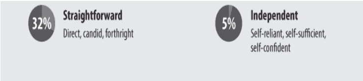

## 前言

《高等教育中的领导力：*产生差异的实践*》讲述的是大学校园里的人们如何激励他人渴望为共同的抱负而奋斗并创造非凡成果。它讲述的是领导者用来将价值观转化为行动、愿景转化为现实、障碍转化为创新、群体转化为团结、风险转化为回报的行为。它讲述的是行使一种领导力，创造出人们能够携手将挑战性的机遇转化为非凡成功的氛围。

大学和高校的领导者能够并且确实在机构的实力上产生影响。事实上，许多人断言，领导力比任何其他单一因素更能决定高等教育的未来活力。¹ *《高等教育纪事报》*的高级撰稿人 Goldie Blumenstyk 指出，“巡航控制式领导力已不再是选项”，需要在对最新趋势的膝跳反应和对真正机遇的平庸不愿之间取得平衡。² 不仅高等教育机构中的人们面临着挑战，而且在其中提供领导力的机会也对每个人每天都开放。

### 谁应该阅读本书？

本书的根本目的是帮助高等教育社区中的人们引领他人前往从未到过的地方。无论你是教员、系主任、项目主任、院长、副校长还是校长，领导力都很重要。同样，领导力

### 基于研究的实践

《高等教育中的领导力》旨在提升你的能力，其所述的原则和实践都建立在扎实的定量和定性研究之上。本书源于我们于1983年开始的一项研究。我们想知道人们在领导他人时处于“个人最佳”状态时会做什么。这些是人们根据自身感知设定个人领导卓越标准的经历。我们最初的假设是，要发现最佳实践，我们不必采访和调查明星表演者、学术界的名人或“顶层”人物。相反，我们假设，通过要求各层级和各种组织环境中的人们描述非凡的经历，我们将能够找到并识别成功的模式。而我们确实做到了。

我们最初调查的结果——以及我们近四十年来持续进行的研究——在一致性上令人惊讶，并且驳斥了许多领导者刻板印象。³ 人们经常假设，例如，领导力因机构而异。事实远非如此。虽然每个校园从外部看起来可能不同，但我们发现领导者在最佳状态下所做的事情非常相似。这种行为模式在高等教育环境和情况下变化不大。在附录中，我们更详细地描述了本书的研究基础，涉及超过125,000名受访者的数据库以及100多项访谈和案例研究。确实，背景不断演变，高等教育的格局随时间推移而变化，但领导力仍然是一个可理解且可推广的过程。领导力不是一种时尚。虽然每个领导者都是独特的个体，但领导实践存在共同的模式。

### 领导力指南

将《高等教育中的领导力》视为你在领导之旅中携带的指南。我们设计它来描述领导者所做的事情，解释支持这些领导实践的基本原则，并提供大学校园中真实人物展示每项实践的实际案例。基于数千名响应领导号召的人的真实世界经验，我们提供具体建议，说明你可以做什么来使这些实践成为你自己的，并继续作为领导者的发展。

第1章向你介绍我们对领导力的观点，并简要描述我们在研究中揭示的典范领导的五项实践。在其中我们还描述了人们最希望在领导者身上看到的特征。我们提出了所有伟大领导力建立的基础。我们从内部讲述领导故事并向外扩展，首先将领导力描述为探索的个人旅程，然后是动员他人。我们的研究表明，领导力不是少数魅力男性和女性的私人保留。它是人们在发挥自身和他人最佳潜能时所使用的过程。释放每个人内心的领导者，非凡的事情就会发生。

在第2章至第6章中，我们逐章探讨五项实践中的每一项。讨论建立在我们研究结果的基础上，我们通过借鉴其他学者的研究来扩展你对领导力的理解。我们不总结文献或各种领导概念视角；相反，我们提供一种经实证验证且实用有价值的领导观点。我们用案例示例说明每项实践，推荐你可以采取的行动来应用该实践，并提出问题供你在发展领导能力时反思。这些章节没有神圣的顺序。我们建议你阅读第1章，然后根据你的兴趣前往任何地方。请记住

尽管所有这些实践都是必不可少的。虽然你可以在本书中随意翻阅，但你不能跳过领导力的任何基本要素。

在第7章中，我们讨论了领导力是一套可学习的做法，人人可及。我们表明领导力是每个人的事业，而寻找领导力的首要地方是在你自己身上。通过这样做，我们希望破除领导力的神秘感，并展示每个人都有领导的能力。我们也讨论了领导力的对比与矛盾——没有人说过这会很容易——以及你需要取得平衡。最后，我们提供了关于你如何继续成长和发展的指导，并揭示了在生活中取得成功的秘诀。

贯穿所有章节的核心主题是 *领导力是一种关系*。无论是一对一还是一对多，领导力都是渴望领导者与选择追随者之间的关系。年轻或年长，教职或员工，经理或个人贡献者，经验丰富或新手——领导力的成功和生活中的成功将继续取决于我们如何相互合作、相处。

如果你想了解我们是如何为本书进行研究的，你可以在我们的网站上找到有关方法、统计数据以及其他学者验证研究的亮点等详细信息的介绍：leadershipchallenge.com。对《卓越领导力的五项实践》模型及其在各种组织环境中的应用感兴趣并希望获得更深入的阐述的人应阅读 *The Leadership Challenge.*⁴

## THE FUTURE OF LEADERSHIP

领导者的领域是未来。我们希望本书能为高等教育的持续振兴、健康大学社区的更新，以及对所有传统人士之间更大的尊重与理解做出贡献。我们也衷心希望它能丰富你以及你的学生、同事、校友、朋友和家人的生活。领导者所做出的最重要贡献是对人和机构的长期发展，以便他们能够适应、繁荣和成长。

领导力的重要性不仅限于你的大学和你的职业。它在每个部门、每个社区和每个国家都至关重要。现在我们需要更多的领导者，而且比以往任何时候都更需要他们。有太多非凡的工作需要完成。我们需要能够团结我们并点燃我们的领导者。

最终我们意识到，领导力发展最终是自我发展。迎接领导力挑战是每个人个人——也是日常——的挑战。

James M. Kouzes

Barry Z. Posner

September 2019

## Leadership Is a Relationship

我们二人合计在高等教育管理方面拥有超过50年的经验——而研究和撰写领导者如何创造非凡成就的时间更是超过了这个数字。我们收集的数千次访谈和领导力案例，更不用说我们调查的数百万份回复，都来自与你非常相似的人。他们就是你在校园里每天遇到的同事。我们选择讲述这些普通领导者的故事，因为我们坚信，其核心领导力 *不* 关于职位或头衔。它关乎关怀，关乎关系，关乎你 *做* 的事。

领导力是一套可识别的技能和实践，人人可用，而不仅仅是少数具有魅力的男性和女性，或拥有崇高头衔和职位的人。我们挑战了领导力只存在于组织最高层的神话，无论是在学术殿堂还是在企业高管套房。认为只有 *少数* 伟大的男性和女性才能领导的理论完全是错误的。我们认为研究中的男性和女性是卓越的，他们的合作者也是如此。

我们从经验、研究、咨询和研讨会中得知，你机构中的每个人都可以学会领导。这一认识令人鼓舞。它让我们对未来充满希望。因为这意味着没有任何个人、项目、部门或职能需要等待有人来

- Inspire a Shared Vision
- Challenge the Process
- Enable Others to Act
- Encourage the Heart

我们在此章中介绍并简要说明、并将在后续章节中广泛讨论的卓越领导力的五项实践，并非我们所研究的人或少数耀眼明星或独特人格的私有财产。它们对任何接受挑战、带领人们和组织走向从未涉足之地的人来说，在任何大学组织或情境中都是可用的。

关于领导力的最大神话之一是有些人拥有“它”，有些人没有。相关的神话是如果你没有“它”，你就学不会“它”。两者都与经验证据相去甚远。³ 在反思他们的个人最佳领导力经历后，人们通常得出的结论与卡内基教学促进基金会的 Tanvi Lotwala 相同：“我们所有人天生都是领导者。我们都具有与生俱来的领导品质；我们所需要做的只是打磨它们并将其带到前台。这是一个持续的过程，让我们作为领导者不断发展自己，但除非我们每天接受向我们提出的领导力挑战，否则我们无法变得更好。”

此外，这一领导力操作系统已被广泛研究和检验。数百名学者已将卓越领导力的五项实践框架应用于他们对高等教育中领导力的研究。从对大学校长、⁴ 商务和财务主管、⁵ 院长和系主任、⁶ 学生事务和项目管理人员、⁷ 体育主管和教练、⁸ 图书馆员、⁹ 以及教员¹⁰ 等人的研究中，许多学者发现这些领导力实践与组织和职业有效性密切相关。

经验证据明确表明，在高等教育中频繁使用卓越领导力五项实践的领导者，其部门和职能中拥有最投入和最有成效的人。根据对其直接下属的调查，卓越领导者比最不投入的直接下属的领导者更有可能以超过六倍的频率运用五项实践。更具体地说，直接下属感受到例如被组织重视、正在发挥作用、个人有效等程度——都与他们观察到领导者参与卓越领导力五项实践的频率直接相关。¹¹

## Model the Way

头衔是授予的；是你行为赢得尊重。这一观点在我们收集的所有案例中都有体现。领导者以身作则。他们知道如果想要获得承诺并实现最高标准，他们必须成为自己期望他人表现的行为的榜样。你必须首先明确自己的指导原则，然后才能将其树立起来供他人效仿。一旦你明确了自己的核心价值观，你就可以为其发声，与他人分享并付诸行动。“这很直接，”Andy Ceperley* 告诉我们，“就是永远不要要求别人做你自己不愿意做的事。”

Andy 在职业服务岗位上任职，既在美国也在国外，经历了各种各样的学术机构：公立和私立，世俗和非世俗，集中化和分散化。在帮助扭转一所大学职业中心的局面时，该中心经历了大量员工流失并烧毁了几任主任，他解释说他有必要亲自“深入与校园各方人士进行对话”。他采访了50多个人并提出了大量问题，认真倾听他们对职业中心的看法。在建立关系时，Andy 通常首先分享他对职业中心作为服务组织的意义的价值观和信念，以及他关于此类中心如何有效与校园社区互动的经验。他确保职业中心每一位员工都能进行类似的反思性思考。

正如 Andy 所指出的那样，为了有效地以身作则，领导者必须首先明确自己的指导原则。他们必须找到真实的声音，清晰而鲜明地阐述自己的价值观。因为领导者被期望为自己的信念挺身而出，他们最好有一些可以捍卫的信念。通过知道自己最看重什么，Andy 能够更好地做出与他珍视的原则一致的决定。然而，仅此是不够的。领导者还必须确保自己的行为与价值观和标准一致。

领导者的行为比言语更重要，用以证明他们对自己所说的话的认真程度。言行必须一致；如果不一致，虚伪就会蔓延，愤世嫉俗就会滋长。像 Andy 一样，领导者需要率先垂范，通过日常行动树立榜样，提供他们对信念深深承诺的证据。他们证明某事重要的最好方式之一就是亲身示范。领导者以行动树立的榜样比他们所说的任何话都更有力量。卓越的领导者言行一致。

## Inspire a Shared Vision

要让人们加入到一个愿景中，领导者必须了解自己的追随者并说他们的语言。与我们采访的其他人类似，Kelly 知道人们必须相信领导者理解他们的需求并将他们的利益放在心上，他们才会加入进来。领导者为他人的希望和梦想注入生命力，并使他们能够看到令人兴奋的可能性。领导者通过向追随者展示梦想是为了共同利益，从而锻造出目标的统一。领导者通过对团队引人注目的愿景表达热情，以生动的语言和富有表现力的风格传达他们的热情，从而在他人心中点燃激情。

## 挑战现状

领导者是先锋——愿意踏入未知的人。他们寻找创新、成长和改进的机会。我们收集的每一例个人最佳领导案例都涉及对现状的某种改变。没有一个人声称自己是通过保持不变——做一直以来或已经做过的事情——来实现个人最佳的。所有领导者都挑战现状。

但领导者并不是新课程、新项目、新服务或新流程的唯一创造者或发起者。事实上，他们更可能不是：创新更多来自倾听而非讲述，来自提问和倾听他人在想什么、想说什么。当挑战现状时，领导者的主要贡献是识别好主意、支持这些想法，以及愿意挑战体制以使新产品、新流程、新服务和新系统得以采纳。也许更准确地说，领导者是创新的*早期采用者*。

J. Patrick Murphy，CM，并不是凭空想象出公共服务研究生项目的想法。他倾听了大学校长所宣扬的抱负，以及许多学生希望将课堂上学到的经验更直接地应用于社区的渴望。Pat 还听到几位同事表达了参与一个连接私营和公共部门的项目的兴趣，以及似乎有机会将营利部门的最佳实践应用于社区组织的想法。

Pat 的院长最初并不支持，理由是财务和战略上的限制。Pat 并没有轻易气馁，他在校园的其他部门推广该提案（在他所在的相对保守的大学里，这被视为一种治理禁忌），获得了对跨学科方法（不仅在课程上，而且在人员配备和资金上）的兴趣和支持。他甚至接触了几位董事会成员，重新与校长沟通，并获得了足够的支持，最终该项目成为学院规模最大的研究生项目之一。

该项目的资金在起步时很紧张，就像在大学里通常一样，因此 Pat 通过几种新颖的举措筹集了资金。例如，Pat 和他的同事创办了一家小型咨询和行政培训公司，并启动了几个筹款项目，包括在爱尔兰学习的学生奖学金筹款的“酒吧之夜”。其中许多努力 Pat 最初不得不暗中进行，以免引起太多关注；有时，他会说，“先斩后奏”有时是必要的，以便了解哪些想法是可行或不可行的。

领导者深知创新和变革涉及试验和风险。你可以通过渐进的步骤和小胜利来应对这些潜在的风险和失败。学习也为进步打开了大门，杰出的领导者会在事情不如预期时特意问：“我们能学到什么？”

学习带来小胜利，这些胜利层层累积，建立起人们能够应对最重大挑战的信心。如此一来，领导者加强了对长期未来的承诺。

## 使他人能够行动

宏伟的梦想不会通过一个人的行动成为重大的现实。领导力是团队的努力，为了让组织中发生非凡的事情，杰出的领导者使他人能够行动。他们培养协作，发展关系并建立信任。领导者调动所有必须使项目成功的人——这正是 Charlie Slater 在讲述他启动新博士项目的个人最佳领导经历时得出的结论。当被问及谁是开发该项目的领导者时，他迅速回答说：“不是单一的领导者，而是许多领导者。在过程的不同阶段，每个人都很关键。如果没有这些人的领导，该项目就不会出现。”

领导者使他们周围的人能够成就伟大的事情。他们认识到，被期望在最具灵感的水平上产出的人必须感受到个人权力和主人翁意识。Charlie 谈到大学校长虽然赞成这个想法，但清楚地知道这样的倡议不能通过行政命令成功启动，所以他将自己的祝福传给了院长，院长又因他的背景以及与教师的积极工作关系而请 Charlie 接受这一领导挑战。Charlie 知道这样的项目不能仅靠一个倡导者来开发和维持，他与学校内众多的教师同事一起合作，使这个新项目得以实现。

这让 Charlie 深刻认识到，正如其他反思个人最佳领导经历的人一样，承诺与支持型领导比前几代人的命令与控制技术更重要。领导者的工作是让人们感到强大、有能力且有承诺。领导者不是囤积自己拥有的权力，而是将其分出去。大学校长不可能独自使该项目成为现实，事实上，没有任何个人或团体能够在没有他人合作的情况下成功倡导该项目。共同工作，杰出的领导者增强了每个人实现他们设想的可能性和兑现承诺的能力。

在我们分析的案例中，像 Charlie 这样的领导者自豪地讨论了团队合作、协作、信任和赋权作为他们努力的必备要素。如果领导者让人们感到软弱、依赖或疏离，人们不会待很久也不会发挥最佳水平。但当领导者让人们感到强大和有能力，提高他们相信自己可以做到比以往认为可能的更多的信念时，人们会竭尽全力。在我们的研究中，人们表示在与最好的领导者合作时，他们投入到事业中的精力超过了 100%，因为那位领导者能够激发他们发挥出他们自己认为不可能的能力。当领导力建立在信任和信心的关系之上时，人们会冒险、做出改变，并让组织和运动保持活力。

## 鼓舞人心

任何事业的攀登都艰难而陡峭，人们很容易变得筋疲力尽、沮丧和幻灭。领导者鼓舞其追随者的心，使他们坚持下去，即使他们可能想放弃。真诚的关怀行为，无论是戏剧性的姿态还是简单的行动——例如，给生病的同事送食物、探望住院的人，或寄出一封手写的感谢信——都能振奋精神，激励人们向前。Jennifer Dirking，她所在社区学院基金会的副主任说，她一直在寻找培养“人们感到被关心和真正被感激”的氛围的方法。

Barry Posner 学校每年都会颁发“最杰出教师”奖。在那些日子里他是教师，他说他“从来不明白为什么只有一个奖项，有这么多学科，而且鉴于每个学科不同的标准，教师和院长办公室如何决定‘最杰出’的含义。”因此，当他成为院长时，Barry 说，

> 我决心我们要改变制度，并在表彰我们*众多*教师同事的卓越方面做更多工作。与我们的系主任委员会合作，我们制定了一套适用于所有学科和所有职级的具体成就标准，从不满意到 exemplary。任何在教学、学术和服务方面都能达到 exemplary 的教师，在我们任何人的眼中都一定是“非凡的”——而这就是我们称该奖项的名字。我们都可以为学校里任何非凡的人感到自豪。

第一年，颁发了六个非凡教师奖。五年后，颁发了 13 个奖项。Barry 回忆道：“我认为标准没有改变，但我们教师的行为——因此表现——已经提升到我们设定的理想水平。这次对奖项标准的改变，我们在消除我们之间‘谁是最好的’的竞争方面迈出了巨大一步，而更集体地关注每个人需要做什么才能发挥最佳水平。”

领导者的工作之一是表达对人们贡献的感激，并创造一种庆祝的文化。多年来，我们见证了成千上万的个人表彰和集体庆祝的例子，从手写的感谢信到游行乐队和“这是你的生活”仪式。

没有对将人们与其领导者以及领导者与其人民联系起来的基本人类渴望的理解。

为了平衡我们对领导力的理解，近四十年来我们一直对个人价值观、特质和特征进行调查，了解人们认为在他们愿意追随的个人身上最重要的品质是什么。这句话中的一个关键词是 *willingly*。因为你认为你必须“否则”而追随某个人是一回事，而因为你 *want to* 而追随某个人则是另一回事。

你会倾听、接受建议、受影响并愿意追随哪种人，而不是因为你必须，而是因为你想？要成为他人愿意追随的人，需要什么条件，而且是热情且自愿地追随？理解并回应这些期望对于 exemplary 领导力的行使至关重要。

## What People Look For in Their Leaders

来自超过 100,000 名受访者的反馈——在高等教育以及各个行业和全球数十个国家——证实并丰富了我们从个人最佳研究中得出的图景。调查结果在多年间表现出惊人的一致性。¹³ 我们的证据表明，一个人必须通过几个基本的品格测试后，才能被他人赋予 *leader* 的称号，如图 1.1 所示的数据所示。

所有特征都会获得投票，因此每个特征对某些人来说都很重要。然而，最引人注目和明显的是，随着时间的推移和跨越大陆，*只有四项* 持续获得了多数（超过 60%）的偏好。人们 *最* 寻求和钦佩的领导者特质是恒定的。如果人们要 *willingly* 追随某个人，他们必须相信这个人是

诚实、胜任、有启发性，并且具有前瞻性。事实上，从相反的角度来看，问问自己你愿意追随一个不诚实、无能、无启发性且迷失的人的程度有多大？不太可能，对吧？

过去几年中，来自数百名教职员工的反馈——其中许多人是系主任、副院长和院长——再次证实了这些发现。来自学生事务管理员、注册官、招生顾问、发展人员、公共安全官员以及休闲和体育总监的答案与教职员工的答案惊人地相似。学生也表示，这四项主要特征——诚实、胜任、有启发性和前瞻性——在他们最优秀的教师中最受重视。研究表明，这四项特征在行业、文化、国籍、组织职能和层级或性别、种族、教育水平、年龄方面没有显著差异。[^14]

84% Honest
Truthful, has integrity, trustworthy, has character, ethical

31% Cooperative
Collaborative, team player, responsive

66% Competent
Capable, proficient, effective, gets job done, professional

28% Ambitious
Aspiring, hardworking, striving

66% Inspiring
Uplifting, enthusiastic, energetic, humorous, cheerful, optimistic, positive about the future

23% Caring
Appreciative, compassionate, concerned, loving, nurturing

62% Forward-looking
Visionary, foresighted, concerned about the future, has a sense of direction

22% Determined
Dedicated, resolute, persistent, purposeful

47% Intelligent
Bright, smart, thoughtful, intellectual, reflective, logical

22% Courageous
Bold, daring, gutsy

40% Broad-minded
Open-minded, flexible, receptive, tolerant

18% Loyal
Faithful, dutiful, unswerving in allegiance, devoted

39% Dependable
Reliable, conscientious, responsible

17% Imaginative
Creative, innovative, curious

37% Supportive
Helpful, offers assistance, comforting

17% Mature
Experienced, wise, has depth

35% Fair-minded
Just, unprejudiced, objective, forgiving

10% Self-controlled
Restrained, self-disciplined

Figure 1.1 Personal values, traits, and characteristics that people look for in their leaders. Note that several synonyms were included in each category. The percentages represent respondents from six continents: Africa, Asia, Australia, Europe, North America, and South America. The majority are from the United States. Because we asked people to select seven characteristics, the total adds up to about 700 percent.

这些对受人钦佩的领导者特征的调查揭示出与人们讲述其 Personal-Best Leadership Experiences 的故事中一致的模式。卓越领导力的五项实践和受人钦佩的领导者特征是对同一主题的互补视角。当他们处于巅峰表现时，领导者不仅仅是在取得成果。他们也在回应他们合作的人的期望，强调了领导力是一种关系，并且这种关系是对目的和他人的服务。

随着我们在后续章节中关于领导力实践的文本中，将诚实、胜任、有启发性和前瞻性这些个人特征编织进去，你将更详细地看到卓越领导者如何回应其利益相关者的需求。例如，如果你想以身作则，被视为诚实是必不可少的。领导力实践 Inspire a Shared Vision 要求你具有前瞻性和启发性。当领导者 Challenge the Process 时，他们增强了人们认为他们充满活力并关心未来的认知。值得信赖，这是诚实的一个同义词，

意味着你将他人的最佳利益放在心上，并且是领导者 Enable Others to Act 的原因和方式的必备组成部分。在认可和庆祝显著的贡献和成就——即 Encourage the Heart——时，你加强了人们对共同价值观的承诺，并强调了协作与实现愿景的一致性。当领导者在 The Five Practices 全部方面表现出能力时，他们向他人表明他们有能力创造非凡的事情。

## CREDIBILITY IS THE FOUNDATION OF LEADERSHIP

尽管人们对领导者的期望在高等教育面临不断变化的力量影响下保持一致，但这一描述性数据揭示了另一个深刻的含义。这些调查结果在社会心理学家和传播专家所称的“可信度”方面具有坚实的理论基础。在评估为什么有些人比其他人更可信、声誉如何形成、什么构成意见领袖或什么因素创造榜样等问题时，研究人员已证明，可信度的关键维度与人们最希望在领导者身上看到的四个特征 remarkably similar。¹⁵

如果你要要求他人跟随你走向某个不确定的未来——这个未来可能在他们的任期内甚至一生中都无法实现——并且旅程需要艰辛和可能的牺牲，那么人们必须相信你，这个他们将要追随的人。无数培养领导者的项目、课程和班级、书籍和 CD、提供技巧和技术的博客和网站——如果本应追随的人不相信本应领导的人，一切都毫无意义。底线是，人们最想要的是可信的领导者。

人们必须能够相信他们的领导者——她的话可以被信任，他会兑现他所说的，她对团队所朝的方向个人上感到兴奋和热情，他拥有领导所需的知识和技能。这是领导力的第一定律：如果人们不相信信使，他们就不会相信信息。

要“相信信使”并被视为可信需要什么？当我们问人们，“可信度在行动中是什么样子的？你如何知道某人是否可信？”他们的答案不会因其机构的性质或他们所做的工作甚至他们是谁而有所不同，例如年龄、性别、种族、教职员工。这些是人们用来描述可信人士的行为和行动的最常见短语：

- “They practice what they preach.”
- “They walk the talk.”
- “Their actions are consistent with their words.”
- “They put their money where their mouth is.”
- “They follow through on their promises.”
- “They do what they say they will do.”

最后一条回应是最频繁的。当判断一位领导者是否可信时，人们首先听取言语，然后观察行动。当言行一致时，就会做出“可信”的判断。如果人们看不到一致性——例如，如果在招生方面据称有特殊优待，热门或喜爱的学生不受

对荣誉准则违规行为进行纪律处分，对校友捐赠者的不当行为视而不见，对员工进行诋毁，对同事进行贬低——他们得出结论，领导者充其量是不够认真，最糟糕的是彻头彻尾的伪君子。当领导者身体力行所倡导的原则，并且始终如一时，人们更愿意将自己的职业、自身的安全和未来托付给他们。

这一认识引出了建立可信度的直接处方：*DWYSYWD*，即 *Do What You Say You Will Do*。这一常识性的可信度定义与领导力实践“以身作则”直接对应。要以身作则并在行动上具有可信度，你必须明确自己的信念；你必须知道自己坚持什么。那就是 DWYSYWD 中的 *say* 部分。然后你必须将所说付诸实践：你必须践行自己的信念并 *do*。正是当领导者的言行一致时，人们才会认为他们可信。保持真实，获得并维持领导的道德权威，对“以身作则”这一实践至关重要。

正因为言行之间存在这种重要的联系，我们在讨论五项实践时，首先对赋予“以身作则”生命力的原则和行为进行全面审视。在接下来的章节中，我们将向你介绍在大学里将五项领导力实践付诸行动并在各自机构内创造非凡成就的人们。

*本书中引用的所有人名都是真实的。他们是我们采访过或合作过的人。我们没有透露他们的机构 affiliation，有两个原因。首先，他们中的一些人已经或将要更换职位和组织，因此他们的 affiliation 不会始终保持最新。其次，因为示例旨在关注个人——他的或她的行动——不应将其与机构相关的任何声誉或特殊情况混淆。我们通常会描述该机构，以为示例提供一些背景，并通过展示大学环境的广度来证明这些经历的有效性（即可推广性）。*
