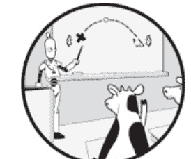
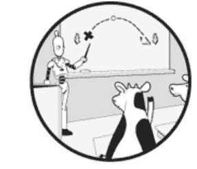

# INTRODUCTION



We use computers to accomplish tasks and to solve problems. For example, perhaps you’ve used a word processor to write an essay or letter. Perhaps you’ve used a spreadsheet program to organize your finances. Perhaps you’ve used an image editor to touch up a picture. It’s hard to imagine doing these things these days without a computer. We get a lot of mileage out of our word processors and spreadsheet programs and image editors.

Those programs are written as general-purpose tools to accomplish a wide variety of tasks. Ultimately, though, they’re programs written by others, not by us. What do we do when an off-the-shelf program doesn’t quite do what we need?

In this book, our goal is to learn how to take control of our computer by going beyond what can be done by an end user using preexisting programs. We’re going to write our own programs. We won’t write a word processor or a spreadsheet or an image editor. Those are huge tasks that, fortunately, people have already done. Rather, we’re going to learn how to write small programs to solve problems that we otherwise wouldn’t be able to solve. I want to help you learn to communicate instructions to a computer; these instructions will tell the computer how to carry out your plan for solving a problem.

To give instructions to a computer, we write code in a *programming language*. A programming language specifies the rules for the code we write and dictates what the computer does in response to that code.

We’re going to learn to program in the Python programming language. That’s a concrete skill that you’ll take away from this book, one that you can put on your résumé. More than Python, though, you’ll learn the type of thinking required to solve problems using a computer. Programming languages come and go. The way that we solve problems

does not. I hope that this book helps you on your way from end user to programmer and that you have fun exploring what’s possible.

# Online Resources

Supplementary resources for the book, including downloadable code and additional exercises, are available at https://nostarch.com/learn-code-solving-problems/.

# Who This Book Is For

This book is for anyone who wants to learn how to write computer programs to solve problems. I have three particular types of people in mind.

First, you may have heard about the Python programming language and want to learn how to write code in Python. I’ll explain in the next section why Python is a great choice as a first programming language to learn. You’ll learn a lot about Python in this book, and you’ll be in a position to read more advanced books on Python if that’s your next step.

Second, if you haven’t heard of Python or just want to learn what programming is all about, don’t worry: this book is for you, too! This book will teach you how to think about programming. Programmers have particular ways of breaking down problems into manageable pieces and expressing solutions to those pieces in code. At this level, it doesn’t matter what programming language is being used, because the way that programmers think is not tied to a particular language.

Finally, you may be interested in learning some other programming language such as C++, Java, Go, or Rust. Much of what you learn as a byproduct of learning Python will be useful when you study those other programming languages. Plus, Python is certainly worth learning in its own right. Let’s turn to why next.

# Why Learn Python?

Years of teaching introductory programming have demonstrated to me that Python is a great choice for a first programming language. Compared to other languages, Python code is often more structured and readable. Once you get used to it, you might agree that parts of it almost

read like English! Python also comes with many features that are not available in other languages, including powerful tools to manipulate and store data. We’ll use many of these features throughout the book.

Not only is Python an excellent teaching language, but it’s also one of the most in-demand programming languages in the world. Programmers use it to write web applications, games, visualizations, machine learning software, and more.

There we have it: a language well-suited for teaching that also carries a professional advantage for you. I can’t ask for any more than that!

## ##Installing Python

Before we can program in Python, we need to install it. Let’s do that now.

There are two major versions of Python: Python 2 and Python 3. Python 2 is an older version of Python and is no longer supported. In this book, we use Python 3, so you’ll need to install Python 3 on your computer.

Python 3 was a major evolution from Python 2, but Python continues to change even within version 3. The first version of Python 3 was Python 3.0. Then Python 3.1 was released, then Python 3.2, and so on. At the time of writing, the latest version of Python 3 is Python 3.9. Versions as old as Python 3.6 will suffice for this book, but I encourage you to install and work with the latest version of Python.

Follow these steps for your operating system to install Python.

### ######Windows

Windows doesn’t come with Python by default. To install it, go to https://www.python.org/ and click **Downloads**. This should offer you the option of downloading the latest version of Python for Windows. Click the link to download Python and then run the installer. On one of the first screens in the installation process, click either **Add Python 3.9 to PATH** or **Add Python to environment variables**; this makes running Python much easier. (If upgrading Python, you may need to click “Customize installation” to find this option.)

### ######macOS


macOS 默认不自带 Python 3。要安装它，请访问 https://www.python.org/ 并点击 **Downloads**。这应该会为你提供下载适用于 macOS 的最新版 Python 的选项。点击链接下载 Python，然后运行安装程序。

### Linux

Linux 自带 Python 3，但可能是较旧的 Python 3 版本。安装说明会因你使用的 Linux 发行版而异，但你应该能够使用你喜欢的包管理器安装最新版本的 Python。

## 如何阅读本书

一次坐下来从头到尾读完本书可能学不到太多东西。这就像试图通过邀请某人到你家弹几小时钢琴然后把他们赶出去、调暗灯光并自弹自唱来学习钢琴一样。这不是练习型技能的学习方式。

以下是我在阅读本书时的建议：

**分散你的工作。** 将练习集中在少数几次会话中远不如分散练习有效。当你感到疲倦时，请休息一下。没有人能告诉你工作多久才需要休息。没有人能告诉你完成本书需要多长时间。这取决于你自己的身心。

**暂停以检验你的理解。** 阅读某事物可能会让我们产生比实际更了解它的错觉。应用材料会迫使我们所知和我们以为所知的内容保持一致。因此，在每章的关键点，我都加入了多项选择“概念检查”问题，要求你做出预测。认真对待这些问题！阅读每个问题并在不使用电脑查阅任何内容的情况下做出回应。然后，阅读我的答案和解释。这是确认你是否走在正确轨道上的机会。如果你答错了，或者答对了但理由错误，请在继续之前花时间纠正你的理解。这可能涉及多玩一会儿正在讨论的相关 Python 功能、重读书中的材料，或在线搜索额外的解释和示例。

**练习编程。** 在阅读时做出预测有助于巩固你对关键概念的理解。但要成为熟练的问题解决者和程序员，你需要更多。你需要练习使用 Python 解决书中没有介绍过解决方案的新问题。每章都以一系列练习题结束。请尽可能完成这些练习题。

学习编程需要时间。如果你进展缓慢或犯了很多错误，不要气馁。不要被你在网上可能遇到的任何咋咋呼呼的孔雀吓倒。让自己周围都是可以帮助你学习的人和资源。

## 使用编程评测

我决定围绕 *programming judge* 网站上的问题来构建本书。编程评测网站提供了一个编程问题的仓库，可以由世界各地的程序员解决。你提交你的解决方案——你的 Python 代码——网站会对你的代码进行测试。如果你的代码对每个测试用例都产生正确答案，那么你的解决方案很可能正确。如果你的代码对一个或多个测试用例产生错误答案，那么你的代码不正确，需要修改。

我认为编程评测是学习编程的特别合适的网站，有几个原因：

**快速反馈** 在学习编程的早期阶段，快速、有针对性的反馈至关重要。编程评测在你提交代码后立即提供反馈。

**高质量问题** 我发现编程评测上的问题质量很高。许多问题最初来自竞赛编程比赛。其他问题是由与编程评测相关的人或只是想帮助他人学习的人编写的。参见问题鸣谢附录，了解我们将研究的每个问题的来源。

**问题数量** 编程评测包含数百个问题。我只为本书挑选了其中少数几个。如果你需要更多练习，相信我：编程评测可以提供。

**社区功能** 编程评测允许用户阅读和回复评论。如果你卡在某个问题上，请浏览评论，看看其他人是否留下了提示。如果你仍然卡住，请考虑发布自己的评论请求帮助。一旦你成功解决了问题，你的学习还没有结束！许多编程评测允许你查看他人提交的代码。深入研究几份这样的提交，看看它们与你的有何不同。解决问题的办法总是有多种。也许你现在的方式对你来说最直观，但敞开心扉接受其他可能性是迈向编程精通的重要一步。

## 创建你的编程评测账号

我们将在全书中使用多个编程评测网站。这是因为每个编程评测都托管了一些在其他编程评测上找不到的问题；我们需要多个编程评测来涵盖我选择的所有问题。

以下是我们将使用的编程评测：

| Judge | URL |
|---|---|
| DMOJ | *https://dmoj.ca/* |
| Timus | *https://acm.timus.ru/* |
| USACO | *http://usaco.org/* |

每个编程评测都要求你在提交代码前创建账号。现在让我们一起创建你的账号，并在过程中了解一下这些评测。

### The DMOJ Judge

DMOJ 评测是我们将在书中最常使用的评测。比其他任何评测都更值得你花时间探索 DMOJ 网站并了解评测提供的功能。

要在 DMOJ 评测上创建账号，请访问 *https://dmoj.ca/* 并点击 **Sign up**。在出现的注册页面上，输入你的用户名、密码和电子邮件地址。此页面还允许你设置默认编程语言。我们将在本书中 exclusively 使用 Python 编程语言，所以我建议在这里点击 **Python 3**。点击 **Register!** 创建你的账号。注册后，你可以使用用户名和密码登录 DMOJ。

书中的每个问题都首先标明问题所在评测网站以及用于访问它的问题代码。例如，我们将在第 1 章中处理的第一个问题位于 DMOJ 上，问题代码为 **dmopc15c7p2**。要在 DMOJ 上找到此问题，请点击 **Problems**，在搜索框中输入 **dmopc15c7p2**，然后点击 **Go**。你应该会看到该问题作为唯一结果。如果点击问题标题，你应该会看到问题本身。

当你准备好为问题提交 Python 代码时，找到该问题并点击 **Submit solution**。在 resulting 页面上，将你的 Python 代码粘贴到文本框中，然后点击 **Submit!**。你的代码将被评测并显示结果。

### The Timus Judge

要在 Timus 评测上创建账号，请访问 *https://acm.timus.ru/* 并点击 **Register**。在出现的注册页面上，输入你的姓名、密码、电子邮件地址和其他所需信息。点击 **Register** 创建你的账号。然后，检查你的电子邮件，查找来自 Timus 的消息，其中包含你的评测 ID。你在提交 Python 代码时需要你的评测 ID。

目前没有设置默认编程语言的方法，因此在提交 Python 代码时请务必选择可用的 Python 3 版本。

我们仅在第 6 章中使用一次 Timus 评测，所以我在这里不再多说了。

### The USACO Judge

要在 USACO 评测上创建账号，请访问 *http://usaco.org/* 并点击 **Register for New Account**。在出现的注册页面上，输入你的用户名、电子邮件地址和其他所需信息。点击 **Submit** 创建你的账号。然后，检查你的电子邮件，查找来自


**第 4 章：重复代码：无限循环** 有时我们预先不知道程序应该重复执行某项指定行为多少次。`for` 循环并不适用于这类问题。在本章中，我们将学习 `while` 循环，只要某个特定条件为真，它就会重复执行代码。

**第 5 章：使用列表组织数值** Python 列表允许我们使用单个名称来引用一整个数据序列。使用列表有助于我们组织数据，并利用 Python 提供的强大的列表操作（例如排序和搜索）。在本章中，我们将全面了解列表。

**第 6 章：使用函数设计程序** 如果一个大型程序包含大量代码，而我们又没有很好地组织它，它就会变得难以管理。在本章中，我们将学习函数，它帮助我们设计由小型、自包含的代码块组成的程序。使用函数使程序更容易理解和修改。我们还将学习自顶向下设计，这是一种使用函数设计程序的方法。

**第 7 章：读写文件** 文件对于向我们的程序提供数据或从我们的程序获取数据非常方便。在本章中，我们将学习如何从文件中读取数据并向文件写入数据。

**第 8 章：使用集合和字典组织数值** 随着我们开始解决日益具有挑战性的问题，思考数据是如何存储的变得至关重要。在本章中，我们将学习使用 Python 存储数据的两种新方式：使用集合和使用字典。

**第 9 章：使用完全搜索设计算法** 程序员解决每个问题时并不是从零开始。相反，他们会思考是否可以使用通用的解决方案模式——一种*算法*——来解决它。在本章中，我们将学习完全搜索算法，它们可用于解决广泛的问题。

**第 10 章：大 O 与程序效率** 有时，我们可能会写出一个功能正确但速度太慢而在实际中无用的程序。在本章中，我们将学习如何交流程序的效率，并了解我们可以用来编写更高效代码的工具。

## 入门



编程涉及编写代码来解决一个问题。因此，我想从一开始就与你一起解决问题。也就是说，我们不是先逐个学习 Python 概念然后再解决问题，而是将使用一个特定的问题来指导我们需要学习的概念。

在本章中，我们将解决两个问题：确定一行中的单词数量（类似于文字处理软件中的字数统计功能）以及计算圆锥的体积。解决这些问题需要对相当多的 Python 概念进行概览。你可能会觉得需要更多细节才能完全理解我在这里介绍的一些内容以及它们如何在一个 Python 程序的设计中相互配合。别担心：我们将在后续章节中重新审视并详细阐述最重要的概念。

### 我们将做什么

如引言所述，我们将使用 Python 编程语言解决竞赛编程问题。每个竞赛编程问题都可以在在线评判网站（online judge）上找到。我假设你已经按照引言中的说明安装了 Python 并创建了你的评判账户。

对于每个问题，我们将编写一个程序来解决它。每个问题都指定了提供给程序的输入类型以及预期的输出（或结果）类型。如果程序能够接受任何有效输入并产生正确的输出，那么该程序就正确地解决了这个问题。

通常，会有数百万或数十亿种可能的输入。每个这样的输入被称为一个*问题实例*。例如，在我们将解决的第一道题中，输入是一行文本，如 `hello there` 或 `bbaabbb aa abab`。我们的任务将是输出该行中的单词数量。编程中最强大的思想之一是，通常少量的通用代码就可以解决看似无穷无尽的问题实例。无论该行有 2 个单词、3 个还是 50 个，都无关紧要。我们的程序每次都会得到正确答案。

我们的程序将执行三项任务：

**读取输入** 我们需要确定我们要解决的具体问题实例，因此我们首先读取提供的输入。

**处理** 我们处理输入以确定正确的输出。

**写入输出** 在解决了问题之后，我们产生所需的输出。

这些步骤之间的边界可能并不总是清晰的——例如，我们可能需要将某些处理与产生某些输出交错进行——但记住这三个大的步骤会有所帮助。

你可能日常使用遵循这种输入-处理-输出模型的程序。考虑一个计算器程序：你输入一个公式（输入），程序计算你的数字（处理），程序显示答案（输出）。或者考虑一个网络搜索引擎：你输入搜索查询（输入），搜索引擎确定最相关的结果（处理），并显示它们（输出）。

将这些类型的程序与*交互式*程序进行对比，后者将输入、处理和输出融合在一起。例如，我正在使用文本编辑器编写这本书。当我输入一个字符时，编辑器通过将该字符添加到我的文档中来响应。它不会等待我输入整个文档后再向我显示；它交互式地显示我正在构建的内容。在这本书中，我们将不会编写交互式程序。如果你对在学习完这本书后编写此类程序感兴趣，你会很高兴地听说 Python 绝对胜任这项任务。

每个问题的文本既可以在这里找到，也可以在在线评判网站上找到。然而，文本不会完全匹配，因为我为全书保持一致性重写了它。别担心：我所写的内容传达了与官方问题陈述相同的信息。

这里重要的是，你在第一行看到至少 3.6 版本的 Python。如果你拥有较旧的版本，特别是 2.x 版本，或者 Python 根本没有加载，请按照引言中的说明安装较新版本的 Python。

在这个窗口的底部，你会看到一个 `>>>` Python 提示符。这是你输入 Python 代码的地方。永远不要自己输入 `>>>` 符号。一旦你完成编程，你可以按 `CTRL-D` 退出。

### Linux

在 Linux 上，请执行以下操作：

- 1. 右键点击你的*编程*（programming）文件夹。
- 2. 在弹出的菜单中，点击*在终端中打开*（Open in Terminal）。（如果你更习惯使用终端并导航到你的*编程*（programming）文件夹，你也可以这样做。）
- 3. 在 resulting 窗口的底部，你会看到一行以美元符号（$）结尾的行。这是你的操作系统*提示符*（prompt），它正等待你输入命令。你在这里输入操作系统命令，而*不是* Python 代码。请确保在每个命令后按 `ENTER`。
- 4. 现在你在你的*编程*（programming）文件夹中。如果你想看看那里有什么，可以输入 `ls`。你还应该看不到任何文件，因为我们还没有创建任何文件。
- 5. 现在，输入 **python3** 以启动 Python shell。（你也可以尝试输入 `python`，不带 3，但这可能会启动较旧版本的 Python 2。Python 2 不适合用来完成这本书的内容。）

当你启动 Python shell 时，你应该看到类似以下内容：

```
Python 3.9.2 (default, Feb 20 2021, 20:57:50)
[GCC 7.5.0] on linux
Type "help", "copyright", "credits" or "license" for more information.
>>>
```

这里重要的是，你在第一行看到至少 3.6 版本的 Python。如果你拥有较旧的版本，特别是 2.x 版本，或者 Python 根本没有加载，请按照引言中的说明安装较新版本的 Python。


窗口底部，你会看到一个 >>> Python 提示符。这就是你输入 Python 代码的地方。永远不要自己输入 >>> 符号。编程完成后，你可以按 CTRL-D 来退出。

## 问题 #1：词数统计

现在是我们的第一个问题！我们将使用 Python 编写一个小型的词数统计程序。我们将学习如何从用户读取输入，处理输入以解决问题，并输出结果。我们还将学习如何在程序中操作文本和数字，利用内置的 Python 操作，并在通向解决方案的过程中存储中间结果。

这是 DMOJ 问题 dmopc15c7p2。

## 挑战

统计提供的单词数量。对于此问题，*word* 是任何由小写字母组成的序列。例如，hello 是一个单词，但像 bbaabbb 这样的非英语“单词”也是如此。

## 输入

输入是一行文本，由小写字母和空格组成。每个单词对之间恰好有一个空格，并且第一个单词之前或最后一个单词之后没有空格。

该行的最大长度为 80 个字符。

## 输出

输出输入行中的单词数。

## 字符串

*值* 是 Python 程序的基本构建块。每个值都有一个 *类型*，类型决定了可以对该值执行的操作。在词数统计问题中，我们处理的是文本行。文本在 Python 中存储为字符串值，因此我们需要学习有关字符串的知识。为了解决问题，我们输出文本中单词的数量，因此我们还需要学习有关数值的信息。让我们从字符串开始。

## 表示字符串

*字符串* 是 Python 用于存储和操作文本的类型。要编写字符串值，我们将其字符放在单引号之间。跟随 Python shell 中的操作：

```python
>>> 'hello'
'hello'
>>> 'a bunch of words'
'a bunch of words'
```

Python shell 会回显我输入的每个字符串。

当我们的字符串包含单引号作为其字符之一时会发生什么？

```python
>>> 'don't say that'
  File "<stdin>", line 1
    'don't say that'
           ^
SyntaxError: invalid syntax
```

单词 don’t 中的单引号结束了字符串。因此，行的其余部分 t say that’ 就没有意义了，这就是产生语法错误的原因。*语法错误* 意味着我们违反了 Python 的规则，没有编写有效的 Python 代码。

为了解决这个问题，我们可以利用双引号也可以用于分隔字符串这一事实：

```python
>>> "don't say that"
"don't say that"
```

除非字符串中包含单引号，否则我不会在本书中使用双引号。

## 字符串运算符

我们可以使用字符串来保存我们想要计数的文本的文本。要计数单词——或对字符串做任何其他事情——我们需要学习如何操作字符串。

字符串附带了丰富的各种操作。我们可以使用特殊符号在操作数之间执行它们。例如，+ 运算符用于字符串连接：

产生字符串的大写版本：

```python
>>> 'hello'.upper()
'HELLO'
```

从方法获得的信息被称为方法的返回值。例如，我们可以说对于前一个例子，upper 返回字符串 'HELLO'。

对值执行方法被称为调用方法。调用方法需要在值和方法名之间放置点运算符（.）。它还需要在方法名后加上括号。对于某些方法，我们将这些括号留空，就像调用 upper 时一样。

对于其他方法，我们可以可选地在其中包含信息。还有一些方法需要信息，没有它就完全无法工作。当调用方法时包含的信息被称为方法的参数。

例如，字符串有一个 strip 方法。如果不带参数调用，strip 会从字符串中删除所有前导和尾随空格：

```python
>>> '  abc'.strip()
'abc'
>>> '  abc   '.strip()
'abc'
>>> 'abc'.strip()
'abc'
```

但我们也可以用字符串作为参数来调用它。如果这样做，该参数将决定从开头和结尾剥离哪些字符：

```python
>>> 'abc'.strip('a')
'bc'
>>> 'abca'.strip('a')
'bc'
>>> 'abca'.strip('ac')
'b'
```

让我们再谈谈一个字符串方法：count。我们向其传递一个字符串参数，它会告诉我们在字符串中该参数出现了多少次：

```python
>>> 'abc'.count('a')
1
>>> 'abc'.count('q')
0
>>> 'aaabcaa'.count('a')
5
>>> 'aaabcaa'.count('ab')
1
```

如果参数的出现重叠，则只计算第一个：

```python
>>> 'ababa'.count('aba')
1
```

与我描述的其他方法不同，count 直接适用于我们的词数统计问题。

把字符串想象成 'this is a string with a few words'。注意每个单词后面都有一个空格。事实上，如果你必须手工计数单词数量，你可能会使用空格来告诉你每个单词在哪里结束。如果我们统计字符串中的空格数量会怎样？为此，我们可以将由单个空格字符组成的字符串传递给 count。它看起来像这样：

```python
>>> 'this is a string with a few words'.count(' ')
7
```

我们得到的值为 7。这还不是单词的数量——该字符串有八个单词——但我们很接近。为什么我们得到的是 7 而不是 8？

原因是每个单词后面都有一个空格，除了最后一个单词。因此，计数空格就无法考虑最后一个单词。为了解决这个问题，我们需要学习如何处理数字。

## 整数和浮点数

*表达式* 由值和运算符组成。我们现在将看到如何编写数值并将它们与运算符结合。

有两种不同的 Python 类型表示数字：整数（没有小数部分）和浮点数（有小数部分）。

我们将整数值写为没有小数点的数字。以下是一些示例：

```python
>>> 30
30
>>> 7
7
>>> 1000000
1000000
>>> -9
-9
```

单独的值是最简单的表达式类型。

熟悉的数学运算符适用于整数。我们有 + 用于加法，- 用于减法，* 用于乘法。我们可以使用这些运算符编写更复杂的表达式。

```python
>>> 8 + 10
18
>>> 8 - 10
-2
>>> 8 * 10
80
```

注意运算符周围的空格。虽然 8+10 和 8 + 10 对 Python 来说是相同的，但后者使表达式对我们人类来说更容易阅读。

Python 有两个除法运算符，而不是一个！// 运算符执行整数除法，它会丢弃任何余数并向下舍入结果：

```python
>>> 8 // 2
4
>>> 9 // 5
1
>>> -9 // 5
-2
```

如果你想要除法的余数，请使用 mod 运算符，写为 %。例如，8 除以 2 没有余数：

```python
>>> 8 % 2
0
```

8 除以 3 的余数为 2：

```python
>>> 8 % 3
2
```

/ 运算符与 // 相反，不执行任何舍入：

```python
>>> 8 / 2
4.0
>>> 9 / 5
1.8
>>> -9 / 5
-1.8
```

这些结果值不是整数！它们有小数点，属于另一种 Python 类型，称为 *float*（“浮点数”）。你可以通过包含小数点来编写 float 值：

```python
>>> 12.5 * 2
25.0
```

我们现在将专注于整数，并在本章后面解决 Cone Volume 时再回到浮点数。

当我们在表达式中使用多个运算符时，Python 使用优先级规则来确定运算符应用的顺序。每个运算符都有一个优先级。就像我们在纸上求解数学表达式时一样，Python 先执行乘法和除法（优先级更高），然后执行加法和减法（优先级更低）：

```python
>>> 50 + 10 * 2
70
```

同样，像在纸上一样，括号内的运算具有最高优先级。我们可以利用这一点强制 Python 按我们期望的顺序执行运算：

```python
>>> (50 + 10) * 2
120
```

程序员经常即使在技术上不需要时也会添加括号。这是因为 Python 有很多运算符，正如我们将看到的那样，跟踪它们的优先级容易出错，而且程序员通常不会这样做。

如果你想知道整数值和 float 值是否像字符串一样有方法，它们确实有！但它们并不是很有用。例如，有一个方法可以告诉我们它在计算机中占用的


内存被一个整数占据。整数越大，所需的内存就越多：

```python
>>> (5).bit_length()
3
>>> (100).bit_length()
7
>>> (99999).bit_length()
17
```

整数周围需要括号；否则，点运算符会与小数点混淆，从而产生语法错误。

## 变量

我们现在知道了如何编写字符串和数值。我们还会发现，能够将它们存储起来以便后续访问是很有价值的。在 Word Count 问题中，能够将一行单词存储在某处，然后统计单词数量，会很方便。

## 赋值语句

变量是一个指向某个值的名称。之后每当我们使用变量名时，它都会被该变量所指向的值替换。要使变量指向一个值，我们使用赋值语句。赋值语句由变量、等号（=）和表达式组成。Python 会计算表达式，并让变量指向结果。下面是一个赋值语句示例：

```python
>>> dollars = 250
```

现在，每当我们使用 dollars 时，它都会被替换为 250：

```python
>>> dollars
250
>>> dollars + 10
260
>>> dollars
250
```

一个变量一次只能指向一个值。一旦我们使用赋值语句让变量指向另一个值，它就不再指向旧值：

```python
>>> dollars = 250
>>> dollars
250
>>> dollars = 300
>>> dollars
300
```

我们可以拥有任意多个变量。大型程序通常使用数百个变量。下面是使用两个变量的示例：

```python
>>> purchase_price1 = 58
>>> purchase_price2 = 9
>>> purchase_price1 + purchase_price2
67
```

请注意，我选择的变量名能让人对它们存储的内容有所了解。例如，这两个变量与两笔购买的价格有关。使用变量名 p1 和 p2 输入起来更简单，但几天后我们可能就会忘记这些名称的含义！

我们也可以让变量指向字符串：

```python
>>> start = 'Monday'
>>> end = 'Friday'
>>> start
'Monday'
>>> end
'Friday'
```

与指向数字的变量一样，我们可以在更复杂的表达式中使用它们：

```python
>>> start + '-' + end
'Monday-Friday'
```

Python 变量名应以小写字母开头，之后可以包含其他字母、用于分隔单词的下划线以及数字。

## 更改变量的值

假设我们有一个指向值 250 的 dollars 变量：

```python
>>> dollars = 250
```

现在我们想增大这个值，让 dollars 指向 251。这样不奏效：

```python
>>> dollars + 1
251
```

结果是 251，但该值已经消失了，没有存储在任何地方：

```python
>>> dollars
250
```

我们需要的是一个能捕获 dollars + 1 结果的赋值语句：

```python
>>> dollars = dollars + 1
>>> dollars
251
>>> dollars = dollars + 1
>>> dollars
252
```

学习者常常把赋值符号 = 当作相等关系。但千万别这么做！赋值语句是一个命令，它让变量指向表达式的值，而不是声称两个实体相等。

## 概念检查

执行以下代码后，y 的值是什么？

```python
>>> x = 37
>>> y = x + 2
>>> x = 20
```

- A. 39
- B. 22
- C. 35
- D. 20
- E. 18

答案：A。对 y 只有一次赋值，它使 y 指向值 39。`x = 20` 这个赋值语句将 x 指向的值从 37 改为 20，但这不会影响 y 所指向的值。

## 使用变量统计单词数

让我们盘点一下在解决 Word Count 问题上的进展：

- 我们了解了字符串，并且可以用字符串来存储一行单词。
- 我们了解了字符串的 `count` 方法，可以用它来统计一行单词中空格的数量。这样得到的结果比我们需要的输出值少 1。
- 我们了解了整数，可以用整数的 `+` 运算符给一个数加 1。
- 我们了解了变量和赋值语句，它们帮助我们保留值，以免丢失。

把所有这些组合起来，我们可以让一个变量指向字符串，然后统计单词数量：

```python
>>> line = 'this is a string with a few words'
>>> total_words = line.count(' ') + 1
>>> total_words
8
```

这里并不一定需要 line 和 total_words 变量；不用它们也可以这样做：

```python
>>> 'this is a string with a few words'.count(' ') + 1
8
```

但使用变量来保存中间结果，是保持代码可读性的好习惯。一旦我们的程序超过几行，变量将不可或缺。

## 读取输入

我们已经编写的代码有一个问题：它只对我们输入的特定字符串有效。它告诉我们 'this is a string with a few words' 中有八个单词，但它只能做这些。如果我们想知道另一个字符串中有多少个单词，就必须把当前字符串替换成新字符串。不过，要解决 Word Count 问题，我们需要程序能够处理作为输入提供给程序的任何字符串。

为了读取一行输入，我们使用 input 函数。函数与方法类似：我们调用它，可能传入一些参数，然后它会返回一个值给我们。方法和方法之间的一个区别是：函数不使用点运算符。传递给函数的所有信息都通过参数传递。

下面是一个调用 input 函数然后输入一些内容——本例中是单词 testing——的示例：

```python
>>> input()
testing
'testing'
```

当你输入 `input()` 并按下回车键后，不会立刻出现 `>>>` 提示符。相反，Python 会等待你在键盘上输入一些内容并按下回车键。然后 input 函数会返回你输入的字符串。像往常一样，如果我们没有把该字符串存储到任何地方，它就会丢失。让我们使用赋值语句来存储输入的内容：

```python
>>> result = input()
testing
>>> result
'testing'
>>> result.upper()
'TESTING'
```

注意最后一行，我对 input 返回的值使用了 upper 方法。这是允许的，因为 input 返回一个字符串，而 upper 是一个字符串方法。

## 编写输出

你已经看到，在 Python shell 中键入表达式会显示它们的值：

## Windows

在 Windows 上，我们将使用记事本（Notepad），一个简陋的文本编辑器。在操作系统命令提示符下，如果你还没有进入编程文件夹，请先导航到那里。然后输入 `notepad word_count.py` 并按下回车键。由于 word_count.py 文件不存在，记事本会询问你是否要新建一个 word_count.py 文件。点击“是”，然后就可以开始键入你的 Python 程序了。

## macOS

在 macOS 上，你可以使用任何你喜欢的文本编辑器。一个你可能已经安装的编辑器是 TextEdit。在操作系统命令提示符下，如果你还没有进入编程文件夹，请先导航到那里。然后输入以下两条命令，每输入一条后按回车键：

```text
$ touch word_count.py
$ open -a TextEdit word_count.py
```

touch 命令会创建一个空文件，这样你的文本编辑器就能打开它。现在你可以开始键入你的 Python 程序了。

## Linux

在 Linux 上，你可以使用任何你喜欢的文本编辑器。一个你可能已经安装的编辑器是 gedit。在操作系统命令提示符下，如果你还没有进入编程文件夹，请先导航到那里。然后输入 `gedit word_count.py` 并按下回车键。现在你可以开始键入你的 Python 程序了。

## 程序

加载并打开文本编辑器后，你可以键入我们的 Python 程序代码。代码如列表 1-1 所示。

```python
1 line = input()
2 total_words = line.count(' ') + 1
3 print(total_words)
```

列表 1-1：解决 Word Count 问题

输入这些代码时，不要输入 1、2 或 3。这些数字是为了帮助我们逐步理解代码，并非代码本身的一部分。

我们首先从输入中获取一行文本，并将其赋值给一个变量 ①。这样就得到了一个字符串，我们可以在其上使用 `count` 方法。我们给空格的数量加 1，以计入字符串中的最后一个单词，并使用变量 `total_words` 指向这个结果 ②。最后要做的是输出 `total_words` 所指向的值 ③。

输入完代码后，一定要保存文件。

### 运行程序

要运行程序，我们将在操作系统命令提示符下使用 python 命令。正如我们所见，单独输入 python 会运行 Python shell，但这次我们不想要那样。相反，我们想让 Python 运行 *word_count.py* 中的程序。为此，请导航到你的 *programming* 文件夹，并输入 **python word_count.py**。在本书中及全书范围内，如果需要，请使用 python3 命令代替 python 命令。

现在你的程序正在输入提示符处等待你键入内容。输入几个单词，按下回车键，你应该看到程序正常工作。例如，输入以下内容：

```text
this is my first python program
```

你应该看到程序生成输出 6。

如果你看到的是 Python 错误，请返回检查代码，确保已准确输入。Python 要求精确无误。即使缺少一个括号或单引号也会导致错误。

如果花了一些时间才让这个程序跑起来，不要气馁。运行第一个程序可能需要很多工作。我们必须能够将程序输入到文件中，调用 Python 来运行该程序，并修复因程序不正确而产生的任何错误。但不管程序多么复杂，运行程序的过程都不会改变，因此你在这里花费的时间，在阅读本书其余部分时将会非常值得。

### 提交给评测系统

恭喜！我希望在计算机上运行你的第一个 Python 程序能让你有成就感。但我们如何知道这个程序是正确的呢？它对所有可能的字符串都有效吗？我们可以在更多字符串上测试它，但让我们对程序更有信心的方式是


## 问题 #2：圆锥体积

在 Word Count 中，我们需要从输入中读取一个字符串。在这个问题中，我们需要从输入中读取整数。做到这一点需要额外的一步来从字符串生成整数。我们还将了解更多关于在 Python 中进行数学运算的知识。

这是 DMOJ 问题 dmopc14c5p1。

### 挑战

计算直圆圆锥的体积。

### 输入

输入由两行文本组成。第一行包含整数 r，即圆锥的半径。第二行包含整数 h，即圆锥的高度。r 和 h 都在 1 到 100 之间。（也就是说，r 和 h 的最小值是 1，最大值是 100。）

### 输出

输出半径为 r 且高度为 h 的直圆圆锥的体积。计算体积的公式是 $(\pi r^2 h) / 3$。

### Python 中的更多数学

假设我们有 r 和 h 变量分别引用半径和高度：

```python
>>> r = 4
>>> h = 6
```

现在我们想计算 $(\pi r^2 h) / 3$。代入半径为 4 和高度为 6，我们得到 $(\pi \times 4^2 \times 6) / 3$。使用 3.14159 作为 $\pi$ 的值，计算器给出的结果是 100.531。我们如何在 Python 中做到这一点？

### 访问 Pi

为了访问 $\pi$ 的值，我们将使用合适的变量。以下是将 PI 赋值的赋值语句，其值具有很高的精度：

```python
PI = 3.141592653589793
```

这更像是一个常量而不是变量，因为我们永远不想在代码中更改 PI 的值。这是 Python 的惯例，使用大写字母用于此类变量，就像我在这里做的那样。

### 指数

回顾我们的公式，$(\pi r^2 h) / 3$，我们还没有谈论的唯一事情是如何执行 $r^2$ 部分。由于 $r^2$ 与 $r \times r$ 相同，我们可以使用乘法而不是幂运算。

```python
>>> r
4
>>> r * r
16
```

但更透明的做法是直接使用幂运算。我们总是希望编写尽可能清晰的代码。此外，有一天你可能需要计算更大的指数，此时重复乘法会变得越来越笨拙。Python 的幂运算符是 `**`。

```python
>>> r ** 2
16
```

这是完整的公式：

```python
>>> (PI * r ** 2 * h) / 3
100.53096491487338
```

太好了——这与我们期望的 100.531 结果非常接近！

请注意，我们在这里生成的是浮点数。正如我们在本章中“整数和浮点数”中讨论的那样，`/` 除法运算符会产生浮点结果。

### 在字符串和整数之间转换

我们最终必须将半径和高度作为输入读取。然后我们将使用这些值来计算体积。让我们试试：

```python
>>> r = input()
4
>>> h = input()
6
```

input 函数总是返回一个字符串，即使用户输入的是整数：

```python
>>> r
'4'
>>> h
'6'
```

单引号证实这些值是字符串。字符串不能用于执行数学计算。如果我们尝试，就会得到一个错误：

```python
>>> (PI * r ** 2 * h) / 3
Traceback (most recent call last):
  File "<stdin>", line 1, in <module>
TypeError: unsupported operand type(s) for ** or pow(): 'str' and 'int'
```

当我们使用错误类型的值时，会生成 `TypeError`。Python 反对我们对 r 引用的字符串和整数 2 使用 `**` 运算符。`**` 运算符纯粹是数学的，在与字符串一起使用时没有意义。

要将我们的字符串转换为整数，我们可以使用 Python 的 `int` 函数：

```python
>>> r
'4'
>>> h
'6'
>>> r = int(r)
>>> h = int(h)
>>> r
4
>>> h
6
```

现在我们再次可以使用这些值在我们的公式中：

```python
>>> (PI * r ** 2 * h) / 3
100.53096491487338
```

每当你有一个其字符代表整数的字符串时，你可以使用 `int` 函数将其转换为类型为整数的值。它可以处理前导和尾随空格，但不能处理非数字字符：

```python
>>> int(' 12 ')
12
>>> int('12x')
Traceback (most recent call last):
  File "<stdin>", line 1, in <module>
ValueError: invalid literal for int() with base 10: '12x'
```

当将 input 返回的字符串转换为整数时，我们可以分两步进行，首先将 input 的返回值赋给一个变量，然后将该值转换为整数：

```python
>>> num = input()
82
>>> num = int(num)
>>> num
82
```

或者我们可以合并 input 和 int 调用：

```python
>>> num = int(input())
82
>>> num
82
```

这里，传递给 `int` 的参数是 input 返回的字符串。`int` 函数接受这个字符串并将其作为整数返回。

如果我们需要反向转换，从整数到字符串，我们可以使用 `str` 函数：

```python
>>> num = 82
>>> 'my number is ' + num
Traceback (most recent call last):
  File "<stdin>", line 1, in <module>
TypeError: can only concatenate str (not "int") to str
>>> str(num)
'82'
>>> 'my number is ' + str(num)
'my number is 82'
```

我们不能连接字符串和整数。`str` 函数从 `82` 返回 `'82'`，以便它可以在字符串连接中使用。

### 解决该问题

我们准备好解决 Cone Volume 了。创建一个名为 `cone_volume.py` 的文本文件并输入清单 1-2 中的代码。

```python
# ①
PI = 3.141592653589793

# ②
radius = int(input())
# ③
height = int(input())

# ④
volume = (PI * radius ** 2 * height) / 3
# ⑤
print(volume)
```

**清单 1-2：解决 Cone Volume**

我包含了空白行以将代码分隔为其逻辑部分。Python 忽略这些空白行，但这样的空白行可以使我们更轻松地阅读和划分代码。

请注意，我使用了描述性的变量名：`radius` 而不是 `r`，`height` 而不是 `h`，以及 `volume`。单字母变量名在数学公式中很常见，但在编写代码时，我们可以使用传达更多信息的变量名。

我们首先让一个名为 PI 的变量引用 pi 的近似值 ❶。然后我们从输入中读取半径 ❷ 和高度 ❸，将两者从字符串转换为整数。我们使用直圆圆锥体积的公式来计算体积 ❹。最后，我们输出体积 ❺。

保存你的 *cone_volume.py* 文件。

通过输入 `python cone_volume.py` 运行你的程序，然后输入半径值和高度值。使用计算器验证你的程序是否产生正确的输出！

如果为半径或高度输入垃圾数据会怎样？例如，运行你的程序并输入以下内容：

```
xyz
```

你应该会看到一个错误：

```
Traceback (most recent call last):
  File "cone_volume.py", line 3, in <module>
    radius = int(input())
ValueError: invalid literal for int() with base 10: 'xyz'
```

这完全不友好，当然。但就学习编程而言，我们不会担心这个问题。法官上的所有测试用例都将根据问题的输入规范有效，因此我们永远不必担心如何处理无效输入。

说到法官，DMOJ 欠我们三点，因为我们已经完成了这个问题的正确代码编写。继续提交你的作品吧！


## 小结

好了，我们开始！我们刚刚通过编写 Python 代码解决了最初的两个问题。我们学习了编程的基础知识，包括值、类型、字符串、整数、方法、变量、赋值语句以及输入和输出。

一旦你熟练掌握这些内容——也许是通过完成下面的一些练习——就可以进入第 2 章了。在那里，我们将学习程序如何做出决策。我们不再编写始终从上到下运行的程序。它们将更加灵活，能够针对当前解决的具体问题实例做所需的事情。

## 章节练习

每章末尾都会有一些练习供你尝试。我鼓励你尽可能多地完成练习。

有些练习可能会花费你很长时间。你可能会因为反复出现的 Python 错误而感到沮丧。与任何值得学习的技能一样，需要专注的练习。当你开始着手一个练习时，我建议先手工解决几个示例。这样你就知道问题在问什么，以及你的程序应该做什么。否则，你可能会在没有计划的情况下编写代码，同时还得费力整理思路并编写程序。

如果你的代码无法运行，请这样问自己：你想要的精确行为是什么？哪些代码行可能是导致你所遇错误的元凶？有没有其他可能更简单的方法可以尝试？

我把练习的解答放在了本书网站（https://nostarch.com/learn-code-solving-problems/）上。但在你对自己选择的练习进行过认真的尝试之前，不要偷看那些解答。尝试一次、两次、三次。如果你确实看了解答并学到了解决该问题的方法，休息一下，然后从头开始自己尝试解决。解决问题的方法往往不止一种。如果你的解做到了正确的事，但和我的不同，并不意味着我们中有一个是错的。相反，它为你提供了一个将你的代码与我的代码进行比较的机会，也许在这个过程中还能学到其他技巧。

- 1. DMOJ 问题 wc16c1j1，惊悚季节
- 2. DMOJ 问题 wc15c2j1，新的希望
- 3. DMOJ 问题 ccc13j1，下一位
- 4. DMOJ 问题 wc17c1j2，天气怎么样？（注意转换方向！）
- 5. DMOJ 问题 wc18c3j1，诚实的一日劳动（提示：如何确定瓶盖数量和这些瓶盖所需的油漆总量？）

## 注释

Word Count 最初来自 DMOPC ’15 四月竞赛。Cone Volume 最初来自 DMOPC ’14 三月竞赛。

## 2

## 做出决策


我们日常使用的大多数程序都会根据执行期间发生的事情表现出不同的行为。例如，当文字处理器询问我们是否要保存工作时，它会根据我们的回答做出决定：如果我们回答“是”，就保存工作；如果我们回答“否”，就不保存工作。在本章中，我们将学习 if 语句，它能让我们的程序做出决策。

我们将解决两个问题：判断篮球比赛的结果，以及判断电话号码是否属于电话推销员。

## 问题 #3：获胜球队

在这个问题中，我们需要根据篮球比赛的结果输出一条消息。为此，我们将全面学习 if 语句。我们还将学习如何在程序中存储和操作真值和假值。

这是 DMOJ 问题 ccc19j1。

## 挑战

在篮球比赛中，有三种得分方式：三分球、两分球和一分罚球。

你刚看了一场苹果队和香蕉队之间的篮球比赛，并记录了每队成功的三分球、两分球和一分罚球的次数。请指出比赛是苹果队获胜、香蕉队获胜还是平局。

## 输入

输入有六行。前三行给出苹果队的得分情况，后三行给出香蕉队的得分情况。

- 第一行给出苹果队成功三分球的次数。
- 第二行给出苹果队成功两分球的次数。
- 第三行给出苹果队成功一分罚球的次数。
- 第四行给出香蕉队成功三分球的次数。
- 第五行给出香蕉队成功两分球的次数。
- 第六行给出香蕉队成功一分罚球的次数。

每个数字都是 0 到 100 之间的整数。

## 输出

输出是一个字符。

- 如果苹果队的得分高于香蕉队，输出 A（A 代表苹果队）。
- 如果香蕉队的得分高于苹果队，输出 B（B 代表香蕉队）。
- 如果苹果队和香蕉队的得分相同，输出 T（T 代表平局）。

## 条件执行

我们可以利用第 1 章学到的知识取得很大进展。我们可以使用 input 和 int 从输入中读取六个整数。我们可以使用变量来保存这些值。我们可以将成功三分球的次数乘以 3，将成功两分球的次数乘以 2。我们可以使用 print 输出 A、B 或 T。

我们还没有学到的是，程序如何根据比赛结果做出决策。我可以通过两个测试用例来说明为什么需要这个。

首先，考虑这个测试用例：

```
5
1
3
1
1
1
```

苹果队得了 5 * 3 + 1 * 2 + 3 = 20 分，香蕉队得了 1 * 3 + 1 * 2 + 1 = 6 分。苹果队赢得了比赛，所以正确的输出是：

```
A
```

其次，考虑这个测试用例，其中苹果队和香蕉队的得分互换了：

```
1
1
1
5
1
3
```

这一次，香蕉队赢得了比赛，所以正确的输出是：

```
B
```

我们的程序必须能够比较苹果队的总得分和香蕉队的总得分，并利用比较结果选择输出 A、B 或 T。

我们可以使用 Python 的 if 语句来做这类决策。*条件*是一个为真或为假的表达式，if 语句使用条件来决定要做什么。if 语句会带来*条件执行*，之所以这样命名，是因为我们程序的执行会受条件影响。

## 布尔类型

我们首先要学习一种新类型，它让我们能够表示真值或假值，以及如何构建这种类型的表达式。然后，我们将使用这些表达式来编写 if 语句。

将表达式传给 Python 的 type 函数，它会告诉你表达式值的类型：

```
>>> type(14)
<class 'int'>
>>> type(9.5)
<class 'float'>
>>> type('hello')
<class 'str'>
>>> type(12 + 15)
<class 'int'>
```

我们尚未遇到的一个 Python 类型是布尔（`bool`）类型。与有数十亿可能值的整数、字符串和浮点数不同，布尔值只有两个：True 和 False。这些正是我们表示条件结果所需的值。

```
>>> True
True
>>> False
False
>>> type(True)
<class 'bool'>
>>> type(False)
<class 'bool'>
```

我们可以用这些值做什么？对于数字，我们有 + 和 - 等数学运算符，可以将值组合成更复杂的表达式。我们需要一组可与布尔值配合使用的新运算符。

## 关系运算符

5 大于 2 吗？4 小于 1 吗？我们可以使用 Python 的关系运算符进行此类比较。它们产生 True 或 False，因此用于编写布尔表达式。

> 运算符接受两个操作数，如果第一个大于第二个则返回 True，否则返回 False：

```
>>> 5 > 2
True
>>> 9 > 10
False
```

类似地，我们有用于小于的 < 运算符：

```
>>> 4 < 1
False
>>> -2 < 0
True
```

还有用于大于等于的 >= 和用于小于等于的 <=：

```
>>> 4 >= 2
True
>>> 4 >= 4
True
>>> 4 >= 5
False
>>> 8 <= 6
False
```

为了判断相等，我们使用 == 运算符。这是两个等号，不是一个。请记住，一个等号（=）用于赋值语句；它与判断相等无关。

```
>>> 5 == 5
True
>>> 15 == 10
False
```

对于不相等，我们使用 != 运算符。如果操作数不相等则返回 True，如果相等则返回 False：

```
>>> 5 != 5
False
>>> 15 != 10
True
```


真实的程序不会去计算那些我们已经知道取值的表达式。我们不需要 Python 来告诉我们 15 不等于 10。更常见的是，我们会在这类表达式中使用变量。例如，`number != 10` 就是一个取值取决于 `number` 所引用对象的表达式。

关系运算符同样适用于字符串。检查相等性时，大小写很重要：

```
>>> 'hello' == 'hello'
True
>>> 'Hello' == 'hello'
False
```

如果一个字符串在字母顺序中排在另一个之前，那么它就小于另一个字符串：

```
>>> 'brave' < 'cave'
True
>>> 'cave' < 'cavern'
True
>>> 'orange' < 'apple'
False
```

但当同时涉及小写和大写字符时，情况可能会出人意料：

```
>>> 'apple' < 'Banana'
False
```

很奇怪，对吧？这与字符在计算机内部的存储方式有关。一般来说，大写字母在字母顺序上位于小写字母之前。再看看这个：

```
>>> '10' < '4'
True
```

如果这些是数字，那么结果会是 False。但字符串是从左到右逐字符进行比较的。Python 会比较 `'1'` 和 `'4'`，由于 `'1'` 更小，`<` 运算符返回 True。请确保你的值的类型和你认为的一致！

有一个关系运算符 `in` 适用于字符串而不适用于数字。如果第一个字符串至少出现在第二个字符串中一次，它就返回 True，否则返回 False：

```
>>> 'ppl' in 'apple'
True
>>> 'ale' in 'apple'
False
```

### 概念检查

以下代码的输出是什么？

```
a = 3
b = (a != 3)
print(b)
```

- A. True
- B. False
- C. 3
- D. 此代码会产生语法错误

**答案：B。表达式 a != 3 的计算结果为 False；随后 b 被赋值为这个 False 值。**

## if 语句

现在我们来探索 Python 的 if 语句的几种变体。

### *单独的 if*

假设我们有两个变量 *apple_total* 和 *banana_total* 存储最终得分，并且如果 *apple_total* 大于 *banana_total*，我们想输出 A。我们可以这样做：

```
>>> apple_total = 20
>>> banana_total = 6
>>> if apple_total > banana_total:
...     print('A')
...
A
```

正如我们所料，Python 输出了 A。

if 语句以关键字 `if` 开头。*关键字* 是对 Python 有特殊含义且不能用作变量名的单词。关键字 `if` 后面跟着一个布尔表达式、一个冒号，以及一个或多个缩进的语句。这些缩进的语句通常被称为 if 语句的*代码块*。如果布尔表达式为 True，代码块就会执行；如果布尔表达式为 False，代码块就会被跳过。

注意提示符从 `>>>` 变成了 `...`。这提醒我们已经处于 if 语句的代码块内部，必须缩进代码。我选择缩进四个空格，所以要缩进代码的话，请按四次空格键。有些 Python 程序员会按 TAB 键来缩进，但本书中我们只使用空格。

当你输入 `print('A')` 并按下回车键后，你应该会看到另一个 `...` 提示符。由于这个 if 语句中我们没有其他内容要写，再次按下回车键来取消这个提示符并返回 `>>>` 提示符。这次额外的回车键操作是 Python shell 的一个奇特之处；当我们在文件中编写 Python 程序时，并不需要这样的空行。

让我们看一个在 if 语句代码块中放入两条语句的例子：

```
>>> apple_total = 20
>>> banana_total = 6
>>> if apple_total > banana_total:
...     print('A')
...     print('Apples win!')
...
A
Apples win!
```

两条 print 调用都会执行，产生两行输出。

让我们试试另一个 if 语句，这次它的布尔表达式为 False：

```
>>> apple_total = 6
>>> banana_total = 20
>>> if apple_total > banana_total:
...     print('A')
...
```

这次 print 函数没有被调用：`apple_total > banana_total` 为 False，所以 if 语句的代码块被跳过了。

### 带 elif 的 if

让我们使用三个连续的 if 语句：如果苹果队获胜就输出 A，如果香蕉队获胜就输出 B，如果平局就输出 T：

```
>>> apple_total = 6
>>> banana_total = 6
>>> if apple_total > banana_total:
...     print('A')
...
>>> if banana_total > apple_total:
...     print('B')
...
>>> if apple_total == banana_total:
...     print('T')
...
T
```

前两个 if 语句的代码块被跳过了，因为它们的布尔表达式为 False。但第三个 if 语句的代码块会执行，输出 T。

当你把一个 if 语句放在另一个后面时，它们是相互独立的。每个布尔表达式都会被求值，无论前面的布尔表达式是 True 还是 False。

对于任意给定的 apple_total 和 banana_total 值，我们的 if 语句中只有一个能够执行。例如，如果 `apple_total > banana_total` 为 True，那么第一个 if 语句会执行，但另外两个不会。我们可以编写代码来强调只允许一个代码块执行。下面是我们如何实现这一点：

```
① >>> if apple_total > banana_total:
...     print('A')
② ... elif banana_total > apple_total:
...     print('B')
③ ... elif apple_total == banana_total:
...     print('T')
...
T
```

这现在是一个单独的 if 语句，而不是三个独立的 if 语句。因此，不要在 `...` 提示符处按回车键；而是输入 `elif` 行。

为了执行这个 if 语句，Python 首先对第一个布尔表达式①进行求值。如果它为 True，那么就输出 A，并跳过其余的 elif 部分。如果它为 False，Python 继续对第二个布尔表达式②进行求值。如果它为 True，那么就输出 B，并跳过剩下的 elif 部分。如果它为 False，Python 继续对第三个布尔表达式③进行求值。如果它为 True，那么就输出 T。

关键字 `elif` 代表“else-if”。把它当作一个提醒：只有当 if 语句中它之前的所有“其他”部分都没有执行时，才会检查 `elif` 表达式。

这个版本的代码等同于之前使用三个独立 if 语句的代码。如果我们想允许执行超过一个代码块，就必须使用三个独立的 if 语句，而不是一个带有 `elif` 代码块的 if 语句。

### 带 else 的 if

如果 if 语句中的所有布尔表达式都为 False，我们可以使用 `else` 关键字来运行代码。下面是一个例子：

```
>>> if apple_total > banana_total:
...     print('A')
... elif banana_total > apple_total:
...     print('B')
... else:
...     print('T')
...
T
```

Python 会从上到下对布尔表达式进行求值。如果其中任何一个为 True，Python 就会运行对应的代码块，并跳过 if 语句的其余部分。如果所有布尔表达式都为 False，Python 就会执行 `else` 代码块。

注意不再需要测试 `apple_total == banana_total`。到达 if 语句的 `else` 部分的唯一条件是 `apple_total > banana_total` 为 False 且 `banana_total > apple_total` 为 False，也就是说，当两个值相等时。

你应该使用独立的 if 语句吗？还是带 elif 的 if 语句？还是带 else 的 if 语句？这通常取决于个人偏好。如果你希望最多只有一个代码块执行，就使用一串 elif。`else` 有助于让代码更清晰，并且省去了编写兜底布尔表达式的需要。比 if 语句的具体风格重要得多的是编写正确的逻辑！

### 概念检查

以下代码运行后，x 的值是多少？

```
x = 5
if x > 2:
    x = -3
if x > 1:
    x = 1
else:
    x = 3
```

- A. -3
- B. 1
- C. 2
- D. 3
- E. 5

**答案：D。因为 x > 2 为 True，第一个 if 语句的代码块会执行。赋值语句 x = -3 使 x 指向 -3。现在看第二个 if 语句。这里 x > 1 为 False，所以 else 代码块执行，x = 3 使 x 指向 3。我建议把 if x > 1 改成 elif x > 1，然后观察程序行为的变化！**

### 概念检查

下面的两段代码做的事情完全一样吗？假设 temperature 已经指向一个数字。

**代码片段 1：**

```
if temperature > 0:
    print('warm')
elif temperature == 0:
    print('zero')
else:
    print('cold')
```

**代码片段 2：**

```
if temperature > 0:
    print('warm')
elif temperature == 0:
    print('zero')
print('cold')
```

- A. 是
- B. 否

**答案：B。代码片段 2 总是会输出 cold 作为最后一行输出，因为 print('cold') 没有缩进！它不与任何 if 语句关联。**

### 解决问题

现在是时候来解决“获胜队伍”（Winning Team）问题了。在本书中，我通常会先展示完整代码，然后进行讨论。但这次的解决方案比第 1 章中的那些要长，所以我决定在这种情况下先分三部分展示代码，然后再整体展示。

首先，我们需要读取输入。这需要六次 `input` 调用，因为我们有两个队伍，每个队伍有三条信息。我们还需要将每条输入转换为整数。代码如下：


```python
apple_three = int(input())
apple_two = int(input())
apple_one = int(input())

banana_three = int(input())
banana_two = int(input())
banana_one = int(input())
```

其次，我们需要确定苹果队和香蕉队得分。 对于每个队伍，我们将三分、两分和一分得分相加。 我们可以按如下方式进行：

```python
apple_total = apple_three * 3 + apple_two * 2 + apple_one
banana_total = banana_three * 3 + banana_two * 2 + banana_one
```

第三，我们生成输出。 如果苹果队获胜，我们输出 A； 如果香蕉队获胜，我们输出 B； 否则，我们知道比赛平局，所以输出 T。 我们使用 if 语句来做到这一点，如下所示：

```python
if apple_total > banana_total:
    print('A')
elif banana_total > apple_total:
    print('B')
else:
    print('T')
```

这就是我们需要的全部代码。 请参阅第 2-1 节中的完整解决方案。

```python
apple_three = int(input())
apple_two = int(input())
apple_one = int(input())

banana_three = int(input())
banana_two = int(input())
banana_one = int(input())

apple_total = apple_three * 3 + apple_two * 2 + apple_one
banana_total = banana_three * 3 + banana_two * 2 + banana_one

if apple_total > banana_total:
    print('A')
elif banana_total > apple_total:
    print('B')
else:
    print('T')
```

### *Listing 2-1: Solving Winning Team*

如果你将我们的代码提交给评测，你应该会看到所有测试用例都通过了。

### Concept Check

以下版本的代码是否正确解决了问题？

```python
apple_three = int(input())
apple_two = int(input())
apple_one = int(input())

banana_three = int(input())
banana_two = int(input())
banana_one = int(input())

apple_total = apple_three * 3 + apple_two * 2 + apple_one
banana_total = banana_three * 3 + banana_two * 2 + banana_one

if apple_total < banana_total:
    print('B')
elif apple_total > banana_total:
    print('A')
else:
    print('T')
```

- A. Yes
- B. No

> Answer: A. The operators and order of the code are different, but the code is still correct. If the Apples lose, we output B (because the Bananas win); if the Apples win, we output A; otherwise, we know that the game is a tie, so we output T.

继续之前，你可能想尝试解决第 45 页“Chapter Exercises”中的练习 1。

## Problem #4: Telemarketers

有时我们需要编码比迄今为止所见更复杂的布尔表达式。 在本问题中，我们将学习有助于我们做到这一点的布尔运算符。

这是 DMOJ 问题 ccc18j1。

### The Challenge

在本问题中，我们假设电话号码是四位数。 如果电话号码的四位数字满足以下全部三个属性，则属于电话推销员：

- 第一个数字是 8 或 9。
- 第四个数字是 8 或 9。
- 第二个和第三个数字相同。

例如，电话号码为 8119 的四位数字属于电话推销员。

判断电话号码是否属于电话推销员，并指示我们是否应该接听电话或忽略它。

### Input

输入有四行。 这些行分别给出电话号码的第一、第二、第三和第四个数字。 每个数字都是 0 到 9 之间的整数。

### Output

如果电话号码属于电话推销员，输出 ignore； 否则，输出 answer。

### Boolean Operators

属于电话推销员的电话号码必须满足什么条件？ 它的第一个数字必须是 8 或 9。 而且，它的第四个数字必须是 8 或 9。 而且，第二个和第三个数字必须相同。 我们可以使用 Python 的 *Boolean operators* 来编码这种“or”和“and”逻辑。

### or Operator

or 运算符以两个布尔表达式作为其操作数。 如果至少一个操作数为 True，则返回 True，否则返回 False：

```
>>> True or True
True
>>> True or False
True
>>> False or True
True
>>> False or False
False
```

从 or 运算符得到 False 的唯一方法是如果其两个操作数都是 False。

我们可以使用 or 来判断一个数字是 8 还是 9：

```
>>> digit = 8
>>> digit == 8 or digit == 9
True
>>> digit = 3
>>> digit == 8 or digit == 9
False
```

请记住，在第 1 章的“Integer and Floating-Point Numbers”中，Python 使用运算符优先级来确定运算符应用的顺序。 or 的优先级低于关系运算符的优先级，这意味着我们通常不需要在操作数周围加上括号。 例如，在 digit == 8 or digit == 9 中，or 的两个操作数是 digit == 8 和 digit == 9。 这与我们写成 (digit == 8) or (digit == 9) 相同。

用英语说“如果数字是 8 或 9”是有意义的。 但在 Python 中这样写是行不通的：

```
>>> digit = 3
>>> if digit == 8 or 9:
...     print('yes!')
...
yes!
```

注意我（错误地！）将第二个操作数写成 9 而不是 digit == 9。 Python 通过输出 yes! 来响应，这显然不是我们想要的，因为 digit 引用的是 3。 原因是 Python 将非零数字视为 True。 由于 9 被视为 True，这使得整个 or 表达式为 True。 在将自然语言翻译成 Python 时，请仔细检查你的布尔表达式，以避免此类错误。

### and Operator

and 运算符如果其两个操作数都为 True，则返回 True，否则返回 False：

```
>>> True and True
True
>>> True and False
False
>>> False and True
False
>>> False and False
False
```

从 And 运算符得到 True 的唯一方法是如果其两个操作数都为 True。

and 的优先级高于 or。 这就是为什么这很重要：

```
>>> True or True and False
True
```

Python 按如下方式解释该表达式，先进行 and：

```
>>> True or (True and False)
True
```

结果为 True，因为 or 的第一个操作数为 True。  
我们可以通过包含括号来强制先进行 or：

```
>>> (True or True) and False
False
```

结果为 False，因为 and 的第二个操作数为 False。

### not Operator

另一个重要的布尔运算符是 not。 与 or 和 and 不同，not 仅接受一个操作数（而不是两个）。 如果其操作数为 True，not 返回 False，反之亦然：

```
>>> not True
False
>>> not False
True
```

not 的优先级高于 or 和 and。

### Concept Check

这里有一个表达式以及带括号的该表达式的版本。 哪一个求值为 True？

- A. not True and False
- B. (not True) and False
- C. not (True and False)
- D. None of the above

Answer: C. The expression (True and False) evaluates to False; the not therefore makes the full expression True.

### Concept Check

考虑表达式 not a or b。

以下哪一项使表达式为 False？

- A. a False, b False
- B. a False, b True
- C. a True, b False
- D. a True, b True
- E. More than one of the above

Answer: C. If a is True, then not a is False. Since b is False, too, both operands to or are False, so the whole expression evaluates to False.

### Solving the Problem

有了布尔运算符，我们就可以解决 Telemarketers 问题。 我们的解决方案在第 2-2 节中。

```
num1 = int(input())
num2 = int(input())
num3 = int(input())
num4 = int(input())

if ((num1 == 8 or num1 == 9) and
    (num4 == 8 or num4 == 9) and
    (num2 == num3)):
    print('ignore')
else:
    print('answer')
```

### Listing 2-2: Solving Telemarketers

与 Winning Team 一样，我们首先读取输入并将其转换为整数。

我们 if 语句的高层结构是三个由 and 运算符连接的表达式； 全部必须为 True，整个表达式才为 True。 我们要求第一个数字为 8 或 9，第四个数字为 8 或 9，并且第二个和第三个数字相等。 如果这三个条件都成立，则我们知道电话号码属于电话推销员，并输出 ignore。 否则，电话号码不属于电话推销员，并输出 answer。

我将布尔表达式拆分为三行。 这需要用额外的一对括号将整个表达式括起来，如我所做的那样。 （如果没有这些括号，你会得到一个语法错误，因为


这里没有任何提示告诉 Python 表达式将继续到下一行。）

Python 样式指南建议每行不超过 79 个字符。包含完整布尔表达式的行刚好以 76 个字符挤进去。但我认为三行版本更清晰，每个必须为 True 的条件都单独占一行。

我们在这里已经有了一个不错的解决方案。为了进一步探讨，让我们讨论一些替代方法。

我们的代码使用一个布尔表达式来检测电话号码是否属于电话推销员。我们也可以选择编写检测电话号码*不*属于电话推销员的代码。如果电话号码不属于电话推销员，我们应该输出 answer；否则，我们应该输出 ignore。

如果第一位数字不是 8 且不是 9，那么该电话号码不属于电话推销员。或者，如果第四位数字不是 8 且不是 9，那么该电话号码不属于电话推销员。或者，如果第二位和第三位数字不相等，那么该电话号码不属于电话推销员。这些表达式中只要有一个为 True，该电话号码就不属于电话推销员。

实现此逻辑的代码版本请参见清单 2-3。

```
num1 = int(input())
num2 = int(input())
num3 = int(input())
num4 = int(input())

if ((num1 != 8 and num1 != 9) or
    (num4 != 8 and num4 != 9) or
    (num2 != num3)):
    print('answer')
else:
    print('ignore')
```

*清单 2-3：解决 Telemarketers 问题，替代方法*

要想把这些 !=、or 和 and 运算符全部弄对并不容易！注意，例如，我们不得不把所有 == 运算符改为 !=，所有 or 运算符改为 and，所有 and 运算符改为 or。

另一种替代方法是使用 not 运算符一次性对“是电话推销员”表达式取反。该代码见清单 2-4。

```
num1 = int(input())
num2 = int(input())
num3 = int(input())
num4 = int(input())

if not ((num1 == 8 or num1 == 9) and
        (num4 == 8 or num4 == 9) and
        (num2 == num3)):
    print('answer')
else:
    print('ignore')
```

*清单 2-4：解决 Telemarketers 问题，使用 not 运算符*

你觉得这些解决方案中哪一个最直观？if 语句的逻辑往往不止一种构建方式，我们应该选择最容易写对的那种。对我来说，清单 2-2 最自然，但你可能有不同感受！

选择你最喜欢的版本并提交给评测系统。你应该会看到所有测试用例都通过。

## 注释

我们应该始终努力让程序尽可能清晰。这有助于避免在编程时引入错误，并且在错误真的混入时更容易修复代码。有意义的变量名、运算符周围留空格、用空行将程序划分成逻辑片段、简单的 if 语句逻辑：所有这些实践都能提高我们编写代码的质量。另一个好习惯是为代码添加*注释*。

注释以 # 字符开始，一直到该行结束。Python 会忽略注释，因此注释不会影响我们程序的行为。我们添加注释是为了提醒自己或他人我们做过的设计决策。假设阅读代码的人熟悉 Python，因此避免写那些只是重复代码功能的注释。下面是一段带有不必要注释的代码：

```
>>> x = 5
>>> x = x + 1  # **Increase x by 1**
```

这条注释除了我们已经知道的赋值语句知识外，什么也没有增加。

带注释的清单 2-2 版本见清单 2-5。

```
① # ccc18j1, Telemarketers

num1 = int(input())
num2 = int(input())
num3 = int(input())
num4 = int(input())
```

```
② # Telemarketer number: first digit 8 or 9, fourth digit 8 or 9,
# second digit and third digit are same
if ((num1 == 8 or num1 == 9) and
    (num4 == 8 or num4 == 9) and
    (num2 == num3)):
    print('ignore')
else:
    print('answer')
```

*清单 2-5：解决 Telemarketers 问题，添加注释*

我添加了三行注释：顶部 ① 提醒我们问题编号和名称，if 语句前的两行 ② 提醒我们检测电话推销员电话号码的规则。

不要过度使用注释。只要可能，首先编写不需要注释的代码。但对于棘手的代码，或者为了说明你为何选择以某种特定方式做事，现在放置一条恰到好处的注释可以为以后省下时间和麻烦。

## 输入和输出重定向

当你将 Python 代码提交给评测系统时，它会运行许多测试用例来判断你的代码是否正确。难道有人在那边尽职地等待新代码，然后疯狂地在键盘上敲测试用例吗？

不可能！这一切都是自动化的。没有人在键盘上敲测试用例。那么，如果我们通过键盘输入来满足 input 调用，评测系统是如何测试我们的代码的呢？

事实是，input 不一定要从键盘读取输入。它从一个名为标准输入的输入源读取，而标准输入默认情况下就是键盘。

我们可以更改标准输入，让它指向一个文件而不是键盘。这种技术称为输入重定向，评测系统正是用它来提供输入的。

我们也可以自己尝试输入重定向。对于输入很小的程序——只有一行文本或几个整数——输入重定向可能省不了多少事。但对于测试用例可能有几十行或几百行长的程序，输入重定向会让测试工作容易得多。与其一遍又一遍地输入相同的测试用例，不如将其保存在一个文件中，然后想运行多少次就运行多少次。

让我们在 Telemarketers 上试试输入重定向。导航到你的*programming*文件夹，创建一个名为*telemarketers_input.txt*的新文件。在该文件中输入以下内容：

```
8
1
1
9
```

题目规定每个整数占一行，所以这里每行写了一个整数。

保存文件。现在输入 **python telemarketers.py < telemarketers_input.txt** 来使用输入重定向运行你的程序。你的程序应该输出 ignore，就像你从键盘输入测试用例时一样。

< 符号指示你的操作系统使用文件而不是键盘来提供输入。在 < 符号之后是包含输入的文件名。

要在不同的测试用例上测试你的程序，只需修改*telemarketers_input.txt*文件并再次运行程序。

我们还可以更改输出去向，不过对于本书来说我们不需要这样做。print 函数输出到*标准输出*，默认情况下是屏幕。我们可以更改标准输出，让它改为指向一个文件。我们使用*输出重定向*来实现，写法是一个 > 符号后跟文件名。

输入 **python telemarketers.py > telemarketers_output.txt** 来使用输出重定向运行你的程序。提供四个整数作为输入，然后你应该会回到操作系统提示符。但你不应该看到 Telemarketers 程序的任何输出！这是因为我们已经将输出重定向到了 telemarketers_output.txt 文件。如果在文本编辑器中打开 telemarketers_output.txt，你应该能在那里看到输出。

使用输出重定向时要小心。如果你使用的文件名已经存在，旧文件会被覆盖！始终反复确认你使用的文件名是你想要的。

## 总结

在这一章中，我们学习了如何使用 if 语句来指导程序的行为。if 语句的关键成分是布尔表达式，也就是值为 True 或 False 的表达式。为了构造布尔表达式，我们使用关系运算符（如 == 和 >=），并使用布尔运算符（如 and 和 or）。

根据 True 和 False 来决定做什么，这使我们的程序更灵活，能够适应眼前的情况。但我们的程序仍然局限于处理少量输入和输出——也就是我们通过单独调用 input 和 print 所能做的事情。在下一章中，我们将开始学习循环，循环让我们重复代码，从而能够随心所欲地处理任意多的输入和输出。

想处理 100 个值吗？1,000 个呢？而且只需少量 Python 代码？我知道，现在激励你可能还有点早，因为你还有下面的练习要做。但等你准备好了，就继续读下去吧！

## 本章练习

下面是一些供你尝试的练习。

- 1. DMOJ 题目 ccc06j1, Canadian Calorie Counting
- 2. DMOJ 题目 ccc15j1, Special Day
- 3. DMOJ 题目 ccc15j2, Happy or Sad
- 4. DMOJ 题目 dmopc16c1p0, C.C. and Cheese-kun
- 5. DMOJ 题目 ccc07j1, Who is in the Middle

## 说明

Winning Team 原题出自 2019 年加拿大计算机竞赛（初级组）。Telemarketers 原题出自 2018 年加拿大计算机竞赛（初级组）。


# 3
