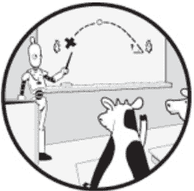

# 重复代码：确定性循环



当我们让计算机反复执行一个过程时，计算机表现出色。它们会毫不疲倦地按我们要求执行，无论是执行 10 次、100 次还是十亿次。在本章中，我们将学习循环，即指示计算机重复执行程序某一部分的语句。

我们将使用循环解决三个问题：追踪杯下球的位置、统计占用停车位的数量，以及确定手机套餐可用数据的大小。

## 问题 #5：三杯

在这个问题中，我们将追踪杯下球的位置，因为杯子在移动。但杯子可能移动很多次，所以我们无法为每次移动分别编写代码。相反，我们将学习并使用 for 循环，它允许我们更轻松地为每次移动运行代码。

这是 DMOJ 问题 coci06c5p1。

### 挑战

Borko 有一排三个不透明的杯子：一个在左边（位置 1），一个在中间（位置 2），一个在右边（位置 3）。球在左边的杯子下。我们的工作是跟踪球的位置，因为 Borko 交换杯子的位置。

Borko 可以进行三种类型的交换：

- A 交换左边和中间的杯子
- B 交换中间和右边的杯子
- C 交换左边和右边的杯子

例如，如果 Borko 的第一次交换是类型 A，那么他交换左边和中间的杯子；因为球开始在左边，这次交换会使它移动到中间。如果他的第一次交换是类型 B，那么他交换中间和右边的杯子；左边杯子保持原位，所以球的位置不会改变。

### 输入

输入是一行最多 50 个字符。每個字符指定 Borko 进行的一种交换类型：A、B 或 C。

### 输出

输出球的最终位置：

- 1 如果球在左边
- 2 如果球在中间
- 3 如果球在右边

### 为什么需要循环？

考虑这个测试用例：

```
ACBA
```

这里有四次交换。要确定球的最终位置，我们需要逐一执行它们。

第一次交换是类型 A，交换左边和中间的杯子。由于球开始在左边，这导致球移动到中间。第二次交换是类型 C，交换左边和右边的杯子。由于球当前在中间，这对球的位置没有影响。第三次交换是类型 B，交换中间和右边的杯子。这使球从中间移动到右边。第四次交换是类型 A，交换左边和中间的杯子。这

对球没有影响。因此正确答案是 3，因为球最终在右边。

请注意，对于每次交换，我们都必须做出决定来确定球是否移动，如果移动，则相应地移动球。做出决定是我们从第 2 章中学到的。例如，如果交换类型是 A 且球位置为 1，则球移动到 2。这看起来像这样：

```
if swap_type == 'A' and ball_location == 1:
    ball_location = 2
```

我们可以为球移动的每种其他情况添加 elif：交换类型为 A 且球在中间，交换类型为 B 且球在中间，交换类型为 B 且球在右边，等等。这个大的 if 语句足以处理一次交换。但这不足以解决三杯问题，因为测试用例最多可能有 50 次交换。我们需要对每次交换重复 if 语句的逻辑。我们当然不想复制粘贴相同的代码 50 次。想象一下，如果你犯了一个拼写错误，不得不修复 50 次。或者如果你突然对最多一百万次交换的测试用例感兴趣。不，我们迄今为止学到的东西是不够的。我们需要一种方法遍历交换，对每个交换执行相同的逻辑。我们需要一个循环。

## for 循环

Python 的 for 语句产生 for 循环。for 循环允许我们处理序列的每个元素。到目前为止，我们唯一见过的序列类型是字符串。我们在学习过程中会学到其他类型；for 循环适用于所有这些类型。

这是我们第一个 for 循环的例子：

```
>>> secret_word = 'olive'
>>> for char in secret_word:
...     print('Letter: ' + char)
...
Letter: o
Letter: l
Letter: i
Letter: v
Letter: e
```

在关键字 **for** 之后，我们写下 *循环变量* 的名称。循环变量是指在循环进行过程中引用不同值的变量。在对字符串的 `for` 循环中，循环变量引用字符串的每个字符。

我选择了变量名 `char`（代表“character”）来提醒我们该变量引用字符串中的一个字符。有时，使用上下文变量名会更清晰。例如，在三杯问题中，我们可以使用名称 `swap_type` 来提醒我们它引用一种交换类型。

在变量名之后，我们有关键字 **in**，然后是我们想要循环的字符串。在我们的例子中，我们循环遍历由 `secret_word` 引用的字符串，即 `'olive'`。

像 if 语句的 `if`、`elif` 和 `else` 行一样，`for` 行以冒号 (`:`) 结尾。而且，与 if 语句一样，for 语句有一个缩进的一条或多条语句的块。

对缩进语句的一次执行被称为循环的 *一次迭代*。以下是我们循环在每次迭代中执行情况的逐步说明：

- 在第一次迭代中，Python 将 `char` 设置为引用 `'o'`，即 `'olive'` 的第一个字符。然后它运行循环块，该块仅由对 `print` 的调用组成。由于 `char` 引用 `'o'`，产生的输出是 Letter: o。
- 在第二次迭代中，Python 将 `char` 设置为引用 `'l'`，即 `'olive'` 的第二个字符。然后它调用 `print`，输出 Letter: l。
- 这个过程再重复三次，对应 `'olive'` 中剩余的每个字符。
- 然后循环终止。我们在循环后没有代码，因此我们的程序已完成运行。如果循环后有额外的代码，则执行将继续执行该代码。

你可以在 `for` 循环的块中放置多条语句。这里有一个例子：

```
```python
>>> secret_word = 'olive'
>>> for char in secret_word:
...     print('Letter: ' + char)
...     print('*')
...
Letter: o
*
Letter: l
```
```

*
Letter: i
*
Letter: v
*
Letter: e
*

现在我们在循环的每次迭代中执行两条语句：一條输出字符串的当前字母，另一條输出一个 * 字符。

for 循环遍历序列的元素，因此序列的长度告诉我们会有多少次迭代。len 函数接受一个字符串并返回其长度：

```
>>> len('olive')
5
```

因此我们对 'olive' 的 for 循环将包含五次迭代：

```
>>> secret_word = 'olive'
① >>> print(len(secret_word), 'iterations, coming right up!')
>>> for char in secret_word:
...  print('Letter: ' + char)
...
5 iterations, coming right up!
Letter: o
Letter: l
Letter: i
Letter: v
Letter: e
```

我使用多个参数调用了 print ①，而不是使用连接，以避免必须将长度转换为字符串。

for 循环是一种所谓的确定性循环，指的是迭代次数是预先确定的。还有不确定性循环，其迭代次数取决于程序运行时发生的各种情况。我们将在下一章研究这些循环。

## 概念检查

以下代码的输出是什么？

```
s = 'garage'
total = 0

for char in s:
    total = total + s.count(char)

print(total)
```

- A. 6
- B. 10
- C. 12
- D. 36

答案：B。对于 'garage' 中的每个字符，我们将其计数加到 total 上。有两个 g、两个 a、一个 r、两个 a（再次！）、两个 g（再次！）和 1 个 e。

## 嵌套

for 循环块是一条或多条语句。这些语句可以包括单行语句，如函数调用和赋值语句。但它们也可以包括多行语句，如 if 语句和循环。

让我们从一个 for 循环内部的 if 语句的例子开始。假设我们只想输出字符串中的大写字符。字符串有一个 isupper 方法，我们可以用它来确定一个字符是否为大写：

```
>>> 'q'.isupper()
False
>>> 'Q'.isupper()
True
```

我们可以在 for 循环的每次迭代中使用 isupper 在 if 语句中控制发生的事情：


```python
>>> title = 'The Escape'
>>> for char in title:
...    if char.isupper():
...        print(char)
T
E
```

这里要注意缩进。我们需要为 for 循环使用一层缩进，为嵌套的 if 语句再多使用一层缩进。

第一次迭代时，char 引用 `'T'`。由于 `'T'` 是大写，`isupper` 测试返回 `True`，if 语句块运行。这导致输出 `T`。第二次迭代时，char 引用 `'h'`。这次，`isupper` 测试返回 `False`，因此 if 语句块不运行。总的来说，for 循环遍历字符串中的每个字符，但嵌套的 if 语句只触发了两次：在字符串开头的 `'T'` 和 `'Escape'` 开头的 `'E'`。

如果 for 循环嵌套在另一个 for 循环中会怎样？我们可以这样做！这里有一个例子：

```python
>>> letters = 'ABC'
>>> digits = '123'
>>> for letter in letters:
...    for digit in digits:
...        print(letter + digit)
A1
A2
A3
B1
B2
B3
C1
C2
C3
```

代码生成了所有以 `letters` 中的字符为首字符、以 `digits` 中的字符为第二字符的两字符字符串。

在外层（`letters`）循环的第一次迭代中，letter 引用 `'A'`。这次迭代涉及完全运行内层（`digits`）循环。内层循环运行的整个时间，letter 都引用 `'A'`。内层循环的第一次迭代中，digit 引用 `1`，这就解释了 A1 的输出。内层循环的第二次迭代中，digit 引用 `2`，输出 A2。内层循环的第三次也是最后一次迭代中，digit 引用 `3`，输出 A3。

我们还没完！我们只经历了外层循环的一次迭代。在外层循环的第二次迭代中，letter 引用 `'B'`。现在内层循环的三个迭代再次运行，这次 letter 引用 `'B'`。这就解释了 B1、B2 和 B3 的输出。最后，在外层循环的第三次迭代中，letter 引用 `'C'`，内层循环产生 C1、C2 和 C3。

## CONCEPT CHECK

以下代码的输出是什么？

```python
title = 'The Escape'
total = 0

for char1 in title:
    for char2 in title:
        total = total + 1

print(total)
```

- A. 10
- B. 20
- C. 100
- D. 此代码因两个嵌套循环都使用 `title` 而产生语法错误

答案：C。`total` 最初为 0，并在内层循环的每次迭代中增加 1。`'The Escape'` 的长度为 10。外层循环因此有 10 次迭代。对于其中每次迭代，内层循环有 10 次迭代。内层循环总共有 10*10 = 100 次迭代。

## Solving the Problem

回到 Three Cups。我们需要的结构是使用一个 for 循环遍历每个交换，并使用嵌套的 if 语句跟踪球的位置：

```python
for swap_type in swaps:
    # 大的 if 语句来跟踪球
```

有三种交换类型（A、B 和 C）和三种球的可能位置，因此很容易得出结论，我们必须编写一个包含 3 * 3 = 9 个布尔表达式的 if 语句（一个在 if 之后，一个在八个 `elif` 之后）。事实上，我们只需要六个布尔表达式。九个中的三个根本不会移动球：当球在右侧时交换类型 A、当球在左侧时交换类型 B、当球在中间时交换类型 C。

Listing 3-1 给出了 Three Cups 的解决方案。

```python
swaps = input()

ball_location = 1

❶ for swap_type in swaps:
    ❷ if swap_type == 'A' and ball_location == 1:
        ❸ ball_location = 2
    elif swap_type == 'A' and ball_location == 2:
        ball_location = 1
    elif swap_type == 'B' and ball_location == 2:
        ball_location = 3
    elif swap_type == 'B' and ball_location == 3:
        ball_location = 2
    elif swap_type == 'C' and ball_location == 1:
        ball_location = 3
    elif swap_type == 'C' and ball_location == 3:
        ball_location = 1

print(ball_location)
```

*Listing 3-1: Solving Three Cups*

我使用 `input` 将交换字符串赋给 `swaps` 变量。for 循环 ❶ 遍历这些交换。每个交换由嵌套的 if 语句 ❷ 处理。if 和 elif 分支各自编码给定交换类型和给定球位置时会发生什么，然后相应地移动球。例如，如果交换类型为 A 且球在位置 1 ❷，则球最终位于位置 2 ❸。

这是一个使用多个 `elif`（一个大的 if 语句）与多个 `if`（多个 if 语句）是否重要会影响代码的示例。如果我们将 `elif` 改为 `if`，我们的代码就不再正确。Listing 3-2 显示了不正确的代码。

```python
# 此代码不正确

swaps = input()

ball_location = 1

for swap_type in swaps:
    ① if swap_type == 'A' and ball_location == 1:
        ball_location = 2
    ② if swap_type == 'A' and ball_location == 2:
        ball_location = 1
    if swap_type == 'B' and ball_location == 2:
        ball_location = 3
    if swap_type == 'B' and ball_location == 3:
        ball_location = 2
    if swap_type == 'C' and ball_location == 1:
        ball_location = 3
    if swap_type == 'C' and ball_location == 3:
        ball_location = 1

print(ball_location)
```

*Listing 3-2: Solving Three Cups incorrectly*

如果我们说代码不正确，我们就声称它至少在一个测试用例上失败。你能找到一个使此代码产生错误答案的测试用例吗？

这里有一个这样的测试用例：

```text
A
```

对我们来说，球每次交换最多移动一次似乎是有意义的。但 Python 会机械地运行你编写的代码，无论它是否符合我们的预期。在这种情况下，我们只有一个交换，因此球最多移动一次。在 for 循环的第一次也是唯一一次迭代中，Python 检查表达式 ①。它为真，因此 Python 将 ball_location 设置为 2。然后，Python 检查表达式 ②。由于我们刚刚将 ball_location 改为 2，此表达式为真！Python 因此将 ball_location 设置为 1。程序的输出为 1，而应为 2。

这是一个 *logic error* 的例子：导致程序遵循错误逻辑并产生错误答案的错误。逻辑错误的常用术语是 *bug*。当程序员通过代码修复 bug 时，称为 *debugging*。

通常只需要一个简单的测试用例来证明程序不正确。当你试图缩小代码出错范围时，不要从长测试用例开始。这样的测试用例结果手工验证困难，并且往往会引发复杂的执行路径，我们可能学不到太多。相比之下，小的测试用例不会让我们的程序做太多；如果它做的事情是错的，那么我们就不必花很长时间寻找罪魁祸首。设计小而有针对性的测试用例并不总是容易的。这是一种可以通过练习来磨练的技能。

将我们的正确代码提交给评判，然后让我们继续。

在继续之前，你可能想尝试解决第 67 页“Chapter Exercises”中的练习 1 和 2。

## Problem #6: Occupied Spaces

我们知道如何遍历字符串的字符。但有时我们需要知道我们在字符串中的位置，而不仅仅是存储在那里的字符。这个问题就是这样的一个例子。

这是 DMOJ 问题 ccc18j2。

### The Challenge

你监督一个有 *n* 个停车位的停车场。昨天，你记录了每个停车位是否被汽车占用或空闲。今天，你再次记录了每个停车位是否被汽车占用或空闲。指出在两天都被占用的停车位数。

### Input

输入包含三行。

- 第一行包含整数 *n*，停车位数。*n* 在 1 到 100 之间。
- 第二行包含昨天信息的长度为 *n* 的字符串，每个停车位一个字符。C 表示停车位被占用（C 代表 car），. 表示停车位空闲。例如，CC. 表示前两个停车位被占用，第三个为空。
- 第三行包含今天信息的长度为 *n* 的字符串，格式与第二行相同。

### Output

输出在两天都被占用的停车位数。

### A New Kind of Loop

我们最多可能有 100 个停车位，所以你可能不会对这里出现循环感到惊讶。我们在解决 Three Cups 时学到的 for 循环类型当然可以遍历停车位信息字符串：

```python
>>> yesterday = 'CC.'
>>> for parking_space in yesterday:
...     print('The space is ' + parking_space)
...
The space is C
The space is C
The space is .
```

这告诉我们每个空间昨天是否被占用。但我们还需要知道每个空间今天是否也被占用。

考虑这个测试用例：

```text
3
CC.
.C.
```

第一个停车位昨天被占用。那个停车位两天都被占用了吗？要回答这个问题，我们需要查看今天字符串中对应的字符。它是 .（空），所以这个停车位不是两天都被占用。

第二个停车位呢？那个停车位昨天也被占用。而且，查看今天字符串的第二个字符，它今天也被占用了。所以这是一个两天都被占用的停车位。（这是唯一这样的停车位；此测试用例的正确输出为 1。）


遍历一个字符串的字符并不能帮助我们找到另一个字符串中对应的字符。但是如果我们能跟踪自己在字符串中的位置——我们在第一个停车位，我们在第二个停车位，等等——我们就可以查找每个字符串中对应的字符。我们到目前为止学到的 for 循环并不是这样做的方法。这样做的方法是使用索引和一种新的 for 循环。

## 索引

字符串中的每个字符都有一个*索引*，它表示其位置。第一个字符的索引是 0，第二个字符的索引是 1，以此类推。在自然语言中，我们通常从 1 开始计数。在英语中，没有人会说“*hello* 中位置 0 的字符是 *h*。”但大多数编程语言，包括 Python，都从 0 开始。

要使用索引，我们在字符串后面加上方括号中的索引。以下是一些索引的示例：

```
>>> word = 'splore'
>>> word[0]
's'
>>> word[3]
'o'
>>> word[5]
'e'
```

如果我们愿意，可以在索引中使用变量：

```
>>> where = 2
>>> word[where]
'l'
>>> word[where + 2]
'r'
```

对于一个非空字符串，我们可以使用到的最高索引是其长度减 1。（空字符串没有有效索引。）例如，'splore' 的长度为 6，因此索引 5 是其最高索引。更大就会报错：

```
>>> word[len(word)]
Traceback (most recent call last):
  File "<stdin>", line 1, in <module>
IndexError: string index out of range
```

```
>>> word[len(word) - 1]
'e'
```

我们如何访问字符串中从右数第二个字符？这样做就行：

```
>>> word[len(word) - 2]
'r'
```

但有更简单的方法。Python 支持负索引作为访问字符的另一种选择。索引 -1 是最右边的字符，索引 -2 是从右数第二个字符，以此类推：

```
>>> word[-2]
'r'
>>> word[-1]
'e'
>>> word[-5]
'p'
>>> word[-6]
's'
>>> word[-7]
Traceback (most recent call last):
  File "<stdin>", line 1, in <module>
IndexError: string index out of range
```

计划是使用索引来访问昨天和今天停车信息的对应位置。我们可以使用每个字符串的索引 0 来访问第一个停车位的信息，使用索引 1 来访问第二个停车位的信息，以此类推。但在执行该计划之前，我们需要学习一种新的 for 循环。

## CONCEPT CHECK

以下代码的输出是什么？

```
s = 'abcde'
t = s[0] + s[-5] + s[len(s) - 5]

print(t)
```

- A. aaa
- B. aae
- C. aee
- D. This code produces an error

Answer: A. 三个索引都指向 'abcde' 中的第一个字符。首先，s[0] 指向 'a'，因为 'a' 在字符串中的索引是 0。其次，s[-5] 指向 'a'，因为 'a' 是从右数第五个字符。第三，s[len(s) - 5] 指向 'a'，因为索引求值为 0：5（字符串的长度）减去 5。

## Range for loops

Python 的 range 函数生成整数范围，我们可以用这些范围来控制 for 循环。与遍历字符串的字符不同，range for 循环遍历整数。如果我们只给 range 提供一个参数，我们会得到从 0 到该参数减 1 的范围：

```
>>> for num in range(5):
...     print(num)
...
0
1
2
3
4
```

注意 5 没有输出。

如果我们给 range 提供两个参数，我们会得到从第一个参数到但不包括第二个参数的序列：

```
>>> for num in range(3, 7):
...     print(num)
...
3
4
5
6
```

我们可以通过包含第三个参数来使用不同的*步长*计数。默认步长为 1，即每次加一。让我们试试其他几个步长：

```
>>> for num in range(0, 10, 2):
...     print(num)
...
0
2
4
6
8
>>> for num in range(0, 10, 3):
...     print(num)
...
0
3
6
9
```

我们也可以倒着计数，但*不能*这样做：

```
>>> for num in range(6, 2):
...     print(num)
...
```

这不起作用，因为默认情况下 range 是向上计数。步长为 -1 让我们可以一次倒退一个：

```
>>> for num in range(6, 2, -1):
...     print(num)
...
6
5
4
3
```

要从 6 倒数到 0 包括 0，我们需要第二个参数的值为 -1：

```
>>> for num in range(6, -1, -1):
...     print(num)
...
6
5
4
3
2
1
0
```

有时快速查看 range 中的数字而不编写循环会很有帮助。不幸的是，range 函数并不会直接显示这些数字：

```
>>> range(3, 7)
range(3, 7)
```

我们可以将该结果传递给 list 函数来得到我们想要的：

```
>>> list(range(3, 7))
[3, 4, 5, 6]
```

当使用 range 调用时，list 函数会生成 range 的整数列表。我们稍后会学习所有关于列表的知识；现在，请记住 list 作为诊断 range 错误的辅助工具。

## CONCEPT CHECK

以下循环执行了多少次迭代？

```
for i in range(10, 20):
    # Some code here
```

- A. 9
- B. 10
- C. 11
- D. 20

Answer: B. range 会遍历数字 10、11、12、13、14、15、16、17、18 和 19。有 10 个数字，因此有 10 次迭代。

## Range for Loops Through Indices

假设我们有字符串给出昨天和今天的停车位信息：

```
>>> yesterday = 'CC.'
>>> today = '.C.'
```

给定一个索引，我们可以查看昨天和今天该索引的信息：

```
>>> yesterday[0]
'C'
>>> today[0]
'.'
```

我们可以使用 range for 循环遍历索引来处理每对对应的字符。我们知道昨天和今天的长度相同。但该长度可能是 1 到 100 之间的任何值，因此我们不能写类似 range(3) 的东西。我们希望使用索引 0、1、2，等等，一直迭代到字符串长度减 1。我们可以通过使用其中一个字符串的长度作为 range 的参数来实现：

```
>>> for index in range(len(yesterday)):
...     print(yesterday[index], today[index])
... 
C .
C C
..
```

我把循环变量叫做 index。其他流行名称包括 i（index 的第一个字母）和 ind。从现在开始我会使用 i。

不要把这个循环变量叫做 status 或 information。这些名称意味着它会取 'C' 和 '.' 值，而实际上它取的是整数。

## Solving the Problem

有了我们的 range for 循环，我们就可以解决 Occupied Spaces 问题了。我们的策略是从字符串开头到结尾遍历每个索引。我们可以检查昨天信息和今天信息在每个索引处的内容。使用嵌套的 if 语句，我们将确定停车位是否在两天都被占用。

Listing 3-3 给出了我们的解决方案。

```
n = int(input())
yesterday = input()
today = input()

① occupied = 0

② for i in range(len(yesterday)):
    ③ if yesterday[i] == 'C' and today[i] == 'C':
        ④ occupied = occupied + 1

print(occupied)
```

Listing 3-3: Solving Occupied Spaces

程序首先读取三行输入：n 指停车位的数量；yesterday 和 today 分别指昨天和今天的停车位信息。

注意我们不再引用停车位的数量（n）。我们本可以用它来告诉我们字符串的长度，但我选择忽略它，因为在现实场景中它通常没有提供。

我们使用 occupied 变量来计算昨天和今天都被占用的停车位数量。我们将该变量初始设为 0 ①。

现在我们进入 range for 循环，它遍历昨天和今天的有效索引 ②。对于每个这样的索引，我们检查停车位是否昨天被占用且今天被占用 ③。如果是，则我们通过将 occupied 增加 1 来将其计入总数 ④。

当 range for 循环终止时，我们将遍历完所有停车位。通过 occupied 变量可以访问到昨天和今天都被占用的停车位总数。剩下的就是输出该总数。

这就解决了这个问题。是时候把你的代码提交给评测了。

## Problem #7: Data Plan

我们了解到 for 循环对于处理从输入读取的数据很有用。它们在读取数据时也经常很有用


本身。在本问题中，我们将处理分散在多行中的数据，并使用 for 循环来帮助我们读取全部数据。

这是 DMOJ 上的题目 coci16c1p1。

## 挑战

Pero 与他的手机运营商签订了一份流量套餐，每月提供 x MB 的数据。此外，他在某个月份未用完的数据会结转到下个月。例如，如果 x 为 10，且 Pero 在某个月份只用了 4MB，那么剩余的 6MB 会结转到下个月（这样下个月他就有 10 + 6 = 16MB 可用）。

我们已知 Pero 在最初 n 个月中每个月使用的数据量（以 MB 计）。我们的任务是确定下一个月可用的 MB 数。

## 输入

输入由以下几行组成：

- 一行包含整数 x，即每月提供给 Pero 的 MB 数。x 在 1 到 100 之间。
- 一行包含整数 n，即 Pero 已使用该流量套餐的月数。n 在 1 到 100 之间。
- n 行，每个月一行，给出该月 Pero 使用的整数 MB 数。每个数至少为 0，并且绝不会超过可用的 MB 数。（例如，如果 x 为 10，且 Pero 当前有 30MB 可用，那么下一个数最多为 30。）

## 输出

输出下一个月可用的 MB 数。

## 用循环读取输入

到目前为止，在我们解决的所有问题中，我们都确切知道需要从输入中读取多少行。例如，在 Three Cups 中，我们读取一行；在 Occupied Spaces 中，我们读取三行。而在 Data Plan 中，我们事先不知道要读取多少行，因为这取决于我们从第二行读取到的数字。

我们可以读取输入的第一行：

```
monthly_mb = int(input())
```

（我使用变量名 `monthly_mb` 而不是 `x`，是为了让它更有意义。）

我们也可以读取输入的第二行：

```
n = int(input())
```

但是如果不使用循环，我们就无法继续读取更多内容。这里使用 range for 循环非常合适，因为我们可以用它恰好循环 n 次：

```
for i in range(n):
    # Process month
```

## 解决问题

我解决这个问题的策略是跟踪从前几个月结转过来的 MB 数。我称之为 excess。

考虑如下测试用例：

```
10
3
4
12
1
```

每个月 Pero 会获得 10MB 数据，我们需要处理他在给定的三个月中使用的数据。第一个月，Pero 获得 10MB，使用了 4MB，因此结转到下个月的 excess 为 6MB。第二个月，Pero 又获得 10MB，所以他现在一共有 16MB。这个月他使用了 12MB，因此结转到下个月的 excess 为 16 − 12 = 4MB。第三个月，Pero 又获得 10MB，所以他现在一共有 14MB。这个月他使用了 1MB，因此结转到下个月的 excess 为 14 − 1 = 13MB。

我们需要知道 Pero 在下一个月（即第四个月）有多少 MB 可用。他有从前三个月结转下来的 13MB，并且在这个月还会获得惯例的 10MB，所以他总共有 13 + 10 = 23MB 可用。

当我根据上述解释编写代码时，我漏掉了最后这 10MB，所以我的输出是 13 而不是 23。我完全专注于 excess，忘记了我们需要的并不是进入下个月的 excess，而是可用的总 MB 数。这个总数等于 excess 加上每月提供给 Pero 的 MB 数。

（修正后的）代码见代码清单 3-4。

```
monthly_mb = int(input())
n = int(input())

excess = 0

for i in range(n):
    used = int(input())
    excess = excess + monthly_mb - used

print(excess + monthly_mb)
```

**代码清单 3-4：解决 Data Plan 问题**

`excess` 变量初始为 0。在 range for 循环的每次迭代中，我们给 `excess` 赋一个值，该值同时考虑了每月提供的 MB 数和该月使用的 MB 数。

range for 循环会循环 n 次，对应 Pero 使用该流量套餐的每一个月 ❶。`i` 取的值——0、1 等等——并不是我们关心的，因为我们没有理由去关心当前处理的是哪个月。因此，我们在程序的任何地方都不会使用 `i` 的值。你可以将 `i` 替换为 `_`（下划线），以明确表示该变量是“不关心”的状态，但为了与其他示例保持一致，我会继续使用 `i`。

在 range for 循环中，我们读取这个月使用的 MB 数。然后，我们更新 excess 的 MB 数 ❷：它等于之前的 excess，加上 Pero 每月获得的 MB 数，再减去 Pero 这个月使用的 MB 数。

在计算出 n 个月后的 excess 数之后，我们报告下一个月可用的 MB 数 ❸。

解决一个问题的方法往往不止一种。编程是富有创造性的，我很喜欢观察人们想出的各种不同解决策略。即使你已经成功解决了一个问题，你也许还想用 Google 搜索该问题，学习别人是如何解决的。此外，有些在线评测系统，比如 DMOJ，允许你在解决问题后查看其他人的提交。对于那些通过了全部测试用例的提交：那些程序员的做法是否与你不同？对于那些未通过某些测试用例的提交：代码哪里有问题？阅读别人的代码是提升自己编程技能的好方法！

你能想出解决 Data Plan 问题的另一种方法吗？

这里有一个提示：你可以先计算出提供给 Pero 的总 MB 数，然后减去他使用的 MB 数。我鼓励你先花些时间思考如何实现，再继续往下读！

提供给 Pero 的总 MB 数，包括下个月提供的部分，是 `x * (n + 1)`，其中 `x` 是每月提供的 MB 数。要确定下一个月可用的 MB 数，我们可以先从这个总数开始，然后减去 Pero 每个月使用的量。这一策略的代码见代码清单 3-5。

```
monthly_mb = int(input())
n = int(input())

total_mb = monthly_mb * (n + 1)

for i in range(n):
    used = int(input())
    total_mb = total_mb - used

print(total_mb)
```

**代码清单 3-5：解决 Data Plan 问题的另一种方法**

选择你最喜欢的解决方案，然后提交给评测系统。

对一个人来说直观易懂的东西，对另一个人未必如此。你可能会读到某个解释或代码，却无法理解它。这并不意味着你不够聪明，只是说明你需要一种不同的呈现方式，一种更贴合你当前思路的方式。你也可以把难以理解的解释和示例标记下来，留待以后复习。一旦你进行了更多练习，它们可能会出人意料地有用。

## 小结

在本章中，我们学习了 for 循环。标准 for 循环会遍历序列中的字符；range for 循环会遍历某个范围内的整数。我们解决的每个问题都需要处理大量输入，如果没有循环，我们将无法做到这一点。

当你需要将代码重复执行特定次数时，for 循环是首选循环。Python 还有另一种类型的循环，我们将在下一章学习如何使用它。为什么除了 for 循环之外还需要其他循环？for 循环有什么做不到的吗？问得好！我现在先告诉你：练习使用 for 循环是为后续内容做准备的绝佳方式。

## 本章练习

这里有一些练习题供你尝试。

1. DMOJ 题目 wc17c3j3，Uncrackable
2. DMOJ 题目 coci18c3p1，Magnus
3. DMOJ 题目 ccc11s1，English or French
4. DMOJ 题目 ccc11s2，Multiple Choice
5. DMOJ 题目 coci12c5p1，Ljestvica
6. DMOJ 题目 coci13c3p1，Rijeci
7. DMOJ 题目 coci18c4p1，Elder

## 附注

Three Cups 最初出自 2006/2007 年克罗地亚信息学公开赛第 5 场比赛。Occupied Spaces 最初出自 2018 年加拿大计算机竞赛初级组。Data Plan 最初出自 2016/2017 年克罗地亚信息学公开赛第 1 场比赛。


# 4
