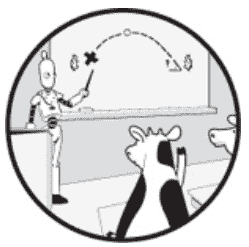

# 重复代码：不定循环



你在第 3 章学到的 for 循环和 range for 循环非常适合遍历字符串或索引范围。但当我们没有字符串，或者索引不遵循固定模式时，该怎么办呢？我们使用 while 循环，这正是本章的主题。while 循环比 for 循环更通用，能处理 for 循环无法应对的情况。

我们将解决三个 for 循环力不能及的问题：确定老虎机能玩多少次、整理歌曲播放列表直到用户想停止，以及解码一条编码消息。

## 问题 #8：老虎机

在钱花光之前，老虎机可以玩多少次？这个问题很微妙，它不仅取决于我们一开始有多少钱，还取决于游戏过程中的中奖模式。我们会发现，这种情况需要用 while 循环，而不是 for 循环。

这是 DMOJ 题目 ccc00s1。

## 挑战

玛莎带着 n 枚 25 美分硬币来到赌场。赌场有三台老虎机，她按顺序玩，直到硬币用完。也就是说，她先玩第一台老虎机，然后第二台，然后第三台，再回到第一台，然后是第二台，依此类推。每玩一次花费一枚 25 美分硬币。

老虎机按以下规则运行：

- 第一台老虎机每当被玩到第 35 次时支付 30 枚 25 美分硬币。
- 第二台老虎机每当被玩到第 100 次时支付 60 枚 25 美分硬币。
- 第三台老虎机每当被玩到第 10 次时支付 9 枚 25 美分硬币。
- 其他游玩不会支付任何硬币。

确定玛莎在硬币用完之前一共玩了多少次。

## 输入

输入由四行组成。

- 第一行包含一个整数 n，表示玛莎带到赌场的 25 美分硬币数量。n 在 1 到 1,000 之间。
- 第二行包含一个整数，表示第一台老虎机自上次支付以来已被玩过的次数。这些游玩发生在玛莎到达之前，玛莎的游玩从该次数之后继续。例如，假设第一台老虎机自上次支付以来已被玩过 34 次。那么，玛莎第一次玩它就会赢得 30 枚 25 美分硬币。
- 第三行包含一个整数，表示第二台老虎机自上次支付以来已被玩过的次数。
- 第四行包含一个整数，表示第三台老虎机自上次支付以来已被玩过的次数。

## 输出

输出以下句子，其中 x 是玛莎在硬币用完之前玩的次数：

```
Martha plays x times before going broke.
```

## 探索一个测试用例

让我们完整地看一个例子，确保这个问题中的所有内容都清楚明了。我们将使用以下测试用例：

```
7
28
0
8
```

为了仔细追踪玛莎的每一次游玩，我们需要记录六项信息。用表格来记录会很方便，因为每一行可以告诉我们每次游玩后的状态。以下是我们的列：

- **游玩次数**：玛莎已经玩过的老虎机数量
- **硬币数**：玛莎当前拥有的 25 美分硬币数量
- **下次游玩**：玛莎接下来会玩的老虎机
- **第一台游玩次数**：第一台机器自上次支付以来已被玩过的次数
- **第二台游玩次数**：第二台机器自上次支付以来已被玩过的次数
- **第三台游玩次数**：第三台机器自上次支付以来已被玩过的次数

开始时，玛莎已经玩了 0 次老虎机，她有 7 枚 25 美分硬币，接下来她会玩第一台老虎机。第一台老虎机自上次支付以来已被玩过 28 次，第二台已被玩过 0 次，第三台已被玩过 8 次。我们的状态如下：

| 游玩次数 | 硬币数 | 下次游玩 | 第一台游玩次数 | 第二台游玩次数 | 第三台游玩次数 |
|---:|---:|:---:|---:|---:|---:|
| 0 | 7 | 第一台 | 28 | 0 | 8 |

玛莎首先玩第一台老虎机。这花费一枚 25 美分硬币。因为这是该机器自上次支付以来第 29 次被玩，而不是第 35 次，所以老虎机不会支付任何硬币。接下来玛莎将玩第二台老虎机。这是我们的新状态：

| 游玩次数 | 硬币数 | 下次游玩 | 第一台游玩次数 | 第二台游玩次数 | 第三台游玩次数 |
|---|---|---|---|---|---|
| 1 | 6 | 第二台 | 29 | 0 | 8 |

玩第二台老虎机花费一枚 25 美分硬币。因为这是该机器自上次支付以来第 1 次被玩，而不是第 100 次，所以老虎机不会支付任何硬币。接下来玛莎将玩第三台老虎机。这是我们的新状态：

| 游玩次数 | 硬币数 | 下次游玩 | 第一台游玩次数 | 第二台游玩次数 | 第三台游玩次数 |
|---|---|---|---|---|---|
| 2 | 5 | 第三台 | 29 | 1 | 8 |

玩第三台老虎机花费一枚 25 美分硬币。因为这是该机器自上次支付以来第 9 次被玩，而不是第 10 次，所以老虎机不会支付任何硬币。接下来，玛莎将循环回到第一台老虎机。这是我们的新状态：

| 游玩次数 | 硬币数 | 下次游玩 | 第一台游玩次数 | 第二台游玩次数 | 第三台游玩次数 |
|---|---|---|---|---|---|
| 3 | 4 | 第一台 | 29 | 1 | 9 |

现在玛莎玩第一台老虎机：

| 游玩次数 | 硬币数 | 下次游玩 | 第一台游玩次数 | 第二台游玩次数 | 第三台游玩次数 |
|---|---|---|---|---|---|
| 4 | 3 | 第二台 | 30 | 1 | 9 |

然后玛莎玩第二台老虎机：

| 游玩次数 | 硬币数 | 下次游玩 | 第一台游玩次数 | 第二台游玩次数 | 第三台游玩次数 |
|---|---|---|---|---|---|
| 5 | 2 | 第三台 | 30 | 2 | 9 |

要编写 while 循环，我们使用 Python 的 while 语句。while 循环由布尔表达式控制。如果布尔表达式为 True，Python 会执行 while 循环的一次迭代。如果表达式仍为 True，Python 会再执行一次 while 循环迭代，如此反复，直到布尔表达式变为 False。如果布尔表达式一开始就是 False，那么循环根本不会运行。

while 循环是 *不定循环*：迭代次数可能事先无法知道。

## 使用 while 循环

让我们从下面这个 while 循环示例开始：

```python
>>> num = 0
>>> while num < 5:
...     print(num)
...
...     num = num + 1
...
0
1
2
3
4
```

在 for 循环中，循环变量由 Python 替我们创建；我们不必在循环之前使用赋值语句来创建变量。但在 while 循环中，没有什么是白来的。如果我们需要一个变量在 while 循环中遍历各个值，就必须自己创建这个变量。我们在这里通过在循环之前让 num 指向 0 来完成这一点 ❶。

while 循环本身由布尔表达式 num < 5 控制 ❷。如果 num < 5 为 True，循环块中的代码就会运行。此时 num 指向 0，所以布尔表达式为 True。因此我们运行循环块，输出 0，然后把 num 增加到 1 ❸。

我们跳回循环顶部，再次计算 num < 5 这个布尔表达式。由于 num 指向 1，表达式为 True。因此我们再次运行循环块，输出 1，然后把 num 增加到 2。

回到循环顶部：num < 5 仍然为 True 吗？是的，因为 num 才等于 2。这会启动循环的另一次迭代，输出 2，并把 num 增加到 3。

这种模式会继续，循环还会再迭代两次：一次是 num 指向 3 时，另一次是 num 指向 4 时。当 num 指向 5 时，num < 5 这个布尔表达式终于为 False，从而终止循环。

重要的是，我们必须记得增加 num ③。for 循环会自动让循环变量遍历合适的值。但同样，在 while 循环中一切都不是白来的，我们必须自己更新变量，使自己一步步接近循环终止。如果我们忘记增加 num，就会发生这种情况：

```
>>> num = 0
>>> while num < 5:
...     print(num)
...
0
0
0
0
0
0
0
... forever
```

如果你在自己的计算机上运行这段代码，屏幕会被 0 填满，你必须终止程序。你可以按 CTRL-C 或关闭 Python 窗口来做到这一点。

问题在于 num < 5 永远为 True；循环中没有任何东西能让它变成 False。这种循环永不终止的情况被称为无限循环。令人惊讶的是，无意中写出无限 while 循环非常容易。如果你看到相同的值不断重复，或者程序似乎什么也没做，那么很可能你陷入了无限循环。请仔细检查 while 循环的布尔表达式，并确保循环块正在朝终止的方向前进。

我们可以对 num 变量做任何我们想做的事。下面是一个每次加 3 的 while 循环：

```
>>> num = 0
>>> while num < 10:
...     print(num)
...     num = num + 3
...
0
3
6
9
```


下面是一个从 4 倒数到 0 的 while 循环：

```
>>> num = 4
>>> while num >= 0:
...   print(num)
...   num = num - 1
...
4
3
2
1
0
```

注意，这里我使用的是 >= 而不是 >。这样，当 num 为 0 时，while 循环仍会执行，这正是我们想要的效果。

## 概念检查

以下代码的输出是什么？

```
n = 3
while n > 0:
    if n == 5:
        n = -100
    print(n)
    n = n + 1
```

A.

3
4

B.

3
4
5

C.

3
4
-100

D.

3
4
5
-100

答案：C。while 循环的布尔表达式只在每次迭代开始时检查。即使它在迭代过程中某一点变为 False，当前迭代的剩余部分仍会执行完毕。

因为 3 大于 0，所以执行一轮循环迭代。if 语句块被跳过（因为其布尔表达式为 False），因此这次迭代输出 3 并将 n 设为 4。由于 4 大于 0，我们再进行一轮循环迭代，这次输出 4 并将 n 设为 5。由于 5 大于 0，我们再执行一轮循环迭代。这一次，if 语句块被执行，将 n 设为 -100。接下来，输出 -100，并将 n 设为 -99。然后我们停下来，因为 n > 0 为 False。

## 概念检查

以下代码的输出是什么？

```
x = 6
while x > 4:
    x = x - 1
    print(x)
```

A.

B.

6
5
4

C.

5
4

D.

5
4
3

E.

6
5
4
3

答案：C。许多 while 循环先执行某些操作，然后更新循环变量，但这个循环不是这样。它先递减循环变量 x，然后输出它。因为 6 大于 4，所以执行一轮循环迭代，将 x 赋值为 5，然后输出 5。接下来，5 大于 4，所以我们再进行一轮迭代，这次将 x 赋值为 4 并输出 4。就是这样：4 不大于 4，所以循环终止。

## 在循环中嵌套循环

我们可以像在 for 循环中嵌套循环一样，在 while 循环中嵌套循环。在第 3 章的“嵌套”一节中，我提到内部 for 循环

会在外层循环开始下一次迭代之前完成其所有迭代。while 循环也是如此。下面是一个示例：

```
>>> i = 0
>>> while i < 3:
...     j = 8
...     while j < 11:
...         print(i, j)
...         j = j + 1
...     i = i + 1
...
0 8
0 9
0 10
1 8
1 9
1 10
2 8
2 9
2 10
```

i 的每一个值都会产生三行输出，分别对应内层 j 循环的每一次迭代。

## 概念检查

以下嵌套循环会输出多少行？

```
x = 0
y = 1
while x < 3:
    while y < 3:
        print(x, y)
        y = y + 1
    x = x + 1
```

- A. 2
- B. 3
- C. 6
- D. 8
- E. 9

答案：A。外层循环的布尔表达式 x < 3 为 True，因此我们执行一次外层循环迭代。这将导致内层循环执行两次迭代：一次 y 为 1，一次 y 为 2，每次迭代都会输出一行。所以目前已经输出了两行。

但代码中没有重置 y 的值！因此，y < 3 永远不会再为 True，内层循环也不会再有后续迭代。

在处理嵌套 while 循环时，忘记重置循环变量是一个常见错误。

## 添加布尔运算符

为了解决老虎机问题，我们希望在 Martha 至少有一枚硬币时进行循环。代码如下：

```
while quarters >= 1:
```

这个简单的布尔表达式就足以解决这个问题。但和 if 语句一样，while 后面的布尔表达式也可以包含关系运算符或布尔运算符。下面是一个示例：

```
>>> x = 4
>>> y = 10
>>> while x <= 10 and y <= 13:
...     print(x, y)
...     x = x + 1
...     y = y + 1
...
4 10
5 11
6 12
7 13
```

这个 while 循环由布尔表达式 x <= 10 and y <= 13 控制。与任何 and 运算符一样，要使整个表达式为 True，其两个操作数都必须为 True。当 x 为 8、y 为 14 时，循环终止，因为 y <= 13 这个操作数为 False。

## 解决问题

为了解决老虎机问题，我们知道需要使用 while 循环而不是 for 循环，因为我们无法提前预测迭代次数。循环的每次迭代将玩当前这台老虎机。当循环终止时，Martha 将没有硬币剩余，我们将输出她玩的次数。

每次迭代我们需要做以下事情：

- 将 Martha 的硬币减少一枚（因为玩一次老虎机需要一枚硬币）。
- 如果 Martha 当前在第一台老虎机，就玩那台机器。这包括增加该机器已被玩的次数。如果这是第 35 次玩，则给 Martha 奖励，并将该机器已被玩的次数重置为 0。
- 如果 Martha 当前在第二台老虎机，就玩那台机器（与玩第一台机器的方式类似）。
- 如果 Martha 当前在第三台老虎机，就玩那台机器（与玩第一台机器的方式类似）。
- 增加 Martha 的游玩次数（因为我们刚玩了一台机器）。
- 移到下一台机器。如果 Martha 刚玩了第一台，我们想移到第二台；如果她刚玩了第二台，我们想移到第三台；如果她刚玩了第三台，我们想循环回到第一台。

我们的程序现在变得越来越长，所以像我刚才那样列出计划是控制复杂性并引导我们写出正确代码的有用技巧。我们可以利用这个计划来确保我们遵循步骤，并且没有遗漏任何东西。

我们的代码在清单 4-1 中。

```
quarters = int(input())
first = int(input())
second = int(input())
third = int(input())

plays = 0
machine = 0

while quarters >= 1:
```

```
quarters = quarters - 1

if machine == 0:
    first = first + 1
    if first == 35:
        first = 0
        quarters = quarters + 30
elif machine == 1:
    second = second + 1
    if second == 100:
        second = 0
        quarters = quarters + 60
elif machine == 2:
    third = third + 1
    if third == 10:
        third = 0
        quarters = quarters + 9

plays = plays + 1
machine = machine + 1
if machine == 3:
    machine = 0

print('Martha plays', plays, 'times before going broke.')
```

## 清单 4-1：解决老虎机问题

quarters 变量记录 Martha 拥有的硬币数量。first、second 和 third 变量分别记录第一、第二和第三台老虎机自上次赔付以来的游玩次数。

machine 变量记录 Martha 接下来要玩的老虎机。第一台老虎机用数字 0 表示，第二台用 1 表示，第三台用 2 表示。因此，让 machine 指向 0 表示接下来将玩第一台老虎机。

我们也可以用 1、2、3 来代替 0、1、2 表示老虎机。或者使用字符串：'first'、'second' 和 'third'。但从零开始编号是惯例，所以我在这里就是这样做的。

这个程序中的最后一个变量是 plays，它记录 Martha 已玩过的老虎机数量。一旦 Martha 没有硬币了，我们就输出这个值。

程序的主体是一个 while 循环，只要 Martha 还有硬币就会一直循环。

循环的每次迭代玩一台老虎机。因此，我们做的第一件事是把 Martha 的硬币减少一枚。接下来，我们玩当前这台老虎机。

我们是在老虎机 0 吗？还是老虎机 1？老虎机 2？我们需要一个 if 语句来回答这个问题。

我们首先检查是否在老虎机 0 上。如果是，我们就将该老虎机自上次赔付以来的游玩次数增加 1。为了确定 Martha 是否会获得赔付，我们接着检查该机器自上次赔付以来是否正好被玩了 35 次。如果是，我们就把该机器的游玩次数重置为 0，并将 Martha 的硬币增加 30。

这里有好几层嵌套，所以请花些时间确认代码逻辑是正确的。特别要注意，每次我们玩第一台机器时，都会将其游玩次数增加 1。但我们只在每玩 35 次后给 Martha 赔付——这就是我们使用内层 if 语句的原因！

我们处理第二台和第三台老虎机的方式与处理第一台完全相同。唯一的区别是，每台老虎机在各自的游玩次数达到要求后向 Martha 赔付，并且赔付的硬币数量也各自不同。

玩完一台老虎机后，我们将 Martha 的游玩次数增加 1。剩下的就是移到下一台机器，这样如果循环还有下一次迭代，我们就会处于正确的机器位置。

要移到下一台机器，我们将 machine 增加 1。如果之前在机器 0，这会将我们移到机器 1。如果之前在机器 1，会移到机器 2。如果之前在机器 2，会移到机器 3。

……机器 3？根本没有机器 3！如果我们刚玩了机器 2，那么我们希望从机器 0 重新开始。为此，我们添加一个检查：如果我们刚移到机器 3，就知道我们刚玩了机器 2，所以我们将 machine 重置为机器 0。

当循环终止时，我们知道 Martha 已经没有硬币了。作为最后一步，我们输出所需的句子，包括 Martha 的游玩次数。

这段代码包含了很多内容：在 Martha 没有硬币时停止、跟踪当前机器、在适当的时候给 Martha 赔付，以及统计 Martha 的游玩次数。你可以随时提交这段代码，但也要考虑一下，你是否会以

不同的方式。如果你在循环顶部而不是底部将 plays 增加 1，会发生什么？在循环顶部还是底部将 quarters 减少 1 有关系吗？你原本会不会使用新变量来记录 Martha 玩每台老虎机的次数，而不是修改 first、second 和 third？我强烈鼓励你对我们在此处的代码进行各种变体实验。如果你做了修改，而代码无法再通过测试，那太好了！现在你又有了新的学习机会来修复代码，并了解为什么你的修改会导致不想要的行为。

接下来的两节将进一步改进代码。我们将使用 % 运算符来减少所需的变量数量，并学习 f-string 以简化字符串的构建方式。

## 取模运算符

在第 1 章的“整数和浮点数”中，我介绍了用于计算整数除法余数的取模（%）运算符。例如，16 除以 5 的余数为 1：

```
>>> 16 % 5
1
```

而 15 除以 5 的余数为 0（因为 5 能整除 15）：

```
>>> 15 % 5
0
```

第二个操作数决定了 % 可能返回的值的范围。可能的返回值为从 0 到第二个操作数（但不包括第二个操作数）之间的整数。例如，如果第二个操作数是 3，那么 % 唯一能返回的值就是 0、1 和 2。此外，随着我们增大第一个操作数，我们会循环遍历所有可能的返回值。下面是一个例子：

```
>>> 0 % 3
0
>>> 1 % 3
1
>>> 2 % 3
2
>>> 3 % 3
0
>>> 4 % 3
1
>>> 5 % 3
2
>>> 6 % 3
0
>>> 7 % 3
1
```

注意这个模式：0、1、2、0、1、2，依此类推。这种行为对于计数到指定数字然后循环回到 0 非常有用。这正是我们玩老虎机时所需的行为：我们先玩 0 号老虎机，然后 1 号，然后 2 号，然后 0 号，然后 1 号，然后 2 号，然后 0 号，然后 1 号，依此类推。（这也是我使用 0、1、2 而不是其他值来指代老虎机的另一个原因。）

假设变量 plays 表示 Martha 已经玩的次数。要确定下一台要玩的老虎机（0、1 或 2），我们可以使用 % 运算符。例如，假设 Martha 到目前为止已经玩了一台老虎机，我们想知道她接下来会玩哪一台。她接下来会玩 1 号老虎机，% 运算符会告诉我们这一点：

```
>>> plays = 1
>>> plays % 3
1
```

如果 Martha 到目前为止已经玩了六次，那么她玩过的老虎机依次是 0、1、2、0、1、2。她接下来要玩的老虎机是 0 号。而且，由于她将三台老虎机各玩了两遍，除此之外没有其他游玩次数，% 运算符会给出 0：

```
>>> plays = 6
>>> plays % 3
0
```

作为最后一个例子，假设 Martha 到目前为止已经玩了 11 次。她已经完成了三个完整循环：0、1、2、0、1、2、0、1、2。这占了九次游玩。剩下的两次游玩将使 Martha 在下一局中玩 2 号老虎机：

```
>>> plays = 11
>>> plays % 3
2
```

也就是说，我们无需显式维护一个机器变量，就能计算出要玩哪台老虎机。

我们还可以使用 % 来简化判断当前老虎机的下一次游玩是否会让 Martha 赢钱的逻辑。以第一台老虎机为例。在代码清单 4-1 中，我们统计了自该老虎机上次赢钱以来的游玩次数。如果这个数字是 35，我们就让 Martha 赢钱并将计数重置为 0。但如果使用 % 运算符，则无需重置计数。我们只需检查该老虎机是否已被游玩了 35 的倍数次，如果是，就让 Martha 赢钱。要测试一个数字是否是 35 的倍数，可以使用 % 运算符。如果一个数字除以 35 没有余数，它就是 35 的倍数：

```
>>> first = 35
>>> first % 35
0
>>> first = 48
>>> first % 35
13
>>> first = 70
>>> first % 35
0
>>> first = 175
>>> first % 35
0
```

我们可以直接检查 `first % 35 == 0` 来决定是否让 Martha 赢钱。

我已经将代码清单 4-1 更新为使用 % 运算符。新代码见代码清单 4-2。

```python
quarters = int(input())
first = int(input())
second = int(input())
third = int(input())

plays = 0

while quarters >= 1:
  machine = plays % 3
  quarters = quarters - 1

  if machine == 0:
    first = first + 1
  if first % 35 == 0:
    quarters = quarters + 30
  elif machine == 1:
    second = second + 1
```

```python
>>> num3 = 11
>>> 'We have ' + str(num1) + ', ' + str(num2) + ', and ' + str(num3) + '.'
'We have 7, 82, and 11.'
```

我们可不想去跟踪所有这些引号、加号和空格。

构建由字符串和数字组成的字符串，最灵活的方法是使用 *f-string*。下面就是前面的例子使用 f-string 的样子：

```python
>>> num1 = 7
>>> num2 = 82
>>> num3 = 11
>>> f'We have {num1}, {num2}, and {num3}.'
'We have 7, 82, and 11.'
```

注意字符串开头的引号前的 *f*。*f* 代表 format（格式化），因为 f-string 允许你格式化字符串的内容。在 f-string 内部，我们可以把表达式放在花括号中。在构建字符串时，每个表达式都会被其值替换并插入到字符串中。结果只是一个普通的字符串——这里没有新的类型：

```python
>>> type(f'hello')
<class 'str'>
>>> type(f'{num1} days')
<class 'str'>
```

花括号中的表达式可以比单独的变量名更复杂：

```python
>>> f'The sum is {num1 + num2 + num3}'
'The sum is 100'
```

我们可以在《老虎机》的最后一行动态构建字符串。如下所示：

```python
print(f'Martha plays {plays} times before going broke.')
```

即使在这样最简单的字符串格式化场景中，我认为 f-string 也能增加清晰度。当你发现自己正在用零碎部分构建字符串时，请记住这一点。

关于 f-string 有一个警告：它们是在 Python 3.6 中新增的，在撰写本文时，Python 3.6 仍算一个比较新的版本。在较旧版本的 Python 中，f-string 会导致语法错误。

如果你使用 f-string，请务必确认你提交代码的评测系统使用的是 Python 3.6 或更高版本来测试你的代码。

在继续之前，你可能想尝试解决第 99 页“章节练习”中的练习 1。

## 问题 #9：歌曲播放列表

有时我们无法预先知道会提供多少输入。我们将在本问题中看到，在这种情况下，while 循环正是我们所需要的。

这是 DMOJ 问题 ccc08j2。

### 挑战

我们有五首最喜欢的歌曲，分别名为 A、B、C、D 和 E。我们为这些歌曲创建了一个播放列表，并使用一款应用来管理它。歌曲初始顺序为 A、B、C、D、E。该应用有四个按钮：

- 按钮 1：将播放列表中的第一首歌移动到播放列表末尾。例如，如果当前播放列表是 A、B、C、D、E，则变为 B、C、D、E、A。
- 按钮 2：将播放列表中的最后一首歌移动到播放列表开头。例如，如果当前播放列表是 A、B、C、D、E，则变为 E、A、B、C、D。
- 按钮 3：交换播放列表中的前两首歌。例如，如果当前播放列表是 A、B、C、D、E，则变为 B、A、C、D、E。
- 按钮 4：播放播放列表！

我们会收到用户的按键输入。当用户按下按钮 4 时，输出播放列表中歌曲的顺序。

### 输入

输入由成对的行组成，其中每对的第一行给出按钮编号（1、2、3 或 4），第二行给出用户按下该按钮的次数（介于 1 和 10 之间）。也就是说，第一行是按钮编号，第二行是次数

字符串的第一个字符位于索引 0，而不是 1。我们可以将该字符放到字符串末尾，像这样：

```python
>>> songs = 'ABCDE'
>>> songs = songs[1] + songs[2] + songs[3] + songs[4] + songs[0]
>>> songs
'BCDEA'
```

这种做法相当笨拙，而且只适用于正好有五首歌的情况。我们可以使用字符串切片来编写更通用、更不容易出错的代码。

*切片*是一个 Python 特性，它允许我们引用字符串的子串。（事实上，它对任何序列都适用，我们将在本书后面看到。）它接受两个索引：我们希望开始的位置索引，以及我们希望结束位置右侧的那个索引。例如，如果我们使用索引 4 和 8，那么我们会得到索引 4、5、6 和 7 处的字符。切片使用方括号，两个索引之间用冒号分隔：

```python
>>> s = 'abcdefghijk'
>>> s[4:8]
'efgh'
```

切片操作不会改变 s 所引用的内容。我们可以使用赋值语句让 s 引用这个切片：

```python
>>> s
'abcdefghijk'
>>> s = s[4:8]
>>> s
'efgh'
```

这里很容易出现差一错误，以为 `s[4:8]` 包含索引 8 处的字符。但事实并非如此，就像 `range(4, 8)` 不包含 8 一样。因此，虽然这个行为可能有点违反直觉，但它在 `range` 和切片中的表现是一致的。

在执行字符串切片时，我们必须始终包含冒号，但开始和结束索引是可选的。如果我们省略开始索引，Python 会从索引 0 开始切片：

```python
>>> s = 'abcdefghijk'
>>> s[:4]
'abcd'
```


## 概念检查

以下代码的输出是什么？

```
game = 'Lost Vikings'

print(game[2:-6])
```

- A. st V
- B. ost V
- C. iking
- D. st Vi
- E. Viking

答案：A。索引 2 处的字符是 'Lost' 中的 's'。索引 -6 处的字符是 'Vikings' 中的第一个 'i'。由于我们从索引 2 开始，直到但不包括索引 -6 结束，因此我们得到切片 'st V'。

## 概念检查

哪个密码能让我们退出以下循环？

```
valid = False

while not valid:
    s = input()
    valid = len(s) == 5 and s[:2] == 'xy'
```

- A. xyz
- B. xyabc
- C. abcxy
- D. 上述多个密码都能让我们退出循环
- E. 没有；循环从不执行，因此无法获取任何密码

答案：B。当 valid 为 True 时，while 循环终止（因为此时 not valid 为 False）。给定的密码中，只有 xyabc 的长度为 5 且前两个字符为 'xy'。因此，它是唯一能使 valid 设为 True 并结束循环的给定密码。

## 解决问题

既然我们已经练习了使用 while 循环在仍有按钮待处理时进行循环，以及使用切片进行字符串操作，我们现在准备解决“歌曲播放列表”问题。代码请参见清单 4-3。

```
songs = 'ABCDE'

button = 0

while button != 4:
    button = int(input())
    presses = int(input())
    for i in range(presses):
        if button == 1:
            songs = songs[1:] + songs[0]
        elif button == 2:
            songs = songs[-1] + songs[:-1]
        elif button == 3:
            songs = songs[1] + songs[0] + songs[2:]

output = ''
for song in songs:
    output = output + song + ' '

print(output[:-1])
```

*清单 4-3：解决歌曲播放列表*

只要还没有按下按钮 4，while 循环就会继续 ❶。在 while 循环的每次迭代中，我们读取按钮编号，然后读取该按钮被按下的次数。

现在，嵌套在外部 while 循环内部，我们需要为每次按钮按下循环一次。在决定使用哪种循环时，请记住所有的循环类型。在这里，range for 循环是最佳选择 ②，因为它是我们指定确切循环次数最容易的方式。

range for 循环内部的行为取决于按下了哪个按钮。因此，我们使用 if 语句检查按钮编号并相应地修改播放列表。如果按下按钮 1，我们使用切片将第一首歌移到播放列表的末尾 ③。如果按下按钮 2，我们使用切片将最后一首歌移到播放列表的开头 ④。为此，我们从字符串右端的字符开始，然后使用切片附加所有其他字符。对于按钮 3，我们需要修改播放列表，使前两首歌交换位置。我们构建一个新的字符串，包含索引 1 处的字符，然后是索引 0 处的字符，然后是索引 2 及之后的所有字符 ⑤。

一旦我们退出 while 循环，我们需要输出歌曲，每对歌曲之间有一个空格。我们不能直接输出 songs，因为它没有空格。相反，我们构建一个带有适当空格的输出字符串。为此，我们从空字符串开始 ⑥，然后使用 for 循环连接每首歌曲和一个空格。一个小麻烦是，这会在字符串末尾，即最后一首歌之后，添加一个空格，而这是我们不想要的。因此，我们使用切片移除该末尾空格字符 ⑦。

现在你准备好提交给评判系统了。

在继续之前，你可能想尝试解决第 99 页“章节练习”中的练习 3。

## 问题 #10：秘密句子

即使我们有一个字符串，并且知道将提供多少输入，while 循环仍可能是所需的循环类型。这个问题说明了为什么会出现这种情况。

这是 DMOJ 问题 coci08c3p2。

### 挑战

Luka 正在课堂上写一个秘密句子。他不希望老师能读懂它，所以他没有写下原始句子，而是写下了编码后的版本。在句子中的每个元音（a, e, i, o 或 u）之后，他加上字母 p 以及该元音。例如，而不是写下句子 *i like you*，他会写下 *ipi lipikepe yopoupuu*。

老师获得了 Luka 的编码句子。为老师恢复 Luka 的原始句子。

### 输入

输入是一行文本，即 Luka 的编码句子。它由小写字母和空格组成。每对单词之间恰好有一个空格。行的最大长度是 100 个字符。

### 输出

输出 Luka 的原始句子。

### for 循环的另一个局限性

在第 3 章中，我们学习了如何使用 for 循环处理字符串。for 循环逐字符地从字符串的开头到结尾逐步遍历。在许多情况下，这正是我们想要的。例如，在“三个杯子”中，我们需要从左到右查看每次交换，因此我们使用针对交换字符串的 for 循环。

在其他情况下，这种限制过于严格，range for 循环可能更合适。range for 循环让我们能够访问索引而不是字符。它还允许我们以我们选择的任意步长跳过序列。例如，我们可以使用 range for 循环访问字符串中每隔两个字符（即第三个字符）：

```
```python
>>> s = 'zephyr'
>>> for i in range(0, len(s), 3):
...     print(s[i])
...
z
h
```
```

我们还可以使用 range for 循环从右到左而不是从左到右处理字符串：

```
```python
>>> for i in range(len(s) - 1, -1, -1):
...     print(s[i])
...
```
```

r
y
h
p
e
z

所有这些都假设我们希望每次迭代时以固定数量步进。

如果我们有时希望向右移动一个字符，而其他时候希望向右移动三个字符，该怎么办？这并不完全异想天开。事实上，如果我们能做到这一点，我们就在解决“秘密句子”问题的道路上迈出了重要一步。

为了解释原因，考虑这个测试用例：

ipi lipikepe yopoupu

假设我们正在通过向 Luka 的原始句子复制字符来重建它。编码句子中的第一个字符是元音 i。这也是 Luka 原始句子的第一个字符。根据 Luka 编码句子，我们知道接下来的两个字符将是 p 和 i。我们不希望将这些字符包括在 Luka 的原始句子中，因此我们需要跳过它们。也就是说，在处理完索引 0 之后，我们希望跳转到索引 3。

索引 3 是一个空格字符。由于它不是元音，我们原封不动地将此字符复制到 Luka 的原始句子中，然后移动到索引 4。索引 4 是 l，另一个非元音，因此我们也复制它并移动到索引 5。在索引 5 这里，我们有一个元音；复制它之后，我们希望跳转到索引 8。

这里的步长是多少？有时我们跳跃三个，但并不总是如此。有时我们跳跃一个，但并不总是如此。这是三和一的混合。for 循环并不是为这种处理设计的。

使用 while 循环，我们可以按照自己的意愿在字符串中快速移动，不受预定义步长的束缚。

### 通过索引使用 while 循环

编写遍历字符串索引的 while 循环与编写其他任何类型的 while 循环没有不同。我们只需要融入字符串的长度。以下是如何从左到右遍历字符串中每个字符的方法：

```
>>> s = 'zephyr'
>>> i = 0
① >>> while i < len(s):
...     print('We have ' + s[i])
...     i = i + 1
...
We have z
We have e
We have p
We have h
We have y
We have r
```

变量 i 允许我们访问字符串中的每个字符。它从 0 开始，每次循环迭代增加 1。

我在循环的布尔表达式中使用 < ① 以便在未达到字符串长度之前继续。如果我使用 <= 代替 <，我们将收到一个 IndexError：

```
>>> i = 0
>>> while i <= len(s):
...     print('We have ' + s[i])
...     i = i + 1
...
We have z
We have e
We have p
We have h
We have y
We have r
Traceback (most recent call last):
  File "<stdin>", line 2, in <module>
IndexError: string index out of range
```

字符串的长度为 6。我们收到此错误是因为循环试图访问 s[6]，这不是字符串中的有效索引。

想要每次跳跃三个字符而不是一个来遍历字符串？没问题；只需将 i 增加 3 而不是 1：

```
>>> i = 0
>>> while i < len(s):
...     print('We have ' + s[i])
...     i = i + 3
```


We have z
We have h

We can also go from right to left instead of left to right. We have to start at len(s) - 1 instead of 0, and we have to decrease i on each iteration rather than increase it. We also have to change the loop’s Boolean expression to detect when we’re at the beginning of the string rather than the end. Here’s how we go from right to left, looping through each character:

```
>>> i = len(s) - 1
>>> while i >= 0:
...   print('We have ' + s[i])
...   i = i - 1
...
```

We have r
We have y
We have h
We have p
We have e
We have z

A final use case for a while loop on a string: stopping at the first index that meets some criterion.

The strategy is to use the Boolean and operator to continue while there are more characters to check and we haven’t yet met our criterion. For example, here is how we can find the index of the first 'y' in a string:

```
>>> i = 0
>>> while i < len(s) and s[i] != 'y':
...   i = i + 1
...
>>> print(i)
4
```

If there’s no 'y' anywhere in the string, the loop stops when i equals the string length:

```
>>> s = 'breeze'
>>> i = 0
>>> while i < len(s) and s[i] != 'y':
...   i = i + 1
...
>>> print(i)
6
```

When `i` refers to 6, the first operand of `and` is False, so the loop terminates. You might wonder why the second operand of `and` doesn’t cause an error here, since index 6 is not a valid index in the string. The reason is that the Boolean operators use *short-circuiting evaluation*, which means that they stop evaluating their operands if the result of the operator is already known. For `and`, if the first operand is False, then we know that, no matter what the second operand is, `and` will return False; Python therefore doesn’t evaluate the second operand. Similarly, for `or`, if the first operand is True, then `or` is guaranteed to return True, so Python doesn’t evaluate the second operand.

## Solving the Problem

Now we know how to use a while loop to loop through a string.

For Secret Sentence, we need to do something different depending on whether we’re looking at a vowel or a nonvowel. If we’re looking at a vowel, then we need to copy the character and jump ahead by three characters (to skip over the p and the second occurrence of this vowel). If we’re looking at a nonvowel, then we need to copy the character and move to the next character. So, we always copy the current character but then move by three or one based on whether the current character is a vowel. We can use an if statement inside the while loop to make this decision for each character that we see.

A solution for Secret Sentence is in Listing 4-4.

```
sentence = input()

① result = ""
   i = 0

② while i < len(sentence):
      result = result + sentence[i]
      ③ if sentence[i] in 'aeiou':
            i = i + 3
         else:
            i = i + 1

   print(result)
```

*Listing 4-4: Solving Secret Sentence*

The result variable ① is used to build the original sentence, one character at a time.

The while loop’s Boolean expression is the standard one for looping until we reach the end of a string ②. In that loop, we first concatenate the current character to the end of the result. Then we check whether the current character is a vowel ③. Recall from “Relational Operators” in Chapter 2 that the in operator can be used to check whether the first string occurs in the second. If the current character is found in the string of vowels, we jump ahead by three characters; if not, we move to the next character.

Once the loop terminates, we have gone through the entire encoded sentence and copied the correct characters into result. The last thing to do is therefore to output this variable.

You’re ready to submit our code to the judge. Grepeapat wopork!

## break and continue

In this section, I’ll show you two other loop keywords that Python supports: break and continue. It’s my experience that introducing these keywords leads learners to overuse them to the detriment of the clarity of their loops, so I’ve decided to avoid them elsewhere in the book. Nonetheless, they are occasionally useful, and you’re likely to see them in other Python code, so let’s have a brief discussion.

### break

The break keyword immediately terminates a loop, no questions asked.

Back when we solved Song Playlist, we used a while loop that looped while the button was not 4. We could also solve that problem using break; see Listing 4-5 for the code.

```
songs = 'ABCDE'

① while True:
    button = int(input())
    ② if button == 4:
        ③ break
    presses = int(input())
    for i in range(presses):
        if button == 1:
```

```
songs = songs[1:] + songs[0]
elif button == 2:
    songs = songs[-1] + songs[:-1]
elif button == 3:
    songs = songs[1] + songs[0] + songs[2:]

output = ""
for song in songs:
    output = output + song + " "

print(output[:-1])
```

*Listing 4-5: Solving Song Playlist using **break***

The loop’s Boolean expression ❶ looks suspicious: True is always True, so at first glance it seems that this loop never terminates. (That’s the downside to `break`. We can’t just look at the Boolean expression to understand what must happen for the loop to terminate.) But it can terminate, because of our use of break. If button 4 is pressed ❷, then we hit a break ❸, which terminates the loop.

Let’s see one more example of using break. In “while Loops Through Indices” in this chapter, we wrote code to find the index of the first 'y' in a string. Here’s how that looks using break:

```
>>> s = 'zephyr'
>>> i = 0
>>> while i < len(s):
...     if s[i] == 'y':
...         break
...     i = i + 1
...
>>> print(i)
4
```

Again, notice that the loop’s Boolean expression is misleading: it suggests that the loop always runs until the end of the string, but further scrutiny reveals that a break is lurking and can influence termination.

A break terminates only its own loop, not any outer loops. Here’s an example:

```
>>> i = 0
>>> while i < 3:
...     j = 10
...     while j <= 50:
...         print(j)
...         if j == 30:
```

```
❶ ...        break
   ...        j = j + 10
   ...        i = i + 1
   ...
   10
   20
   30
   10
   20
   30
   10
   20
   30
```

Notice how the break ❶ cuts the j loop short. But it doesn’t affect the i loop: there are three iterations of that loop, exactly as there would be without the break ❶.

### continue

The continue keyword ends the current iteration of the loop without running any more of its code. Unlike break, it does not end the loop altogether. If the loop condition is True, then further iterations of the loop occur.

Here’s an example that uses continue to print each vowel and its index in a string:

```
>>> s = 'zephyr'
>>> i = 0
>>> while i < len(s):
❶ ...    if not s[i] in 'aeiou':
   ...        i = i + 1
❷ ...        continue
❸ ...    print(s[i], i)
   ...    i = i + 1
   ...
   e 1
```

If the current character is not a vowel ❶, then we don’t want to print it. So, we increase i by 1 to take us past this character and then use continue ❷ to end the current iteration. If we get below the if statement ❸, then it must mean that we’re looking at a vowel (otherwise continue would have prevented us from getting here). We therefore output that character and increase i by 1 to take us past this character.

The continue keyword is enticing because it seems to give us a way to get us out of an iteration that we don’t want to be in. “This isn’t a vowel. I’m out of here!” But an if statement can also be used to obtain the same behavior, and the logic is often clearer:

```
>>> s = 'zephyr'
>>> i = 0
>>> while i < len(s):
...   if s[i] in 'aeiou':
...     print(s[i], i)
...   i = i + 1
...
e 1
```

Rather than skip the iteration when the current character is not a vowel, the if statement processes it when it is a vowel.

## Summary

The unifying feature of the problems in this chapter is that we don’t know in advance how many iterations of a loop will be required.

- **Slot Machines** The number of iterations depends on the initial number of quarters and the payouts of the slot machines.
- **Song Playlist** The number of iterations depends on how many buttons were pressed.
- **Secret Sentence** The number of iterations, and what to do on each iteration, depends on where vowels are located in a string.

When the number of iterations is unknown, we turn to the while loop, which runs as long as needed. Using a while loop is more error-prone than code that uses a for loop. It’s also more flexible, as we are freed from the for loop constraint of systematically looping through a sequence.

In the next chapter, we’ll learn about lists, which allow us to store large amounts of numeric or string data. And how do you suppose we’ll process all of that data? Yes: loops! Practice the following exercises to hone your loop skills. You’ll be using them a lot when we solve problems using lists.


