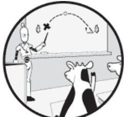
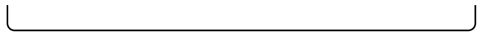

## 5

## 使用列表组织值



我们已经看到可以使用字符串来处理字符序列。在本章中，我们将学习列表（list），它帮助我们处理其他类型值的序列，例如整数和浮点数。我们还将学习如何在列表中嵌套列表，从而处理数据网格。

我们将使用列表解决三个问题：找出若干村庄的最小邻域、判断学校旅行是否筹集到足够的资金，以及计算面包店提供的奖励数量。

## 问题 #11：村庄邻域

在这个问题中，我们要找出一组村庄中最小邻域的大小。我们发现存储所有邻域大小会很有帮助。不过村庄可能有100个之多，为每个村庄使用单独的变量将是一场噩梦。我们将看到，列表允许我们把本来会是单独的变量聚合到一个集合中。我们还将学习 Python 强大的列表操作，用于修改、搜索和排序列表。

这是 DMOJ 问题 ccc18s1。

## 挑战

一条直路上有 $n$ 个村庄，位于不同的点上。每个村庄由一个整数表示，该整数表示它在道路上的位置。

一个村庄的左邻居是位置次小的村庄；右邻居是位置次大的村庄。一个村庄的*邻域*由该村庄与其左邻居之间距离的一半，加上该村庄与其右邻居之间距离的一半组成。例如，如果一个村庄位于位置10，其左邻居位于位置6，右邻居位于位置15，那么这个村庄的邻域从位置8（6和10的中点）开始，到位置12.5（10和15的中点）结束。

最左边和最右边的村庄只有一个邻居，因此邻域的定义对它们不适用。在这个问题中，我们将忽略这两个村庄的邻域。

邻域的*大小*计算为邻域最右位置减去邻域最左位置。例如，从8到12.5的邻域大小为 $12.5 - 8 = 4.5$。

确定最小邻域的大小。

### 输入

输入由以下行组成：

+   - 一行包含整数 $n$，即村庄数量。$n$ 介于 3 和 100 之间。
+   - $n$ 行，每行给出一个村庄的位置。每个位置是介于 $-1,000,000,000$ 和 $1,000,000,000$ 之间的整数。位置不一定要从左到右依次排列；某个村庄的邻居可能出现在这些行中的任何位置。

### 输出

输出最小邻域的大小。在小数点后包含一位数字。

### 为什么使用列表？

在读取输入时，我们需要读取 $n$ 个整数（表示村庄位置的整数）。我们在第3章解决 Data Plan 问题时已经处理过这种情况。当时我们使用 range for 循环精确循环了 *n* 次。我们在这里也会这样做。

Data Plan 和 Village Neighborhood 之间有一个关键区别。在 Data Plan 中，我们读取一个整数，使用它，之后不再引用它。我们不需要保留它。但在 Village Neighborhood 中，只看每个整数一次是不够的。一个村庄的邻域取决于其左邻居和右邻居。如果不能访问这些邻居，我们就无法计算该村庄邻域的大小。我们需要存储所有村庄位置以供后续使用。

关于为什么需要存储所有村庄位置，考虑这个测试用例：

```
6
20
50
4
19
15
1
```

这里有六个村庄。要找到某个村庄邻域的大小，我们需要该村庄的左邻居和右邻居。

输入中的第一个村庄位于位置20。这个村庄的邻域大小是多少？要回答这个问题，我们需要访问所有村庄位置，以便找到它的左邻居和右邻居。扫描这些位置，你可以确定左邻居位于位置19，右邻居位于位置50。因此这个村庄的邻域大小为 (20 − 19)/2 + (50 − 20)/2 = 15.5。

输入中的第二个村庄位于位置50。这个村庄的邻域大小是多少？同样，我们需要查看这些位置才能弄清楚。这个村庄恰好是最右边的村庄，所以我们忽略这个村庄的邻域。

输入中的第三个村庄位于位置4。左邻居位于位置1，右邻居位于位置15，所以这个村庄的邻域大小为 (4 − 1)/2 + (15 − 4)/2 = 7。

输入中的第四个村庄位于位置19。左邻居位于位置15，右邻居位于位置20，所以这个村庄的邻域大小为 (19 − 15)/2 + (20 − 19)/2 = 2.5。

唯一还需要考虑的村庄位于位置15。如果你计算它的邻域大小，应该得到7.5。

比较我们计算的所有邻域大小，可以看到最小值——也是这个测试用例的正确回答——是2.5。

我们需要一种方法来存储所有村庄位置，以便能够找到每个村庄的邻居。字符串不行，因为字符串存储字符，而不是整数。Python 列表来拯救我们！

## 列表

*列表*是一种 Python 类型，存储一个值序列。（你有时会看到列表值被称为*元素*。）我们使用左方括号和右方括号来界定列表。

我们只能在字符串中存储字符，但可以在列表中存储任何类型的值。这个整数列表保存了前一部分中的村庄位置。

```
>>> [20, 50, 4, 19, 15, 1]
[20, 50, 4, 19, 15, 1]
```

这是一个字符串列表：

```
>>> ['one', 'two', 'hello']
['one', 'two', 'hello']
```

我们甚至可以创建一个包含不同类型值的列表：

```
>>> ['hello', 50, 365.25]
['hello', 50, 365.25]
```

你学到的关于字符串的许多内容也适用于列表。例如，列表支持 + 运算符进行连接，以及 * 运算符进行复制：

```
>>> [1, 2, 3] + [4, 5, 6]
[1, 2, 3, 4, 5, 6]
>>> [1, 2, 3] * 4
[1, 2, 3, 1, 2, 3, 1, 2, 3, 1, 2, 3]
```

我们甚至还有 in 运算符，它可以告诉我们一个值是否在列表中：

```
>>> 'one' in ['one', 'two', 'hello']
True
```

```
>>> 'n' in ['one', 'two', 'three']
False
```

我们还有 len 函数来获取列表的长度：

```
>>> len(['one', 'two', 'hello'])
3
```

列表是一个序列，我们可以使用 for 循环遍历其值：

```
>>> for value in [20, 50, 4, 19, 15, 1]:
... print(value)
20
50
4
19
15
1
```

我们可以让变量引用列表，就像我们让它们引用字符串、整数和浮点数一样。让我们让两个变量引用列表，然后将它们连接起来生成一个新列表。

```
>>> lst1 = [1, 2, 3]
>>> lst2 = [4, 5, 6]
>>> lst1 + lst2
[1, 2, 3, 4, 5, 6]
```

虽然我们显示了连接后的列表，但我们并没有存储它，这可以通过再次查看列表来确认：

```
>>> lst1
[1, 2, 3]
>>> lst2
[4, 5, 6]
```

要让一个变量引用连接后的列表，我们使用赋值：

```
>>> lst3 = lst1 + lst2
>>> lst3
[1, 2, 3, 4, 5, 6]
```

当不需要更具体地说明列表包含什么时，可以使用 `lst`、`lst1` 和 `lst2` 这样的名称。

但不要使用 `list` 本身作为变量名。它已经是一个可以用来将序列转换为列表的名称：

```
>>> list('abcde')
['a', 'b', 'c', 'd', 'e']
```

如果你命名一个变量为 `list`，你将失去这个有价值的行为，并且会让读者感到困惑，因为他们期望 `list` 不被篡改。

最后，列表支持索引和切片。索引返回单个值，切片返回一个值的列表：

```
>>> lst=[50, 30, 81, 40]
>>> lst[1]
30
>>> lst[-2]
81
>>> lst[1:3]
[30, 81]
```

如果我们有一个字符串列表，我们可以通过两次索引访问其中一个字符串的字符：第一次选择一个字符串，第二次选择一个字符：

```
>>> lst= ['one', 'two', 'hello']
>>> lst[2]
'hello'
>>> lst[2][1]
'e'
```

## 概念检查

以下代码在 total 变量中存储了什么？

```
lst= [a list of numbers]
total = 0
i = 1

while i <= len(lst):
```


```python
total = total + i
i = i + 1
```

- A. 列表的总和
- B. 列表的总和，但不包括它的第一个值
- C. 列表的总和，但不包括它的第一个和最后一个值
- D. 这段代码会导致错误，因为它访问了列表中的一个无效索引
- E. 以上都不对

答案：E. 这段代码将 1、2、3 等数字相加，一直加到列表的长度。它并没有把列表中的数字相加，也完全没有对列表进行索引！

## 列表的可变性

字符串是*不可变的*，这意味着它们无法被修改。当我们看起来是在修改一个字符串时（例如使用字符串拼接），实际上是在创建一个新的字符串，而不是修改一个已经存在的字符串。

另一方面，列表是*可变的*，这意味着它们*可以*被修改。

我们可以通过索引来观察这种差异。如果我们试图修改字符串中的一个字符，就会得到一个错误：

```python
>>> s = 'hello'
>>> s[0] = 'j'
Traceback (most recent call last):
  File "<stdin>", line 1, in <module>
TypeError: 'str' object does not support item assignment
```

错误消息说明字符串不支持元素赋值，也就是说我们不能修改它们的字符。

但因为列表是可变的，所以我们可以修改它们的值：

```python
>>> lst = ['h', 'e', 'l', 'l', 'o']
>>> lst
['h', 'e', 'l', 'l', 'o']
>>> lst[0] = 'j'
>>> lst
['j', 'e', 'l', 'l', 'o']
>>> lst[2] = 'x'
>>> lst
['j', 'e', 'x', 'l', 'o']
```

如果对赋值语句没有精确的理解，可变性可能会导致看似令人费解的行为。下面是一个例子：

```python
>>> x = [1, 2, 3, 4, 5]
➊ >>> y = x
>>> x[0] = 99
>>> x
[99, 2, 3, 4, 5]
```

到目前为止还没有什么意外。但这个结果可能会让你感到惊讶：

```python
>>> y
[99, 2, 3, 4, 5]
```

那个 99 是怎么进到 y 里去的？

当我们在➊处将 x 赋值给 y 时，y 被设置为引用与 x 相同的列表。赋值语句并不会复制列表。这里只有一个列表，只不过它恰好有两个名字（或称别名）指向它。因此，如果我们对该列表做了修改，无论我们用 x 还是 y 来引用这个列表，都会看到这个修改。

可变性很有用，因为它直接模拟了我们可能想对列表中各个值进行的操作。如果我们想改变某个值，直接修改它即可。如果没有可变性，就无法修改一个值。我们就必须创建一个新列表，除了我们想要修改的那个值之外，其余和旧列表相同。这样做虽然可行，但修改值的方式绕了弯子，也不够直观。

如果你确实想要列表的一个副本，而不只是它的另一个名字，可以使用切片。省略起始索引和结束索引，就会得到整个列表的副本：

```python
>>> x = [1, 2, 3, 4, 5]
>>> y = x[:]
>>> x[0] = 99
>>> x
[99, 2, 3, 4, 5]
>>> y
[1, 2, 3, 4, 5]
```

请注意，这一次当 x 列表改变时，y 列表并没有改变。它们是两个独立的列表。

### 概念检查

下面这段代码的输出是什么？

```python
lst = ['abc','def','ghi']
lst[1] = 'wxyz'

print(len(lst))
```

- A. 3
- B. 9
- C. 10
- D. 4
- E. 这段代码会产生一个错误

答案：A. 修改列表中的值是允许的（因为列表是可变的）。但把索引 1 处的值改成一个更长的字符串，并不能改变列表仍然有三个值这一事实。

## 了解方法

与字符串一样，列表也有很多有用的方法。在下一节中我会介绍其中的一些，但首先我想让你知道如何自己了解一个方法。

你可以使用 Python 的 dir 函数来获取某个特定类型的方法列表。只要调用 dir 并以一个值作为参数，你就会得到该值所属类型的方法。

下面是我们用一个字符串值作为参数调用 dir 时得到的结果：

```python
>>> dir('')
['__add__', '__class__', '__contains__', '__delattr__',
<more stuff with underscores>
'capitalize', 'casefold', 'center', 'count', 'encode',
'endswith', 'expandtabs', 'find', 'format',
'format_map', 'index', 'isalnum', 'isalpha', 'isascii',
'isdecimal', 'isdigit', 'isidentifier', 'islower',
'isnumeric', 'isprintable', 'isspace', 'istitle',
'isupper', 'join', 'ljust', 'lower', 'lstrip',
'maketrans', 'partition', 'replace', 'rfind', 'rindex',
'rjust', 'rpartition', 'rsplit', 'rstrip', 'split',
'splitlines', 'startswith', 'strip', 'swapcase', 'title',
'translate', 'upper', 'zfill']
```

注意，我们是用一个空字符串调用 dir 的。我们也可以用任意字符串值来调用 dir；空字符串只是输入起来最快而已。

忽略顶部那些带下划线的名称；这些名称是 Python 内部使用的，通常程序员不会关注它们。其余名称都是你可以调用的字符串方法。在这个列表中，你会看到一些你已经知道的字符串方法，比如 isupper 和 count，还有许多我们还没遇到过的其他方法。

要了解某个方法的用法，可以在调用 help 时使用该方法的名称。下面是我们针对字符串的 count 方法获得的帮助：

```python
>>> help(''.count)
Help on built-in function count:

count(...) method of builtins.str instance
    S.count(sub[, start[, end]]) -> int

    Return the number of non-overlapping occurrences of
    substring sub in string S[start:end]. Optional
    arguments start and end are interpreted as in
    slice notation.
```

帮助信息告诉了我们如何调用该方法（①）。

方括号表示可选参数。如果你只想在字符串的某个切片内统计 sub 的出现次数，就可以使用 start 和 end。

浏览方法列表是值得的，这样可以看看是否有方法能帮助你完成当前的编程任务。即使你以前用过某个方法，查看帮助也可能让你发现一些之前不知道的功能！

要查看有哪些列表方法可用，可以调用 `dir([])`。要了解它们，可以调用 `help([].xxx)`，其中 **xxx** 是某个列表方法的名称。

### 概念检查

下面是字符串 center 方法的帮助信息：

```python
>>> help(".center")
Help on built-in function center:

center(width, fillchar=' ', /) method of builtins.str instance
    Return a centered string of length width.

    Padding is done using the specified fill character
    (default is a space).
```

下面这段代码生成的字符串是什么？

```python
'cave'.center(8, 'x')
```

- A. `'xxcavexx'`
- B. `' cave '`
- C. `'xxxxcavexxxx'`
- D. `'  cave  '`

答案：A. 我们以宽度 8 和 fillchar 为 'x' 调用 center。（如果我们只提供一个参数，fillchar 就会使用空格。）因此，结果字符串的长度为 8。字符串 'cave' 有 4 个字符，所以还需要 4 个字符才能达到长度 8。于是 Python 在字符串开头和结尾各添加两个空格，使其居中。



## 列表方法

是时候在“村庄邻里”问题上取得进展了。我能想到两种对列表的操作，它们能帮助解决这个问题。

第一种是向列表中添加元素。我们一开始没有任何村庄位置，而是从输入中一次读取一个位置。因此，我们需要一种方法，把每个位置逐个添加到一个不断增长的列表中：一开始列表为空，然后包含一个村庄位置，接着两个，以此类推。

第二种是对列表进行排序。读入所有村庄位置后，我们需要找出最小的邻里。这需要查看每个村庄位置以及它到左、右邻居的距离。村庄位置可能以任意顺序输入，所以一般来说，要找到一个给定村庄的邻居并不容易。回想一下我们在本章“为什么需要列表？”一节中所做的工作。当时对每个村庄，我们都要扫描整个列表才能找到它的邻居。如果村庄按照位置排序，就会容易得多。那样我们就能确切地知道邻居在哪里：它们就在一个村庄的紧左边和紧右边。

例如，下面是我们样例中的村庄按读取顺序排列的样子：

```
20 50 4 19 15 1
```

这简直一团糟！在真实的街道上，它们会按照位置顺序排列，就像这样：

```
1 4 15 19 20 50
```

想知道位于位置 4 的村庄的邻居？只要看紧挨着它的左边和右边：1 和 15。位置 15 的村庄的邻居呢？瞧，它们就在那里——4 和 19。不用再到处搜索了。我们将对村庄位置列表进行排序，以简化代码。

我们可以使用 append 方法向列表中添加元素，使用 sort 方法对列表进行排序。我们会学习这两个方法，以及另外几个在你继续使用列表时可能会觉得有用的方法，然后再回来解决“村庄邻里”问题。


这里有一个示例：

```python
>>> lst1 = [1, 2, 3]
>>> lst2 = [4, 5, 6]
>>> lst1.extend(lst2)
>>> lst1
[1, 2, 3, 4, 5, 6]
>>> lst2
[4, 5, 6]
```

如果你想在列表的末尾以外的位置插入元素，可以使用 insert 方法。它接受一个索引和一个值，并将该值插入到索引处：

```python
>>> lst = [10, 20, 30, 40]
>>> lst.insert(1, 99)
>>> lst
[10, 99, 20, 30, 40]
```

## 对列表进行排序

sort 方法会对列表进行*排序*，将其值按顺序排列。如果我们不带参数调用它，它会从小到大排序：

```python
>>> positions = [20, 50, 4, 19, 15, 1]
>>> positions.sort()
>>> positions
[1, 4, 15, 19, 20, 50]
```

如果我们在调用时传入 reverse 参数，值为 True，则会从大到小排序：

```python
>>> positions.sort(reverse=True)
>>> positions
[50, 20, 19, 15, 4, 1]
```

我使用的语法 reverse=True 是新的。基于我们到目前为止在本书中调用方法和函数的方式，你可能会认为单独的 True 就可以工作。但并非如此：sort 要求必须提供完整的 reverse=True，原因我将在第 6 章解释。

## 从列表中删除值

pop 方法按索引删除值。如果未提供参数，pop 会删除并返回最右边的值。

```python
>>> lst = [50, 30, 81, 40]
>>> lst.pop()
40
```

我们可以将待删除值的索引作为参数传给 pop。这里，我们删除并返回索引 0 处的值：

```python
>>> lst.pop(0)
50
```

由于 pop 会返回一些东西——不像 append 和 sort 等方法——将其返回值赋给变量是有意义的：

```python
>>> lst
[30, 81]
>>> value = lst.pop()
>>> value
81
>>> lst
[30]
```

remove 方法按值删除，而不是按索引。将要删除的值传给它，它会从列表中删除该值的第一次出现。如果该值不存在，remove 会产生错误。在下面的示例中，列表中有两个 50，因此 remove(50) 执行两次后才产生错误：

```python
>>> lst = [50, 30, 81, 40, 50]
>>> lst.remove(50)
>>> lst
[30, 81, 40, 50]
>>> lst.remove(50)
>>> lst
[30, 81, 40]
>>> lst.remove(50)
Traceback (most recent call last):
  File "<stdin>", line 1, in <module>
ValueError: list.remove(x): x not in list
```

## 概念检查

以下代码运行后，lst 的值是什么？

```python
lst = [2, 4, 6, 8]
lst.remove(4)
lst.pop(2)
```

- A. [2, 4]
- B. [6, 8]
- C. [2, 6]
- D. [2, 8]
- E. This code produces an error

答案：C。remove 调用删除了值 4，剩下 [2, 6, 8]。现在 pop 调用删除索引 2 处的值，即值 8。最终列表为 [2, 6]。

## 解决问题

假设我们已经成功读取并排序了村庄位置。此时我们的列表如下所示：

```python
>>> positions = [1, 4, 15, 19, 20, 50]
>>> positions
[1, 4, 15, 19, 20, 50]
```

为了找到最小邻居的大小，我们首先找到索引 1 处的村庄的邻居大小。（注意，我们不是从索引 0 开始：索引 0 处的村庄是最左边的，根据问题描述，我们可以忽略它。）我们可以这样找到该邻居大小：

```python
>>> left = (positions[1] - positions[0]) / 2
>>> right = (positions[2] - positions[1]) / 2
>>> min_size = left + right
>>> min_size
7.0
```

left 变量存储邻居左部分的大小，right 存储右部分的大小。然后将它们相加得到邻居的总大小。我们得到的值为 7.0。

这是要超越的值。我们如何知道是否有其他村庄的邻居更小？我们可以使用循环来处理其他村庄。如果我们找到一个比当前最小值更小的邻居，我们就将当前最小值更新为该更小的值。

我们解决方案的代码在清单 5-1 中。

```python
n = int(input())

❶ positions = []

❷ for i in range(n):
    ❸ positions.append(int(input()))

❹ positions.sort()

❺ left = (positions[1] - positions[0]) / 2
right = (positions[2] - positions[1]) / 2
min_size = left + right

❻ for i in range(2, n - 1):
    left = (positions[i] - positions[i - 1]) / 2
    right = (positions[i + 1] - positions[i]) / 2
    size = left + right
    ❼ if size < min_size:
        min_size = size

print(min_size)
```

*清单 5-1：解决村庄邻居问题*

我们首先从输入中读取 n，即村庄数量。我们还将 positions 设为引用一个空列表❶。

第一个 range for 循环的每次迭代❷负责读取一个村庄位置并将其追加到 positions 列表。它通过使用 input 读取下一个村庄位置，使用 int 将其转换为整数，并使用列表方法 append 将该整数追加到列表❸来完成。这一行❸等价于以下三个独立的行：

```python
position = input()
position = int(position)
positions.append(position)
```

读取村庄位置后，我们接下来按递增顺序对它们排序❹。然后我们找到索引 1 处村庄的邻居大小，并将其存储到 min_size 中❺。

接下来，在第二个循环中，我们遍历每个需要计算邻居大小的其他村庄❻。这些村庄从索引 2 开始，到索引 n - 2 结束。（我们不想考虑索引 n - 1 处的村庄，因为那是最右边的村庄。）因此，我们使用 range，第一个参数为 2（因此从 2 开始），第二个参数为 n - 1（因此到 n - 2 结束）。

在循环内部，我们计算当前村庄的邻居大小，与我们对第一个村庄所做的方式完全相同。到目前为止找到的最小邻居大小由 min_size 表示。当前村庄的邻居是否比我们目前的最小值更小？为了回答这个问题，我们使用一个 if 语句❼。如果这个村庄的邻居比 min_size 小，我们将 min_size 更新为这个邻居的大小。如果这个村庄的邻居不比 min_size 小，那么我们什么都不做，因为这个村庄不会改变最小邻居的大小。

遍历完所有村庄后，min_size 必定是最小邻居的大小。因此我们输出 min_size 的值。

本问题描述中的“输出”部分指定了“在小数点后包含一位数字”。如果最小大小是像 6.25 或 8.33333 这样的值呢？我们不应该对此做些什么吗？

不，我们目前的做法是安全的。我们能得到的唯一邻居大小是像 3.0（小数点后为 0）和 3.5（小数点后为 .5）这样的数字。原因如下：当我们计算邻居的左部分时，我们减去两个整数并将结果整数除以 2。如果除以 2 之前是偶数，那么除法得到 .0 数字（没有余数）；如果除以 2 之前是奇数，那么除法得到 .5 数字。右部分也是如此：大小将是 .0 数字或 .5 数字。因此，将左部分和右部分相加得到的总大小也必然是 .0 或 .5 数字。

## 避免代码重复：另外两种解决方案

有点令人失望的是，我们在第二个 range for 循环之前和之中都包含了“计算邻居大小”的代码。

一般来说，重复的代码表明我们可能能够改进代码的设计。我们希望避免重复代码，因为它增加了我们必须维护的代码量，并且如果重复的代码有缺陷，则会使修复问题变得更加困难。在这里，重复的代码在我看来是可以接受的（只有三行），但让我们讨论两种避免它的方法。这些是你可以应用于其他类似问题的一般方法。

### 使用一个极大值

我们在循环之前计算村庄邻居大小的唯一原因是让循环有东西可以比较其他邻居大小。如果我们在没有 `min_size` 值的情况下进入循环，当代码尝试将其与当前村庄的大小进行比较时，我们会收到错误。

如果我们在循环前将 `min_size` 设置为 0.0，那么循环将永远找不到更小的值，并且无论测试用例如何，我们都会错误地输出 0.0。使用 0.0 会是一个 bug！

但一个极大的值，一个至少与所有可能的邻居大小一样大的值，*会*有效。我们只需要让它足够大，保证循环的第一次迭代能找到不超过它的值，从而确保我们假的大值永远不会被输出。

根据本问题描述中的“输入”部分，我们知道每个位置在 −1,000,000,000 到 1,000,000,000 之间。那么，我们可能拥有的最大邻居出现在：一个村庄位于位置 −1,000,000,000，另一个位于位置 1,000,000,000，还有一个村庄位于两者之间。这个中间村庄的邻居大小将是 1,000,000,000。因此，我们可以将 `min_size` 初始化为 1000000000.0 或更大的值。这种替代方法见清单 5-2。

```python
n = int(input())

positions = []

for i in range(n):
    positions.append(int(input()))

positions.sort()

min_size = 1000000000.0

for i in range(1, n - 1):
    left = (positions[i] - positions[i - 1]) / 2
```


right = (positions[i + 1] - positions[i]) / 2
size = left + right
if size < min_size:
    min_size = size

print(min_size)

## 清单 5-2：使用极大值解决村庄邻域问题

注意！我们现在需要从索引 1 ❶ 开始计算大小（而不是索引 2）；否则，我们会忘记包含索引 1 处村庄的邻域。

### 构建大小列表

另一种避免代码重复的方法是将每个邻域大小存储在一个大小列表中。Python 有一个内置的 `min` 函数，它接受一个序列并返回其最小值：

```
>>> min('qwerty')
'e'
>>> min([15.5, 7.0, 2.5, 7.5])
2.5
```

（Python 还有一个 `max` 函数，返回序列的最大值。）

参见清单 5-3，它展示了如何在邻域大小列表上使用 `min` 的解决方案。

```
n = int(input())

positions = []

for i in range(n):
    positions.append(int(input()))

positions.sort()

sizes = []

for i in range(1, n - 1):
    left = (positions[i] - positions[i - 1]) / 2
    right = (positions[i + 1] - positions[i]) / 2
    size = left + right
    sizes.append(size)

min_size = min(sizes)
print(min_size)
```

## 清单 5-3：使用 `min` 解决村庄邻域问题

你可以随意将这两个解决方案中的任何一个提交给评测系统，选你最喜欢的即可！

在继续之前，你可以尝试解决第 134 页“章节练习”中的练习 1。

## 问题 #12：学校旅行

你会遇到的许多问题的输入每行都有多个整数或浮点数。到目前为止，我们一直在回避这些问题，但它们无处不在！我们现在就来学习如何使用列表处理这类问题的输入。

这是 DMOJ 问题 ecoo17r1p1。

### 挑战

学生们想在年末去学校旅行，但他们需要钱来支付费用。为了筹钱，他们组织了一顿早午餐。参加早午餐时，一年级学生付 12 美元，二年级学生付 10 美元，三年级学生付 7 美元，四年级学生付 5 美元。

在早午餐筹到的所有钱中，50% 可以用于支付学校旅行（另外 50% 用于支付早午餐本身的费用）。

我们已知学校旅行的费用、每个年级学生的比例以及学生总数。请判断学生们是否还需要为学校旅行筹集更多钱。

### 输入

输入包含 10 个测试用例，每个测试用例有三行（共 30 行）。以下是每个测试用例的三行：

- 第一行包含学校旅行的费用（以美元为单位）；它是一个介于 50 和 50,000 之间的整数。
- 第二行包含四个数字，分别表示参加早午餐的学生中一年级、二年级、三年级和四年级的比例。每对数字之间有一个空格。每个数字在 0 和 1 之间，它们的和为 1（即 100%）。
- 第三行包含整数 n，即参加早午餐的学生人数。n 在 4 和 2,000 之间。

### 输出

对于每个测试用例：如果学生们需要为学校旅行筹集更多钱，则输出 YES；否则，输出 NO。

### 一个陷阱

假设有 50 名学生，其中 10%（即比例为 0.1）是四年级学生。那么我们可以计算出 50 * 0.1 = 5 名四年级学生。

现在假设有 50 名学生，但其中 15%（即比例为 0.15）是四年级学生。如果我们相乘，得到 50 * 0.15 = 7.5 名四年级学生。

有 7.5 名学生毫无意义，而且我还没有告诉你在这种情况下我们应该怎么做。完整的问题描述规定我们应该向下取整——所以这里我们应该取整为 7。这可能导致一年级、二年级、三年级和四年级学生人数之和不等于学生总数。对于未被计入的学生，我们要把他们加到学生人数最多的年级。题目保证恰好有一个年级的学生人数最多（不会出现多个年级并列最多的情况）。

我们将先忽略这个陷阱来解决问题。然后我们会加入这个陷阱，给出完整的解决方案。

### 拆分字符串与连接列表

每个测试用例的第二行由四个比例组成，如下所示：

```
0.2 0.08 0.4 0.32
```

我们需要一种方法从字符串中提取这四个数字，以便进一步处理。我们将学习字符串的 `split` 方法，用于将字符串拆分成其组成部分的列表。同时，我们还将学习字符串的 `join` 方法，它让我们反方向操作，将列表合并成单个字符串。

### 将字符串拆分为列表

请记住，无论输入看起来如何，`input` 函数返回的都是字符串。如果输入应解释为整数，我们需要将字符串转换为整数。如果输入应解释为浮点数，我们需要将字符串转换为浮点数。如果输入应解释为四个浮点数呢？那么，我们最好在转换任何内容之前先把它拆分成单独的浮点数！

字符串 `split` 方法将字符串拆分成其组成部分的列表。默认情况下，`split` 按空格拆分，这正是我们处理四个浮点数所需要的：

```
>>> s = '0.2 0.08 0.4 0.32'
>>> s.split()
['0.2', '0.08', '0.4', '0.32']
```

`split` 方法返回一个字符串列表，此时我们可以独立访问每个元素。这里，我保存了 `split` 返回的列表，然后访问了其中的两个值：

```
>>> proportions = s.split()
>>> proportions
['0.2', '0.08', '0.4', '0.32']
>>> proportions[1]
'0.08'
>>> proportions[2]
'0.4'
```

实际中的数据通常是以逗号分隔的，而不是以空格分隔的。小菜一碟：我们可以调用 `split` 并传入一个参数，告诉它用什么作为分隔符：

```
>>> info = 'Toronto,Ontario,Canada'
>>> info.split(',')
['Toronto', 'Ontario', 'Canada']
```

### 将列表连接成字符串

要反方向操作，从列表到字符串而不是从字符串到列表，我们可以使用字符串的 `join` 方法。调用 `join` 的字符串被用作列表值之间的分隔符。这里有两个例子：

```
>>> lst = ['Toronto', 'Ontario', 'Canada']
>>> ','.join(lst)
'Toronto,Ontario,Canada'
```

```
>>> '**'.join(lst)
'Toronto**Ontario**Canada'
```

严格来说，`join` 可以连接任何序列中的值，而不仅仅是列表。这里有一个连接字符串中字符的例子：

```
>>> '*'.join('abcd')
'a*b*c*d'
```

### 修改列表值

当我们对包含四个部分的字符串使用 `split` 时，会得到一个字符串列表：

```
>>> s = '0.2 0.08 0.4 0.32'
>>> proportions = s.split()
>>> proportions
['0.2', '0.08', '0.4', '0.32']
```

在第 1 章的“在字符串和整数之间转换”中，我们学到了看起来像数字的字符串不能用于数值计算。因此，我们需要将这个字符串列表转换为浮点数列表。

我们可以使用 `float` 将字符串转换为浮点数，如下所示：

```
>>> float('45.6')
45.6
```

这只是一个浮点数。我们如何将整个字符串列表转换为浮点数列表呢？尝试使用下面的循环来实现这一点是非常诱人的：

```
>>> for value in proportions:
...     value = float(value)
```

逻辑是这样的：这个循环应该遍历列表中的每个值，并将其转换为浮点数。

遗憾的是，它不起作用。列表仍然引用的是字符串：

```
>>> proportions
['0.2', '0.08', '0.4', '0.32']
```

哪里可能出错了？是 `float` 不起作用吗？我们可以通过查看转换后 `value` 的类型来看到 `float` 工作得很好：

```
>>> for value in proportions:
...   value = float(value)
...   type(value)
...
<class 'float'>
<class 'float'>
<class 'float'>
<class 'float'>
```

四个浮点数！但列表仍然顽固地是字符串列表。

这里发生的情况是，我们并没有改变列表中引用的值。我们改变的是变量 `value` 所引用的对象，但这并不能改变列表仍然引用旧字符串值的事实。要真正改变列表引用的值，我们需要在列表的索引处赋予新值。做法如下：

```
>>> proportions
['0.2', '0.08', '0.4', '0.32']
>>> for i in range(len(proportions)):
...   proportions[i] = float(proportions[i])
...
>>> proportions
[0.2, 0.08, 0.4, 0.32]
```

`range` for 循环遍历每个索引，赋值语句改变了该索引所引用的对象。

### 解决大部分问题

我们现在已经具备了解决这个问题的良好条件（暂时忽略陷阱）。

我们先用一个例子来强调我们的代码需要做什么。然后我们进入代码本身。

### 探索一个测试用例

这个问题的输入包含 10 个测试用例，但我这里只展示一个。如果你从键盘输入这个测试用例，你会看到答案。但程序不会就此终止，因为它还在等待下一个测试用例。如果你对这个测试用例使用输入重定向，你同样会看到答案。但随后你会遇到一个 `EOFError`。EOF 代表“文件结束”；这个错误是由于程序试图读取比可用输入更多的输入而导致的。一旦你的代码能正确处理一个测试用例，你


你可以在输入中再多加几个数据，确保这些也能正常运行。一旦凑满 10 个测试用例，程序就会运行到底。

下面是我想和你一起追踪的测试用例：

```
504
0.2 0.08 0.4 0.32
125
```

学校旅行的费用是 504 美元，有 125 名学生参加早午餐会。

要确定早午餐会筹到了多少钱，我们需要计算每个年级的学生筹集的金额。一年级学生人数为 125 * 0.2 = 25，每人支付 12 美元。所以一年级学生筹集了 25 * 12 = 300 美元。我们可以用同样的方法计算二、三、四年级学生筹集的金额。具体计算见表 5-1。

**表 5-1：学校旅行示例**

| 年级 | 该年级学生人数 | 每名学生费用 | 筹集金额 |
|---|---|---|---|
| 一年级 | 25 | 12 | 300 |
| 二年级 | 10 | 10 | 100 |
| 三年级 | 50 | 7 | 350 |
| 四年级 | 40 | 5 | 200 |

每个年级筹集的金额等于该年级学生人数乘以该年级每名学生的费用，见表格最右列。要计算所有学生筹集的总金额，我们将最右列四个数相加：300 + 100 + 350 + 200 = 950 美元。其中只有 50% 可用于学校旅行，所以我们剩下 950 / 2 = 475 美元，不足以支付 504 美元的旅行费用。因此正确输出是 YES，因为还需要筹集更多资金。

## 代码

这个部分解决方案能够正确处理所有“比例乘以学生人数得到整数学生人数”的输入（比如我们刚才测试的用例）。代码见清单 5-4。

```python
YEAR_COSTS = [12, 10, 7, 5]  # ①

for dataset in range(10):  # ②
    trip_cost = int(input())
    proportions = input().split()  # ③
    num_students = int(input())

    for i in range(len(proportions)):  # ④
        proportions[i] = float(proportions[i])

    students_per_year = []  # ⑤

    for proportion in proportions:
        students = int(num_students * proportion)  # ⑥
        students_per_year.append(students)

    total_raised = 0
    for i in range(len(students_per_year)):  # ⑦
        total_raised = total_raised + students_per_year[i] * YEAR_COSTS[i]

    if total_raised / 2 < trip_cost:  # ⑧
        print('YES')
    else:
        print('NO')
```

**清单 5-4：解决学校旅行问题的大部分情况**

首先，我们使用变量 YEAR_COSTS 来引用参加早午餐会的费用列表：分别对应一、二、三、四年级学生的费用 ①。一旦确定了每个年级的学生人数，我们将乘以这些值来计算筹集的金额。这些费用不会改变，所以我们永远不会修改这个变量所引用的内容。对于这样的“常量”变量，Python 的惯例是用大写字母书写其名称，就像我这里做的一样。

输入包含 10 个测试用例，因此我们循环 10 次 ②，每次处理一个测试用例。程序的其余部分都位于这个循环内部，因为我们需要将整个过程重复 10 次。

对于每个测试用例，我们读取三行输入。第二行包含四个比例，所以我们用 split 将其拆分成包含四个字符串的列表 ③。我们使用 range 循环将每个字符串转换为浮点数 ④。

现在让我们看看为什么当前程序在某些测试用例上会出错，以及我们将使用哪些 Python 特性来修复它。

## 探索一个测试用例

下面是一个当前代码会出错的测试用例：

```
50
0.7 0.1 0.1 0.1
9
```

这次学校旅行费用为 50 美元，有 9 名学生参加早午餐会。对于一年级学生人数，当前程序会计算 9 * 0.7 = 6.3，然后向下取整为 6。正是因为这个向下取整的步骤，我们在这个测试用例上需要格外小心。要了解当前程序对四个年级分别的计算结果，见表 5-2。

**表 5-2：学校旅行中当前程序会算错的一个示例**

| 年级 | 该年级学生人数 | 每名学生费用 | 筹集金额 |
|---|---:|---:|---:|
| 一年级 | 6 | 12 | 72 |
| 二年级 | 0 | 10 | 0 |
| 三年级 | 0 | 7 | 0 |
| 四年级 | 0 | 5 | 0 |

除一年级外，其他年级的学生人数都为 0，因为 9 * 0.1 = 0.9 向下取整为 0。这样看来我们只筹集了 72 美元。72 美元的一半是 36 美元，不足以支付 50 美元的学校旅行费用。当前程序输出 YES，表示需要筹集更多资金。

……但实际并非如此。我们这里应该有 9 名学生，而不是 6 名！因为取整我们丢失了 3 名学生。题目描述规定，应该将这些学生加到人数最多的年级中，在这个例子中就是一年级。如果我们这样做，就会发现实际上我们筹集了 9 * 12 = 108 美元。108 美元的一半是 54 美元，所以实际上我们*并不*需要为这次 50 美元的学校旅行筹集更多资金！正确输出是 NO。

## 更多列表操作

要修复程序，我们需要做两件事：计算因取整丢失了多少学生，并将这些学生加到人数最多的年级。

### 对列表求和

要确定因取整丢失的学生人数，我们可以将 students_per_year 列表中的学生人数加起来，然后用总学生人数减去这个总和。Python 的 sum 函数接受一个列表并返回其值的总和：

```
>>> students_per_year = [6, 0, 0, 0]
>>> sum(students_per_year)
6
>>> students_per_year = [25, 10, 50, 40]
>>> sum(students_per_year)
125
```

### 查找最大值的索引

Python 的 max 函数接受一个序列并返回其最大值：

```
>>> students_per_year = [6, 0, 0, 0]
>>> max(students_per_year)
6
>>> students_per_year = [25, 10, 50, 40]
>>> max(students_per_year)
50
```

我们想要的是最大值的索引，而不是最大值本身，这样我们才能增加该索引处的学生人数。有了最大值，我们可以使用 index 方法找到它的索引。它会返回所提供值第一次出现的最左侧索引，如果该值根本不在列表中，则会产生错误：

```
>>> students_per_year = [6, 0, 0, 0]
>>> students_per_year.index(6)
0
>>> students_per_year.index(0)
1
>>> students_per_year.index(50)
Traceback (most recent call last):
  File "<stdin>", line 1, in <module>
ValueError: 50 is not in list
```

我们搜索的值肯定在列表中，所以不用担心出现错误。

### 解决问题

我们做到了！现在可以更新部分解决方案，以处理任何有效的测试用例。新程序见清单 5-5。

```python
YEAR_COSTS = [12, 10, 7, 5]

for dataset in range(10):
    trip_cost = int(input())
    proportions = input().split()
    num_students = int(input())

    for i in range(len(proportions)):
        proportions[i] = float(proportions[i])

    students_per_year = []

    for proportion in proportions:
        students = int(num_students * proportion)
        students_per_year.append(students)

    counted = sum(students_per_year)  # ①
    uncounted = num_students - counted
    most = max(students_per_year)
    where = students_per_year.index(most)
    students_per_year[where] = students_per_year[where] + uncounted  # ②

    total_raised = 0

    for i in range(len(students_per_year)):
        total_raised = total_raised + students_per_year[i] * YEAR_COSTS[i]

    if total_raised / 2 < trip_cost:
        print('YES')
    else:
        print('NO')
```

**清单 5-5：解决学校旅行问题**

唯一新增的代码是从 ① 开始的那五行。我们使用 sum 计算到目前为止已经计入的学生人数，然后从总学生人数中减去它，得到未计入的学生人数。接着使用 max 和 index 来找出需要增加人数的年级索引。

输入包含 10 个测试用例。每个测试用例包含以下几行：

- 一行包含整数 $f$（加盟商数量）和整数 $d$（天数），以空格分隔。$f$ 在 4 到 130 之间，$d$ 在 2 到 4745 之间。
- 之后是 $d$ 行，每行包含 $f$ 个以空格分隔的整数。每个整数表示一个销售额。第一行给出每个加盟商第一天的销售额，第二行给出每个加盟商第二天的销售额，以此类推。每个整数在 1 到 13000 之间。

## 输出

对于每个测试用例，输出发放奖金的总数。

## 表示表格

这个问题的数据可以可视化为一个表格。我们从一个示例开始，然后研究如何将表格表示为列表。

## 探索一个测试用例

如果我们有 $d$ 天和 $f$ 个加盟商，就可以将数据排列成一个有 $d$ 行和 $f$ 列的表格。

下面是一个示例测试用例：

```
6 4
1 13 2 1 1 8
2 12 10 5 11 4
39 6 13 52 3 3
15 8 6 2 7 14
```

该测试用例对应的表格如表 5-3 所示。

**表 5-3：面包师奖金表**

|   | 0 | 1 | 2 | 3 | 4 | 5 |
|---|---|---|---|---|---|---|
| 0 | 1 | 13 | 2 | 1 | 1 | 8 |
| 1 | 2 | 12 | 10 | 5 | 11 | 4 |
| 2 | 39 | 6 | 13 | 52 | 3 | 3 |
| 3 | 15 | 8 | 6 | 2 | 7 | 14 |


|   | 0 | 1 | 2 | 3 | 4 | 5 |
|---|---|---|---|---|---|---|
| 3 | 15 | 8 | 6 | 2 | 7 | 14 |

我将行和列从 0 开始编号，以与我们稍后将把此数据存储在列表中的方式相一致。

此测试用例中颁发了多少奖金？让我们先查看表格的行，对应于天数。行 0 的销售额之和为 1 + 13 + 2 + 1 + 1 + 8 = 26。由于 26 是 13 的倍数，此行给我们 26 / 13 = 2 个奖金。行 1 的和为 44。这不是 13 的倍数，因此没有奖金。行 2 的和为 116——同样没有奖金。行 3 的和为 52，这给我们 52 / 13 = 4 个奖金。

现在让我们查看列，对应于加盟商。列 0 的和为 1 + 2 + 39 + 15 = 57。这不是 13 的倍数，因此没有奖金。事实上，唯一给我们奖金的列是列 1。其和为 39，给我们 39 / 13 = 3 个奖金。

颁发的奖金总数为 2 + 4 + 3 = 9。所以，9 是此测试用例的正确输出。

## 嵌套列表

到目前为止，我们已经看到整数、浮点数和字符串的列表。我们也可以创建列表的列表，称为嵌套列表。此类列表的每个值本身就是一个列表。常用像 grid 或 table 这样的变量名来引用嵌套列表。以下是对应于表 5-3 的 Python 列表：

```
>>> grid = [[ 1, 13, 2, 1, 1, 8],
...   [ 2, 12, 10, 5, 11, 4],
...   [39, 6, 13, 52, 3, 3],
...   [15, 8, 6, 2, 7, 14]]
```

每个列表值对应一行。如果我们索引一次，我们得到一行，它本身就是一个列表：

```
>>> grid[0]
[1, 13, 2, 1, 1, 8]
>>> grid[2]
[39, 6, 13, 52, 3, 3]
```

如果我们索引两次，我们得到一个单一值。以下是第 1 行第 2 列的值：

```
>>> grid[1][2]
10
```

与行相比，处理列有点棘手，因为每一列都分布在多个列表中。要访问一列，我们需要从每一行聚合一个值。我们可以用循环来做到这一点，该循环逐步构建一个代表列的新列表。在这里，我获取列 1：

```
>>> column = []
>>> for i in range(len(grid)):
...     column.append(grid[i][1])
...
>>> column
[13, 12, 6, 8]
```

注意第一个索引（行）在变化，但第二个（列）没有变化①。这选择了具有相同列索引的每个值。

行和列的求和呢？要对一行求和，我们可以使用 sum 函数。以下是行 0 的和：

```
>>> sum(grid[0])
26
```

我们也可以使用循环，如下所示：

```
>>> total = 0
>>> for value in grid[0]:
...     total = total + value
...
>>> total
26
```

使用 sum 是更容易的选择，所以我们将使用它。

要对一列求和，我们可以构建一个列列表并对该列表使用 sum，或者我们可以直接计算而不创建新列表。以下是后一种方法用于列 1：

```
>>> total = 0
>>> for i in range(len(grid)):
...     total = total + grid[i][1]
...
```

## 概念检查

以下代码的输出是什么？

```
lst = [[1, 1],
    [2, 3, 4]]
x = 0

for i in range(len(lst)):
    for j in range(len(lst[0])):
        x = x + lst[i][j]

print(x)
```

-   A. 2
-   B. 7
-   C. 11
-   D. 此代码产生错误（它使用了无效的索引）

答案：B。变量 i 遍历值 0 和 1（因为 lst 的长度为 2）；变量 j 也遍历值 0 和 1（因为 lst[0] 的长度为 2）。因此被求和的列表中的值是每个索引都为 0 或 1 的那些值。特别是，这不包括 lst[1][2] 中的 4。

## 概念检查

以下代码包含两个 print 调用。输出是什么？

```
lst = [[5, 10], [15, 20]]
x = lst[0]
x[0] = 99
print(lst)

lst = [[5, 10], [15, 20]]
y = lst[0]
y = y + [99]
print(lst)
```

-   A.
    
    ```text
    [[99, 10], [15, 20]]
    [[5, 10], [15, 20]]
    ```
-   B.
    
    ```text
    [[99, 10], [15, 20]]
    [[5, 10, 99], [15, 20]]
    ```
-   C.
    
    ```text
    [[5, 10], [15, 20]]
    [[5, 10], [15, 20]]
    ```
-   D.
    
    ```text
    [[5, 10], [15, 20]]
    [[5, 10, 99], [15, 20]]
    ```

答案：A。x 引用 lst 的第一行；它是引用 lst[0] 的另一种方式。因此，当我们执行 x[0] = 99 时，该更改在通过 lst 查看列表时也会反映出来。

接下来，y 也引用 lst 的第一行。但随后我们将一个新列表分配给 y——并且是该列表，而不是 lst 的第一行，被附加了 99。

## 解决问题

我们解决此问题的代码在列表 5-6 中。

```
for dataset in range(10):
    ① lst = input().split()
    franchisees = int(lst[0])
    days = int(lst[1])
    grid = []

    ② for i in range(days):
        row = input().split()
        ③ for j in range(franchisees):
            row[j] = int(row[j])
        ④ grid.append(row)

    bonuses = 0

    ⑤ for row in grid:
        ⑥ total = sum(row)
        if total % 13 == 0:
            bonuses = bonuses + total // 13

    ⑦ for col_index in range(franchisees):
        total = 0
        ⑧ for row_index in range(days):
            total = total + grid[row_index][col_index]
        if total % 13 == 0:
            bonuses = bonuses + total // 13

    print(bonuses)
```

列表 5-6：解决 Baker Bonus

与 School Trip 一样，输入包含 10 个测试用例，因此我们将所有代码放在一个迭代 10 次的循环中。

对于每个测试用例，我们读取输入的第一行并调用 split 将其拆分为一个列表①。该列表将包含两个值——加盟商数量和天数——我们将它们转换为整数并分配给适当命名的变量。

grid 变量最初是一个空列表。它最终将引用一个行列表，其中每一行都是给定一天的销售额列表。

我们使用 range for 循环对每一天循环一次②。然后我们从输入中读取一行并调用 split 将其拆分为单独的销售额列表

值。这些值目前是字符串，因此我们使用嵌套循环将它们全部转换为整数③。然后，我们将该行添加到我们的 grid 中④。

我们现在已经读取了输入并存储了 grid。是时候计算奖金数量了。我们分两步进行：首先是来自行的奖金，其次是来自列的奖金。

为了找到来自行的奖金，我们在 grid 上使用 for 循环⑤。与对列表的任何 for 循环一样，它一次给我们一个值。在这里，每个值都是一个列表，因此 row 在每次迭代中引用不同的列表。sum 函数适用于任何数字列表，因此我们在这里使用它来加总当前行的值⑥。如果和能被 13 整除，则我们添加奖金数量。

我们不能像处理行那样遍历列表的列，因此我们必须求助于遍历索引。我们通过使用 range for 循环遍历列的索引来实现这一点⑦。使用 sum 对当前列求和不是一个选项，因此我们需要一个嵌套循环。该嵌套循环遍历行⑧，将所需列中的每个值加起来。然后我们检查该总数是否能被 13 整除，如果能则添加任何奖金。

最后打印总奖金数。

评判时间！如果您提交我们的代码，您应该会看到所有测试用例都通过了。

## 总结

在本章中，我们学习了列表，它帮助我们处理我们选择的任何类型的集合。数字列表、字符串列表、列表的列表：Python 支持我们所需的一切。我们还学习了列表方法以及为什么对列表进行排序可以使处理列表中的值变得更容易。

与字符串不同，列表是可变的，这意味着我们可以更改其内容。这有助于我们更轻松地操作列表，但我们必须小心修改我们认为正在修改的列表。

我们在学习中已经到了可以编写包含许多行代码的程序的地步。我们可以使用 if 语句和循环来指导程序的行为。我们可以使用字符串和列表来存储和操作信息。我们可以编写程序来解决具有挑战性的问题。这样的程序可能变得难以设计和阅读。幸运的是，


有一个工具可以帮助我们组织程序以保持其复杂性 under control，我们将在下一章学习该工具。完成以下部分练习可能会加深你对编写大量代码的困难的认识。然后你就可以继续了！

## Chapter Exercises

这里有一些练习供你尝试。

- 1. DMOJ problem ccc07j3, Deal or No Deal Calculator
- 2. DMOJ problem coci17c1p1, Cezar
- 3. DMOJ problem coci18c2p1, Preokret
- 4. DMOJ problem ccc00s2, Babbling Brooks (Check out Python’s round function.)
- 5. DMOJ problem ecoo18r1p1, Willow’s Wild Ride
- 6. DMOJ problem ecoo19r1p1, Free Shirts
- 7. DMOJ problem dmopc14c7p2, Tides
- 8. DMOJ problem wac3p3, Wesley Plays DDR
- 9. DMOJ problem ecoo18r1p2, Rue’s Rings (If you use f-strings here, you’ll need a way to include the { and } symbols themselves. You can include a { in the f-string by using {{ and a } by using }}.)
- 10. DMOJ problem coci19c5p1, Emacs
- 11. DMOJ problem coci20c2p1, Crtanje (You’ll need to support rows from −100 to 100. But how do we support negative-indexed rows when Python lists start at index 0? Here’s a trick: use index x + 100 any time you need access to row x. That shifts the row numbers to be between 0 and 200 rather than between −100 and 100. Also, one small annoyance here with strings: \ is a special character, so you’ll have to use '\\' rather than '\' if you want a \ character.)
- 12. DMOJ problem dmopc19c5p2, Charlie’s Crazy Conquest (You’ll have to be careful with indices and the game rules for this one!)

## Notes

Village Neighborhood is originally from the 2018 Canadian Computing Competition, Senior Level. School Trip is originally from the 2017 Educational Computing Organization of Ontario Programming Contest, Round 1. Baker Bonus is originally from the 2017 Educational Computing Organization of Ontario Programming Contest, Round 3.
