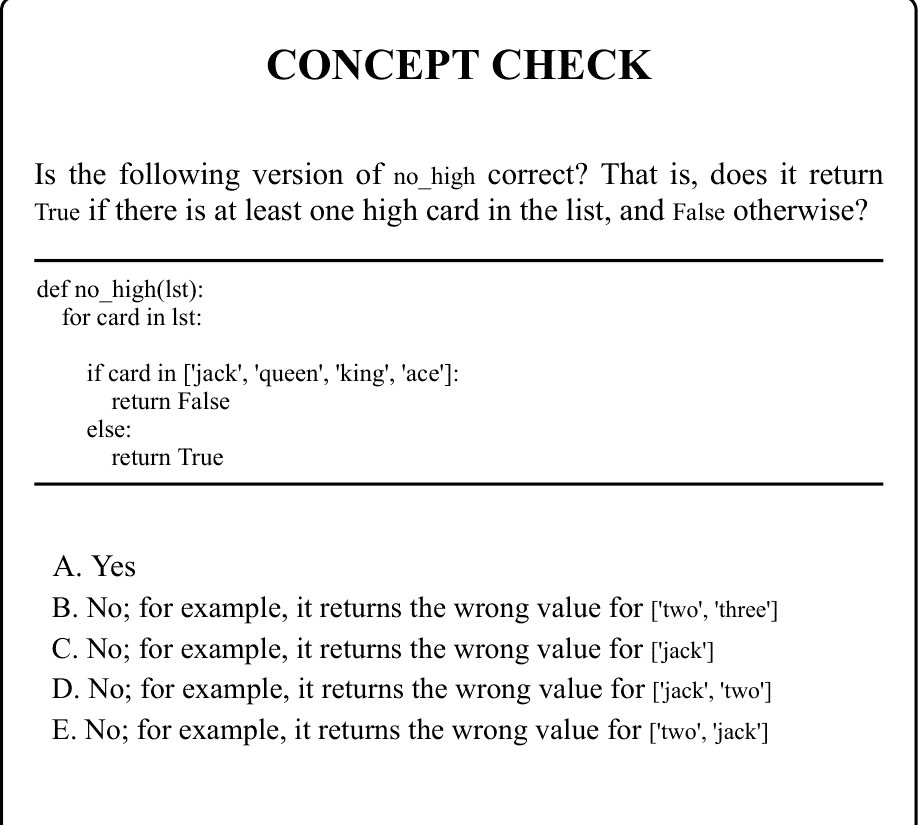

# 6

## DESIGNING PROGRAMS WITH FUNCTIONS


编写大型程序时，重要的是将我们的代码组织成较小的逻辑块，每个块都为整体目标做出贡献。这样，我们就能独立思考每个块，而不必担心其他块在做什么。然后我们将这些块组合起来。这些块称为 *functions*。

在本章中，我们将使用 *functions* 来分解并解决两个问题：计算两名玩家纸牌游戏的得分以及判断动作人偶的盒子是否可以整齐地组织。

### Problem #14: Card Game

在这个问题中，我们将实现一个两名玩家的纸牌游戏。在思考问题的过程中，我们会发现同一段逻辑出现了多次。我们将学习如何将这段代码打包成一个 Python 函数，以避免代码重复并增强代码清晰度。

这是 DMOJ problem ccc99s1。

#### *The Challenge*

两名玩家 A 和 B 正在玩一个纸牌游戏。 （你不需要了解纸牌或纸牌游戏就能理解这个问题。）

游戏开始时有一副 52 张牌的牌堆。玩家 A 从牌堆中取一张牌，然后玩家 B 从牌堆中取一张牌，然后玩家 A，再然后玩家 B，直到牌堆中没有牌为止。

牌堆中有 13 种牌型。牌型如下：
two, three, four, five, six, seven, eight, nine, ten, jack, queen, king, ace.
每种牌型各有四张牌。例如，有四张二、四张三，等等，一直到四张 A。 （这就是为什么牌堆中有 52 张牌：13 种牌型乘以每种 4 张牌。）

*high card* 是 jack、queen、king 或 ace 的牌。当玩家取到一张高牌时，他们可能会得分。以下是计分规则：

- 如果玩家取到一张 jack，随后牌堆中至少还剩一张牌，并且牌堆中的下一张牌不是高牌，则该玩家得 1 分。
- 如果玩家取到一张 queen，随后牌堆中至少还剩两张牌，并且牌堆中接下来的两张牌都不是高牌，则该玩家得 2 分。
- 如果玩家取到一张 king，随后牌堆中至少还剩三张牌，并且牌堆中接下来的三张牌都不是高牌，则该玩家得 3 分。
- 如果玩家取到一张 ace，随后牌堆中至少还剩四张牌，并且牌堆中接下来的四张牌都不是高牌，则该玩家得 4 分。

我们被要求在每次玩家得分时输出信息，以及游戏结束时每个玩家的总得分。

### Input

输入由 52 行组成。每行包含牌堆中一张牌的类型。行是按从牌堆中取牌的顺序排列的；也就是说，第一行是从牌堆中取出的第一张牌，第二行是从牌堆中取出的第二张牌，以此类推。

### Output

每当玩家得分时，输出以下行：

| |
|---|
| Player *p* scores *q* point(s). |

其中 **p** 是玩家 A 的 A 或玩家 B 的 B，**q** 是他们刚刚得分的分数。

游戏结束时，输出以下两行：

```
Player A: *m* point(s).
Player B: *n* point(s).
```

其中 **m** 是玩家 A 的总得分，**n** 是玩家 B 的总得分。

### Exploring a Test Case

如果你思考如何解决这个问题，你可能会想知道我们是否可以直接解决它，而无需学习新东西。确实可以！我们准备得很充分。我们可以使用一个列表来表示牌堆。我们知道如何使用列表 append 方法向牌堆添加一张牌。我们可以访问列表中的值来查找高牌。我们甚至有 f-strings 来帮助我们输出玩家和分数信息。

不过，在深入之前，让我们先通过一个小例子。 这样做会突出我们缺少 Python 的一个关键特性，这将使我们更容易组织解决方案并解决这个问题。

如果我们使用 52 张牌的例子，我们将在这里待一整年，所以让我们使用一个只有 10 张牌的更小的例子。这不是一个完整的测试用例，所以我们编写的程序在上面不会工作，但它足以让我们理解游戏的机制以及我们的解决方案需要做什么。以下是测试用例：

```
queen
three
seven
king
nine
jack
eight
king
jack
four
```

玩家 A 取第一张牌，即 queen。 Queen 是一张高牌，玩家 A 在这里可能会得 2 分。首先，我们确认在这张 queen 之后牌堆中至少还剩两张牌。接下来，我们必须检查这两张牌，希望其中没有高牌。接下来的两张牌不是高牌——它们是 three 和 seven——所以玩家 A 得 2 分。

玩家 B 现在取第二张牌，即 three。 Three 不是高牌，所以玩家 B 没有得分。

玩家 A 现在取 seven。没有得分。

玩家 B 现在取 king，所以玩家 B 有机会得 3 分。在这张 king 之后牌堆中至少还剩三张牌。我们必须检查这三张牌，希望其中没有高牌。可惜，其中有一张高牌，是一张 jack。玩家 B 没有得分。

玩家 A 现在取 nine。没有得分。

玩家 B 现在取第一张 jack。在这张 jack 之后牌堆中至少还剩一张牌。我们必须检查下一张牌，希望它不是高牌。好消息：它不是高牌——它是一张 eight——所以玩家 B 得 1 分。

只有一次得分是由玩家 A 在他们取到倒数第二张牌（jack）时获得的。

因此，这个测试用例的输出为：

- Player A scores 2 point(s).
- Player B scores 1 point(s).
- Player A scores 1 point(s).
- Player A: 3 point(s).
- Player B: 1 point(s).

注意，每当玩家取到一张高牌时，我们需要检查两件事：牌堆中至少还剩一定数量的牌，以及这些牌中没有高牌。第一点我们应该可以通过使用一个变量来告诉我们已经取了多少张牌来管理。第二点更困难。我们需要一些代码来检查给定数量的牌是否包含高牌。更糟糕的是，如果我们不小心，我们最终会重复四次非常相似的代码：一次检查 jack 之后的牌，一次检查 queen 之后的两个牌，一次检查 king 之后的三个牌，一次检查 ace 之后的四个牌。如果我们后来发现逻辑有缺陷，我们将不得不修复多达四个不同的地方。

是否有 Python 特性让我们可以只打包一次“这里没有高牌”的逻辑，然后调用四次？有。它被称为函数，它只是一个执行小任务的命名代码块。


函数对于代码的组织性和清晰度至关重要。所有程序员都会使用它们。如果没有函数，编写像游戏和文字处理器这样的大型软件系统将变得不可行。让我们来学习如何使用函数。

## 定义和调用函数

我们已经学习了如何调用 Python 自带的函数。例如，我们使用了 input 函数来读取输入。以下是一个没有参数的 input 调用示例：

```
```python
>>> s = input()
hello
>>> s
'hello'
```
```

我们还使用了 Python 的 print 函数来输出文本。以下是一个带有一个参数的 print 调用示例：

```
```python
>>> print('well, well')
well, well
```
```

Python 的内置函数是通用的，旨在用于各种广泛的环境。当我们希望一个函数解决特定任务时，我们就必须自己定义它。

### 无参函数

为了*定义*或创建一个函数，我们使用 Python 的 def 关键字。以下是一个输出三行内容的函数的定义：

```
```python
>>> def intro():
...     print('**********')
...     print('*WELCOME*')
...     print('**********')
...
```
```

函数定义的结构与 if 语句或循环的结构类似。def 后面的名称是我们正在定义的函数的名称；在这里，我们定义了一个名为 intro 的函数。在函数名称之后，有一对空括号 ()。稍后我们会看到，可以在这些括号中包含信息以向函数传递参数。这个 intro 函数不接收任何参数，这就是为什么括号是空的。括号后面是一个冒号；与 if 语句或循环一样，省略冒号会导致语法错误。在接下来的几行中，我们提供了一个缩进的语句块，该语句块将在每次调用函数时执行。

当你定义 intro 函数时，你可能期望看到以下输出：

```
**********
*WELCOME*
**********
```

但并没有：到目前为止，我们只是定义了该函数，并未调用它。定义函数没有可观察到的效果；它只是将函数存储在计算机内存中，以便我们稍后调用。我们调用自己定义的函数，就像调用 Python 的任何内置函数一样。由于这个 intro 函数不接收任何参数，我们在调用时使用一组空括号：

```
>>> intro()
**********
*WELCOME*
**********
```

你可以随意调用这个函数多次。只要我们需要，它就在那里。

## 带参数的函数

我们的 intro 函数不太灵活，因为它每次被调用时都执行相同的操作。我们可以修改函数，使其能够接收参数，并且传递的参数可以影响函数的行为。以下是 intro 函数的一个新版本，它允许我们传递单个参数：

```
>>> def intro2(message):
...     line_length = len(message) + 2
...     print('*' * line_length)
...     print(f'* {message} *')
...     print('*' * line_length)
...
```

要调用这个函数，我们需要提供一个字符串参数：

```
>>> intro2('HELLO')
*******
*HELLO*
*******
>>> intro2('WIN')
*****
*WIN*
*****
```

如果我们不传参数就无法调用这个 intro2 函数——如果我们尝试这样做，会得到一个错误：

```
>>> intro2()
Traceback (most recent call last):
  File "<stdin>", line 1, in <module>
TypeError: intro2() missing 1 required positional argument: 'message'
```

该错误提醒我们，我们没有为 message 提供参数。名称 message 被称为函数参数。当我们调用 intro2 时，Python 首先让 message 指向我们的参数所指向的内容；也就是说，message 成为我们参数的别名。

我们可以创建具有多个参数的函数。以下是一个接受两个参数的函数：一个要打印的信息和打印的次数：

```
>>> def intro3(message, num_times):
...     for i in range(num_times):
...         print(message)
...
```

要调用这个函数，我们需要提供两个参数。Python 从左到右处理，将第一个参数赋值给第一个参数名，将第二个参数赋值给第二个参数名。在下一次调用中，'high' 被赋值给 message 参数，5 被赋值给 num_times 参数：

```
>>> intro3('high', 5)
high
high
high
high
high
```

请务必提供正确数量的参数。对于 intro3，我们需要两个参数。其他任何情况都是错误：

```
>>> intro3()
Traceback (most recent call last):
  File "<stdin>", line 1, in <module>
TypeError: intro3() missing 2 required positional arguments: 'message' and 'num_times'
>>> intro3('high')
Traceback (most recent call last):
  File "<stdin>", line 1, in <module>
TypeError: intro3() missing 1 required positional argument: 'num_times'
```

我们还必须确保提供正确类型的值。错误类型不会阻止我们调用函数，但会导致函数内部出现错误：

```
>>> intro3('high', 'low')
Traceback (most recent call last):
  File "<stdin>", line 1, in <module>
  File "<stdin>", line 2, in intro3
TypeError: 'str' object cannot be interpreted as an integer
```

这个 TypeError 出现是因为 intro3 使用了一个基于变量 num_times 的 range for 循环。如果为 num_times 提供的参数不是整数，range for 循环就会失败。

## 关键字参数

在调用函数时，可以覆盖参数与参数名之间的从左到右的对应关系。要做到这一点，我们可以按照自己喜欢的顺序使用参数名。使用参数名的参数称为关键字参数。以下是其工作方式：

```
>>> def intro3(message, num_times):
...   for i in range(num_times):
...     print(message)
...
>>> intro3(message='high', num_times=3)
high
high
high
>>> intro3(num_times=3, message='high')
high
high
high
```

这里的每个函数调用都使用了两个关键字参数。关键字参数由参数名、等号及其对应的参数组成。

你甚至可以以常规参数开始，并以关键字参数结束：

```
>>> intro3('high', num_times=3)
high
high
high
```

但一旦你使用了关键字参数，就不能再回到常规参数：

```
>>> intro3(message='high', 3)
  File "<stdin>", line 1
SyntaxError: positional argument follows keyword argument
```

在第 5 章的“排序列表”部分，我们在调用 sort 方法时使用了一个 reverse 关键字参数。Python 设计者决定 reverse 应该是一个仅关键字参数，这意味着如果不使用关键字参数，就无法填入它的值。Python 也允许我们在自己的函数中做到这一点，但在这本书中我们不需要这种程度的控制。

## 局部变量

参数名像常规变量一样工作，但仅限于定义它们的函数内部。也就是说，函数参数在其函数外部不存在：

```
>>> def intro2(message):
...   line_length = len(message) + 2
...   print('*' * line_length)
...   print(f'*{message}*')
...   print('*' * line_length)
>>> intro2('hello')
*******
*hello*
*******
>>> message
Traceback (most recent call last):
  File "<stdin>", line 1, in <module>
NameError: name 'message' is not defined
```

那么 line_length 变量呢——它也是局部的吗？是的：

```
>>> line_length
Traceback (most recent call last):
    File "<stdin>", line 1, in <module>
NameError: name 'line_length' is not defined
```

如果你有一个变量，然后调用一个使用同名参数或局部变量的函数，会发生什么？你的值会丢失吗？让我们看看：

```
>>> line_length = 999
>>> intro2('hello')
*******
*hello*
*******
>>> line_length
999
```

松了一口气——它仍然是 999，正如我们离开时那样。局部变量在函数被调用时创建，在函数终止时销毁，这一切都不会影响其他同名的变量。

一个函数可以访问在该函数外部创建的变量。尽管不建议依赖于此，因为这会使该函数不再自包含，而是期望它需要的变量实际存在。在这本书中，我们将编写仅使用局部变量的函数。函数所需的所有信息将通过其参数提供给函数。

## 可变参数

由于参数是其对应参数的别名，因此它可以用于修改变量值。以下是一个从列表 lst 中移除所有 value 出现的函数：

```
>>> def remove_all(lst, value):
...     while value in lst:
...         lst.remove(value)
...
>>> lst = [5, 10, 20, 5, 45, 5, 9]
>>> remove_all(lst, 5)
>>> lst
[10, 20, 45, 9]
```


注意，我们通过变量向 `remove_all` 传递了一个列表。如果你直接用列表值（而不是用一个引用列表的变量）来调用这个函数，那么它不会产生任何有用的效果：

```
>>> remove_all([5, 10, 20, 5, 45, 5, 9], 5)
```

函数确实从列表中删除了所有的 5，但由于我们没有使用变量，以后就再也没有办法引用那个列表了。

## 概念检查

下面代码的输出是什么？

```
def mystery(s, lst):
    s = s.upper()
    lst = lst + [2]

s = 'a'
lst = [1]
mystery(s, lst)

print(s, lst)
```

+   A. a [1]
+   B. a [1, 2]
+   C. A [1]
+   D. A [1, 2]

**答案：** A. 调用 `mystery` 时，它的 `s` 参数被设置为引用 `s` 实参所引用的对象，即字符串 'a'。类似地，它的 `lst` 参数被设置为引用 `lst` 实参所引用的对象，即列表 [1]。在 `mystery` 内部，`s` 和 `lst` 都是局部变量。

现在我们来研究函数本身的两个语句。

首先，s = s.upper()。这使局部变量 s 引用 'A'（大写）。但它并没有改变函数外部 s 所引用的内容；外部的 s 仍然引用 'a'（小写）。

其次，lst = lst + [2]。对列表使用 + 会创建一个新列表（它不会改变现有列表！），所以这使局部变量 lst 引用新列表：[1, 2]。但同样，它并没有改变函数外部 lst 所引用的内容；外部的 lst 仍然是 [1]。

这是怎么回事——我之前不是告诉过你，函数可以改变可变参数吗？我确实说过；但要实现这一点，你真的需要改变值本身，而不是改变局部变量所引用的对象。请把之前的程序和下面这个程序比较一下，它们的输出是不同的：

```
def mystery(s, lst):
    s.upper() # upper creates a new string
    lst.append(2) # append changes the list

s = 'a'
lst = [1]
mystery(s, lst)

print(s, lst)
```

## 返回值

让我们回到“纸牌游戏”问题。我们的目标是定义一个函数，判断牌列表中是否没有大牌。我们把这个函数命名为 no_high。我们还没有编写 no_high，但我们仍然可以说明我们想要实现的目标。以下是我们期望的效果：

```
>>> no_high(['two', 'six'])
True
>>> no_high(['eight'])
True
>>> no_high(['two', 'jack', 'four'])
False
>>> no_high(['queen', 'king', 'three', 'queen'])
False
```

```
...           print(i, j)
...           if j == 4:
...               return
...
>>> func()
0 0
0 1
0 2
0 3
0 4
```

return 就像一种超级 break！有些人不喜欢在循环中使用 return，原因和不喜欢 break 一样：它可能会掩盖循环的目的和逻辑。方便的时候我会在循环中使用 return。与可以出现在任何地方的 break 不同，return 只能出现在函数内部，与其他代码分隔开。如果我们保持函数短小精悍，那么在循环中使用 return 可以帮助我们写出清晰的代码，而不会干扰周围的代码。



答案：E. if-else 语句使循环在第一次迭代时总是终止。如果第一张牌是大牌，函数终止并返回 False；如果第一张牌不是大牌，函数终止并返回 True。它不会查看任何其他牌！这就是它在 ['two', 'jack'] 上失败的原因：第一张牌不是大牌，所以函数返回 True。返回 True 告诉我们列表中没有大牌。但这是错误的：里面有一张 jack！函数做错了。它本应返回 False。

## 函数文档

现在，我们的 no_high 函数是做什么的、应该怎样调用，我们都一清二楚。但几个月后，当旧代码的用途不再那么容易想起时怎么办？而且，一旦我们积累了大量自己的函数，很难记住每个函数是做什么的，又该怎么办？

对于我们编写的每个函数，我们都会添加文档，说明每个参数的含义以及函数的返回值。这种文档称为 docstring，也就是“文档字符串”（documentation string）。docstring 应该写在函数块的第一行。下面是 no_high 函数，这次带上了文档：

```
>>> def no_high(lst):
...     """
...     lst is a list of strings representing cards.
...
...     Return True if there are no high cards in lst, False otherwise.
...     """
...     if 'jack' in lst:
...         return False
...     if 'queen' in lst:
...         return False
...     if 'king' in lst:
...         return False
...     if 'ace' in lst:
...         return False
...     return True
...
```

docstring 以三个双引号（"""）开头和结尾。和单引号（'）或双引号（"）一样，三个双引号也可以用来开始和结束任何字符串。用三个引号创建的字符串称为三引号字符串。（三个单引号也可以，但 Python 的惯例是使用三个双引号。）它们还有一个好处：只要在每一行后面按 ENTER，就可以把多行文本添加到字符串中；而用 ' 或 " 创建的字符串不能这样跨行。我们使用三引号字符串作为 docstring，这样就可以包含我们想要的任意多行内容。

这里的 docstring 告诉我们 lst 是什么：它是一个表示牌的字符串列表。它还告诉我们函数返回 True 或 False，以及每个返回值表示什么。这些信息足以让调用者无需查看代码即可调用该函数。只要知道函数做什么，就可以直接使用它。我们一直在使用 Python 函数，却从未查看过它们的代码。print 是如何工作的？input 是如何工作的？我们不知道！但这并不重要：我们知道这些函数的功能，所以只需专注于调用它们。

对于有多个参数的函数，docstring 应该列出每个参数的名称，并说明其预期类型。下面是本章“可变参数”一节中的 remove_all，以及一个合适的 docstring：

```
>>> def remove_all(lst, value):
... """
... lst is a list.
... value is a value.
...
... Remove all occurrences of value from lst.
... """
... while value in lst:
...     lst.remove(value)
...
```

注意，这个 docstring 没有提到返回任何内容。那是因为这个函数不会返回任何有用的东西！它从 lst 中移除元素，这正是 docstring 所描述的功能。

## 解决问题

我们刚刚学习了定义和调用函数的基础知识。在本书的剩余部分，每当我们面对一个需要解决的大问题时，我们都能把它的解决方案拆分成更小的任务，每个任务由一个函数来解决。

让我们把 no_high 函数用到“纸牌游戏”的解决方案中。代码见清单 6-1。

```
① NUM_CARDS = 52

② def no_high(lst):
    """
    lst is a list of strings representing cards.

    Return True if there are no high cards in lst, False otherwise.
    """
    if 'jack' in lst:
        return False
    if 'queen' in lst:
        return False
    if 'king' in lst:
        return False
    if 'ace' in lst:
        return False
    return True

③ deck = []

④ for i in range(NUM_CARDS):
    deck.append(input())

score_a = 0
score_b = 0
player = 'A'

⑤ for i in range(NUM_CARDS):
    card = deck[i]
    points = 0
⑥ remaining = NUM_CARDS - i - 1
⑦ if card == 'jack' and remaining >= 1 and no_high(deck[i+1:i+2]):
    points = 1
elif card == 'queen' and remaining >= 2 and no_high(deck[i+1:i+3]):
    points = 2
elif card == 'king' and remaining >= 3 and no_high(deck[i+1:i+4]):
    points = 3
elif card == 'ace' and remaining >= 4 and no_high(deck[i+1:i+5]):
    points = 4

⑧ if points > 0:
```

```
print(f'Player {player} scores {points} point(s).')

if player == 'A':
    score_a = score_a + points
    player = 'B'
else:
    score_b = score_b + points
    player = 'A'

print(f'Player A: {score_a} point(s).')
print(f'Player B: {score_b} point(s).')
```

# 清单 6-1：解决纸牌游戏

我引入了常量 NUM_CARDS 来表示 52 ❶。我们会在代码中用到它几次，而记住 NUM_CARDS 的含义比记住 52 的含义更容易。

接下来，我们定义已经深入讨论过的 no_high 函数，包括其 docstring ❷。我们总是把函数放在程序靠前的位置。这样，后面的任何代码都可以调用这些函数。

程序的主要部分首先创建一个列表，用来存放牌堆中的牌 ❸。然后我们从输入中读取牌 ❹，把每张牌追加到牌堆中。你会注意到，牌从未真正从牌堆中移除或取走（在程序执行期间，牌堆始终保持原样）。我们本可以那样做。相反，我选择跟踪牌堆中的位置，以便知道接下来会移除哪张牌。

我们还维护了另外三个关键变量：score_a，玩家 A 的当前总分；score_b，玩家 B 的当前总分；以及 player，当前玩家的名字。

我们的下一个任务是查看牌堆中的每张牌，为玩家计分。普通的 for 循环可以让我们查看当前牌。但这还不够：如果当前牌是大牌，我们还必须能够查看后面的牌。为了方便这一点，我们使用 range for 循环 ❺。

在这个循环的每次迭代中，我们根据当前玩家从牌堆中取出的牌来确定该玩家获得的分数。每条得分规则都依赖于牌堆中剩余一定数量的牌。变量 remaining ❻ 告诉我们剩余牌的数量。当 i 为 0 时，剩余牌数为 51，因为我们刚刚取走了第一张牌。当 i 为 1 时，剩余牌数为


剩余卡片数为 50，因为我们刚刚取出了第二张卡片。一般来说，剩余卡片数的表达式为卡片总数减去 i 再减去 1。

现在我们有四个测试，对应每种得分方式 ⑦。每个测试都会检查当前卡片和剩余卡片数。如果这两个条件都为 True，则会调用我们的 no_high 函数，并传入包含适当数量卡片的牌堆切片。例如，如果当前卡片是 'jack' 且至少还剩 1 张卡片，则我们向 no_high ⑦ 传递长度为 1 的列表。如果 no_high 返回 True，则说明切片列表中没有高牌，因此当前玩家得 points。points 变量决定了将授予的分数数；它在循环的每次迭代中从 0 开始，并根据情况设置为 1、2、3 或 4。

如果玩家得分了 points ⑧，则我们输出一条消息，指示得分的玩家以及他们得分的数量。

当前迭代剩下的唯一工作就是将分数加到当前玩家的分数上并轮到另一位玩家。我们通过 if-else 语句 ⑨ 完成这两个任务。（如果本次迭代 points 为 0，则会向玩家的分数中添加一个无害的 0。没有理由显式地测试并避免这种情况。）

最后两个 print 调用输出每个玩家的总分。

好了：一个使用函数来组织代码并使其更易于阅读的问题解决方案。随时将我们的代码提交给评测，你应该会看到所有测试用例都通过了。

## 问题 #15：行动人物

为了解决 Card Game，我们首先通过了一个示例，而该示例突出了函数可能有用的地方。现在，我们将使用函数解决另一个问题，但我们将使用更系统的方法来发现所需的函数。

这是 Timus 问题 2144。这是本书中唯一来自 Timus 评测的问题。要找到该问题，请访问 https://acm.timus.ru/，点击 Problem set，点击 Volume 12，并找到问题 2144（在评测中称为 Cleaning the Room）。

## 挑战

Lena 有 n 个未开封的行动人物盒子。盒子不能打开（否则行动人物会失去价值），因此盒子中行动人物的顺序不能改变。此外，盒子不能旋转（否则行动人物会面向错误的方向）。

每个行动人物都由其高度指定。例如，其中一个盒子可能从左到右有三个行动人物，高度分别为 4、5 和 7。当我谈论一个行动人物盒子时，我总是从左到右列出高度。

Lena 想整理盒子，这意味着要排列盒子，使行动人物的高度从左到右递增或保持不变。

她是否能整理盒子取决于盒子中行动人物的高度。例如，如果第一个盒子有高度为 4、5 和 7 的行动人物，而第二个盒子有高度为 1 和 2 的行动人物，那么她可以通过将第二个盒子放在前面来整理这些盒子。但如果我们保持第一个盒子不变并将第二个盒子改为有高度为 6 和 8 的行动人物，那么就无法整理这些盒子。

判断 Lena 是否有可能整理盒子。

## 输入

输入由以下几行组成：

- 包含整数 n 的一行，表示盒子的数量。n 在 1 到 100 之间。
- n 行，每行对应一个盒子。每行以整数 k 开头，表示该盒子中行动人物的数量。k 在 1 到 100 之间。（由于 k 至少为 1，我们不必担心空盒子。）k 之后有 k 个整数，给出该盒子中从左到右的行动人物高度。每个高度都是 1 到 10,000 之间的整数。行中每对整数之间有一个空格。

## 输出

如果 Lena 能整理盒子，输出 YES；否则，输出 NO。

## 表示盒子

这个问题由几个小问题组成，我们可以通过编写函数来解决每个小问题。让我们先看看如何在 Python 中表示盒子，然后再设计我们需要的函数。

在第 5 章中，当我们解决 Baker Bonus 时，我们了解到列表的值可以是其他列表。这使我们能够在列表内嵌套列表。我们可以使用这种安排来表示行动人物盒子。例如，这里有一个表示两个盒子的列表：

```
>>> boxes = [[4, 5, 7], [1, 2]]
```

第一个盒子有三个行动人物，第二个有兩個。我们可以单独访问每个盒子：

```
>>> boxes[0]
[4, 5, 7]
>>> boxes[1]
[1, 2]
```

我们将从输入中读取盒子的内容并将该信息放入嵌套列表中，如我所示。然后我们将使用该嵌套列表来确定盒子是否可以整理。

## 自顶向下设计

我们将使用一种称为自顶向下设计的方法来解决这个问题。自顶向下设计将一个大问题分解为几个小问题。这很有用，因为每个小问题都更容易解决。然后我们可以将这些子问题解决方案组合起来解决原始问题。

## 进行自顶向下设计

自顶向下设计的工作方式如下。我们首先编写一个不完整的 Python 程序，捕捉解决方案中的主要任务。其中一些任务不需要太多代码，因此我们可以直接解决它们。其他任务需要我们更多的工作，我们会将每个任务变成一个我们将调用的函数。我们也可能通过编写少量代码并调用一个函数来解决一个任务。然而，这些函数还不存在。我们必须编写它们！

要编写所需的函数，我们对该函数的任务重复相同的过程。也就是说，我们首先写下该函数的任务。如果我们可以直接为任务编写代码，那么我们就这样做；否则，我们调用另一个函数（我们稍后会编写）来处理该任务。

我们一直这样做，直到没有更多函数需要编写为止。此时，我们将拥有问题的解决方案。

它被称为自顶向下设计，因为我们从顶部或最高级别的问题开始，并向下深入问题的内部，直到每个任务都完全用代码编写。我们现在将用它来解决 Action Figures。

## 顶层

为了开始我们的设计，我们关注需要解决的主要任务。

我们当然必须读取输入，所以这是我们的第一个任务。

现在，假设我们已经读取了输入。我们应该做什么来确定盒子是否可以整理？一个重要事项是检查每个盒子本身，以确保其行动人物的高度是有序的。例如，假设我们有盒子 [18, 20, 4]。这个盒子高度无序，意味着我们没有机会整理所有盒子。我们甚至无法整理这个盒子！

所以，这是我们的第二个任务：确定每个盒子本身的行动人物高度是否有序。如果这些盒子中的任何一个行动人物高度无序，那么我们就知道盒子不能被整理。如果所有盒子都 OK，那么我们还有更多要检查。

如果每个盒子本身都 OK，下一个问题是我们是否可以整理所有盒子。这里我们可以做一个重要的观察：从现在开始，我们只关心每个盒子左右两侧的行动人物。盒子之间的行动人物不再重要。

考虑这个有三个盒子的例子：

```
[[9, 13, 14, 17, 25],
[32, 33, 34, 36],
[1, 6]]
```

第一个盒子以高度为 9 的行动人物开始，以高度为 25 的行动人物结束。放置在此盒子左侧的所有行动人物必须全部高度为 9 或更小；例如，我们可以将第三个盒子放在此盒子左侧。放置在此盒子右侧的所有行动人物必须全部高度为 25 或更大；例如，我们可以将第二个盒子放在此盒子右侧。高度为 13、14 和 17 的行动人物什么都不会改变；它们就好像不存在一样。

那么，这是我们的第三个任务：忽略除盒子两端行动人物之外的所有行动人物。

完成第三个任务后，我们将得到一个如下所示的列表：

```text
[[9, 25],
 [32, 36],
 [1, 6]]
```

如果我们先对这些盒子进行排序，就更容易判断是否可以整理这些盒子，如下所示：

```text
[[1, 6],
 [9, 25],
 [32, 36]]
```

现在很容易看出一个盒子的邻居盒子必须是什么。（我们在第 5 章解决 Village Neighborhood 时使用了类似的方法。）所以，我们的第四个任务是对这些新盒子进行排序。

我们的第五个也是最后一个任务是确定这些排序后的盒子是否已整理。它们是有序的，如果行动人物的高度从左到右排序。高度为 1、6、9、25、32 和 36 的行动人物排序合适，因此之前的盒子可以整理。但考虑这个例子：

```text
[[1, 6],
 [9, 50],
 [32, 36]]
```

这些盒子不能整理，因为第二个盒子中有一个巨大的行动人物。那个第二个盒子占据了 9 到 50 的高度；第三个盒子不能放在第二个盒子的右边，因为它的高度太小。

我们现在已经完成了对问题的研究，并确定了五个主要任务：

- 1. 读取输入。
- 2. 检查所有盒子是否 OK。
- 3. 获取一个仅包含每个盒子左右行动人物高度的新盒子列表。
- 4. 对这些新盒子进行排序。


# 5. 判断这些整理过的箱子是否有序。

你可能好奇为什么我们有一个“读取输入”的任务，却没有“写出输出”的任务。对于这个问题，写出输出只需要按需输出 YES 或 NO，没什么内容。另外，我们一知道答案就会输出 YES 或 NO，因此输出会与其他任务交错进行。基于这些原因，我决定不把它列为主要任务。在你自行进行自顶向下设计时，如果后来发现自己漏掉了一个任务，不用太担心。你只需把它补上并继续你的设计即可。

下面是如何用代码来体现我们所需的任务：

```
❶ # Main Program

  # TODO: Read input

  # TODO: Check whether all boxes are OK

  # TODO: Obtain a new list of boxes with only left and right heights

  # TODO: Sort boxes

  # TODO: Determine whether boxes are organized
```

我将其称为主程序 ❶。我们编写的任何函数都应包含在此注释之前。

目前每个任务都只写成了一个注释。其中的 TODO 标记是为了强调这些是我们需要从英语转为 Python 的任务。一旦我们完成某个任务，就会去掉它的 TODO。这样，我们就能跟踪哪些任务已完成、哪些尚未完成。让我们开始吧！

## 任务 1：读取输入

我们需要读取包含 *n*（箱子数量）的那一行，然后读取各个箱子。读取一个整数可以用一行代码完成，所以我们直接读取 *n*。另一方面，读取箱子是一个定义明确的任务，需要几行代码，所以让我们用一个函数来解决它；我们将它命名为 read_boxes。这是我们主程序目前的进展：

```
# Main Program
```

```
```python
# Read input
n = int(input())
boxes = read_boxes(n)

# TODO: Check whether all boxes are OK

# TODO: Obtain a new list of boxes with only left and right heights

# TODO: Sort boxes

# TODO: Determine whether boxes are organized
```
```

我已经从注释 ❶ 中移除了 TODO，因为从主程序的角度来看，我们已经解决了该任务。当然，我们还需要编写 read_boxes 函数，现在就来写吧。

read_boxes 函数接受一个整数 n 作为参数，并读取和返回 n 个箱子。代码如下：

```
```python
def read_boxes(n):
    """
    n is the number of boxes to read.

    Read the boxes from the input, and return them as a
    list of boxes; each box is a list of action figure heights.
    """
    boxes = []
    for i in range(n):
        box = input().split()
        box.pop(0)
        for i in range(len(box)):
            box[i] = int(box[i])
        boxes.append(box)
    return boxes
```
```

我们需要读取 n 个箱子，所以循环 n 次 ❶。在每次循环迭代中，我们读取当前行，并将其拆分为一个个动作人偶高度。该行以表示高度数量的整数开头，因此我们在继续之前将该值从列表中移除（它位于索引 0 处）❷。然后我们将每个高度转换为整数，并将当前箱子添加到箱子列表中。最后，我们返回箱子列表。

我们没有把 read_boxes 的任何部分推迟到尚未编写的函数中，所以这个任务完成了！我们会把这个函数以及我们编写的其他函数放在 `# Main Program` 注释之前。

return False
return True

我在注释中使用了“非递减”一词，而不是“递增”，因为动作人偶的高度允许相等。例如，箱子 [4, 4, 4] 完全没问题；声称这个箱子是“递增”则是不正确的。

我们已经把 all_boxes_ok 任务的一部分推给了 box_ok，所以接下来编写这个函数。如下：

```
def box_ok(box):
    """
    box is the list of action figure heights in a given box.

    Return True if the heights in box are in nondecreasing order,
    False otherwise.
    """
    for i in range(len(box)):
        if box[i] > box[i + 1]:
            return False
    return True
```

如果任何高度大于其右侧的高度，我们就返回 False，因为这些高度没有按顺序排列。如果我们顺利通过 for 循环，说明没有高度违规，因此返回 True。

使用自顶向下设计的一个很好的副作用是，我们会得到一些小块的代码，封装成函数，可以单独测试。例如，将 box_ok 的代码输入 Python shell。然后我们可以测试它：

```
>>> box_ok([4, 5, 6])
```

我们当然希望这里返回 True，因为该箱子是从小到大排列的。但我们肯定不希望看到实际得到的结果：

```
Traceback (most recent call last):
  File "<stdin>", line 1, in <module>
  File "<stdin>", line 9, in box_ok
IndexError: list index out of range
```

错误从来都不好玩，而当我们需要翻遍一页又一页的代码来查找它们时，就更不好玩了。但在这里，我们知道错误仅限于这个小函数，因此我们查找它的工作量大大减少了。这里的问题在于，我们最终会将最右侧的高度与其右侧的高度进行比较——而后者当然不存在！所以我们需要提前一个迭代停止，将倒数第二个高度与最后一个高度进行比较。以下是更新后的代码：

```
def box_ok(box):
    """
    box is the list of action figure heights in a given box.

    Return True if the heights in box are in nondecreasing order,
    False otherwise.
    """
    for i in range(len(box) - 1):
        if box[i] > box[i + 1]:
            return False
    return True
```

唯一的变化在调用 range 处 ①。如果你测试这个版本的函数，你会看到它按要求工作。任务 2 完成了！

## 任务 3：获取仅包含左右两端高度的新箱子列表

现在我们已经掌握了自顶向下设计的要领。在这个任务中，我们需要一种方法，从包含所有动作人偶的箱子，转换为仅包含最左侧和最右侧动作人偶的箱子。我将最左侧和最右侧的动作人偶称为箱子的端点。

一种方法是创建一个仅包含端点的新的箱子列表，我在这里就是这么做的。你也可以考虑直接从原箱子中移除高度，不过那会稍微棘手一些。

我将这个任务的函数命名为 boxes_endpoints。这是主程序的主要部分，已更新为该函数的调用：

```
# Main Program

# Read input
n = int(input())
boxes = read_boxes(n)

# Check whether all boxes are OK
if not all_boxes_ok(boxes):
    print('NO')
else:
```

```
# Obtain a new list of boxes with only left and right heights
① endpoints = boxes_endpoints(boxes)

# TODO: Sort boxes

# TODO: Determine whether boxes are organized
```

当我们用一个箱子列表调用 boxes_endpoints 时 ①，我们期望得到一个新的、仅包含箱子端点的列表。下面是符合该描述的 boxes_endpoints 代码：

```
def boxes_endpoints(boxes):
    """
    boxes is a list of boxes; each box is a list of action figure heights.

    Return a list, where each value is a list of two values:
    the heights of the leftmost and rightmost action figures in a box.
    """
    ① endpoints = []
    for box in boxes:
        ② endpoints.append([box[0], box[-1]])
    return endpoints
```

我们创建一个新的列表 ①，用来保存每个箱子的端点。然后我们遍历这些箱子。对于每个箱子，我们使用索引找到箱子里最左侧和最右侧的高度，并将它们添加到我们的端点列表中 ②。最后，我们返回端点列表。

等等：如果有一个箱子里面只有一个动作人偶会怎样？我们的 boxes_endpoints 函数会如何处理它？根据其文档字符串，对于任何有效的箱子，它都会返回一个包含两个值的列表。所以这里最好能做到；否则，该函数就没有履行它的承诺。让我们测试一下。将 boxes_endpoints 函数输入 Python shell，并用一个包含单个动作人偶的单个箱子来测试：

```
>>> boxes_endpoints([[2]])
[[2, 2]]
```

成功！最左侧高度是 2，最右侧高度也是 2，所以我们得到一个包含两个 2 的列表。在这种情况下，我们的函数工作正常，因为当 box 只有一个值时，box[0] 和 box[-1] 引用的是同一个值。（不用担心空箱子的情况。问题描述中禁止出现空箱子。）


## 任务 4：对箱子进行排序

至此，我们有了一个端点列表，类似这样：

```python
>>> endpoints = [[9, 25], [32, 36], [1, 6]]
>>> endpoints
[[9, 25], [32, 36], [1, 6]]
```

我们想对它们进行排序。需要再写一个函数吗？某种 `sort_endpoints` 函数？

这次不用了！列表的 `sort` 方法正好满足我们的需求：

```python
>>> endpoints.sort()
>>> endpoints
[[1, 6], [9, 25], [32, 36]]
```

当对一个由两个值的列表组成的列表调用 `sort` 时，它会使用第一个值进行排序。（如果第一个值相同，则进一步使用第二个值排序。）

我们可以立即更新程序的主部分，加入对 `sort` 的调用，然后划掉又一个 TODO。以下是更新后的代码：

```python
# Main Program

# Read input
n = int(input())
boxes = read_boxes(n)

# Check whether all boxes are OK
if not all_boxes_ok(boxes):
    print("NO")
else:
    # Obtain a new list of boxes with only left and right heights
    endpoints = boxes_endpoints(boxes)

    # Sort boxes
    endpoints.sort()

    # TODO: Determine whether boxes are organized
```

我们快要完成了。只剩一个 TODO 了。

## 任务 5：判断箱子是否有序

最后一项任务是检查端点。它们可能是有序的，像这样：

```python
[[1, 6],
[9, 25],
[32, 36]]
```

也可能不是，像这样：

```python
[[1, 6],
[9, 50],
[32, 36]]
```

对于前一种情况，我们应输出 `YES`；对于后一种情况，我们应输出 `NO`。我们需要一个函数来告诉我们端点是否有序。最后一次更新程序的主部分，最终得到如下代码：

```python
# Main Program

# Read input
n = int(input())
boxes = read_boxes(n)

# Check whether all boxes are OK
if not all_boxes_ok(boxes):
    print('NO')
else:
    # Obtain a new list of boxes with only left and right heights
    endpoints = boxes_endpoints(boxes)

    # Sort boxes
    endpoints.sort()

    # Determine whether boxes are organized
    if all_endpoints_ok(endpoints):
        print('YES')
    else:
        print('NO')
```

距离完整解决问题，只剩我们调用的那个 `all_endpoints_ok` 函数了。它接收一个列表，其中每个值都是一个端点列表，如果端点有序则返回 `True`，否则返回 `False`。

让我们通过一个例子来感受如何实现这个函数。这里是我们将要使用的端点列表：

```python
[[1, 6],
[9, 25],
[32, 36]]
```

第一个盒子的右端点高度为 6。因此，第二个盒子的左端点高度最好为 6 或更大。如果不是，则返回 `False`，表示端点无序。但这里没问题，因为第二个盒子的左端点高度为 9。

现在我们用第二个盒子的右端点 25 重复这个检查。第三个盒子的左端点是 32，所以 32 至少是 25，同样没问题。

一般来说，如果某个盒子的左端点小于前一个盒子的右端点，我们返回 `False`。否则，如果所有这些检查都通过，我们返回 `True`。

代码如下：

```python
def all_endpoints_ok(endpoints):
    """
    endpoints is a list, where each value is a list of two values:
    the heights of the leftmost and rightmost action figures in a box.

    Requires: endpoints is sorted by action figure heights.

    Return True if the endpoints came from boxes that can be
    put in order, False otherwise.
    """
    maximum = endpoints[0][1]
    for i in range(1, len(endpoints)):
        if endpoints[i][0] < maximum:
            return False
        maximum = endpoints[i][1]
    return True
```

我在 docstring 中添加了一些信息，提醒我们调用该函数时需要满足的条件。具体来说，在调用此函数之前，我们必须先对端点进行排序。否则，函数可能返回错误的值。

`endpoints` 中的每个值都是一个包含两个值的列表：索引 0 是最左（最小）高度，索引 1 是最右（最大）高度。代码使用 `maximum` 变量来跟踪一个盒子的最大高度。在 for 循环之前，它指向第一个盒子中的最大高度。for 循环将下一个盒子的最小值与该最大值进行比较。如果下一个盒子的最小值太小，我们返回 `False`，因为这两个盒子无法正确排列。每次迭代中要做的最后一件事是更新 `maximum`，使其指向下一个盒子的最大值。

## 整合所有代码

在完成了所有任务的代码编写之后，包括设计中产生的各个函数，我们可以将所有代码整合成一个完整的解决方案。主程序部分是否保留注释由你决定。我把它们保留了下来，但在实际中，这可能属于过度注释的情况，因为函数名本身就已选择用来传达代码的意图。完整代码见清单 6-2。

```python
def read_boxes(n):
    """
    n is the number of boxes to read.

    Read the boxes from the input, and return them as a
    list of boxes; each box is a list of action figure heights.
    """
    boxes = []
    for i in range(n):
        box = input().split()
        box.pop(0)
        for i in range(len(box)):
            box[i] = int(box[i])
        boxes.append(box)
    return boxes

def box_ok(box):
    """
    box is the list of action figure heights in a given box.

    Return True if the heights in box are in nondecreasing order,
    False otherwise.
    """
    for i in range(len(box) - 1):
        if box[i] > box[i + 1]:
            return False
    return True

def all_boxes_ok(boxes):
    """
    boxes is a list of boxes; each box is a list of action figure heights.

    Return True if each box in boxes has its action figures in
    nondecreasing order of height, False otherwise.
    """
    for box in boxes:
        if not box_ok(box):
            return False
    return True

def boxes_endpoints(boxes):
    """
    boxes is a list of boxes; each box is a list of action figure heights.

    Return a list, where each value is a list of two values:
    the heights of the leftmost and rightmost action figures in a box.
    """
    endpoints = []
    for box in boxes:
        endpoints.append([box[0], box[-1]])
    return endpoints

def all_endpoints_ok(endpoints):
    """
    endpoints is a list, where each value is a list of two values:
    the heights of the leftmost and rightmost action figures in a box.

    Requires: endpoints is sorted by action figure heights.

    Return True if the endpoints came from boxes that can be
    put in order, False otherwise.
    """
    maximum = endpoints[0][1]
    for i in range(1, len(endpoints)):
        if endpoints[i][0] < maximum:
            return False
        maximum = endpoints[i][1]
    return True

# Main Program

# Read input
n = int(input())
boxes = read_boxes(n)

# Check whether all boxes are OK
if not all_boxes_ok(boxes):
    print('NO')
else:
    # Obtain a new list of boxes with only left and right heights
    endpoints = boxes_endpoints(boxes)

    # Sort boxes
    endpoints.sort()

    # Determine whether boxes are organized
    if all_endpoints_ok(endpoints):
        print('YES')
    else:
        print('NO')
```

## 清单 6-2：解决动作人偶问题

这是本书到目前为止我们编写的最大的程序。但看看主程序部分是多么整洁和精简：它主要是函数调用，加上一点 if-else 逻辑将它们粘合在一起。

我们在这里每个函数只调用了一次。想想我们调用了四次的 `no_high` 纸牌游戏函数。即使一个函数只被调用一次，它仍然有助于代码的组织性和可读性。

是时候提交到 Timus 评测系统了。你应该会看到所有测试用例都通过。

## 概念检查

在任务 2 中，我们编写了函数 `box_ok`，用于判断单个箱子的高度是否有序。它使用了一个 range for 循环。下面是 `box_ok` 的 while 循环版本，请问它正确吗？

```python
def box_ok(box):
    """
    box is the list of action figure heights in a given box.

    Return True if the heights in box are in nondecreasing order,
    False otherwise.
    """
    ok = True
    i = 0
    while i < len(box) - 1 and ok:
        if box[i] > box[i + 1]:
            ok = False
        i = i + 1
    return ok
```


+   A. 是
+   B. 否；它会引发 IndexError
+   C. 否；它不会引发任何错误，但可能会返回错误的值

答案：A. 这等价于我们之前使用 range for 循环的版本。ok 变量初始为 True，意味着我们检查过的所有高度都正常（因为我们还没有检查任何一个！）。只要还有盒子需要检查并且没有高度违规，while 循环就会继续。如果某个动作人偶顺序错误，ok 会被设为 False，从而终止循环。如果所有动作人偶都按顺序排列，那么 ok 的值永远不会从 True 变为 False。因此，当我们在函数底部返回 ok 时，如果所有动作人偶都按顺序排列，我们返回 True，否则返回 False。

## 摘要

在本章中，我们学习了函数。函数是解决较大问题中较小部分的一段自包含代码。我们学习了如何通过参数向函数传递信息，以及通过返回值获取信息。

为了确定首先要编写哪些函数，我们可以使用自顶向下设计。自顶向下设计帮助我们将解决大问题的方案分解为若干较小的任务；对于每个任务，如果可以直接解决就直接解决，否则为其编写函数。如果某个任务过于复杂，我们可以对其进行进一步的自顶向下设计。

在下一章中，我们将学习如何处理我们选择的文​​件，而不是使用标准输入和标准输出。随着我们不断拓展所知边界，我们将在本章及本书其余部分发现许多函数的使用方式。练习以下一些练习，以提高你使用函数的信心。

## 章节练习

这里有一些练习供你尝试。对于每个练习，使用自顶向下设计来识别一个或多个有助于组织代码的函数！在每个函数中包含一个文档字符串！

-   1. DMOJ 问题 ccc13s1, From 1987 to 2013
-   2. DMOJ 问题 ccc18j3, Are we there yet?
-   3. DMOJ 问题 ecco12r1p2, Decoding DNA
-   4. DMOJ 问题 crci07p1, Platforme
-   5. DMOJ 问题 coci13c2p2, Misa
-   6. 重温第 5 章的一些练习，通过使用函数改进你的解决方案。我特别建议重温 DMOJ 问题 coci18c2p1 (Preokret) 和 DMOJ 问题 ccc00s2 (Babbling Brooks)。

## 注释

Card Game 最初来自 1999 年加拿大计算竞赛。Action Figures 最初来自 2019 年乌拉尔学校编程竞赛。

许多现代编程语言，包括 Python，都支持两种不同的编程范式。一种基于函数；这就是本章所研究的。另一种基于对象，导致了被称为面向对象编程 (OOP) 的范式。OOP 涉及定义新类型并为这些类型编写方法。我们在全书中都使用 Python 类型（如整数和字符串），但我们不会进一步讨论 OOP。有关 OOP 的介绍以及 OOP 在实践中的案例研究，我推荐 Eric Matthes 所著的《Python Crash Course, 2nd edition》 (No Starch Press, 2019)。

## 读写文件


到目前为止，我们一直使用 input 函数读取所有输入，并使用 print 函数写入所有输出。这些函数分别从标准输入（默认为键盘）和标准输出（默认为屏幕）读取和写入。虽然我们可以使用输入和输出重定向来更改这些默认值，但有时程序需要对其文件有更多的控制。例如，你的文字处理器允许你打开任意文档文件并以任意名称保存文件，而无需你处理标准输入和标准输出。

在本章中，我们将学习如何编写操作文本文件的程序。我们将使用文件解决两个问题：正确格式化一篇论文和为喂养奶牛播种农场。

## 问题 #16：论文格式化

这个问题与我们到目前为止解决的所有问题有一个重要的区别：它要求我们从特定文件读取并向特定文件写入！在阅读问题描述时请注意这一点。

这是 USACO 2020 年 1 月青铜赛问题 Word Processor。这是本书中来自 USACO (USA Computing Olympiad) 评测的第一道题。要找到该问题，请前往 *http://usaco.org/*，点击 **Contests**，点击 **2020 January Contest Results**，然后点击 Word Processor 下的 **View problem**。

## 挑战

奶牛 Bessie 正在写一篇论文。论文中的每个单词只包含小写或大写字符。她的老师指定了每行最多可以出现的字符数，不计空格。为了满足这一要求，Bessie 按以下规则写下论文中的单词：

-   - 如果下一个单词能放入当前行，则将其添加到当前行。行上每对单词之间包含一个空格。
-   - 否则，将此单词放在新行；此行成为新的当前行。

输出论文中每行的正确单词。

## 输入

从名为 word.in 的文件读取输入。

输入包含两行。

-   - 第一行包含两个由空格分隔的整数。第一个整数 n 是论文中的单词数；它在 1 到 100 之间。第二个整数 k 是每行最多可以出现的字符数（不计空格）；它在 1 到 80 之间。
-   - 第二行包含 n 个单词，每对单词之间有一个空格。每个单词最多有 k 个字符。

## 输出

将输出写入名为 word.out 的文件。

输出正确格式化的论文。

## 使用文件

论文格式化问题要求我们从文件 word.in 读取并向文件 word.out 写入。但在我们能做到这些之前，我们需要学习如何在程序中打开文件。

## 打开文件

使用你的文本编辑器，创建一个名为 word.in 的新文件。将其放在你一直用于 .py Python 程序的同一目录中。

这是我们第一次创建不以 .py 结尾的文件。相反，它以 .in 结尾。确保文件名为 word.in，而不是 word.py。in 是 input 的缩写；你会经常看到它用于包含程序输入的文件。

在该文件中，让我们放置论文格式化问题的有效输入。输入以下内容到文件中：

```
12 13  
perhaps better poetry will be written in the language of digital computers
```

保存文件。

要在 Python 中打开文件，我们使用 open 函数。我们传递两个参数：第一个是文件名，第二个是打开文件的模式。模式决定了我们如何与文件交互。

这是我们如何打开 word.in 的示例：

```
>>> open('word.in', 'r')
<_io.TextIOWrapper name='word.in' mode='r' encoding='cp1252'>
```

在此函数调用中，我们提供了 'r' 模式。r 代表 "read"，打开文件以便从中读取。模式碰巧是一个可选参数，其默认值为 'r'，因此如果我们愿意可以省略它。但我将在全书中为保持一致性而明确包含 'r'。

当我们使用 open 时，Python 会给我们一些关于文件如何被打开的信息 ❶。例如，它会确认文件名和模式。关于编码的部分表示文件如何从磁盘上的状态解码为我们可以读取的形式。文件可以使用多种编码进行编码，但在本书中我们不需要担心编码。

如果我们尝试打开一个不存在的文件进行读取，我们会得到一个错误：

```
>>> open('blah.in', 'r')
Traceback (most recent call last):
  File "<stdin>", line 1, in <module>
FileNotFoundError: [Errno 2] No such file or directory: 'blah.in'
```

如果你在打开 word.in 时遇到此错误，请仔细检查文件是否命名正确并且位于你启动 Python 的目录中。

除了用于读取的 'r' 模式外，还有用于写入的 'w' 模式。如果我们使用 'w'，那么我们就是打开文件以便在其中写入文本。

请注意 'w' 模式。如果使用 'w' 打开已存在的文件，该文件的内容将被删除。我刚刚不小心用它删除了我的 word.in 文件。没什么大不了的，因为很容易重新创建。但如果我们不小心覆盖了重要文件，就不会有人高兴。

如果你使用 'w' 且文件名不存在，它会创建一个空文件。

让我们使用 'w' 模式创建一个名为 blah.in 的空文件：

```
```python
>>> open('blah.in', 'w')
<_io.TextIOWrapper name='blah.in' mode='w' encoding='cp1252'>
```
```

现在 blah.in 存在了，我们可以不报错地打开它进行读取：

```
```python
>>> open('blah.in', 'r')
<_io.TextIOWrapper name='blah.in' mode='r' encoding='cp1252'>
```
```

那我们一直看到的 _io.TextIOWrapper 是什么？那是我们 open 返回的值的类型：

```
```python
>>> type(open('word.in', 'r'))
<class '_io.TextIOWrapper'>
```
```

把这个类型看作文件类型。它的值代表打开的文件，你很快就会看到它具有我们可以调用的方法。

与任何函数一样，如果我们不将 open 的返回值赋给变量，那么它的返回值就会丢失。我们到目前为止调用 open 的方式并不能让我们引用已打开的文件！

这是我们如何让变量引用打开文件的方式：

```
```python
>>> input_file = open('word.in', 'r')
>>> input_file
<_io.TextIOWrapper name='word.in' mode='r' encoding='cp1252'>
```
```

我们将能够使用 input_file 从 'word.in' 读取。

在解决论文格式化问题时，我们还需要一种方法来写入文件 'word.out'。以下变量将帮助我们做到这一点：


```python
>>> output_file = open('word.out', 'w')
>>> output_file
<_io.TextIOWrapper name='word.out' mode='w' encoding='cp1252'>
```

## 从文件读取

要从打开的文件中读取一行，我们使用文件对象的 `readline` 方法。该方法返回一个包含文件下一行内容的字符串。就这一点而言，它与 `input` 函数类似。然而，与 `input` 不同，`readline` 是从文件读取而不是从标准输入读取。

让我们打开 `word.in` 并读取它的两行：

```python
>>> input_file = open('word.in', 'r')
>>> input_file.readline()
'12 13\n'
>>> input_file.readline()
'perhaps better poetry will be written in the language of digital computers\n'
```

这里令人意外的是每个字符串末尾的 `\n`。我们在使用 `input` 读取一行时肯定没有看到那个。字符串中的 `\` 符号是一个 *转义字符*。它跳出字符的标准解释并改变其含义。我们不会把 `\n` 当作两个独立的字符 `\` 和 `n` 来处理。相反，`\n` 只是一个字符：换行符。文件中所有行，或许除了最后一行，都以换行符结束。如果没有的话，一切都会在一行上！`readline` 方法字面地给了我们整行，包括其终止的换行符。

下面是如何在我们自己的字符串中嵌入换行符：

```python
>>> 'one\ntwo\nthree'
'one\ntwo\nthree'
>>> print('one\ntwo\nthree')
one
two
three
```

Python shell 不会处理转义字符的效果，但 `print` 会。

`\n` 序列在字符串中很有用，因为它帮助我们添加多行。但我们很少希望从文件中读取的行中保留这些换行符。为了去掉它们，我们可以使用字符串 `rstrip` 方法。此方法与 `strip` 类似，只是它仅从字符串右侧移除空白（而不是左侧）。就它而言，换行符与空格一样是空白：

```python
>>> 'hello\nthere\n\n'
'hello\nthere\n\n'
>>> 'hello\nthere\n\n'.rstrip()
'hello\nthere'
```

让我们再次从文件中读取，这次去掉换行符：

```python
>>> input_file = open('word.in', 'r')
>>> input_file.readline().rstrip()
'12 13'
>>> input_file.readline().rstrip()
'perhaps better poetry will be written in the language of digital computers'
```

此时，我们已经读取了两行，所以文件里没有东西可读了。`readline` 方法通过返回一个空字符串来表示这一点。

```python
>>> input_file.readline().rstrip()
''
```

空字符串意味着我们已到达文件末尾。如果我们想再次读取行，必须重新打开文件以从开头开始。

让我们这样做，这次使用变量保存每一行：

```python
>>> input_file = open('word.in', 'r')
>>> first = input_file.readline().rstrip()
>>> second = input_file.readline().rstrip()
>>> first
'12 13'
>>> second
'perhaps better poetry will be written in the language of digital computers'
```

如果我们需要读取文件中的所有行，无论有多少行，我们可以使用 `for` 循环。Python 中的文件充当行序列，因此我们可以像遍历字符串和列表一样遍历它们：

```python
>>> input_file = open('word.in', 'r')
>>> for line in input_file:
...     print(line.rstrip())
...
```

不过，与字符串或列表不同，我们不能第二次遍历文件，因为第一次遍历会把我们带到文件末尾。如果我们尝试，就什么也得不到：

```python
>>> for line in input_file:
...   print(line.rstrip())
...
```

### 概念检查

我们想使用 `while` 循环输出打开文件 `input_file` 的每一行。 （该文件可以是任意文件；我没有假设它与论文格式有关。）以下哪段代码能正确做到这一点？

**A.**

```python
while input_file.readline() != "":
    print(input_file.readline().rstrip())
```

**B.**

```python
line = 'x'
while line != "":
    line = input_file.readline()
    print(line.rstrip())
```

**C.**

```python
line = input_file.readline()
while line != "":
    line = input_file.readline()
    print(line.rstrip())
```

- D. 以上全部
- E. 以上皆非

在查看答案之前，我鼓励你创建一个包含四到五行内容的文件并在该文件上尝试每段代码。你也可以考虑在输出的每一行开头添加一个字符如 `*`，以便能看到否则为空的空白行。

**答案：** E. 每段代码都有细微的错误。

代码 A 只输出文件的每隔一行。例如，`while` 循环的布尔表达式导致第一行被读取……然后丢失，因为它没有被赋给变量。因此循环的第一次迭代输出的是文件的第二行。

代码 B 非常接近正确。它输出文件的全部行，但也在末尾输出了一行多余的空白行。

代码 C 未打印文件的第一行。那是因为第一行在循环之前被读取，但循环随后读取第二行而没有打印第一行。它也像代码 B 一样在末尾产生了一行多余的空白行。

下面是正确读取并打印每一行的代码：

```python
line = input_file.readline()
while line != "":
    print(line.rstrip())
    line = input_file.readline()
```

## 写入文件

要向打开的文件写入一行，我们使用文件对象的 `write` 方法。我们传递一个字符串，该字符串会被添加到文件末尾。

为了解决论文格式问题，我们将写入 `word.out`。我们还不准备解决那个问题，所以让我们改写到 `blah.out`。下面是如何向该文件写入一行的示例：

```python
>>> output_file = open('blah.out', 'w')
>>> output_file.write('hello')
5
```

这里的 5 是做什么的？`write` 方法返回写入的字符数。这是一个很好的确认，表明我们写入了预期数量的文本。

如果你在文本编辑器中打开 `blah.out`，你应该在其中看到文本 `hello`。

让我们尝试向文件写入三行。开始：

```python
>>> output_file = open('blah.out', 'w')
>>> output_file.write('sq')
2
>>> output_file.write('ui')
2
>>> output_file.write('sh')
2
```

根据我迄今为止告诉你的内容，你可能会期望 `blah.out` 看起来像这样：

```text
sq
ui
sh
```

但如果你在文本编辑器中打开 `blah.out`，你应该会看到以下内容：

```text
squish
```

字符之所以在一行上，是因为 `write` 不会为我们添加换行符！如果我们想要单独的行，我们需要明确指定，像这样：

```python
>>> output_file = open('blah.out', 'w')
>>> output_file.write('sq\n')
3
>>> output_file.write('ui\n')
3
>>> output_file.write('sh\n')
3
```

注意在每种情况下 `write` 都写入了三个字符，而不是两个。换行符算作一个字符。现在如果你打开 `blah.out`，你应该会看到文本分布在三行上：

与 `print` 不同，`write` 仅在你用字符串调用它时才有效。要向文件写入数字，先将其转换为字符串：

```python
>>> num = 7788
>>> output_file = open('blah.out', 'w')
>>> output_file.write(str(num) + '\n')
5
```

## 关闭文件

完成后关闭文件是良好的实践。它向代码的阅读者表明文件不再被使用。

关闭文件也有助于操作系统管理计算机的资源。当你使用 `write` 方法时，你写入的内容可能不会立即进入文件。相反，Python 或操作系统可能会等待积累一批写入请求，然后一次性写入。关闭你写入的文件可保证你写入文件的内容已安全存储在文件中。

要关闭文件，调用其 `close` 方法。下面是打开文件、读取一行并关闭它的示例：

```python
>>> input_file = open('word.in', 'r')
>>> input_file.readline()
'12 13\n'
>>> input_file.close()
```

一旦你关闭了文件，就不能再从中读取或写入：

```python
>>> input_file.readline()
Traceback (most recent call last):
  File "<stdin>", line 1, in <module>
ValueError: I/O operation on closed file.
```

## 解决问题

回到论文格式。现在我们知道如何从 `word.in` 读取并写入 `word.out`。这解决了输入和输出要求。


是时候解决这个问题本身了。

让我们先从探索一个测试用例开始，确保我们清楚如何解决这个问题。然后我们会看到代码。

## 探索测试用例

这是我一直在使用的 word.in 文件：

```
12 13
perhaps better poetry will be written in the language of digital computers
```

一共有 12 个单词，每行最多可容纳的字符数（不计算空格）为 13。只要单词能放下，我们就应将其添加到当前行；一旦某个单词放不下，我们就用该单词另起一行。

单词 perhaps 包含 7 个字符，所以它可以放在第一行。单词 better 包含 6 个字符。我们也可以把它放在第一行；加上已经放在第一行的 perhaps，目前总共有 13 个字符（不包括两个单词之间的空格）。

单词 poetry 放不进第一行，所以我们以 poetry 作为第一个单词另起一行。单词 will 可以放在第二行的 poetry 后面。类似地，be 可以放在 will 后面。到目前为止，我们有 12 个非空格字符。现在轮到单词 written，而第二行只剩下 1 个字符的空位，所以我们只能以 written 作为第一个单词再起一行。

按照这个过程一直进行到最后，我们需要写入 word.out 的完整文章如下：

```
perhaps better
poetry will be
written in the
language of
digital
computers
```

## 代码

我们的解决方案见清单 7-1。

```
① input_file = open('word.in', 'r')
② output_file = open('word.out', 'w')

③ lst = input_file.readline().split()
n = int(lst[0])  # n not needed
k = int(lst[1])
words = input_file.readline().split()

line = ""
chars_on_line = 0

for word in words:
    if chars_on_line + len(word) <= k:
        line = line + word + ' '
        chars_on_line = chars_on_line + len(word)
    else:
        output_file.write(line[:-1] + '\n')
        line = word + ' '
        chars_on_line = len(word)

output_file.write(line[:-1] + '\n')

input_file.close()
output_file.close()
```

## 清单 7-1：解决文章格式化问题

首先，我们打开输入文件❶和输出文件❷。注意模式：我们以 'r' 模式（读取）打开输入文件，以 'w' 模式（写入）打开输出文件。我们本可以晚一点再打开输出文件，就在使用它之前打开，但我选择在这里同时打开两个文件，以简化程序结构。类似地，我们本可以在不再需要某个文件时立刻关闭它，但在这本书中，我选择在程序结束时一起关闭所有文件。对于长时间运行且操作多个文件的程序，你可能希望只在需要时才保持文件打开。

接下来，我们读取输入文件的第一行❸。这一行包含两个以空格分隔的整数：n 表示单词数量，k 表示每行允许的最大字符数（不计算空格）。和往常处理空格分隔的值一样，我们使用 split 来分离它们。然后我们读取第二行，其中包含文章的单词。我们再次使用 split，这次是把单词字符串拆分成一个单词列表。这样输入就处理好了。

两个变量驱动着程序的主要部分：line 和 chars_on_line。line 变量表示当前行；我们一开始让它指向空字符串❹。chars_on_line 变量表示当前行上不计空格的字符数量。

你可能想知道我为什么要维护 chars_on_line。难道我们不能直接用 len(line) 吗？嗯，如果真这么做，我们就会把空格也算进去，而空格并不计入每行允许的字符数。我们可以通过减去空格数来修正这一点；如果你觉得这样比维护 chars_on_line 变量更直观，我鼓励你自己试试。

现在该遍历所有单词了。对于每个单词，我们必须判断它是放在当前行还是下一行。

如果当前行上的非空格字符数加上当前单词的字符数不超过 k，那么当前单词可以放在当前行⑤。在这种情况下，我们将该单词加一个空格加到当前行，并更新行上的非空格字符数。

否则，当前单词放不进当前行，当前行就完成了！因此，我们将这一行写入输出文件⑥，并更新 line 和 chars_on_line 变量，以反映该单词是当前新行上的唯一单词。

关于写入调用⑥，有两点需要注意。第一，[:-1] 切片用于避免我们输出行末最后一个单词后面的空格。第二，你可能以为我会在这里使用 f-string，像这样：

```
output_file.write(f'{line[:-1]}\n')
```

然而，在我撰写本文时，USACO 评测系统运行的 Python 版本较旧，不支持 f-string。

为什么我们要在循环结束后输出 line⑦？原因是 for 循环的每次迭代都保证会让 line 中还剩一个或多个尚未输出的单词。考虑一下我们处理的每个单词会发生什么：如果当前单词能放在当前行，我们不会输出任何内容；如果当前单词放不进当前行，我们会输出当前行，但不会输出下一行的那个单词。因此，我们需要在循环结束后把 line 写入输出文件⑦；否则，文章的最后一行就会丢失。

最后要做的是关闭这两个文件。

向文件而不是屏幕写入的一个恼人之处在于，运行程序时我们看不到输出。要查看输出，我们必须在文本编辑器中打开输出文件。

一块牧场可能是多头奶牛的最爱。但可以保证，一块牧场最多是三头奶牛的最爱。

确定每块牧场应使用的草种类型。每个牧场需要使用 1 到 4 之间的草种类型，而且每头奶牛所喜爱的两块牧场的草种类型必须不同。

## 输入

从名为 revegetate.in 的文件中读取输入。

输入由以下几行组成：

- 一行包含两个以空格分隔的整数。第一个整数是 n，表示牧场数量；它的取值范围在 2 到 100 之间。第二个整数是 m，表示奶牛数量；它的取值范围在 1 到 150 之间。
- m 行，每行给出一头奶牛所喜爱的两个牧场编号。这些牧场编号是介于 1 和 n 之间的整数，并且以空格分隔。

## 输出

将输出写入名为 revegetate.out 的文件。

输出一种给牧场播种的有效方式。输出是一个包含 n 个字符的行，每个字符是 '1'、'2'、'3' 或 '4'。第一个字符是牧场 1 的草种类型，第二个字符是牧场 2 的草种类型，依此类推。

我们可以把这 n 个字符看作一个有 n 位的整数。例如，如果有五个草种类型 '11123'，那么我们可以把它看作整数 11123。

当我们需要选择输出内容时，这种整数解释就派上了用场。如果有多种有效的牧场播种方式，我们必须输出按整数解释时最小的那个。例如，如果 '11123' 和 '22123' 都有效，我们输出字符串 '11123'，因为 11123 小于 22123。

## 探索测试用例

我们将使用自顶向下的设计来得出这个问题的解决方案。仔细分析一个测试用例有助于我们梳理任务。

下面是测试用例：

```
8 6
5 4
2 4
3 5
4 1
2 1
5 2
```

测试用例的第一行告诉我们有 8 块牧场，编号从 1 到 8。第一行还告诉我们有 6 头奶牛。题目没有指定奶牛的编号方式，所以我就从 0 开始编号。为了便于查阅，每头奶牛所喜爱的两块牧场列在表 7-1 中。

### 表 7-1：农场播种示例（奶牛）

| 奶牛 | 牧场 1 | 牧场 2 |
|---|---|---|
| 0 | 5 | 4 |
| 1 | 2 | 4 |
| 2 | 3 | 5 |
| 3 | 4 | 1 |
| 4 | 2 | 1 |
| 5 | 5 | 2 |

在这个问题中，我们需要做出 n 个决定。牧场 1 应该使用什么草种类型？牧场 2 应该使用什么草种类型？牧场 3？牧场 4？依此类推，一直到牧场 n。对于这类问题，一种策略是一次做一个决定，并且不在任何一个决定上出错。如果我们能一直做到第 n 个决定，并且途中没有犯任何错误，那么我们的解决方案一定是正确的。

让我们从 1 到 8 逐个检查牧场，看看能否为每个牧场分配一种草种类型。我们需要优先选择编号较小的草种类型，这样按整数解释时，我们最终会得到最小的草种类型组合。

牧场 1 应该选择什么草种类型？只有奶牛 3 和奶牛 4 在意牧场 1，所以我们只关注这两头奶牛。如果我们已经为这些奶牛的部分牧场选择了草种类型，那么

我们必须谨慎选择牧场 1 的草类型。我们不想让某头奶牛的两个牧场拥有相同的草类型，因为那会违反规则！我们还没有选择任何草类型，所以无论为牧场 1 选择什么都不会出错。不过，由于我们希望草类型的编号尽可能小，我们会选择草类型 1。

我会把草类型的决定记录在表格中。以下是我们刚刚做出的决定：牧场 1 使用草类型 1：

| 牧场 | 草类型 |
|---|---|
| 1 | 1 |

接着往下看。我们应该为牧场 2 选择什么草类型？关心牧场 2 的奶牛是奶牛 1、4 和 5，所以我们关注这些奶牛。奶牛 4 的其中一个牧场是牧场 1，而我们已经为牧场 1 选择了草类型 1，所以草类型 1 被排除，不能用于牧场 2。如果我们在牧场 2 使用草类型 1，那么奶牛 4 的两个牧场就拥有了相同的草类型，这会违反规则。然而，奶牛 1 和 5 并没有排除任何其他草类型，因为我们还没有为它们的牧场选择草类型。因此，我们选择草类型 2，即编号最小的可用草类型。目前的情况如下：

| 牧场 | 草类型 |
|---|---|
| 1 | 1 |
| 2 | 2 |

我们应该为牧场 3 选择什么草类型？唯一关心牧场 3 的奶牛是奶牛 2。奶牛 2 的牧场是牧场 3 和 5。但该奶牛并没有排除任何草类型，因为我们还没有为牧场 5 分配草类型！为了得到最小编号，我们会在牧场 3 使用草类型 1。下一个快照如下：

| 牧场 | 草类型 |
|---|---|
| 1 | 1 |
| 2 | 2 |

| 牧场 | 草类型 |
|---|---|
| 3 | 1 |

在这里，我可以看到自顶向下设计中的三个任务逐渐成形。第一，我们需要获取关心当前牧场的奶牛。第二，我们需要确定这些奶牛会排除哪些草类型。第三，我们需要选择未被排除的最小编号的草类型。其中每一个都是函数的绝佳候选。

我们继续。有三头奶牛关心牧场 4：奶牛 0、1 和 3。奶牛 0 没有排除任何草类型，因为我们还没有为它的牧场分配草类型。奶牛 1 排除了草类型 2，因为我们为牧场 2（它的另一个牧场）分配了草类型 2。奶牛 3 排除了草类型 1，因为我们为牧场 1（它的另一个牧场）分配了草类型 1。那么，编号最小的可用草类型是 3，所以牧场 4 使用草类型 3：

| 牧场 | 草类型 |
|---|---|
| 1 | 1 |
| 2 | 2 |
| 3 | 1 |
| 4 | 3 |

接着看牧场 5。关心牧场 5 的奶牛是奶牛 0、2 和 5。奶牛 0 排除了草类型 3；奶牛 2 排除了草类型 1；奶牛 5 排除了草类型 2。因此草类型 1、2 和 3 都被排除了。我们唯一的选择是草类型 4。

好险！我们差点就用光了草类型。幸运的是，没有其他奶牛关心牧场 5 并排除草类型 4。

或者，等等。这根本不是运气，因为题目描述中有这样一句话：“保证每个牧场最多成为三头奶牛的最爱。”这意味着每个牧场最多只能被排除三种草类型。我们永远不会走投无路！而且我们甚至不必担心过去的选择会对下一个决定产生什么影响。无论过去做了什么，我们总是至少有一种可用的草类型。

我们把牧场 5 加入表格：

| 牧场 | 草类型 |
|---|---|
| 1 | 1 |
| 2 | 2 |
| 3 | 1 |
| 4 | 3 |
| 5 | 4 |

还剩三个牧场。但是没有奶牛关心它们，所以我们只需在每种情况下使用草类型 1。结果如下：

| 牧场 | 草类型 |
|---|---|
| 1 | 1 |
| 2 | 2 |
| 3 | 1 |
| 4 | 3 |
| 5 | 4 |
| 6 | 1 |
| 7 | 1 |
| 8 | 1 |

我们可以从上到下读取草类型，得到这个示例的正确输出。输出如下：

12134111

## 自顶向下设计

在清楚理解了我们需要完成的任务之后，我们转而对这个问题进行自顶向下设计。

## 顶层

在上一节中，我们通过一个测试用例发现了三个任务。在程序解决其中任何一个任务之前，我们需要读取输入，所以这是第四个任务。我们还需要写出输出。这需要一些思考，以及几行代码，所以我们就把它称为第五个任务。

以下是我们的五个主要任务：

- 1. 读取输入。
- 2. 找出关心当前牧场的奶牛。
- 3. 为当前牧场排除草类型。
- 4. 为当前牧场选择编号最小的草类型。
- 5. 写出输出。

和我们在第 6 章解决 Action Figures 问题时一样，我们会从包含 TODO 注释的框架开始，并在解决每个任务时移除相应的 TODO。

我们首先以注释为主。由于我们需要在开始时打开文件，并在结束时关闭文件，我也添加了这些代码。

我们从这里开始：

```
# Main Program

input_file = open('revegetate.in', 'r')
output_file = open('revegetate.out', 'w')

# TODO: Read input

# TODO: Identify cows that care about pasture

# TODO: Eliminate grass types for pasture

# TODO: Choose smallest-numbered grass type for pasture

# TODO: Write output

input_file.close()
output_file.close()
```

## 任务 1：读取输入

读取输入的第一行，其中包含整数 n 和 m，是我们已经知道如何做的事情。它足够直接，我认为不需要为它编写函数，所以我们就直接做。接下来，我们需要读取 m 头奶牛的牧场信息，这里似乎值得使用一个函数。让我们移除“读取输入”注释中的 TODO，处理输入的第一行，并调用 read_cows 函数，我们稍后会编写该函数：

```
# Main Program

input_file = open('revegetate.in', 'r')
output_file = open('revegetate.out', 'w')

# Read input
lst = input_file.readline().split()
num_pastures = int(lst[0])
num_cows = int(lst[1])
① favorites = read_cows(input_file, num_cows)

# TODO: Identify cows that care about pasture

# TODO: Eliminate grass types for pasture

# TODO: Choose smallest-numbered grass type for pasture

# TODO: Write output

input_file.close()
output_file.close()
```

我们正在调用的 read_cows 函数 ① 会接收一个已打开供读取的文件，并读取每头奶牛的两个最爱牧场。它会返回一个列表的列表，其中每个内部列表包含给定奶牛的两个牧场编号。代码如下：

```
def read_cows(input_file, num_cows):
    """
    input_file is a file open for reading; cow information is next to read.
    num_cows is the number of cows in the file.

    Read the cows' favorite pastures from input_file.
    Return a list of each cow's two favorite pastures;
    each value in the list is a list of two values giving the
    favorite pastures for one cow.
    """
    favorites = []
```

```
for i in range(num_cows):
    ① lst = input_file.readline().split()
    lst[0] = int(lst[0])
    lst[1] = int(lst[1])
    ② favorites.append(lst)
return favorites
```

这个函数将奶牛们的最爱牧场累积到 favorites 列表中。它使用一个 for 循环，循环 num_cows 次，每次处理一头奶牛。我们需要这个循环，因为要读取的行数取决于文件中的奶牛数量。

在循环的每次迭代中，我们读取下一行，并将其分成两个组成部分 ①。然后使用 int 将这些组成部分从字符串转换为整数。当我们把这个列表追加到 favorites ② 时，我们追加的其实是一个包含两个整数的列表。

最后，我们返回这个最爱牧场的列表。

在继续之前，让我们确保知道如何调用这个函数。我们会单独调用它来练习，而不是在我们正在构建的更大程序中调用。像这样测试函数很有用，这样我们可以修复在过程中可能发现的任何错误。

使用文本编辑器创建一个名为 revegetate.in 的文件，内容如下（与之前研究的测试用例相同）：

```
8 6
5 4
2 4
3 5
4 1
2 1
5 2
```

现在，在 Python shell 中输入我们的 read_cows 函数代码。我们这样调用 read_cows：

```
>>> input_file = open('revegetate.in', 'r')
① >>> input_file.readline()
'8 6\n'
② >>> read_cows(input_file, 6)
[[5, 4], [2, 4], [3, 5], [4, 1], [2, 1], [5, 2]]
```

read_cows 函数只读取奶牛的信息。由于我们是在程序之外单独测试这个函数，我们需要


to read the first line of the file ourselves before we call it ①. When we then call read_cows, we get back a list giving the favorite pastures for each cow. Also notice that we’re calling read_cows with an open file, not a filename ②.

Be sure to include our read_cows function, along with the functions we’ll write for other tasks, before our # Main Program comment. Then we can move on to Task 2.

## Task 2: Identify Cows

Our overall strategy for solving this problem is to consider each pasture in turn, deciding which grass type to use. We’ll organize this work inside a loop, with each iteration of the loop responsible for seeding one pasture. For each pasture, we need to identify the cows that care about the pasture, eliminate the used grass types, and choose the smallest-numbered available grass type. These three tasks must run for each pasture, so we’ll indent them inside the loop.

We’ll write a function called cows_with_favorite that tells us the cows who care about the current pasture.

Here’s what we’ve got now for our main program:

```
# Main Program

input_file = open('revegetate.in', 'r')
output_file = open('revegetate.out', 'w')

# Read input
lst = input_file.readline().split()
num_pastures = int(lst[0])
num_cows = int(lst[1])
favorites = read_cows(input_file, num_cows)

for i in range(1, num_pastures + 1):
    # Identify cows that care about pasture
    ① cows = cows_with_favorite(favorites, i)
    # TODO: Eliminate grass types for pasture
    # TODO: Choose smallest-numbered grass type for pasture

# TODO: Write output

input_file.close()
output_file.close()
```

The cows_with_favorite function that we’re calling ① takes a list of the cows’ favorite pastures and a pasture number and returns the cows that care about that pasture. Here’s the code:

```
def cows_with_favorite(favorites, pasture):
    """
    favorites is a list of favorite pastures, as returned by read_cows.
    pasture is a pasture number.

    Return list of cows that care about pasture.
    """
    cows = []
    for i in range(len(favorites)):
        if favorites[i][0] == pasture or favorites[i][1] == pasture:
            cows.append(i)
    return cows
```

The function loops through favorites, looking for cows that care about pasture number pasture. Each cow that cares about the pasture is added to the cows list that is ultimately returned.

Let’s do a little test. Enter our cows_with_favorite function into the Python shell. Here’s the call that we’ll try:

```
>>> cows_with_favorite([[5, 4],[2, 4],[3, 5]], 5)
```

We have three cows here, and we’re asking which ones care about pasture 5. The cows at indices 0 and 2 care about pasture 5, and that’s exactly what the function tells us:

```
[0, 2]
```

## Task 3: Eliminate Grass Types

Now we know the cows that care about the current pasture. Our next step is to figure out which grass types these cows eliminate from consideration for the current pasture. We eliminate the grass types that are used in a pasture associated with one or more of these cows. We’ll write a function called types_used that tells us the grass types that have already been used (and are therefore eliminated for the current pasture).

Here is our main program, updated with a call to this function:

```
# Main Program

input_file = open('revegetate.in', 'r')
output_file = open('revegetate.out', 'w')

# Read input
lst = input_file.readline().split()
num_pastures = int(lst[0])
num_cows = int(lst[1])
favorites = read_cows(input_file, num_cows)

pasture_types = [0]

for i in range(1, num_pastures + 1):
    # Identify cows that care about pasture
    cows = cows_with_favorite(favorites, i)

    # Eliminate grass types for pasture
    eliminated = types_used(favorites, cows, pasture_types)

    # TODO: Choose smallest-numbered grass type for pasture

# TODO: Write output

input_file.close()
output_file.close()
```

In addition to calling the `types_used` function ❷, I’ve also added a variable called `pasture_types` ❶. The list referred to by this variable will keep track of the grass type for each pasture.

Recall that the pastures are numbered starting from 1. Python lists, on the other hand, are indexed starting from 0. I don’t like this discrepancy; if we simply started adding grass types to pasture_types, then the grass type for pasture 1 would be at index 0, the grass type for pasture 2 would be at index 1, and so on, always off by one. That’s why I added a bogus 0 at the beginning of the list ❶; when we later add the grass type for pasture 1, it’ll be placed at index 1 to match.

Suppose we’ve figured out the grass types for the first four pastures. Here’s how pasture_types might look at that point:

```
[0, 1, 2, 1, 3]
```

If we want the grass type for pasture 1, we look at index 1; if we want the grass type for pasture 2, we look at index 2; and so on. If we want the grass type for pasture 5? Well, no, we can’t have that, because we haven’t figured it out yet. If the length of pasture_types is 5, it means that we’ve figured out the grass types for only the first four pastures. In general, the number of grass types that we’ve figured out is one less than the list’s length.

Now we’re ready for the types_used function. It takes three parameters: the list of favorite pastures for each cow, the cows that care about the current pasture, and the grass types chosen for pastures so far. It returns the list of grass types that are already used and therefore eliminated for the current pasture. Here goes:

```
def types_used(favorites, cows, pasture_types):
    """
    favorites is a list of favorite pastures, as returned by read_cows.
    cows is a list of cows.
    pasture_types is a list of grass types.

    Return a list of the grass types already used by cows.
    """
    used = []
    for cow in cows:
        pasture_a = favorites[cow][0]
        pasture_b = favorites[cow][1]
        ① if pasture_a < len(pasture_types):
            used.append(pasture_types[pasture_a])
        ② if pasture_b < len(pasture_types):
            used.append(pasture_types[pasture_b])
    return used
```

Each cow has two favorite pastures, which I refer to by pasture_a and pasture_b. For each of these pastures, we check whether a grass type has already been chosen for it at ① and ②. A grass type has already been chosen if that pasture is already an index in pasture_types. These grass types are all added to the used list, which the function returns after looping through all of the relevant cows.

What if more than one cow uses the same pasture—what does our code do then? Let’s come up with a simple test case to answer that question.

Enter our types_used function into the Python shell. Here’s a call of that function; let’s predict what it returns:

```
>>> types_used([[5, 4], [2, 4], [3, 5]], [0, 1], [0, 1, 2, 1, 3])
```

Let’s be careful so we don’t get lost. The first argument gives the favorite pastures for three cows. The second argument gives the cows that care about a particular pasture; these are cows 0 and 1. And the third argument gives the grass types that we’ve decided on so far.

Now, what are the grass types already used, and therefore eliminated, by cows 0 and 1? Cow 0 cares about pasture 4, and pasture 4 uses grass type 3, so grass type 3 is eliminated. Cow 1 cares about pasture 2, and pasture 2 uses grass type 2, so grass type 2 is eliminated. Cow 1 also cares about pasture 4—but we already know, from cow 0, that pasture 4’s grass type 3 is eliminated.

The return value of our function is this:

```
[3, 2, 3]
```

Two 3s in there, one coming from cow 0 and the other from cow 1.

It may seem tidier to have just one 3 in there, but what we have—with the duplicate—is just fine. If a grass type is in that list, then it’s eliminated, no matter whether it’s in there once, twice, or three times.

## Task 4: Choose Smallest-Numbered Grass Type

Having obtained the grass types that are eliminated, we can move on to our next task: choosing the smallest-numbered available grass type for the current pasture. To solve this one, we’ll call a new function, smallest_available. It will return the grass type that we should use for the current pasture.

Here’s the main program, updated with a call to the smallest_available function:

```
# Main Program

input_file = open('revegetate.in', 'r')
output_file = open('revegetate.out', 'w')

# Read input
lst = input_file.readline().split()
num_pastures = int(lst[0])
num_cows = int(lst[1])
favorites = read_cows(input_file, num_cows)

pasture_types = [0]

for i in range(1, num_pastures + 1):
```


# 识别关心牧场的奶牛
cows = cows_with_favorite(favorites, i)

# 消除牧场的草类型
eliminated = types_used(favorites, cows, pasture_types)

# 选择牧场最小编号的草类型
❶ pasture_type = smallest_available(eliminated)
❷ pasture_types.append(pasture_type)

# TODO: 写入输出

input_file.close()
output_file.close()

一旦我们获得了当前牧场最小编号的草类型 ❶，我们就将其添加到我们选择的草类型列表中 ❷。下面是 smallest_available 函数本身：

```
def smallest_available(used):
    """
    used is a list of used grass types.

    Return the smallest-numbered grass type that is not in used.
    """
    grass_type = 1
    while grass_type in used:
        grass_type = grass_type + 1
    return grass_type
```

该函数以草类型 1 开始。然后它循环直到找到一个尚未使用的草类型，每次迭代将草类型增加一。一旦找到空闲的草类型，函数就会返回它。记住，最多有三种草类型已被使用，四种可用，因此该函数保证成功。

## 任务 5：写入输出

我们已经有了答案，就在 pasture_types 中！现在我们要做的就是输出它。下面是最终版的主程序：

```
# Main Program

input_file = open('revegetate.in', 'r')
output_file = open('revegetate.out', 'w')
```

```
# Read input
lst = input_file.readline().split()
num_pastures = int(lst[0])
num_cows = int(lst[1])
favorites = read_cows(input_file, num_cows)

pasture_types = [0]

for i in range(1, num_pastures + 1):
    # Identify cows that care about pasture
    cows = cows_with_favorite(favorites, i)
    # Eliminate grass types for pasture
    eliminated = types_used(favorites, cows, pasture_types)
    # Choose smallest-numbered grass type for pasture
    pasture_type = smallest_available(eliminated)
    pasture_types.append(pasture_type)

# Write output
① pasture_types.pop(0)
② write_pastures(output_file, pasture_types)

input_file.close()
output_file.close()
```

在写入输出之前，我们删除 pasture_types 开头的错误 0 ①。我们不想输出那个 0，因为它不是真正的草类型。然后，我们调用 write_pastures 来实际写入输出 ②。

现在我们需要的只是 write_pastures 函数。它接受一个打开用于写入的文件和一个草类型列表，并将草类型输出到文件中。下面是代码：

```
def write_pastures(output_file, pasture_types):
    """
    output_file is a file open for writing.
    pasture_types is a list of integer grass types.

    Output pasture_types to output_file.
    """
    pasture_types_str = []
    ① for pasture_type in pasture_types:
        pasture_types_str.append(str(pasture_type))
    ② output = " ".join(pasture_types_str)
    ③ output_file.write(output + '\n')
```

目前，pasture_types 是一个整数列表。正如我们稍后会看到的，使用字符串列表在这里更方便，因此我创建一个新列表，将每个整数作为字符串 ①。我不会修改 pasture_types 列表本身，因为这可能会震惊该函数的调用者。调用者调用此函数时期望的只是输出被写入 output_file，而不是其 pasture_types 列表被修改。该函数无权修改其列表参数。

为了生成输出，我们需要调用 write 并传入一个字符串，而不是一个列表。我们需要以不带空格的方式输出列表中的字符串。字符串 join 方法在这里非常有用。正如我们在第 5 章“将列表连接成字符串”中所学的那样，我们调用 join 的字符串充当放置在列表值之间的分隔符。由于我们不希望值之间有任何分隔符，因此我们使用空字符串作为分隔符 ②。join 方法仅适用于字符串列表，而不是整数列表，这就是为什么我在该函数的开头将整数列表转换为字符串列表 ①。

有了作为单个字符串的输出，我们就可以将其写入文件 ③。

## 把所有东西放在一起

完整程序在列表 7-2 中。

```
def read_cows(input_file, num_cows):
    """
    input_file is a file open for reading; cow information is next to read.
    num_cows is the number of cows in the file.

    Read the cows' favorite pastures from input_file.
    Return a list of each cow's two favorite pastures;
    each value in the list is a list of two values giving the
    favorite pastures for one cow.
    """
    favorites = []
    for i in range(num_cows):
        lst = input_file.readline().split()
        lst[0] = int(lst[0])
        lst[1] = int(lst[1])
        favorites.append(lst)
    return favorites

def cows_with_favorite(favorites, pasture):
    """
    favorites is a list of favorite pastures, as returned by read_cows.
    pasture is a pasture number.
```

```
output = "".join(pasture_types_str)
output_file.write(output + '\n')

# Main Program

input_file = open('revegetate.in', 'r')
output_file = open('revegetate.out', 'w')

# Read input
lst = input_file.readline().split()
num_pastures = int(lst[0])
num_cows = int(lst[1])
favorites = read_cows(input_file, num_cows)

pasture_types = [0]

for i in range(1, num_pastures + 1):

    # Identify cows that care about pasture
    cows = cows_with_favorite(favorites, i)

    # Eliminate grass types for pasture
    eliminated = types_used(favorites, cows, pasture_types)

    # Choose smallest-numbered grass type for pasture
    pasture_type = smallest_available(eliminated)
    pasture_types.append(pasture_type)

# Write output
pasture_types.pop(0)
write_pastures(output_file, pasture_types)

input_file.close()
output_file.close()
```

列表 7-2：解决农场播种问题

我们做到了！一个令人望而生畏的问题，通过自顶向下设计的运用变得更易管理。欢迎将我们的工作提交给 USACO 评委。

当你第一次阅读问题时，很容易被问题压倒。但请记住，你不需要一步完成它。将其分解，解决你能解决的每个任务，你就会朝着整体问题的解决方案迈进。你在 Python 知识量以及设计程序和解决问题的能力方面取得了巨大进步。解决这些问题在你的能力范围内！

## 概念检查

让我们思考一个没有限制关心牧场的奶牛数量的农场播种新版本。牧场可能是四头奶牛、五头奶牛甚至更多奶牛的最爱。我们仍然不允许给一头奶牛两个相同草类型的牧场。

假设我们在解决这个新版本的问题，并且有一个测试用例，其中一个牧场是超过三头奶牛的最爱。以下哪一项对该测试用例是正确的？

- A. *保证* *没有办法* 用只有四种草类型来解决它。
- B. 可能有办法解决它。如果有，我们的原始解决方案（列表 7-2）*会* 做到这一点。
- C. 可能有办法解决它。如果有，我们的原始解决方案（列表 7-2）*保证会* 做到这一点。
- D. 可能有办法解决它。如果有，我们的原始解决方案（列表 7-2）*保证不会* 做到这一点。

答案：B。我们可以找到一个由我们的程序正确解决的测试用例，也可以找到一个可以解决但不能由我们的程序解决的测试用例。前者排除了 A 和 D 作为正确答案；后者排除了 C 作为正确答案。

这里有一个由我们的程序正确解决的测试用例：

```
2 4
1 2
1 2
1 2
1 2
```

每个牧场都是四头奶牛的最爱。尽管如此，我们仍然只能使用两种草类型来解决这个测试用例。尝试我们的程序，你应该会看到它正确解决了这个测试用例。

现在这里有一个可以解决但不能由我们的程序解决的测试用例：

```
```text
6 10
2 3
2 4
3 4
2 5
3 5
4 5
1 6
3 6
4 6
5 6
```
```

我们的程序犯的错误是为牧场 1 使用草类型 1。这样一来，它就被迫为牧场 6 使用草类型 5——这是不允许的！我们的程序失败了，但不要得出结论说没有办法解决这个测试用例。特别是，使用草类型 2 为牧场 1，你应该能够找到一种仅使用四种草类型来解决这个测试用例的方法。可以更复杂的程序解决这类测试用例，如果你感兴趣，我鼓励你自己思考这个问题。

## 总结

在本章中，我们学习了如何打开、从中读取、写入和关闭文件。每当你需要存储信息并稍后将其用作输入时，文件就很有用。它们也很有用，可以将信息传达给你的用户。我们还了解到，我们处理文件的方式与处理标准输入和标准输出的方式相似。

在下一章中，我们将学习如何在 Python 集合或字典中存储一组值。存储一组值——听起来像列表所做的那样。我们会看到，集合和字典可以使我们更容易解决某些类型的问题。

## 章节练习

这里有一些练习供你尝试。它们都来自 USACO 评委，需要读写文件。它们还将要求你

把前几章内容上的蜘蛛网掸掉，回顾一下。

- 1. USACO 2018 年 12 月青铜组竞赛题：混合牛奶
- 2. USACO 2017 年 2 月青铜组竞赛题：奶牛为什么过马路
- 3. USACO 2017 年美国公开赛青铜组竞赛题：迷路的奶牛
- 4. USACO 2019 年 12 月青铜组竞赛题：奶牛体操
- 5. USACO 2017 年美国公开赛青铜组竞赛题：牛基因组学
- 6. USACO 2018 年美国公开赛青铜组竞赛题：团队井字棋
- 7. USACO 2019 年 2 月青铜组竞赛题：困倦的牧牛

# 注释

“论文格式”最初出自 USACO 2020 年 1 月青铜组竞赛。“农田播种”最初出自 USACO 2019 年 2 月青铜组竞赛。

除了文本文件之外，还有很多其他类型的文件。你可能会想处理 HTML 文件、Excel 电子表格、PDF 文件、Word 文档或图像文件。Python 可以帮上忙！更多信息请参阅 Al Sweigart 所著的《Python 编程快速上手——让繁琐工作自动化》第 2 版（No Starch Press，2019）。

“也许会有更好的诗”这句话出自 J. C. R. 利克莱德，引自 Martin Greenberger 编辑的《计算机与未来世界》（MIT Press，1962）：

> 但有些人用我们所说的语言写诗。
> 也许未来数字计算机的语言能写出比英语写过的更好的诗。

# 8
