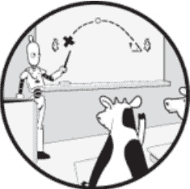

# 使用集合和字典组织值



当我们需要存储一系列值时，Python 列表非常有用，例如可动人偶的身高或文章中的单词。列表让我们可以轻松地按顺序保存值，并在给定索引时访问某个值。不过，正如我们将在本章中看到的，有些操作并不是列表所擅长的，包括判断某个特定值是否在集合中，以及在成对的值之间建立关联。

在本章中，我们将学习 Python 的集合和字典，它们是除列表之外用于存储值集合的两种选择。我们会看到，当需要查找特定值且不关心顺序时，集合可以成为首选工具；而每当需要处理成对的值时，字典可以成为首选工具。

我们将使用这些新集合解决三个问题：确定唯一电子邮件地址的数量、在单词列表中查找常见单词，以及确定特殊的城市与州配对的数量。

# 问题 18：电子邮件地址

在这个问题中，我们将存储一组电子邮件地址。我们不关心每个电子邮件地址出现的次数，也不关心这些电子邮件地址的排列顺序。这种宽松的存储要求意味着我们可以放弃列表，改用集合——一种速度让列表望尘莫及的 Python 类型。我们将全面学习集合。

这是 DMOJ 上的 ecoo19r2p1 题。

# 挑战

你知道吗，一个人的 Gmail 电子邮件地址可以有很多种写法？我们可以拿某个人的 Gmail 地址，在 @ 符号前加上一个加号（+）和一段字符串，对方依然能收到我们发送到这个新地址的邮件。也就是说，就 Gmail 地址而言，从 + 符号开始到 @ 符号之前的所有字符都会被忽略。例如，我告诉别人我的 Gmail 地址是 daniel.zingaro@gmail.com，但这只是其中一种写法。如果你向 daniel.zingaro+book@gmail.com 或 daniel.zingaro+hi.there@gmail.com 发送邮件，我也能收到。（选一个你喜欢的吧。打个招呼！）

在 Gmail 地址中，@ 符号之前的点也会被忽略。例如，如果你向 danielzingaro@gmail.com（完全没有点）、daniel..zingaro@gmail.com（连续两个点）、da.nielz.in.gar.o..@gmail.com（乱七八糟的点）、daniel.zin.garo+blah@gmail.com 等地址发送邮件，我都能收到。

最后一点：整个地址中大写和小写的区别都会被忽略。我希望到此时你还没有朝我狂发邮件，但无论你发送到 Daniel.Zingaro@gmail.com、DAnIELZIngARO+Flurry@gmAIL.COM 还是其他类似地址，我都会收到。

在这个问题中，我们会得到一些电子邮件地址，需要判断其中有多少个是唯一的。本题中电子邮件地址的规则与前面讨论的 Gmail 规则相同：从 + 符号到 @ 符号之前的所有字符都会被忽略，@ 符号之前的点会被忽略，整个地址的大小写也会被忽略。

# 输入

输入包含 10 个测试用例。每个测试用例包含以下行：

- - 一行，包含整数 n，即电子邮件地址的数量。n 在 1 到 100,000 之间。
- *n* 行，每行给出一个电子邮件地址。每个电子邮件地址在 @ 符号前至少包含一个字符，后跟 @ 符号本身，再后跟 @ 符号后的至少一个字符。@ 符号前的字符由字母、数字、点和加号组成。@ 符号后的字符由字母、数字和点组成。

# *输出*

对于每个测试用例，输出唯一电子邮件地址的数量。

解决这些测试用例的时间限制为 30 秒。

# 使用列表

你已经读完了本书的七章。在每一章中，我都提出了一个问题，然后教你新的 Python 特性，让你能够解决那个问题。因此，你可能会期望我在解决“电子邮件地址”问题之前先教一些新的 Python 内容。

你可能会反对：我们不是已经拥有所需的一切了吗？毕竟，我们可以编写一个函数，接收一个电子邮件地址并返回一个干净版本：没有 + 后面的内容，没有 @ 符号之前的点，并且全部小写。我们还可以维护一个干净电子邮件地址的列表。每看到一个电子邮件地址，就清理它，并检查它是否已在干净地址列表中。如果不在，就添加它；如果在，就什么也不做（因为它已经被计数了）。处理完所有电子邮件地址后，列表的长度就是我们得到的唯一电子邮件地址的数量。

是的，我们可能已经拥有了所需的一切。那就让我们试着解决这个问题吧。

# *清理电子邮件地址*

考虑电子邮件地址 *DAnIELZIngARO+Flurry@gmAIL.COM*。我们将清理这个电子邮件地址，使其变成 *danielzingaro@gmail.com*。没有 +Flurry，没有 @ 符号之前的点，且全部小写。我们可以把清理后的版本看作真正的电子邮件地址。任何表示同一个真正电子邮件地址的其他地址，在清理后也会与 *danielzingaro@gmail.com* 匹配。

清理电子邮件地址是一个小而独立的任务，所以我们为它编写一个函数。这个 clean 函数将接收一个表示电子邮件地址的字符串，对其清理，并返回清理后的电子邮件地址。我们将执行三个清理步骤：移除从 + 符号到 @ 符号之前的所有字符，移除 @ 符号之前的点，以及转换为小写。这个函数的代码见清单 8-1。

```
def clean(address):
    """
    address is a string email address.

    Return cleaned address.
    """
    # Remove from '+' up to but not including '@'
    plus_index = address.find('+')
    if plus_index != -1:
        at_index = address.find('@')
        address = address[:plus_index] + address[at_index:]

    # Remove dots before @ symbol
    at_index = address.find('@')
    before_at = ""
    i = 0
    while i < at_index:
        if address[i] != '.':
            before_at = before_at + address[i]
        i = i + 1

    cleaned = before_at + address[at_index:]

    # Convert to lowercase
    cleaned = cleaned.lower()

    return cleaned
```

*清单 8-1：清理一个电子邮件地址*

第一步是移除从 + 符号到 @ 符号之前的所有字符。字符串的 find 方法在这里很有用。它返回参数最左侧出现位置的索引；如果找不到该参数，则返回 -1：

```
>>> 'abc+def'.find('+')
3
>>> 'abcdef'.find('+')
-1
```

我用 find 来确定最左侧 + 符号的索引 ①。如果根本没有 + 符号，那么这一步就无需做任何事情。但如果有一个，我们就找到 @ 符号的索引 ②，并移除从 + 符号开始到 @ 符号之前（不包括 @ 符号）的字符。

第二步是移除 @ 符号之前的任何点。为此，我使用一个新字符串 before_at 来累积 @ 符号之前的那部分地址。@ 符号之前每个不是 . 的字符都会被添加到 before_at ③。

before_at 字符串不包含 @ 符号及其后的任何字符。我们不想丢失电子邮件地址的那一部分，所以我使用一个新变量 cleaned 来引用整个电子邮件地址 ④。

第三步是将整个电子邮件地址转换为小写 ⑤。之后，电子邮件地址就干净了，所以我们可以将其返回。

让我们稍微测试一下。在 Python shell 中输入我们的 clean 函数代码。下面是这个函数清理几个电子邮件地址的示例：

```
>>> clean('daniel.zingaro+book@gmail.com')
'danielzingaro@gmail.com'
>>> clean('da.nielz.in.gar.o..@gmail.com')
'danielzingaro@gmail.com'
>>> clean('DAnIELZIngARO+Flurry@gmAIL.COM')
'danielzingaro@gmail.com'
>>> clean('a.b.c@d.e.f')
'abc@d.e.f'
```

如果电子邮件地址本来就是干净的，clean 会原样返回它：

```
>>> clean('danielzingaro@gmail.com')
'danielzingaro@gmail.com'
```

# 主程序

我们可以使用 clean 函数清理任意电子邮件地址。现在的策略是维护一个干净电子邮件地址的列表。只有当一个清理后的电子邮件地址尚未被添加时，我们才把它加入列表。这样，我们就可以避免添加同一个干净电子邮件地址的重复项。

我们程序的主体部分在清单 8-2 中。请务必在运行这段代码之前输入我们的 clean 函数（清单 8-1），这样才能构成该问题的完整解答。


## 主程序

```python
for dataset in range(10):
    n = int(input())
    # ①
    addresses = []
    for i in range(n):
        address = input()
        address = clean(address)
        # ②
        if address not in addresses:
            addresses.append(address)

    # ③
    print(len(addresses))
```

### 清单8-2：主程序，使用列表

我们有10个测试用例要处理，因此我们用循环10次的range for循环包围程序的其他部分。

对于每个测试用例，我们读取电子邮件地址的数量，并以一个空的干净电子邮件地址列表开始 ①。

然后我们使用内层range for循环遍历每个电子邮件地址。我们读取每个电子邮件地址并清理它。然后，如果之前没有见过这个干净的电子邮件地址 ②，我们将其添加到干净电子邮件地址列表中。

当内层循环结束时，我们就已经构建了一个包含所有干净电子邮件地址的列表。该列表中没有重复项。唯一电子邮件地址的数量就是这个列表的长度，所以这就是我们输出的内容 ③。

不错吧，嗯？几乎让人觉得我们在第6章学完函数后就能解决这个问题。或者，实际上，在第5章学完列表后就可以。

几乎，但不完全。因为如果你提交给评测系统，你应该会注意到事情并不按计划进行。

麻烦的第一个迹象是评测系统需要一段时间才能显示我们的结果。例如，我刚才等了一分钟才看到结果。相比之下，我们之前解决的其它问题，很快就能收到反馈。

麻烦的第二个迹象是，当我们的结果最终显示出来时，我们并没有因为这个问题获得满分！我得到了5分中的3.25分。你可能得到的会多一点或少一点，但你不应该得到完整的5分。

这在我的手提电脑上大约需要12秒。
时间又翻了一倍。试着在长度为50000的列表上运行。你要等一会儿。我刚在我的手提电脑上运行了：

```python
>>> search(list(range(1, 50001)), 50000)
```

花了30多秒。记住，我们的搜索函数正在列表中搜索50000次。所以，在长度为50000的列表上总共搜索50000次需要30秒。

我们可能有一个测试用例需要如此多的搜索。例如，假设我们向列表中添加100000个唯一的电子邮件地址，一次一个。到中途，我们将有一个包含50000个值的列表；从那时起，剩下的50000次 `in` 操作都将在至少包含50000个值的列表上进行。

而这只是10个测试用例中的一个！我们需要在总共30秒内完成所有10个测试用例。如果一个测试用例本身就要花费大约30秒，那我们毫无机会。

搜索列表太慢了。Python列表是错误的使用类型。我们需要一种更适合这项工作的类型。我们需要一个Python集合。你不会相信搜索集合有多快。

## 集合

*集合*（set）是一种Python类型，它存储一组值，其中不允许有重复值。我们使用左右花括号来界定集合。

与列表不同，集合可能不按照你指定的顺序维护值。这是一个整数集合：

```python
>>> {13, 15, 30, 45, 61}
{45, 13, 15, 61, 30}
```

注意，Python打乱了值的顺序。在你的电脑上，你可能会看到不同顺序的值。重点是，你不能依赖值的任何特定顺序。如果顺序对你很重要，那么集合不是应该使用的类型。

如果我们尝试包含一个值的多个出现，只保留一个出现：

你可以使用`len`函数来确定集合中的值的数量：

```python
>>> len({2, 4, 6, 8})
4
```

你也可以遍历集合中的值：

```python
>>> for value in {2, 4, 6, 8}:
...     print('I found', value)
...
I found 8
I found 2
I found 4
I found 6
```

但是，你不能对集合进行索引或切片。集合中的值没有索引。

要创建一个空集合，你可能会期望使用一对空花括号{}。由于Python语法的不一致，这行不通：

```python
>>> type({2, 4, 6, 8})
<class 'set'>
>>> {}
{}
>>> type({})
<class 'dict'>
```

使用{}得到的是错误的类型：一个dict（字典）而不是集合。我们将在本章后面讨论字典。

要创建一个空集合，我们使用`set()`，像这样：

```python
>>> set()
set()
>>> type(set())
<class 'set'>
```

### 集合方法

集合是可变的，所以我们可以添加和删除值。我们可以使用方法来完成这些任务。

你可以使用`dir(set())`获得集合方法的列表。你可以使用`help`获取关于某个特定集合方法的帮助，就像我们使用help来了解字符串或列表方法一样。例如，要了解add方法，请键入`help(set().add)`。

add方法是我们用来向集合添加值的方法。它类似于列表上的append：

```python
>>> s = set()
>>> s
set()
>>> s.add(2)
>>> s
{2}
>>> s.add(4)
>>> s
{2, 4}
>>> s.add(6)
>>> s
{2, 4, 6}
>>> s.add(8)
>>> s
{8, 2, 4, 6}
>>> s.add(8)
>>> s
{8, 2, 4, 6}
```

要删除一个值，我们使用remove方法：

```python
>>> s.remove(4)
>>> s
{8, 2, 6}
>>> s.remove(8)
>>> s
{2, 6}
>>> s = {2, 6}
>>> s.remove(8)
Traceback (most recent call last):
  File "<stdin>", line 1, in <module>
KeyError: 8
```

## 概念检查

使用help了解集合的update和intersection方法。

在以下代码中，print调用的输出是什么？

```python
s1 = {1, 3, 5, 7, 9}
s2 = {1, 2, 4, 6, 8, 10}
s3 = {1, 4, 9, 16, 25}
s1.update(s2)
s1.intersection(s3)
print(s1)
```

- A. {1, 2, 3, 4, 5, 6, 7, 8, 9, 10}
- B. {1, 1, 2, 3, 4, 5, 6, 7, 8, 9, 10}
- C. {1, 4, 9}
- D. {1, 4, 9, 16, 25}
- E. {1}

答案：A。update方法将s2中所有s1缺少的值添加到s1中。在调用update之后，s1是集合{1, 2, 3, 4, 5, 6, 7, 8, 9, 10}。

现在来看intersection的调用。两个集合的交集是包含两个集合中共同值的集合。这里，s1和s3的交集是{1, 4, 9}。但是，intersection方法不会修改集合；相反，它会产生一个新集合！因此，它对s1没有影响。

### 搜索集合的效率

回到解决电子邮件地址问题。

我们关心干净电子邮件地址的顺序吗？不！我们只关心电子邮件地址是否已经存在。

在我们的干净电子邮件地址中，我们需要允许重复吗？也不需要！事实上，我们想要明确避免存储重复的电子邮件地址。

顺序无关紧要，并且不允许重复。这两个要素表明集合可能是正确的类型。

我们尝试使用列表但失败了，因为搜索列表太慢。集合将是我们的一项改进，因为搜索集合比搜索列表更快。

我们已经使用清单8-3中的search函数来搜索列表。但该函数并没有做任何特别需要列表的事情！它使用了`in`运算符，而`in`同时适用于列表和集合。因此，我们也可以直接使用该函数来搜索集合，无需修改。

将清单8-3中的search函数输入到Python shell中。在你的电脑上跟着做，感受搜索长列表和大集合之间的区别：

```python
>>> search(list(range(1, 50001)), 50000)
# ❶
>>> search(set(range(1, 50001)), 50000)
```

在❶处，我使用了`set`来从range中生成一个整数集合，而不是列表。

在我的手提电脑上，搜索列表大约需要30秒。相比之下，搜索集合快速如子弹，几乎瞬间完成。

集合势不可挡。不要尝试在列表上这样做，但在这里，我们开始在包含500000个值的集合中搜索某个东西：

```python
>>> search(set(range(1, 500001)), 500000)
```

轰！小菜一碟。

Python管理列表的方式允许我们在任何时候使用任何索引。Python没有灵活地打乱值的顺序：第一个值必须在索引0，第二个在索引1，依此类推。但对于集合，Python可以根据它想要的任何方式存储它，因为它不承诺为我们保持顺序。正是这种更大的自由度，使得Python能够优化集合中的搜索速度。

出于类似的原因，还有其他操作在大列表上极其缓慢，但在大集合上却极其快速。例如，从列表中删除一个值非常慢，因为Python必须减小该值右侧每个值的索引。相比之下，从集合中删除一个值非常快：没有需要更新的索引！

## 解决问题


我们已经有一个用于清理电子邮件地址的函数（第 8-1 节），并且我们将在基于集合的解决方案中使用它。至于主程序，第 8-2 节的代码已经完成了大部分工作。我们只需要使用集合而不是列表即可。

新的主程序在第 8-4 节中。为获得该问题的完整解决方案，请在此代码之前包含第 8-1 节。

```python
# Main Program

for dataset in range(10):
    n = int(input())
    addresses = set()  # ①
    for i in range(n):
        address = input()
        address = clean(address)
        addresses.add(address)  # ②

    print(len(addresses))
```

*第 8-4 节：使用集合的主程序*

请注意，我们现在使用的是电子邮件地址的集合 ① 而不是列表。清理每个电子邮件地址后，我们使用集合的 add 方法 ② 将其添加到集合中。

在第 8-2 节中，我们使用 `in` 运算符检查电子邮件地址是否已在列表中，以避免添加重复项。我们的基于集合的解决方案中没有对应的 `in` 检查。它去哪了？看起来我们是在不确保其是否已存在的情况下就将每个电子邮件地址添加到集合中。

当使用集合时，我们可以不使用 `in` 检查，因为集合永远不包含重复项。`add` 方法为我们处理了 `in` 检查，确保不会添加重复项。你可以认为 `add` 执行了自己的 `in` 检查。没有时间方面的担忧，因为搜索集合非常快。

如果你将此解决方案提交给评测系统，你应该在时间限制内轻松通过所有测试用例。

正如你在这里看到的，选择合适的 Python 类型可能意味着不满意的解决方案和满意的解决方案之间的区别。在开始编写代码之前，请问自己你将频繁执行哪些操作，以及哪种 Python 类型最适合这些操作。

在继续之前，你可能想尝试解决第 236 页“章节练习”中的练习 1 和 2。

## 问题 #19：常见单词

在这个问题中，我们需要将单词与其出现次数关联起来。这超出了集合所能做到的范围，因此我们这里不会使用集合。相反，我们将学习并使用 Python 字典。

这是 DMOJ 问题 cco99p2。

### 挑战

我们给定 m 个单词。这些单词不一定是不同的；例如，单词 brook 可能出现多次。我们还给定一个整数 k。

我们的任务是找到第 k 个最常见的单词。如果恰好有 k − 1 个不同的单词比 w 出现得更频繁，则单词 w 是第 k 个最常见的单词。根据数据集，第 k 个最常见的单词可能为零个、一个或多个。

让我们确保我们对第 k 个最常见单词的定义是清楚的。如果 k = 1，那么我们被要求找出恰好有 0 个单词出现得更频繁的单词；也就是说，我们被要求找出出现次数最多的单词。如果 k = 2，那么我们被要求找出恰好有 1 个单词出现得更频繁的单词。如果 k = 3，那么我们被要求找出恰好有两个不同的单词出现得更频繁的单词，依此类推。

### 输入

输入包含一个给出测试用例数量的行，后面是测试用例本身的行。每个测试用例包含以下行：

- 一行包含整数 m（测试用例中的单词数）和 k，用空格分隔。m 在 0 到 1,000 之间；k 至少为 1。
- m 行，每行给出一个单词。每个单词最多包含 20 个字符，且所有字符均为小写。

### 输出

对于每个测试用例，输出以下行：

- 一行包含以下内容：

现在，如果 *k* 为 2，我们该怎么办？我们可以通过再次扫描单词并计数出现次数来回答这个问题，但有一种不同的组织单词的方式会使我们的任务变得容易得多。让我们不要看单词列表，而是看每个单词与其出现次数的关联。参见表 8-1。

**表 8-1：单词和出现次数**

| Word | Number of occurrences |
|---|---:|
| cut | 4 |
| gully | 3 |
| storm | 2 |
| brook | 2 |
| magma | 1 |
| cliff | 1 |
| blast | 1 |

我已根据出现次数对单词进行了排序。查看第一行，我们可以再次确认 cut 是 *k* = 1 时要输出的单词。查看第二行，我们看到 gully 是 *k* = 2 时要输出的单词。gully 是唯一一个恰好有一个单词出现次数更多的单词。

现在对于 *k* = 3。这次有 **两个单词** 要输出，storm 和 brook，因为它们具有相同的出现次数。这两个单词恰好有两个单词出现次数更多。这表明我们有时需要输出不止一个单词。

也有可能我们需要输出零个单词！例如，考虑 *k* = 4。*没有* 单词恰好有三个单词出现次数更多。查看表格，你可能会想知道为什么我们不为 *k* = 4 输出 magma。我们不输出 magma，因为 magma 恰好有四个单词（而不是恰好三个单词）出现次数更多。

当 *k* = 5 时，我们有三个单词要输出：magma、cliff 和 blast。在继续之前，请自行验证对于任何其他 k 值都没有单词需要输出——对于 k = 6、k = 7、k = 8、k = 9、k = 100 等都没有单词。

表 8-1 在很大程度上简化了我们的问题。我们现在将学习如何在 Python 中组织此类信息。

### 字典

*字典* 是 Python 的一种类型，它存储从一组元素，称为 *键*，到另一组元素，称为 *值* 的映射。

我们使用大括号来界定字典。这些与我们用于集合的符号相同，但 Python 可以通过我们放入大括号中的内容来区分集合和字典。对于集合，我们列出值；对于字典，我们列出键值对。

这里有一个将某些字符串映射到数字的字典：

```python
>>> {'cut':4, 'gully':3}
{'cut': 4, 'gully': 3}
```

在这个字典中，键是 'cut' 和 'gully'，值是 4 和 3。键 'cut' 映射到值 4，键 'gully' 映射到值 3。

基于我们对集合的接触，你可能会想知道字典是否保持我们输入的顺序。例如，你可能会想知道是否可能发生以下情况：

```python
>>> {'cut':4, 'gully':3}
{'gully': 3, 'cut': 4}
```

从 Python 3.7 开始，答案是否定的：字典保留添加对的顺序。在 Python 的早期版本中，字典不维护此顺序，因此你可能以一种顺序添加对，但以另一种顺序取回它们。尽管如此，编写不依赖于 Python 3.7 行为的代码仍然是一个好主意，因为在可预见的未来，旧版本的 Python 可能会继续使用。

如果字典包含相同的键值对，即使我们以不同的顺序编写它们，它们也是相等的：

```python
>>> {'cut':4, 'gully':3} == {'cut':4, 'gully':3}
True
>>> {'cut':4, 'gully':3} == {'gully': 3, 'cut': 4}
True
>>> {'cut':4, 'gully':3} == {'gully': 3, 'cut': 10}
False
>>> {'cut': 4, 'gully': 3} == {'cut': 4}
False
```

字典键必须是唯一的。如果你尝试多次包含同一个键，只会保留一个涉及该键的对：

```python
>>> {'storm': 1, 'storm': 2}
{'storm': 2}
```

相比之下，重复的值是可以的：

```python
>>> {'storm': 2, 'brook': 2}
{'storm': 2, 'brook': 2}
```

键必须是不可变的值，例如数字和字符串。值可以是不可变或可变的。这意味着我们不能将列表用作键，但可以将列表用作值：

```python
>>> {['storm', 'brook']: 2}
Traceback (most recent call last):
  File "<stdin>", line 1, in <module>
TypeError: unhashable type: 'list'
>>> {2: ['storm', 'brook']}
{2: ['storm', 'brook']}
```

`len` 函数给出字典中键值对的数量：

```python
>>> len({'cut': 4, 'gully': 3})
2
>>> len({2: ['storm', 'brook']})
1
```

要创建一个空字典，我们使用 `{}`。这就是为什么我们被迫使用那糟糕的 `set()` 语法来创建集合——字典获得了漂亮的语法：

```python
>>> {}
{}
>>> type({})
<class 'dict'>
```

类型称为 `dict`，而不是 dictionary。

在 Python 资源和代码中，“dictionary”和“dict”可以互换使用，但在本书中我将坚持使用“dictionary”。


# 概念检测

以下哪项最适合使用字典而不是列表或集合？

+   A. 人们完成比赛的顺序
+   B. 食谱所需的食材
+   C. 国家名称及其首都城市
+   D. 50个随机整数

答案：C。这是唯一包含键值映射关系的选项。这里，键可以是国家名称，值可以是它们的首都城市。

# 概念检测

以下字典中值的类型是什么（忽略键）？

```
{'MLB': {'Bluejays': [1992, 1993],
'Orioles': [1966, 1970, 1983]},
'NFL': {'Patriots': ['too many']}}
```

+   A. 整数
+   B. 字符串
+   C. 列表
+   D. 字典
+   E. 以上不止一种

有时使用 `get` 方法比使用索引查找键对应的值更方便。即使键不存在，`get` 方法也永远不会产生错误：

```
>>> print(d.get('cut'))
4
>>> print(d.get('storm'))
None
```

如果键存在，get 返回其值。否则，它返回 None 表示该键不存在。

除了查找键对应的值，我们还可以使用方括号向字典中添加键或更改键映射的值。以下代码展示了如何执行这些操作，从空字典开始：

```
>>> d = {}
>>> d['gully'] = 1
>>> d
{'gully': 1}
>>> d['cut'] = 1
>>> d
{'gully': 1, 'cut': 1}
>>> d['cut'] = 4
>>> d
{'gully': 1, 'cut': 4}
>>> d['gully'] = d['gully'] + 1
>>> d
{'gully': 2, 'cut': 4}
>>> d['gully'] = d['gully'] + 1
>>> d
{'gully': 3, 'cut': 4}
```

# 概念检测

使用 help({}.get) 了解更多关于字典 get 方法的信息。

以下代码的输出是什么？

```
d = {3: 4}
d[5] = d.get(4, 8)
```

字典有一些方法，允许我们访问键、值或两者。keys 方法给我们键，values 方法给我们值：

```
>>> d.keys()
dict_keys(['cut', 'gully', 'storm', 'brook'])
>>> d.values()
dict_values([4, 3, 2, 2])
```

这些不是列表，但我们可以将它们传递给 list 进行转换：

```
>>> keys = list(d.keys())
>>> keys
['cut', 'gully', 'storm', 'brook']
>>> values = list(d.values())
>>> values
[4, 3, 2, 2]
```

有了可用列表形式的键，我们可以对键进行排序，然后按排序顺序循环遍历它们：

```
>>> keys.sort()
>>> keys
['brook', 'cut', 'gully', 'storm']
>>> for word in keys:
...     print('key', word, 'has value', d[word])
...
key brook has value 2
key cut has value 4
key gully has value 3
key storm has value 2
```

我们也可以循环遍历值：

```
>>> for num in d.values():
...     print('number', num)
...
number 4
number 3
number 2
number 2
```

循环遍历键通常比循环遍历值更受青睐。从键到其值很容易。正如我们将在下一小节中看到的，从值返回其键则不那么容易。

最后一个相关的方法是 items。它让我们同时访问键和值：

```
>>> pairs = list(d.items())
>>> pairs
[('cut', 4), ('gully', 3), ('storm', 2), ('brook', 2)]
```

这为我们提供了另一种循环遍历字典键值对的方法：

```
>>> for pair in pairs:
...   print('key', pair[0], 'has value', pair[1])
...
key cut has value 4
key gully has value 3
key storm has value 2
key brook has value 2
```

仔细看 pairs 的值：

```
>>> pairs
[('cut', 4), ('gully', 3), ('storm', 2), ('brook', 2)]
```

这里有点可疑：每个内部值周围是圆括号，而不是方括号。事实证明，这不是列表的列表，而是元组的列表：

```
>>> type(pairs[0])
<class 'tuple'>
```

元组与列表相似，都存储一系列值。元组和列表最重要的区别在于元组是不可变的。你可以循环遍历它们、索引它们、切片它们，但不能修改它们。如果尝试修改元组，会出错：

```
>>> pairs[0][0] = 'river'
Traceback (most recent call last):
  File "<stdin>", line 1, in <module>
TypeError: 'tuple' object does not support item assignment
```

你可以使用圆括号创建自己的元组。对于具有单个值的元组，需要尾随逗号。对于具有多个值的元组，则不需要：

```
>>> (4,)
(4,)
>>> (4, 5)
(4, 5)
>>> (4, 5, 6)
(4, 5, 6)
```

元组也有方法——但只有少数几个，因为会更改元组的方法是不允许的。如果你感兴趣，我鼓励你了解更多关于元组的知识，但在本书中我们不会进一步使用元组。

# 反向字典

我们离使用字典解决“常用词”问题越来越近了。这是计划。我们维护一个将单词映射到其出现次数的字典。每当我们处理一个单词时，我们检查该单词是否已在字典中。如果不在，则将其值设为 1 添加进去。如果在，则将其值增加 1。

以下是添加两个单词的示例，一个是我们见过的，一个是我们没见过的：

```
>>> d = {'storm': 1, 'cut': 1, 'magma': 1}
>>> word = 'cut' # 'cut' 已在字典中
>>> if not word in d:
...     d[word] = 1
... else:
...     d[word] = d[word] + 1
...
>>> d
{'storm': 1, 'cut': 2, 'magma': 1}
>>> word = 'brook' # 'brook' 不在字典中
>>> if not word in d:
...     d[word] = 1
... else:
...     d[word] = d[word] + 1
...
>>> d
{'storm': 1, 'cut': 2, 'magma': 1, 'brook': 1}
```

字典使得从键到值的映射变得容易。例如，给定键 'brook'，我们可以轻松地查找值 1：

```
>>> d['brook']
1
```

参考表 8-1，这就像从左列中的单词到右列中其出现次数的映射。然而，这并不能直接告诉我们具有指定出现次数的单词。我们真正需要能够做的是从右列到左列，从出现次数到单词。然后我们就能将出现次数从多到少排序，以找到我们需要的单词。

也就是说，我们需要从这种字典：

```
{'storm': 2, 'cut': 4, 'magma': 1, 'brook': 2, 'gully': 3, 'cliff': 1, 'blast': 1}
```

转换为这种，*反向字典*：

```
{2: ['storm', 'brook'], 4: ['cut'], 1: ['magma', 'cliff', 'blast'], 3: ['gully']}
```

原始字典将字符串映射到数字。反向字典将数字映射到字符串。嗯，不完全是：反向字典将数字映射到字符串的*列表*。请记住，每个键在字典中只允许出现一次。在反向字典中，我们需要将每个键映射到多个值，因此我们将所有这些值存储在一个列表中。

要反转字典，每个键变成值，每个值变成键。如果反向字典中尚不存在某个键，我们为它的值创建一个列表。如果反向字典中已存在某个键，我们则将它的值添加到列表中。

我们现在可以编写一个函数来返回字典的反向版本。代码见清单 8-5。

```
def invert_dictionary(d):
    """
    d 是一个将字符串映射到数字的字典。

    返回 d 的反向字典。
    """
    inverted = {}
    for key in d:
        num = d[key]
```

```
if not num in inverted:
    ③ inverted[num] = [key]
else:
    ④ inverted[num].append(key)
return inverted
```

清单 8-5：反转字典

我们对字典 d ① 使用 for 循环，这给我们每个键。我们对 d 进行索引以获取此键映射到的值 ②。然后我们将此键值对添加到反向字典中。如果 num 还不是反向字典中的键，我们则添加它并使其映射到 d ③ 中的关联键。如果 num 已经是反向字典中的键，则它的值已是一个列表。因此，我们可以使用 append 将 d 中的键作为另一个值添加 ④。

将我们的 invert_dictionary 函数代码输入 Python shell。让我们试一试：

```
>>> d = {'a': 1, 'b': 1, 'c': 1}
>>> invert_dictionary(d)
{1: ['a', 'b', 'c']}
>>> d = {'storm': 2, 'cut': 4, 'magma': 1, 'brook': 2,
...     'gully': 3, 'cliff': 1, 'blast': 1}
>>> invert_dictionary(d)
{2: ['storm', 'brook'], 4: ['cut'], 1: ['magma', 'cliff', 'blast'],
3: ['gully']}
```

现在我们准备使用反向字典来解决“常用词”问题。

# 解决问题

如果你想要更多自顶向下设计的练习，你可能希望在继续之前自己解决问题。为了篇幅，我在此不遵循自顶向下设计的步骤。而是，我将完整地展示解决方案，然后我们讨论每个函数及其用法。

# 代码

解决方案在清单 8-6 中。


```python
def invert_dictionary(d):
    """
    d is a dictionary mapping strings to numbers.

    Return the inverted dictionary of d.
    """
    inverted = {}
    for key in d:
        num = d[key]
        if not num in inverted:
            inverted[num] = [key]
        else:
            inverted[num].append(key)
    return inverted


def with_suffix(num):
    """
    num is an integer >= 1.

    Return a string of num with its suffix added; e.g. '5th'.
    """
    s = str(num)
    if s[-1] == '1' and s[-2:] != '11':
        return s + 'st'
    elif s[-1] == '2' and s[-2:] != '12':
        return s + 'nd'
    elif s[-1] == '3' and s[-2:] != '13':
        return s + 'rd'
    else:
        return s + 'th'


def most_common_words(num_to_words, k):
    """
    num_to_words is a dictionary mapping number of occurrences to
        lists of words.
    k is an integer >= 1.

    Return a list of the kth most-common words in num_to_words.
    """
    nums = list(num_to_words.keys())
    nums.sort(reverse=True)

    total = 0
    i = 0
    done = False
    while i < len(nums) and not done:
        num = nums[i]
        if total + len(num_to_words[num]) >= k:
            done = True
else:
    total = total + len(num_to_words[num])
    i = i + 1

if total == k - 1 and i < len(nums):
    return num_to_words[nums[i]]
else:
    return []

n = int(input())

for dataset in range(n):
    lst = input().split()
    m = int(lst[0])
    k = int(lst[1])

    word_to_num = {}

    for i in range(m):
        word = input()
        if not word in word_to_num:
            word_to_num[word] = 1
        else:
            word_to_num[word] = word_to_num[word] + 1

num_to_words = invert_dictionary(word_to_num)

ordinal = with_suffix(k)
words = most_common_words(num_to_words, k)

print(f'{ordinal} most common word(s):')
for word in words:
    print(word)

print()
```

Listing 8-6: Solving Common Words

第一个函数是 invert_dictionary。我们在本章前面的“反转字典”一节中已经讨论过它。现在，我们将遍历程序的其余每个部分。

## 添加后缀

with_suffix 函数接收一个数字，并返回添加了正确后缀的数字字符串。我们需要这个函数是因为有一个恼人的要求：输出带后缀的 k。例如，如果 k = 1，那么我们必须生成这行作为输出的一部分：

1st most common word(s):

如果 k = 2，我们必须生成这行作为输出的一部分：

2nd most common word(s):

等等。我们的 with_suffix 函数确保我们给数字添加正确的后缀。我们首先将数字转换为字符串，以便可以轻松访问其数字。然后我们使用一系列测试来确定后缀是 st、nd、rd 还是 th。例如，如果最后一位数字是 1，但最后两位数字不是 11，那么正确的后缀是 st。这给我们 1st、21st 和 31st，但不包括 11st（那是错误的）。

## 查找第 k 个最常见单词

most_common_words 函数是实际查找所需单词的函数。它接收一个反转字典（将出现次数映射到单词列表）和一个整数 k，并返回第 k 个最常见单词的列表。

为了了解它是如何工作的，让我们看看一个示例反转字典。我已将其键按照从出现次数最多到最少的顺序排列，因为 most_common_words 按此顺序遍历键。以下是该字典：

```python
{4: ['cut'],
 3: ['gully'],
 2: ['storm', 'brook'],
 1: ['magma', 'cliff', 'blast']}
```

假设 k 是 3。因此，恰好必须有两个单词比我们要返回的单词更常见。我们所需的单词不由第一个字典键提供。该键只提供一个单词（cut），所以它不能是第三个最常见的单词。同样，我们所需的单词也不由第二个字典键提供。该键多提供一个单词（gully）。我们现在总共处理了两个单词，但尚未找到第三个最常见单词。然而，我们所需的单词由第三个字典键提供。该键多提供两个单词；每个单词（storm 和 brook）恰好有两个单词的出现次数比它多，因此当 k 为 3 时，这些就是这些单词。

如果 k 是 4 呢？这一次，恰好必须有三个单词比我们要返回的单词更常见。候选单词仍然是

来自第三个键的那些单词（storm 和 brook），但只有两个单词的出现频率比这些单词中的每一个都高。因此，当 k = 4 时，没有单词。

总之，我们需要在遍历键时累加我们看到的单词数量，直到找到可能包含所需单词的键。如果恰好有 k - 1 个单词出现的频率更高，那么我们就有 k 对应的单词；否则，没有，就没有单词可输出。

现在让我们走一遍代码本身。我们首先获取字典键的列表，并将它们从最大到最小排序。然后我们按此逆排序顺序遍历键。done 变量告诉我们是否已经查看了 k 个或多个单词。一旦我们做到了，我们就退出循环。

当循环完成时，我们检查 k 是否有单词。如果恰好有 k - 1 个单词出现的频率更高，并且我们还没有超出键的末尾，那么确实有单词要返回。否则，没有单词要返回，所以我们返回空列表。

## 主程序

现在，我们来到程序的主要部分。我们构建字典 word_to_num，它将每个单词映射到其出现次数。然后我们构建反转字典 num_to_words，它将每个出现次数映射到相关的单词列表。注意这些字典的名称如何传达了映射的方向：word_to_num 从单词到数字，而 num_to_words 从数字到单词。

其余代码调用我们的其他辅助函数并输出适当的单词。

至此，你已准备好提交给评判系统。干得不错：这是你用字典解决的第一道题。每当你需要在两种类型的值之间进行映射时，请考虑你是否可以使用字典来组织信息。如果可以，你很可能正朝着高效解决方案迈进！

## 问题 #20：城市与州

这是另一道我们可以使用字典的问题。在阅读问题描述时，思考我们可以使用什么作为键，什么作为值。

这是 USACO 2016 年 12 月银牌竞赛中的问题“城市与州”（Cities and States）。

## 挑战

美国被划分为称为州的地理区域，每个州包含一个或多个城市。每个州都被赋予了一个两字符的缩写。例如，宾夕法尼亚州的缩写是 PA，南卡罗来纳州的缩写是 SC。我们将以全大写形式书写城市名称和州缩写。

考虑城市对 SCRANTON PA 和 PARKER SC。这对城市是特殊的，因为每个城市的前两个字符给出了对方城市的州缩写。也就是说，SCRANTON 的前两个字符给我们 SC（PARKER 的州），PARKER 的前两个字符给我们 PA（SCRANTON 的州）。

如果一对城市满足此属性且不在同一个州，则该城市对是特殊的。

确定所提供输入中特殊城市对的数量。

## 输入

从名为 citystate.in 的文件读取输入。

输入由以下行组成：

-   包含 n 的一行，即城市的数量。n 介于 1 到 200,000 之间。
-   n 行，每行一个城市。每行给出一个大写形式的城市名称，一个空格，以及一个大写形式的州缩写。每个城市的名称长度为 2 到 10 个字符；每个州的缩写恰好为两个字符。相同的城市名称可以存在于多个州中，但在同一个州中不会出现超过一次。此问题中的城市或州名称是满足这些要求的任意字符串；它可能不是实际美国城市或州的名字。

## 输出

将输出写入名为 citystate.out 的文件。

输出特殊城市对的数量。

解决每个测试用例的时间限制为四秒。


## 探索一个测试用例

也许你会想，用列表就能解决这个问题。有这个想法很好！如果你感兴趣，我建议在继续之前先试一试。策略是使用两个嵌套循环来考虑每对城市，并检查每对城市是否特殊。用这种方法是有可能得出正确解的。

正确解，没错，但也很慢。城市列表可能非常庞大——最多可达 200,000 个——任何涉及在列表中搜索匹配城市的方案都注定太慢。让我们探索一个测试用例，看看字典如何提供帮助。

这是我们的测试用例：

```
12
SCRANTON PA
MANISTEE MI
NASHUA NH
PARKER SC
LAFAYETTE CO
WASHOUGAL WA
MIDDLEBOROUGH MA
MADISON MI
MILFORD MA
MIDDLETON MA
COVINGTON LA
LAKEWOOD CO
```

第一个城市是 SCRANTON PA。要找到涉及该城市的特殊对，我们需要找到其他名称以 PA 开头且州为 SC 的城市。唯一符合这一描述的其他城市是 PARKER SC。

注意，我们关心的是 SCRANTON PA 的名称以 SC 开头且其州为 PA。它完全可以叫作 SCMERWIN PA 或 SCSHOCK PA 或 SCHRUTE PA；它与 PARKER SC 仍然组成一个特殊对。

我们把城市名称的前两个字符加上该城市的州称为一个“组合”。例如，SCRANTON PA 的组合是 SCPA，PARKER SC 的组合是 PASC。

现在我们可以不再寻找特殊城市对，而是查看特殊组合对。让我们试试看。

有两个城市的组合是 MAMI。它们恰好是 MANISTEE MI 和 MADISON MI，但我们只关心有两个这样的城市。MAMI 城市以 MA 开头，位于州 MI。要计算涉及 MAMI 城市的特殊对数量，我们需要知道以 MI 开头且州为 MA 的城市。也就是说，我们需要知道 MIMA 城市的数量。有三个 MIMA 城市。它们恰好是 MIDDLEBOROUGH MA、MILFORD MA 和 MIDDLETON MA，但我们只关心有三个这样的城市。好——所以我们有两个 MAMI 城市和三个 MIMA 城市。因此这些组合的特殊对总数为 2 * 3 = 6，因为对于两个 MAMI 城市中的每一个，我们都有三个 MIMA 城市可供选择。

如果你还不相信，下面是这些组合的六个特殊对：

- MANISTEE MI 和 MIDDLEBOROUGH MA
- MANISTEE MI 和 MILFORD MA
- MANISTEE MI 和 MIDDLETON MA
- MADISON MI 和 MIDDLEBOROUGH MA
- MADISON MI 和 MILFORD MA
- MADISON MI 和 MIDDLETON MA

如果我们能将组合——SCPA、PASC、MAMI、MIMA 等等——映射到出现次数，我们就可以遍历组合来找出特殊城市对的数量。字典是存储这种映射关系的完美工具。

下面是我们想为测试用例创建的字典：

```
{'SCPA': 1, 'MAMI': 2, 'NANH': 1, 'PASC': 1, 'LACO': 2,
'MIMA': 3, 'COLA': 1}
```

有了这个字典，我们就可以计算出特殊城市对的数量。让我们逐步来走一遍。

第一个键是 'SCPA'，其值为 1。要找到涉及 'SCPA' 的特殊城市对，我们需要查找 'PASC' 的值。该值也是 1。我们将两个值相乘，得到 1 * 1 = 1 个涉及这些组合的特殊城市对。我们需要对字典中的每个其他键执行同样的过程。

下一个键是 'MAMI'，其值为 2。要找到涉及 'MAMI' 的特殊城市对，我们需要查找 'MIMA' 的值。该值是 3。我们将两个值相乘，得到 2 * 3 = 6 个涉及这些组合的特殊城市对。加上之前找到的 1，现在总数是 7。

下一个键是 'NANH'，其值为 1。要找到涉及 'NANH' 的特殊城市对，我们需要查找 'NHNA' 的值。但 'NHNA' 不是字典中的键！没有涉及这些组合的特殊城市对。总数仍然是 7。

请密切关注下一个。下一个键是 'PASC'，其值为 1。要找到涉及 'PASC' 的特殊城市对，我们需要查找 'SCPA' 的值。该值也是 1。我们将两个值相乘，得到 1 * 1 = 1 个涉及这些组合的特殊城市对。但等等：我们在处理键 'SCPA' 时已经计算过这一对了。如果在这里加上 1，我们就会重复计数。事实上，通过处理每个键，我们会对每个特殊城市对都进行重复计数。不过不用担心：稍后当我们准备输出最终答案时，会做一个调整。让我们把这个 1 加进去。加上之前找到的 7，现在总数是 8。

下一个键是 'LACO'，其值为 2。'COLA' 的值是 1，得到 2 * 1 = 2 个涉及这些组合的特殊城市对。加上之前找到的 8，现在总数是 10。

还剩两个键，'MIMA' 和 'COLA'。前者使我们总数加 6；后者使我们总数加 2。加上之前找到的 10，现在总数是 18。

记住，我们对每个特殊城市对都进行了重复计数。因此，我们并没有 18 个不同的特殊城市对。我们只有 18 / 2 = 9 个特殊城市对。我们只需要除以 2 来消除重复计数。

如果你将刚才看过的字典与测试用例中的城市进行比较，你会注意到字典中少了些什么。那就是 WASHOUGAL WA 这个城市！它的组合是 WAWA，但我们的字典中没有 'WAWA' 这个键。我们没有考虑这个城市，我们需要理解为什么。

WASHOUGAL WA 的前两个字符是 WA。这意味着 WASHOUGAL WA 要成为特殊城市对的一部分，唯一的方法是找到另一个州为 WA 的城市。注意，WASHOUGAL WA 本身也在州 WA。然而，问题规定特殊城市对中的两个城市必须来自不同的州。因此，不可能找到涉及 WASHOUGAL WA 的特殊城市对。为了确保我们不会意外地统计到虚假的特殊对，我们甚至不把 WASHOUGAL WA 包含在字典中。

## 解决问题

我们准备好了！我们可以使用字典为“城市与州”问题提供一个简洁且飞快的解决方案。代码见清单 8-7。

```
input_file = open('citystate.in', 'r')
output_file = open('citystate.out', 'w')

n = int(input_file.readline())

① combo_to_num = {}

for i in range(n):
    lst = input_file.readline().split()
    ② city = lst[0][:2]
    state = lst[1]
    ③ if city != state:
        combo = city + state
        if not combo in combo_to_num:
            combo_to_num[combo] = 1
        else:
            combo_to_num[combo] = combo_to_num[combo] + 1

total = 0

④ for combo in combo_to_num:
    ⑤ other_combo = combo[2:] + combo[:2]
    if other_combo in combo_to_num:
        ⑥ total = total + combo_to_num[combo] * combo_to_num[other_combo]

⑦ output_file.write(str(total // 2) + '\n')

input_file.close()
output_file.close()
```

清单 8-7：解决“城市与州”问题

这是一个 USACO 问题，我们需要使用文件而不是标准输入和标准输出。

我们将构建的字典称为 combo_to_num ①。它将四个字符的组合（如 'SCPA'）映射到具有该组合的城市数量。

对于输入中的每个城市，我们使用变量来指代城市名称的前两个字符②及其州。然后，如果这两个值不相同③，我们就将它们组合起来，并将该组合添加到字典中。如果该组合不在字典中，就将其添加并设值为 1；如果已经存在，就将其值增加 1。

现在字典已经构建好了。我们遍历它的键④。对于每个键，我们构造另一个需要查找的组合，以找到涉及该键的特殊城市对。例如，如果键是 'SCPA'，那么我们想要的另一个组合就是 'PASC'。为此，我们取键的最右边两个字符，然后接上最左边两个字符⑤。如果该另一个组合也在字典中，我们就将这两个键的值相乘，并将乘积加到总数中⑥。

现在我们需要做的就是将特殊城市对的总数输出到输出文件中。正如上一节所解释的，我们需要将总数除以 2⑦，以消除处理字典中每个键所导致的重复计数。

就这样：这是通过恰当地部署字典来解决问题的另一个例子。尽情提交我们的代码吧！

## 小结

在本章中，我们学习了 Python 的集合和字典。集合是没有顺序且不包含重复值的值集合。字典是键:值对的集合。正如我们在本章的问题中看到的，有时这些集合比列表更合适。例如，在集合中判断某个值是否存在，与在列表上执行相同操作相比，速度快得惊人。如果我们不关心值的顺序，或者想消除重复项，就应该认真考虑使用集合。

类似地，字典使我们能够轻松地确定键映射到的值。如果我们需要维护从键到值的映射，就应该认真考虑使用字典。

有了集合和字典的加入，你现在在存储值方面有了更大的灵活性。然而，这种灵活性也意味着你需要做出选择。不要总是默认使用列表！使用某一种类型与另一种类型的差异，可能就是解决问题与否的差异。

我们已经到达了一个重要的里程碑，因为我们已经覆盖了本书将要教授的大多数 Python 知识。这并不意味着你的 Python 之旅已经结束。除了书中包含的内容之外，Python 还有更多东西需要了解。但这确实意味着，我们已经到了一个能够解决各种


problems—in competitive programming or otherwise—with our Python skills.

In the next chapter of the book, we shift gears: from learning new Python features to sharpening our problem-solving ability. We’ll focus on one particular type of problem that we can solve by searching through all candidate solutions.

## Chapter Exercises

Here are some exercises for you to try. For each, use a set or dictionary. Sometimes, a set or dictionary will help you write code that runs faster; other times, it will help you write code that’s more organized and easier to read.

- 1. DMOJ problem crci06p1, Bard
- 2. DMOJ problem dmopc19c5p1, Conspicuous Cryptic Checklist
- 3. DMOJ problem coci15c2p1, Marko
- 4. DMOJ problem ccc06s2, Attack of the CipherTexts
- 5. DMOJ problem dmopc19c3p1, Mode Finding
- 6. DMOJ problem coci14c2p2, Utrka (Try solving this one in three different ways: using a dictionary, using a set, and using lists!)
- 7. DMOJ problem coci17c2p2, ZigZag (Hint: maintain two dictionaries. The first maps each starting letter to its list of words; the second maps each starting letter to the index of its next word that will be output. That way, we can cycle through the words for each letter without having to explicitly update numbers of occurrences or modify lists.)

## Notes

Email Addresses is originally from the 2019 Educational Computing Organization of Ontario Programming Contest, Round 2. Common Words is originally from the 1999 Canadian Computing Olympiad. Cities and States is originally from the USACO 2016 December Silver Contest.

If you’d like to learn more about Python, I recommend Python Crash Course, 2nd edition by Eric Matthes (No Starch Press, 2019). When you’re ready to take it to the next level, you might like to read *Effective Python*, 2nd edition by Brett Slatkin (Addison-Wesley Professional, 2020), which offers a collection of tips to help you write better Python code.
