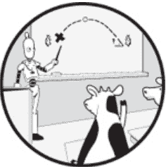

## 10

## BIG O AND PROGRAM EFFICIENCY



在这本书的前七章中，我们专注于编写正确的程序：对于任何有效输入，我们希望我们的程序产生期望的输出。除了正确代码之外，我们通常还希望代码高效，即使面对海量输入也能快速运行。你在前七章中可能偶尔收到时间限制超出的错误，但我们对程序效率的正式探索直到第 8 章才开始，当时我们解决了 Email Addresses。我们在那里看到，有时我们需要使程序更高效，以便它们能在给定的时限内完成。

在本章中，我们将首先学习程序员如何思考和交流程序效率。然后，我们将研究两个需要编写高效代码的问题：确定围巾上最受欢迎的部分以及给丝带上色。

对于每个问题，我们会看到我们的初始想法会导致一个效率不够的算法。但我们会坚持下去，直到为同一问题设计出更快的算法，其效率比之前高出数倍。这体现了程序员的常见工作流程：首先，提出一个正确的算法；然后，如果需要，再使其更快。

## The Problem with Timing

我们在这本书中解决的每个竞赛编程问题都有一个时间限制，规定我们的程序运行允许的最长时间。（我开始


## 效率与时间限制

包括在第八章的问题描述中提到的时间限制，当时我们开始遇到效率成为严重问题的编程难题。）如果我们的程序超过时间限制，裁判将因时间限制错误终止我们的程序。时间限制旨在防止过于缓慢的解决方案通过测试用例。例如，我们可能提出了一个完全搜索解决方案，但问题作者可能设计了一个快得多的解决方案。那个更快的解决方案可能是完全搜索的变体，就像我们在第九章解决牛棒球（Cow Baseball）问题时所使用的那样，或者它可能完全是另一种方法。无论如何，时间限制可能被设置为使我们的完全搜索解决方案无法按时完成。因此，除了正确性外，我们可能还需要程序足够快。

我们可以运行程序来探索它是否足够高效。例如，回想一下第八章中“搜索列表的效率”，当时我们尝试使用列表来解决电子邮件地址（Email Addresses）问题。我们运行了代码，使用越来越大的列表来了解列表操作所需的时间。这种测试可以让我们对程序的效率有一些了解。如果我们的程序太慢，根据问题的时间限制，我们知道需要优化当前代码或找到全新的方法。

程序所需的时间取决于运行它的计算机。我们不知道裁判使用的是什么类型的计算机，但在我们自己的计算机上运行程序仍然具有参考价值，因为裁判使用的计算机可能至少和我们的一样快。假设我们在笔记本电脑上运行程序，在某些小型测试用例上花费了 30 秒。如果问题的时间限制是三秒，我们可以确信我们的程序速度远远不够。

然而，仅关注时间限制是局限的。想想我们在第九章对牛棒球（Cow Baseball）问题的第一个解决方案。我们不需要运行该代码来确定它有多慢。这是因为我能够根据运行该程序时所做的工数量来描述该程序。例如，在第 253 页的“程序的效率”中，我们说对于 $n$ 头牛，我们的程序处理 $n^3$ 个牛三元组。请注意，我们这里的关注点不是程序运行所需的时间（秒数），而是程序相对于输入量 $n$ 所做的事情。

与运行程序并记录执行时间相比，这种分析具有显著优势。这里有五点：

- 执行时间不容易沟通
  对于列出的许多原因，使用执行时间来与他人讨论算法的效率是很困难的。执行时间太具体：它取决于使用的计算机、操作系统、测试用例、编程语言和特定实现。我们需要向所有关心我们算法效率的人提供这些信息。

不要担心：计算机科学家已经设计了一种记法来解决计时法的这些缺点。它独立于计算机，独立于测试用例，也独立于特定实现。它指示了为什么一个慢程序是慢的。它易于沟通。它被称为**大 O (Big O)**，它即将到来。

## 大 O

大 O 是计算机科学家用来简洁地描述算法效率的记法。这里的关键概念是**效率类 (efficiency class)**，它告诉你一个算法有多快，或者等效地，它做了多少工作。算法越快，它做的功就越少；算法越慢，它做的功就越多。每个算法都属于一个效率类；效率类告诉你该算法相对于它必须处理的输入量做了多少工作。要理解大 O，我们需要理解这些效率类。我们现在将研究七个最常见的效率类。我们将看到那些做最少工作的类，即你希望你的算法适应的那些。我们还将看到那些做多得多的工作的类，即那些可能会导致时间限制错误的算法。

### 常时

最理想的算法是那些随着输入量增加而不会做更多工作的算法。无论问题实例如何，这样的算法都取大致相同数量的步骤。这些被称为**常时**算法。

这很难相信，对吧？一个无论发生什么都做大致相同工作的算法？确实，使用这样的算法来解决问题是罕见的。但当你能够做到这一点时，请庆祝：你无法做得更好。

我们设法使用常时算法解决了本书中的几个问题。回想一下第二章的电话推销员（Telemarketers）问题，我们需要确定提供的电话号码是否属于电话推销员。我将我们的解决方案（来自列表 2-2）重新整理如下：

```python
num1 = int(input())
num2 = int(input())
num3 = int(input())
num4 = int(input())

if ((num1 == 8 or num1 == 9) and
    (num4 == 8 or num4 == 9) and
    (num2 == num3)):
    print('ignore')
else:
    print('answer')
```

无论电话号码的四个数字是什么，我们的解决方案所做的功都是相同的。代码首先读取输入。然后它对 num1、num2、num3 和 num4 进行一些比较。如果电话号码属于电话推销员，我们输出某些内容；如果不属于电话推销员，我们输出其他内容。没有任何输入能使我们的程序做比这更多的工作。

在第二章的早期，我们解决了获胜团队（Winning Team）。我们也在常时内解决了那个问题吗？是的！以下是来自列表 2-1 的解决方案：

```python
apple_three = int(input())
apple_two = int(input())
apple_one = int(input())

banana_three = int(input())
banana_two = int(input())
banana_one = int(input())

apple_total = apple_three * 3 + apple_two * 2 + apple_one
banana_total = banana_three * 3 + banana_two * 2 + banana_one

if apple_total > banana_total:
    print('A')
elif banana_total > apple_total:
    print('B')
else:
    print('T')
```

我们读取输入，计算苹果的总分，计算香蕉的总分，比较这些总分，并输出一条消息。苹果或香蕉得了多少分并不重要——我们的程序总是做相同量的工作。

等等——如果苹果得了巨量巨量的三分球？当然，计算机处理巨大数字比处理像 10 或 50 这样的小数字花的时间更长？虽然这是事实，但我们在这里不必担心。问题描述指出每个团队每种类型的进球最多得 100 分。因此，我们处理的是小数字，可以说计算机可以在恒定数量的步骤内读取或操作这些数字。一般来说，你可以将高达几十亿的数字视为“小”数字。

在大 O 记法中，我们说常时算法是 $O(1)$。1 并不意味着你在常时算法中只执行一步。如果你执行固定数量的步骤，比如 10 甚至 10,000，它仍然是常时。但不要写 $O(10)$ 或 $O(10000)$——所有常时算法都表示为 $O(1)$。

### 线性时间

大多数算法都不是常时算法。相反，它们所做的功的量取决于输入的量。例如，处理 1,000 个值所做的功比处理 10 个值多。区分这些算法彼此之间的因素是输入量与算法所做的功量之间的关系。

**线性时间**算法是输入量与所做的功量之间存在线性关系的算法。假设我们运行一个线性时间算法，输入为 50 个值，然后再次运行它，输入为 100 个值。与 50 个值相比，算法在处理 100 个值时会做大约两倍的工作。

作为一个例子，让我们看看第三章的三个杯子（Three Cups）问题。我们在列表 3-1 中解决了那个问题，我在此重新整理了我们的解决方案：

```python
swaps = input()

ball_location = 1
```


```text
① for swap_type in swaps:
    if swap_type == 'A' and ball_location == 1:
        ball_location = 2
    elif swap_type == 'A' and ball_location == 2:
        ball_location = 1
    elif swap_type == 'B' and ball_location == 2:
        ball_location = 3
    elif swap_type == 'B' and ball_location == 3:
        ball_location = 2
    elif swap_type == 'C' and ball_location == 1:
        ball_location = 3
    elif swap_type == 'C' and ball_location == 3:
        ball_location = 1

print(ball_location)
```

这里有一个 for 循环 ①，它所完成的工作量与输入量成线性关系。如果有 5 次交换要处理，那么循环就会迭代 5 次。如果有 10 次交换要处理，那么循环就会迭代 10 次。循环的每次迭代都会执行固定次数的比较，并可能改变 `ball_location` 所指向的位置。因此，该算法所完成的工作量与交换次数成正比。

我们通常用 `n` 来表示提供给问题的输入量。在这里，`n` 就是交换次数。如果我们需要执行 5 次交换，那么 `n` 就是 5；如果需要执行 10 次交换，那么 `n` 就是 10。

如果有 `n` 次交换，那么我们的程序大约完成 `n` 的工作量。这是因为 for 循环执行 `n` 次迭代，每次迭代执行固定数量的步骤。只要每次迭代执行的步骤数是常数，我们并不关心具体是多少。无论该算法总共执行 `n` 步、`10n` 步还是 `10,000n` 步，它都是一个线性时间算法。用大 O 表示法，我们说这个算法是 `O(n)`。

在使用大 O 表示法时，我们不会在 `n` 前面加上数字。例如，一个需要 `10n` 步的算法写作 `O(n)`，而不是 `O(10n)`。这有助于我们把注意力集中在该算法是线性时间这一事实上，而不是纠结于线性关系的具体细节。

如果一个算法需要 `2n + 8` 步，它属于哪一类算法？它仍然是线性时间！原因是，只要 `n` 足够大，线性项 (`2n`) 就会主导常数项 (`8`)。例如，如果 `n` 是 5,000，那么 `8n` 就是 40,000。数字 8 与 40,000 相比是如此之小，我们不妨忽略它。在大 O 表示法中，我们忽略除主导项以外的一切。

许多 Python 操作完成其工作需要常数时间。例如，向列表追加元素、向字典添加元素，或对序列或字典进行索引，都需要常数时间。

但有些 Python 操作完成其工作则需要线性时间。注意要把它们算作线性时间，而不是常数时间。例如，使用 Python 的 `input` 函数读取长字符串需要线性时间，因为 Python 必须读取输入行上的每一个字符。任何检查字符串中每个字符或列表中每个值的操作也同样需要线性时间。

如果一个算法读取 `n` 个值，并以固定步数处理每个值，那么它就是一个线性时间算法。

我们无需走远就能看到另一个线性时间算法——我们在第 3 章中对“已占用空间”（Occupied Spaces）问题的解法就是另一个这样的例子。我把代码清单 3-3 中的解法复制到这里：

```text
n = int(input())
yesterday = input()
today = input()

occupied = 0

for i in range(len(yesterday)):
    if yesterday[i] == 'C' and today[i] == 'C':
        occupied = occupied + 1

print(occupied)
```

我们令 `n` 为停车位数量。该模式与三杯问题相同：我们读取输入，然后针对每个停车位执行固定步数的操作。

## 概念检查

在代码清单 1-1 中，我们解决了单词计数问题。下面是该解决方案的代码。

```text
line = input()
total_words = line.count(' ') + 1

print(total_words)
```

我们算法的大 O 效率是多少？

- A. O(1)
- B. O(n)

答案：B。人们很容易认为该算法是 `O(1)`。毕竟，它没有任何循环，而且看起来该算法只执行了三个步骤：读取输入、调用 `count` 来计算单词数量，以及输出单词数量。

但这个算法是 `O(n)`，其中 `n` 是输入中的字符数。`input` 函数读取输入需要线性时间，因为它必须逐个字符地读取输入。使用 `count` 方法也需要线性时间，因为它必须处理字符串中的每个字符来查找匹配项。因此，该算法在读取输入时执行线性工作，在统计单词时也执行线性工作。总体上是线性工作量。

## 概念检查

在代码清单 1-2 中，我们解决了圆锥体积问题。我把该解决方案复制到这里：

```text
PI = 3.141592653589793

radius = int(input())
height = int(input())

volume = (PI * radius ** 2 * height) / 3

print(volume)
```

我们算法的大 O 效率是多少？（回忆一下，半径和高度的最大值是 100。）

- A. O(1)
- B. O(n)

答案：A。我们在这里处理的是很小的数字，所以从输入中读取它们需要常数时间。计算体积也需要常数时间：它只是几次数学运算。因此，我们这里所做的只是几个常数时间的步骤。总体上是恒定的工作量。

## 概念检查

在代码清单 3-4 中，我们解决了数据套餐问题。我把该解决方案复制到这里：

```text
monthly_mb = int(input())
n = int(input())

excess = 0

for i in range(n):
    used = int(input())
    excess = excess + monthly_mb - used

print(excess + monthly_mb)
```

我们算法的大 O 效率是多少？

- A. O(1)
- B. O(n)

答案：B。该算法的模式与我们解决三杯问题或已占用空间问题的方法类似，只不过它将读取输入与处理输入交错进行。我们令 `n` 为每月兆字节值的数量。程序对这 `n` 个输入值中的每一个都执行固定步数的操作。因此这是一个 `O(n)` 算法。

## 二次时间

到目前为止，我们已经讨论了常数时间算法（输入量增加时工作量不会增加的算法）和线性时间算法（输入量增加时工作量线性增加的算法）。与线性时间算法一样，*二次时间*算法会随着输入量的增加而做更多的工作；例如，处理 1,000 个值比处理 10 个值的工作量更大。虽然我们可以在相对较大的输入量上使用线性时间算法，但在二次时间算法上，我们只能处理小得多的输入量。接下来我们就会看到原因。

### 典型形式

一个典型的线性时间算法如下所示：

```text
for i in range(n):
    <process input i in a constant number of steps>
```

相比之下，一个典型的二次时间算法如下所示：

```text
for i in range(n):
    for j in range(n):
        <process inputs i and j in a constant number of steps>
```

对于 *n* 个值的输入，每个算法会处理多少个值？线性时间算法处理 *n* 个值，每个 for 循环迭代处理一个。相比之下，二次时间算法在外层 for 循环的*每次迭代*中处理 *n* 个值。

在外层 for 循环的第一次迭代中，会处理 *n* 个值（内层 for 循环每次迭代处理一个）；在外层 for 循环的第二次迭代中，又会处理 *n* 个值（内层 for 循环每次迭代处理一个）；依此类推。由于外层 for 循环迭代 *n* 次，总工作量

答案：B。这里有两个嵌套循环，所以你的第一直觉可能会认为这是一个二次时间算法。不过要小心，因为外层 for 循环只迭代 10 次，与 `n` 的值无关。因此，该算法的总步数是 `10n`。这里没有 `n²`；`10n` 和 `n` 一样是线性的。所以，这是一个线性时间算法，而不是二次时间算法。我们会把它的效率写作 `O(n)`。

## 概念检查

以下算法的大 O 效率是多少？

```text
for i in range(n):
    <process input i in a constant number of steps>
for j in range(n):
    <process input j in a constant number of steps>
```

- A. O(1)
- B. O(n)
- C. O(n²)

答案：B。这里有两个循环，它们都依赖 `n`。那么这难道不是二次时间吗？

不！这两个循环是顺序执行的，不是嵌套的。第一个循环需要 `n` 步，第二个循环也需要 `n` 步，总共 `2n` 步。因此这是一个线性时间算法。

### 另一种形式

当你看到两个嵌套循环且每个循环都依赖 `n` 时，很可能你面对的是一个二次时间算法。但有可能存在一个


即使没有这种嵌套循环，也会出现**二次方时间**算法。我们可以在电子邮件地址问题的第一个解决方案，即清单 8-2 中找到这样一个例子。我在这里重现了该解决方案：

```
```python
# clean 函数未展示

for dataset in range(10):
    n = int(input())
    addresses = []
    for i in range(n):
        address = input()
        ❶ address = clean(address)
        ❷ if not address in addresses:
            addresses.append(address)

print(len(addresses))
```
```

我们将 *n* 设为我们在 10 个测试用例中看到的电子邮件地址的最大数量。外层 `for` 循环迭代 10 次；内层 `for` 循环最多迭代 *n* 次。因此，我们最多处理 10*n* 个电子邮件地址，这在 *n* 中是线性的。

清理一个电子邮件地址 ❶ 需要常数步，所以我们不必担心它。但这仍然 *不是* 一个线性时间算法，因为内层 `for` 循环的每次迭代都花费了超过常数的步数。具体来说，检查电子邮件地址是否已经在列表中 ❷ 所需的工作量与列表中已有的电子邮件地址数量成正比，因为 Python 必须搜索列表。这本身就是一个线性时间操作！所以我们在处理 10*n* 个电子邮件地址，每个都需要 *n* 的工作量，总工作量是 10*n*²，或者说是二次方时间工作量。正是这种二次方时间性能导致我们使用此代码时收到了时间限制超时的错误，促使我们改用集合而不是列表。

## 三次方时间

如果一个循环会导致线性时间，两个嵌套循环会导致二次方时间，那么三个嵌套循环会怎样？三个嵌套循环，每个都依赖于 *n*，会导致 *三次方时间* 算法。在大 O 记法中，我们说三次方时间算法是 *O(n*³*).*

如果你觉得二次方时间算法很慢，那等着看三次方时间算法有多慢吧。假设 *n* 是 1,000。我们已经知道线性时间算法将花费大约 1,000 步，而

二次方时间算法将花费大约 1,000² = 1,000,000 步。三次方时间算法将花费 1,000³ = 1,000,000,000 步。十亿步！但情况更糟。例如，如果 *n* 是 10,000，这仍然是一个小规模的输入，那么三次方时间算法将花费 1,000,000,000,000（即一万亿）步。一万亿步需要好几分钟的计算时间。不开玩笑：三次方时间算法几乎永远都不够好。

当我们试图使用三次方时间算法来解决清单 9-5 中的“牛棒球”（Cow Baseball）问题时，确实不够好。我在这里重现了该解决方案：

```
input_file = open('baseball.in', 'r')
output_file = open('baseball.out', 'w')

n = int(input_file.readline())

positions = []

for i in range(n):
    positions.append(int(input_file.readline()))

total = 0

for position1 in positions:
    for position2 in positions:
        first_two_diff = position2 - position1
        if first_two_diff > 0:
            low = position2 + first_two_diff
            high = position2 + first_two_diff * 2

            for position3 in positions:
                if position3 >= low and position3 <= high:
                    total = total + 1

output_file.write(str(total) + '\n')

input_file.close()
output_file.close()
```

你会在这段代码中看到三次方时间的明显标志：三个嵌套循环 ❶ ❷ ❸，每个循环都取决于输入量。正如你回忆的那样，该问题的时间限制是四秒，而我们可能有多达 1,000 头牛。处理十亿个三元组的三次方时间算法太慢了。

答案：D。第一个循环依赖于 m，第二个循环依赖于 n。这些循环是顺序执行的，而不是嵌套的，所以它们的工作量是相加而不是相乘。

## 对数时间

在第 255 页的“我们程序的有效性”中，我们讨论了线性搜索和二分搜索之间的区别。线性搜索通过从头到尾搜索列表来在列表中查找值。这是一个 O(n) 算法。无论列表是否排序，它都能工作。相比之下，二分搜索仅在排序过的列表上工作。但如果你有一个排序过的列表，那么二分搜索非常快速。

二分搜索通过比较我们要查找的值与列表中间的值来工作。如果列表中间的值大于我们要查找的值，我们在列表的左半部分继续搜索。如果列表中间的值小于我们要查找的值，我们在列表的右半部分继续搜索。我们不断这样做，每次忽略列表的一半，直到找到我们要找的值。

假设我们使用二分搜索在一个包含 512 个值的列表中查找一个值。需要多少步？嗯，经过一步后，我们忽略了列表的一半，所以剩下大约 512 / 2 = 256 个值。（不管我们的值是大于列表中一半的值还是小于列表中一半的值；在这两种情况下，我们都忽略列表的一半。）经过两步后，我们剩下 256 / 2 = 128 个值。经过三步后，我们剩下 128 / 2 = 64 个值。继续下去，经过四步后我们有 32 个值，经过五步后我们有 16 个值，经过六步后我们有 8 个值，经过七步后我们有 4 个值，经过八步后我们有 2 个值，经过九步后我们只有 1 个值。

九步——就这样！这比使用线性搜索花费多达 512 步要好得多。二分搜索所做的工作比线性时间算法少得多。但它是什么类型的算法？它不是常数时间：虽然它花费的步数很少，但随着输入量的增加，步数确实会稍微增加。

二分搜索是对数时间或对数时间算法的一个例子。在大 O 记法中，我们说对数时间算法是 O(log n)。

对数时间指的是数学中的对数函数。给定一个数字，该函数告诉你需要将该数字除以基数多少次才能到达 1 或更小。我们在计算机科学中通常使用的基数是 2，所以我们寻找的是将一个数字除以 2 多少次才能到达 1 或更小。例如，需要 9 次除以 2 才能将 512 降至 1。我们将此写为 $\log_2 512 = 9$。

对数函数是指数函数的逆函数，后者可能对你来说更熟悉。计算 $\log_2 512$ 的另一种方法是找到幂 $p$ 使得 $2^p = 512$。由于 $2^9 = 512$，我们确认 $\log_2 512 = 9$。

对数函数增长之慢令人震惊。例如，考虑一个包含一百万个值的列表。二分搜索需要多少步来搜索它？它需要 $\log_2 1{,}000{,}000$ 步，这只有大约 20 步。对数时间比线性时间更接近常数时间。每当你能够用对数时间算法替换线性时间算法时，这都是一个巨大的胜利。

## n log n 时间

在第 5 章中，我们解决了“村庄邻里”（Village Neighborhood）问题。我在这里重现了来自清单 5-1 的我们的解决方案：

```
```python
n = int(input())

positions = []

❶ for i in range(n):
    positions.append(int(input()))

❷ positions.sort()

left = (positions[1] - positions[0]) / 2
right = (positions[2] - positions[1]) / 2
min_size = left + right

❸ for i in range(2, n - 1):
    left = (positions[i] - positions[i - 1]) / 2
    right = (positions[i + 1] - positions[i]) / 2
    size = left + right
    if size < min_size:
        min_size = size

print(min_size)
```
```

看起来像个线性时间算法，不是吗？我是说，有一个线性时间循环来读取输入 ①，还有一个线性时间循环来找到最小尺寸 ③。那么这段代码是 O(n) 吗？

现在下结论还为时过早！原因是我们还没有考虑到我们对位置进行排序 ②。我们不能简单地忽略它；我们需要了解排序的效率。正如我们将看到的，排序比线性时间慢。因此，由于排序是这里最慢的步骤，无论排序的效率如何，它都将是整体的效率。

程序员和计算机科学家发明了许多排序算法，这些算法大致可以分为两组。第一组由花费 O(n²) 时间的算法组成。这三个最著名的排序算法是冒泡排序、选择排序和插入排序。如果你愿意，可以自行学习更多关于这些排序算法的知识，但我们在继续这里时不需要了解它们的任何内容。我们只需要记住 O(n²) 可能相当慢。例如，要对一个包含 10,000 个值的列表进行排序，O(n²) 排序算法将花费大约 10,000² = 100,000,000 步。正如我们所知，这将让任何计算机至少花费几秒钟。这相当令人失望：对 10,000 个值进行排序感觉像是计算机应该能够几乎瞬间完成的事情。

现在引入第二组排序算法。这组由仅花费 O(n log n) 时间的算法组成。这组中有两个著名的排序算法：快速排序和归并排序。同样，如果你愿意，可以自行查找它们，但这里我们不需要细节。

O(n log n) 意味着什么？不要让记法混淆你。这只是 n 乘以 log n。让我们在一个包含 10,000 个值的列表上尝试一下。在这里，我们有 10,000 * log 10,000 步，这只有大约 132,877。这是一个非常小的步数，特别是与 O(n²) 排序算法花费的 100,000,000 步相比。

现在我们可以真正关心的问题了：当我们要求 Python 对一个列表进行排序时，它使用的是什么排序算法？答案：O(n log n) 的算法！（它被称为 Timsort。如果你愿意了解更多，从归并排序开始，因为 Timsort 是增强版的归并排序。）这里没有慢速的 O(n²) 排序。一般来说，排序非常快——如此接近线性时间——以至于我们可以使用它而不会对我们的效率产生太大影响。

回到村庄邻里问题，我们现在看到它的效率不是 O(n)，而是由于排序，它是 O(n log n)。在实践中，O(n log n)


algorithm 只比 $O(n)$ 算法多做一点工作，远少于 $O(n^{2})$ 算法。如果你的目标是设计一个 $O(n)$ 算法，设计一个 $O(n \log n)$ 的算法可能已经足够好了。

## 处理函数调用

从第 6 章开始，我们编写了自己的函数来帮助我们设计更大的程序。在我们的 big O 分析中，我们需要小心地包含调用这些函数时所做的工作。

让我们重新审视第 6 章中的纸牌游戏问题。我们在列表 6-1 中解决了它，我们的解决方案的一部分涉及调用我们的 `no_high` 函数。我在这里重现了该解决方案：

```
NUM_CARDS = 52

def no_high(lst):
    """
    lst is a list of strings representing cards.

    Return True if there are no high cards in lst, False otherwise.
    """
    if 'jack' in lst:
        return False
    if 'queen' in lst:
        return False
    if 'king' in lst:
        return False
    if 'ace' in lst:
        return False
    return True

deck = [ ]

for i in range(NUM_CARDS):
    deck.append(input())

score_a = 0
score_b = 0
player = 'A'

for i in range(NUM_CARDS):
    card = deck[i]
    points = 0
    remaining = NUM_CARDS - i - 1
    if card == 'jack' and remaining >= 1 and no_high(deck[i+1:i+2]):
```

```
points = 1
elif card == 'queen' and remaining >= 2 and no_high(deck[i+1:i+3]):
    points = 2
elif card == 'king' and remaining >= 3 and no_high(deck[i+1:i+4]):
    points = 3
elif card == 'ace' and remaining >= 4 and no_high(deck[i+1:i+5]):
    points = 4

if points > 0:
    print(f'Player {player} scores {points} point(s).')

if player == 'A':
    score_a = score_a + points
    player = 'B'
else:
    score_b = score_b + points
    player = 'A'

print(f'Player A: {score_a} point(s).')
print(f'Player B: {score_b} point(s).')
```

我们将使用 *n* 来表示纸牌的数量。`no_high` 函数接受一个列表并在上面使用 in，所以我们可能会得出结论它需要 *O(n)* 时间。毕竟，in 可能需要搜索整个列表才能找到它正在寻找的内容。然而，我们只 ever 调用 `no_high` 使用常数大小的列表——最多四张牌——所以我们可以将每次调用 `no_high` 视为 *O(1)* 时间。

现在我们了解了 `no_high` 的效率，我们可以确定整个程序的 big O 效率。我们从一个读取纸牌需要 *O(n)* 时间的循环开始。然后我们进入另一个迭代 n 次的循环。每次迭代只需要常数步数，可能包括一次需要常数步数的 `no_high` 调用。因此，这个循环需要 *O(n)* 时间。程序因此由两个 *O(n)* 部分组成，所以整体是 *O(n)*。

要小心准确判断调用函数时执行的工作量。正如你刚才在 `no_high` 中看到的，这可能涉及查看函数本身以及它被调用的上下文。

### 概念检查

以下算法的 big O 效率是多少？

```
def f(lst):
    for i in range(len(lst)):
        lst[i] = lst[i] + 1

# Assume that lst refers to a list of numbers
for i in range(len(lst)):
    f(lst)
```

- A. O(1)
- B. O(n)
- C. O(n²)

答案：C。主程序中的循环迭代 n 次。每次迭代，我们调用函数 f，它本身有一个迭代 n 次的循环。

## 总结

做最少工作的算法是 O(1)，其次是 O(log n)，其次是 O(n)，其次是 O(n log n)。你是否使用这四种中的一种解决了问题？如果是，你可能已经完成了。如果不是，那么根据时间限制，你可能还有更多工作要做。

我们现在要看两个问题，其中直接的解决方案不会高效到足以在时间限制内运行。使用我们刚刚学到的关于 big O 的知识，我们甚至可以在不实现代码的情况下预测这种低效率！我们将然后研究一个更快的解决方案并实现它以在时间限制内解决该问题。

## 问题 #24：最长围巾

在这个问题中，我们将通过切割初始围巾来确定我们可以生产的最长期望围巾。阅读以下描述后暂停：你会如何解决它？你能想出多个你想调查其效率的算法吗？

这是 DMOJ 问题 dmopc20c2p2。

### 挑战

你有一条长度为 n 英尺的围巾，每英尺都有特定的颜色。

你还有 m 个亲戚。每个亲戚通过指定其围巾的第一英尺和最后一英尺的颜色来表示他们期望的围巾的样子。

你的目标是以产生其中一个亲戚的最长期望围巾的方式切割你的原始围巾。

### 输入

输入由以下行组成：

- 一行包含围巾长度整数 n 和亲戚数量整数 m，用空格分隔。n 和 m 各自介于 1 和 100,000 之间。
- 一行包含 n 个用空格分隔的整数。每个整数指定围巾从第一英尺到最后一英尺顺序的某英尺的颜色。每个整数介于 1 和 1,000,000 之间。
- m 行，每行一个亲戚，包含两个用空格分隔的整数。这些数字描述亲戚期望的围巾：第一个整数是第一英尺期望的颜色，第二个整数是最后一英尺期望的颜色。

### 输出

输出可以通过切割你的原始围巾生产的最长期望围巾的长度。

解决测试用例的时间限制为 0.4 秒。

### 探索测试用例

让我们通过处理一个小的测试用例来确保我们确切知道要求的是什么。这里就是：

```
6 3
18 4 4 2 1 2
1 2
4 2
18 4
```

例如，假设我们有这条围巾：

18 4 4 2 1 2

我们会为它存储以下信息：

| 颜色 | 最左索引 | 最右索引 |
|---|---|---|
| 1 | 4 | 4 |
| 2 | 3 | 5 |
| 4 | 1 | 2 |
| 18 | 0 | 0 |

假设一个亲戚想要一条第一英尺颜色为 1 且最后一英尺颜色为 2 的围巾。我们查找颜色 1 的最左索引，为 4，并查找颜色 2 的最右索引，为 5。然后我们计算 5 − 4 + 1 = 2，这就是该亲戚的最长期望围巾的长度。

惊人：无论围巾有多长，我们只需为每个亲戚做一次快速计算。无需一次又一次地遍历围巾。这里唯一棘手的事情是如何计算所有颜色的最左和最右索引，并且只通过一次查看围巾来做到这一点。

代码在列表 10-1 中给出。在我继续解释之前，试着弄清楚 `leftmost_index` 和 `rightmost_index` 字典是如何构造的。

```
lst = input().split()
n = int(lst[0])
m = int(lst[1])

scarf = input().split()
for i in range(n):
    scarf[i] = int(scarf[i])

leftmost_index = {}
rightmost_index = {}

for i in range(n):
    color = scarf[i]
    if not color in leftmost_index:
        leftmost_index[color] = i
        rightmost_index[color] = i
    else:
        rightmost_index[color] = i

max_length = 0

for i in range(m):
    relative = input().split()
    first = int(relative[0])
    last = int(relative[1])
    if first in leftmost_index and last in leftmost_index:
        length = rightmost_index[last] - leftmost_index[first] + 1
        if length > max_length:
            max_length = length

print(max_length)
```

列表 10-1：解决最长围巾，算法 2

该解决方案使用两个字典：一个跟踪每种颜色的最左索引，一个跟踪每种颜色的最右索引。

正如承诺的那样，我们只查看围巾的每英尺一次。以下是我们如何保持 `leftmost_index` 和 `rightmost_index` 字典为最新：

- 如果当前英尺的颜色从未见过，则当前索引既是该颜色的最左索引也是最右索引。
- 否则，当前英尺的颜色之前见过。我们不想更新该颜色的最左索引，因为当前索引在旧索引的右侧。我们确实想更新最右索引，因为我们找到了旧索引右侧的索引。

现在是回报：对于每个亲戚，我们只需从这些字典中查找最左和最右索引。期望围巾的最大长度是最后一英尺颜色的最右索引，减去第一英尺颜色的最左索引，再加一。

正如我现在要论证的，这个算法比算法 1 好得多。读取围巾需要 O(n) 时间，处理围巾的英尺也需要 O(n) 时间。到目前为止是 O(n) 时间。然后我们用常数步数处理每个亲戚，而不是像以前那样用 n 步，所以那是 O(m) 时间。在


总的来说，我们有一个 $O(m + n)$ 算法，而不是 $O(mn)$ 算法。鉴于 $m$ 和 $n$ 最多可以达到 100,000，我们只需要大约 100,000 + 100,000 = 200,000 步的操作，很容易在时限内完成。你可以将我们的代码提交给评测系统来证明这一点！

## 问题 #25：丝带涂色

这里又有一个问题，我们一开始想到的算法太慢了。不过，我们不会在那个算法上浪费太多时间，因为大 O 分析会在我们考虑实现代码之前就告诉我们所有需要知道的信息。然后我们将把时间花在设计一个更快的算法上。

这是 DMOJ 问题 dmopc17c4p1。

### 挑战

你有一条长度为 $n$ 单位的紫色丝带。第一个单位从位置 0 开始到不包括位置 1，第二个单位从位置 1 开始到不包括位置 2，依此类推。然后你进行 $q$ 次涂色，每次涂色都会将丝带的一段涂成蓝色。

你的目标是确定丝带中仍然是紫色的单位数以及现在是蓝色的单位数。

### 输入

输入由以下几行组成：

- 一行包含丝带长度的整数 $n$ 和涂色次数的整数 $q$，用空格分隔。$n$ 和 $q$ 各自介于 1 和 100,000 之间。
- $q$ 行，每行一个涂色，包含用空格分隔的两个整数。第一个整数给出涂色的起始位置；第二个整数给出涂色的结束位置。起始位置保证小于结束位置；每个整数介于 0 和 $n$ 之间。涂色从起始位置开始到不包括结束位置。例如，如果一次涂色的起始位置为 5，结束位置为 12，则该涂色将丝带从位置 5 涂到不包括位置 12。

### 输出

输出丝带中仍然是紫色的单位数，一个空格，以及现在是蓝色的单位数。

解决测试用例的时间限制为 2 秒。

### 探索一个测试用例

让我们看一个小的测试用例。这个测试用例不仅能确保我们正确理解了问题，还能突出朴素算法的危险之处。这里就是：

```
20 4
18 19
4 16
4 14
5 12
```

我们的丝带长度为 20，有四次涂色。我们的涂色会把丝带的多少部分变成蓝色？

第一次涂色将一个单位涂成蓝色，就是从位置 18 开始的那个单位。

第二次涂色将从位置 4、5、6、7 开始的丝带单位一直涂到位置 15。 这次涂色涂了 12 个单位的蓝色，总共 13 个蓝色单位。

第三次涂色将 10 个单位涂成蓝色。但这些单位都已经在第二次涂色时被涂成蓝色了！如果我们花费时间“涂”这次涂色的任何东西，那将是巨大的浪费。无论我们想出什么算法都不能陷入这种浪费时间的陷阱。

第四次涂色将 7 个单位涂成蓝色。但同样：这些单位都已经是蓝色了！

现在涂色完成，我们有 13 个蓝色单位。剩余的紫色单位为 20 − 13 = 7，所以这个测试用例的正确输出为：

```
7 13
```

### 解决问题的思路

总共。关键是，我们在处理这个涂色的单个单位之前就已经弄清楚了这一点。在继续之前，不要忘记将我们存储的最右位置更新为 16。

我们的第三次涂色与第二次类似，因为它开始于我们存储的最右位置之前。与第二次涂色不同的是，其结束位置根本没有超过我们存储的最右位置。因此，这次涂色没有增加新的蓝色单位，我们存储的最右位置仍然是 16。同样，我们在逐个遍历这次涂色的位置之前就弄清楚了这一点！

要小心第四次涂色。它*不会*增加 19 − 16 = 3 个新的蓝色单位。我们必须*不同地*处理这次涂色，因为其起始位置在我们存储的最右位置的右侧。在这种情况下，我们根本不使用存储的最右位置，而是计算 19 − 18 = 1 个新的蓝色单位，总共 13 个蓝色单位。我们还将存储的最右位置更新为 19。

唯一的问题是我们如何在 Python 代码中对涂色进行排序。我们需要按其起始位置对它们进行排序；如果多个涂色具有相同的起始位置，则我们希望按其结束位置对它们进行排序。

也就是说，我们希望将如下列表：

```
[[18, 19], [4, 16], [4, 14], [5, 12]]
```

生成如下：

```
[[4, 14], [4, 16], [5, 12], [18, 19]]
```

幸运的是，正如我们在第 6 章“任务 4：排序盒子”中所发现的，列表 sort 方法正是以这种方式工作的。当给定一个列表的列表时，sort 使用每个列表中的第一个值进行排序；当这些值相等时，列表会进一步使用第二个值进行排序。试试看：

```
>>> strokes = [[18, 19], [4, 16], [4, 14], [5, 12]]
>>> strokes.sort()
>>> strokes
[[4, 14], [4, 16], [5, 12], [18, 19]]
```

算法：检查。排序：检查。我们状态很好！在看到代码之前，我们还想知道一件事：它的大 O 效率如何？我们需要读取 *q* 个查询；这需要 *O(q)* 时间。然后我们需要对查询进行排序；这需要 *O(q log q)* 时间。最后，我们需要处理查询；这需要 O(q) 时间。其中最慢的是排序的 O(q log q) 时间，所以这就是我们整体的大 O 效率。

现在我们拥有快速解决方案所需的一切。查看列表 10-2。

```
lst = input().split()
n = int(lst[0])
q = int(lst[1])

strokes = []

for i in range(q):
    stroke = input().split()
    # ①
    strokes.append([int(stroke[0]), int(stroke[1])])

# ②
strokes.sort()

rightmost_position = 0

blue = 0

for stroke in strokes:
    stroke_start = stroke[0]
    stroke_end = stroke[1]
    # ③
    if stroke_start <= rightmost_position:
        if stroke_end > rightmost_position:
            # ④
            blue = blue + stroke_end - rightmost_position
            rightmost_position = stroke_end
    # ⑤
    else:
        # ⑥
        blue = blue + stroke_end - stroke_start
        rightmost_position = stroke_end

print(n - blue, blue)
```

列表 10-2：解决丝带涂色

我们读取每个涂色，将其作为两个值的列表附加到我们的 strokes 列表中 ①。然后我们对所有涂色进行排序 ②。

接下来我们需要从左到右处理每个涂色。驱动此处理的两个关键变量是：变量 rightmost_position 存储我们迄今为止涂色的最右位置，变量 blue 存储我们迄今为止涂成蓝色的单位数。

要处理一个涂色，我们需要知道它是在我们存储的最右位置之前还是之后开始的。让我们依次思考这两种情况。

其中一些问题相当具有挑战性。有两个原因。首先，你可能同意根据你在全书中的工作，提出任何算法都可能很困难。提出一个更快的算法可能更困难。其次，这是我们在一起时间的结束，但算法研究的开始。我希望这些问题既能帮助你欣赏你所取得的成就，也能证明如果你愿意的话，这本书之外还有更多内容。

- 1. DMOJ 问题 dmopc17c1p1，Fujo Neko（该问题谈论使用快速输入/输出。不要忽略这一点！）
- 2. DMOJ 问题 coci10c1p2，Profesor
- 3. DMOJ 问题 coci19c4p1，Pod starim krovovima（提示：为了最大化空杯子的数量，你希望把尽可能多的液体放在最大的杯子里。）
- 4. DMOJ 问题 dmopc20c1p2，Victor’s Moral Dilemma
- 5. DMOJ 问题 avocadotrees，Avocado Trees!
- 6. DMOJ 问题 coci11c5p2，Eko（提示：树的最大数量远少于最大高度数。考虑从最高到最矮的每棵树。）
- 7. DMOJ 问题 wac6p2，Cheap Christmas Lights（提示：不要尝试每秒翻一次开关——你怎么知道翻哪一个？相反，把它们存起来，并在你能关闭所有亮着的灯时一次性使用它们。）
- 8. DMOJ 问题 io98p3，Party Lamps（提示：对每个按钮来说，重要的是它被按下偶数次还是奇数次。）

## 注释

最长围巾最初来自 DMOPC ’14 三月比赛。丝带涂色最初来自 DMOPC ’20 十一月比赛。


