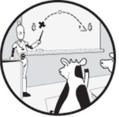

## 后记

在你开始下一步之前，我想花一点时间祝贺你到目前为止所取得的成就。有可能你在拿起这本书之前没有做过任何编程。或者你可能已经学了一点编程，想提高自己解决问题的能力。无论如何，如果你读完了这本书，并花了必要的时间刻苦练习，那么你现在就知道如何用计算机解决问题了。你学会了如何理解问题描述、设计解决方案，并用代码写出这个解决方案。你学会了 if 语句、循环、列表、函数、文件、集合、字典、完整搜索算法和大 O 分析。这些是编程的核心工具，也是你会一再使用的工具。你现在也可以称自己为 Python 程序员了！

也许你的下一步是了解更多关于 Python 的知识。如果是这样，请看第 8 章末尾的注释。

也许你的下一步是学习另一种编程语言。我个人最喜欢的是 C。与 Python 相比，它能让你更接近程序运行时计算机内部的实际运作。如果你想学 C，没有比 K. N. King 所著的 *C 语言程序设计：现代方法* 第 2 版（W. W. Norton & Company, 2008）更好的书了。我认为你目前的状态已经足够去读那本书了。你也可以考虑学习 C++、Java、Go 或 Rust 等语言，这取决于你想编写什么类型的程序（或者仅仅是因为你听说过这些语言）。

也许你的下一步是学习更多关于算法设计的知识。如果是这样，请看第 9 章末尾的注释。

也许你的下一步是休息一下。做些别的事情。解决一些可能与计算有关也可能无关的其他类型的问题。
