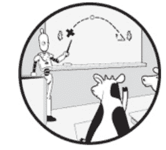

## 问题鸣谢

我感谢所有通过竞赛编程帮助人们学习的人所付出的时间和专业知识。对于本书中的每一道题，我都试图确定其作者和出处。如果你对以下任何题目有额外的信息或致谢对象，请告诉我。更新内容将发布在本书的网站上。

以下是下表中使用的缩写：

- CCC：加拿大计算机竞赛
- CCO：加拿大计算机奥林匹克
- COCI：克罗地亚信息学公开赛
- DMOPC：DMOJ 月度公开编程竞赛
- ECOO：安大略省教育计算组织编程竞赛
- Ural：乌拉尔学校编程竞赛
- USACO：美国计算机奥林匹克

| 章节 | 部分 | 原始标题 | 竞赛/作者 |
|---|---|---|---|
| 1 | 字数统计 | 不是文本墙 | 2015 DMOPC/ FatalEagle |
| 1 | 圆锥体积 | 取芯钻 | 2014 DMOPC/ FatalEagle |
| 2 | 获胜队伍 | 获胜分数 | 2019 CCC |
| 2 | 电话推销员 | 是电话推销员吗？ | 2018 CCC |
| 3 | 三个杯子 | 戏法 | 2006/2007 COCI |
| 3 | 被占用的空间 | 占用停车场 | 2018 CCC |
| 3 | 数据套餐 | 资费 | 2016/2017 COCI |
| 4 | 老虎机 | 老虎机 | 2000 CCC |
| 4 | 歌曲播放列表 | 进行随机播放 | 2008 CCC |
| 4 | 秘密句子 | 化学 | 2008/2009 COCI |
| 5 | 村庄邻里 | 沃罗诺伊村庄 | 2018 CCC |
| 5 | 学校旅行 | 大嚼早午餐 | 2017 ECOO/ Andrew Seidel Reyno Tilikaynen |
| 5 | 面包师奖金 | 面包师布里 | 2017 ECOO/ Andrew Seidel Reyno Tilikaynen |
| 6 | 纸牌游戏 | 纸牌游戏 | 1999 CCC |
| 6 | 人偶 | 打扫房间 | 2019 Ural/ Ivan Smirnov |
| 7 | 论文格式 | 文字处理器 | 2020 USACO/ Nathan Pinsker |
| 7 | 农场播种 | 大规模的植被恢复 | 2019 USACO/ Dhruv Rohatgi Brian Dean |
| 8 | 电子邮件地址 | 电子邮件 | 2019 ECOO/ Andrew Seidel Reyno Tilikaynen Tongbo Sui |
| 8 | 常见单词 | 常见单词 | 1999 CCO |
| 8 | 城市与州 | 城市与州 | 2016 USACO/ Brian Dean |
| 9 | 救生员 | 救生员 | 2018 USACO/ Brian Dean |
| 9 | 滑雪场 | 滑雪课程设计 | 2014 USACO/ Brian Dean |
| 9 | 奶牛棒球 | 奶牛棒球 | 2013 USACO/ Brian Dean |
| 10 | 最长的围巾 | 糟糕的圣诞礼物 | 2020 DMOPC / Roger Fu |
| 10 | 缎带绘画 | 缎带着色乐趣 | 2017 DMOPC / Jiayi Zhang |

CCC 和 CCO 的题目归滑铁卢大学数学与计算教育中心（CEMC）所有。
