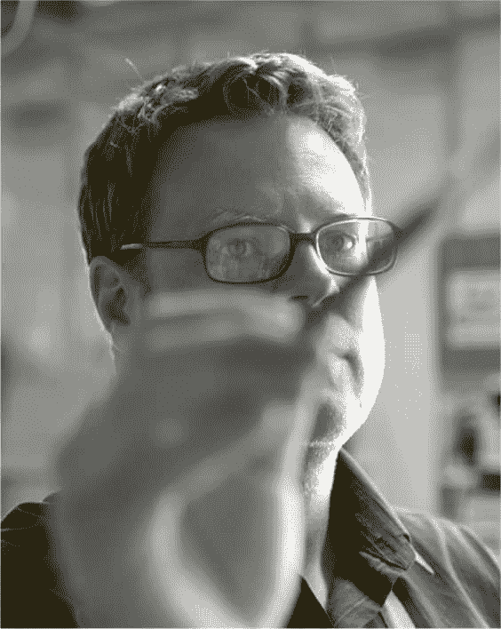
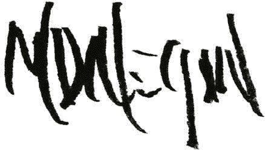
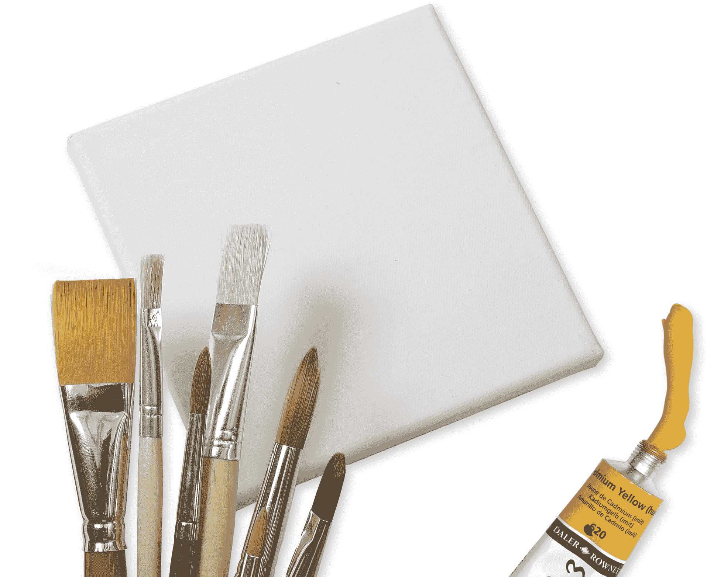

# 50幅更多小画 丙烯画入门指南：掌握技巧，涂上颜料，挂起你的艺术 (50幅小画)

## 欢迎

自我的第一本书 *用 50 幅小画学习丙烯绘画* 首次印刷以来已经过去了几年。自那时起，我几乎每天都会在电子邮件收件箱中收到读者的留言，他们称赞第一本书、批评它、寻求澄清、询问材料、庆祝在长期中断后重返绘画，并请求许可出于各种意想不到的原因使用这本书（一名读者使用这本书帮助手部手术后的患者进行康复，这让我非常高兴）。
我曾意外受邀在大学和高中艺术系讲学，我也有许久未联系的老朋友重新联系，因为他们、他们的朋友、他们的父母或他们的孩子正一幅小画一幅地学习这本书。我无法用言语形容当我看到读者在社交媒体上发布他们对我项目的诠释时所感受到的激动。
这就引出了我撰写这第二卷的目的：我觉得有很多东西想要扩展，而且坦率地说，有些需要修正。为了改进和扩展第一卷，我在这本书中建议使用有限的、价格实惠的颜色调色板。我还将画笔数量限制为四支，以减少有关颜料应用的困惑。我简化了题材，并尝试为项目的重新诠释和组合创造大量空间——例如有一只蜜蜂和一株蓟，以及相关的物品如食物和玩具。大多数项目也提供了易于进行颜色替换的空间。
没有改变的是我对小幅绘画的持续热爱。这些练习中的每一个都设计为可在一个小时内完成并立即分享（无论是在虚拟世界还是物理世界）。题材充满奇思妙想，旨在吸引儿童、父母、祖父母以及任何有兴趣踏上充满乐趣的丙烯绘画学习之旅的人。我的希望是，你能以开放的心态和渴望的精神来对待这 50 幅小画——一次一幅小画。

Mark Daniel Nelson
“伟大的事物是由一系列小事汇聚而成。” **Vincent van Gogh**

## 1
### 材料、工具和技巧
在开始这 50 幅绘画之前，探索工具和材料的选择以及考虑有关色彩和设计的[content]

## 欢迎

自我的第一本书 *用 50 幅小画学习丙烯绘画* 首次印刷以来已经过去了几年。自那时起，我几乎每天都会在电子邮件收件箱中收到读者的留言，他们称赞第一本书、批评它、寻求澄清、询问材料、庆祝在长期中断后重返绘画，并请求许可出于各种意想不到的原因使用这本书（一名读者使用这本书帮助手部手术后的患者进行康复，这让我非常高兴）。
我曾意外受邀在大学和高中艺术系讲学，我也有许久未联系的老朋友重新联系，因为他们、他们的朋友、他们的父母或他们的孩子正一幅小画一幅地学习这本书。我无法用言语形容当我看到读者在社交媒体上发布他们对我项目的诠释时所感受到的激动。
这就引出了我撰写这第二卷的目的：我觉得有很多东西想要扩展，而且坦率地说，有些需要修正。为了改进和扩展第一卷，我在这本书中建议使用有限的、价格实惠的颜色调色板。我还将画笔数量限制为四支，以减少有关颜料应用的困惑。我简化了题材，并尝试为项目的重新诠释和组合创造大量空间——例如有一只蜜蜂和一株蓟，以及相关的物品如食物和玩具。大多数项目也提供了易于进行颜色替换的空间。
没有改变的是我对小幅绘画的持续热爱。这些练习中的每一个都设计为可在一个小时内完成并立即分享（无论是在虚拟世界还是物理世界）。题材充满奇思妙想，旨在吸引儿童、父母、祖父母以及任何有兴趣踏上充满乐趣的丙烯绘画学习之旅的人。我的希望是，你能以开放的心态和渴望的精神来对待这 50 幅小画——一次一幅小画。

Mark Daniel Nelson
“伟大的事物是由一系列小事汇聚而成。” **Vincent van Gogh**

## 1
### 材料、工具和技巧
在开始这 50 幅绘画之前，探索工具和材料的选择以及考虑有关色彩和设计的[content]

## 欢迎

自我的第一本书 *用 50 幅小画学习丙烯绘画* 首次印刷以来已经过去了几年。自那时起，我几乎每天都会在电子邮件收件箱中收到读者的留言，他们称赞第一本书、批评它、寻求澄清、询问材料、庆祝在长期中断后重返绘画，并请求许可出于各种意想不到的原因使用这本书（一名读者使用这本书帮助手部手术后的患者进行康复，这让我非常高兴）。
我曾意外受邀在大学和高中艺术系讲学，我也有许久未联系的老朋友重新联系，因为他们、他们的朋友、他们的父母或他们的孩子正一幅小画一幅地学习这本书。我无法用言语形容当我看到读者在社交媒体上发布他们对我项目的诠释时所感受到的激动。
这就引出了我撰写这第二卷的目的：我觉得有很多东西想要扩展，而且坦率地说，有些需要修正。为了改进和扩展第一卷，我在这本书中建议使用有限的、价格实惠的颜色调色板。我还将画笔数量限制为四支，以减少有关颜料应用的困惑。我简化了题材，并尝试为项目的重新诠释和组合创造大量空间——例如有一只蜜蜂和一株蓟，以及相关的物品如食物和玩具。大多数项目也提供了易于进行颜色替换的空间。
没有改变的是我对小幅绘画的持续热爱。这些练习中的每一个都设计为可在一个小时内完成并立即分享（无论是在虚拟世界还是物理世界）。题材充满奇思妙想，旨在吸引儿童、父母、祖父母以及任何有兴趣踏上充满乐趣的丙烯绘画学习之旅的人。我的希望是，你能以开放的心态和渴望的精神来对待这 50 幅小画——一次一幅小画。

Mark Daniel Nelson
“伟大的事物是由一系列小事汇聚而成。” **Vincent van Gogh**

## 1
### 材料、工具和技巧
在开始这 50 幅绘画之前，探索工具和材料的选择以及考虑有关色彩和设计的[content]

## 欢迎

自我的第一本书 *用 50 幅小画学习丙烯绘画* 首次印刷以来已经过去了几年。自那时起，我几乎每天都会在电子邮件收件箱中收到读者的留言，他们称赞第一本书、批评它、寻求澄清、询问材料、庆祝在长期中断后重返绘画，并请求许可出于各种意想不到的原因使用这本书（一名读者使用这本书帮助手部手术后的患者进行康复，这让我非常高兴）。
我曾意外受邀在大学和高中艺术系讲学，我也有许久未联系的老朋友重新联系，因为他们、他们的朋友、他们的父母或他们的孩子正一幅小画一幅地学习这本书。我无法用言语形容当我看到读者在社交媒体上发布他们对我项目的诠释时所感受到的激动。
这就引出了我撰写这第二卷的目的：我觉得有很多东西想要扩展，而且坦率地说，有些需要修正。为了改进和扩展第一卷，我在这本书中建议使用有限的、价格实惠的颜色调色板。我还将画笔数量限制为四支，以减少有关颜料应用的困惑。我简化了题材，并尝试为项目的重新诠释和组合创造大量空间——例如有一只蜜蜂和一株蓟，以及相关的物品如食物和玩具。大多数项目也提供了易于进行颜色替换的空间。
没有改变的是我对小幅绘画的持续热爱。这些练习中的每一个都设计为可在一个小时内完成并立即分享（无论是在虚拟世界还是物理世界）。题材充满奇思妙想，旨在吸引儿童、父母、祖父母以及任何有兴趣踏上充满乐趣的丙烯绘画学习之旅的人。我的希望是，你能以开放的心态和渴望的精神来对待这 50 幅小画——一次一幅小画。

Mark Daniel Nelson
“伟大的事物是由一系列小事汇聚而成。” **Vincent van Gogh**

