## 1
### 材料、工具和技巧
在开始这 50 幅绘画之前，探索工具和材料的选择以及考虑色彩和设计的基本原则非常重要。本章将向你介绍丙烯颜料、画笔、绘画表面以及完成本书中所示项目的所需设备的基础知识。
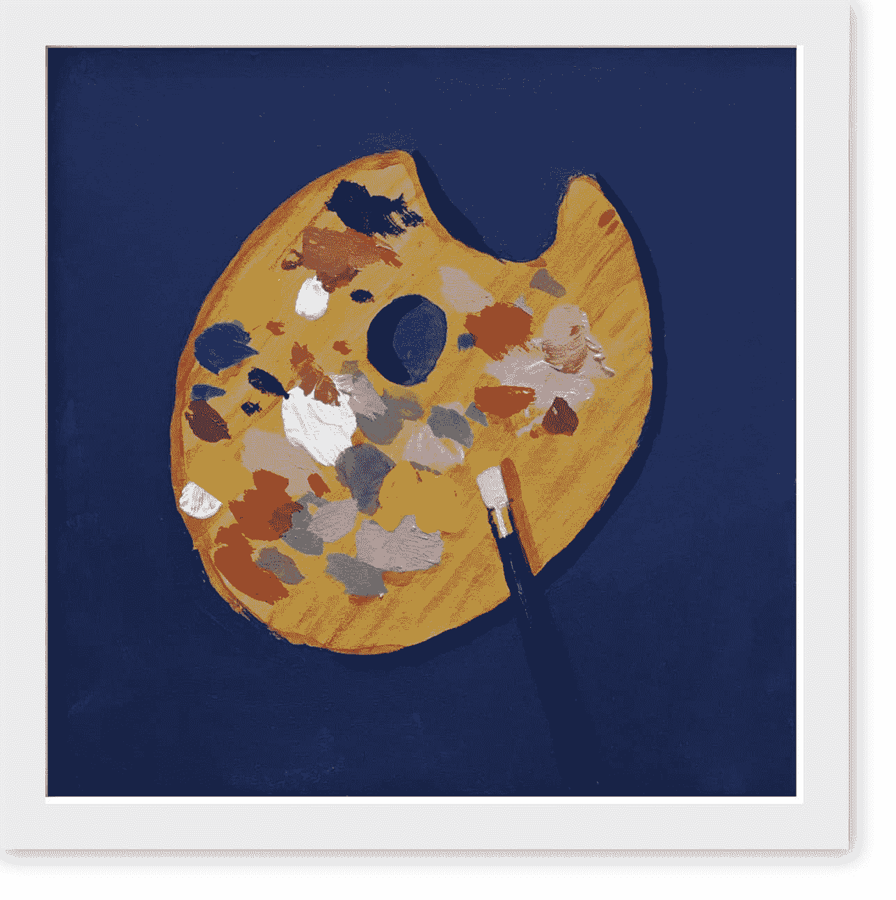
#### 丙烯颜料
丙烯颜料有无数种配方可供初学者和高级画家使用。所有丙烯颜料都由颜料（通常以粉末形式存在）和粘合剂（将颜料结合在一起）组成。
丙烯颜料中的粘合剂基于聚合物（即塑料，与用于粘合油画颜料的油相反）。不同品牌的价格和质量差异基于颜料与粘合剂在颜料中的比例。丙烯颜料相对于其他媒介的优势在于其快速干燥时间。然而，使用丙烯颜料的一个显著缺点是，丙烯粘合剂无法像油基粘合剂的颜料那样容纳那么多颜料。这导致颜料更透明，更适合分层和罩染，而不是厚重、不透明的应用。
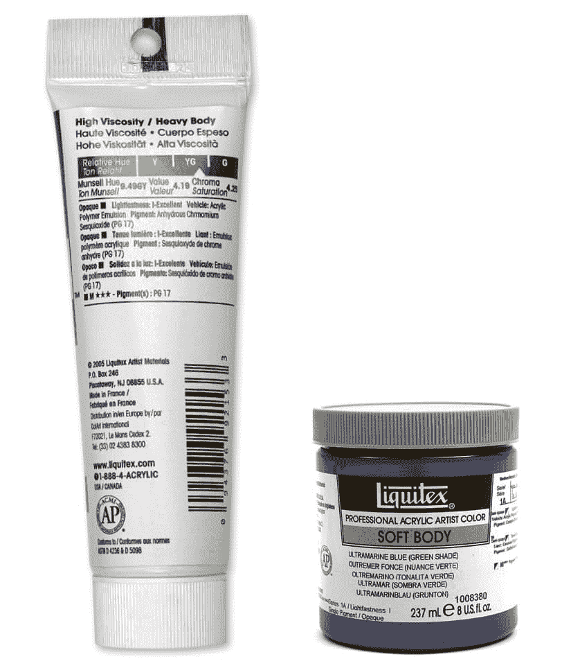
你可以以管状、罐装、瓶装、记号笔和喷罐的形式购买丙烯颜料——包装通常取决于粘度。
##### 重质与软质丙烯颜料
丙烯颜料有多种粘度可供不同艺术家的偏好和需求使用。大多数丙烯颜料品牌提供‘重质’和‘软质’（也称为‘流体’）版本的颜料。
乍一看似乎有些违反直觉，但由于配方中使用了较少的粘合剂，软质颜料略微更不透明。软质颜料用于薄涂，而重质颜料用于厚涂，例如厚涂法。
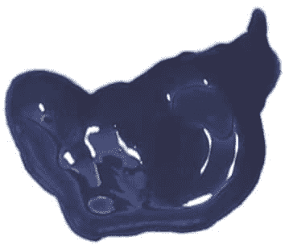
软质丙烯颜料
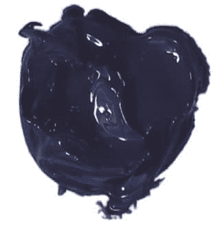
重质丙烯颜料
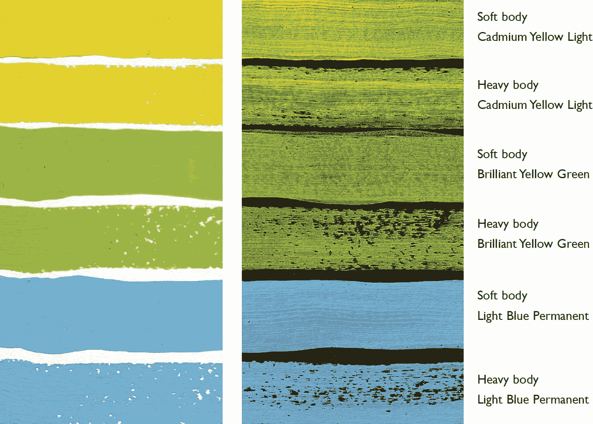

The top stripe of each colour was painted using soft body acrylics straight from the tube with no dilution. The bottom stripe of each colour was painted using heavy body acrylics with no dilution. Notice that while neither is fully opaque even at full strength, the soft body acrylics are slightly better at covering evenly.

## ‘学生’ VS ‘专业’ 颜料

学生级颜料通常更便宜，因为它们含有的颜料较少。如果您刚开始使用丙烯颜料，这些颜料可能很有用。请注意，学生级（或工艺级）颜料相当透明，您会很难在深色上绘制浅色（例如在黑色上画黄色）。更高等级的颜料更昂贵，因为它们含有更多颜料，使其明显更不透明。

学生级颜料与专业级版本之间的不透明度差异在镉黄中号和萘酚红上尤其明显。然而，在马尔斯黑、群青蓝和未漂白钛白上，这种效果就不那么明显了。

| 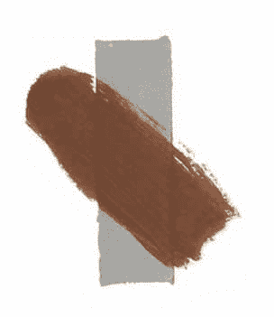  
烧赭石  
(学生) || 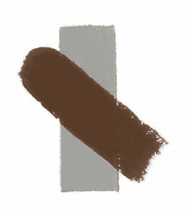  
烧赭石  
(专业) |
| --- | --- |
| 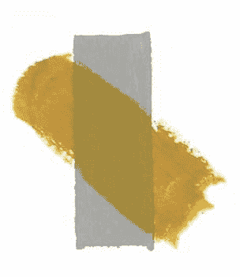  
黄赭石  
(学生) || 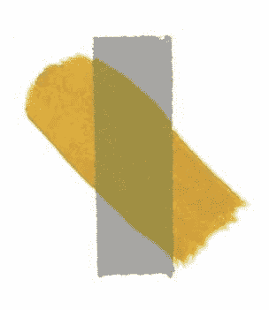  
黄赭石  
(专业) |
| 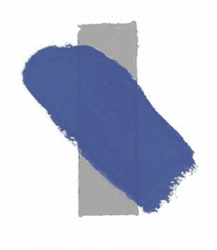  
群青蓝  
(学生) || 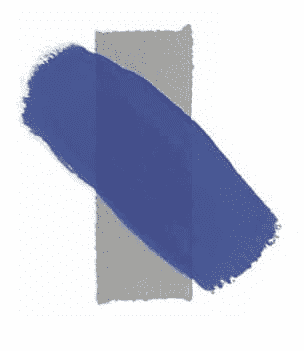  
群青蓝  
(专业) |
| 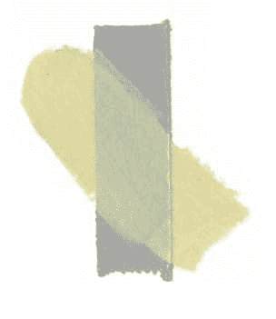  
未漂白钛白  
(学生) || 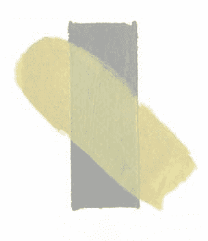  
未漂白钛白  
(专业) |
| 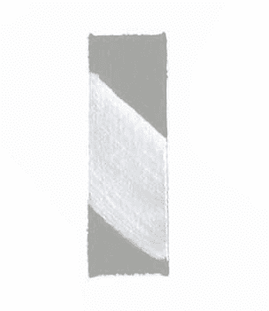  
钛白  
(学生) || 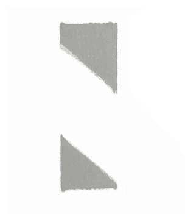  
钛白  
(专业) |
| 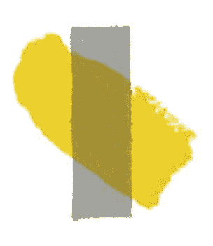  
镉黄中号  
(学生) || 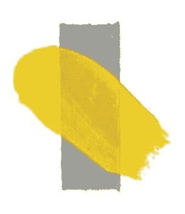  
镉黄中号  
(专业) |
| 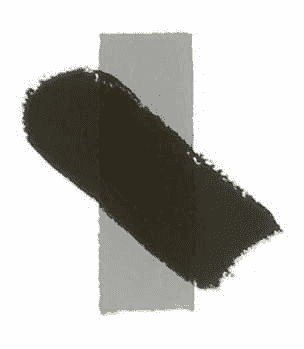  
马尔斯黑  
(学生) || 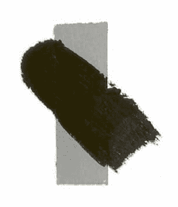  
马尔斯黑  
(专业) |
| 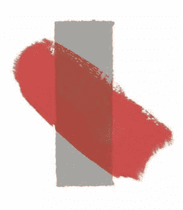  
萘酚红  
(学生) || 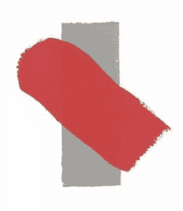  
萘酚红  
(专业) |

## 颜色调色板

如果您预算有限或刚开始使用丙烯颜料，还不准备在材料上做大量投资，请尝试这些建议的颜色组合。

本书中…

### 初学者

如果您是丙烯颜料新手，不想在第一套颜料上花费太多，请尝试此列表中颜色的学生级版本。

| 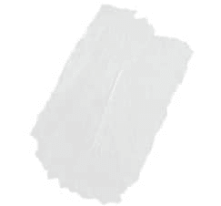  
钛白 || 萘酚红  
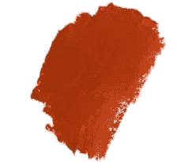 |
| --- | --- |
| 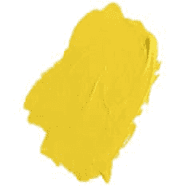  
镉黄中号 || 群青蓝  
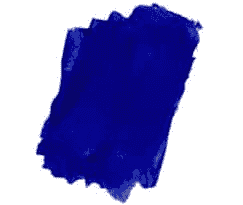 |
| 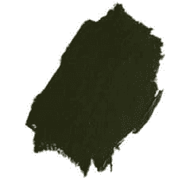  
马尔斯黑 || 未漂白钛白  
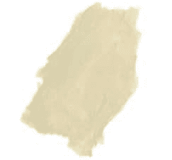 |
| 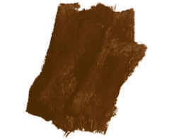  
烧赭石 || 黄赭石  
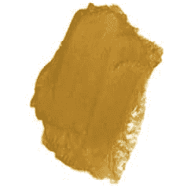 |

### 中级

如果您准备在更高等级的颜色选择上投资，请尝试这些颜色的标准版本（非学生级）。

| 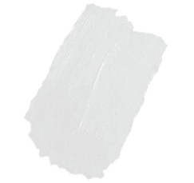  
钛白 || 萘酚红  
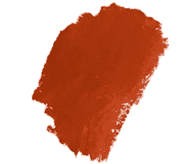 |
| --- | --- |
|   
镉黄中号 || 镉红中号 (色相)  
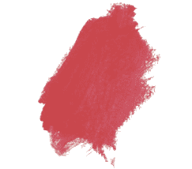 |
| 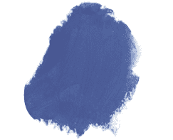  
钴蓝 (色相) || 群青蓝  
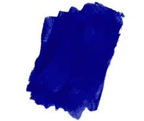 |
| 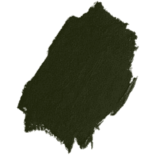  
马尔斯黑 || 未漂白钛白  
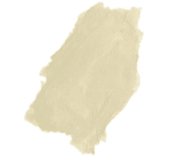 |
| 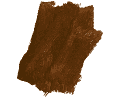  
烧赭石 || 黄赭石  
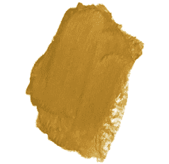 |

### 高级

对于专业级颜色选择，请添加镉色颜料的“纯”版本、几种额外的蓝色和一种紫色。

|   
钛白 || 萘酚红  
 |
| --- | --- |
| 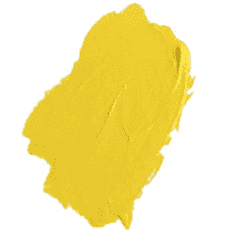  
镉黄中号 || 镉红中号  
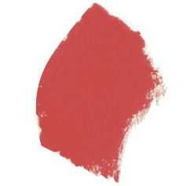 |
| 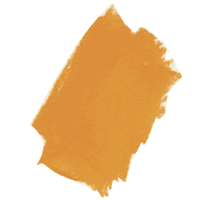  
镉橙 || 钴蓝  
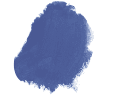 |
| 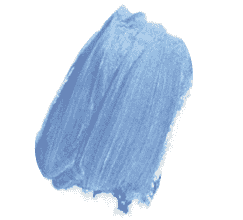  
天蓝 || 群青蓝  
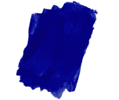 |
| 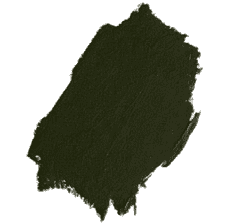  
马尔斯黑 || 未漂白钛白  
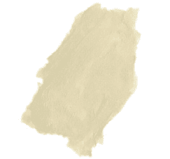 |
| 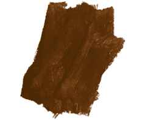  
烧赭石 || 黄赭石  
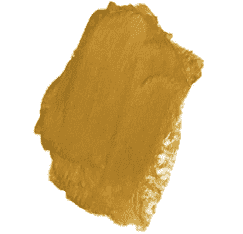 |
| 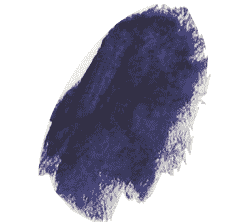  
二噁嗪紫 ||   |

## 媒介剂和添加剂

丙烯颜料可以与各种媒介剂和添加剂混合以产生不同的效果和光泽。丙烯媒介剂的市场非常庞大，可能会让新手感到不知所措。本书中的项目，我使用了缎面丙烯罩光媒介剂将颜料稀释至可用的稠度。建议您使用媒介剂而不是水来稀释颜料。这是因为丙烯颜料是悬浮在粘合剂（即媒介剂）中的颜料，因此向颜料中添加水不仅会稀释颜料，还会稀释粘合剂。这会损害颜料粘附在初始层上的能力，尤其是在干燥后。使用丙烯媒介剂稀释比用水稀释效果更好，因为它是纯粘合剂，能比水更好地粘附在之前的层上。

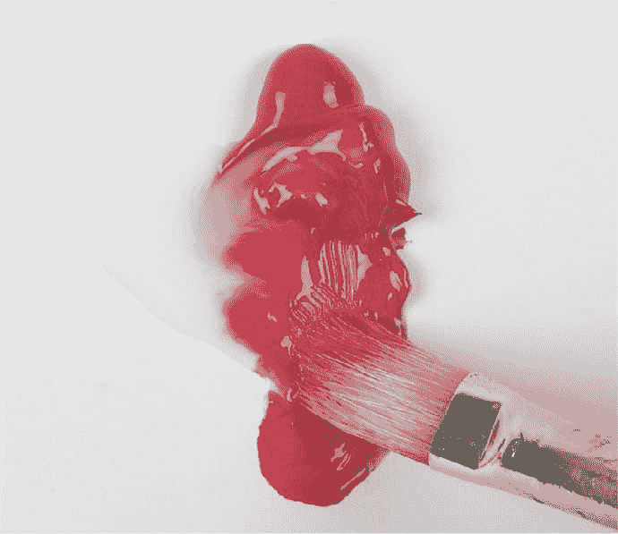

**罩光媒介剂：** 一种薄而滑的媒介剂，非常适合为颜料层罩光。这种媒介剂会大大降低颜料负载。

**增稠剂：** 凝胶媒介剂会使颜料变得非常浓稠。如果您喜欢有纹理的笔触，请尝试将凝胶媒介剂混入颜料中。

**开放媒介剂/延缓剂：** 如果您的颜料干燥速度比您舒适的速度更快，延缓媒介剂会减慢干燥时间，让您能以更慢的速度工作。

## 画笔

从艺术用品商店（或在线供应商）提供的似乎无数的选择中挑选“合适的”画笔，即使是最有经验的画家也可能感到不知所措。

本书中…

### 选择您的画笔

材料、形状、尺寸和价格的多样性可能使选择画笔变得相当困难。尽管在决定画笔时有几个客观特征需要牢记，最终您应该选择适合个人喜好的画笔。画笔在手中的感觉、画笔的重量和平衡、柄的长度甚至画笔的价格都是需要考虑的问题。

#### 硬度 vs 柔软度

感受画笔的鬃毛。如果它们很硬，画笔将更适合涂抹厚重的厚涂笔触。更柔软的画笔会吸收更多颜料，非常适合涂抹薄颜料层。

#### 天然 vs 合成鬃毛

天然（取自动物毛皮）鬃毛画笔比合成（人造）鬃毛画笔更昂贵。由于需要更频繁地清洁画笔，丙烯颜料会比其他媒介更快损坏画笔，因此更耐用的合成鬃毛通常是更好的选择。

#### 画笔尺寸

大画笔在覆盖大面积时很有用；小画笔更适合精细细节工作。好的中等尺寸画笔通常可以取代大画笔或小画笔的需求。

#### 学生级 vs 专业级

大多数艺术用品商店提供不同等级的画笔。‘学生’级画笔价格更低但也更不耐用。‘专业’级画笔在正确清洁和保养下可以使用多年。

#### 价格

最好购买少量优质画笔并好好保养，而不是购买许多低质量画笔，每种只能用几个项目。如果您刚开始绘画，廉价材料很诱人，但您最终会更频繁地更换它们，从而抵消了节省。

一个画笔卷套可以让你携带必备画笔而不损坏它们，并在外出作画时便于查看和取用。

## 画笔的正确保养

使用内部带有格栅的水罐在等待一层干燥或休息时彻底清洁画笔。丙烯颜料会在未清洁的画笔上非常迅速地干燥，画笔将无法再用于日后使用。此外，不要让画笔长时间浸泡在水中，因为这会损坏画笔形状，并可能使金属箍松脱。 当你当天完成作画后，用画笔皂清洗画笔并清除毛刷中残留的颜料。如果画笔失去了形状，涂抹大量画笔修复剂（可在美术用品店购买）并在下次作画前重新塑形画笔。

## 调色板

丙烯颜料最有用的特性之一是其能在数分钟内干燥成坚硬耐用的表面。这在大多数情况下很有帮助，但快速干燥时间也带来了一个问题——你挤在调色板上的颜料往往在你使用之前就已干掉。解决这个问题的办法之一是使用湿垫或海绵作为调色和存放颜料的表面。

我最喜欢的调色板是 Acryl-a-Miser 调色板系统。它带有许多用于盛放颜料的隔间，盖子非常容易打开和关闭。

### 选择你的调色板

调色板有多种材料、形状和尺寸可供每位艺术家选择。你可以购买专门为丙烯颜料制造的调色板，也可以简单地重复使用旧的餐盘或回收食品包装（如塑料酸奶盖）作为调色板。

小型圆形调色板

带盖和海绵的塑料调色板

调色板纸

### 临时调色板

要自制调色板，请在小型塑料容器内将 3–4 个厨房海绵放置在冰格托盘下方和两侧。倒足够的水在海绵上，使其湿润但容器底部没有积水。用你的颜色填充冰格托盘。定期用水喷洒调色板以防止颜料干燥，不使用时用盖子盖住容器。一个缺点是如果长时间封闭，海绵和颜料会发霉。用一汤匙氨水涂抹在其中一个海绵上即可解决此问题。

这种自制调色板非常便宜，只要稍加注意，颜料就能保持湿润数周甚至数月。

| 类型 || 描述 || 优点 || 缺点 |
| --- | --- | --- | --- |
| **带盖和海绵的塑料调色板** || 一个“盒中调色板”，带盖和海绵可防止颜料干燥。 || • 可长时间保持颜料湿润• 轻便• 易于清洁 || • 某些调色板的盖子难以取下• 长期购买海绵/湿垫成本可能较高 |
| --- | --- | --- | --- |
| **小型圆形调色板** || 一个塑料圆盘，设有用于存放和调色的区域。 || • 轻便• 占用空间非常小• 颜色保持干净，得益于独立的“碗” || • 调色区域非常小• 清洁可能困难 |
| **调色板纸** || 一叠涂层纸页组成的垫子。 || • 价格便宜• 清洁方便（只需丢弃用过的调色板）• 轻便• 便于携带 || • 长期使用后纸张有翘曲倾向• 无法长期保存颜色• 丢弃调色板时可能浪费部分颜料 |

## 选择表面

使用丙烯颜料时，最受欢迎的绘画表面是购买自美术用品店的预拉伸、丙烯底涂画布。然而，传统在预制画布上作画的方法也有许多替代方案。丙烯颜料制造商生产了大量用于准备玻璃、金属和布料等表面的产品。

对于本书…

就本书而言，我建议你自行准备表面。这种方法比购买大量画布便宜得多，并且允许你在不担心浪费金钱的情况下进行实验，即使某些尝试没有达到预期效果。

如果你决定自行准备绘画表面，有许多选择可用。最简单的方法是在表面上涂抹丙烯酸底胶（也有油性底胶，因此请确保标签上写着“丙烯酸底胶”）。更贵的底胶能更快覆盖表面；更便宜的底胶需要多层涂抹。

虽然可以直接在纸上作画，但你会发现如果纸张未固定在稳定表面上，会导致翘曲和起皱。如果你喜欢纸张的质感，但想要板材提供的刚性，可以使用 pH 中性胶水将纸张或画布粘贴到硬表面上。装裱纸张会使绘画表面更耐用，但也会增加重量，如果你需要在完成后运输绘画作品，这可能是一个需要考虑的问题。

**将画布或纸张装裱到面板上**

**1** 要将画布或纸张装裱到面板上，首先使用小型泡沫滚筒将 pH 中性胶水涂抹在面板整个表面上。这将使纸张或画布粘附到面板上，同时保护它们免受面板材料中可能存在的酸性物质影响。

**2** 将面板牢固地按压在预先底涂的画布或纸张上（胶水会粘在未底涂的一侧）。

**3** 用美工刀修剪画布或纸张的边缘，并在作画前静置干燥一小时。

| 表面 || 类型 || 优点 || 缺点 || 准备 |
| --- | --- | --- | --- | --- |
| **纸张** || • 帆布纸• 多媒体纸• 丙烯绘画本 || • 比画布便宜• 随处可得• 表面光滑• 易于裁剪• 便于携带 || • 不如画布耐用• 容易翘曲 || • 直接在垫子上作画• 添加底胶或其他底材 |
| --- | --- | --- | --- | --- |
| **画布** || • 预拉伸底涂画布• 粘贴在板上的画布• 未装裱画布卷• 未底涂画布卷 || • 大多数美术店均有售• 表面有纹理• 便于携带 || • 选项中最贵• 拉伸后不耐用• 难以裁剪 || • 拉伸• 添加底胶 |
| **MDF、Masonite 或木板** || • 3mm（1/8in）厚 Masonite• 6mm（1/4in）厚硬纸板• 15mm（5/8in）、20mm（3/4in）或 25mm（1in）厚 MDF• 桦木胶合板• 杨木或椴木板 || • 极其耐用• 价格便宜• 表面坚硬 || • 需要处理• 重• 难以裁剪• 遇湿可能翘曲 || • 添加底胶 |

**用丙烯酸底胶进行底涂**

要对面板进行丙烯酸底胶底涂，只需用刷子或泡沫上色垫均匀涂抹底胶即可。等待约 10 分钟后添加第二层。当表面触摸干燥时即可作画（约 15 分钟后）。

**调色画布**

在许多项目中，初始步骤涉及用一层丙烯颜料对画布/表面进行“调色”。这有助于统一后续层次的颜色和明暗，但更重要的是它起到底漆的作用，在一定程度上密封吸水表面，使后续笔触呈现清晰直接的效果。

## 转移你的绘画

如果你不习惯用画笔勾勒绘画的初始轮廓（本书几乎每个项目都使用的方法），你可能更喜欢在开始用画笔之前先将图像直接转移到画布/面板/纸上。有三种方法可以做到这一点：使用石墨、使用网格系统或使用投影仪。

| 方法 || 优点 || 缺点 |
| --- | --- | --- |

| 石墨 || • 容易操作• 精确 || • 可能损坏原图• 在纸张/板上留下轻微压痕 |
| --- | --- | --- |
| 网格系统 || • 能够在不损坏画布/板的情况下获得准确的图像 || • 耗时• 损坏原图 |
| 投影仪 || • 容易实现线条和图像在画布上放置的准确性 || • 投影设备可能很昂贵• 操作需要一定的专业知识 |

### 使用石墨

**1** 将石墨涂在铅笔素描的背面。或者，你可以从美术用品店购买石墨纸，将其夹在你的绘画和支撑物之间。

**2** 将绘画正面朝上放在支撑物上并描摹线条——石墨会转移到支撑物上，留下轮廓。

### 使用网格系统

**1** 在源图像上轻轻画一个网格，然后在支撑物上画相同数量方格的网格。

**2** 或者，如果你不想在原始草图或照片上作画，可以用黑色记号笔在一块玻璃上画网格并将其覆盖在源图像上。仔细复制每个方格，使其与原图上的相同方格相对应。

不要害怕用画笔徒手勾勒绘画的初始轮廓——这会增加成品绘画的自发性。

### 使用投影仪

使用不透明、透明或数字投影仪将你的绘画投影到画布/板/纸上并轻轻描摹线条。你可以用同样的方式复制或改编你的绘画，描摹构图的基本框架。确保你的绘画支撑物与投影呈完美的垂直 90 度角，以避免投影失真或变形。

### 颜色和明度

颜色与明度之间的关系或许是画家需要掌握的最重要（也常常最难以捉摸）的概念。简单来说，有些颜色是亮的，有些是暗的，有些介于亮和暗之间。

#### 颜色

色轮是艺术家们使用了数百年的工具，用来更好地组织绘画中使用的颜色。虽然自然界包含无限的颜色变化，但将使用的颜色范围限制在一定范围内有助于保持绘画的统一和谐。使用有限的颜色组的做法通常被称为“配色方案”。以下是几种最常见的配色方案。

##### 色轮

色轮是你在工作时挑选颜色组的实用工具。

##### 邻近互补

与互补色类似，只是没有使用完全相反的颜色，而是使用与其中一个相反色相邻的两种颜色。例如蓝色搭配红橙色和黄橙色。

##### 类似色

使用色轮上彼此相近的颜色：例如将颜色范围限制为仅包括红橙色、橙色和黄橙色。

##### 三原色

三角色配色方案利用色轮上彼此等距的三种颜色。红、蓝、黄构成“原色三角色”。绿、橙、紫构成“复色三角色”。

##### 互补色

使用色轮相对两侧的颜色：例如黄色和紫色。

##### 四色

四角色是一种较为复杂的配色方案。在其中，你从色轮一侧选择两种颜色，并将它们与另一侧的两种颜色组合，在色轮上形成正方形或矩形。例如，红色和橙色搭配绿色和蓝色。

#### 明度

如果你只用铅笔或钢笔学习绘画，那么你习惯于以明度思考：亮与暗。谈论颜色时，“明度”一词指的是颜色的相对明亮或暗淡程度。例如，黄色明度亮，紫色明度暗。比较不同颜色明度的一个实用技巧是看时眯起眼睛。如果颜色之间的边界消失了，它们具有相同的明度。识别颜色的明度在调色时至关重要，尤其是在需要简化复杂场景时。通过减少绘画中的明度数量，你会使绘画更具凝聚力和和谐感。

这些颜色很容易被识别为紫罗兰色、橙色和蓝色。

当颜色从形状中去除时，很明显橙色和蓝色的明度几乎相同。

将色相转换为黑白可以揭示它们的明度（第 4 行）。通常在中等明度底色（第 2 行）上判断不同色相的明度比在浅色（第 1 行）或暗明度底色（第 3 行）上更容易。

### 基本设计原则

创作绘画时，艺术家常常过于专注于描绘物体或场景，以至于设计连贯构图的想法从未进入他的脑海。为了做出令人愉悦、连贯的安排，在设计绘画时注意以下几个基本原则很重要。

#### 统一

为了创作连贯一致的绘画，请使用共享属性统一元素。通过使用相似的颜色、形状甚至笔触，你的绘画的各个部分将协同工作，形成统一的整体。

绘画通过温暖、柔和的中性色调（棕色、灰色、带绿调的暗色）的有限调色板以及松散的垂直笔触而得以统一。

#### 和谐

和谐与统一是非常相似的概念，区别在于你寻找的是互补（而非匹配）的元素。选择作为一组相互增强的颜色。

柠檬枝的黄色、赭色和绿色是统一的；加入紫色后，整体变得和谐。

#### 对比

如果你的目标是创作戏剧性构图，可以通过夸大明度或颜色之间的对比来实现。戏剧性明度对比使用亮对暗。鲜艳的颜色对比使用色轮相对两侧的颜色。

挂锁的暖锈橙色与门上的冷蓝色形成鲜明对比。戏剧性的阴影增加了明度对比。

#### 焦点

制作绘画时最需要考虑的事情或许是拥有“焦点”，它指的是绘画中最重要的部分。绘画的其他所有部分都安排为从属于焦点。

灯塔及其闪亮的灯光是焦点。

#### 平衡

使用令人愉悦的关系和比例来创造宁静的平衡感。构图的平衡可以是对称的（相等）或不对称的（不相等）。对称平衡意味着每一部分都与画布中心同等重要。不对称平衡涉及以较不僵硬、更富节奏的方式安排各部分。

天空占据了图像的三分之一。小麦田占绘画的三分之二。

#### 主导

运用主导原则最常见的例子之一是在选择地平线的放置位置。将其正好放置在画布中间会将绘画分成相等的两部分，这通常会产生不舒服的张力。将地平线向上移动以让陆地占据主导，或向下移动以让天空占据主导。这一原则同样适用于色彩（主导色调）、明度（主导基调）、形状（主导物体）等等。

当地平线靠近绘画底部时，云层密布的天空变得更加突出。

#### 重复
要引导观者的视线穿过绘画，只需重复相似的形状、色彩等等。由于大多数人从左到右阅读，将重复的对象放置在构图的左侧，并在向右移动时重复它会很有帮助。

悬崖的橙色贯穿始终，峡谷墙壁的阴影形状也是如此。

## 展示你的作品
随着你在本书中完成项目，你可能会注意到完成的绘画设计成成组悬挂。保持绘画尺寸一致，会产生一种内在的相似性，使绘画在展示时相互协调。花些时间探索绘画之间不寻常的关系，并将它们以有趣且出乎意料的组合进行排列。

### 装裱
如果你选择在不能不装裱就展示的表面（如纸张或未拉伸的画布）上作画，你需要考虑使用衬板或画框，或两者结合。

#### 材质
纸上绘画需要在玻璃与作品之间留出空气层。衬板提供了这一空间，同时也扩大了作品周围的空白区域。通常的做法是使底部边缘比顶部和两侧宽 1/2 英寸（12 毫米），以纠正当所有边缘相同时产生的视觉错觉。确保使用无酸板材。选择浅色、中性的色调；象牙白是经典之选。避免使用可能压倒绘画的奇异颜色。

#### 画框
如果你选择在三维表面（如拉伸画布或中密度纤维板）上完成绘画，你可能希望将其装入传统的画框中展示。大多数美术用品商店至少提供有限的款式选择，其中一些还提供定制装裱服务。一般来说，小巧简洁的绘画最适合简洁的画框。繁复且过度装饰的画框很可能会分散对绘画的注意力，而且通常价格也更高。如果你附近没有美术用品商店或专业画框店，许多在线供应商提供多种画框设计可供选择。大多数供应商在你同时订购多个画框时都会提供大幅折扣。

### 悬挂主题
以随机顺序悬挂你的绘画完全是可以接受的，你也可以根据特定主题来排列绘画。下面展示了几个建议——色彩、形状和主题。

薄衬板会让你的绘画呈现出简洁、现代的外观。

中等大小的衬板不会分散对绘画的注意力。

带偏移中心的宽大衬板会将注意力集中在你的绘画上。

#### 色彩
寻找相似的配色方案以获得统一的绘画组。你可能想排列一组黄色物体，或使用此处所示的类近的蓝色、紫色和红色配色方案。

#### 形状
寻找重复/相似的形状以形成意外的组合。寻找具有圆形形状的对称物体，或许也可以是一组方形形状。

#### 主题
按主题分组绘画。风景、鸟类、食物、玩具、美术材料、物体和植物是本书中反复出现的几个主题。

### 悬挂配置
由于绘画是以组形式呈现的，按一致的模式排列绘画会很有帮助。

将绘画装在素色画框中悬挂不会削弱作品。

#### 线性
只需将绘画悬挂在同一高度，彼此之间保持相等距离。这样做的好处是可以按顺序展示作品。让所有绘画都正确对齐可能很困难，因此在悬挂时请后退一步检查。

#### 网格
将绘画以 2 x 2、3 x 3、4 x 4 等网格形式悬挂。如果以网格形式悬挂，在小空间展示大量绘画就很容易。由于本书中的绘画相当小，使用网格可以在小空间悬挂大量作品。为钩子/钉子做好精确测量，以确保绘画在垂直和水平方向上对齐。

#### 随机
以杂乱无章、随机的排列方式悬挂绘画会使整体显得不那么正式，也许更具‘创意’。这种方式在咖啡馆或你自己的工作室等休闲环境中尤其适用。

### 悬挂方法
一旦确定了悬挂主题和配置，就有各种硬件选项可用于将装裱好的艺术品、板材或画布固定在墙上。

不装画框悬挂作品会让你的绘画呈现出更随意的风格。而且你甚至不必悬挂它们：只需将画布靠在墙上，放在地板或架子上即可。

#### 画布与钉子
一种简单的悬挂方式是将所有项目画在小号拉伸画布上，并将画框条挂在钉子上。

#### 钥匙孔
如果你在木材或中密度纤维板上作画并且拥有铣床，可以快速在板材背面切出钥匙孔。设置好机器使所有切口相同，并将其挂在等距的钉子上。

#### D 形环
如果你在中密度纤维板、木材或胶合板上工作，将 D 形环拧入板材背面并挂在钉子上。

#### 细线
安装两个 D 形环并在它们之间缠绕挂画线。挂在钉子或挂钩上。
