## 2 上色
在本章中，你将通过一系列逐步加难的项目了解丙烯绘画所需的主要技巧。你将从基本的颜料涂抹练习开始，并在每个项目中逐步添加新技能。到本章结束时，你将掌握丙烯绘画所需的 fundamentals。

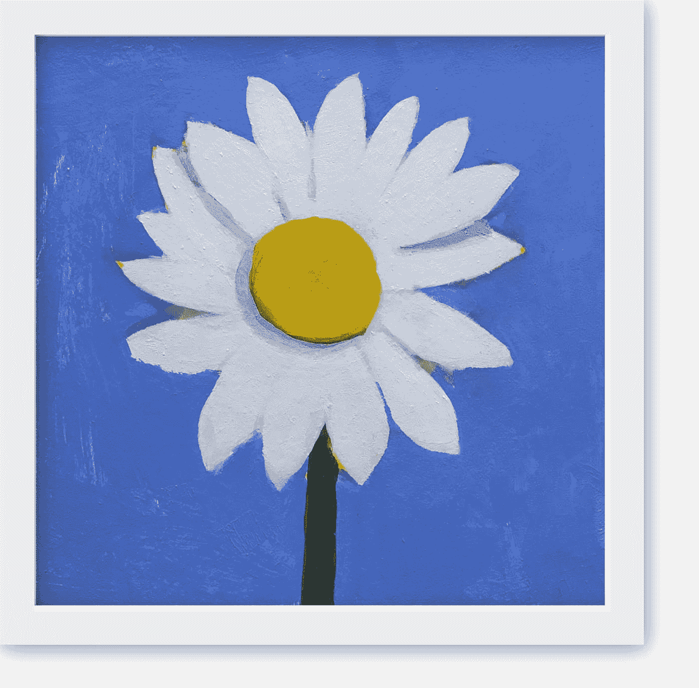

### 1 基本颜料涂抹：门
这个项目是关于熟悉颜料的触感以及干燥所需的时间。我选择了一个简单的彩色门在素色墙上的场景，因此你无需担心创造复杂的形状或颜色相互混淆。甚至没有涉及调色。使用这个项目来尝试不同的颜料与罩光介质的比例：如果想要厚实的覆盖效果，增加颜料和/或涂抹更多层；如果想要颜料看起来更薄、更透明，以便你可以看到粗糙的笔触并在绘画中创造一些质感，使用更多介质并只涂一层。改变施加在画笔上的压力大小也有助于你看到可以创造出的质感。

Materials

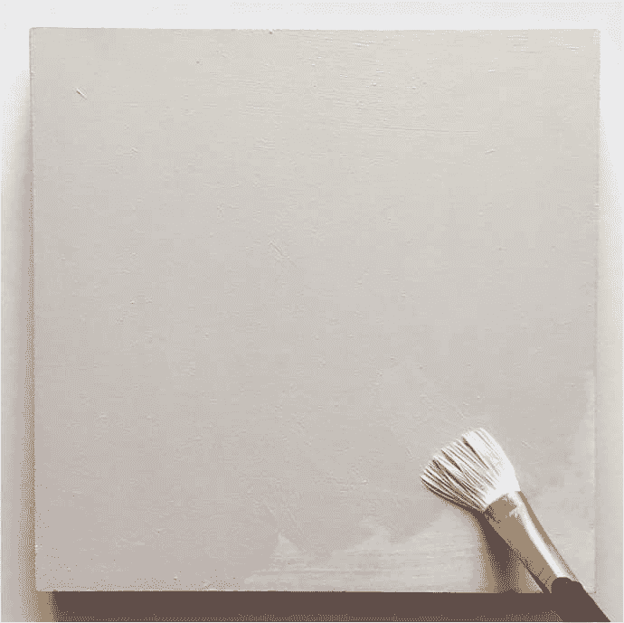

## 1

**1** 使用 #6 平头刷，用一层未漂白钛白调色底。让其干燥约 10 分钟，否则下一步的红色颜料会与潮湿的白色混合，你最终会得到一扇粉色门。清洁并擦干你的画笔；每次使用新颜色的画笔时都需要这样做，除非你想用旧颜色制造色彩混合。

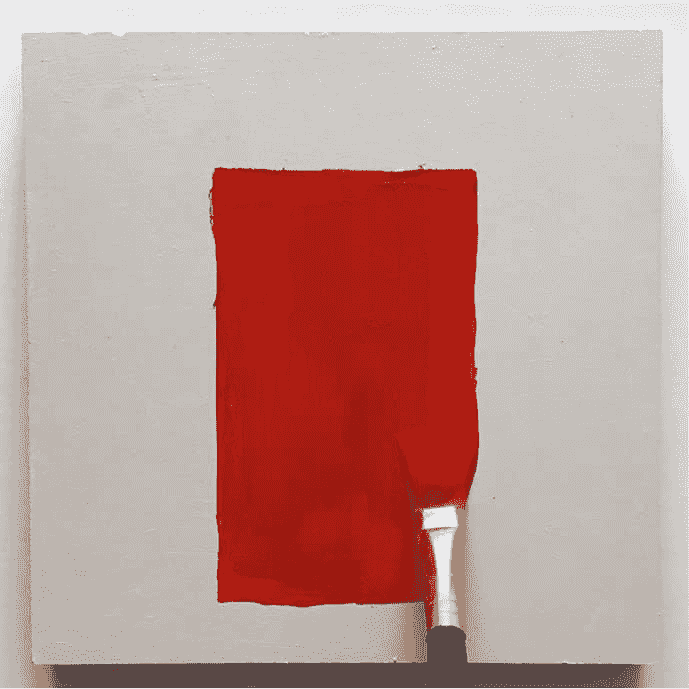

**2** 在画布中央使用 #6 平头刷直接从管中画出一个萘酚红的矩形。画笔的形状使其易于绘制直线边缘和尖锐的角落。我涂了两层以获得良好的不透明度；一层会产生更透明的效果。涂层之间让颜料干燥。第二个涂层在下一步之前是否干燥并不重要，因为你不会用其他颜色触碰它。

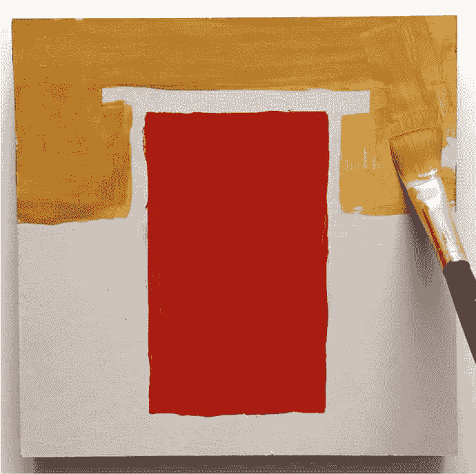

**3** 用调色胶稀释黄赭石颜料并涂抹在墙面上，门框周围的门楣保持未上色作为‘负形’——一个技术术语，指物体周围的空白空间。我在这里只使用了一层颜料，以便笔触可见并在墙面上营造出一些质感。

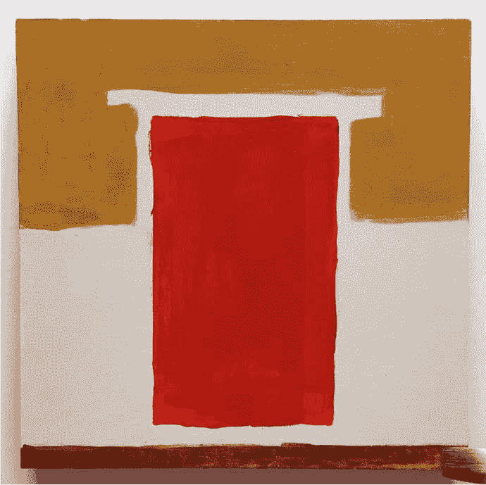

**4** 将煅烧赭石与少量调色胶混合，涂上一条细长线条以表示门下的地面，同样留出空白。

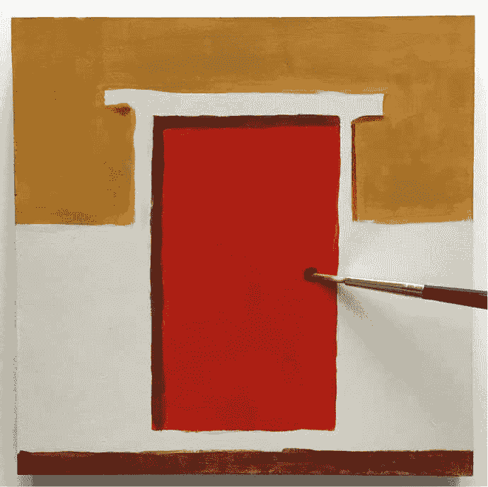

**5** 用调色胶稀释煅烧赭石。使用 #1 圆头刷绘制门楣在墙上投下的阴影以及门顶部和左侧的阴影。用同一种颜色绘制门把手。恭喜你完成了第一幅丙烯画。

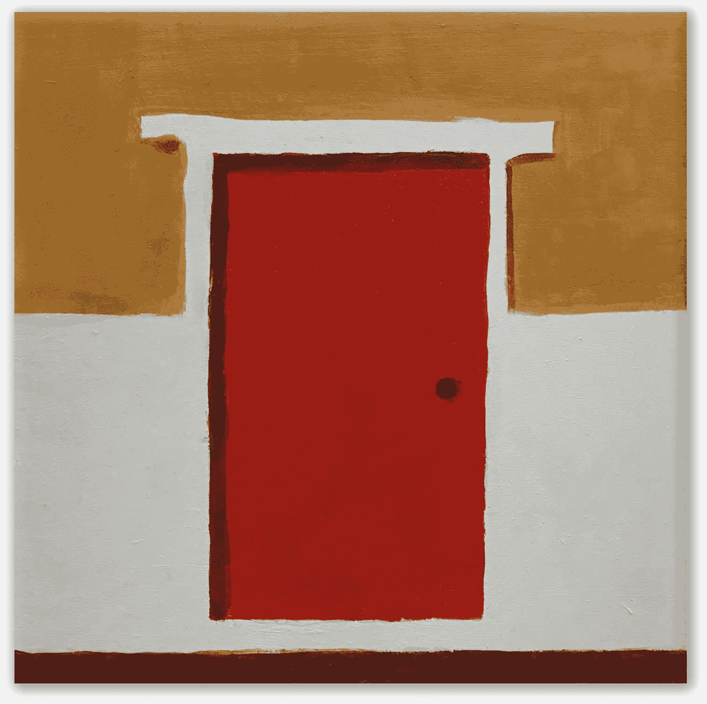

只用三种颜色和两支画笔，你就能创作出简洁但富有图形感的绘画。尝试用不同的色彩组合再做一次——也许是镉黄中号的门配黄赭石阴影和群青色的墙。

### 2 调配色调与阴影：信封

本练习探索制作颜色的更浅和更深版本。这些浅色和深色的技术术语是‘tints’和‘shades’。色调是被提亮的颜色；在丙烯中，这是通过添加白色或其他浅色（如黄色）来实现的。阴影是被加深的颜色；在丙烯中，这通常是通过添加黑色来实现的，尽管也可以使用蓝色或棕色。我们将在书中后面再回到这个问题，当我们研究光线如何影响物体以及如何使用色调和阴影使物体看起来三维时。现在，在你仍在熟悉丙烯颜料的使用并了解每支画笔的作用时，我们将混合一种颜色——Napthol Red——的色调和阴影，来绘制一个几乎完全由直线边缘构成的非常平坦的主题。

### 材料

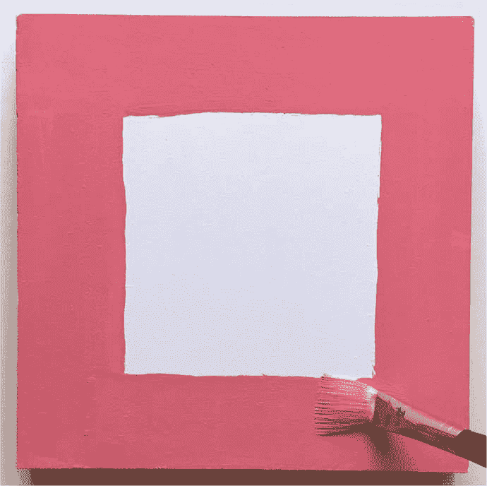

**1** 用等量的萘酚红和未漂白钛白调配出一种鲑鱼粉色。这是一种色调——萘酚红的浅色版本。使用 #6 平头刷在画布边缘画出约 11/2 支笔宽的边框，中央保持白色。待其干燥，并记住每次使用新的色调、阴影或颜色时都要清洁并擦干画笔。

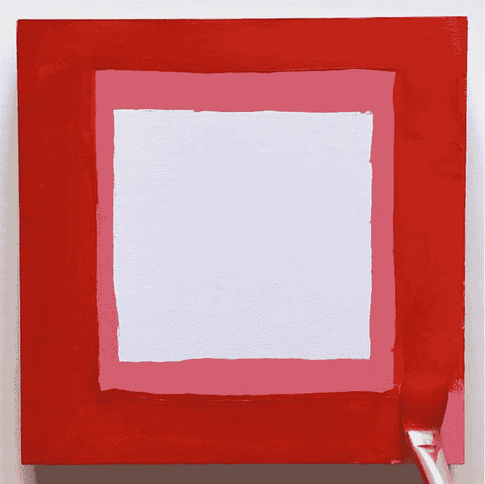

**2** 继续使用 #6 平头刷，将管中直接取出的萘酚红涂在边框上，留出内部一丝粉色透出。这种底层粉色有助于使绘画和谐统一。你可能需要两层涂层才能获得平整、不透明的 finish；如果你想要更具质感的效果，只涂一层即可。

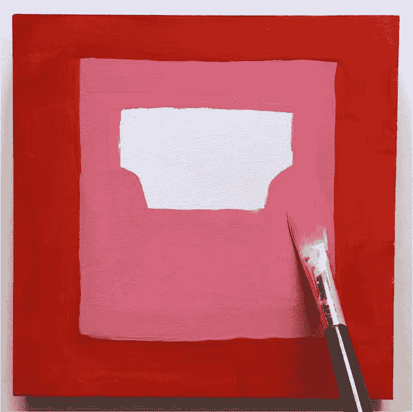

**3** 回到步骤 1 中的原始鲑鱼粉色。涂抹信封，中央留出一个未上色的形状以定义内部。白色区域底部的弧形表示信封盖折叠的位置。待其干燥。

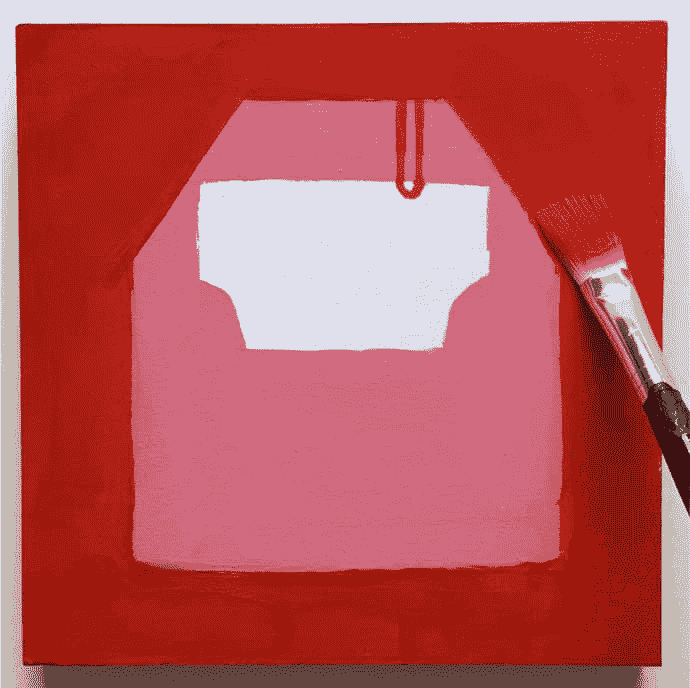

**4** 再次使用纯萘酚红，在信封外部绘画以获得清晰干净的边缘并创建信封盖的倾斜侧面。使用画笔尖端绘制回形针的尖锐线条；我用画笔的上边缘绘制直线，用角尖绘制曲线。

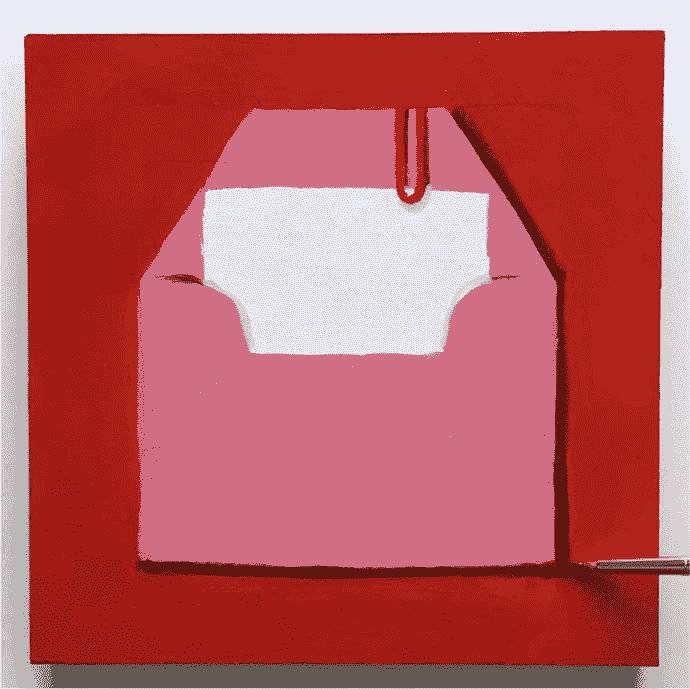

**5** 用未漂白钛白和极少量玛斯黑调配出一种非常浅的灰色。使用 #1 圆头刷绘制信封白色内部的小投射阴影。现在用萘酚红加一点玛斯黑调配出深红色。这是一种阴影。使用 #1 圆头刷绘制信封粉色部分在弧形盖顶部以及回形针右侧边缘的阴影。用同一种颜色绘制信封底部和右侧边缘的投射阴影。

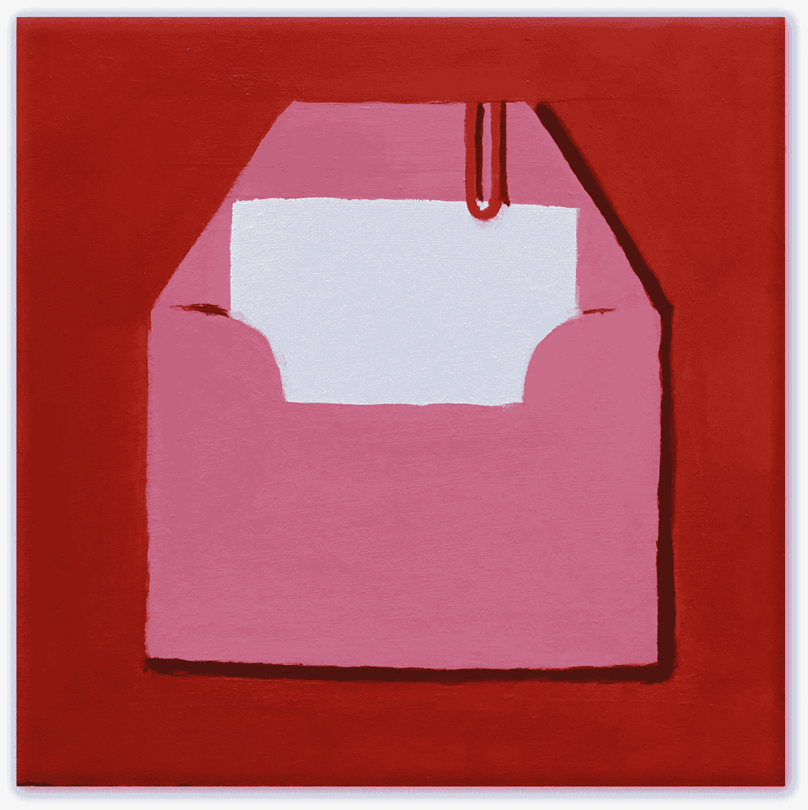

难以置信这只是由萘酚红和另一种颜色的简单混合构成的吧？用调色板上其他所有颜色重复此练习，以便你熟悉需要添加多少白色或黑色。

### 3 不透明叠加：T 恤

丙烯颜料的优点之一是，由于其干燥时间短，你可以快速将一层涂在另一层之上以创建不透明的色彩区域。这里，白色被涂在强烈的蓝色背景之上。一层可能不足以完全覆盖背景，因此等待第一层干燥后再决定是否要涂第二层——甚至第三层——。没有硬性规定：对于某些主题，你可能希望让部分背景透出，但一旦你熟悉了所获得的覆盖效果，你就可以决定涂多少层以及颜料需要多厚或多薄。使用简单的形状和有限的调色板可以让你专注于技巧，而不会被复杂的形状或色彩混合分散注意力。

### 材料

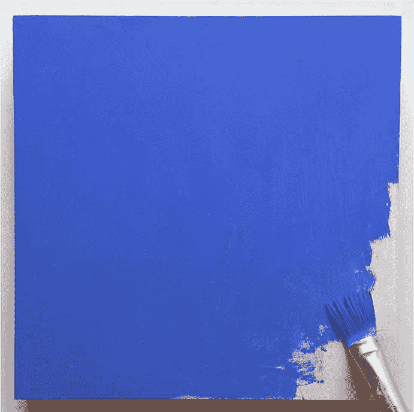

**1** 使用 #6 平头刷，用由等量群青和钛白加少量调色胶混合成的强蓝色调色底。待其干燥。

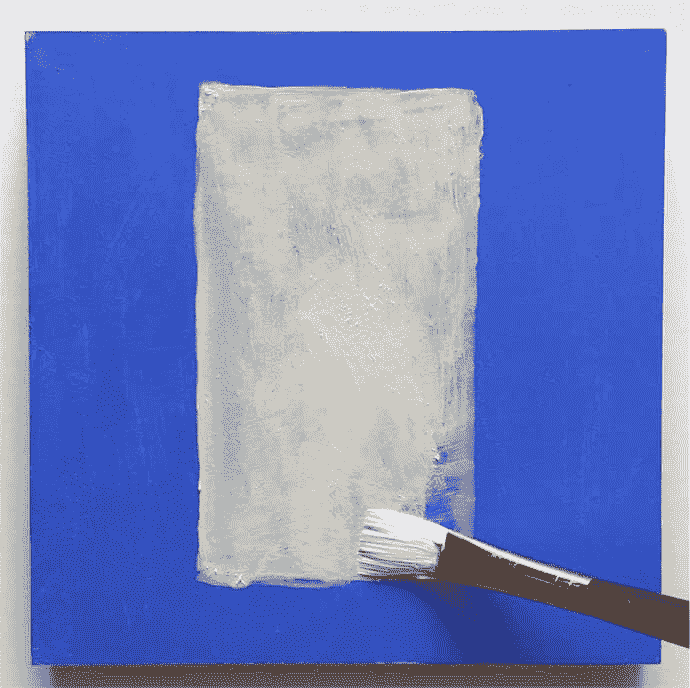

**2** 为了绘制 T 恤的身体，使用 #6 平头刷在画布中央直接从管中涂出一个未漂白钛白的矩形。这里可以看到第一层正在涂抹；待其干燥后，我涂了第二层，留下了一些笔触以增加变化和质感。在此阶段，如果覆盖不完全均匀也不必担心——以后可以调整。

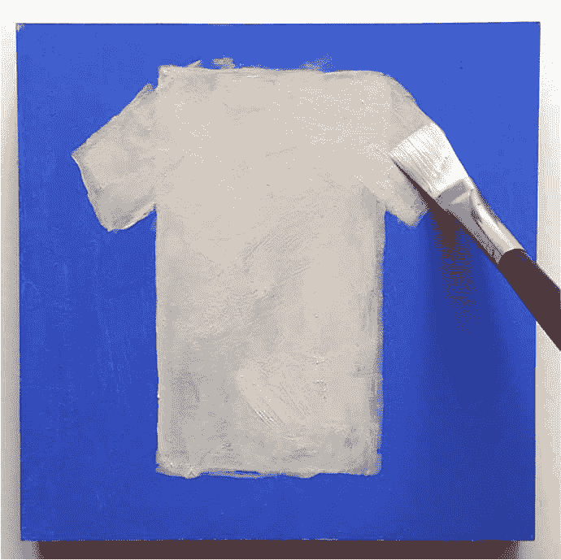

**3** 为袖子添加未漂白钛白的矩形。随着每层干燥，决定是否要添加另一层。我涂了两层；你可能会决定需要三层。

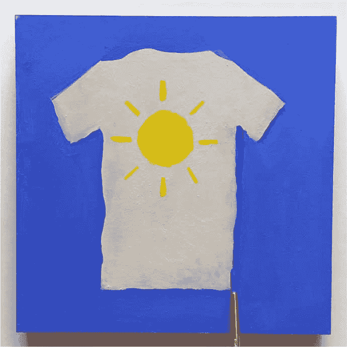

**4** 使用步骤 1 中的背景蓝色和 #6 平头刷，在 T 恤周围绘画以整理边缘，为领口挖出一个浅浅的曲线。待其干燥。用镉黄中号加少量未漂白钛白调配出明亮的黄色并绘制太阳形状（或你想要的任何图案）。换成 #1 圆头刷和纯群青并画出投射阴影。待其干燥。

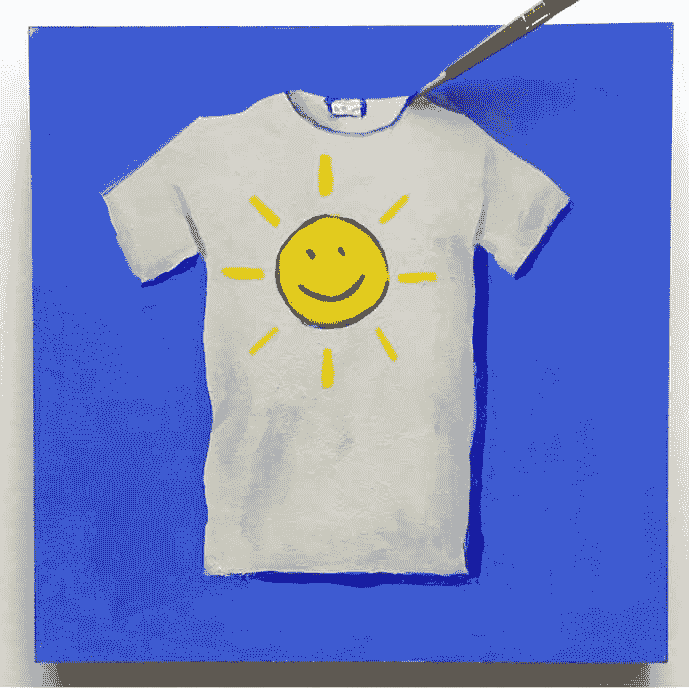

**5** 用未漂白钛白和极少量玛斯黑调配出非常浅的灰色，并用 #4 菲尔伯特刷将其涂抹在 T 恤的阴影区域。这些浅色阴影显示出布料如何落在褶皱和折痕中。待其干燥。在纯群青中加入一点玛斯黑并绘制太阳上的脸。使用 #1 圆头刷用群青绘制衣领，用钛白加群青细节绘制标签。

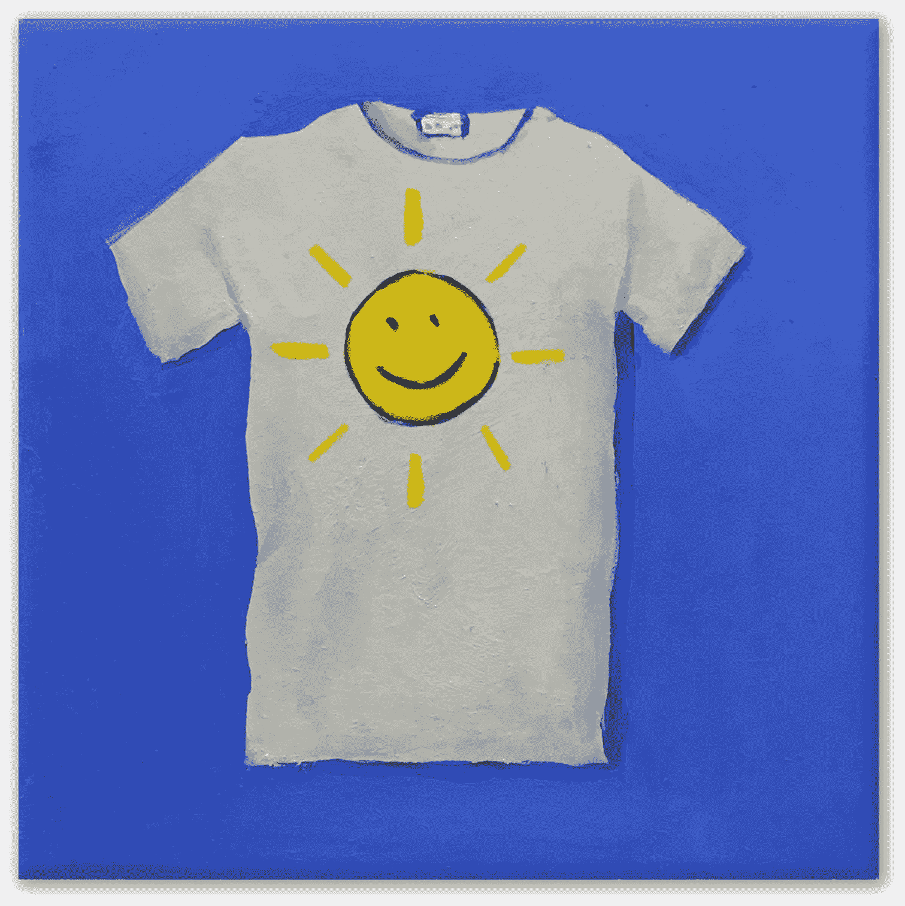

这个项目展示了丙烯的覆盖力：在水彩中，不可能在如此强烈的蓝色上绘制浅色而不让蓝色透出。尝试看看需要多少层才能达到这种效果；这会根据所用颜料而有所不同。

### 4 扩展你的色彩调色板：儿童粉笔画
### 儿童粉笔画

这是一个有趣的项目，可以让你练习调色，并了解从你基本调色板中仅有的几种颜料可以调出多少种不同的颜色。你可以参考儿童画作作为灵感，也可以直接开始涂鸦，重拾你内心的孩子。在这里，我们要画粉笔棒：粉笔的顶部被明亮照亮，但侧面没有，所以我们需要调出色调，即颜色的较暗版本来绘制它们。只要在每根粉笔上加上阴影侧的笔触，它就会从一个扁平的形状变成看起来有三维感的东西。我们还在添加投射阴影——同样也是用你基本调色板中的两种颜色混合而成。

#### 材料

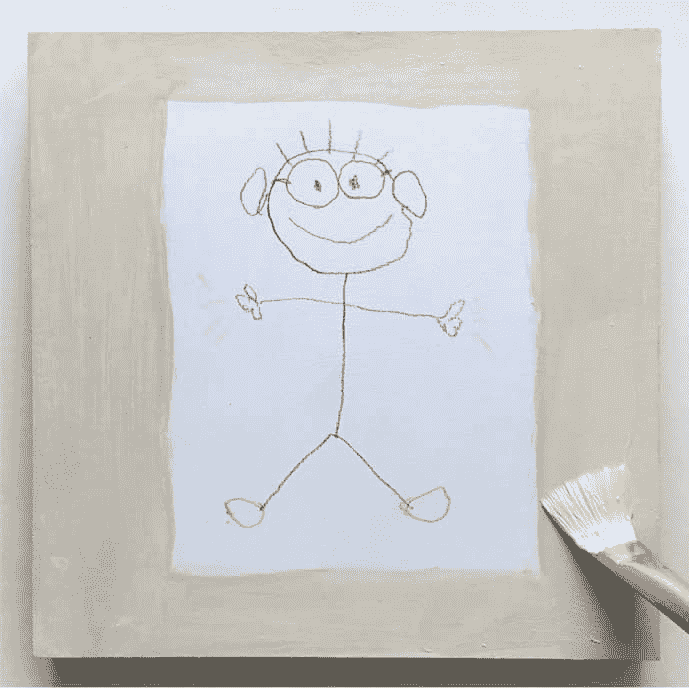

**1** 使用彩色铅笔，在画布中央画一个滑稽、幼稚的棍状人形。使用 #6 平头刷，用钛白未漂白在棍状人形周围画一个边框，留出中央矩形不涂色，使其看起来像是画在另一张纸上。

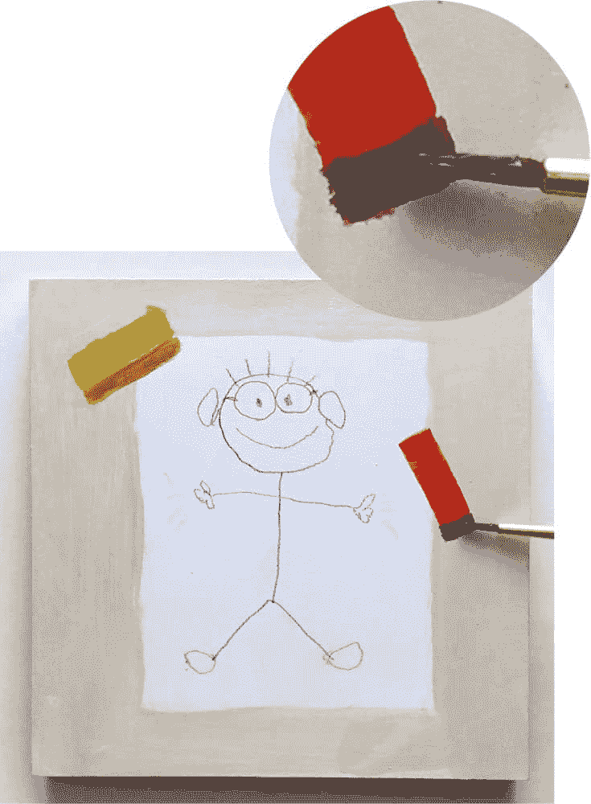

**2** 现在画粉笔。在左上角，使用 #4 亮面刷，画一条宽一笔触的镉黄中色线条，作为粉笔明亮照亮的顶部。在其下方，涂上一条较窄的黄赭色笔触；这就是色调——黄色的较暗版本。在画作右侧重复此操作，使用萘酚红作为明亮顶部，使用萘酚红加一点赭红黑作为阴影侧。

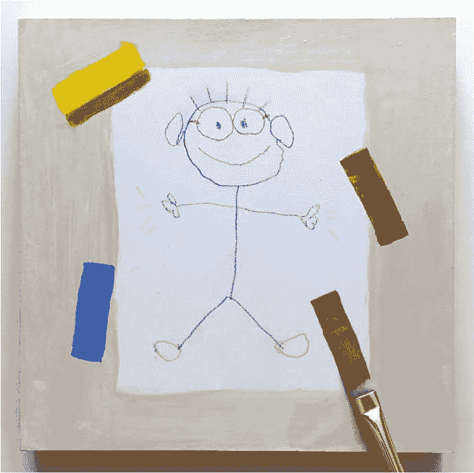

**3** 用群青画蓝色粉笔，用镉黄中与群青的混合色画绿色粉笔。

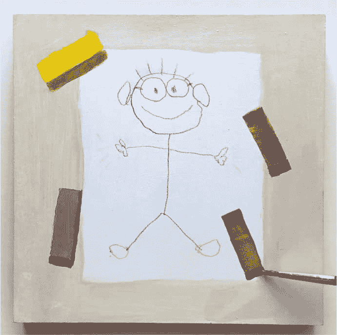

**4** 现在画蓝色和绿色粉笔的阴影侧，在群青中加入一点赭红黑，并在绿色混合色中加入群青。

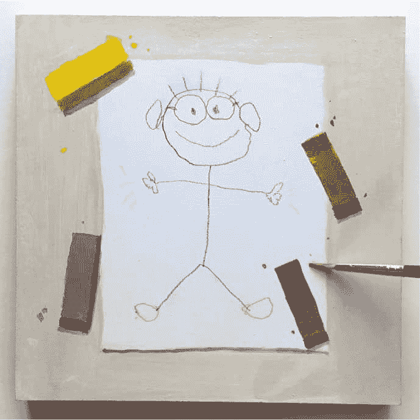

**5** 用钛白未漂白和极少量赭红黑调出浅灰色。使用 #1 圆头刷，在粉笔下方以及“纸张”底部边缘画出投射阴影。用圆头刷和你为粉笔明亮顶部使用的颜色，添加一些小点，看起来像粉笔灰。

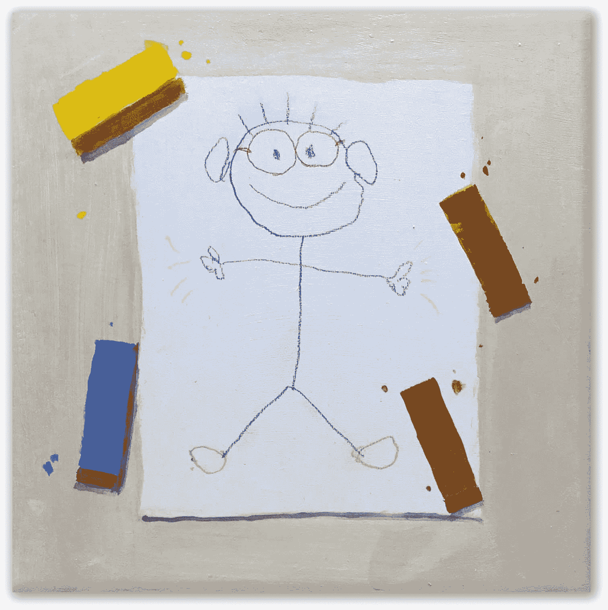

除了调色之外，这个项目还能让你练习笔触控制。形状很简单——粉笔只需用刷子全宽的一笔——但你会体会到按下刷子的力度和在画布上移动刷子的速度。

### 5 调配灰色的明度：蜡笔
### 蜡笔

在信封项目中（见第 38 页），我们研究了调配明度和色调。这是该过程的延续——但不同于只调一个颜色的明亮和暗调版本，这里我们要从最亮的高光到中亮、中等、中暗到暗色，创造出整个范围。技术术语称之为颜色的“明度”。如果你很难判断要调多亮或多暗，可以试着半眯着眼睛看你的主题——甚至可以用手机拍照并转为黑白。专注于混合中颜料的不同比例。你可能会发现，把这些记录下来并附上颜色混合的色块很有帮助。

#### 材料

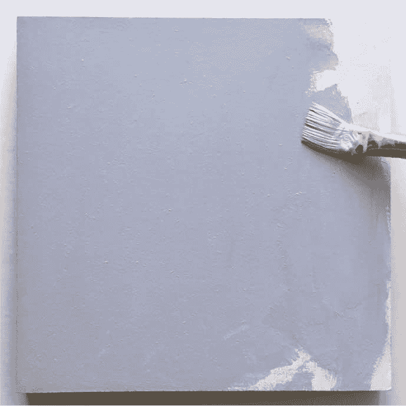

**1** 混合等量的钛白未漂白和赭红黑。使用 #6 平头刷，用这种混合物为画布上底色。待干。这是中间明度。如果从中间明度开始，就更容易判断需要调多亮或多暗。如果从最亮或最暗的明度开始，虽然诱人，但判断会更困难。

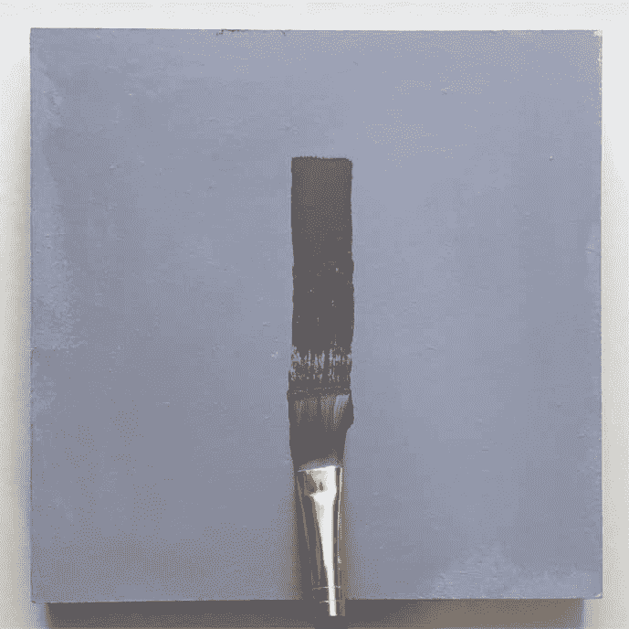

**2** 在混合色中加入更多赭红黑以获得中暗明度。使用 #6 平头刷，画一条宽一笔触的线条作为蜡笔周围的纸包装。待干。

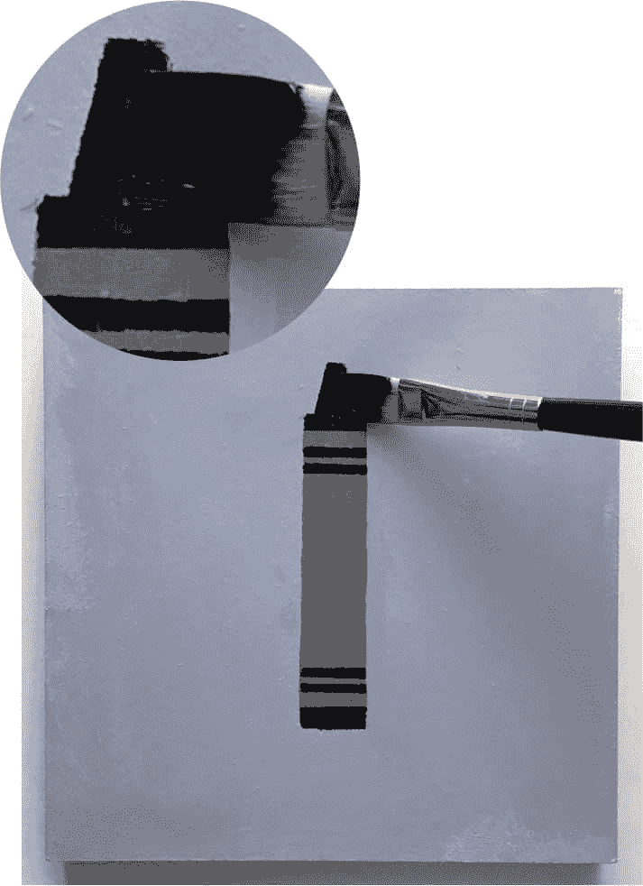

**3** 现在在画作中加入最暗的明度——纯赭红黑。用 #6 平头刷的尖端和侧面画出包装上的条纹以及包装下方蜡笔的底部。然后将蜡笔顶部画成顶部平坦的圆锥形。

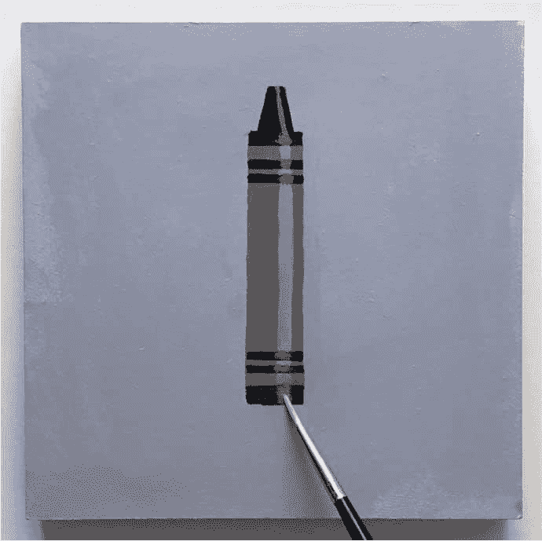

**4** 换成 #1 圆头刷。用步骤 1 的底色调出纸包装灰色部分的中间亮高光。在该混合色中加入一点赭红黑，用于包装黑色部分和蜡笔上的高光。

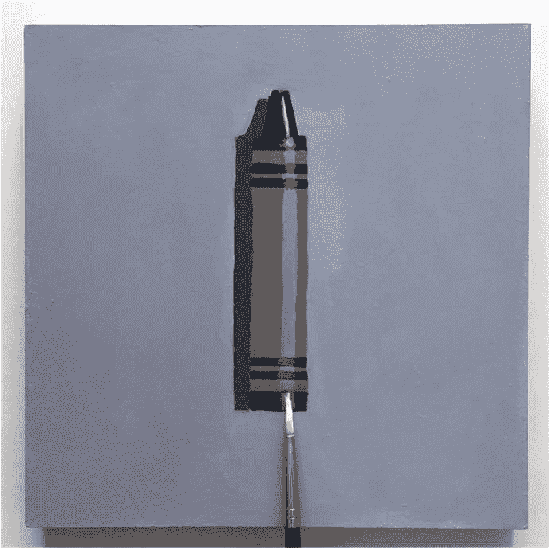

**5** 蜡笔投下的阴影需要比包装用的灰色更暗，所以调出一种大约为 80%赭红黑和 20%钛白的深灰色明度。用 #4 亮面刷画阴影；刷子的轮廓使获得干净、笔直的线条变得容易。用 #1 圆头刷在蜡笔的蜡质部分用钛白画出清晰的高光。蜡是光亮的，所以它的高光比纸包装更锐利。

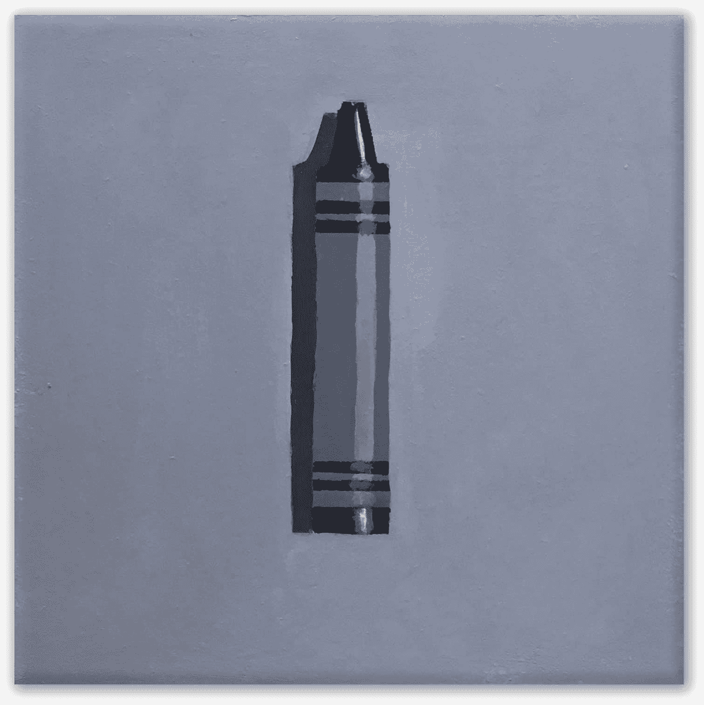

仅用同一种颜色的五种明度，你就能创作出看起来有三维感的画作。尝试用调色板中的所有颜色做同样的练习，以感受调色和评估明度——然后继续在同一幅画中画很多不同颜色的蜡笔。

### 6 认识你的画笔：带彩珠的糕点
### 带彩珠的糕点

开始用丙烯颜料作画时你不需要很多尺寸或形状的画笔，在这本书中我只限于四种：#6 平头、#1 圆头、#4 菲伯特和 #4 亮面。然而，每一种都有略微不同的特性：大平头刷可以快速用宽幅色彩覆盖大面积并创造出边缘笔直的形状；小圆头很适合做尖锐的小标记和柔和的边缘；菲伯特适合圆润物体和更具有机感的笔触；亮面刷则适合做短的矩形笔触和小型、精确成形的区域。这个练习让你有机会练习不同类型的标记制作，并习惯画笔上可以装载多少颜料。

#### 材料

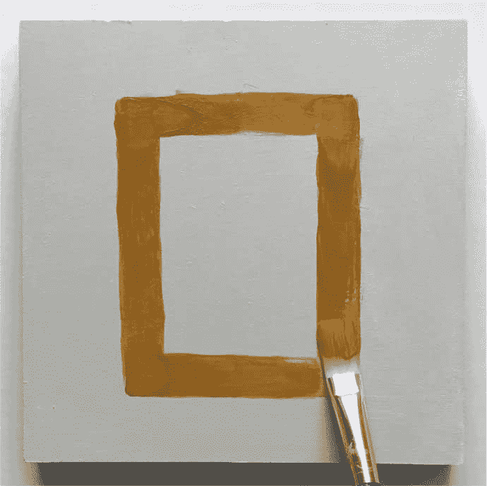

**1** 使用 #6 平头刷，用钛白未漂白混合少量罩光介质为画布上底色。用 #6 平头刷和黄赭色画一条笔直边缘的边框，宽一笔触，作为将要出现的糕点可见区域。待干。

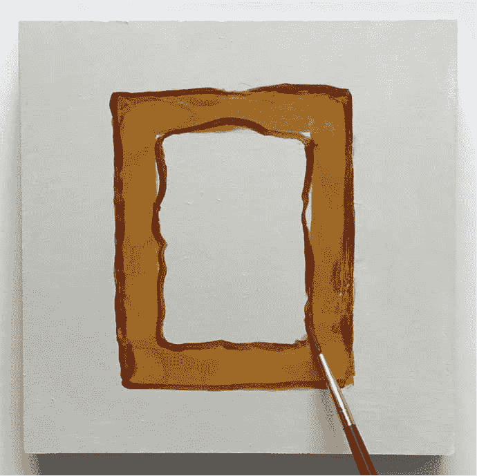

**2** 换成 #1 圆头刷，用赭红棕勾出糕点可见区域的内外边缘；刷子的形状使你能保持笔触松散且略微颤抖，从而创造出更少机械、更具有机感的外观。糕点边框中间的白色区域是糖霜所在的位置。

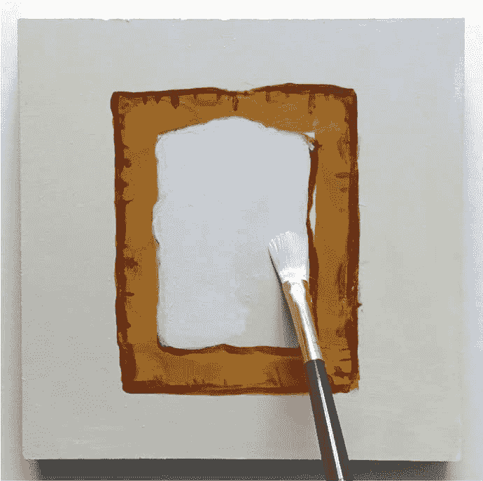

**3** 继续使用 #1 圆头刷，用赭红棕画出糕点边缘周围的小褶皱和皱纹。换成 #4 菲伯特刷画中间大面积的糖霜；这支刷子有圆润的尖端，因此更容易变化标记的形状以适应糖霜的弧形边缘。用钛白加极其微量的赭红黑画糖霜。

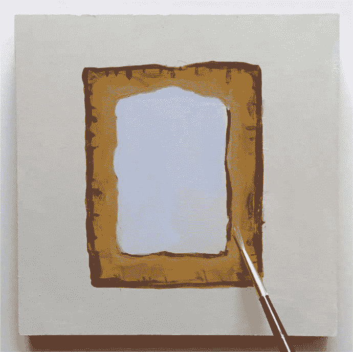

**4** 糕点的边缘比中间烤得更熟，所以从糖霜周围的浅黄棕色创造出色彩渐变（黄赭色 + 钛白未漂白 + 一点镉黄中），然后是中棕色（黄赭色 + 镉黄中），最后在外边缘是较深的棕色（黄赭色 + 赭红棕）。使用 #1 圆头刷并在画布上融合色彩过渡。视需要涂抹尽可能多的层次。

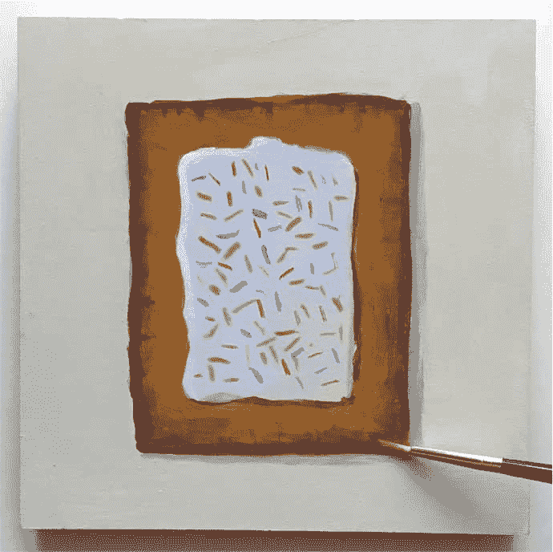

##### 5 最后阶段全是关于细小、可控的细节，因此请使用 #1 圆头画笔来完成。在糖霜左侧，用纯钛白绘制高光。在右侧和底部边缘绘制投射阴影，使用淡灰色（未漂白钛白 + 少许马尔斯黑）。随意用你喜欢的颜色绘制糖珠，每次只使用一种颜色。最后，在糕点边缘的顶部和底部涂抹一点萘酚红，以表现流出的果酱。

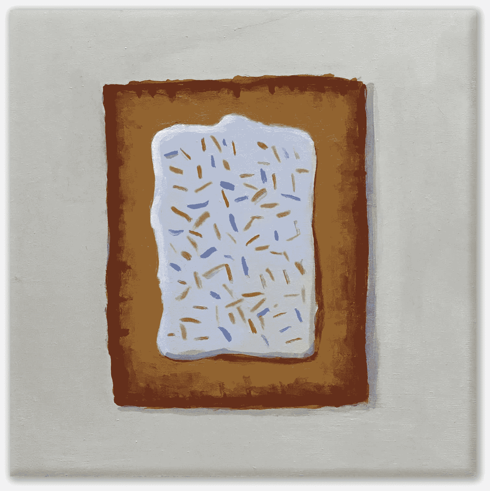

本练习利用了每种画笔的主要特性，但你可能会惊讶于仅用一支画笔就能做出多少种不同的笔触。尝试使用画笔的全部宽度，然后将画笔侧放或仅使用笔尖。

### 7 刻出形状：玩具鸭

当你刚开始绘画时，绘制非常细小、紧凑的细节可能很困难，部分原因是需要练习才能获得足够的画笔控制力。虽然这听起来可能违反直觉，但一个选择是先用与主体非常接近的颜色涂满整个画布，然后通过绘制背景来定义主体的形状。艺术家称之为‘刻出’或‘雕刻出’主体，或绘制‘负空间’。因此，与其担心绘制主体的轮廓（尤其是像喙和尾尖这样的小而尖的形状），不如观察背景形成的形状——例如头部和尾部之间的 U 形，或喙与身体之间的半圆形——并绘制它们。这种技巧对于清理主体凌乱或颤抖的边缘也非常有用。

#### 材料

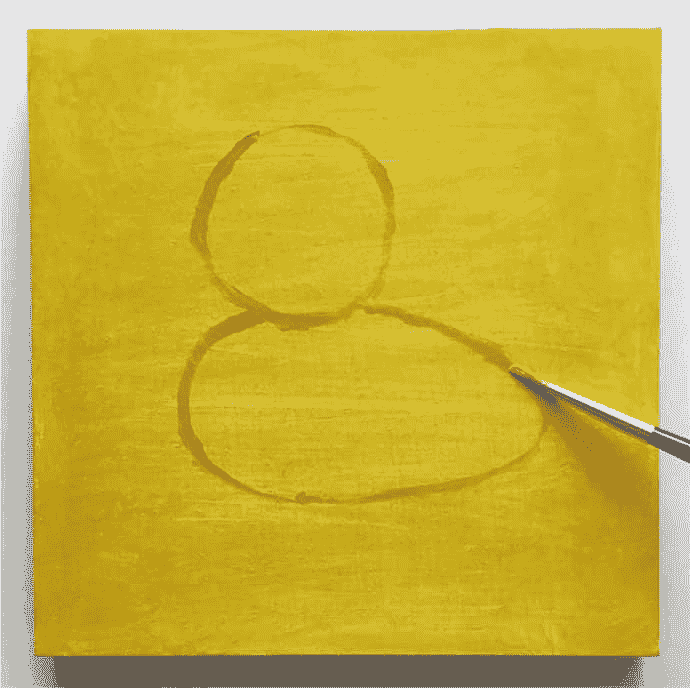

**1** 使用 #6 平头画笔，用由镉黄中等、少许未漂白钛白和一些罩光介质调配的明亮黄色均匀上色画布。待其干燥。可以保留一些纹理透出，以表现玩具上的木纹。使用 #1 圆头画笔和黄赭石，绘制鸭子的头部圆形和身体的细长椭圆形。待干燥。

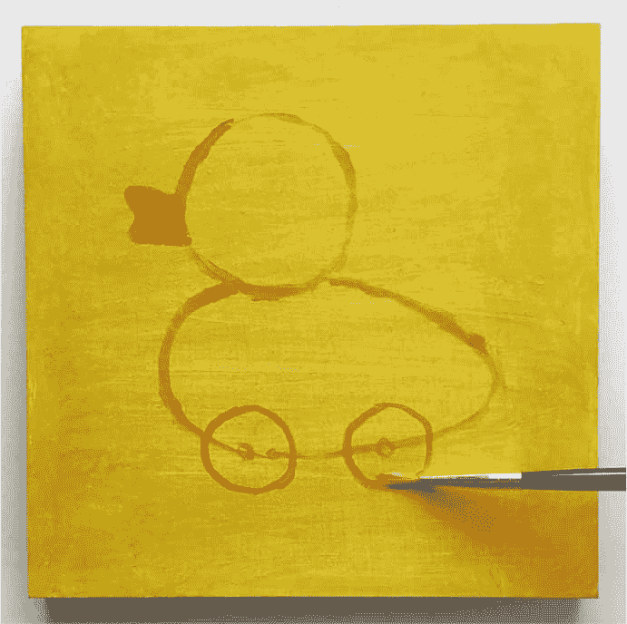

**2** 用萘酚红和镉黄中等调配橙红色。使用 #1 圆头画笔勾出喙并指示轮子。

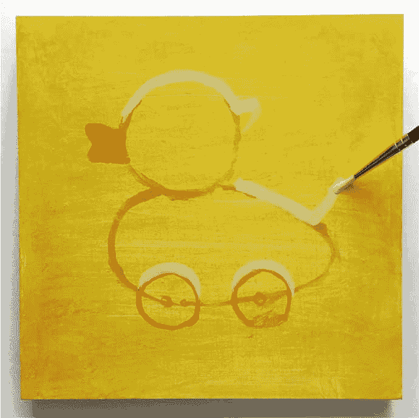

**3** 用未漂白钛白和一点镉黄中等调配淡黄色。使用 #1 圆头画笔点出高光——即光线最强烈照射到的部位——位于头部、背部和轮子顶部。

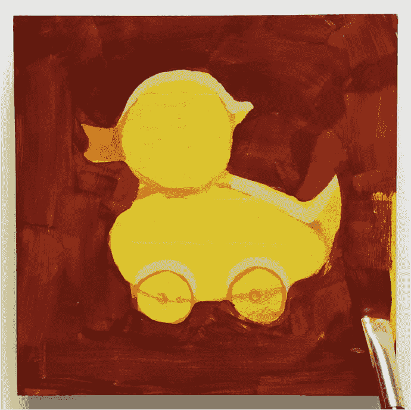

**4** 用萘酚红、煅赭石和少许马尔斯黑调配红褐色，加入大量介质使其半透明。用 #6 平头画笔绘制背景，将画笔直接带到鸭子处以‘刻出’并定义形状。如果想让笔触仍然可见，可涂一层；想要更干净、更不透明的效果则涂多层。待干燥。

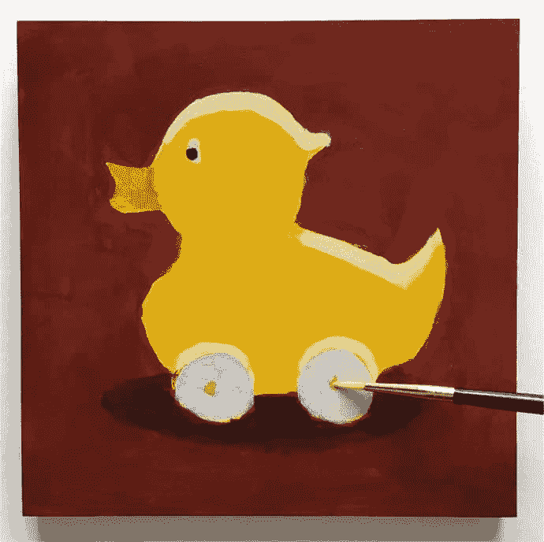

**5** 在红褐色混合色中加入马尔斯黑，用 #4 阔叶画笔绘制鸭子下方的投射阴影。用 #4 阔叶画笔用由镉黄中等和未漂白钛白混合的明亮黄色填满鸭子。对于轮子和眼睛的白色，用未漂白钛白和一点马尔斯黑调配非常淡的灰色，并用 #1 圆头画笔涂上。干燥后，用管装黄赭石直接绘制轮子中心，用马尔斯黑绘制眼睛瞳孔。

所有真正精确的形状，如尖尖的喙和尾尖，都是通过绘制背景而不是鸭子本身来完成的。看看你家周围，还有哪些日常物品可以采用这种处理方式。

### 8 块面介绍：雏菊

当你刚开始绘画时，很容易想把看到的每一个细节都画出来——树枝上的每一片叶子，花朵上的每一片花瓣，墙上的每一块砖。问题在于你会被细节困住；作品会变得繁琐、过度复杂，观众难以清晰阅读。在本练习中，你将学习一种称为‘块面’的技术。这意味着，与其绘制许多小而独立的形状，不如寻找可以作为一个整体处理的更简单、概括化的形状。这是一种让绘画更具凝聚力的方法。

#### 材料

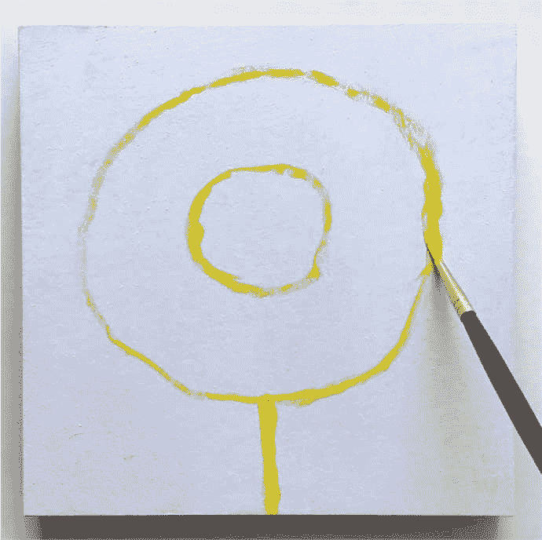

**1** 将镉黄中等与少量罩光介质混合。在画布中央，使用 #1 圆头画笔画出花心的圆，然后画出外层的‘引导圆’和花梗。你稍后会覆盖引导圆；它只是为了大致显示花瓣的极端位置。

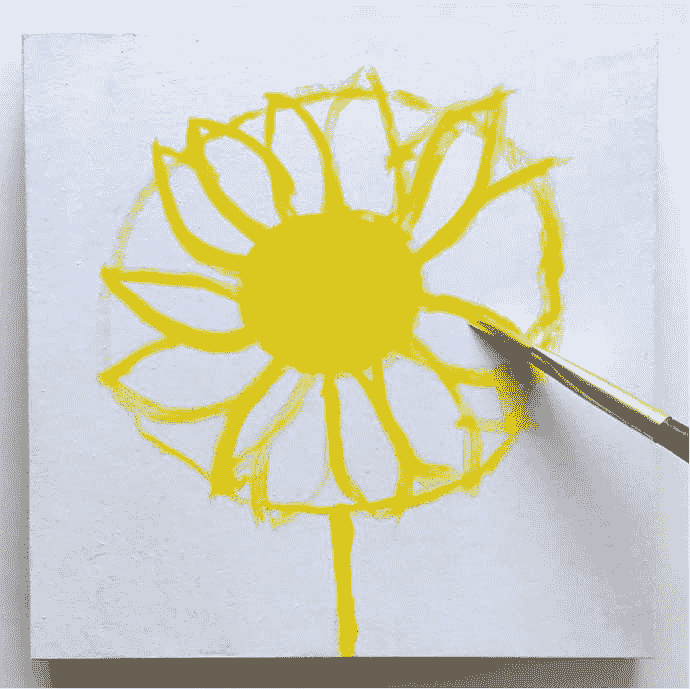

**2** 换成 #4 亮光画笔，用镉黄中等填满花心，然后勾出花瓣的形状，保持部分分离，让其他部分重叠。与步骤 1 中的引导圆一样，你稍后会覆盖其中大部分形状。待干燥。

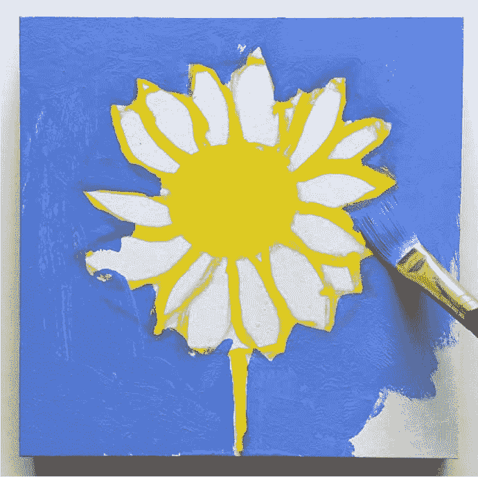

**3** 用群青和钛白调配明亮的蓝色。使用 #6 平头画笔绘制背景，同时刻出花瓣的形状。完全干燥。

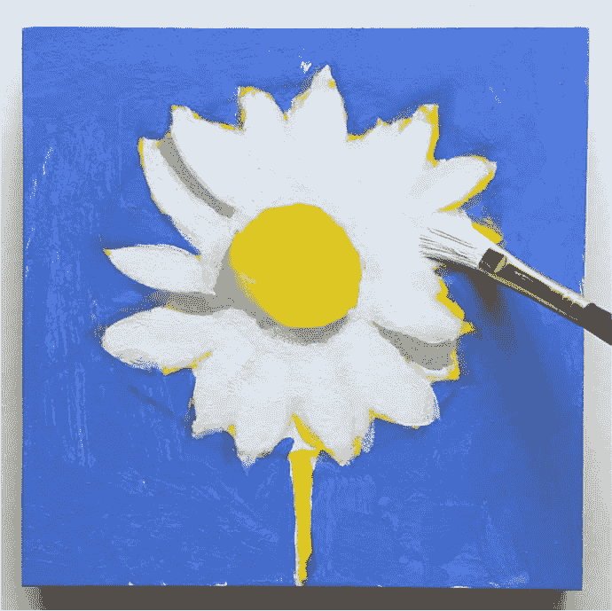

**4** 有些花瓣位于其他花瓣之上并投下阴影；用 #4 阔叶画笔用淡灰色（未漂白钛白 + 少许马尔斯黑）绘制这些阴影。现在通过‘块面’将绘画统一起来，用钛白将一些花瓣连接成整体形状；我将右侧所有的花瓣合并成一个大块面，使图像在图形上更令人满意。待干燥。

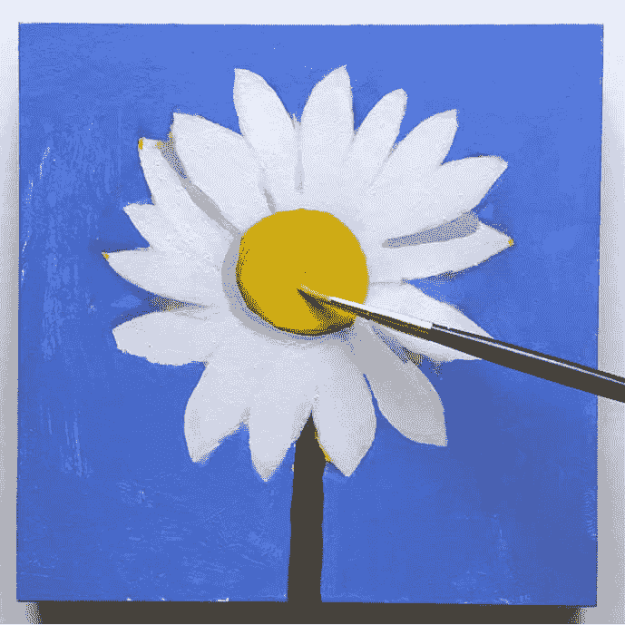

**5** 在必要的地方，用背景蓝色切入以勾勒出部分花瓣的尖端，并用淡灰色混合色添加更多投射阴影。仍使用 #4 阔叶画笔，在花心加入一点黄赭石。用群青、镉黄中等和未漂白钛白调配中调绿色，绘制花茎。

由于左侧花瓣之间仍有一些分离，我们的大脑会填补缺失的细节，并将右侧也解读为由独立花瓣组成——但结果是图形化且不繁琐的。

### 9 纹理分层：红色谷仓

本练习探索了两种不同的分层上色方法来创造有趣的纹理。第一种方法是刮掉颜料，让下面的颜色透出来——非常适合捕捉可能在数十年间被多次粉刷的老谷仓的风化外观。第二种方法——此处用于谷仓前的麦田——是先涂一层非常松散、薄的底色，笔触清晰可见，然后在其上叠加一系列短小的纹理笔触。要注意不要过度——纹理应增强主体，但不应主导它。

#### 材料

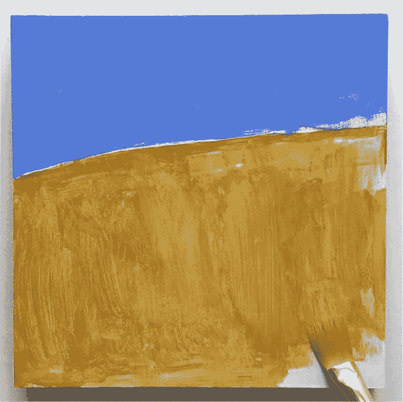

**1** 用等量的群青和钛白调配明亮的蓝色，用 #6 平头画笔绘制天空。沿地平线留出一点白色画布（由于天空和地面不相接，无需等待天空干燥），用非常稀薄的黄赭石（混入大量罩光介质）绘制前景，使用模仿麦秆的垂直笔触。待干燥。

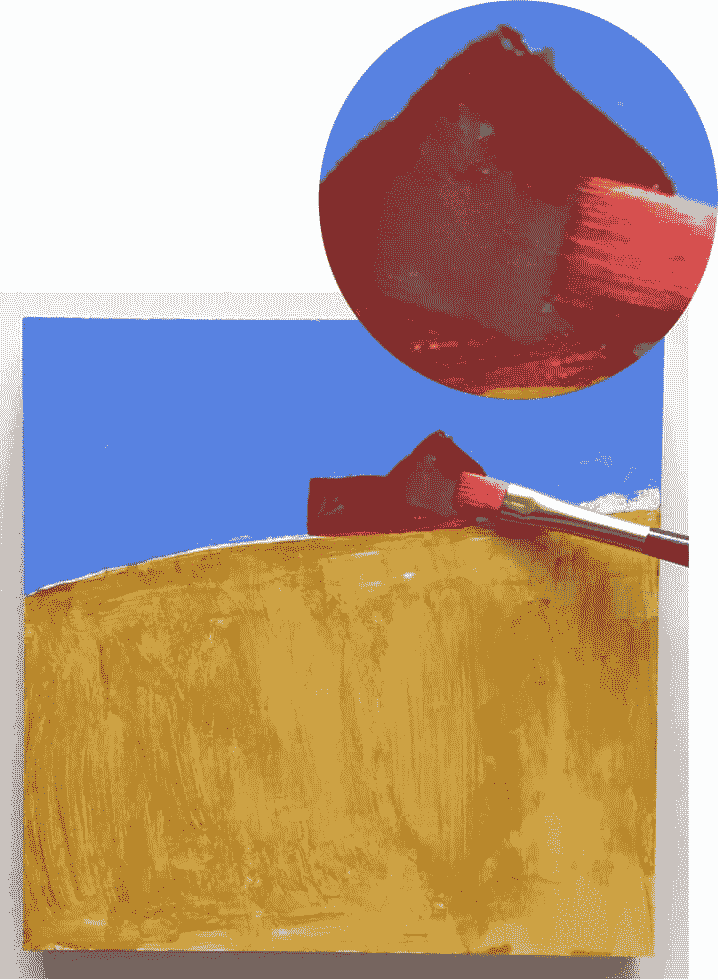

**2** 用萘酚红加一点镉黄中等调配暗红色，用 #4 亮光画笔勾出谷仓的形状。颜料仍湿时，用画笔刮掉部分颜料，让下面的蓝色透出来。这使谷仓呈现风化外观。待干燥。

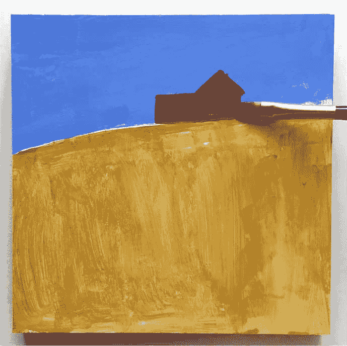

### 3
混合等量的那不勒斯红和煅烧赭石来调配谷仓的阴影色。再次使用 #4 亮光刷，[content]
### 3
混合等量的那不勒斯红和煅烧赭石来调配谷仓的阴影色。再次使用 #4 亮光刷，绘制屋顶底部（你将在第 4 步添加）的阴影区域以及建筑右侧的阴影。画笔平坦的轮廓使其非常适合这些小巧、形状精确的区域。

### 4
仍使用亮光刷，直接使用管装的马尔斯黑为谷仓上屋顶，并利用画笔的角部来绘制窗户。换成 #1 圆头刷，用马尔斯黑绘制栅栏柱，使其在形状和大小上略有不规则，以呈现更粗犷的外观。

### 5
现在用单独的垂直笔触构建小麦的质感，使用各种黄色调配：远处使用钛白未漂白 + 中黄镉黄；中景使用中黄镉黄 + 黄赭石；前景使用黄赭石。笔触的大小也要变化，靠近谷仓时笔触更小，前景中更大。这有助于营造出尺度和距离感。最后，用钛白未漂白在栅栏柱之间标出电线的线条。

正如俗话所说，“少即是多”。用于小麦的短促、有质感的笔触营造出微风中轻微模糊的草丛印象，同时不会分散对主要主体——那座风化的老谷仓的注意力。

### 10 简单构图：桌面静物
这个静物中的物体只是一系列矩形和一个圆形，而且是从几乎正上方观看的，因此形状没有失真。这使得它们非常简单易画，让你可以专注于发展不透明的层次和控制画笔。虽然这样的静物看起来非常简单，但你仍需要在布置上花费时间。你选择的物体是否在某种程度上相互关联——以主题、色彩或形状为依据？你将如何在画面空间内摆放不同的元素？请记住要观察物体之间的空间（负空间），而不仅仅是物体本身。

#### 材料

#### 1
使用 #6 平头刷，用中黄镉黄为画布上色。使用 #1 圆头刷，勾勒出物体的轮廓，并在咖啡杯的投射阴影占据的区域用加了少量罩光介质稀释的黄赭石进行指示。

#### 2
用群青和钛白调配出明亮的蓝色。使用 #6 平头刷绘制桌面背景，同时勾勒出构图中物体的形状（以及杯影）。

#### 3
用群青、马尔斯黑和一点点钛白未漂白调配出深蓝黑色，并绘制物体下方的投射阴影。根据需要更换画笔尺寸：我用 #1 圆头刷绘制细小的铅笔阴影，用 #6 平头刷绘制大得多的杯子和书本阴影。

#### 4
使用 #1 圆头刷和钛白绘制书本标签和咖啡杯的白色边缘。用马尔斯黑和钛白未漂白调配出中等灰色，并在书页上、标签下方、杯内以及杯柄上绘制阴影。在铅笔末端点上一点灰色作为金属箍。待干燥后，在箍上用钛白添加高光。

#### 5
在第 4 步的灰色中再加入一点马尔斯黑并绘制书本标签的图形。杯子在咖啡上投下一个新月形的阴影；用马尔斯黑绘制它。用煅烧赭石和群青调配出非常稀薄的混合色用于咖啡；使用大量罩光介质有助于你在咖啡上实现漩涡图案。用黄赭石绘制铅笔尖，用那不勒斯红和一点中黄镉黄绘制铅笔橡皮。在尖端点上一点马尔斯黑作为铅笔芯。

这幅画的色彩方案是原色三合会（见第 26 页）。重复练习，使用第 26 页的色轮来确定其他可能的色彩方案。

### 11 绘制木纹：画家调色板
分层是表现木纹的完美技巧。首先，涂上一层非常薄、破碎的底色以确定木材的基础颜色；然后你可以用画笔在上面“绘制”木纹图案，再用另一层薄薄的颜料覆盖该区域，木纹仍可透过可见。为了使木纹真正突出，使用光滑、不透明的颜色绘制背景，同时勾勒出调色板的形状；这可能需要两层或更多层。采用这种方法还有一个好处是，你不必担心木纹标记是否完全在物体范围内：如果略微溢出，可以用厚厚的背景色将其覆盖，因此你的笔触可以更自由。

#### 材料

#### 1
用黄赭石混合大量罩光介质。使用 #6 平头刷将其非常松散、粗略地涂抹在画布上。待触干后，用 #1 圆头刷用较浓的黄赭石绘制调色板和拇指孔的轮廓。在调色板中央，用几条恰当放置的线条指示木纹的总体方向。完全干燥。

#### 2
调配黄赭石和一点钛白未漂白的非常稀薄的洗染液，并加入大量罩光介质。使用 #6 平头刷将其涂抹在调色板上；你在第 1 步中施加的底层线条会透出来。

#### 3
用群青、钛白未漂白和马尔斯黑调配深蓝色。使用 #6 平头刷绘制背景，同时勾勒出调色板和拇指孔的形状。木纹在光滑、不透明的背景下非常突出。

#### 4
对于调色板上的颜料点，可使用任何你想要的颜色。依次用 #4 菲尔伯特刷涂抹每种颜色并待其干燥，然后再涂抹更多颜色层以创造厚重的厚涂质感。“厚涂”是技术术语，仅指将颜料涂抹得如此厚实以至于从表面隆起。

#### 5
用群青和马尔斯黑调配深蓝黑色，并在调色板和拇指孔周围绘制投射阴影。用马尔斯黑绘制画笔手柄和箍的轮廓。使用钛白绘制鬃毛，并在箍和手柄上添加高光线。在画笔末端涂上一些颜色。

你不需要画出木纹的每一个细节，只要捕捉到线条的总体方向和宽度即可。木材不仅在颜色上不同，其纹理图案也各不相同，因此请尝试绘制一些不同类型木材的样方。

### 12 表面做旧：砖墙
这是一个非常有趣、实验性的项目，让你有机会使用薄层和不透明层来创造出 somewhat 难以预测、有机感的纹理。重点在于它很凌乱、不精确：你先破坏或做旧画面的某一部分，然后再覆盖上去进行润饰并部分恢复。在此过程中，不同的层次增加了色彩和纹理，成为成品画作不可分割的一部分。一旦你掌握了概念，就尝试用其他方法做旧画面的部分——例如，在某些地方刮掉湿颜料以露出底层颜色，用刀尖在干颜料上刻划，用砂纸摩擦画布并撒上随机的滴落和飞溅。

#### 材料

**1** 使用 #6 平头刷，用大量调色介质混合的 Unbleached Titanium 为画布上底色，保持纹理尽可能粗糙。完全晾干。

**2** 用 Napthol Red、Yellow Ochre 和少量 Unbleached Titanium 调配砖块颜色。使用 #4 亮光刷在画布上绘制砖块图案，错开排列，每块砖宽约一笔。此时砖块颜色不必完全准确，因为之后会再叠加颜料。随着刷子上颜料减少，干刷痕会帮助营造砖块风化的质感。晾干。

**3** 用 Unbleached Titanium、少量 Napthol Red 和少量 Mars Black 调配石膏或腻子色。颜色不必完全逼真，但需要厚实且不透明。使用 #6 平头刷将颜料涂在砖块图案的局部，营造破损石膏的区域。

**4** 现在可以开始享受乐趣了。调配任意颜色的薄涂层（虽然使用最接近砖块颜色的效果最好，例如 Yellow Ochre、Cadmium Yellow Medium 和 Mars Black）。使用几乎干的 #6 平头刷，将每种颜色轮流随意刷在画布上，几乎到无法分辨砖块的程度。让每种颜色干燥约 5 分钟。

**5** 使用 Unbleached Titanium 和 #1 圆头刷重新绘制砖块之间的灰缝。这会重新建立原始砖块图案，同时保留步骤 4 中砖块上破碎的颜色。

你可以按需重复做旧和恢复的过程，对砖块颜色使用薄釉彩，对灰缝和风化石膏使用较厚的颜料。这种处理方式也适用于生锈金属和风化剥落的油漆。

### 13 水中简单倒影：热气球
水中倒影一直是热门题材。以下是一些简单技巧，帮助你更逼真地绘制它们。如果水面完全静止，倒影将是主体的完美镜像。然而，如果水面有些流动会更有趣，因为这会打破倒影并营造出引人入胜的形状和图案。由于倒影被打断，你不需要像主体那样细致——基本的颜色晕染就足够了——并且应避免用硬边缘绘制倒影。一般来说，水中倒影的颜色会更柔和——即使是白云或雪在倒影中也需要稍微灰化。如果使用较为干燥的画笔绘制倒影，底层的蓝色斑块会显现出来；这有助于传达水面涟漪的印象。

材料

**1** 用 Ultramarine Blue 和 Titanium White 调配天空颜色。使用 #6 平头刷在画布上三分之一的上部绘制天空，并在底部画一条水面。中间留出空间给云朵。

**2** 调配更浅的蓝色（约 90% Titanium White）并填入云朵形状。在步骤 1 的天空颜色中加入更多 Ultramarine，画出远山的形状，并在山丘与云朵之间留出一些白色空间以表现积雪。（这是一个练习调配调色的好机会。）让画布完全干燥，否则下一步的 Yellow Ochre 会变绿。

**3** 使用 #4 杏仁形刷，用混入少量调色介质的 Yellow Ochre 勾出气球形状，部分地方让蓝色透出来，使其看起来略显风化。晾干。

**4** 刷子上仍有 Yellow Ochre 时，开始绘制倒影；这只是颜色的晕染，不是整个气球形状——倒影中突出的小块蓝色会打破形状并传达水面波动的效果。用 Titanium White 和少量 Cadmium Yellow Medium 调配淡黄色。绘制气球受光面，并在倒影中加入相同颜色。

**5** 在步骤 4 的黄色混合色中加入更多 Titanium White，并在气球左上侧绘制高光。在倒影中点缀此颜色。换成 #4 亮光刷，用 Mars Black 绘制气球的篮筐及其中的人物剪影。在倒影中重复。用 Napthol Red 混入少量 Mars Black 绘制气球上的条纹，然后将该颜色引入倒影。使用 #4 杏仁形刷，用纯 Titanium White 绘制气球上最亮的高光。不要将此高光添加到更柔和的倒影中。

可能会想在画中包含整个倒影，但那样会让它与主体同等重要。往往一点暗示就足够了。

### 14 粗糙与光滑表面：吐司上的鸡蛋
本练习让你有机会在同一幅画中探索两种截然不同的质感——一片吐司粗糙的表面和煎蛋光滑、略带光泽的表面。对于粗糙表面，你可以利用画布本身的纹理，以及各种质感技巧，例如不均匀地擦拭颜料和改变笔触方向。光滑表面需要非常均匀的颜料涂抹。然而关键区别在于光线对它们的影响：光滑表面因光线反射而具有非常尖锐、清晰的高光，而粗糙表面几乎没有或完全没有高光。

材料

**1** 使用 #6 平头刷用 Unbleached Titanium 为画布上底色。晾干。使用 #4 杏仁形刷用 Burnt Sienna 勾出吐司片的轮廓——只是一个顶部带“M”形的小矩形——并粗略填充，中央较亮部分用 Yellow Ochre，边缘处在混合色中加入 Burnt Sienna。改变笔触方向并让画布纹理透出。完全晾干。

**2** 用 #6 平头刷和 Titanium White 绘制一个宽约一笔的甜甜圈形状作为蛋清，中央留空。根据想要的洁净度和不透明度涂 2 甚至 3 层，每层之间让颜料干燥。这也是练习笔控的好方法，因为你需要不断重现圆形。

**3** 使用 #4 杏仁形刷和 Burnt Sienna 加深面包的烤边，并在蛋清左侧添加阴影。用 Yellow Ochre 填满蛋黄，然后在其上添加 Cadmium Yellow Medium，左侧保留一点 Yellow Ochre 以表现阴影。这表明蛋黄是隆起且圆润的；如果它是平的，就不会有阴影。

**4** 换成 #4 亮光刷。用 Unbleached Titanium 和一点 Mars Black 调配非常浅的灰色，用它在蛋黄、蛋清和吐司的左侧绘制阴影。在蛋清上涂最后一层 Titanium White，这次加入极少量 Mars Black 稍微降低白度，以便在最后一步添加高光。

**5** 用纯 Titanium White 在蛋黄和蛋清的右上方添加高光，并彻底晾干。用大量调色介质混合 Mars Black，蘸取干净的画笔（甚至旧牙刷）。轻轻用手指弹刷，在蛋上喷洒细小的黑胡椒斑点。如果效果不理想，只需用纸巾擦掉再试一次。

用于绘制吐司的粗糙、刮擦的笔触与蛋的非常光滑的层次形成鲜明对比。真正让它们彼此区别开的是蛋黄上的高光：它只是整幅画的很小一部分，但确实让画面活了起来。

### 15 理解织物：剧院窗帘
### 剧院窗帘
要有效绘制织物，你需要了解它如何垂落和悬挂。需要考虑多个因素：织物本身的重量，它是僵硬的（如麻布）还是柔软的（如天鹅绒或丝绸），以及它 draped over 或悬挂于何物（例如，draped over 像桌子这样边缘硬的物体时会形成尖锐的褶皱）。本练习中的窗帘显然由重质织物制成；从窗帘下垂的方式可以看出，它们被自身的重量和重力拉了下来。例如，轻薄的雪纺就不会形成同样的深褶皱。重要的是不要让褶皱的线条过于笔直、机械化：织物不像金属或木头那样僵硬——褶皱的深度会有所变化，所以保持线条略微颤抖并变化粗细。

#### 材料

**1** 使用 #6 平头刷，用由萘酚红和少量黄赭石调成的浓红色调底。将萘酚红和煅烧赭石混合，使用 #1 圆头刷，用大胆、 sweeping 的线条勾出窗帘的不同部分。你不需要等底色完全干：你使用的是同一种基本颜色，所以线条稍微模糊也没关系。

**2** 使用相同的混合色和画笔，画出背景窗帘的褶皱；这块窗帘从上到下笔直垂下，所以褶皱是垂直的。在此处不时加入一点马尔斯黑，增加变化。也为侧面窗帘添加垂直褶皱。

**3** 现在确定剩余部分的流动。顶部部分横跨舞台，但织物的重量使其中间下垂形成半圆形；此处使用曲线。两侧窗帘被拉开；它们轻轻向下弯曲至系住的点，然后以笔直的垂直褶皱垂落。

**4** 背景窗帘处于更深的阴影中（由前景窗帘投射），所以开始区分窗帘以给场景一些深度。加入煅烧赭石到萘酚红中使其变暗。（这是一个练习调配色调的好机会。）调一层薄的 wash，用 #6 平头刷涂上；因为 wash 很薄，深褶仍然可见。

**5** 尽你所愿继续发展窗帘。想要褶皱的地方画较暗的线条；想要柔软垂坠感的地方，抚平色调之间的过渡，保持一些较亮的斑块以显示光线如何照射到材质上。待干。用马尔斯黑绘制背景窗帘与底部暗色舞台区域之间的间隙；这有助于锚定场景。换成 #1 圆头刷，用未漂白钛白画一条金属窗帘系带的线。待干后，再在上面加一条煅烧赭石的线。

这幅画中下垂的曲线和深褶美妙地传达了织物的重量。在家中寻找不同的织物，挂在椅背上看看它们如何垂落：轻薄的丝巾、棉床单和天鹅绒窗帘的垂坠方式都非常不同。

### 16 色彩对比：门和挂锁
### 门和挂锁
你可以通过围绕强烈的色彩对比来构建，创作出非常动感的绘画。本项目利用对比的色彩温度。术语“温度”用于描述颜色的相对暖冷：这里，锈锁的暖橙色调与门的冷蓝色形成对比。本项目也是使用互补色的练习（见第 26 页）。蓝色是橙色的互补色，当互补色在画中并置时，会使彼此显得更强烈。笔触也很重要：风化质感是逐渐在非常薄的层次中建立起来的，颜料粗糙松散地涂抹，使底层颜色透出来，增加包浆感。

#### 材料

**1** 使用 #6 平头刷，用黄赭石混合大量罩光介质调底，施压画笔以创造质感。不要把它抹平——你希望质感在进展中显现出来。待干。使用 #1 圆头刷和混合大量罩光介质的煅烧赭石，勾出挂锁的轮廓。待干。

**2** 使用 #6 平头刷，涂上非常薄的暖色罩染以开始发展表面的磨损包浆——黄赭石混合煅烧赭石，黄赭石混合萘酚红和少量未漂白钛白。用几乎干的画笔粗糙地将颜料涂在锁和门上，留下大量底层颜色透出。待干。

**3** 将马尔斯黑与少量煅烧赭石混合。使用 #1 圆头刷，绘制环的阴影内部、钥匙孔、门开启处的垂直缝隙以及挂锁右侧的投射阴影。在横穿挂锁的水平线下方画出阴影，在钥匙孔上方添加一个小凸起。勾出两个铆钉和顶部的金属丝环。

**4** 用钛白和群青调一个冷蓝色。使用 #6 平头刷，将颜色粗糙地涂在背景上，同时勾出挂锁的形状。保持颜料涂抹相当随意且非常有质感，留下部分原始底色可见，以增加质感和粗糙、风化的外观。

**5** 用 #6 平头刷和群青、马尔斯黑与大量罩光介质的混合色，绘制门上的深蓝色阴影区域。用 #1 圆头刷绘制挂锁的高光，在环的左上方、铆钉和钥匙孔上使用钛白和未漂白钛白，右侧使用黄赭石。用黄赭石发展锈色，在合适的地方添加其他颜色（萘酚红、镉黄中、煅烧赭石）。这不是精细绘画：它本意是看起来粗糙。

暖暖的锈橙色平衡了冷蓝色，创造出动感的色彩对比，而门上橙色的点缀使这一区域更生动并有助于统一画面。

### 17 精细细节：蝴蝶
### 蝴蝶
这与砖墙项目（见第 58 页）类似，即首先建立基本结构（蝴蝶的斑纹），然后进行罩染；你可以重复此过程直到获得想要的效果和色彩密度。这里的不同之处在于，由于斑纹非常精确，并且你希望整幅画保持相同程度的细节和着色，你需要以更受控的方式工作，力求在蝴蝶翅膀上实现非常渐进的色彩过渡。也要仔细考虑你的颜色：寻找具有合理透明度的颜色，使其看起来发光。不要为翅膀图案使用纯黑色，否则它可能会看起来像彩色玻璃而不是自然的活体生物。

#### 材料

**1** 用 Cadmium Yellow Medium 和一点 Napthol Red 调配出暖橙黄色，使其略微变暖。用 #6 平头刷绘制背景。待干。用 #1 圆头刷和 Burnt Sienna 绘制翅膀轮廓、身体以及上翅顶部的暗区。

**2** 使用同一支刷子和颜色，在翅膀图案中添加更多细节并绘制触角。尽量保持图案对称。

**3** 将 Mars Black 与少量 Burnt Sienna 混合。用 #1 圆头刷将此颜色涂在上一步的 Burnt Sienna 上，但要让颜色保持在 Burnt Sienna 线条的内侧，以开始为图案增添深度。将分节的身体画成一系列重叠的圆圈。完全晾干。

**4** 用 Cadmium Yellow Medium 和 Napthol Red 调配出暖橙色，并加入大量罩光介质。用 #4 椭圆刷将此颜色罩在有图案的翅膀上，向下移动时逐渐增加黄色。注意底层的 Mars Black/Burnt Sienna 标记仍然可见。每个翅膀顶部的三个小点只是 Cadmium Yellow Medium。

**5** 使用 #1 圆头刷和步骤 3 中的 Mars Black 与 Burnt Sienna 混合色，重新勾勒翅膀上的图案。用 Unbleached Titanium 在翅膀边缘点上白色点状标记。如有需要，可用步骤 4 中的黄橙色混合色再次润色，以进一步细化色彩过渡。

这是一个练习笔触控制的绝佳项目。用调色板中的不同颜色重复练习，以便感受它们的透明度。

## 3