## 3 光、阴影与形体
现在你对如何用绘画表现平面二维物体已有更好的理解，是时候探索光、阴影和色彩在三维形体中如何发挥作用了。本章的项目都以可以用一组简化形体来表现的物体为特色：球体、立方体、圆锥体和圆柱体。
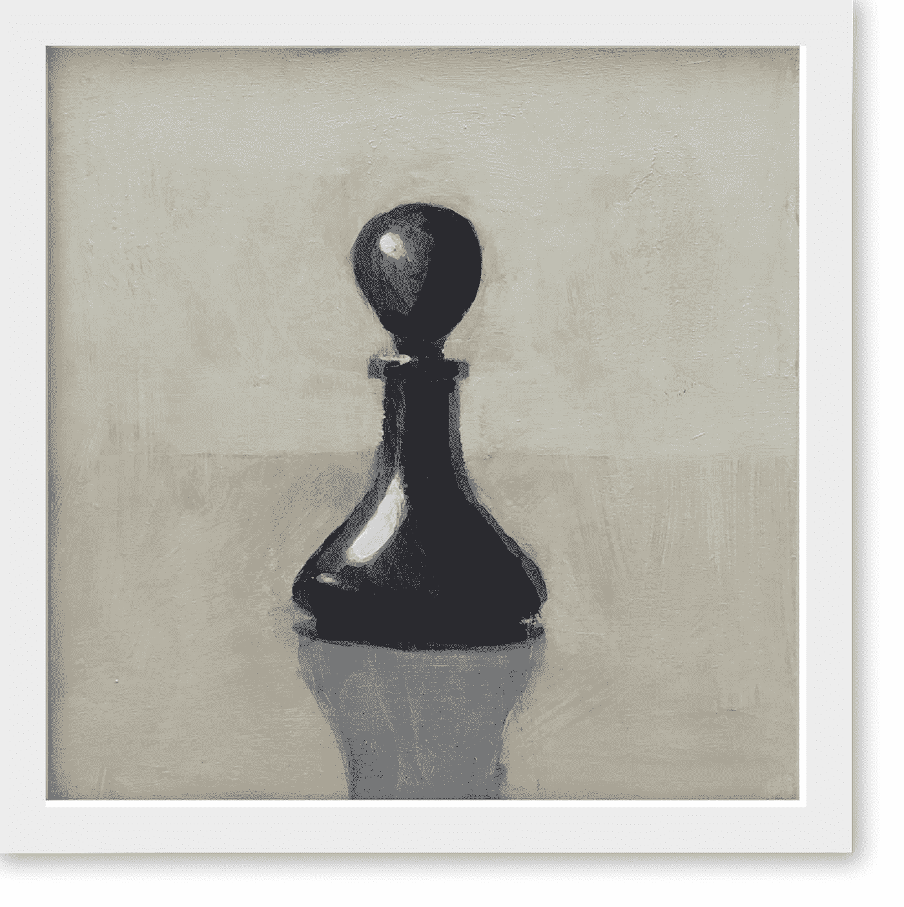

### 18 立方体入门：黄油块
通常把主体想象成基本几何形状会有所帮助，而不是试图画出完整的轮廓。接下来几页我们将探讨这一点。让我们从最简单的开始——立方体或盒状形体。稍有变化，这种形体出现在无数主题中：建筑、汽车、家具等等。最重要的是要记住，立方体的所有垂直线彼此平行，所有水平线也彼此平行。因此，即使你从角度看立方体的顶面，两侧看起来似乎倾斜，那两条侧边仍会彼此平行，顶部和底部的边缘也是如此。亮边刷非常适合绘制立方体，因为它的形状可以创造出非常清晰的线条和棱角。
材料
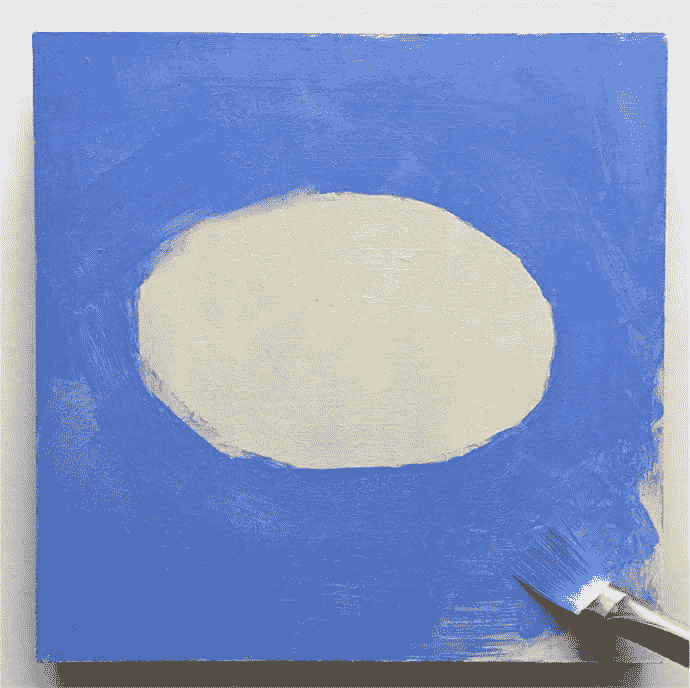
**1** 用 #6 平头刷将画布调成 Unbleached Titanium 混少量罩光介质的颜色。用 Titanium White 和 Ultramarine Blue 调配出中调蓝色。用 #6 平头刷绘制背景，在中央留出一个未上色的椭圆形作为盘子。
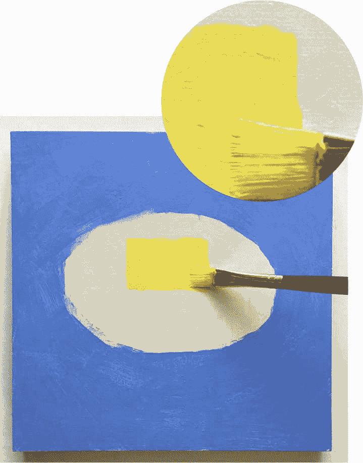
**2** 用 Titanium White 和少量 Cadmium Yellow Medium 调配出淡黄色。用 #4 亮边刷在盘子中央稍上方画一个矩形作为黄油块。这是检验亮边刷准确度的好机会——它非常适合画出清晰、方正的棱角。待干。
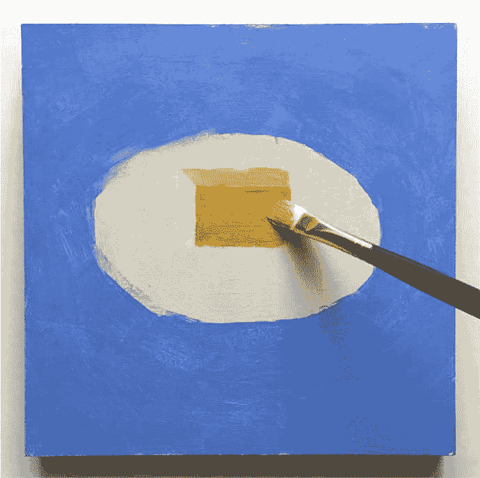
**3** 黄油的左侧光线最亮；用 #4 亮边刷将其涂成由 Titanium White 和极少量 Cadmium Yellow Medium 调配的非常淡的黄色，将顶部和底部边缘倾斜形成平行四边形，使黄油呈现透视效果。用 Yellow Ochre 覆盖步骤 2 中黄色的半部分，以营造阴影的前缘。
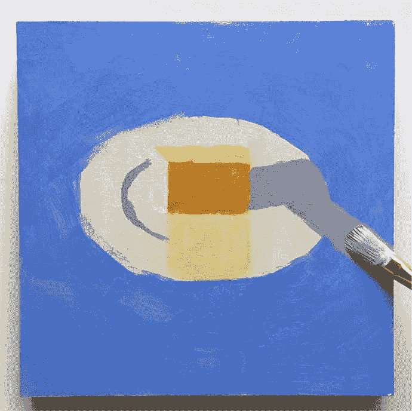
**4** 用 Unbleached Titanium 与极少量 Yellow Ochre 调配的非常稀薄的淡色，绘制盘子上黄油块的倒影，以极薄的罩色方式涂抹，营造出盘子光亮反光的错觉。用 Unbleached Titanium 和 Mars Black 调配出淡灰色。换成 #4 椭圆刷，在左侧画一个新月形以表现盘子的凹陷，在盘子右侧画出投射阴影，并画一条斜线表示刀。
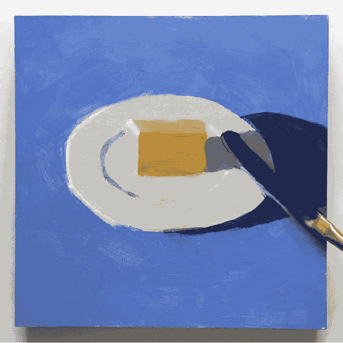
**5** 用 Mars Black 勾出黄油刀的剪影。在蓝色背景上，用 Ultramarine Blue 混少量 Mars Black 画出盘子本身投下的阴影。换成 #1 圆头刷，用纯 Titanium White 在黄油和盘子上添加高光。用步骤 4 中的灰色混合色绘制刀的细节。
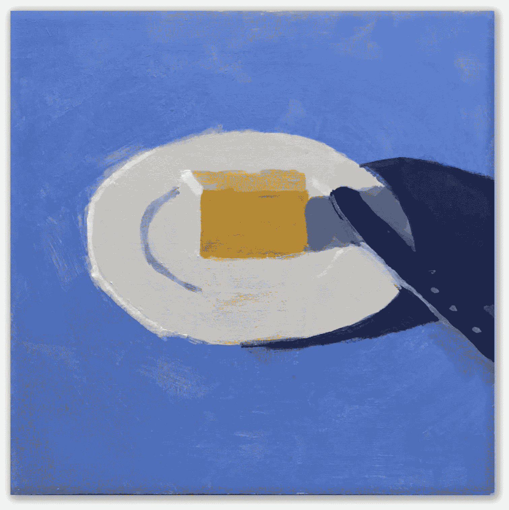
只需亮边刷几笔干净的笔触，就能创造出令人信服的立方体。环顾一下你的家，看看还能找到哪些立方体：书、塑料食品容器或方形铁罐都可以用类似的方式绘制。

### 19 椭圆入门：菠萝片
这里我们要看的是透视中的圆形。这听起来并不复杂。如果你把盘子等圆形物体挂在面前墙上，你会正视它，它看起来就是完整的圆形，因为所有部分与你的距离相同。但如果你把它放在面前的桌子上，后缘离你比前缘更远，形状看起来就会略微失真：不再是完整的圆形，而更像椭圆形。绘制或绘画椭圆的诀窍在于大胆自信。如果动作太慢，更容易过度思考而画错形状。为了进入状态，退后一步，离开画布，用整个手臂在空中练习画形状——有点像艺术家版的“空气吉他”。
材料
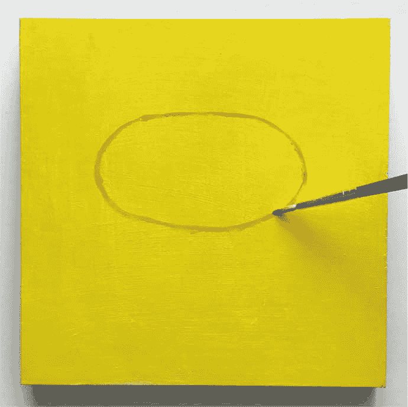
**1** 用 #6 平头刷将画布调成 Cadmium Yellow Medium 混少量罩光介质的颜色。用 #1 圆头刷和 Yellow Ochre 在面板中央画一个椭圆，作为菠萝片的整体形状，尽量保持对称；不必完美，后续可以整理形状。
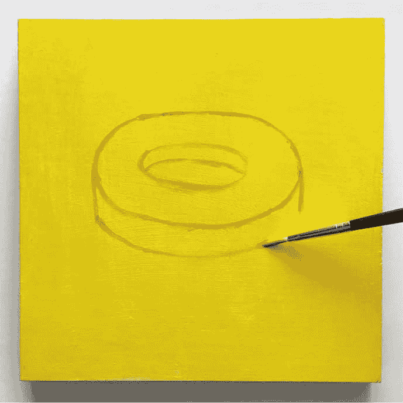
**2** 对于片中间的孔，在第一个椭圆中央画一个较小的椭圆，然后在中间加上一个半椭圆（两端向下弯曲的线）以确定孔的深度。回到步骤 1 的椭圆，从两侧向下各加几条直线，与另一个半椭圆（这次是两端向上弯曲的线）相连。
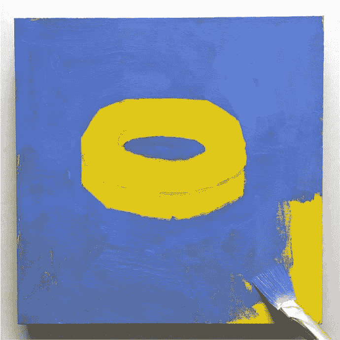
**3** 用 Ultramarine Blue 和 Titanium White 调配出明亮的蓝色。用 #6 平头刷绘制背景，同时勾出菠萝片的形状。
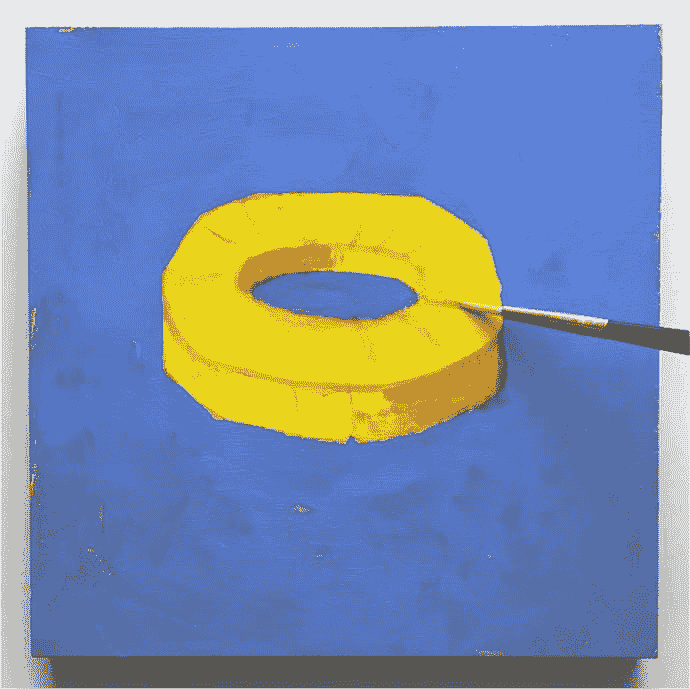
**4** 现在可以开始让菠萝片看起来有三维感了。光源位于左上方，因此菠萝环内侧左侧和右侧外缘有阴影区。用 #1 圆头刷和 Yellow Ochre 画出这些阴影。然后画出从菠萝中心向外辐射的线条。
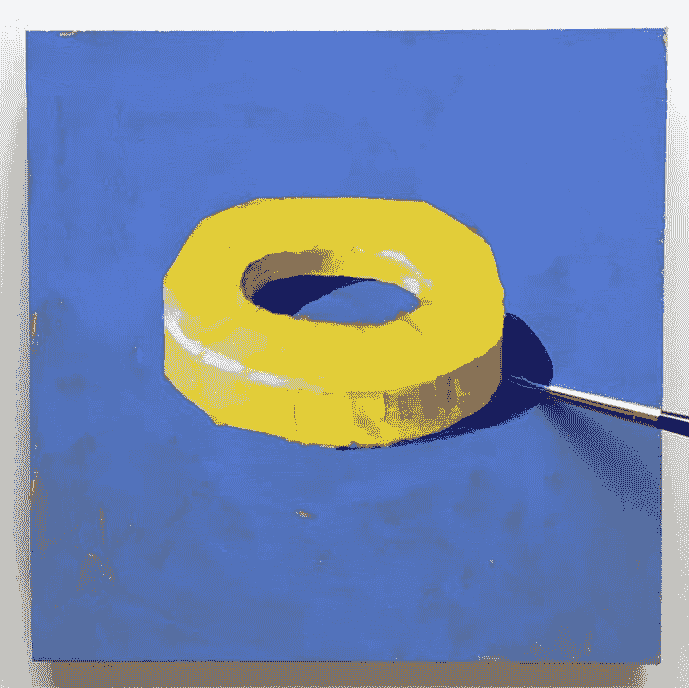

`5` 用 #1 圆头画笔继续绘制明暗区域，以营造出 3D 效果。对于最亮的高光，仅使用钛白。对于中间调，使用逐渐变暗的混合色：钛白 + 镉黄中；单独使用镉黄中；然后是镉黄 + 少量黄赭。最后，加入少量煅烧赭石以获得最深的黄色调，并使用群青混合少量玛斯黑来绘制投射阴影。

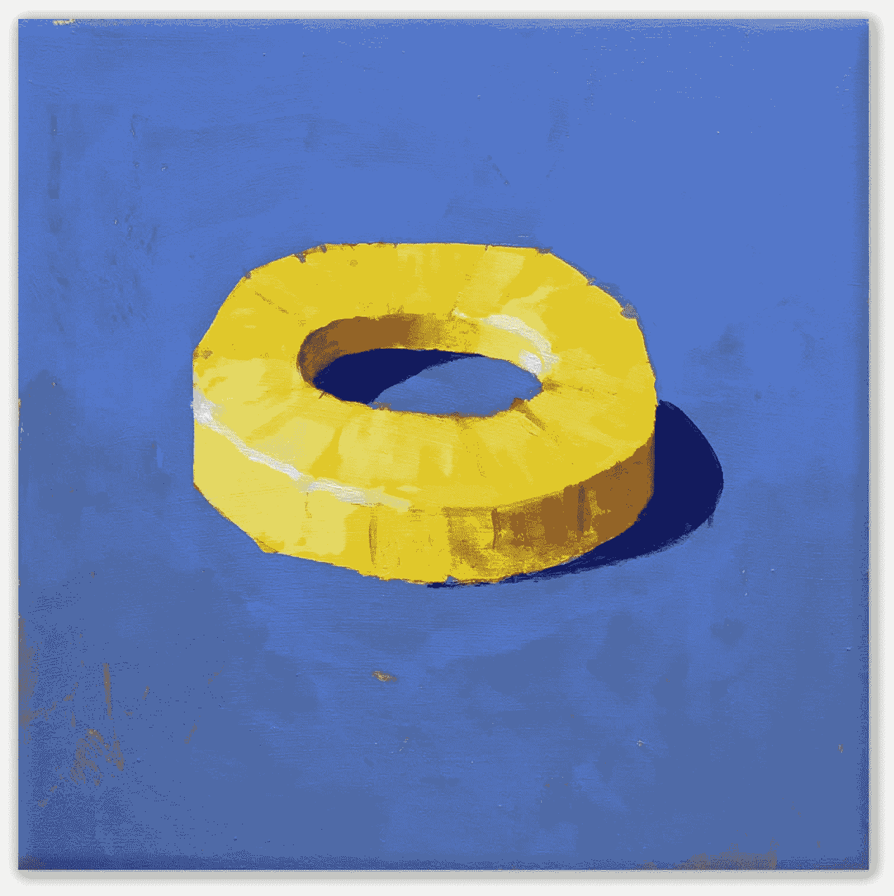

大胆的原色真的让这幅画更出彩。若想要更细腻的效果，可使用和谐的色彩方案重复练习，背景使用柔和的橙色或橙红色。

### 20 球体的介绍：针垫
下一个我们要研究的几何形状是球体——这种形状存在于众多日常物品中，从水果到足球。那么如何让球体看起来圆润且具有三维感，而不仅仅是一个扁平的圆呢？关键在于利用物体远离光源时明暗值的差异：我们的眼睛会告诉我们，如果物体的某个部分处于阴影中，那么该部分一定是背向光源的——因此我们本能地“读”出它是有圆度的。你将在画布上湿中湿地混合颜色，而不是制造出鲜明、清晰的明暗变化。渐变非常细微，几乎难以察觉，值得练习这一点，因为丙烯快干的特性会使实现它变得困难。这项练习还介绍了轮廓线的概念——线条围绕物体形态弯曲，以赋予其深度和立体感。

#### 材料
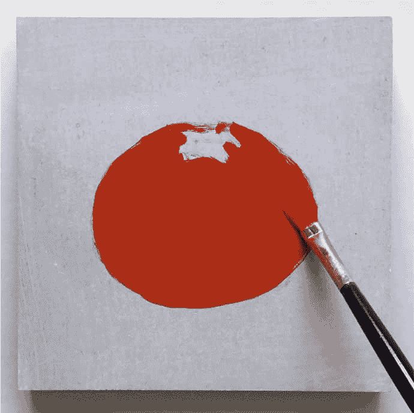

`1` 用萘酚红和少量镉黄中调配出暗淡的红橙色。使用 #4 菲伯特画笔为针垫绘制椭圆形轮廓，顶部留出星形不涂色。针垫并非纯圆形；将其画成椭圆形有助于使其看起来在填充物的重量下略微被压扁。

`2` 在第一层仍湿润且不清洗画笔的情况下再次覆盖形状，在向左侧和底部的阴影区域推进时，逐渐在混合色中加入少量玛斯黑和煅烧赭石。慢慢“晕染”颜色，使湿润的颜料在画布上融合，形成细微的色调渐变。不要担心一些不规则之处——针垫本就会有一些褶皱。

`3` 用镉黄中、少量未漂白钛白和极少量玛斯黑调配出深橄榄绿色。使用 #4 亮光画笔绘制顶部的星形。换用 #1 圆头画笔绘制向下辐射的条纹，将两侧外条纹沿形态弯曲。在条纹底部附近加入少量群青，用于阴影部分。

`4` 用钛白和群青调配出明亮的蓝色。使用 #6 平头画笔绘制背景，同时勾出针垫的形状并为别针留出空隙。由于别针与底画布颜色相同，留空比事后添加更容易——而且画笔的形状使得别针可以非常笔直地绘制。

`5` 将钛白与少量罩光介质混合，使用 #1 圆头画笔在针垫前方添加几枚别针。用群青、未漂白钛白和玛斯黑的混合色绘制针垫下方的投射阴影。用萘酚红、镉黄中和少量煅烧赭石的混合色绘制别针投下的阴影，确保它们遵循针垫的轮廓，就像步骤 3 中的绿色条纹一样。星形周围的阴影使用相同混合色。最后，用你喜欢的任何颜色绘制别针针头。

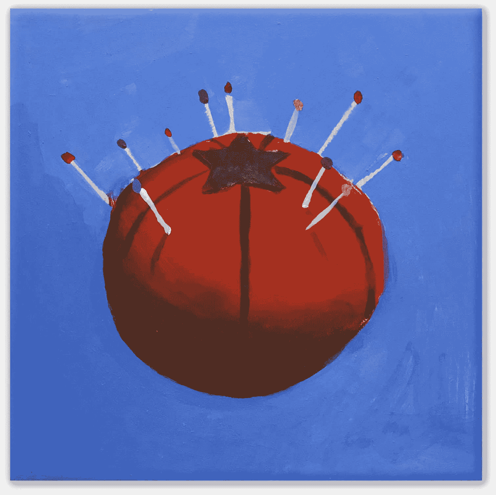

我画中的光源直接位于针垫上方。完成这幅画后，尝试将光源置于左侧或右侧，看看它如何影响阴影。

### 21 圆锥的介绍：节日帽
圆锥是另一种简单形状，但了解光影在其上的作用很重要。在最接近光源的一侧，高光区域沿圆锥形状从上到下平行于边缘，呈大致三角形。（根据主体材质的不同，可能没有真正的高光——只是比其他区域明亮的区域。）随着你向远离光源的圆锥中部移动，高光区域更接近垂直直线。在最远离光源的一侧，阴影区域再次平行于边缘，呈大致三角形。像针垫一样（参见第 76 页），这是一项创造平滑明暗过渡的练习。你可以继续润色渐变——反复分层和精修会带来更平滑的渐变——但进行到何种程度完全由你决定。

#### 材料
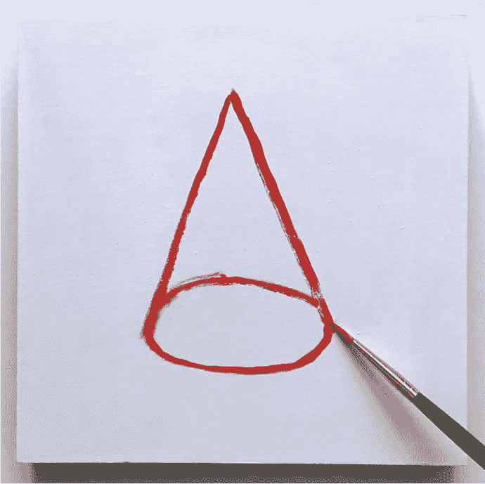

`1` 使用 #1 圆头画笔和萘酚红，为帽子开口绘制椭圆，并从其引出线条形成三角形。起初完整绘制整个椭圆会很有帮助，即使在完成画中我们只能看到前弧。

`2` 用萘酚红和极少量镉黄中调配出暗淡的红橙色，并用 #4 菲伯特画笔填满帽子。

`3` 在其干燥过程中，向红橙混合色中加入少量玛斯黑并绘制阴影的右侧，在画布上晕染颜色。向红橙混合色中加入少量未漂白钛白并绘制较亮的左侧，同样晕染颜色。这些明暗区域形成大致三角形。用镉黄中和极少量未漂白钛白调配颜色，使用 #6 平头画笔绘制背景，同时勾出帽子的形状。待干。

`4` 使用 #4 菲伯特画笔和钛白混合少量未漂白钛白，绘制顶部的毛球和帽檐周围的蓬松装饰。白色部分不透明需要两层。待干。

`5` 将未漂白钛白与少量玛斯黑和一些罩光介质混合。使用 #4 菲伯特画笔绘制毛球和装饰处于阴影的部分。用 #4 亮光画笔绘制投射阴影，使用黄赭石混合大量罩光介质以保持半透明；这里可能也需要两层。

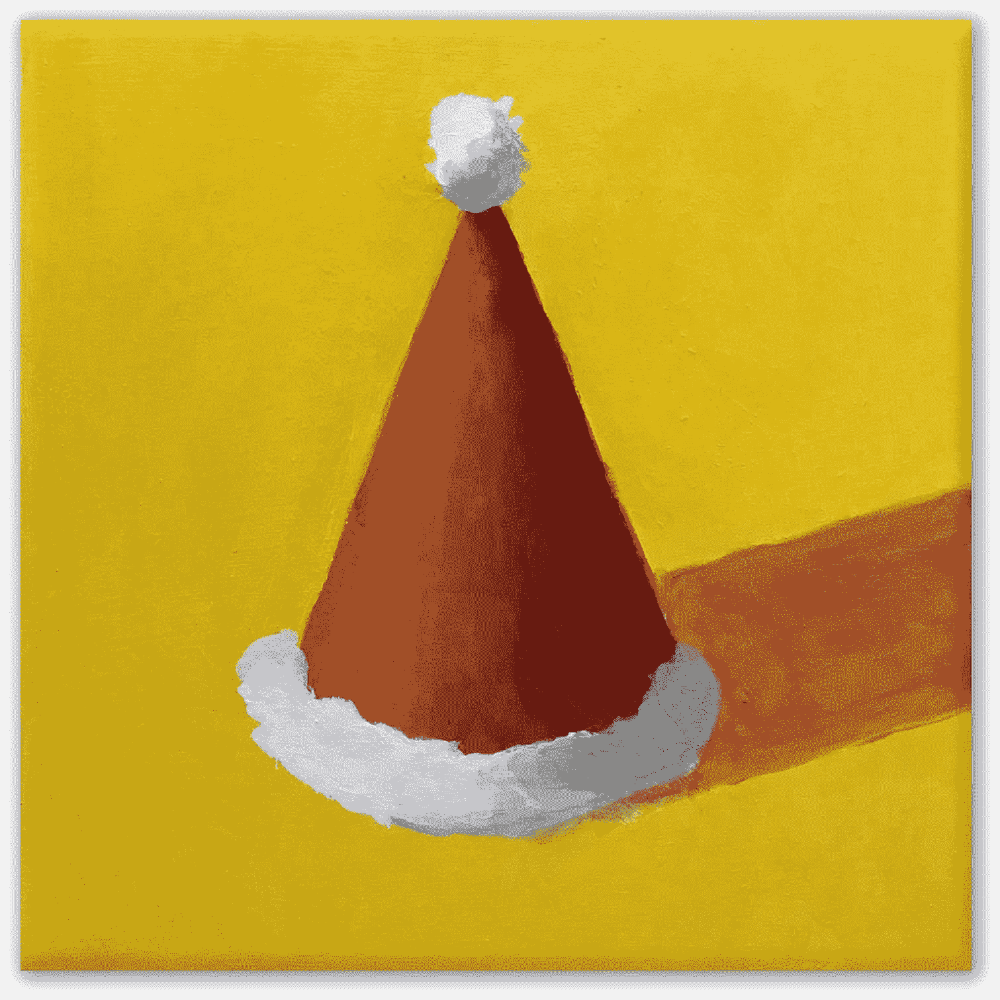

这里从明到暗的过渡非常细微。如果你觉得困难，可以寻找表面更具反射性的圆锥形状，例如金属厨房漏斗，高光和阴影区域会更明显。

### 22 立方体上的明暗：多层三明治
我们已经研究过如何绘制立方体形状（参见第 72 页）；这里，我们专注于让立方体看起来具有三维感。对于任何物体，最接近光源的一侧（无论是太阳还是台灯等人工光源）会被明亮照亮，而相反的一侧则处于阴影中。对于硬边物体，例如建筑物相互垂直的两侧或本练习中的三明治，明暗之间会有明显的转变。首先需要确定光源来自何处。这里，光源位于三明治上方并偏左。顶面接收的光最多，因此最亮；左侧面次之，光线只是掠过它，所以比顶面稍暗；右侧（正面）面没有直接光线，只有环境光，因此最暗。

#### 材料
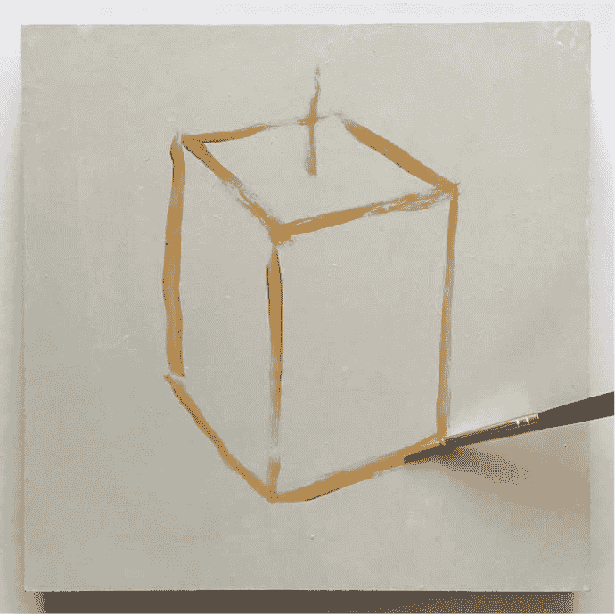

### 立方体

#### 1
使用 #6 平头刷，用混有少量透明媒介剂的钛白未漂白调匀画布。用少量焦赭调和黄赭土，并使用 #1 圆头刷绘制立方体的边缘。记住垂直线彼此平行，顶部和底部边缘的斜线也彼此平行。在顶部画一条线表示鸡尾酒棒。

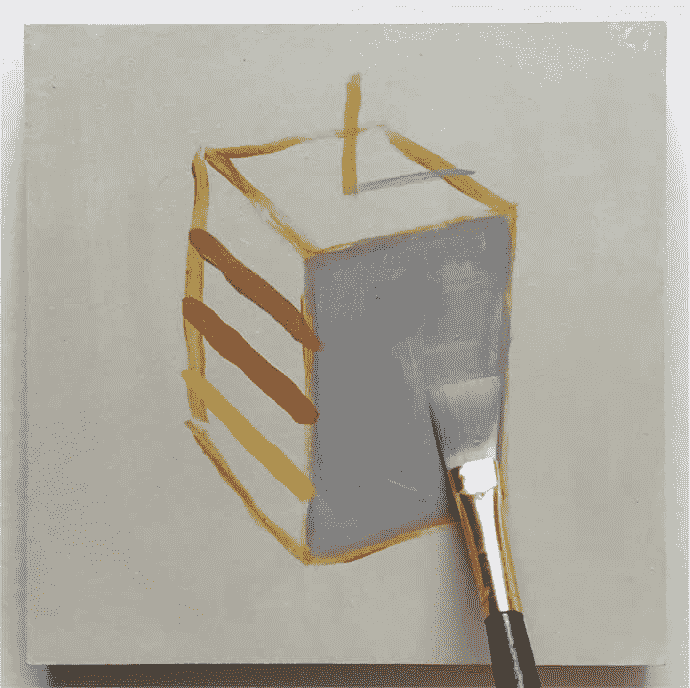

#### 2
使用 #4 杏仁形刷，涂上中等色调的条纹作为馅料，角度与顶部和底部边缘相匹配：镉黄中号 + 群青（生菜）；萘酚红 + 钛白未漂白（火腿）；镉黄中号（奶酪）。用少量马尔斯黑调和钛白未漂白，使用 #6 平头刷绘制正面（最暗）平面。用这种灰色绘制鸡尾酒棒的阴影；这告诉我们光线来自哪个方向。晾干。

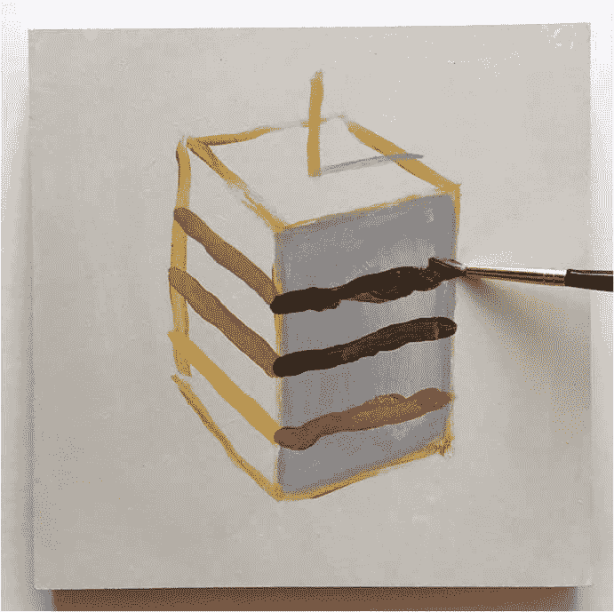

#### 3
现在通过添加少量马尔斯黑来制作生菜和火腿颜色的阴影（更深的色值）；奶酪使用黄赭土。用 #1 圆头刷将它们涂在正面平面上。让线条有点颤抖，看起来像是馅料在渗出。

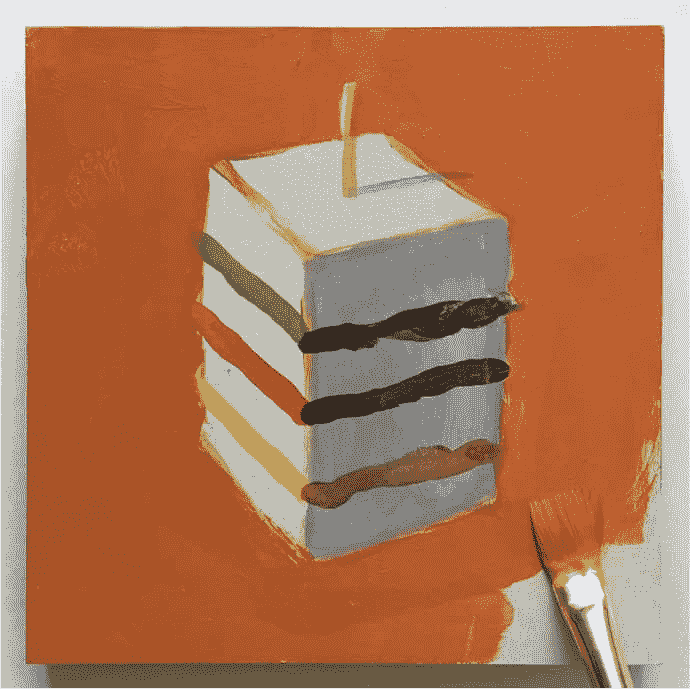

#### 4
用镉黄中号、少量萘酚红和一点钛白未漂白调配出明亮的橙色。使用 #6 平头刷绘制背景，同时勾出三明治的形状。晾干。

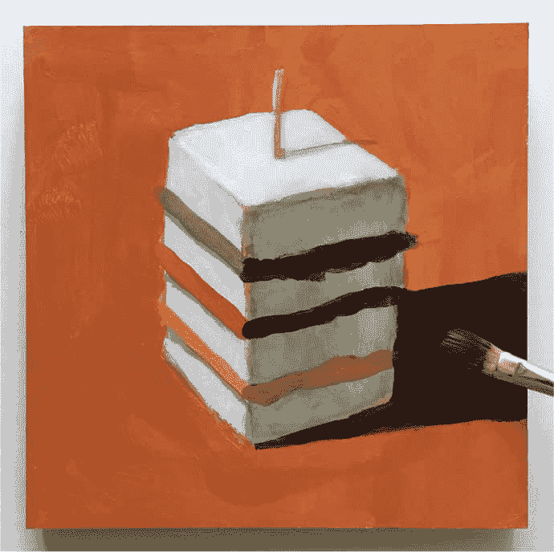

#### 5
使用 #4 亮光刷，用钛白加少量透明媒介剂绘制三明治明亮的顶部。左侧加入少量钛白未漂白到此混合色中：该平面需要比顶部略暗，才能看起来令人信服地具有三维感。使用 #1 圆头刷和步骤 2 中的灰色混合色，在左侧平面的中色调馅料下方添加阴影。使用 #6 平头刷，用萘酚红、马尔斯黑和焦赭的混合色绘制投射阴影。

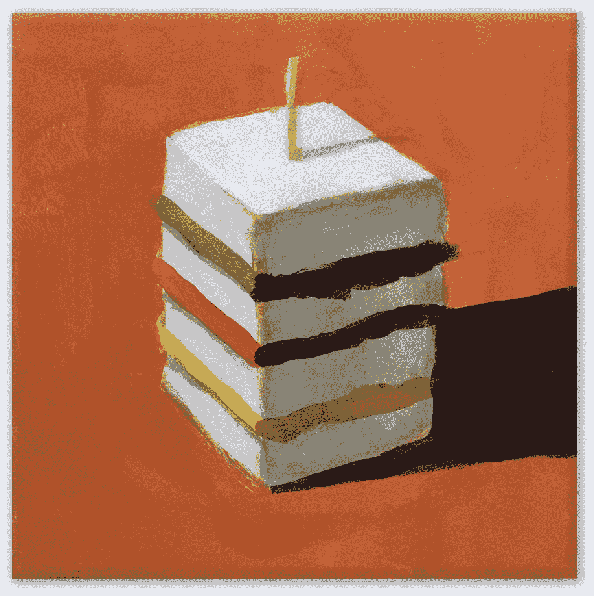

立方体是您首次尝试绘画三维物体时的绝佳形状，因为您可以专注于把握好明暗值，而不必担心绘制复杂的形状。您可以尝试的其他立方体形状有书堆或一盘巧克力布朗尼。

### 23 反射表面：象棋兵

高度反射的表面，如抛光木材、硬塑料、玻璃和金属，其反射会非常清晰、明显。高光也会边缘分明且明亮：例如看象棋兵的左侧，光线直接照射到物体上。在本项目中，象棋兵所坐的桌面也是反射性的：光线也会从桌面反射到象棋兵的右侧。这是一个微妙的细节，但有助于传达材料的反射特性。本项目还使用了名为灰色调画的经典技法，即层层叠加薄而透明的灰色油画，直至出现细微的明暗渐变。

#### 材料

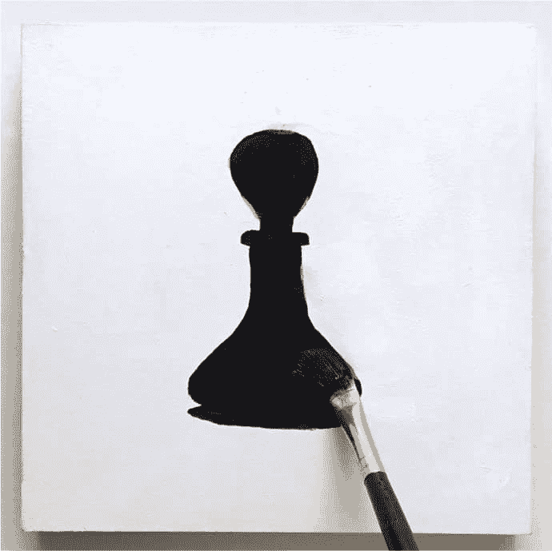

#### 1
使用 #4 杏仁形刷和马尔斯黑绘制象棋兵的形状，尽量保持对称。晾干。

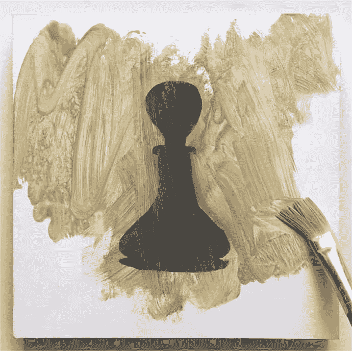

#### 2
调配钛白未漂白、少量黄赭土和大量透明媒介剂的薄釉。使用 #6 平头刷松散地刷遍整个画布。此釉会将黑色的明暗值改变为中灰。

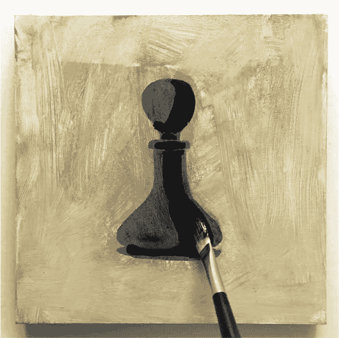

#### 3
现在开始塑造象棋兵的形态。用 #4 杏仁形刷和马尔斯黑描绘远离光源的象棋兵面。在象棋兵右侧边缘留下一丝中灰，那里光线反射回表面。

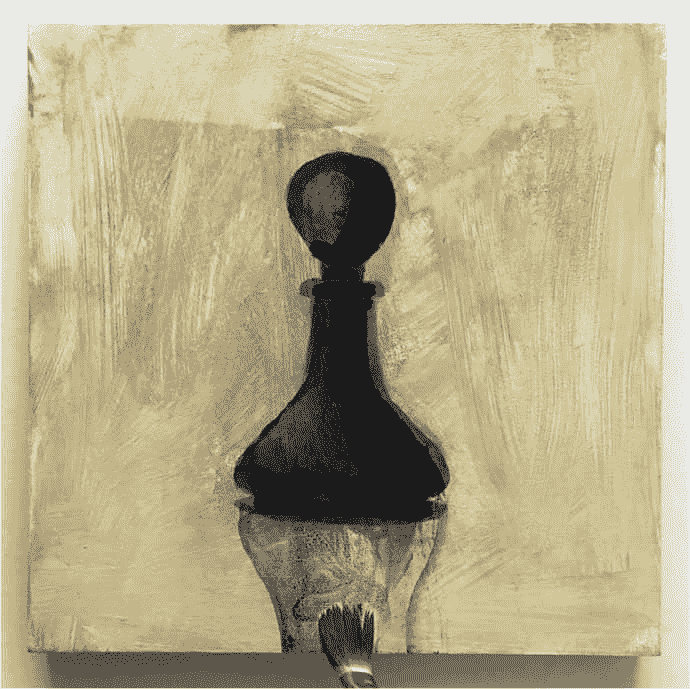

#### 4
用透明媒介剂稀释马尔斯黑，并小心地晕染在象棋兵左侧，光源直接照射物体之处，以使象棋兵黑色表面与灰色反射之间的过渡更细腻。用同样的混合色填充桌面上的反射。桌面非常有反射性，因此要使反射的形状清晰锐利。

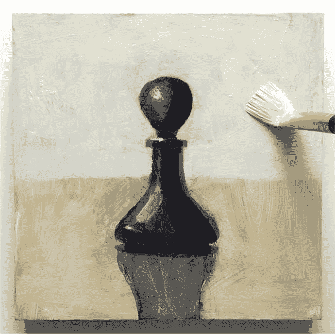

#### 5
混合钛白未漂白和钛白。使用 #6 平头刷在象棋兵左侧添加更明亮的高光，注意保持高光形状清晰且边缘锐利。用同样的混合色绘制象棋兵后面的墙壁，同时勾出象棋兵的形状。用 #6 平头刷的边缘和钛白收紧并细化高光，然后用钛白未漂白和钛白的混合色为桌面和反射上釉，以统一整体。

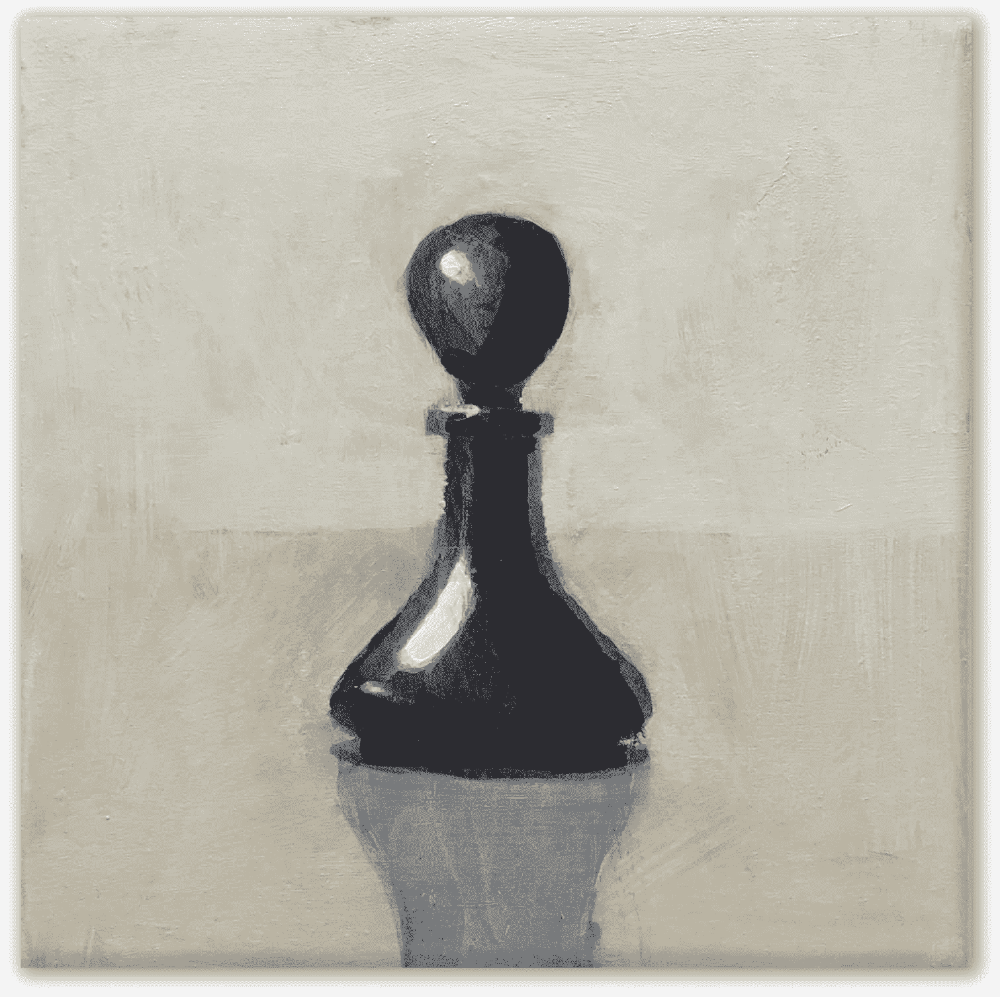

对于这种题材，请仔细注意高光的形状以及明暗值。尝试在不同表面，如哑光木材或织物上再次绘制同一题材，看看这对光线反射方式有何不同。

### 24 圆柱体入门：煎饼堆

我们接下来要看的下一个几何形状是圆柱体，本质上是一系列叠放在一起的椭圆。我选择煎饼堆来让您入门：虽然它们是椭圆形的，但边缘略不规则，因此在把握形状时您有更大的余地——它们不像瓶子那样僵硬。绘画圆柱体时，您通常只能看到椭圆的前弧（除非您的题材是透明的，如玻璃花瓶）。但即使您稍后会覆盖这些线条，开始时画出整个椭圆也有帮助。如果从一开始就把题材视为三维形状，您将更清晰地感受到其圆润度以及光线开始衰减的位置。

#### 材料

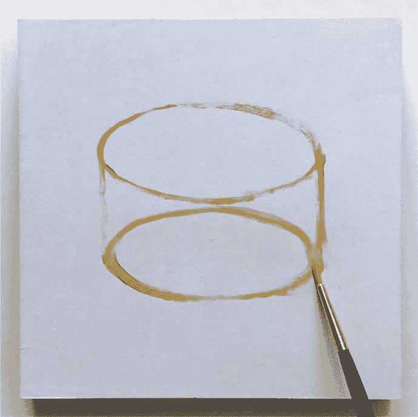

#### 1
用透明媒介剂调和黄赭土。使用 #1 圆头刷绘制两个椭圆，一个在另一个上方，基本相触且形状和大小尽可能接近。用直线垂直线连接它们的外边缘。即使我们看不到底部椭圆的后弧，开始时画上它也有帮助，这样您才能整体把握圆柱体。

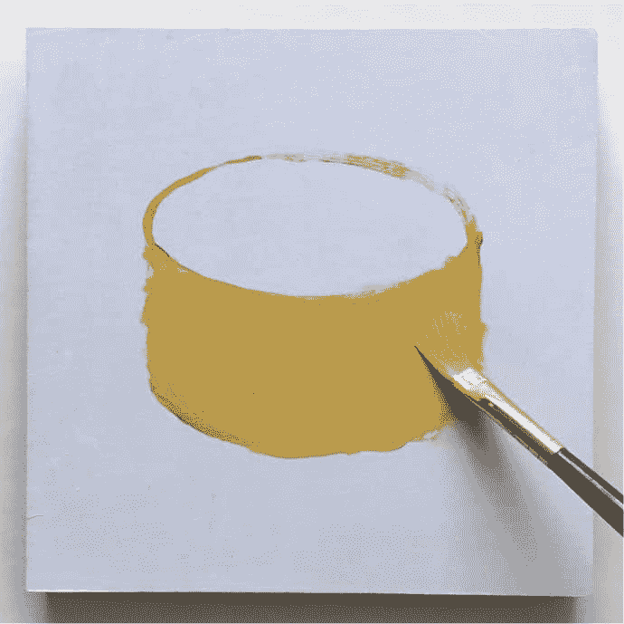

#### 2
用钛白未漂白、黄赭土和少量镉黄中号调配煎饼的基础颜色。使用 #4 杏仁形刷填满整个正面形状。再次强调，您应该考虑圆柱体整体的体积，即使稍后您会将其分解。边缘不必精确——现实中它们并不那么均匀规则。

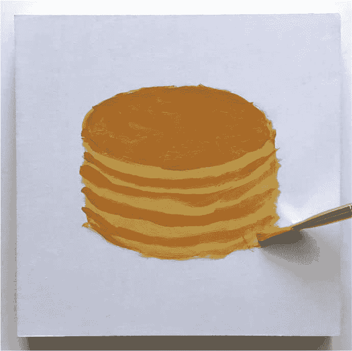

#### 3
用黄赭土、焦赭、钛白未漂白和少量萘酚红调配煎饼的棕色“熟”色。用 #4 杏仁形刷的宽面绘制堆顶；将刷子侧放绘制分隔煎饼的轮廓线。确保轮廓线遵循原始椭圆的弧线。晾干。

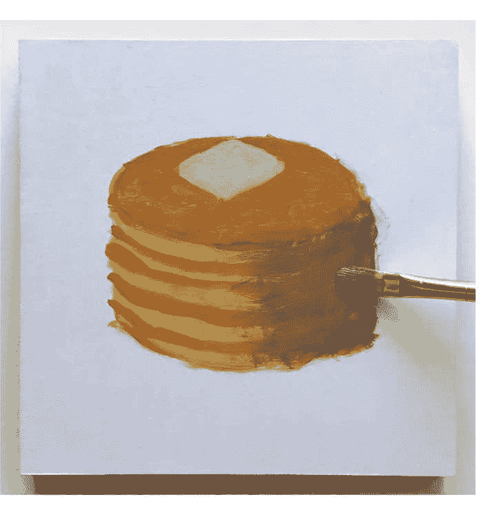

#### 4
用少量镉黄中号调和钛白未漂白，用 #4 亮光刷绘制黄油块。对于堆的阴影右侧，混合钛白未漂白、马尔斯黑、少量焦赭和萘酚红，并加一点群青使其变冷，再加大量透明媒介剂使其半透明；您需要能够看到下方轮廓线的痕迹。用 #4 杏仁形刷涂抹。

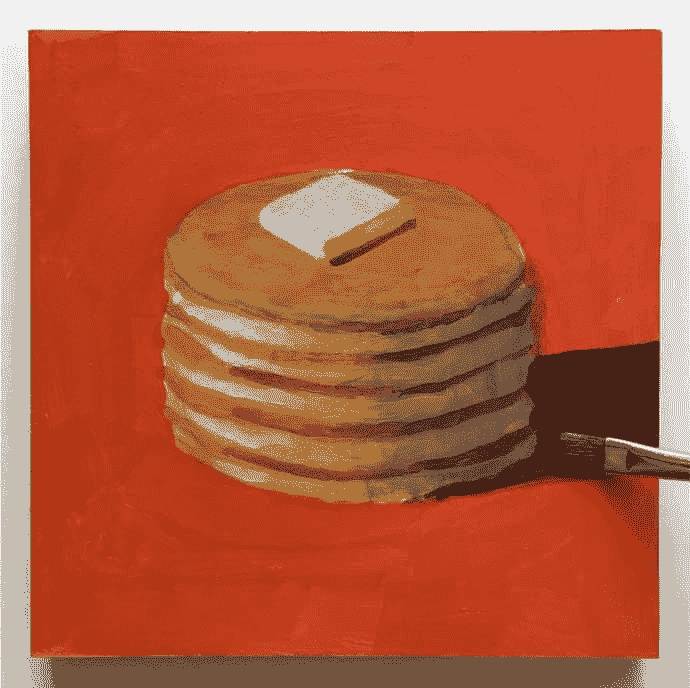

#### 5
使用 #6 平头刷和橙红色（Napthol Red + Cadmium Yellow Medium）绘制背景，同时勾出煎饼堆的形状。使用 #1 圆头刷细化黄油和煎饼：黄油阴影面（Yellow Ochre + Cadmium Yellow Medium）；黄油左侧（Titanium White）；煎饼上的浅色（步骤 4 中的黄油颜色）；黄油和堆右侧的投射阴影（Burnt Sienna）。使用 #4 亮边刷，用 Napthol Red、Mars Black 和大量罩光介质混合的颜色绘制煎饼右侧的阴影。

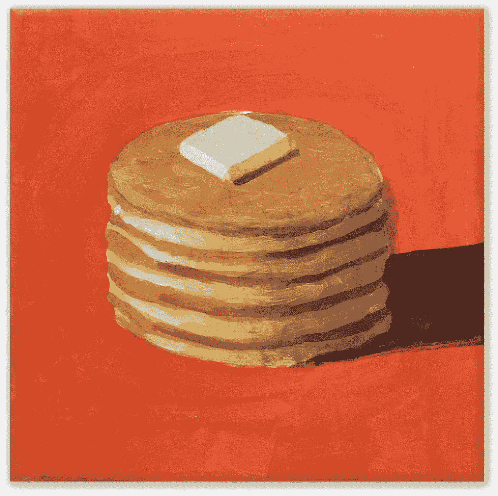

重复步骤 1，改变视角。从正上方观看时，椭圆看起来更像圆形；视角越低，椭圆看起来越窄。

### 25 创建统一的色彩方案：仙人掌
本项目使用非常有限的调色板，创作出几乎单色的图像，由绿色和各种灰色的明度和深浅构成——一种类似色方案（见第 26 页）。使用类似色是营造宁静、祥和氛围的经典方法。但这里有一个转折：在绘画中，有时看不见的东西与看得见的东西一样重要。即使乍看之下并不明显，相同的颜色——Cadmium Yellow Medium——被用在每一个调色中，这有助于统一画面。该颜色还作为一层薄而透明的罩光层涂抹在整幅图像上，微妙地改变下方和上方叠加的颜色，增添柔和温暖的光泽。

#### 材料
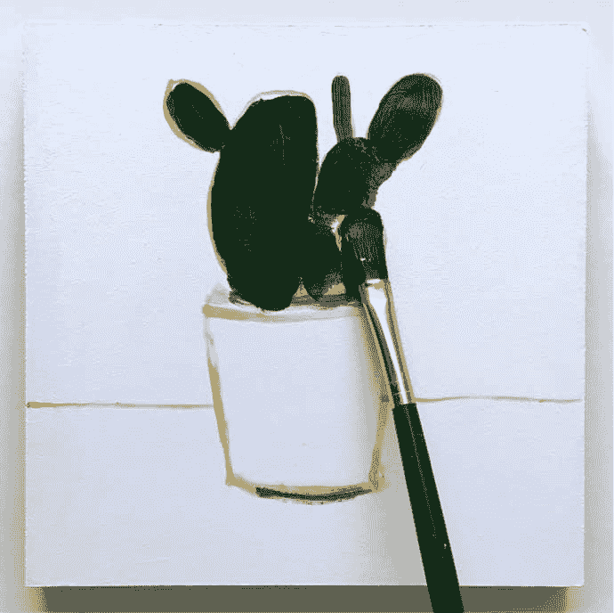

#### 1
使用 Yellow Ochre 和 #1 圆头刷绘制花盆的圆柱体，并在其上画一条水平线作为桌面。用 Mars Black、少量 Cadmium Yellow Medium 和罩光介质调出深绿色。用 #4 扁圆刷勾出椭圆形的叶片形状，并在花盆底部添加一笔。待干。

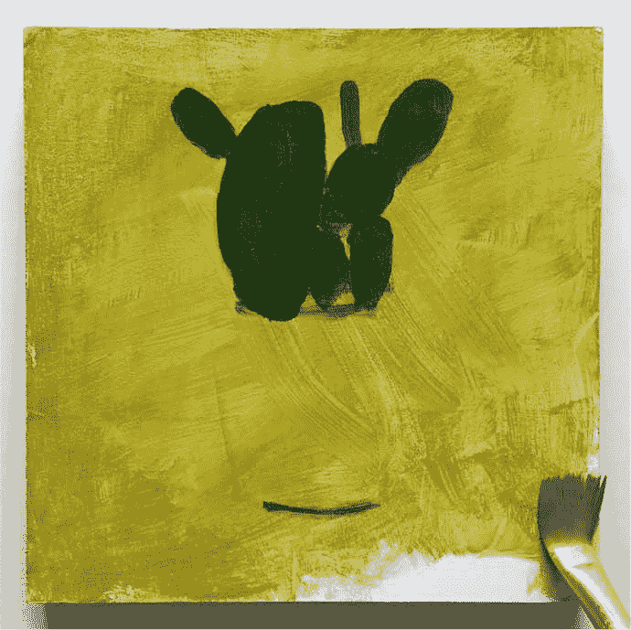

#### 2
用 Cadmium Yellow Medium、Yellow Ochre、少量 Mars Black 和大量罩光介质调出一层非常稀薄、透明的黄绿色罩光。用 #6 平头刷将此混合物涂抹在整个画布上。注意罩光如何影响仙人掌的绿色——它起初是相当酸性的绿色，但罩光使其柔和。待干。

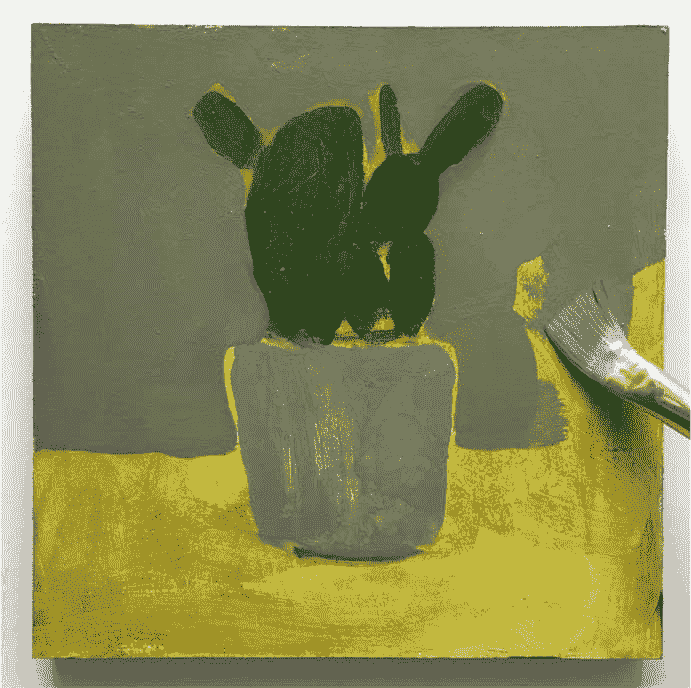

#### 3
用 Unbleached Titanium、Mars Black 和一点点 Cadmium Yellow Medium 调出中调灰色，用 #4 扁圆刷绘制花盆。加入更多 Cadmium Yellow Medium 使灰色向绿色推移。使用 #6 平头刷将此颜色涂抹在背景上，同时勾出花盆和仙人掌的形状。这种背景色的温暖部分源于下方的黄色罩光。

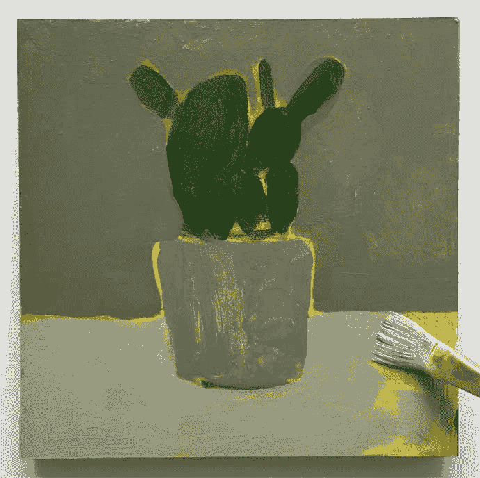

#### 4
用 Unbleached Titanium、Cadmium Yellow Medium 和少量 Mars Black 调制的浅灰色绘制桌面。注意所有颜色如何很好地和谐统一：这是因为 Cadmium Yellow Medium 和 Mars Black 是所有调色中共同使用的颜色。

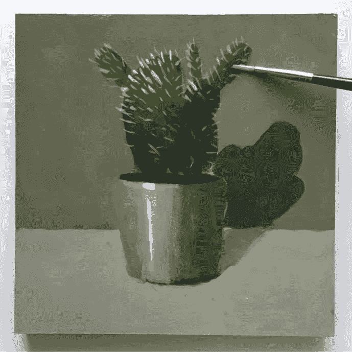

#### 5
稍微加深桌面混合色并绘制花盆的亮面。墙面和花盆上的阴影色均由相同颜色按不同比例调配而成——Mars Black、Unbleached Titanium 和 Cadmium Yellow Medium。用 #4 扁圆刷绘制它们。使用 #1 圆头刷和 Titanium White 绘制仙人掌上的刺和花盆上的高光。

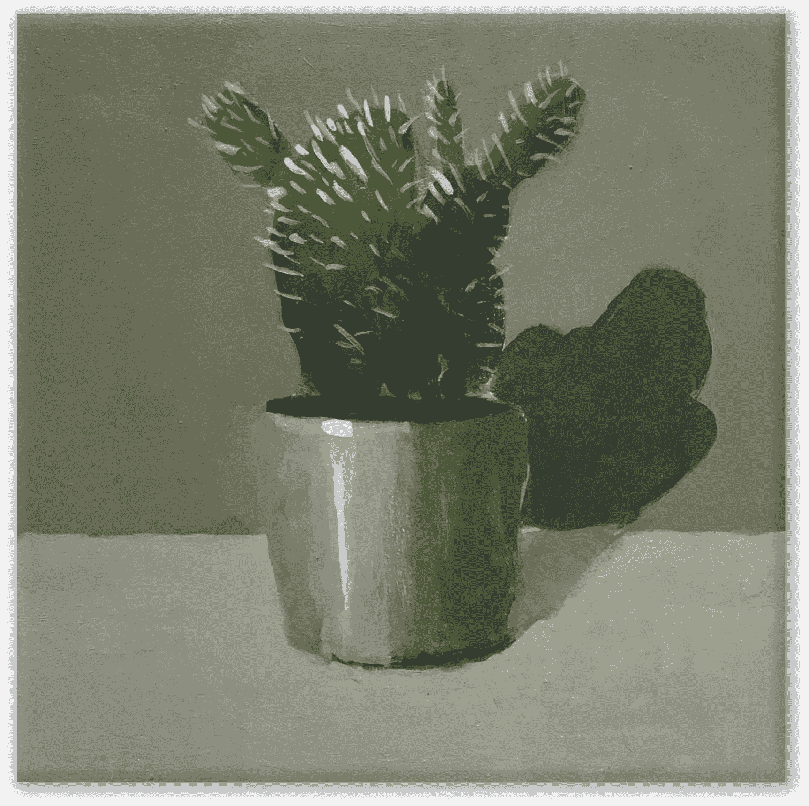

绿灰为主的这幅简洁静物——但请注意，初始的薄黄色罩光如何为整幅画带来温暖的光泽。

### 26 多个球体：玩具熊猫
在本项目中，我们从一系列相互咬合的球体构建出复杂的形态。将它们与简单球体（见第 76 页）完全相同的方式处理，但要花时间单独评估每个球体，观察光暗变化的位置。例如，熊猫突出的鼻子遮挡了脸部一侧的光线，因此脸部的这一侧比身体阴影面略暗。这些是细微的差别，但有助于表现圆润形态的变化。也可以尝试不同的笔触，看看能创造出什么质感。用点拍的方式上色会产生轻微的斑驳效果，这非常适合这种可爱熊猫所用的仿毛，而干刷处理可能更适合由亚麻等编织面料制成的玩具。

#### 材料
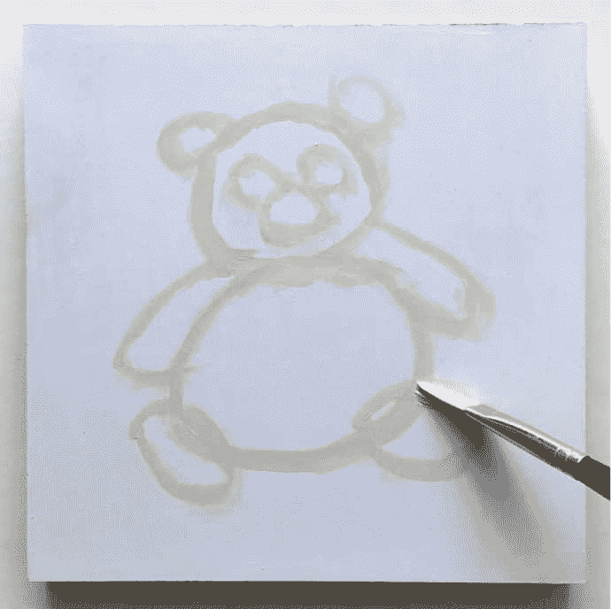

#### 1
使用 #4 扁圆刷和用罩光介质稀释的 Unbleached Titanium，为熊猫的各个部位画出一系列圆和椭圆。比例不必完美；这些只是初始的引导线。

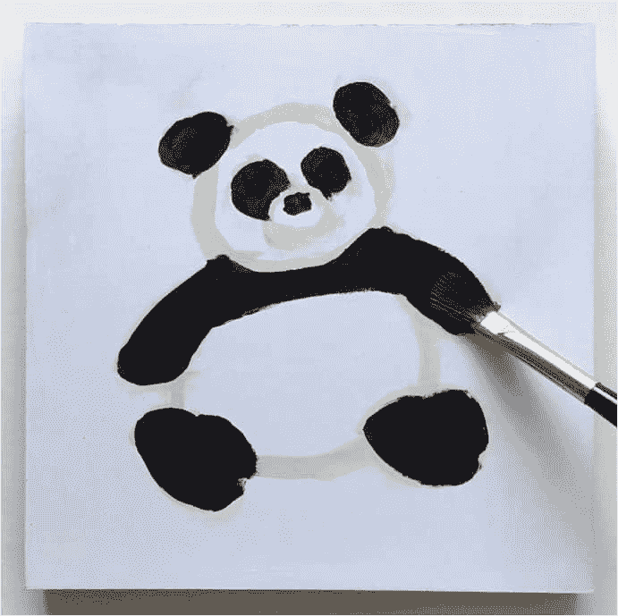

#### 2
使用 #4 扁圆刷和用少量罩光介质稀释的 Mars Black 填满熊猫的黑色部分。

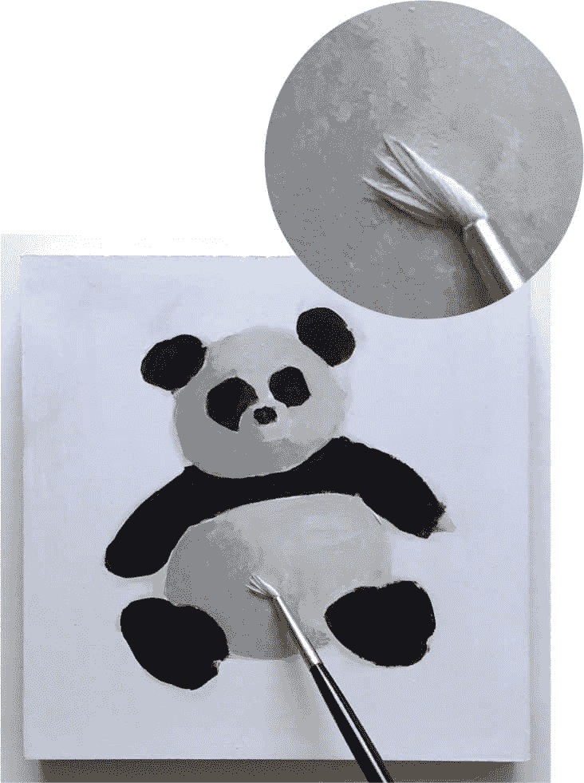

#### 3
用 Unbleached Titanium 和少量 Mars Black 调出浅灰色。使用 #1 圆头刷填满球体左侧的阴影白色区域。随着向右侧推进，逐渐加入更多 Unbleached Titanium，移出阴影并朝向光源。

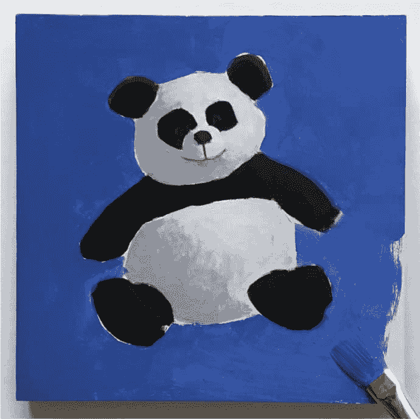

#### 4
在头部和腹部最亮的部分使用纯 Titanium White。用 Mars Black 和少量 Unbleached Titanium 调出深灰色。勾出眼睛，画出嘴巴并绘制耳朵、鼻子、手臂和腿部顶部的浅色部分（见最终画作）。使用 #6 平头刷和 Ultramarine Blue 与 Unbleached Titanium 的混合色绘制背景，同时勾出熊猫的形状。

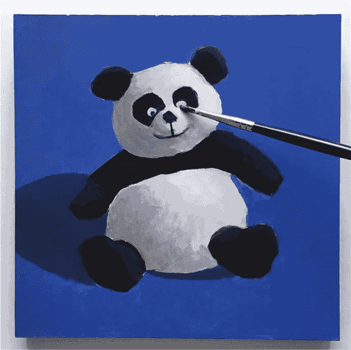

#### 5
用 Ultramarine Blue、少量 Mars Black 和 Unbleached Titanium 调配投射阴影色，并用 #4 亮边刷涂抹。用 #1 圆头刷和 Titanium White 绘制熊猫眼睛的白色部分。待干后，用 Mars Black 绘制瞳孔。

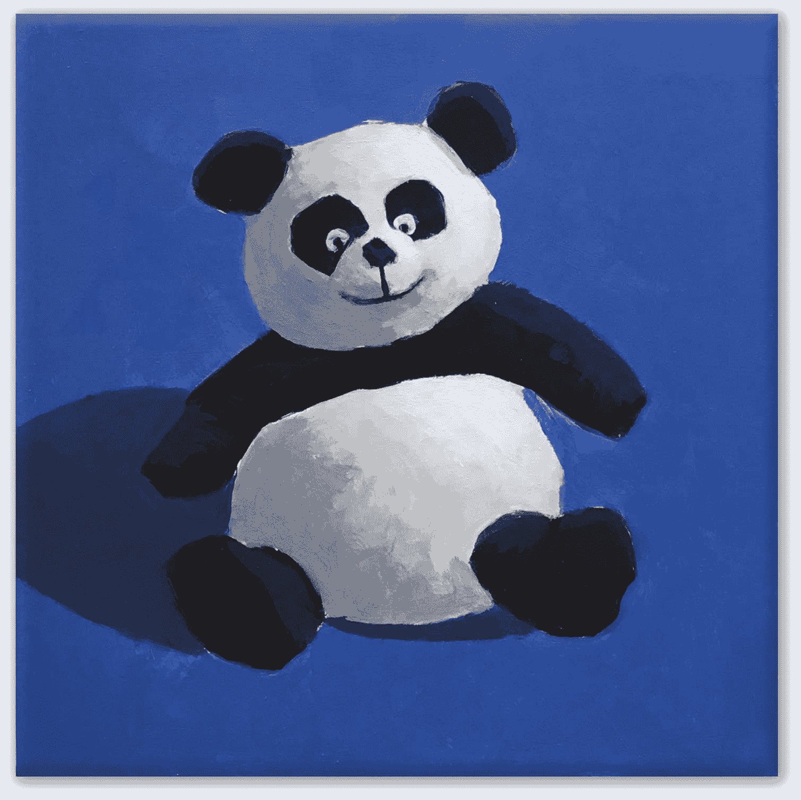

乍一看，这可能看起来像一个相当复杂的绘画对象——但就像大多数事物一样，它很容易被分解为一系列简单的几何形状。

### 27 排线笔触：蜜蜂
本项目让你有机会练习使用非常短、受控的笔触来创造这种（字面意义上）大得惊人的蜜蜂柔软、毛茸茸的质感。这些排线笔触是在中调底色之上构建的，使底层颜色部分可见，以便你逐渐在其上构建明暗色调，创造出真实的深度和形态。形状非常简单——只是蜜蜂身体各部位的圆和卵形。这一点加上黄橙底色上大胆的黑色条纹图案，使你能够专注于制作质感笔触，而不必太担心绘画技巧。

#### 材料
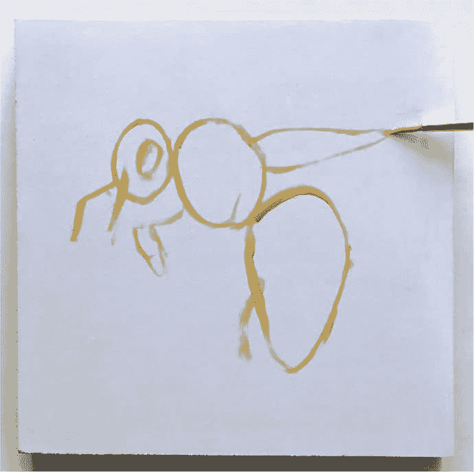

#### 1
使用 #1 圆头刷和 Yellow Ochre，将昆虫的轮廓画成一系列非常简单的形状——头部和胸部用圆，腹部和翅膀用细长的卵形，腿和触角用线条。

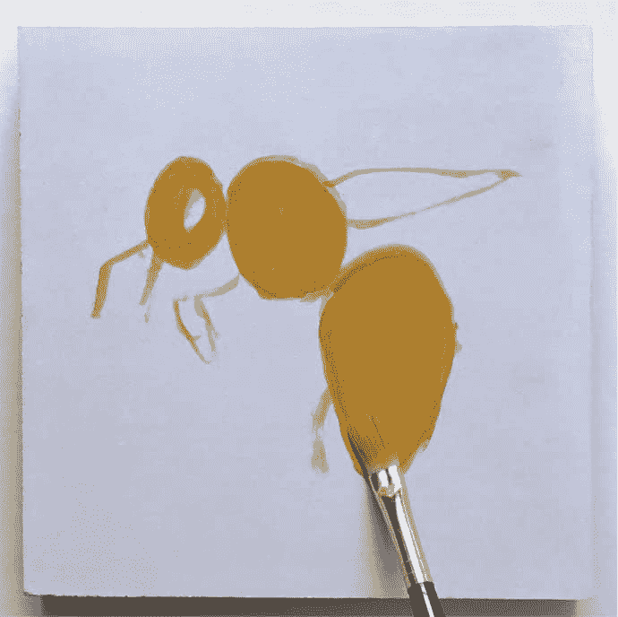

#### 2
使用 #4 扁圆刷，留出眼睛的位置，用 Yellow Ochre 混入一点点 Cadmium Yellow Medium 块状绘制头部和身体。待干。

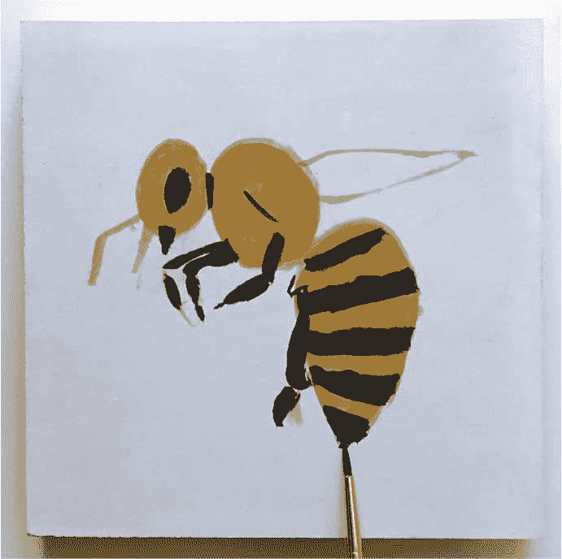

#### 3
现在使用 #1 圆头刷和 Mars Black 绘制腿部、条纹和头部细节。圆头刷尖细，非常适合绘制小细节。

### 4
将镉黄中调与未漂白钛白混合，用 #1 圆头笔和短笔触描绘光线照射到身体上的毛发。用 #6 平头笔，用群青、钛白和一点未漂白钛白调成的混合色绘制背景，同时勾出昆虫的形状。画翅膀时加入更多白色并用罩光介质稀释颜色，使其看起来透明。

### 5
继续塑造质感和形体，使笔触沿着毛发生长的方向。使身体边缘的颜色变深（黄赭石），中心变浅（镉黄中调 + 未漂白钛白）。在头部添加一些玛斯黑色的毛发，并用钛白点出细小的高光。

短而受控的笔触完美捕捉了蜜蜂身体的蓬松质感——但务必仔细思考其方向。在开始作画前，花时间分析这些细小的毛发是竖立还是沿着昆虫身体纵向生长。

### 28 理解色彩明度：纸袋木偶
在多层三明治项目（见第 80 页）中，我们为三明治“立方体”的三个平面使用了不同明度的白色，以使主体看起来有三维感。这个练习更进一步，因为我们现在引入了不同的颜色。相同的颜色（棕色、黄色和红色）同时出现在纸袋的明亮面和阴影面。如果纸袋在明亮面和阴影面上的棕色差异在明度标尺上（见第 27 页）约为三级，那么黄色和红色的差异也需要是三级，才能创造出可信的立体感和形体。颜色会使事情复杂化，所以如果难以判断明度，试着半闭眼睛看你的主体——甚至可以用手机拍照并转为黑白。

#### 材料

#### 1
用 #6 平头笔，用未漂白钛白混合少量罩光介质对画布进行底色处理。用 #1 圆头笔和稀释的黄赭石绘制袋子的轮廓。实际上你是在画一个立方体（像三明治项目一样），所以确保每个面的线条彼此平行——但这里顶部不是正常的立方体，而是呈 45 度角。也画出袋子投下的阴影。

#### 2
填入袋子顶部下方的阴影，形成木偶的嘴巴。画出眼睛和鼻子，然后勾勒出袋子的不同部分，同样注意保持每个面上的线条彼此平行。

#### 3
用 #4 亮光笔绘制光线照射到的袋子左侧，用未漂白钛白混合少量煅烧赭石绘制棕色部分，用镉黄中调绘制衬衫。对于阴影面（以及眼睛和鼻子周围的阴影），棕色部分使用未漂白钛白混合少量玛斯黑和煅烧赭石，黄色部分使用黄赭石。

#### 4
用 #1 圆头笔用玛斯黑色绘制眼睛瞳孔和胡须；用煅烧赭石和镉黄中调混合绘制鼻子和下唇；用萘酚红绘制领带和手臂。（暂时不用担心红色的明度；下一步会调整。）用未漂白钛白和玛斯黑调出浅灰色，用 #6 平头笔绘制投射阴影。

#### 5
用 #1 圆头笔和你想要的任何颜色绘制头发的发丝。在处于阴影中的手臂上涂一层煅烧赭石，使其明度比明亮面上的红色暗三级，就像袋子这一侧的棕色和黄色一样。用钛白绘制眼白。

能够评估和调配颜色的不同明度对于使物体看起来有三维感至关重要。尝试用衬衫和手臂的不同颜色再次练习这个练习，以便习惯调配不同的色调。

### 29 阴影颜色：积木长颈鹿
阴影颜色很少，如果有的话，纯粹是黑色：仔细观察会发现它们通常包含（或至少含有）补色的一种暗色版本。这里阴影是深蓝色阴影——而蓝色和橙色是互补色。这也是简化绘画整体设计并清晰表现明暗的一种很好的技巧。橙色/棕色积木上的阴影颜色与深蓝色背景融为一体；同样，在黄色积木的明亮面，可以看到积木与背景之间的边界几乎消失。

#### 材料

#### 1
用 #6 平头笔用未漂白钛白对画布进行底色处理。用镉黄中调和未漂白钛白调出淡黄色。用 #4 亮光笔在画布中央绘制一条宽一个笔触的条纹。在右侧涂上第二条稍宽的黄赭石条纹，形成 L 形。你可能需要为每种颜色涂两层。

#### 2
参考上方的照片确定形状，用 #6 平头笔和步骤 1 中相同的颜色绘制长颈鹿的头部——明亮面使用黄色加白的混合色，暗面使用黄赭石。

#### 3
现在用 #6 平头笔为长颈鹿的皮肤添加一些花纹。用镉黄中调和萘酚红调出淡橙色用于明亮面，阴影面使用煅烧赭石。用未漂白钛白混合少量玛斯黑调出的浅灰色绘制眼睛的圆形。

#### 4
用群青、未漂白钛白和少量玛斯黑调出深蓝色。用 #6 平头笔绘制背景，将颜色延伸到长颈鹿身体约一半的位置，同时勾出长颈鹿的形状。用同一种颜色绘制投射阴影。

#### 5
用 #1 圆头笔和未漂白钛白在耳朵和鼻吻上缘点出细小高光。用玛斯黑色勾勒眼睛并点入瞳孔。

没有复杂形状的干扰，你可以尝试不同颜色之间的关系。翻翻玩具箱，看看还能用乐高或其他积木创造出哪些物体，以助你在绘画之旅中进步。

### 30 结合圆锥和球体：冰淇淋甜筒
这比之前的一些项目稍复杂一些，因为它涉及多个形状——樱桃和冰淇淋的球体、压在甜筒上的冰淇淋部分的椭圆，以及甜筒本身。每个形状接收光线的方式略有不同，所以不能对所有阴影区域一视同仁。针对每个区域，问问自己光影之间是急剧过渡（像立方体那样，平面彼此垂直）还是随着物体远离光源而逐渐过渡。也要注意质感。颜料不均匀的涂抹可以看起来像物体表面的波纹或起伏，传达出它并非完全光滑的感觉。

#### 材料

#### 1
用 #1 圆头笔和用罩光介质稀释的黄赭石绘制一个球体、椭圆和圆锥叠放在一起，尽量保持对称。我只画了椭圆的一部分，但如果你愿意，也可以画完整。

**2** 用 Titanium White、Unbleached Titanium、Ultramarine Blue 和一点点 Cadmium Yellow Medium 调配出淡蓝色，用 #6 平头笔绘制冰淇淋。然后用 Yellow Ochre 绘制冰淇淋筒，用平坦、片状的笔触来营造华夫饼的质感。

**3** 对于巧克力淋酱，用 Burnt Sienna 和 Ultramarine Blue 调配出浓郁的棕色，并用 #4 阔叶笔涂上。用 Napthol Red 加一点 Cadmium Yellow Medium 调配出暖红色绘制樱桃，使用 #1 圆头笔。

**4** 现在使用明暗来塑造形体，保持球形上的明度过渡平缓；冰淇淋筒上的阴影与边缘平行。对于暗部，在冰淇淋的蓝色调中加入一点 Mars Black；樱桃用 Napthol Red 和 Mars Black 调配；冰淇淋筒用 Burnt Sienna 和 Yellow Ochre 调配。在棕色调中加入一点 Unbleached Titanium 来提亮巧克力右侧。用 Titanium White 为樱桃点出高光。

**5** 对于背景，用 Unbleached Titanium、一点 Ultramarine Blue 和一点 Napthol Red 调配。用 #6 平头笔绘制背景，同时勾出冰淇淋筒的形状。用 Unbleached Titanium、Cadmium Yellow Medium 和 Yellow Ochre 的混合色为冰淇淋筒添加高光，同样使其与筒的边缘平行。糖屑可用你喜欢的任意颜色绘制，换色时记得清洗画笔。

虽然这是一个非常简单的题材，但明暗值的变化使其看起来令人信服地具有三维感。如果你觉得难以判断明暗值，试着看画时半眯眼睛：这会减弱色彩，使你更容易判断事物需要多亮或多暗。

### 31 复杂椭圆：纽扣花

我们已经看过如何绘制单个椭圆（见第 74 页）。这里的挑战在于同一幅画中有多个椭圆，要尽可能让每个都对称。一个非常有用的技巧是尝试一气呵成地画出椭圆，而不是分两半画——否则椭圆的两端可能会变得尖锐或钝。熟能生巧真的适用于这种情况。椭圆的确切形状取决于你的视点，所以只要用眼睛观察并画出所见即可。你会注意到，随着视点降低，椭圆会显得越来越窄，直到完全消失，只剩下曲线。相反，随着视点升高，椭圆会显得越来越宽，直到你从正上方观看主体时，它看起来像一个完整的圆形。

#### 材料

**1** 使用 #1 圆头笔和用 glazing medium 稀释的 Yellow Ochre，画出两个同心椭圆，以表现中心纽扣的凸起区域。

**2** 现在画出纽扣花瓣的椭圆，确保它们间距均匀且大小一致。虽然成品中看不到完整的椭圆，但在此时画出来有助于把握整体形状。待干。

**3** 使用 #4 阔叶笔用 Cadmium Yellow Medium 绘制花心。待其干燥时，用 Unbleached Titanium 和少量 Mars Black 调配出淡灰色。绘制花瓣时，留出一点画布的白色透出来以表现高光。在花心上再涂一层 Cadmium Yellow Medium 以获得良好的不透明覆盖。

**4** 在步骤 3 的灰色中再加入一点 Mars Black，用侧放的 #4 阔叶笔绘制花瓣上的阴影。（注意，那些纽扣的内部也是一系列椭圆。）对于花茎，用 Cadmium Yellow Medium 和一点点 Mars Black 调配出中调绿色。中心花瓣的阴影为 Yellow Ochre，而高光为 Titanium White 加上极少量 Cadmium Yellow Medium。

**5** 用 Ultramarine Blue、Titanium White 和一点点 Unbleached Titanium 调配出明亮的蓝色。仍使用 #4 阔叶笔绘制背景，同时勾出花的形状。换用 #1 圆头笔，用 Ultramarine Blue、Unbleached Titanium 和一点 Mars Black 调配出花朵和花茎下方的投射阴影。中心花朵的纽扣孔也使用此颜色。花瓣上的纽扣孔用 Mars Black 绘制。

画准椭圆的形状对于使图像看起来令人信服地具有三维感至关重要。在家中找一个圆形物体，比如浅圆碗，尝试从不同视点绘制它，看看形状如何变化。

### 32 多种几何形状：玩具火箭

这个项目将本章前面介绍的大多数几何形状结合到一幅图像中。它们仍然 instantly recognizable，但重要的是要记住，光影对每个元素的影响略有不同。例如看高光：在圆柱体（火箭主体）上，高光是一条笔直的垂直线，而在火箭的鼻锥上，高光是倾斜的并跟随锥体的形状。还要记住保持椭圆的一致性：锥体的底部、两条条纹以及火箭底部本身都需要平行并遵循相同的弧线。

#### 材料

**1** 使用用 glazing medium 稀释的 Yellow Ochre 和 #1 圆头笔，将火箭画成一系列重叠的几何形状——球体、锥体和圆柱体。圆柱体的两个椭圆应对称且在大小和倾斜度上对应。在底部添加小月牙形作为起落架。

**2** 用 #4 亮光笔铺色。红色的球体和圆柱体为 Napthol Red 混入一点 Cadmium Yellow Medium。锥体为 Cadmium Yellow Medium；可能需要两层。对于起落架，使用 Ultramarine Blue 和 Burnt Sienna 的混合色。

**3** 在黄色中加入 Titanium White，在红色调中加入 Unbleached Titanium 以制造高光。用 #1 圆头笔涂上；高光在圆柱体上直向下，但在锥体上是倾斜的。用 Mars Black 绘制火箭侧面的舷窗，并用 Ultramarine Blue 和 Unbleached Titanium 的混合色绘制起落架的亮面。

**4** 用 #4 阔叶笔在锥体左侧阴影处涂上 Yellow Ochre。在 Napthol Red 中加入一点 Mars Black 并绘制球体和圆柱体的阴影侧。用 Titanium White 提亮高光。用 Napthol Red、Yellow Ochre 和 Cadmium Yellow Medium 调配颜色。用 #6 平头笔绘制背景，同时勾出火箭的形状。

**5** 用 Napthol Red 和 Mars Black 的混合色绘制投射阴影，使用 #4 亮光笔。最后一步是用 Ultramarine Blue、Mars Black 和 Unbleached Titanium 的混合色用 #1 圆头笔绘制条纹，确保它们遵循与圆柱体顶部和底部相同的弧线。用相同颜色混合物勾出舷窗。干燥后在条纹上用 Titanium White 添加高光。

尝试在不同位置绘制类似场景——比如让火箭侧卧，使底部椭圆更圆——看看这如何影响各个元素的形状和比例。

### 33 反射光：外卖盒

## 绘制白色物体
当你绘制白色物体时，只有最亮的高光部分才会是纯白色；任何阴影区域都会是白色的某种色调，甚至中间调也会是白色混合了其他颜色。那个其他颜色是什么取决于附近有哪些颜色。这是因为光线会从它照到的表面弹射出来并反射回附近的物体——因此附近的物体就会吸收一些反射的颜色。此外，光线（以及颜色）是以与最初到达表面时相同的角度反射回来的；它无法绕过曲线或越过陡峭的边缘。在这里，反射的蓝色无法到达纸盒内部——因此内部趋向于一种偏白的色调。

### 材料

**1** 用一点未漂白钛白和一些罩光介质混合黄赭石。用 #1 圆头笔勾出纸盒的形状。它大致是一个立方体，但在底部略微收窄，所以垂直线彼此不平行（尽管水平线是平行的）。

**2** 用群青蓝、钛白、一点未漂白钛白和罩光介质调出一种淡蓝色。用 #6 平头笔绘制纸盒的阴影面。

**3** 在混合色中加入更多钛白并绘制纸盒的亮面。完全不需要彻底清洗画笔：只需在纸巾上擦去画笔多余的颜料，然后在调色板上向混合色中加入钛白即可。即使画过了黄赭石线也没关系，因为下一步你会从背景中切出形状。

**4** 用群青蓝和一点钛白以及罩光介质调出明亮的蓝色。用 #6 平头笔绘制背景，同时切出纸盒的形状。尽量让盒子的边缘非常清晰。

**5** 使用 #1 圆头笔和钛白，在纸盒的边缘和褶皱处添加高光。用玛斯黑绘制手柄，内部用未漂白钛白绘制。用绘制纸盒阴影面时所用的同一种颜色，在纸盒亮面上画出阴影。对于投射阴影，将群青蓝、玛斯黑和一点煅烧赭石混合，用 #4 亮光笔涂抹。

我们的眼睛会自动“读出”纸盒是白色的，即使上面几乎没有纯白色。一旦你用蓝色完成了这项练习，就用另一种背景色再画一次，看看反射光的颜色如何变化。

### 34 多种质感：画笔
即使是最普通的家居用品也能成为有趣的绘画题材。这是一个有趣的项目，将你已经学过的几种质感技巧结合在一起——几乎干的画笔和非常短、细的笔触用于粗糙的鬃毛；明度和暗度来营造湿润颜料上光线照射的效果；细腻的高光使金属箍看起来有反光；以及用于哑光木质画笔手柄的平涂色彩。正是高光和阴影真正让这幅画栩栩如生，所以在把画笔放到画布上之前，花时间思考如何处理它。

### 材料

**1** 加入一点未漂白钛白使黄赭石略微不透明（黄赭石是一种非常透明的颜色）。用 #4 菲尔伯特笔为笔毛画一个矩形，顶部略不规则，向底部收窄成三角形和更细的矩形。使用垂直笔触：这将在绘制画笔的鬃毛时有所帮助。待干。

**2** 用萘酚红和一点镉黄中调出鲜艳的红色，保持混合色较稠。用 #4 菲尔伯特笔和垂直笔触填满画笔的上半部分。

**3** 用 #4 菲尔伯特笔和煅烧赭石在画笔上的颜料下方表示轻微阴影，并绘制箍上的条纹。为较细的条纹将画笔侧放使用，为粗条纹使用全宽度。画笔是制造品，所以尽量保持条纹间距规律。用玛斯黑绘制手柄。待干。

**4** 混合黄赭石和未漂白钛白，用几乎干的 #4 亮光笔的笔尖做一系列短而细的笔触绘制鬃毛。加入煅烧赭石到混合色中重复，再加入玛斯黑重复。用未漂白钛白和玛斯黑调出暖灰色。用 #6 平头笔绘制背景，同时切出画笔的形状。在鬃毛上添加一些灰色笔触。

**5** 使用 #4 菲尔伯特笔和萘酚红的明度和暗度为颜料塑造体积感。明度加入未漂白钛白和一点镉黄中；暗度加入煅烧赭石。对于画笔下方的投射阴影，在背景色中加入更多玛斯黑。换成 #1 圆头笔。用玛斯黑加强颜料下方的阴影，并在颜料和金属箍上绘制钛白高光，在想要高光更透明的地方使用更多罩光介质。

看看你家周围还能找到哪些多质感的物体来作画。皮毛装饰的皮靴、哑光黑盒中的亮面口红，或是银色开瓶器和软木塞怎么样？它们都是简单形状，却在质感对比上有趣。

### 35 复杂圆柱体：椒盐卷饼
即使是相当复杂的形状也可以分解为简单的几何形态。虽然椒盐卷饼看起来很复杂，有那么多扭曲和转折，但它实际上是基本圆柱体的一种变体。如果这听起来有点牵强，想想椒盐卷饼是如何制作的：它只是一根——或圆柱体——面团，末端交叉然后相互环绕。所以简单圆柱体适用的原理，例如煎饼堆（见第 84 页），在这里也适用。没有硬边；圆柱体从光线处弯曲离开，形成从亮到暗的柔和明度过渡。诀窍在于寻找过渡发生的位置，而不是试图线性地绘制椒盐卷饼，并将它们融合得非常平滑和渐进。

### 材料

**1** 使用 #6 平头笔和直接从管中挤出的黄赭石，松散地勾出椒盐卷饼的形状以确定底色；只涂一层以保留一些质感。你不需要等待它干燥。用萘酚红、镉黄中和一点黄赭石调出背景色。用 #6 平头笔绘制背景，同时切出椒盐卷饼的形状。

**2** 现在确定最亮和最暗的明度。用 #4 菲尔伯特笔，用黄赭石、未漂白钛白和一点点镉黄中混合的颜色绘制椒盐卷饼较亮的部分。用煅烧赭石、萘酚红和未漂白钛白混合的颜色绘制较暗的烘烤部分。

**3** 通过加入中间调来继续发展明暗感。在圆柱体开始从光线处弯曲离开的地方，也就是光线来自右侧的位置，用黄赭石罩染在较亮的颜色上。在暗部罩染煅烧赭石、萘酚红和一点黄赭石的混合色。

**4** 视需要继续发展明度，保持过渡柔和渐进：这里没有尖锐的边缘。对于高光，用 #1 圆头笔涂抹钛白。

**5** 完成绘画时，在钛白中撒上盐晶，并用萘酚红和少量马尔斯黑混合调出投射阴影。记住光线来自右侧，因此阴影会落在左侧。

判断光线落在主体上的位置以及阴影落处对于这类题材至关重要，因为所有那些扭曲和转折看起来似乎有点难以作画。花园水管也是另一个很好的实验题材。
