## 4 解释性手法

本章最后涉及应用各种色彩主题、直接作画而不分层或混合、风格化诠释等。项目旨在为你提供一套创作更具表现力绘画的工具。为什么不将它们应用到本书中早期的项目上，看看你的绘画进步如何呢？艺术可能性是无限的。

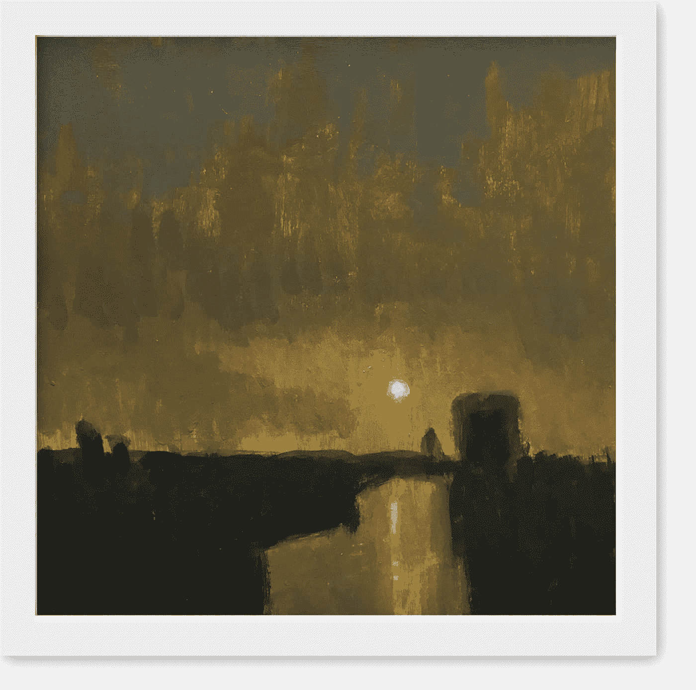

### 36 随机边缘：积云

要实现柔和、看似随机的边缘，需要一定的练习和笔触控制。云是练习的好题材，因为它们是无实质、鼓胀的形状。它们往往如此短暂且快速移动，以至于几乎不可能将其固定为坚实、硬边的形状。保持手腕松弛灵活并快速作画会有帮助；如果握笔太紧，你很可能会得到硬而尖锐的线条。另一个技巧是让画笔拖尾，这样就能得到细小的干刷白丝，通过它们可以看到天空的蓝色。这也是练习色彩渐变的好练习，无论是天空（向地平线变浅）还是云朵。丙烯的乐趣之一是，在它仍湿润时，你可以轻松移动颜料，创造出从一个色调到下一个色调的平滑过渡。

#### 材料

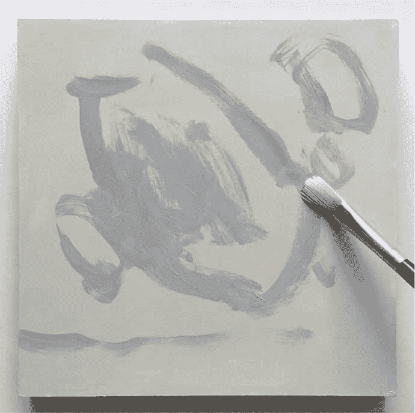

**1** 使用 #6 平头笔，用未漂白钛白调色画布。这种米白色将代表白云的中值。用未漂白钛白和少量马尔斯黑调出稀薄的浅灰色。用 #4 杏仁形笔指示地平线并画出一系列不同大小的椭圆形作为云朵；你可能会发现握笔靠近手柄末端有助于得到更颤抖、定义较少的形状。大致在最大云朵上涂抹阴影。待干。

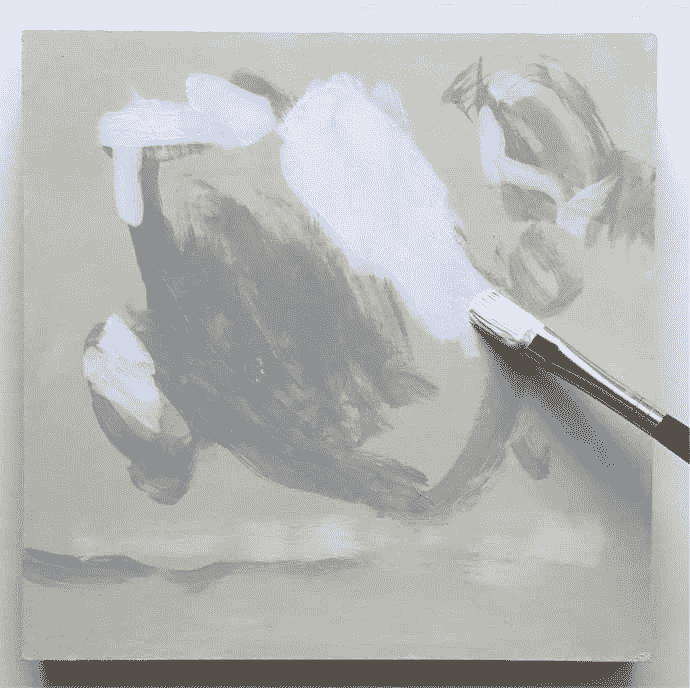

**2** 用纯钛白和 #4 杏仁形笔绘制云朵最亮的部分，即阳光透过边缘照射的地方。轻微指示地平线沿线几朵远处的云形。注意此时仍有一些底色透出。作画时扭转画笔，保持手腕松弛，以免绷紧而产生硬边。

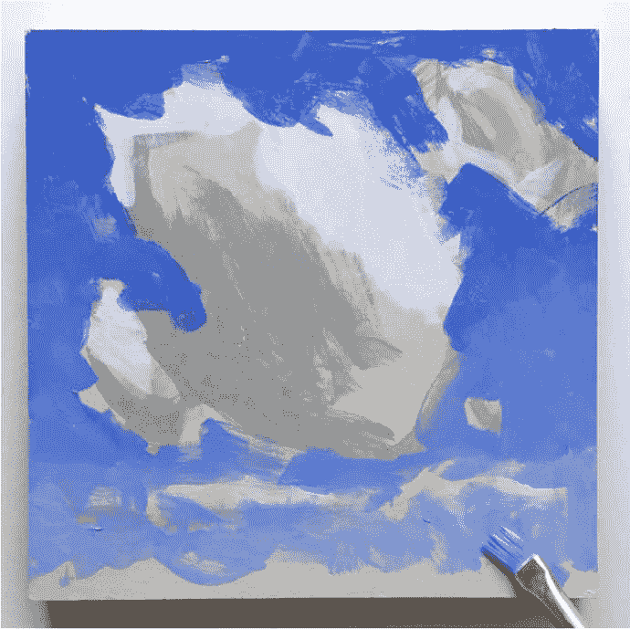

**3** 用群青和钛白调出明亮的蓝色。用 #4 亮光笔绘制天空，同时勾出云朵的形状。向下接近地平线时逐渐加入更多钛白；尽量保持渐变平滑。为了营造飘逸的云尾，用干刷法在白色部分上刷蓝色；这也有助于柔化云朵边缘。

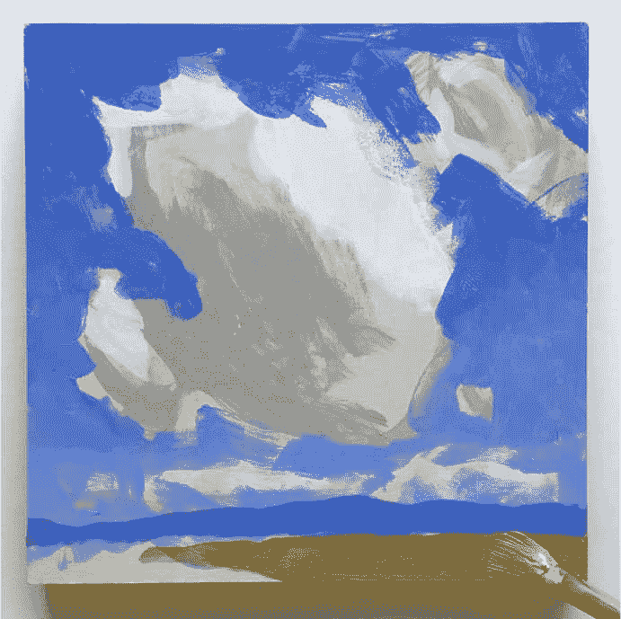

**4** 用 #4 亮光笔调配群青、未漂白钛白和少量马尔斯黑来表现远山的蓝色。用 #4 杏仁形笔和由黄赭石、未漂白钛白和少量镉黄中调成的混合色绘制前景的田野。

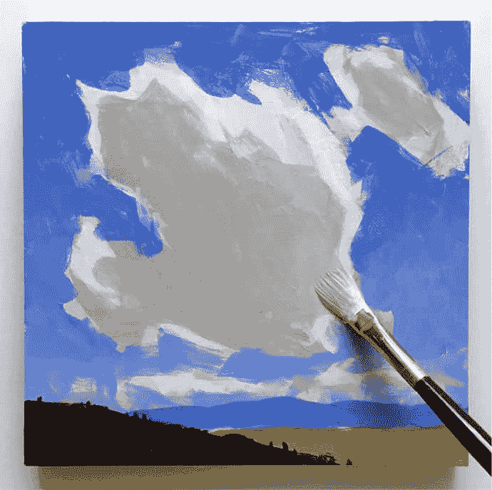

**5** 用 #4 亮光笔用马尔斯黑、煅赭石和少量未漂白钛白混合色块出前景山丘，用画笔边缘做出短的垂直笔触表现树木。用未漂白钛白和少量马尔斯黑调成的浅灰色填充大云朵内部，并将其与已铺设的颜色融合。

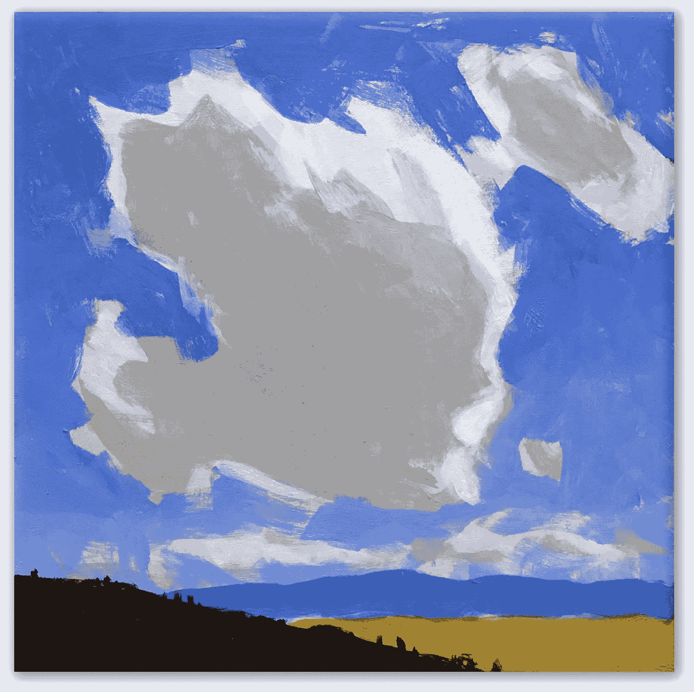

柔软、鼓胀的形状和快速的笔触捕捉到云朵在天空中疾驰的感觉。重复此练习，改变云朵的大小和位置，并在云朵和天空的渐变程度上做变化。

### 37 表现性笔触：香蕉皮

到目前为止，我们研究了通过明暗和混合色彩来表现形体、从而在平面之间创造色值过渡的方法。在本项目中，我们通过使用非常棱角分明、边缘笔直的笔触来强调——甚至夸大——这些平面。相同的板状笔触也用于香蕉皮上的色彩分层。这里的画笔选择很重要：具有平坦或仅略微圆润轮廓的画笔，如杏仁形笔或亮光笔，会使任务变得容易得多。这种方法远非照片般写实，也不适合每个题材，但它能创造出强劲、大胆的形状，使绘画极具动感。

#### 材料

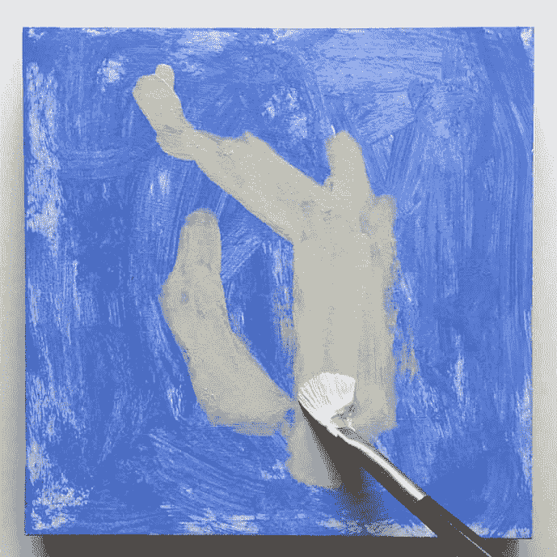

**1** 使用 #6 平头笔，用群青和钛白混合色松散地绘制背景，变化笔触方向并相当有力地擦拭颜料。用未漂白钛白和少量钛白混合并用 #4 杏仁形笔勾出香蕉皮的形状。待干。

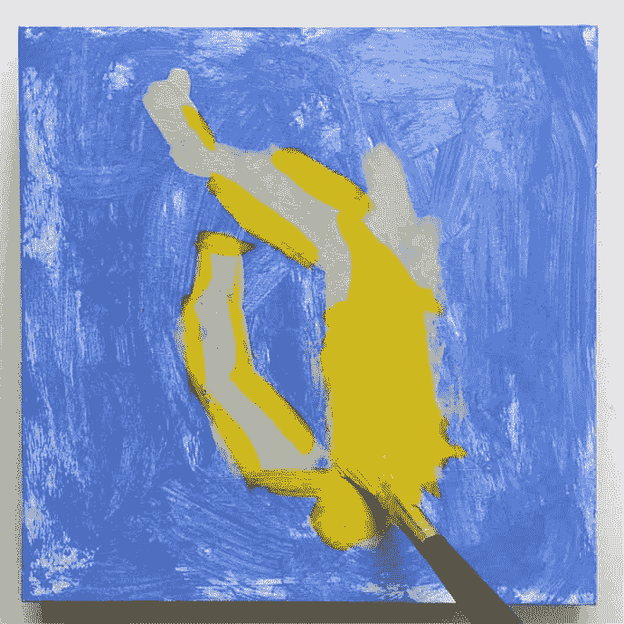

**2** 用 #4 杏仁形笔和镉黄中色块出皮上的黄色部分，尽量保持线条笔直。

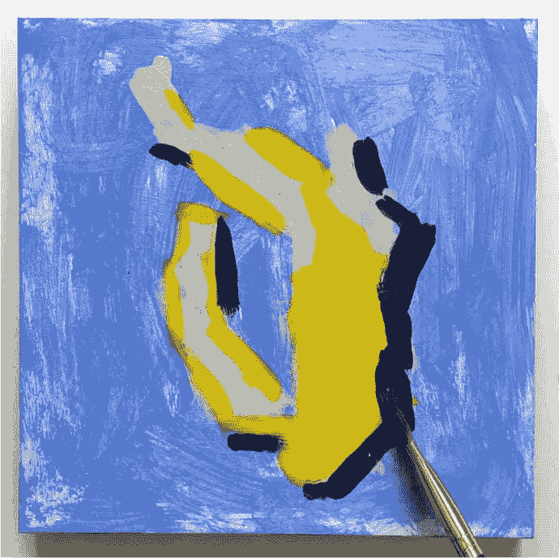

**3** 在群青中加入少量煅赭石使其变暗并降低饱和度，并用此混合色绘制阴影，同样保持线条笔直、棱角分明以维持强烈的形体感。

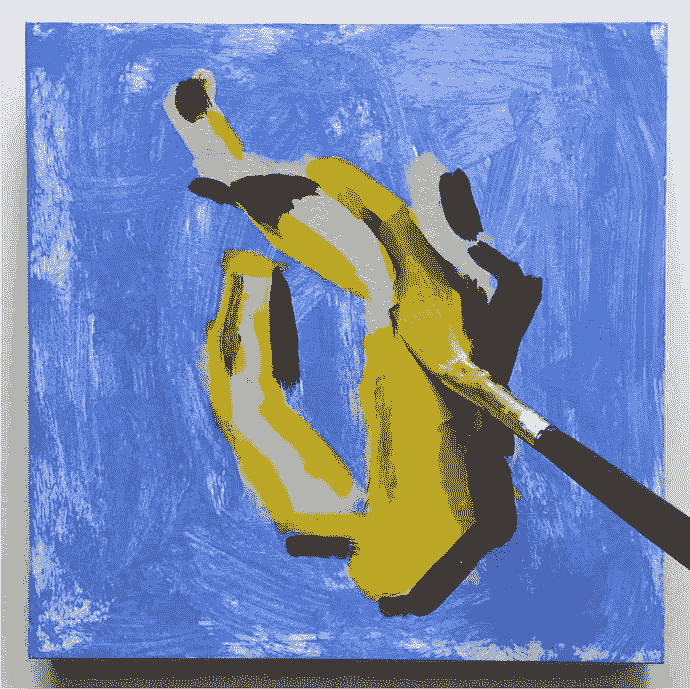

**4** 对于香蕉皮上的深棕色斑纹，通过在煅赭石中加入少量群青来反转阴影混合色中的色彩比例。对于较浅的棕色，将黄赭石与罩光介质混合，并在必要时薄薄地涂在之前的黄色之上。

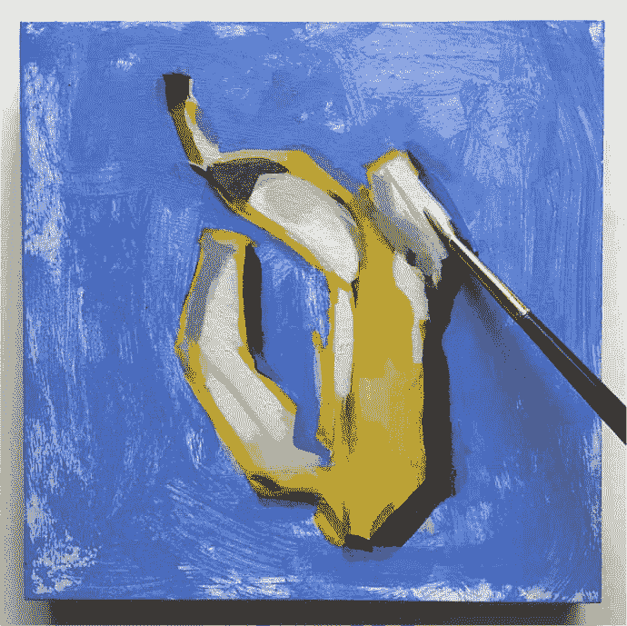

**5** 使用 #6 平头笔和步骤 1 中的蓝色混合色增加背景的深度，同时细化香蕉的形状。现在在香蕉皮上创造一些色彩混合的变化。在镉黄中色中加入未漂白钛白并块出较浅的黄色部分。对于白色的内部部分，用未漂白钛白和少量马尔斯黑调出浅灰色并绘制阴影区域。用 #1 圆头笔和未漂白钛白加少量钛白点出白色内部最亮的部分。

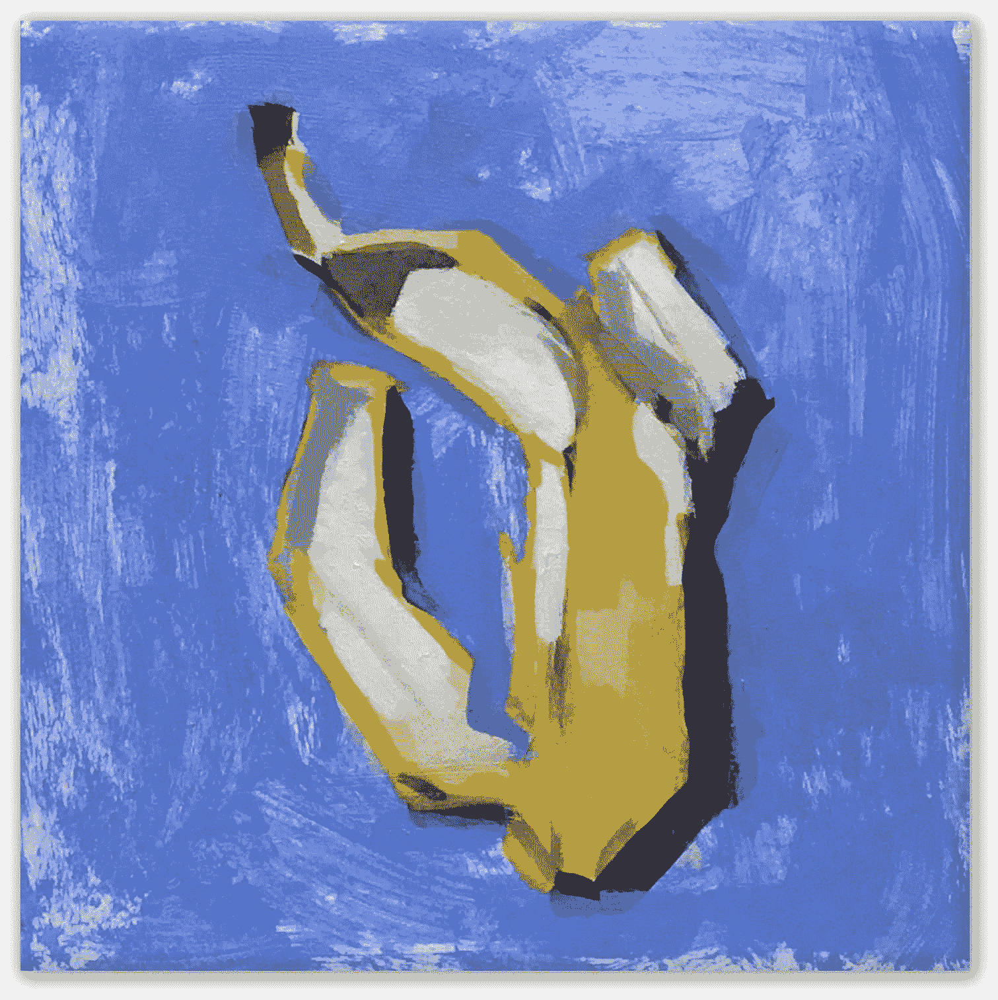

笔直的边缘和板状的笔触使绘画大胆而引人入胜。尝试将这种方法用于其他题材，用直线绘制弯曲的事物——例如苹果的轮廓——或用来确立不同的平面。

### 38 光辉光效：日落时分的城市

在这幅城市风景中，落日的日光倾泻在建筑物上，形成一种朦胧的雾霭，只能看到剪影。色彩向外辐射，画布的白色代表太阳本身炽热明亮的光球，而色彩逐渐向画布边缘变暗并变得更暖。这创造出一种隧道效果，将我们的视线引导向画面的中心。朦胧效果是通过使用含有大量罩光介质的非常薄的罩染层实现的；这使色彩极其透明，因此你可以通过它们看到坚实、质感丰富的建筑。罩染层在画布上光学结合，每一层叠加都会增加色彩而不掩盖下面的颜色。保持笔触相当粗糙；色彩混合得越平滑，看起来就越不像雾霭。

#### 材料

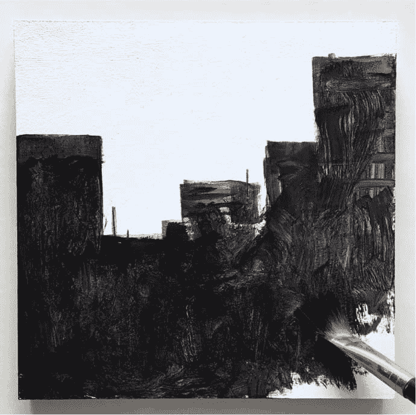

**1** 使用 Mars Black 和 #6 平头刷，将城市天际线画成矩形和细尖塔的剪影。注意保持笔触中的一些纹理：在后续步骤中罩染上层时，这将有助于使场景看起来更加朦胧、更具氛围感。完全晾干，因为你将在上面进行大量分层，不希望失去建筑物清晰的形状。

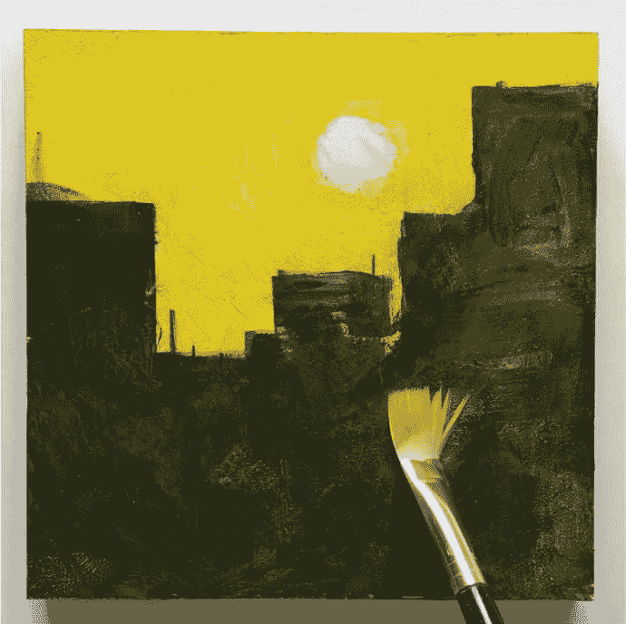

**2** 留出一个未上色的圆圈作为太阳，用 Cadmium Yellow Medium 薄薄罩染整个画布，使用极高的罩染介质与颜料比例。像放射线一样涂抹颜料——太阳周围是圆形笔触，然后在建筑物上画对角线，左侧向下、右侧向上，形成一种暗色的“隧道”效果。晾干几分钟。

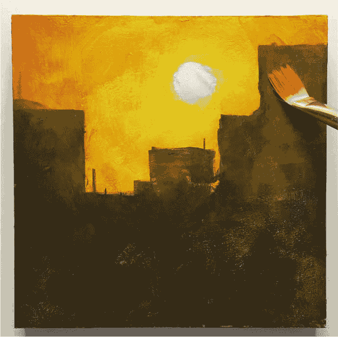

**3** 将 Napthol Red 与大量罩染介质混合，并像上一步一样用相同的放射状笔触涂抹，避免太阳周围的黄色区域，使该区域保持明亮鲜艳。注意底层颜色如何透过薄罩染层可见：剪影仍然大胆清晰，但现在覆盖着红色和黄色，给人一种日落反射在石头和玻璃上的印象。

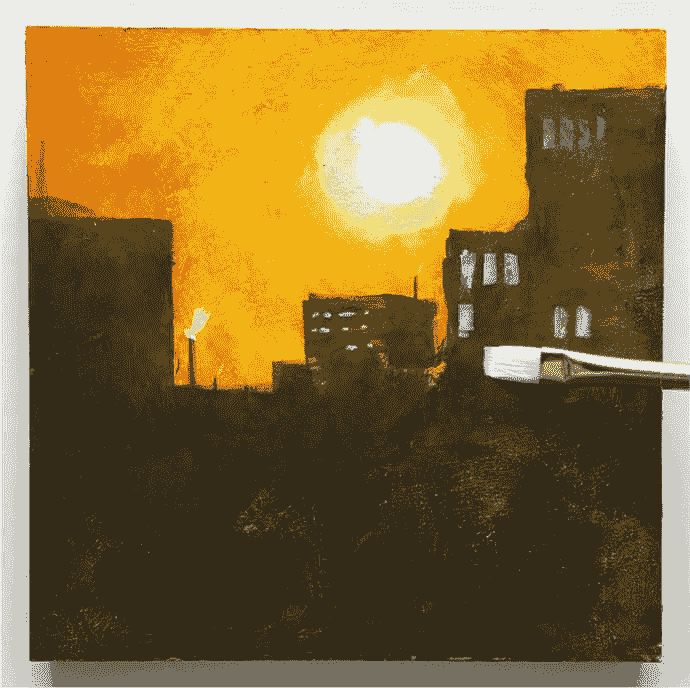

**4** 换成 #4 亮光刷，用 Titanium White 在太阳周围上色以重新确定太阳的形状。将窗户和烟囱顶部冒出的烟涂成白色。在涂抹最终罩染层之前完全晾干。

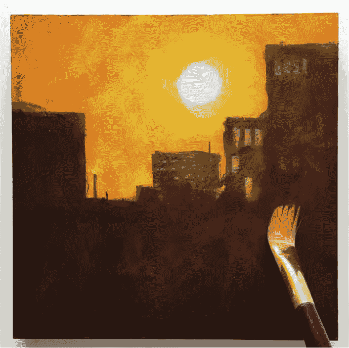

**5** 继续涂抹颜色罩染层（画布边缘附近多用 Napthol Red，靠近太阳处多用 Cadmium Yellow Medium），直到达到想要的效果。

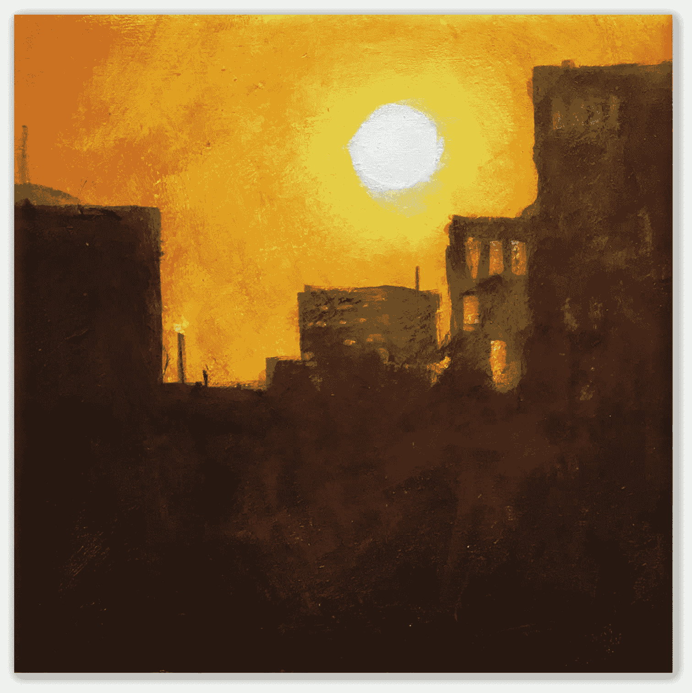

尝试使笔触更粗糙或更光滑，看看这对绘画朦胧感有何影响。用你自己的城市天际线重新诠释这个项目，或在网上查找极易辨认的天际线图像，例如纽约的克莱斯勒大厦或佛罗伦萨的杜 omo。

### 39 发光的罩染：
点亮的灯泡

使物体看起来发光具有挑战性：在油画中，你可以慢慢晕染和混合颜色，但丙烯干得很快，你必须采用不同的方法。答案是涂抹罩染层，即非常薄的色彩层。这允许部分底层颜色透出，营造出闪烁效果，同时也使颜色能够湿中湿混合，从而实现从一个色调到下一个色调的非常平滑的过渡。你还需要观察色彩过渡发生的位置。毋庸置疑，最亮最明亮的区域最接近光源，形成一种光晕效果，而颜色会随着远离逐渐变暗。然而，色彩调色板是有限的，Titanium White 保留用于最亮的部分——那些亮到直接看会刺眼的部分。

材料

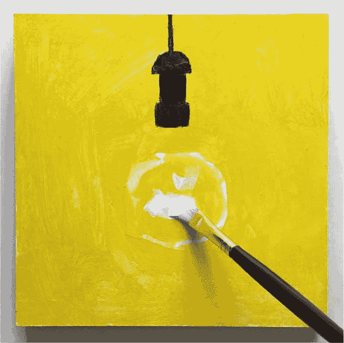

**1** 使用 #6 平头刷，用大量罩染介质混合的 Cadmium Yellow Medium 薄薄调色画布，允许部分纹理透出。晾干。使用 Mars Black 和 #4 亮光刷，画出灯具的剪影。将灯泡内部最亮的部分用 Titanium White 涂上。

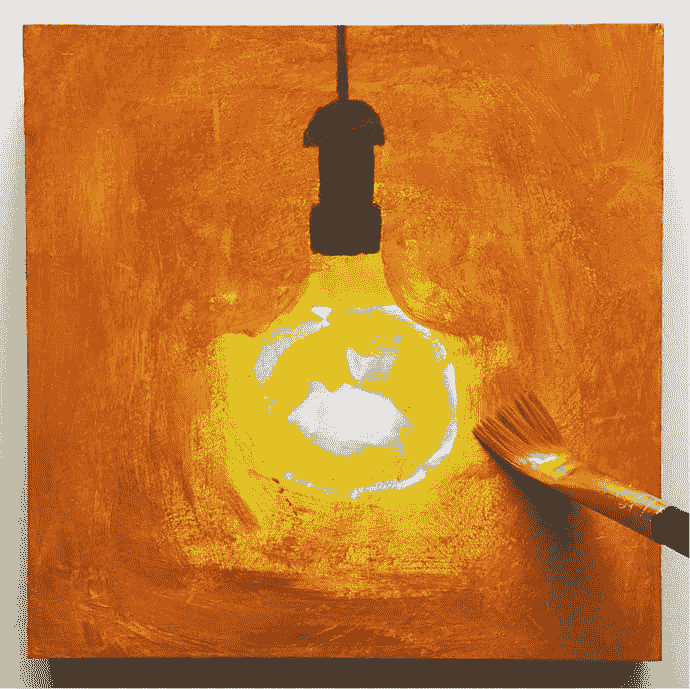

**2** 让第 1 步的黑色干透；白色仍可保持湿润，因为这里不会覆盖它。用 Napthol Red 和少量 Burnt Sienna 调配出橙棕色的稀薄混合色。使用 #6 平头刷罩染背景，同时勾出灯泡的形状。靠近灯泡处更薄地涂抹罩染层，以便更多黄色底色透出。

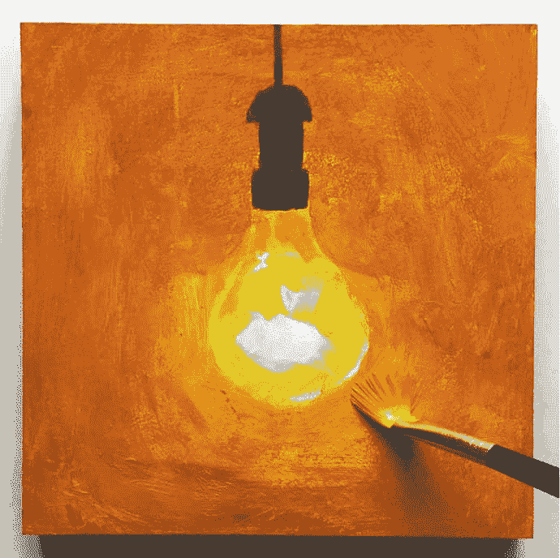

**3** 用 Cadmium Yellow Medium 和少量 Napthol Red 调配出更亮的橙色。使用 #4 扁平圆头刷，绘制最靠近灯泡的背景区域。用同一种颜色为灯泡内部较暗的部分着色，位于灯具下方顶部。

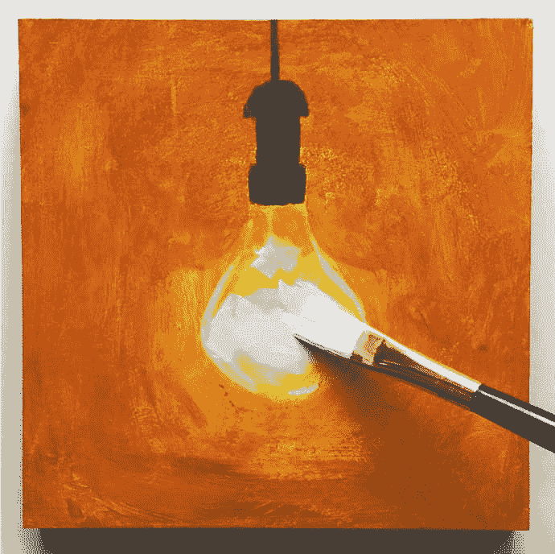

**4** 使用 #6 平头刷和 Titanium White，绘制灯泡内部最亮的区域。

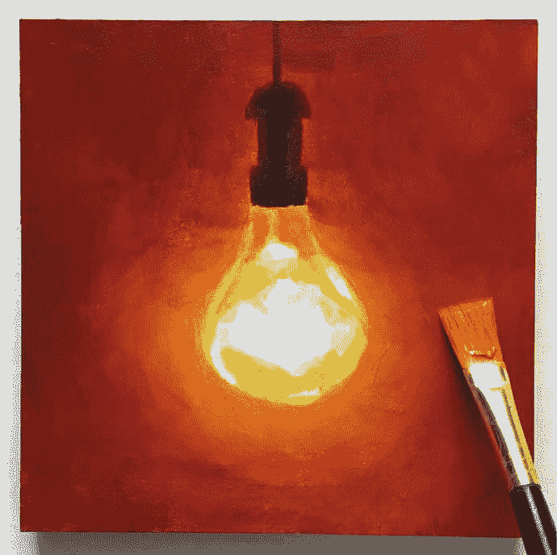

**5** 继续分层叠加罩染层，使用之前的相同调色，直到达到想要的效果，色调之间过渡平滑。这是一个逐步调整颜色的过程——在灯泡边缘最亮，向画布边缘逐渐变暗。

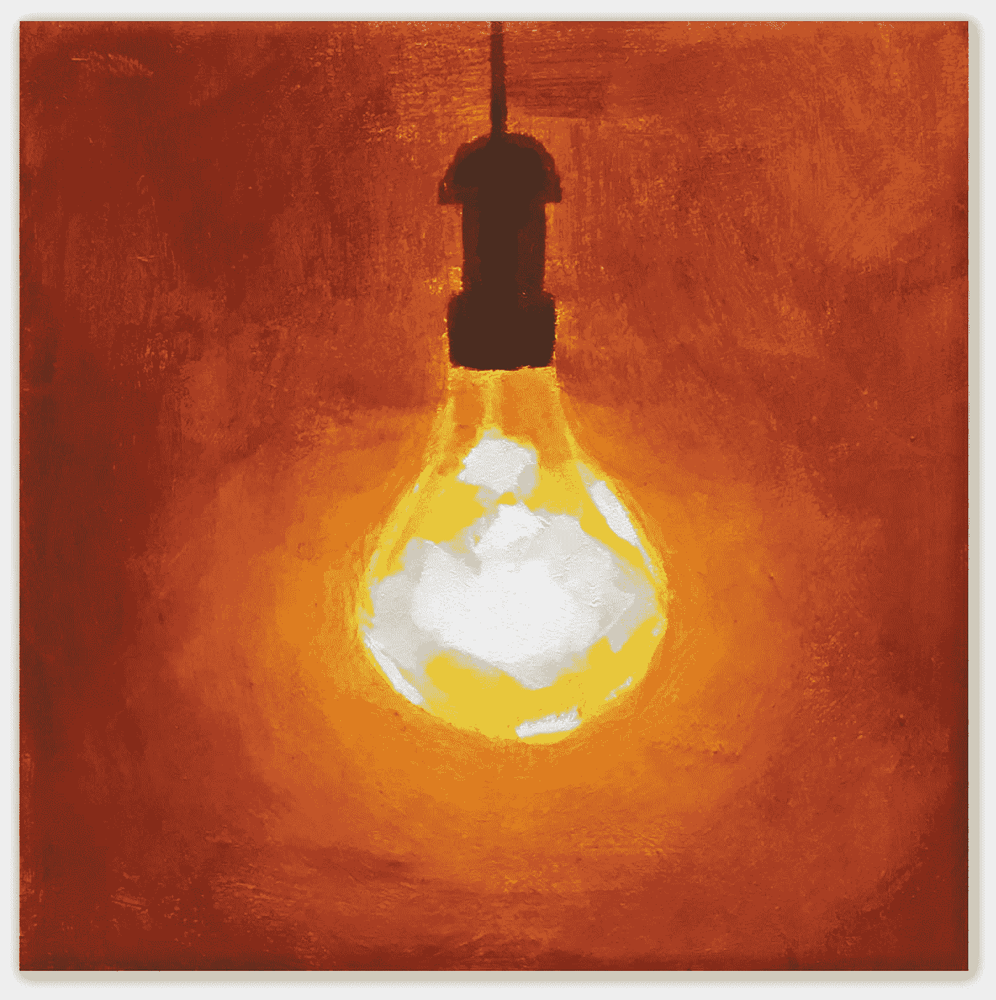

注意光晕效果——光线在最靠近灯泡处最亮，随着远离而减弱。

### 40 创造干净清新的白色：
天鹅

当你绘制白色物体时，它很少——如果有的话——是纯白色。有些区域处于阴影中，其他区域会有非常明亮的高光，中间则有一系列的中调色值。从中调色值开始是个好主意，因为这样更容易判断其余绘画的深浅程度。这里，画布用 Unbleached Titanium 调色，这个颜色代表天鹅的中调白色。你还将通过绘制背景来勾出天鹅的形状。这带来了一种清新感，如果在上面绘制亮调就很难实现，因为每种白色的色值只接受一层或最多两层颜料。如果你先画背景再画天鹅，就需要多层才能达到合适的遮盖度，这可能会使绘画看起来沉重而费力。

材料

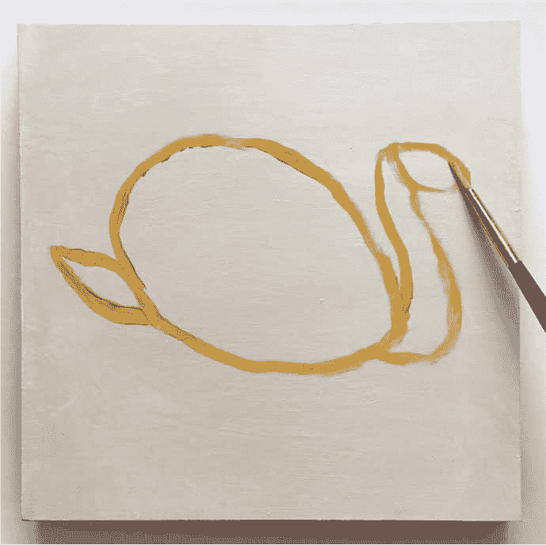

**1** 使用 #6 平头刷，用 Unbleached Titanium 调色画布。使用 #1 圆头刷和 Yellow Ochre，将天鹅的轮廓画成一系列简化形状——身体为蛋形，尾巴为叶片形，头部为椭圆形，颈部为 S 形。晾干。Unbleached Titanium 将代表白色的中调色值，因此以此为基准判断其他所有色值。

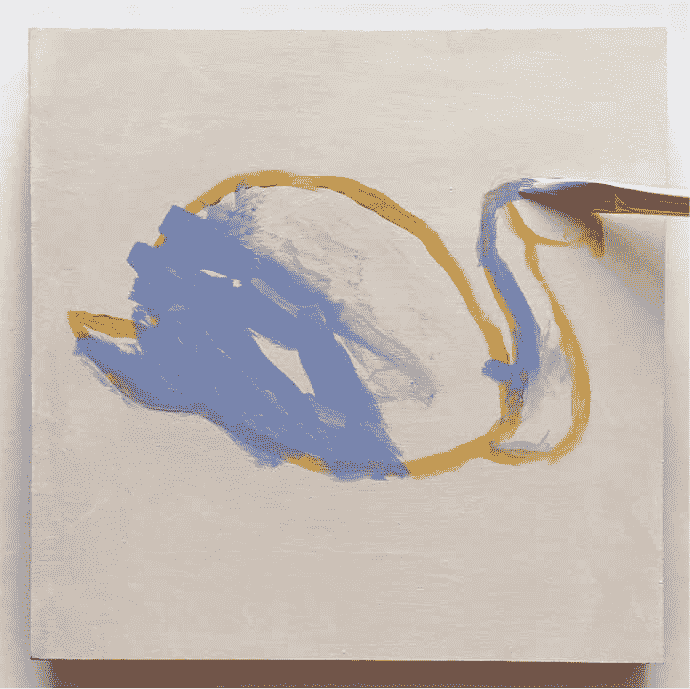

**2** 用 Ultramarine Blue、Titanium White、少量 Unbleached Titanium 和大量罩染介质调配出中调蓝色。使用 #4 扁平圆头刷，松散地指示阴影区域，让部分笔触显现以营造纹理。不要尝试绘制单根羽毛——而是观察羽毛群体的整体形状，并使笔触跟随羽毛方向。晾干。

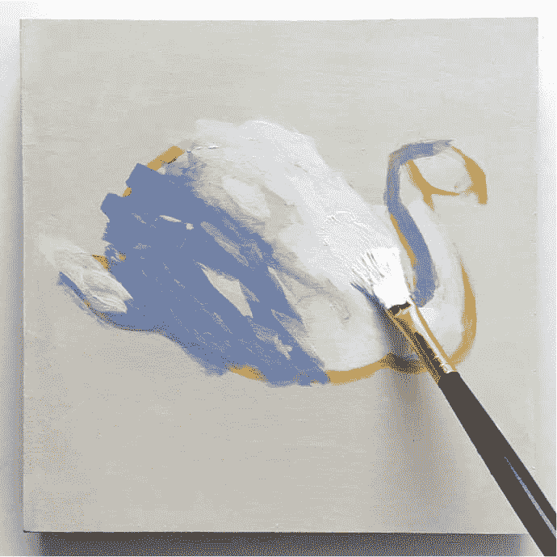

**3** 将 Titanium White 与极少量 Unbleached Titanium 和 Mars Black 混合，降低一点明度；这样以后可以涂抹纯 Titanium White 高光。使用 #4 扁平圆头刷，松散地指示较浅的羽毛群，允许部分 Unbleached Titanium 画布透出以呈现中调白色。晾干。

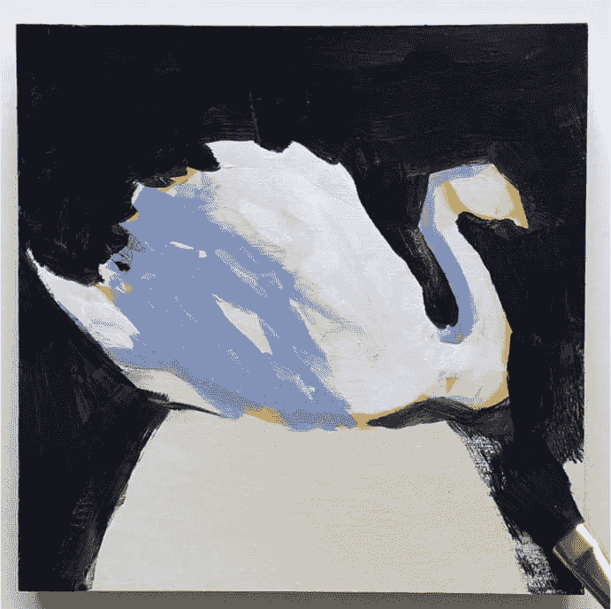

**4** 用 Mars Black、Ultramarine Blue 和少量 Burnt Sienna 调配出深暖色背景色。使用 #6 平头刷绘制背景，同时勾出天鹅的形状。用刷子边缘获得清晰的形状，暂时留出倒影区域不涂。晾干。

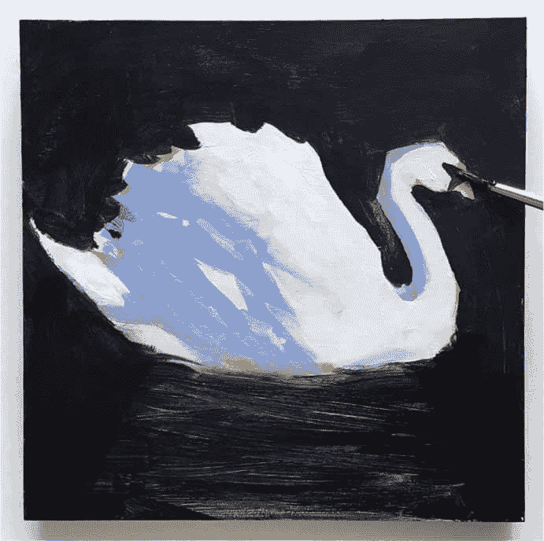

**5** 使用 #4 扁平圆头刷，用纯 Titanium White 绘制最明亮的部分（头部、颈部和胸部的正面），将颜色与底下的中调色融合。将背景色用罩染介质稀释。使用 #6 平头刷将此颜色罩染在画作下半部分，拖动刷子在表面上制造天鹅游过水面产生的涟漪效果。用 #1 圆头刷用 Mars Black 绘制天鹅的眼睛和头部标记。

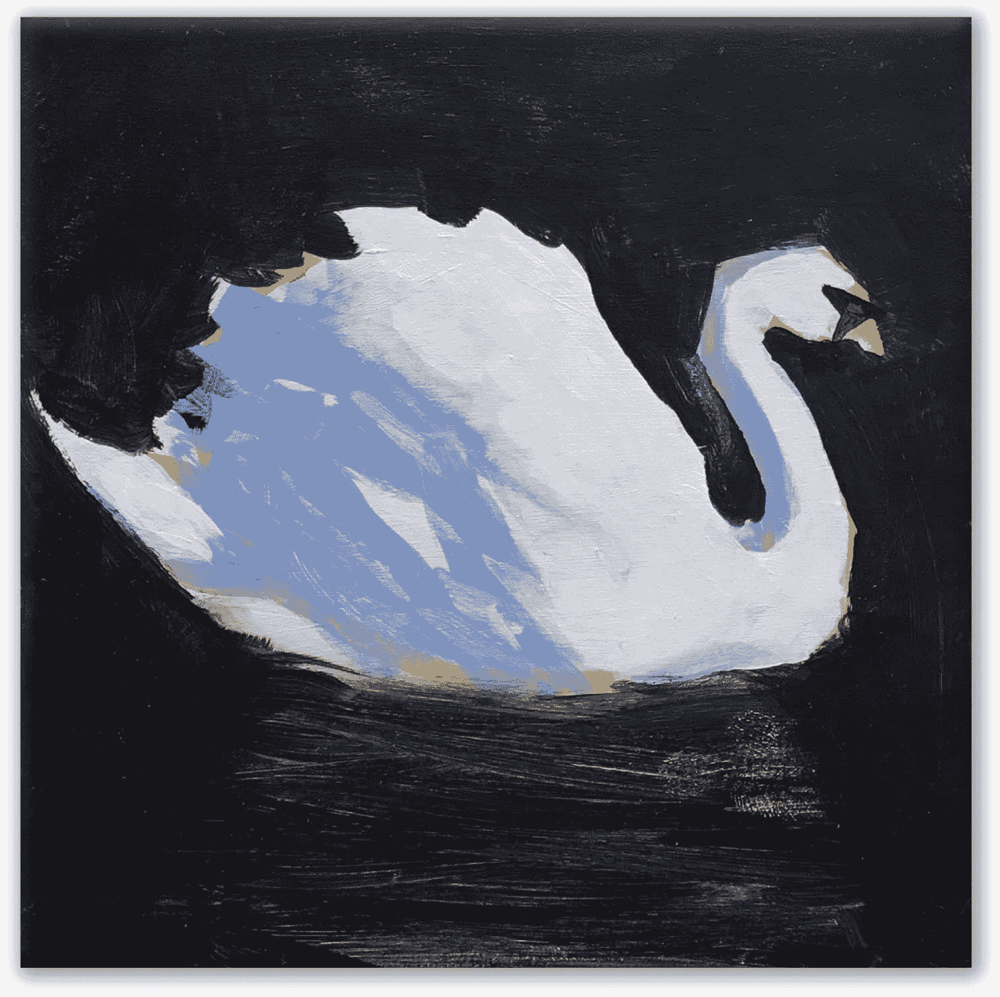

不要过于纠结细节：羽毛纹理的一点点暗示就足够了。相反，要集中在白色的不同明度上，因为正是这些让天鹅看起来圆润且富有立体感。

### 41 简化主题：火烈鸟

当你刚开始绘画时，很容易想把事情变得过于复杂。实际上，即使是复杂的主题通常也可以简化为一系列简单、相互咬合的形状，以这种方式处理主题真的能迫使你思考什么是本质的。通过富有表现力的笔触来暗示细节以营造质感，而不是画出每一根羽毛或每一片叶子。也要简化色彩，将你的色彩范围缩小到一个狭窄的范围，并通过色调和明暗来创造变化。并且要确保你的色彩选择是平衡的：如果背景和主体具有相同的色彩强度（或饱和度），它们会相互竞争，争夺观众的注意力。这里，背景是淡蓝色；加入一点 Unbleached Titanium 会使颜色稍微去饱和并变冷，从而使背景显得后退。

### 材料

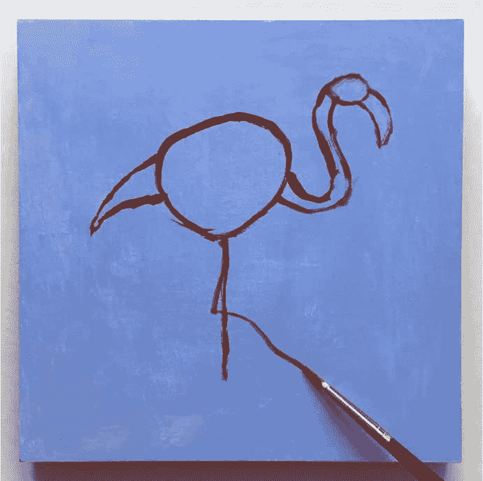

**1** 使用 #6 平头刷，用由 Ultramarine Blue、Titanium White 再加上一点点 Unbleached Titanium 调配的蓝色为画布上色，以使背景去饱和从而显得后退。待干。用 #1 圆头刷和 Napthol Red 画出火烈鸟的轮廓，作为一系列简单形状——喙和尾巴为略微弯曲的三角形，身体和头部为椭圆形，颈部为 S 形。

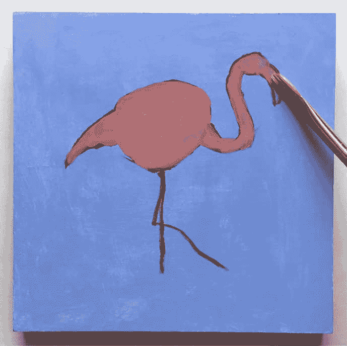

**2** 无需让轮廓干，因为颜色会被并入下一个调色。用 #4 菲尔伯特刷和由 Napthol Red、一点 Cadmium Yellow Medium、Unbleached Titanium 以及一点 glazing medium 调配的中调粉色，大致勾出火烈鸟的色块。晾干一两分钟。

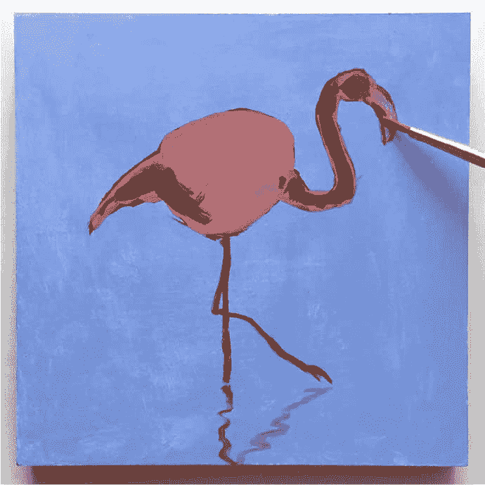

**3** 在 Napthol Red 中加入极少量 Mars Black。用 #1 圆头刷填满颈部的 S 曲线、眼睛的圆形形状、喙的下侧以及尾羽的阴影区域。还为腿部的倒影画上锯齿线。

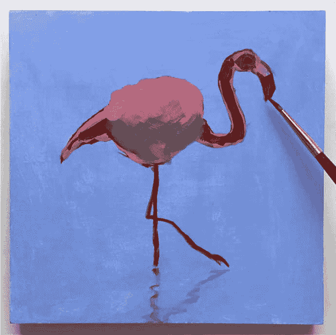

**4** 用 #1 圆头刷，用 Mars Black、Unbleached Titanium 和一点点 Napthol Red 调配的混合色绘制阴影的腹部，以使其偏向粉色。（请注意，水面反射的光会照到鸟身上，因此身体底部仍可见最初的淡粉色。）用 Napthol Red 和 Unbleached Titanium 调配出更亮的粉色，并用 #4 菲尔伯特刷绘制上半身。用 Mars Black 绘制喙和眼球。

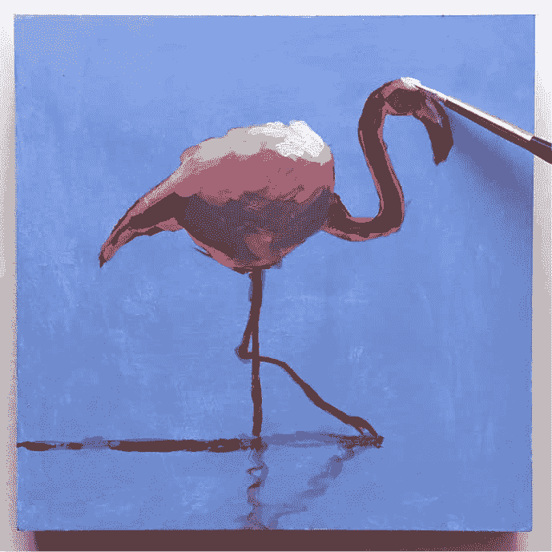

**5** 为水面上的阴影调配由 Ultramarine Blue 和 Napthol Red 组成的深紫色，并用 #1 圆头刷涂上。通过在画布上将 Titanium White 融入步骤 4 的亮粉色，在身体上部涂上粉色调，并在画布上混合颜色。用纯 Titanium White 绘制最亮的高光。

如果你是从写生画这种题材，很难把形状完全画准。先做一系列超快的铅笔速写，集中注意鸟头相对于身体和腿的角度，以便在脑海中固定鸟类运动的节奏。

### 42 戏剧性对比：路上的光

在作品中引入对比是赋予绘画戏剧性冲击力的一种好方法，即使题材本身相当平凡。这里有几种对比在起作用：尺度对比（前景占据了图像的大部分，而山脉只占很小面积）；明度对比（明亮的阳光斑块与黑暗的阴影相对）；以及色彩温度对比（温暖的紫色阴影与背景山脉相对较冷的红色相平衡）。大胆的、趋向抽象的形状也增强了画面的冲击力。这幅画还利用了互补对比（见第 26 页）：玉米田的金黄色抵消了路面上紫色的阴影，而绿色山脉和路边则被红色土色所平衡。这些都是制作更具戏剧性图像的工具。

### 材料

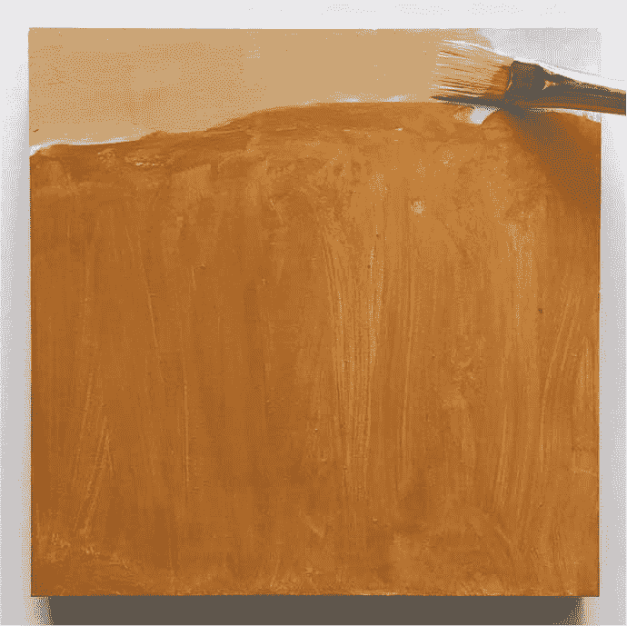

**1** 使用 #6 平头刷，在大部分画布上涂一层薄薄的 Yellow Ochre，留下一些纹理以表现粗糙的道路。用 Yellow Ochre 和 Unbleached Titanium 的混合色绘制天空区域。注意比例的对比——前景约占画布的四分之五。

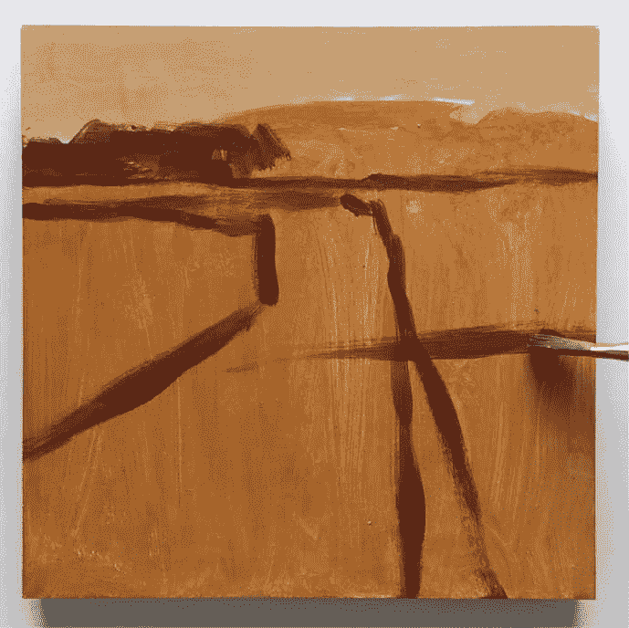

**2** 用 #4 菲尔伯特刷和用 glazing medium 稀释的 Burnt Sienna 大致勾出构图，将一切简化为一系列基本几何形状。我没有使用柔和的曲线，而是选择为道路做一系列斜线；这不是抽象的方法，但也不是严格的写实。

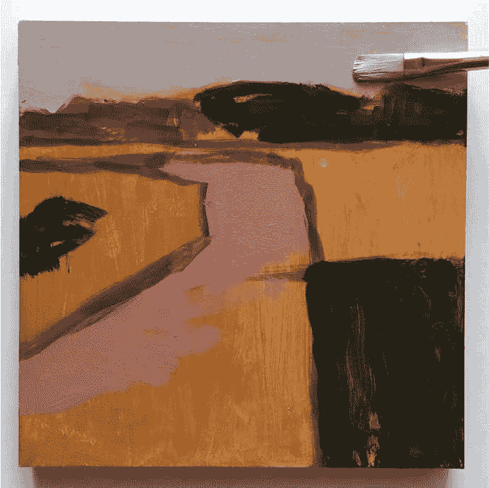

**3** 用 #4 菲尔伯特刷，用 Unbleached Titanium、Napthol Red 和一点 Cadmium Yellow Medium 的混合色大致勾出道路。用 Mars Black 和一点点 Cadmium Yellow Medium 调配出深绿色，并勾出阴影区域，保持形状非常大胆和 stark。用 Titanium White、Unbleached Titanium 和一点 Ultramarine Blue 的混合色绘制天空，让部分原始底色显现以表现云朵。

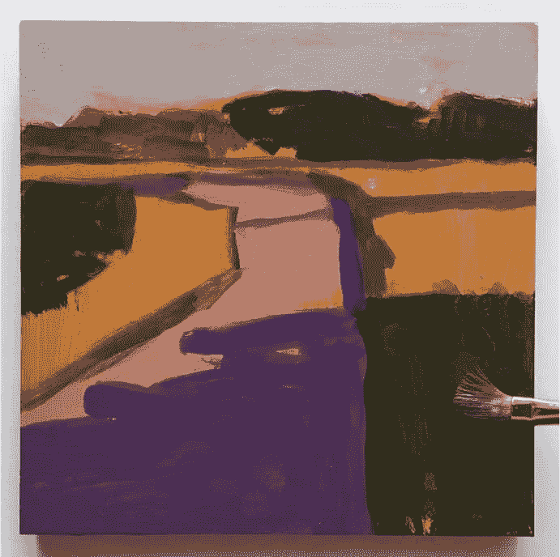

**4** 用 Ultramarine Blue、Unbleached Titanium 和 Napthol Red 调配出紫色。用 #4 菲尔伯特刷在路面上勾出阴影。用 Mars Black、Cadmium Yellow Medium 和一点 Unbleached Titanium 调配草地区域，以稍微提亮颜色。这些深色与明亮阳光的斑块形成鲜明对比。

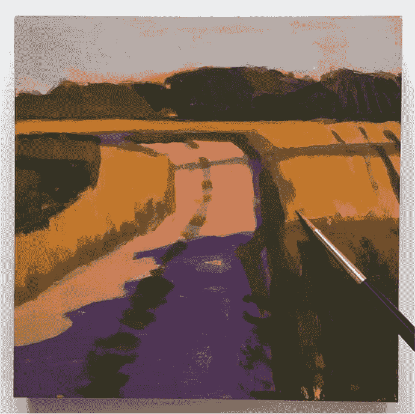

**5** 继续在画上工作，发展色彩和明度。加入一些浅绿色草地以平衡深绿色草地，并用一层薄薄的 Napthol Red 釉料温暖玉米田的金黄色，以抵消道路的冷紫色。

看看其他风景场景——无论是自己的照片还是网上的图片——思考如何用同样的原则来画它们。在可能的情况下简化形状和细节，并记住色彩并不总是必须忠于生活。

### 43 破碎笔触：树

破碎笔触只是小点或短笔触的颜料，不进行混合；颜色在光学上而非在调色板或画布上物理地结合，并且允许底层的画布透出来。这种技法营造出非常生动、充满活力的感觉，非常适合表现自然光的闪烁——因此不足为奇，它常出现在 19 世纪晚期印象派作品中。在这个项目中，背景颜色从红色，经橙色和黄色，过渡到绿色。这被称为棱镜或光谱渐变，颜色遵循阳光穿过棱镜时所见的顺序。这些颜色在色轮上彼此接近，有助于使绘画和谐统一。

### 材料

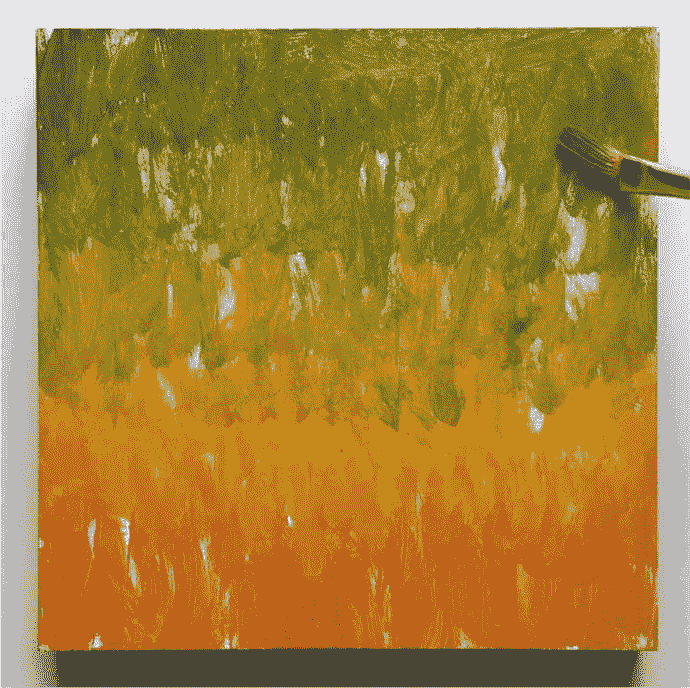

**1** 从画布底部向上工作，用 #4 菲尔伯特刷涂上短的垂直笔触。从底部开始用 Cadmium Yellow Medium 和 Napthol Red 调配的橙色混合，逐渐靠近中心时加入更多黄色，最后向黄色中加入 Ultramarine Blue 以创造绿色。菲尔伯特的形状使其非常适合这种标记制作。待干。

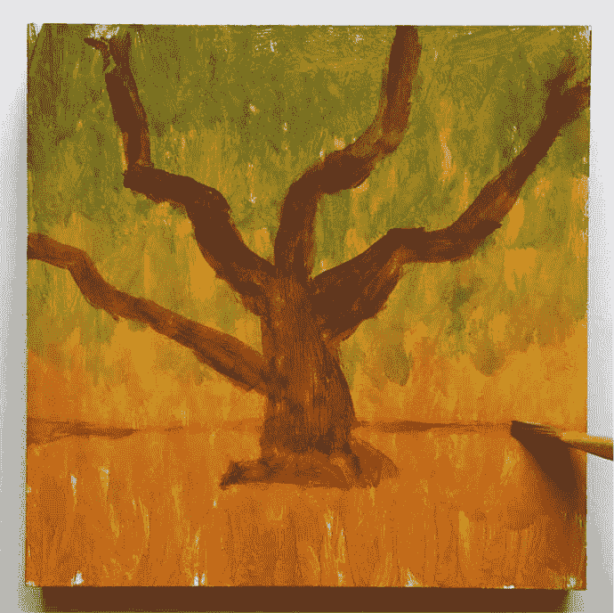

**2** 用调色胶将熟赭色调和后，用 #4 阔头圆头刷再次绘制树干和主枝的轮廓以及地平线。如果你没有合适的参考资料，很容易在网上找到树木剪影。

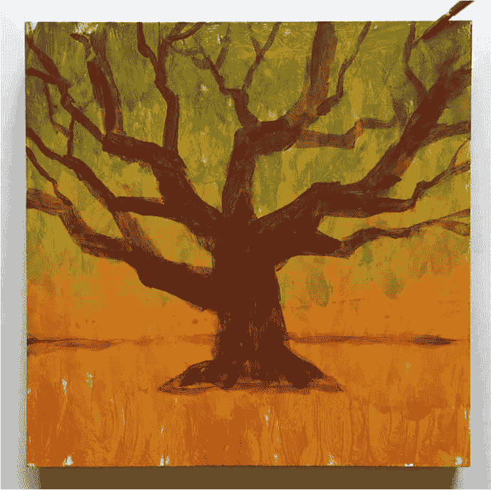

**3** 用熟赭色和群青调出稍深的棕色。再次使用 #4 阔头圆头刷，用断裂的排线填满树内，用刷子侧面着色。这些在树干较暗部位的断裂线条也暗示了树皮的纹理。继续添加枝条，对较小的枝条换用 #1 圆头刷。

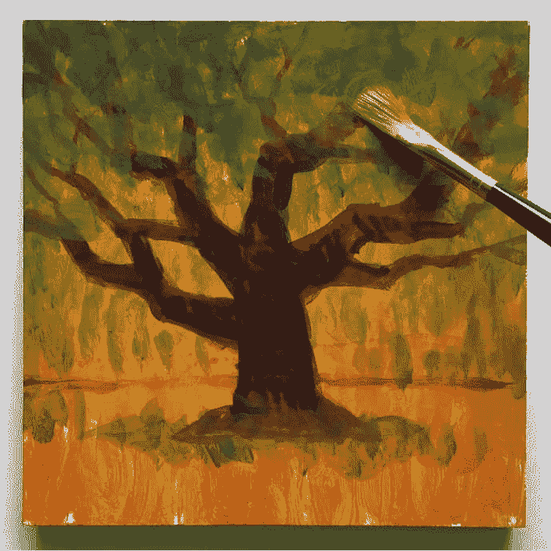

**4** 用镉黄中号色和马尔斯黑调出深橄榄绿（这样调出的绿色比在黄色中加蓝色更温暖、更自然）。用点彩的方式将颜色点在树上，注意整体的叶丛形状，而不是试图画出每一片叶子。在背景中点出一些灌木，并在树干底部点出一些草。

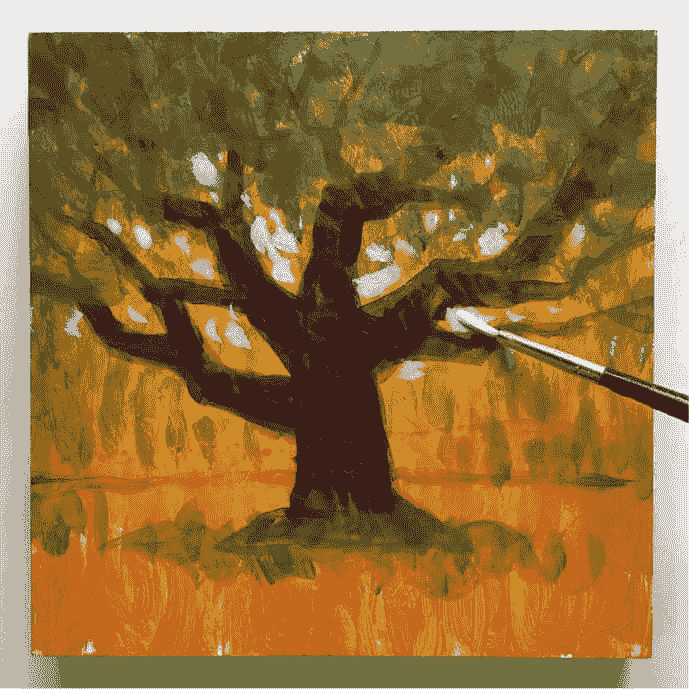

**5** 用钛白调入一点群青。用 #1 圆头刷随机点出“天空孔”——即天空透过叶丛显现的地方，以营造光线穿透的感觉。

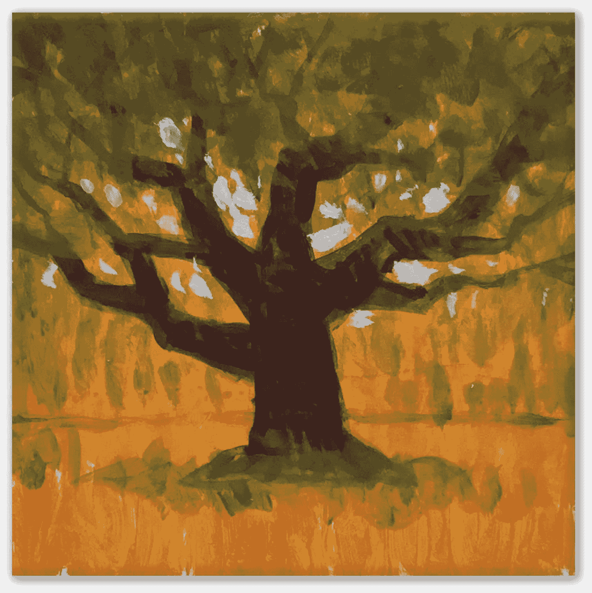

本练习的目的是探索断裂笔触的创作可能性；虽然这种技巧特别适用于风景画，但你可以将其应用于迄今为止完成的任何项目，使其更具印象派风格并营造出更具活力的绘画。

### 44 渐变与深度：朦胧的群山

在绘画中，特别是风景画中，创造深度和距离感的一种方法是色彩渐变。物体越远离越显得越小——但颜色也会随距离变冷、变淡、变不鲜亮。在本项目中，你可以看到山脉范围中的渐变。随着距离的增加，质感和细节也会减少。例如，在最近的山脉范围内，我们可以看到树木的剪影与天际线相对，但在下一座山脉范围内只能辨认出山体本身的整体形状。本项目还利用了红、黄颜料的自然光泽，通过薄釉表现日落。因为所有颜色都在色轮的同一部分（从红色到黄色，光学混合形成橙色），它们和谐地融合，创造出协调的配色方案。

#### 材料

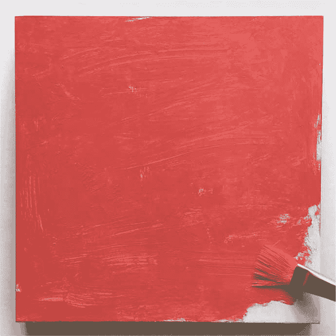

**1** 用萘酚红、未漂白钛白和一点镉黄中号色调出暖粉色，使其更接近日落粉而非鲑鱼粉。用 #6 平头刷为画布上底色，保持纹理粗糙不平。让其稍干，但不要完全干透。

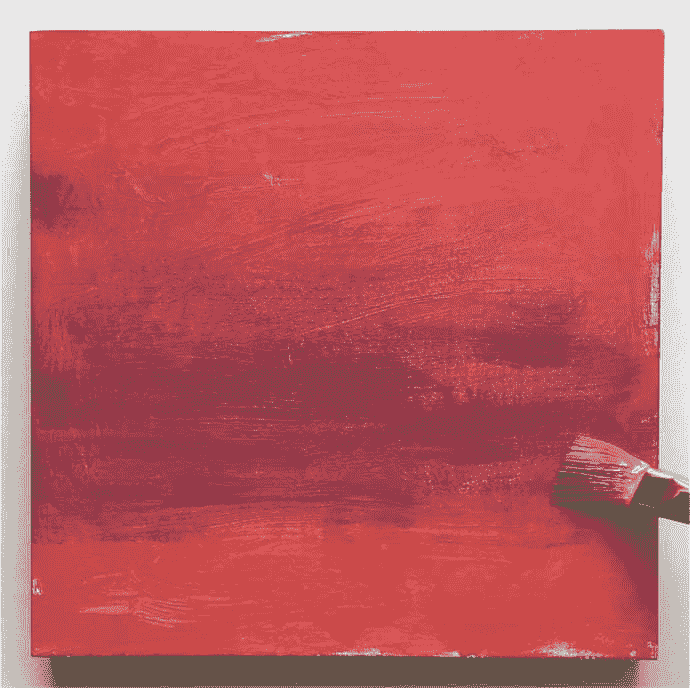

**2** 用萘酚红、未漂白钛白和群青调出较稠的暖紫色。用 #6 平头刷以干刷法将颜色刷过画布中部，施加极轻的压力：你希望覆盖略显断裂，让最初的粉色透出来。

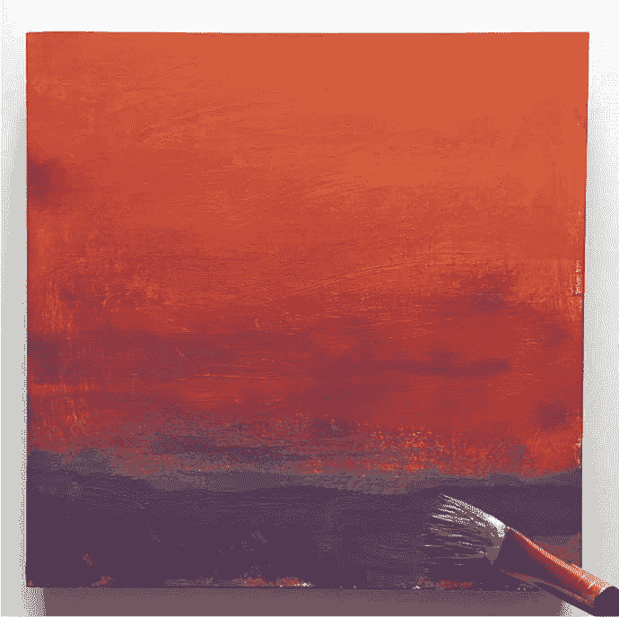

**3** 在颜料仍湿润时，用镉黄中号色和萘酚红调出浓郁的橙色，并在画布上三分之一处涂一层薄釉。对于中间三分之一，在混合色中加入更多萘酚红并以干刷法刷上。对于底部的山脉，用群青、未漂白钛白和一点马尔斯黑调出深而温暖的紫色。将此颜料涂得比天空更厚，以使土地更具实体感。

**4** 换成 #4 阔头圆头刷，在步骤 3 的紫色仍湿润时继续。向紫色混合色中加入更多马尔斯黑，在画布底部画一个松散的 V 形；较深的色调给人这种区域最靠近观者的印象。将刷子压入湿润的底层混合颜色并确定中部山脉的形状。用刷尖点出一些短笔触表现树木。

**5** 用马尔斯黑绘制画布底部最近的树木。为了营造太阳周围的橙色雾霭，用镉黄中号色、萘酚红和未漂白钛白调色，并用 #4 阔头圆头刷涂一短笔触。用镉黄中号色和 #1 圆头刷绘制太阳本身。

虽然山脉只占据画面的底部四分之一，但三种精心渐变的紫色调传达了场景的尺度。不要觉得画布尺寸小而受限：即使在这样的小方块画布上也能创作出令人印象深刻的画面。

### 45 使用釉彩混合色彩：灯塔

釉彩本质上是一种非常稀薄的色彩混合——薄到画布颜色或下面的颜料会透出来。每层颜料都会被下面的层/层所改变；颜色在画布上光学混合——例如，涂在蓝色上方的黄色釉彩会呈现绿色——但颜色仍保持独立，因此比直接使用预调绿色更生动、闪烁。这种效果使其成为捕捉光线瞬息变化的完美技巧。务必用丙烯调色胶而非水来稀释釉彩用颜料，因为这不仅增加了颜料的流动性，还有助于其附着在画布上。你可能会惊讶于实际需要的颜料如此之少。还请记住在涂下一层釉彩前让每层釉彩干燥；对于丙烯来说，这并不需要很长时间。

#### 材料

**1** 用 #6 平头刷将画布调成柔和的鲑鱼粉色，该颜色由萘酚红、未漂白钛白、少量镉黄中号色和丙烯调色胶混合而成。用萘酚红和一点熟赭色调出红褐色。用 #4 阔头圆头刷勾出岩石的形状。

**2** 用群青、未漂白钛白和一点萘酚红调出柔和的紫蓝色。用 #4 阔头圆头刷粗略勾出云朵及其倒影，部分地方让下面的粉色日落色透出来。用同一种颜色勾出灯塔和倒影。

**3** 用 #1 圆头刷和步骤 2 中更深的紫蓝色为灯塔绘制一些细节。从现在开始，你将涂抹薄薄的色彩釉彩，因此在混合色中加入调色胶。向步骤 1 的鲑鱼粉中加入更多未漂白钛白，使其呈粉橙色。用 #4 阔头圆头刷将此色釉涂在天空的粉色部分及其倒影上。

**4** 向步骤 2 的紫蓝色混合色中加入更多群青并涂在天空和倒影的较暗部分。用步骤 3 的浅粉橙色为灯塔上釉：主体沐浴在落日光线中，釉彩完美捕捉了这种温暖、朦胧的效果。

**5** 这里从群青到紫色再到橙色的过渡相当 stark，因此用步骤 3 的浅粉橙色混合液为整幅画上釉以柔化；这也有助于在色彩上统一画面。对于灯光本身，使用纯钛白。

釉彩——以极薄的层次堆叠颜料——比直接逐色作画更能令人信服地表现光线的瞬息变化。

### 46 互补色：柠檬枝

## 互补色

互补色是色轮上彼此相对的颜色（见第 26 页）。这些色彩组合比其他色彩组合显得更强烈，可以营造出非常充满动感的绘画。需要注意的是，如果互补色饱和度相同且紧挨着放置，它们似乎会产生振动感：相邻边缘似乎模糊在一起，几乎看起来在振荡。过度饱和的颜色也可能显得相当不自然。为避免这种情况，一个有用的技巧是通过添加灰色或未漂白钛白来降低一个或两个颜色的饱和度。投射阴影也是此构图的重要部分。请注意，阴影边缘越靠近物体越清晰。

### 材料

**1** 使用 #1 圆头画笔和用调色介质稀释的黄赭色，勾勒出柠檬和叶片的轮廓。

**2** 使用 #4 扁平圆头画笔和镉黄中铺出柠檬的颜色。向黄色中加入马尔斯黑制作深橄榄绿，并填满叶片。

**3** 在柠檬左侧，用 #1 圆头画笔涂上黄赭色，逐渐向更明亮的部分添加镉黄中。向步骤 2 的绿色混合色中再加入更多镉黄中和一点未漂白钛白，绘制叶片向光扭曲的部分。

**4** 黄色和紫色是互补色，因此这里使用紫色作为背景。混合未漂白钛白、萘酚红、群青和一点钛白；未漂白钛白使紫色脱饱和，而钛白使其变亮。使用 #6 平头画笔绘制背景，同时勾出柠檬和叶片的形状。待干。

**5** 换成 #4 扁平圆头画笔。向步骤 2 的绿色混合色中加入更多马尔斯黑，用它来加深叶片部分并绘制茎。用萘酚红、群青和少量未漂白钛白混合绘制投射阴影。每个阴影都从物体附近开始；随着远离，用布擦拭画笔，蘸入调色介质并向外拉开颜色，使阴影边缘变柔和。在柠檬上用钛白混合少量镉黄中添加高光。

柔和的紫色背景增强了柠檬的明亮黄色而不喧宾夺主。为了练习脱饱和色彩，不妨用互补色画一系列水果——红色背景上的青柠、蓝色背景上的橙子、黄色背景上的李子？

### 47 透光性和透明度：太妃糖

绘制透明物体或材料如玻璃纸的秘诀是使用非常薄的颜料层，以便底层颜色透出。先绘制透明材料后面的物体，然后在上面罩上一层非常非常薄的白色或灰色釉，让部分背景仍然可见。最后在上面添加高光。半透明物体，如本练习中的糖果，需要稍有不同的方法。糖果显然比它包裹的玻璃纸更坚实，因此颜料涂得稍厚一些——但它仍然需要看起来有光泽，所以你需要使用更透明的颜色。并非所有制造商都会在颜料管标签上提供此信息，所以这是你需要通过实验自己学习的东西。

#### 材料

**1** 在画布中央，使用 #6 平头画笔用镉黄中绘制一个椭圆。 用萘酚红和镉黄中调出暗橙红色并绘制背景，同时勾出糖果的形状。

**2** 糖果干后，使用 #4 亮光画笔在糖果左上方刷上一层非常薄、透明的背景色釉。待干。

**3** 用未漂白钛白、一点马尔斯黑和大量调色介质调出一层非常浅灰色的薄釉。使用 #6 平头画笔画出几个粗糙的三角形以开始表现塑料包装的形状，保持覆盖不均匀，使底层颜色透出。

**4** 用萘酚红和马尔斯黑调出阴影色。使用 #4 扁平圆头画笔绘制糖果下方的投射阴影，远离糖果时加入更多萘酚红。将少量同色涂于包装上，使其看起来像能透过透明玻璃纸看到部分投射阴影。

**5** 调配一层非常薄的钛白釉，加入极少量马尔斯黑和大量调色介质。将 #4 扁平圆头画笔侧放，在包装上做出一系列细长、略微弯曲的笔触以表现高光，注意不要完全覆盖底层。（#1 圆头画笔无法承载足够颜料来做出这种长笔触。）再添加几处纯钛白的更亮高光。

最后一步添加的明亮高光表示包装上的褶皱：光线照在褶皱的平坦顶部平面上，侧面则变暗。尝试使用不同颜色的背景和糖果，并记录每种颜色的透明度如何。

### 48 绘制逆光主体：蓟

当你看逆光主体时会看到什么？主体本身的细节往往被削弱，因为背后的光线非常强烈，形成眩目的光晕效果——因此先从光晕开始，其他部分会更容易落位。也要利用画布的颜色。这里，我用未漂白钛白的浅米白色调了画布，这立即带来一种光泽感，并会在蓟周围形成光晕。我随后用黄赭色混合色勾出蓟的形状，使其从背景中分离；这营造出温暖的感觉，因为蓟刺沐浴在太阳的金色光辉中。对于这个特定主题，使用短促、有方向的笔触来表现蓟头和花朵的质感也很重要，并让部分光晕透出；这也增加了光泽感。

#### 材料

**1** 使用 #6 平头画笔用未漂白钛白调色画布。用黄赭色和未漂白钛白调出暖黄色。使用 #6 平头画笔绘制背景，同时勾出蓟的形状。用同色在中央绘制蓟的形状，两者之间留出间隙以形成光晕，让调好的画布透出。待干。

**2** 用萘酚红、煅赭色和一点黄赭色调出暗红色。使用 #4 亮光画笔覆盖背景，这次在原始光晕外勾出蓟刺的形状，使步骤 1 的黄赭色透出一点，形成次级发光光晕。

**3** 用马尔斯黑和镉黄中调出深暗绿色。使用 #1 圆头画笔绘制茎和花头的膨大部分；后者使用短促、有方向的笔触向外辐射，留出一些空隙使底层的黄赭色透出。

#### 4
用萘酚红、群青和钛白调出紫色。使用 #1 圆头画笔，用短促、有方向的笔触绘制蓬松质感的花头，在混合色中加入更多群青以表现较冷的下半部，加入更多萘酚红以表现较暖的上半部。再次让一些黄赭色透出来，既表现单个花瓣，又增强明亮感。

#### 5
加深蓟花底部，用更浓的紫色混合。用镉黄中调和未漂白钛白的混合色，建立几根更多伸向背景的蓟刺，以增加明亮感。

主体本身的细节被弱化，但光线在主体边缘周围形成的光晕效果创造出一种迷人的氛围画。

### 49 营造尺度感：峡谷全景

我们都熟悉线性透视的基本原理——物体越远看起来越小——但传达尺度感和距离感还有其他方法。第一是色彩温度：前景的物体看起来比远处的更温暖、更强烈。例如，在这一场景中，前景的橙色和蓝色被加强且饱和度很高，而背景中的则更冷、更淡。第二是纹理和细节会随着距离而变得不那么明显。这个项目也关乎将复杂的场景抽象成更简单的图案。即使主题是一幅辽阔的全景，你也可以将其简化为基本形状和色块，甚至在你选择的情况下趋向抽象。

### 材料

#### 1
用萘酚红、少量镉黄中和一点点黄赭调出暖橙色。使用 #4 扁平圆头画笔将其涂在陆地区域，保留天空区域不动。从上到下作画，接近前景时加入更多萘酚红。待干。

#### 2
重复此过程，用蓝色表现峡谷墙壁的阴影区域。对于前景阴影，在群青中加入煅赭以中和并加深它。左前景中阴影的峡谷墙壁为纯群青。随着向后推进加入未漂白钛白，逐渐提亮并冷却颜色。这会产生将悬崖推向场景深处的效果。为天空区域加入钛白。

#### 3
用萘酚红、少量镉黄中和一些未漂白钛白调出紫粉色。仍使用 #4 扁平圆头画笔，将其在中景部分进行擦涂，变化混合色中颜色的比例。

#### 4
对于树木，用玛斯黑和镉黄中调出深绿色，阴影面加入更多黑色。用稀释的煅赭罩染前景阴影，使其稍暖。用步骤 1 的橙色混合色塑造前景峡谷的形体，为最亮的部分加入未漂白钛白。

#### 5
使用 #1 圆头画笔在中景中点缀一些小树，以帮助营造尺度感。然而，不要陷入过多细节，尤其是在如此小的画布上。细化阴影区域，使用步骤 2 中相同的蓝色混合色，并使前景阴影更暖、更暗、更饱和。

练习用其他全景视野作画透视，例如阿尔卑斯山脉，其色彩对比可能不如这一峡谷场景那样极端。然后尝试用同样的方法表现更平坦但同样辽阔的景观，如非洲大草原。

### 50 整体主义：落日景观

整体主义是 1870 年代在美国兴起的艺术运动，以柔和且色彩有限的调色板为特征。整体主义者感兴趣的是捕捉光的效果——特别是月光或黎明或黄昏的漫射光。价值非常接近的大面积与对比度更高的较小面积相对。朦胧、富有氛围的风景是最常见的题材。在这一场景中，土地形成 stark 的剪影——尽管仔细看你会发现它不是纯黑：相反，暖中性色（棕色、灰色、带绿调的深色）交织其中。黄赭底色赋予整体光晕，而落日及其在下方河流中的倒影像刀一样切穿周围的暗调。

### 材料

#### 1
将黄赭与一点点煅赭和罩染介质混合。使用 #6 平头画笔粗略地将此颜色刷满整个画布并待干。现在将煅赭与一点黄赭与罩染介质混合。使用 #4 扁平圆头画笔绘制地平线和树木的剪影。保持笔触非常松散且富有质感。

#### 2
在画布上三分之二的区域，使用 #4 扁平圆头画笔涂抹黄赭、煅赭和少量玛斯黑的混合色，留出落日的位置。将相同颜色添加到河流中天空的倒影上，中央留出落日倒影的位置。也在树木中加入少量该颜色。

#### 3
用玛斯黑与少量煅赭和镉黄中的混合色覆盖土地，使颜色向绿色偏移，使用松散的垂直笔触呼应树木和草生长的方向。用玛斯黑、未漂白钛白、群青和黄赭调出蓝灰色，并将其刷在天空上部和倒影中。注意这种灰色在明度上与步骤 2 中的深橄榄混合色非常相似。

#### 4
继续加深土地并细化天空；注意地平线上的树木现在看起来被背光照亮，与傍晚天空的光晕形成鲜明对比。就明度而言，画布上三分之二的上部形成一个统一和谐的空间，将与落日及其倒影形成对比。

#### 5
继续用之前的相同颜色发展天空，抚平颜料但仍保留一些质感。对于太阳及其倒影，将钛白与少量镉黄中和黄赭混合，并用 #1 圆头画笔涂抹。

尝试改变地平线的位置，上下移动并观察其对情绪的影响。你也可以尝试改变色彩温度，例如使云朵更暖（例如加入萘酚红），但避免使用过多饱和的颜色。
