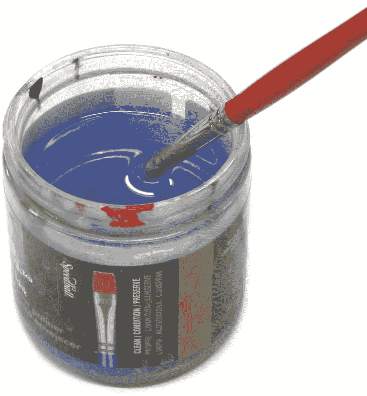

## 索引

### A
丙烯酸底胶 23
丙烯酸涂料：
基本应用 36–37
色彩调色板 16
干燥时间 17
厚体 vs 软体 14
色相与混合 vs 纯颜料 17
媒介与添加剂 17
学生级 vs 专业级 15
稀释 17
添加剂 17
类似色 26
艺术家调色板 56–57

### B
背光主体，绘制 134–135
绘画中的平衡 29
香蕉皮 112–113
蜜蜂 90–91
粘合剂 14
黄油块 72–73
砖墙 58–59
刷辊 18
画笔：
护理 19
选择 18
认识你的 46–47
形状 19
笔触：
破碎 124–125
表现性 112–113
排线 90–91
积木长颈鹿 94–95
蝴蝶 68–69
焦糖糖果 132–133
钮扣花 98–99

### C
仙人掌 86–87
画布：
悬挂方法 33
安装到板上 22
使用 23
峡谷景色 136–137
儿童粉笔画 42–43
色彩：
补色 26, 130–131
对比 66–67
创建统一方案 86–87
与展示 31
通过使用釉彩混合 128–129
调色板 16, 42–43
方案 26
阴影 94–95
与明度 26–27, 44–45, 92–93
色轮 26
构图，简单 54–55
圆锥：
介绍 78–79
与球体 96–97
对比：
色彩 66–67
戏剧性 122–123
在绘画中 28
立方体：
介绍 72–73
光与影 80–81
积云 110–111
挖出形状 48–49
圆柱体：
复杂 106–107
介绍 84–85

### D
雏菊 50–51
深度，与渐变 126–127
设计原则 28–29
细节，精细 68–69
展示你的作品 30–33
使表面受损 58–59
绘画中的主导 29
门 36–37
门和挂锁 66–67
戏剧性对比 122–123
绘画，转移 24–25
干燥时间 17

### E
边缘，随机 110–111
土司上的鸡蛋 62–63
椭圆：
复杂 98–99
介绍 74–75
信封 38–39

### F
布料，了解 64–65
火烈鸟 120–121
绘画中的焦点 29
画框/装框 30, 32

### G

## G
几何形状，多个 100–101
石膏，丙烯 23
釉彩：
发光效果 114–115, 116–117, 126–127
色彩混合 86–87, 128–129
半透明/透明 132–133
釉彩媒介 17
光泽媒介 17
渐变与深度 126–127
石墨，使用石墨转移绘画 24
灰色，混合其明度 44–45
网格系统，使用网格转移绘画 24, 25
## H
悬挂：
配置 32
方法 33
主题 30–31
和谐，绘画中的 28
排笔笔触 90–91
重体丙烯 14
节日帽 78–79
热气球 60–61
色相，丙烯 15
## I
冰淇淋锥 96–97
点亮的灯泡 116–117
繁复细节 68–69
## L
落日景观 138–139
分层：
不透明 40–41
有纹理 52–53
柠檬枝 130–131
光：
发光效果 114–115
反射 102–103
以及立方体上的明暗 80–81
道路上的光 122–123
灯塔 128–129
发光釉彩 116–117
发光光效 114–115
## M
Masonite，使用 23
块面，介绍 50–51
哑光媒介 17
MDF，使用 23
媒介 17
朦胧山脉 126–127
混合，丙烯 15
装裱 30
多层三明治 80–81
## N
负空间，绘画 48–49
## O
不透明分层 40–41
开放媒介/延缓剂 17
## P
绘画应用，基础 36–37
画笔 104–105
调色板：
色彩 16
扩展 42–43
调色板，用于盛放颜料 20–21
纸：
装裱到面板上 22
使用 23
纸袋木偶 92–93
洒满糖屑的糕点 46–47
兵卒 82–83
颜料 14
针垫 76–77
菠萝片 74–75
椒盐卷饼 106–107
底涂 23
专业级：
画笔 18
颜料 15
投影仪，使用投影仪转移绘画 24, 25
纯色素 15
## R
红色谷仓 52–53
反射光 102–103
反射，水中的 60–61
反光表面 82–83
重复，绘画中的 29
粗糙和光滑表面 62–63
## S
缎面媒介 17
明暗，立方体上的光与 80–81
色调，混合色调与 38–39
阴影色彩 94–95
形状：
剪切 48–49
与展示 31
多个几何 100–101
简化主题 120–121
光滑与粗糙表面 62–63
软体丙烯 14
球体：
与圆锥 96–97
介绍 76–77
多个 88–89
分裂互补色 26
松饼堆 84–85
学生级：
画笔 18
颜料 15
主题：
与展示 31
绘画背光 134–135
简化 120–121
表面：
做旧 58–59
用于绘画 22–23
反光 82–83
天鹅 118–119
## T
桌面静物 54–55
外卖盒 102–103
四色 26
有纹理分层 52–53
纹理，多个 104–105
剧院窗帘 64–65
增稠剂 17
蓟 134–135
色调与明度，混合 38–39
色调主义 138–139
调色画布 23
玩具鸭 48–49
玩具熊猫 88–89
玩具火箭 100–101
转移你的绘画 24–25
半透明与透明 132–133
树 124–125
三色 26
T 恤 40–41
## U
统一，绘画中的 28
## V
明度与色彩 26–27, 44–45, 92–93, 136–137
## W
水，简单的反射 60–61
蜡笔 44–45
白色，创造干净清新的 118–119
木纹，绘画 56–57
木板，使用 23
## Credits
致谢
本书记载着我对数千名艺术家的深切敬意，我有幸与他们分享这段艺术探索之旅。渴望学习的学生、忠实的实践者、困惑的评论家以及你们其他人，都激励着我努力为任何好奇如何创作艺术的人提供有用的、可用的内容。
感谢 Quarto 团队的指导和耐心（Kate Kirby、Gemma Wilson、Charlene Fernandes）。特别感谢 Michelle Pickering 承担了让我保持任务进度的艰难工作。
最后，也是最重要的是：没有 Sarah Hoggett 的出色贡献，这本书就不复存在，她将我杂乱的项目笔记翻译成了这本书的连贯文本。
Quarto 感谢以下机构提供本书中再版的图像：
[www.dickblick.com](http://www.dickblick.com)：p26（色轮）
[www.shutterstock.com](http://www.shutterstock.com)：pp8–11 & 32（背景墙）Flas100；p32（相框）A-R-T；p33（右上方）suriya yapin
所有其他照片和插图均由 Quarto Publishing plc 版权所有。虽然我们已尽力署名贡献者，但 Quarto 希望就任何遗漏或错误表示歉意——并乐于在本书的未来版本中作出适当更正。

版权所有 © 2020 Quarto Publishing plc
首次出版于 2020 年，由 Quarto Group 旗下 Quarry Books 出版
100 Cummings Center, Suite 265-D
Beverly, MA 01915, USA
T (978) 282-9590 F (978) 283-2742
[QuartoKnows.com](http://QuartoKnows.com)

版权所有。未经版权所有者书面许可，本书的任何部分不得以任何形式复制。本书中的所有图像均已在有关艺术家的知情并事先同意下复制，制作方、出版方或印刷方对因本出版物内容而产生的任何版权或其他侵权行为概不负责。

10 9 8 7 6 5 4 3 2 1

ISBN: 978-1-63159-851-7

eISBN 978-1-63159-852-4

美国国会图书馆出版物编目数据可供查询。

构思、编辑和设计由
Quarto Publishing
The Quarto Group 的一个印记
The Old Brewery
6 Blundell Street
London N7 9BH
[www.quartoknows.com](http://www.quartoknows.com)

QUAR: 334017

编辑与设计：Michelle Pickering
顾问编辑：Sarah Hoggett
摄影：Mark Daniel Nelson
编辑助理：Charlene Fernandes
艺术总监：Gemma Wilson
出版人：Samantha Warrington
