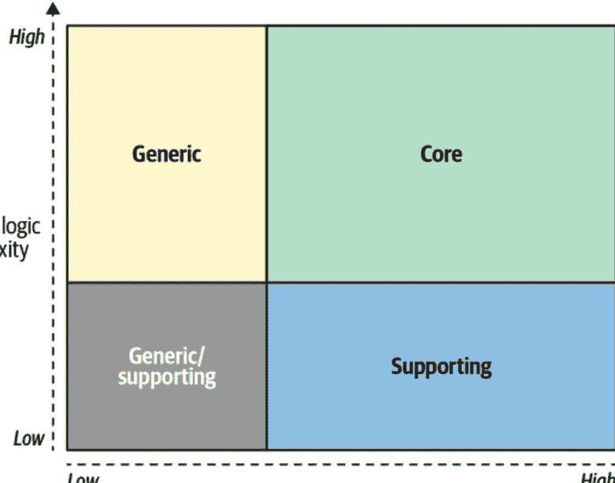
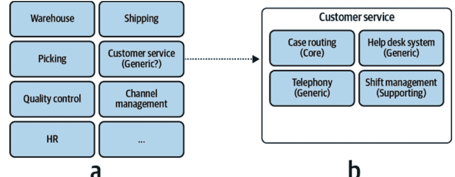
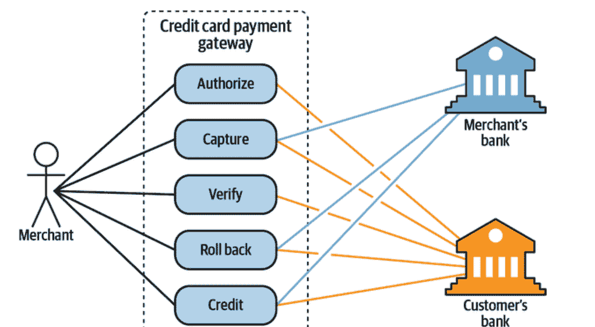
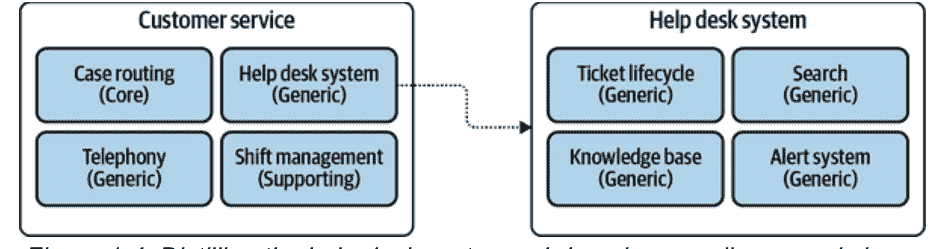

## Chapter 1. Analyzing Business Domains

如果你和我一样，你喜欢编写代码：解决复杂问题、提出优雅的解决方案，并通过精心设计规则、结构和行为来构建全新的世界。 我相信这就是你对领域驱动设计感兴趣的原因：你希望在自己的技艺上做得更好。 然而，本章与编写代码无关。 在本章中，你将学习公司如何运作：它们为什么存在、追求什么目标，以及实现目标的战略。

当我在领域驱动设计课程中教授这些材料时，许多学生实际上会问：“我们需要知道这些材料吗？ 我们在编写软件，而不是经营企业。” 对他们问题的回答是响亮的“是”。 要设计和构建有效的解决方案，你必须理解问题。 在我们的上下文中，问题是我们必须构建的软件系统。 要理解问题，你必须理解其存在的上下文——组织的业务战略，以及它通过构建软件寻求获得什么价值。

在本章中，你将学习领域驱动设计用于分析公司业务领域及其结构的工具：其核心、支持和通用子领域。 这些材料是设计软件的基础。 在剩余的章节中，你将学习这些概念如何影响软件设计。

#### What Is a Business Domain?

业务领域定义了公司的主要活动领域。 一般来说，它是公司为客户提供的服务。 例如：

- FedEx 提供快递递送服务。
- Starbucks 最为人所知的是其咖啡。
- Walmart 是最广为人知的零售机构之一。

一家公司可以在多个业务领域运营。 例如，Amazon 提供零售和云计算服务。 Uber 是一家拼车公司，同时还提供食品配送和自行车共享服务。

需要注意的是，公司可能会经常改变其业务领域。 一个典型的例子是诺基亚，多年来它曾在木材加工、橡胶制造、电信和移动通信等多种不同的领域运营。

#### What Is a Subdomain?

为了实现其业务领域的目标和指标，公司必须在多个*子领域*中运营。 子领域是业务活动的细粒度领域。 公司的所有子领域构成了其业务领域：它为客户提供的服务。

仅实现单个子领域不足以使公司成功；它只是整体系统中的一个构建块。 子领域必须相互交互才能实现公司在其业务领域中的目标。 例如，Starbucks 可能因其咖啡而最受认可，但要建立成功的咖啡连锁店，仅仅知道如何制作优质咖啡是不够的。 你还必须在有效的位置购买或租赁房地产、招聘人员并管理财务，等等。 这些子领域中的任何一个单独都不会使公司盈利。 只有它们全部结合起来，公司才能在其业务领域中竞争。

### 子域的类型

正如软件系统包含各种架构组件——数据库、前端应用、后端服务等——子域也具有不同的战略/业务价值。领域驱动设计将子域区分为三种类型：核心、通用和支持。让我们从公司战略的角度看看它们有何不同。

##### 核心子域

核心子域是公司与竞争对手不同的地方。这可能涉及发明新产品或服务，或通过优化现有流程来降低成本。

以 Uber 为例。最初，公司提供了一种新型交通方式：拼车。随着竞争对手的追赶，Uber 找到了优化和演进其核心业务的方法：例如，通过匹配同向乘客来降低成本。

Uber 的核心子域影响其底线。这是公司区别于竞争对手的方式。这是公司为客户提供更好服务和/或最大化盈利能力的战略。为了保持竞争优势，核心子域涉及发明、智能优化、商业诀窍或其他知识产权。

再考虑另一个例子：Google Search 的排名算法。在撰写本文时，Google 的广告平台占其利润的大部分。也就是说，Google Ads 不是一个子域，而是一个独立的业务域，其下包含子域，其中包括其云计算服务（Google Cloud Platform）、生产力和协作工具（Google Workspaces），以及 Alphabet，即 Google 的母公司运营的其他领域。但 Google Search 及其排名算法呢？尽管搜索引擎不是付费服务，但它作为 Google Ads 的最大展示平台。其提供出色搜索结果的能力推动了流量，随后成为广告平台的重要组成部分。由于算法中的错误导致搜索结果不佳，或竞争对手推出更好的搜索服务，都将损害广告业务的收入。因此，对于 Google 来说，排名算法是一个核心子域。

### 复杂性

一个易于实现的简单核心子域只能提供短暂的竞争优势。因此，核心子域自然是复杂的。继续以 Uber 为例，公司不仅通过拼车创造了一个新的市场空间，还通过有针对性的技术使用，打破了数十年历史的单体架构——出租车行业。通过理解其业务域，Uber 能够设计出更可靠、更透明的交通方式。公司的核心业务应具有较高的进入壁垒；竞争对手很难复制或模仿公司的解决方案。

### 竞争优势来源

需要注意的是，核心子域不一定是技术性的。并非所有商业问题都可以通过算法或其他技术解决方案解决。公司的竞争优势可以来自各种来源。

例如，考虑一家在线销售产品的珠宝商。在线商店很重要，但它不是核心子域。珠宝设计才是。公司可以使用现成的在线商店引擎，但不能外包珠宝的设计。设计是客户购买该珠宝商产品并记住该品牌的原因。

作为一个更复杂的例子，想象一家专门从事人工欺诈检测的公司。该公司培训分析师审查可疑文件并标记潜在的欺诈案件。你正在构建分析师使用的软件系统。这是一个核心子域吗？不是。核心子域是分析师所做的工作。你正在构建的系统与欺诈分析无关，它只是显示文件并跟踪分析师的评论。

### 核心子域与核心域

核心子域也称为核心域。例如，在最初的领域驱动设计书籍中，Eric Evans 交替使用“核心子域”和“核心域”。尽管“核心域”一词经常被使用，但我更喜欢使用“核心子域”，原因有几点。首先，它是一个*子域*，我更喜欢避免与*业务域*混淆。其次，正如你在第 11 章中将学到的那样，子域随着时间的推移而演变并改变其类型并不少见。例如，核心子域可以转变为通用子域。因此，说“一个*通用*子域演变为*核心*子域”比说“一个通用*子域*演变为核心*域*”更直接。

#### 通用子域

*通用子域*是所有公司以相同方式执行的业务活动。与核心子域一样，通用子域通常复杂且难以实现。然而，通用子域不会为公司提供任何竞争优势。这里不需要创新或优化：经过实战检验的实现方案广泛可用，所有公司都使用它们。

例如，大多数系统都需要对其用户进行身份验证和授权。与其发明专有的身份验证机制，使用现有解决方案更有意义。这样的解决方案更有可能可靠和安全，因为它已经由许多其他具有相同需求的公司进行了测试。

回到在线销售产品的珠宝商的例子，珠宝设计是核心子域，但在线商店是通用子域。使用与竞争对手相同的在线零售平台——相同的通用解决方案——不会影响珠宝商的竞争优势。

### 支持子域

顾名思义，*支持子域*支持公司的业务。然而，与核心子域相反，支持子域不会提供任何竞争优势。

例如，考虑一家在线广告公司，其核心子域包括将广告匹配到访客、优化广告效果以及最小化广告空间成本。然而，为了在这些领域取得成功，公司需要对其创意素材进行编目。公司存储和索引其物理创意素材（如横幅和着陆页）的方式不会影响其利润。在该领域没有需要发明或优化的东西。另一方面，创意目录对于实施公司的广告管理和投放系统至关重要。这使得内容编目解决方案成为公司支持子域之一。

支持子域的显著特征是解决方案业务逻辑的复杂性。支持子域是简单的。它们的业务逻辑大多类似于数据录入屏幕和 ETL（提取、转换、加载）操作；即所谓的 CRUD（创建、读取、更新和删除）接口。这些活动领域不会为公司提供任何竞争优势，因此不需要较高的进入壁垒。

### 比较子域

现在我们对三种类型的业务子域有了更深入的了解，让我们从其他角度探索它们的区别，并看看它们如何影响战略软件设计决策。

### 竞争优势

只有核心子域能为公司提供竞争优势。核心子域是公司区别于竞争对手的战略。

通用子域按定义不能成为任何竞争优势的来源。这些是通用解决方案——公司及其竞争对手使用的相同解决方案。

支持子域具有较低的进入壁垒，也无法提供竞争优势。通常，公司不会介意竞争对手复制其支持子域——这不会影响其在行业中的竞争力。相反，从战略上讲，公司更希望其支持子域是通用、现成的解决方案，从而消除设计和构建其实现的需求。你将在第 11 章中详细了解支持子域转变为通用子域的情况，以及其他可能的排列组合。这样的真实案例研究将在附录 A 中概述。

公司能够解决的问题越复杂，就能提供越大的业务价值。复杂问题不仅限于向消费者提供服务。复杂问题可以是，例如，使业务更优化和高效。例如，以与竞争对手相同的服务水平，但以更低的运营成本提供，也是竞争优势。

### 复杂性

从更技术的角度来看，识别组织的子域很重要，因为不同类型的子域具有不同的复杂性水平。在设计软件时，我们必须选择

适应业务需求的复杂性。
因此，识别子域对于设计合理的软件解决方案至关重要。

支持子域的业务逻辑很简单。这些是基本的 ETL 操作和 CRUD 接口，业务逻辑显而易见。通常，它不会超出验证输入或将数据从一种结构转换为另一种结构。

通用子域要复杂得多。别人已经投入时间和精力解决这些问题，应该有一个很好的理由。这些解决方案既不简单也不平凡。例如，考虑加密算法或身份验证机制。

从知识可用性的角度来看，通用子域是“已知未知”。这些是你知道自己不知道的东西。此外，这些知识很容易获得。你可以使用业界认可的最佳实践，或者如果需要，可以聘请该领域的顾问来帮助设计定制解决方案。

核心子域很复杂。它们应该尽可能难以被竞争对手复制——公司的盈利能力取决于此。因此，从战略上讲，公司希望将复杂问题作为其核心子域来解决。

有时区分核心子域和支持子域可能具有挑战性。复杂性是一个有用的指导原则。问一下相关子域是否可以变成一项副业。有人会单独为它付费吗？如果是，这就是核心子域。区分支持子域和通用子域也适用类似的推理：与集成外部解决方案相比，自己编写实现是否会更简单、更便宜？如果是，这就是支持子域。

从更技术的角度来看，识别会影响软件设计的复杂核心子域很重要。如前所述，核心子域不一定与软件相关。识别与软件相关的核心子域的另一个有用指导原则是评估你必须在代码中建模和实现的业务逻辑的复杂性。业务逻辑是否类似于用于数据输入的 CRUD 接口，还是你必须实现由复杂业务规则和不变量编排的复杂算法或业务流程？在前一种情况下，这是支持子域的迹象，而后者是典型的核心子域。

图 1-1 中的图表表示了三种子域类型在业务差异化和业务逻辑复杂性方面的相互作用。支持子域和通用子域之间的交集是一个灰色地带：可能两种情况都有。如果支持子域的功能存在通用解决方案，则由此产生的子域类型取决于集成通用解决方案是否比从头实现该功能更简单和/或更便宜。

图 1-1. 三种子域类型的业务差异化和业务逻辑复杂性

### Volatility

如前所述，核心子域可能会经常发生变化。如果一个问题能在第一次尝试就得到解决，它可能不是一个好的竞争优势——竞争对手会迅速赶上。

因此，核心子域的解决方案是涌现式的。必须尝试不同的实现，进行改进和优化。

此外，核心子域的工作永远不会结束。公司会不断创新和发展核心子域。变化以添加新功能或优化现有功能的形式出现。无论哪种方式，其核心子域的不断演进对于公司保持领先于竞争对手至关重要。

与核心子域相反，支持子域很少发生变化。它们不会为公司提供任何竞争优势，因此，与将同样的精力投入到核心子域相比，支持子域的演进提供的业务价值微乎其微。

尽管已有现有解决方案，但通用子域仍可能随时间变化。变化可能以安全补丁、错误修复或针对通用问题的全新解决方案的形式出现。

### Solution strategy

核心子域为公司提供了与行业其他参与者竞争的能力。这是一项业务关键责任，但这是否意味着支持子域和通用子域不重要？当然不是。所有子域对于公司在其业务领域运作都是必需的。子域就像基础构建块：拿走其中一个，整个结构可能会倒塌。话虽如此，我们可以利用不同类型子域的固有属性来选择实现策略，以最有效的方式实现每种类型的子域。

核心子域必须在内部实现。它们不能被购买或采用；这会削弱竞争优势的概念，因为公司的竞争对手也能做到同样的事情。

将核心子域的实现外包也是不明智的。这是一项战略投资。在核心子域上偷工减料不仅在短期内有风险，而且从长远来看可能产生致命后果：例如，无法支持公司目标和目的的难以维护的代码库。组织中最熟练的人才应分配到其核心子域的工作上。此外，在内部实现核心子域可以让公司更快地进行更改和演进解决方案，从而在更短的时间内建立竞争优势。

由于核心子域的需求预计会经常且持续地变化，解决方案必须可维护且易于演进。因此，核心子域需要实施最先进的工程技术。

由于通用子域是困难但已解决的问题，因此购买现成产品或采用开源解决方案比在内部实现通用子域更具成本效益。

缺乏竞争优势使得避免在内部实现支持子域是合理的。然而，与通用子域不同，没有现成的解决方案。因此，公司别无选择，只能自行实现支持子域。话虽如此，业务逻辑的简单性和变化的低频率使其很容易偷工减料。

支持子域不需要复杂的设计模式或其他高级工程技术。快速应用开发框架足以在不引入偶然复杂性的情况下实现业务逻辑。

从人员配置角度来看，支持子域不需要高度熟练的技术能力，并为培养后起之秀提供了绝佳机会。把团队中擅长应对复杂挑战的工程师留给核心子域。最后，业务逻辑的简单性使得支持子域成为外包的良好候选对象。

表 1-1 总结了三种子域类型在不同方面的差异。

### Table 1-1. The differences between the three types of subdomains

| 子域类型 | 竞争优势 | 复杂性 | 波动性 | 实现方式 |
| Core | Yes | High | High | In-house |
| Generic | No | High | Low | Buy/adopt |
| Supporting | No | Low | Low | In-house/outsource |

### Identifying Subdomain Boundaries

正如你已经看到的，识别子域及其类型可以在构建软件解决方案时帮助做出不同的设计决策。在后面的章节中，你将学习更多利用子域来简化软件设计过程的方法。但我们如何实际识别子域及其边界呢？

子域及其类型由公司的业务战略定义：其业务领域以及它如何与同一领域的其他公司区分开来竞争。在绝大多数软件项目中，以一种或另一种方式，子域是“已经存在”的。这并不意味着，然而，识别它们的边界总是容易和直接的。如果你向 CEO 询问他们公司的子域列表，你可能会得到一个茫然的眼神。他们不了解这个概念。因此，你必须自己进行领域分析以识别和分类所涉及的子域。

一个良好的起点是公司的部门和其他组织单位。例如，在线零售商店可能包括仓库、客户服务、拣货、发货、质量控制和渠道管理等部门。然而，这些是相对粗粒度的活动领域。例如，客户服务部门。合理地假设它将

可能是支持性的，甚至是通用的子域，因为该功能通常外包给第三方供应商。但这些信息足以让我们做出合理的软件设计决策吗？

### 提炼子域

粗粒度的子域是一个良好的起点，但魔鬼在细节中。我们必须确保没有遗漏隐藏在业务功能复杂性中的重要信息。

让我们回到客户服务部门的例子。如果我们探究其内部运作，就会发现典型的客户服务部门由更细粒度的组件组成，例如帮助台系统、班次管理和排班、电话系统等等。当被视为独立的子域时，这些活动可能属于不同类型：虽然帮助台和电话系统是通用子域，班次管理是支持性的，而一家公司可能会开发其巧妙的算法，用于将事件路由到过去处理类似案例成功的代理。路由算法需要分析传入案例并识别过往经验中的相似性——这两项都不是简单的任务。由于路由算法使公司能够提供比竞争对手更好的客户体验，因此路由算法是核心子域。图 1-2 展示了此示例。

图 1-2. 分析看似通用的子域的内部运作，以找到更细粒度的核心子域、支持子域和两个通用子域

另一方面，我们不能无限地向下钻取，在越来越细的粒度层级寻找洞察。什么时候应该停止？

### 子域作为连贯用例

从技术角度看，子域类似于一组相互关联、连贯的用例。这类用例集通常涉及相同的参与者、业务实体，并且都操作一组密切相关的数据。

考虑图 1-3 中所示的信用卡支付网关用例图。用例因其所操作的数据和所涉及的参与者而紧密绑定。因此，所有用例都构成信用卡支付子域。

我们可以将“子域作为一组连贯用例”的定义作为何时停止寻找更细粒度子域的指导原则。这些是最精确的子域边界。

图 1-3. 信用卡支付子域的用例图

你是否应该始终努力识别这种激光聚焦的子域边界？对于核心子域来说，这绝对是必要的。核心子域是最重要、最不稳定、最复杂的。必须尽可能提炼它们，因为这将使我们能够提取所有通用和支持功能，并将精力投入到更聚焦的功能上。

对于支持性和通用子域，提炼可以适当放宽。如果进一步钻取不能揭示任何有助于你做出软件设计决策的新洞察，就可以停止了。例如，当所有更细粒度的子域与原始子域类型相同时，就会发生这种情况。

考虑图 1-4 中的示例。进一步提炼帮助台系统子域的用处不大，因为它没有揭示任何战略信息，并且将使用粗粒度的现成工具作为解决方案。

图 1-4. 提炼帮助台系统子域，揭示通用的内部组件

在识别子域时需要考虑的另一个重要问题是，我们是否需要全部子域。

### 专注于本质

子域是减轻软件设计决策过程的工具。所有组织可能都有相当多的业务功能推动其竞争优势，但与软件无关。我们在本章前面讨论的珠宝制造商就是一个例子。

在寻找子域时，重要的是识别与软件无关的业务功能，将其视为此类，并专注于与你正在处理的软件系统相关的业务方面。

### 领域分析示例

让我们看看如何在实践中应用子域的概念，并将其用于做出一系列战略设计决策。我将描述两家虚构公司：Gigmaster 和 BusVNext。作为练习，在阅读时分析这些公司的业务域。尝试为每家公司识别三种类型的子域。记住，正如现实生活一样，部分业务需求是隐含的。

免责声明：当然，通过阅读如此简短的描述，我们无法识别每个业务域涉及的所有子域。尽管如此，这足以训练你识别和分类可用子域。

#### Gigmaster

Gigmaster 是一家票务销售和分销公司。其移动应用分析用户的音乐库、流媒体服务账户和社交媒体资料，以识别附近用户可能感兴趣的演出。

Gigmaster 的用户非常注重隐私。因此，所有用户的个人信息都已加密。此外，为确保用户的小秘密在任何情况下都不会泄露，公司推荐算法完全在匿名数据上运行。

为了改进应用的推荐，实施了一个新模块。它允许用户记录过去参加过的演出，即使票不是通过 Gigmaster 购买的。

##### 业务域和子域

Gigmaster 的业务域是票务销售。这就是它为客户提供的服务。

*核心子域*

Gigmaster 的主要竞争优势是其推荐引擎。该公司也非常重视用户隐私，仅在匿名数据上工作。最后，虽然没有明确提及，但我们可以推断移动应用的用户体验也至关重要。因此，Gigmaster 的核心子域是：

- 推荐引擎
- 数据匿名化
- 移动应用

#### 通用子域

我们可以识别并推断出以下通用子域：

- 加密，用于加密所有数据
- 会计，因为公司从事销售业务
- 清算，用于向客户收费
- 身份验证和授权，用于识别其用户

### 支持子域

最后，以下是支持子域。这里的业务逻辑简单，类似于 ETL 流程或 CRUD 接口：

- 与音乐流媒体服务的集成
- 与社交网络的集成
- 已参加演出模块

### 设计决策

了解正在发挥作用的子域及其类型之间的差异后，我们已经可以做出几个战略设计决策：

- 推荐引擎、数据匿名化和移动应用必须使用最先进的工程工具和技术在内部实现。这些模块将最频繁地发生变化。
- 应为数据加密、会计、清算和身份验证使用现成或开源解决方案。
- 与流媒体服务和社交网络的集成，以及已参加演出模块，可以外包。

#### BusVNext

BusVNext 是一家公共交通公司。它的目标是为客户提供舒适的公交车乘坐体验，类似于打车。该公司在主要城市管理公交车队。

BusVNext 客户可以通过移动应用订购乘车。在计划出发时间，附近公交车的路线将即时调整，以便在指定的出发时间接上客户。

公司的主要挑战是实现路由算法。其需求是“旅行商问题”的一种变体。路由逻辑会持续调整和优化。例如，统计数据显示取消乘车的主要原因是等待公交车到达的时间过长。因此，公司调整了路由算法以优先快速接客，即使这意味着延误下车时间。为了进一步优化路由，BusVNext 与第三方提供商集成以获取交通状况和实时警报。

不时地，BusVNext 会发放特别折扣，既吸引新客户，又在高峰和非高峰时段平衡乘车需求。

##### 业务域和子域

BusVNext 为客户提供优化的公交车乘坐服务。业务域是公共交通。

##### 核心子域

BusVNext 的主要竞争优势是其路由算法，它试图解决一个复杂问题（“旅行商”），同时优先考虑不同的业务目标：例如减少接客时间，即使这会增加整体行程长度。

我们还看到乘车数据会持续分析以获得对客户行为的新见解。这些见解使公司能够通过优化路由算法来增加利润。

最后，BusVNext 为其客户和司机提供的应用程序必须易于使用并提供便捷的用户界面。

管理车队并非易事。公交车可能会出现技术问题或需要维护。忽视这些问题可能会导致财务损失和服务水平下降。

因此，BusVNext 的核心子域是：
- 路线规划
- 分析
- 移动应用用户体验
- 车队管理

#### 通用子域

路由算法还使用第三方公司提供的交通数据和警报——这是一个通用子域。此外，BusVNext 接受客户付款，因此必须实现会计和清算功能。BusVNext 的通用子域是：
- 交通状况
- 会计
- 计费
- 授权

### 支持子域

管理促销和折扣的模块支持公司的核心业务。也就是说，它本身并不是核心子域。其管理界面类似于用于管理活动优惠券代码的简单 CRUD 界面。因此，这是一个典型的支持子域。

### 设计决策

了解所涉及的子域及其类型之间的差异后，我们已经可以做出一些战略设计决策：
- 路由算法、数据分析、车队管理和应用可用性必须使用最精细的技术工具和模式在内部实现。
- 促销管理模块的实现可以外包。
- 识别交通状况、授权用户以及管理财务记录和交易可以委托给外部服务提供商。

### 谁是领域专家？

现在我们对业务域和子域有了清晰的理解，让我们来看一下在接下来的章节中我们将经常使用的另一个 DDD 术语：*领域专家*。领域专家是了解我们将建模并在代码中实现的所有业务复杂性的主题专家。换句话说，领域专家是软件业务域的知识权威。

领域专家既不是收集需求的分析师，也不是设计系统的工程师。领域专家代表业务。他们是首先识别业务问题的人，所有业务知识都源于他们。系统分析师和工程师将他们对业务域的心理模型转化为软件需求和源代码。

作为经验法则，领域专家要么是提出需求的人，要么是软件的最终用户。软件旨在解决他们的问题。

领域专家的专业知识范围可能不同。一些主题专家将对整个业务域的运作方式有详细的了解，而另一些则专门研究特定的子域。例如，在一家在线广告代理公司中，领域专家将是活动经理、媒体采购员、分析师和其他业务利益相关者。

### 结论

在本章中，我们介绍了用于理解公司业务活动的领域驱动设计工具。正如你所见，一切都始于业务域：企业运营所在的领域以及为客户提供的服务。

你还了解了实现业务域成功并使公司区别于竞争对手所需的各种构建块：

*核心子域*

有趣的问题。这些是公司与竞争对手不同执行的活动，也是其获得竞争优势的来源。

*通用子域*

已解决的问题。这些是所有公司以相同方式执行的事情。这里没有创新空间或需求；与其创建内部实现，使用现有解决方案更具成本效益。

*支持子域*

有明显解决方案的问题。这些是公司可能需要在内部实现但不提供任何竞争优势的活动。

最后，你了解到领域专家是业务的主题专家。他们对公司的业务域或一个或多个子域有深入的了解，对项目的成功至关重要。

## 练习

1. 哪些子域不提供竞争优势？
   a. 核心
   b. 通用
   c. 支持
   d. B 和 C
2. 竞争对手可能使用相同解决方案的子域是哪个？
   a. 核心。
   b. 通用。
   c. 支持。
   d. 以上都不是。公司应始终使其与竞争对手区别开来。
3. 哪个子域预计变化最频繁？
   a. 核心。
   b. 通用。
   c. 支持。
d. 不同子域类型的波动性没有差异。

考虑 WolfDesk 的描述（参见前言），该公司提供帮助台票务管理系统：
4. WolfDesk 的业务域是什么？
5. WolfDesk 的核心子域是什么？
6. WolfDesk 的支持子域是什么？
7. WolfDesk 的通用子域是什么？
