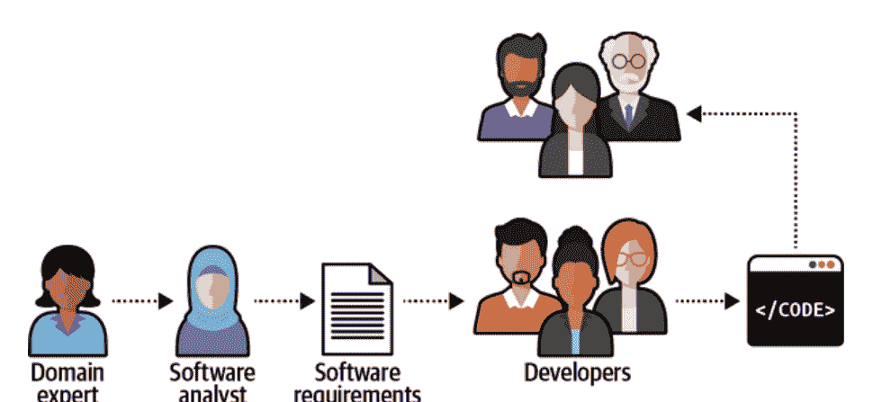
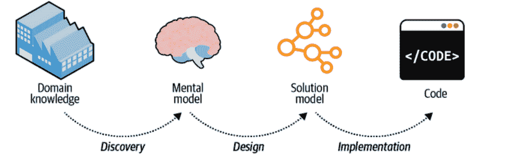

## 第 2 章. 发现领域知识

> 并非领域专家的知识，而是开发人员（的误）理解被发布到生产环境中。
> —Alberto Brandolini

在上一章中，我们开始探索业务域。你学习了如何识别公司的业务域或活动领域，并分析其在其中竞争的策略；即其业务子域的边界和类型。

本章继续业务域分析的主题，但从另一个维度：深度。它关注子域内部发生的事情：其业务功能和逻辑。你将学习用于有效沟通和知识共享的领域驱动设计工具：通用语言。在这里我们将使用它来学习业务域的复杂性。之后在本书中我们将使用它来建模并在软件中实现其业务逻辑。

### 业务问题

我们构建的软件系统是业务问题的解决方案。在这种情况下，单词 problem 并不是指数学问题或你能解决后就完事的谜题。在业务域的上下文中，“问题”有更广泛的含义。业务问题可以与优化工作流程和流程、最小化人工劳动、管理资源、支持决策、管理数据等相关的问题。

业务问题同时出现在业务域和子域层面。公司的目标是为客户的问题提供解决方案。回到第 1 章中的 FedEx 示例，该公司的客户需要在有限的时间范围内运输包裹，因此它优化了运输流程。

子域是更细粒度的难题域，其目标是为特定的业务能力提供解决方案。知识管理子域优化存储和检索信息的过程。清算子域优化执行金融交易的过程。会计子域跟踪公司的资金。

### 知识发现

为了设计有效的软件解决方案，我们必须掌握业务域的至少基本知识。正如我们在第 1 章中所讨论的，这些知识属于领域专家：他们的工作是专门研究并理解业务域的所有复杂性。我们绝不应该，也不能成为领域专家。也就是说，对我们来说，了解领域专家并使用他们使用的相同业务术语至关重要。

为了有效，软件必须模仿领域专家思考问题的方式——他们的心理模型。如果没有对业务问题及其需求背后的推理的理解，我们的解决方案将仅限于“将”业务需求“翻译”为源代码。如果需求遗漏了关键的边界情况呢？或者未能描述一个业务概念，从而限制了我们实现能够支持未来需求的模型的能力？

正如 Alberto Brandolini¹ 所说，软件开发是一个学习过程；可工作的代码是副产品。软件项目的成功取决于领域


专家和软件工程师。我们必须理解问题才能解决它。

领域专家与软件工程师之间有效的知识共享需要有效的沟通。让我们来看看软件项目中有效沟通的常见障碍。

### 沟通

可以肯定地说，几乎所有软件项目都需要不同角色的利益相关者的协作：领域专家、产品负责人、工程师、UI 和 UX 设计师、项目经理、测试人员、分析师等。如同任何协作工作一样，结果取决于各方合作得有多好。例如，所有利益相关者是否同意正在解决什么问题？关于他们正在构建的解决方案——他们对其实用性和非功能性需求是否持有任何冲突的假设？对所有项目相关事宜达成一致和对齐对于项目的成功至关重要。

关于软件项目失败原因的研究表明，有效的沟通对于知识共享和项目成功至关重要。² 然而，尽管其重要性，有效的沟通在软件项目中很少见。经常，业务人员和工程师之间没有直接互动。相反，领域知识是从领域专家向下推送给工程师的。它是通过扮演调解人或“翻译”角色的人传递的，例如系统/业务分析师、产品负责人和项目经理。这种常见的知识共享流程如图 2-1 所示。



图 2-1. 软件项目中的知识共享流程

在传统的软件开发生命周期中，领域知识被“翻译”成一种对工程师友好的形式，即分析模型，它是对系统需求的描述，而不是对其背后业务领域的理解。虽然意图可能良好，但这种调解对知识共享是有害的。在任何翻译中，信息都会丢失；在这种情况下，对于解决业务问题至关重要的领域知识在传到软件工程师的途中就丢失了。这并不是典型软件项目中唯一的此类翻译。分析模型被翻译成软件设计模型（软件设计文档，该文档被翻译成实现模型或源代码本身）。正如经常发生的那样，文档很快就会过时。源代码被用来向日后维护项目的软件工程师传达业务领域知识。图 2-2 说明了将领域知识实现为代码所需的各种转换。



图 2-2. 模型转换

这种软件开发过程类似于儿童游戏“传话”：³ 消息或领域知识往往会失真。信息导致软件工程师实现错误的解决方案，或正确的解决方案但针对错误的问题。在任何一种情况下，结果都一样：软件项目失败。

领域驱动设计提出了一种更好的方法来将知识从领域专家传递给软件工程师：使用通用语言。

### 什么是通用语言？

使用通用语言是领域驱动设计的基石实践。想法很简单直接：如果各方需要高效沟通，而不是依赖翻译，他们必须使用相同的语言。

尽管这一概念近乎常识，但正如伏尔泰所说，“常识并不常见”。传统的软件开发生命周期意味着以下转换：
- 领域知识到分析模型
- 分析模型到需求
- 需求到系统设计
- 系统设计到源代码

领域驱动设计不是持续翻译领域知识，而是要求培养一种描述业务领域的单一语言：通用语言。

所有项目相关利益相关者——软件工程师、产品负责人、领域专家、UI/UX 设计师——在描述业务领域时都应使用通用语言。最重要的是，领域专家必须在推理业务领域时感到舒适地使用通用语言；这种语言将代表业务领域和领域专家的心理模型。

只有通过持续使用通用语言及其术语，才能在项目的所有利益相关者之间培养共同的理解。

### 业务的语言

必须强调，通用语言是业务的语言。因此，它应仅由业务领域相关的术语组成。不要使用技术术语！向业务领域专家教授单例和抽象工厂不是你的目标。通用语言旨在以易于理解的术语来框定领域专家对业务领域的理解和心理模型。

### 场景

假设我们正在开发一个广告活动管理系统。考虑以下陈述：
- 广告活动可以展示不同的创意素材。
- 只有当其至少有一个投放位置处于活动状态时，活动才可以发布。
- 销售佣金在交易获批后计入。

所有这些陈述都是用业务的语言表述的。也就是说，它们反映了领域专家对业务领域的看法。

另一方面，以下陈述纯粹是技术性的，因此不符合通用语言的概念：
- 广告 iframe 显示一个 HTML 文件。
- 只有当活动在 active-placements 表中有至少一条关联记录时，活动才可以发布。
- 销售佣金基于 transactions 和 approved-sales 表中的相关记录。

这些后者的陈述纯粹是技术性的，领域专家将无法理解。假设工程师只熟悉这种技术、面向解决方案的业务领域视图。在这种情况下，他们将无法完全理解业务逻辑或其运作方式的原因，这将限制他们建模和实现有效解决方案的能力。

### 一致性

通用语言必须精确且一致。它应消除对假设的需求，并使业务领域的逻辑明确。

由于歧义会阻碍沟通，通用语言中的每个术语都应有且只有一个含义。让我们看几个术语不明确的例子以及如何改进它们。

### 模糊的术语

假设在某个业务领域中，术语 *policy* 有多种含义：它可以指监管规则或保险合同。确切的含义可以在人与人之间的互动中根据上下文推断出来。然而，软件处理歧义并不好，而且在代码中建模“policy”实体可能很繁琐且具有挑战性。

通用语言要求每个术语只有一个含义，因此“policy”应使用两个术语 *regulatory rule* 和 *insurance contract* 明确建模。

### 同义词

通用语言中不能互换使用两个术语。例如，许多系统使用术语 *user*。然而，对领域专家的行话进行仔细检查可能会发现 *user* 和其他术语被互换使用：例如，*user*、*visitor*、*administrator*、*account* 等。

同义词乍一看似乎无害。然而，在大多数情况下，它们表示不同的概念。在此示例中，*visitor* 和 *account* 在技术上都指系统的用户；然而，在大多数系统中，未注册用户和已注册用户代表不同的角色并具有不同的行为。例如，“访客”数据主要用于分析目的，而“账户”实际上使用系统及其功能。

最好在特定上下文中明确使用每个术语。理解使用中的术语之间的差异可以构建更简单、更清晰的业务领域实体模型和实现。

### 业务领域模型


现在让我们从另一个角度来看普遍语言：建模。

### 什么是模型？

> 模型是对事物或现象的简化表示，它有意强调某些方面，同时忽略其他方面。具有特定用途的抽象。
> 
> ——Rebecca Wirfs-Brock

模型不是现实世界的复制品，而是一种人类构建物，有助于我们理解现实世界系统。

模型的典型例子是地图。任何地图都是一个模型，包括导航地图、地形图、世界地图、地铁图等，如图 2-3 所示。


图 2-3. 不同类型的地图展示了地球的不同模型：道路、时区、海上导航、地形、航空导航和地铁线路。

这些地图中没有一张代表我们星球的所有细节。相反，每张地图只包含足够的数据来支持其特定目的：它 supposed 要解决的问题。

### 有效建模

所有模型都有目的，而有效的模型只包含为实现其目的所需的信息。例如，你不会在世界地图上看到地铁站。另一方面，你不能使用地铁地图来估算距离。每张地图只包含它 supposed 要提供的信息。

这一点值得重申：有用的模型不是现实世界的复制品。相反，模型旨在解决一个问题，并且应为该目的提供足够的信息。或者，正如统计学家 George Box 所说，“所有模型都是错误的，但有些是有用的。”

从本质上讲，模型是一种抽象。抽象的概念使我们能够通过省略不必要的细节，只保留解决当前问题所需的内容来处理复杂性。另一方面，无效的抽象会删除必要的信息，或通过保留不需要的内容而产生噪音。正如 Edsger W. Dijkstra 在其论文“The Humble Programmer”⁴ 中指出的那样，抽象的目的不是含糊其辞，而是创造一个新的语义层，在其中可以做到 *绝对精确*。

### 对业务领域的建模

在培养普遍语言时，我们实际上是在构建业务领域的模型。该模型 supposed 要捕捉领域专家的心智模型——他们关于业务如何运作以实现其功能的思考过程。模型必须反映所涉及的业务实体及其行为、因果关系和不变量。

我们使用的普遍语言并不 supposed 要涵盖领域的每一个可能细节。那将相当于让每个利益相关者都成为领域专家。相反，模型 supposed 要包含业务领域的足够方面，以便能够实现所需系统；即解决软件 intended 要解决的具体问题。在接下来的章节中，你将看到普遍语言如何驱动低级设计和实现决策。

工程团队与领域专家之间的有效沟通至关重要。这种沟通的重要性随着业务领域复杂性的增长而增加。业务领域越复杂，就越难以对其业务逻辑进行建模和在代码中实现。即使是对复杂业务领域或其基本原则的轻微误解，也会无意中导致容易出现严重错误的实现。验证对业务领域的理解的唯一可靠方法是与领域专家交谈，并用他们理解的语言进行交流：业务的语言。

### 持续努力

普遍语言的制定需要与它的自然持有者——领域专家——进行互动。只有与真正的领域专家的互动才能揭示不准确之处、错误假设或对业务领域的整体错误理解。

所有利益相关者都应始终如一地在所有项目相关沟通中使用普遍语言，以传播知识并促进对业务领域的共同理解。语言应在整个项目中持续强化：需求、测试、文档，甚至源代码本身都应使用这种语言。

最重要的是，培养普遍语言是一个持续的过程。它应不断得到验证和演进。日常使用语言会随着时间的推移揭示对业务领域的更深见解。当出现这样的突破时，普遍语言必须演进以跟上新获得的领域知识。

### 工具

有一些工具和技术可以减轻捕获和管理普遍语言的过程。

例如，可以使用 wiki 作为 *术语表* 来捕获和记录普遍语言。这样的术语表可以缓解新团队成员的上手过程，因为它作为了解业务领域术语的 go-to 场所。

重要的是要使术语表维护成为共同努力。当普遍语言发生变化时，应鼓励所有团队成员继续更新术语表。这与集中式方法相反，在集中式方法中，只有团队领导或架构师负责维护术语表。

尽管维护项目相关术语的术语表具有明显的优势，但它存在固有的局限性。术语表最适用于“名词”：实体、流程、角色等的名称。虽然名词很重要，但捕获行为至关重要。行为不仅仅是与名词相关的动词列表，而是实际的业务逻辑，其规则、假设和不变量。此类概念更难在术语表中记录。因此，术语表最好与更适合捕获行为的其他工具一起使用；例如，用例或 *Gherkin 测试*。

用 Gherkin 语言编写的自动化测试不仅是捕获普遍语言的绝佳工具，而且也是弥合领域专家与软件工程师之间差距的额外工具。领域专家可以阅读测试并验证系统的预期行为。⁵ 例如，参见以下用 Gherkin 语言编写的测试：

```
Scenario: Notify the agent about a new support case
Given Vincent Jules submits a new support case saying:
"""
I need help configuring AWS Infinidash
"""
When the ticket is assigned to Mr. Wolf
Then the agent receives a notification about the new ticket
```

管理基于 Gherkin 的测试套件有时可能具有挑战性，尤其是在项目的早期阶段。然而，对于复杂的业务领域来说，这绝对是值得的。

最后，甚至还有静态代码分析工具可以验证普遍语言术语的使用。其中一个值得注意的工具示例是 NDepend。

虽然这些工具很有用，但它们是次要的，次于在日常互动中实际使用普遍语言。使用工具来支持普遍语言的管理，但不要期望文档可以取代实际使用。正如《敏捷宣言》所说，“个体和互动高于流程和工具。”

### 挑战

理论上，培养普遍语言听起来像是一个简单直接的过程。实际上并非如此。收集领域知识的唯一可靠方法是与领域专家交谈。相当频繁地，最重要的知识是隐性的。它没有被记录或编纂，而是只存在于领域专家的脑海中。获取它的唯一方法是提问。

随着你在这种实践中积累经验，你会注意到，经常，这个过程不仅仅是发现已有的知识，而是与领域专家共同创建模型。有时，领域专家自己对业务领域的理解中存在模糊性和空白点；例如，只定义“快乐路径”场景，但不考虑挑战既定假设的边缘情况。此外，你可能会遇到缺乏明确定义的业务领域概念。询问关于其性质的


业务领域往往会使这种隐含的冲突和空白显现出来。对于核心子域来说尤其常见。在这种情况下，学习过程是相互的——你也在帮助领域专家更好地理解他们的领域。

当向棕地项目引入领域驱动设计实践时，你会注意到已经形成了一种描述业务领域的语言，并且利益相关者在使用它。然而，由于该语言并非由 DDD 原则驱动，因此不一定能有效反映业务领域。例如，它可能会使用技术术语，例如数据库表名。改变一个组织中已经在使用的语言并不容易。这种情况下必不可少的工具是耐心。你需要确保在容易控制的地方使用正确的语言：在文档和源代码中。

最后，关于通用语言的问题是我在会议上经常被问到的：如果公司不在英语国家，我们应该使用什么语言。我的建议是至少使用英语名词来命名业务领域的实体。这将缓解在代码中使用相同术语的问题。

### 结论

有效的沟通和知识共享对于软件项目的成功至关重要。软件工程师必须理解业务领域，以便设计和构建软件解决方案。

领域驱动设计的通用语言是弥合领域专家与软件工程师之间知识差距的有效工具。它通过培养一种共享语言来促进沟通和知识共享，该语言可在整个项目中被所有利益相关者使用：在对话、文档、测试、图表、源代码等中。

为了确保有效沟通，通用语言必须消除歧义和隐含假设。语言中的所有术语都必须保持一致——没有歧义的术语，也没有同义词。

培养通用语言是一个持续的过程。随着项目的演进，会发现更多领域知识。重要的是这些见解要反映在通用语言中。

诸如基于 wiki 的术语表和 Gherkin 测试等工具可以极大地缓解记录和维护通用语言的过程。然而，有效通用语言的主要前提是使用：该语言必须在所有项目相关沟通中始终如一地使用。

## 练习

- 1. 谁应该能够为通用语言的定义做出贡献？
  - a. 领域专家
  - b. 软件工程师
  - c. 终端用户
  - d. 项目的所有利益相关者
- 2. 通用语言应该在何处使用？
  - a. 面对面对话
  - b. 文档
  - c. 代码
  - d. 以上全部

3. 请回顾前言中虚构的 WolfDesk 公司的描述。你能在描述中发现哪些业务领域术语？

4. 考虑你当前正在进行或过去进行过的某个软件项目：
  - a. 尝试提出可在与领域专家对话中使用的业务领域概念。
  - b. 尝试识别不一致术语的示例：业务领域概念具有不同含义，或相同概念由不同术语表示。
  - c. 你是否遇到过因沟通不畅而导致的软件开发效率低下？

5. 假设你在进行一个项目，你注意到来自不同组织单元的领域专家使用相同的术语，例如 policy，来描述业务领域中不相关的概念。

由此产生的通用语言基于领域专家的心理模型，但未能满足术语具有单一含义的要求。

在继续下一章之前，你将如何解决这种困境？

3 玩家排成一列，第一位玩家想出一条信息并悄悄告诉第二位玩家。第二位玩家将信息重复给第三位玩家，以此类推。最后一位玩家将听到的信息宣布给整个团体。第一位玩家随后将原始信息与最终版本进行比较。虽然目标是传达相同的信息，但它通常会被篡改，最后一位玩家收到的信息与原始信息有显著不同。

4 Edsger W. Dijkstra，“谦逊的程序员”。

5 但请不要陷入认为领域专家会编写 Gherkin 测试的陷阱。
