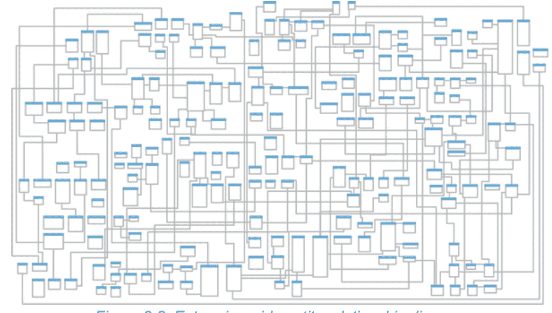
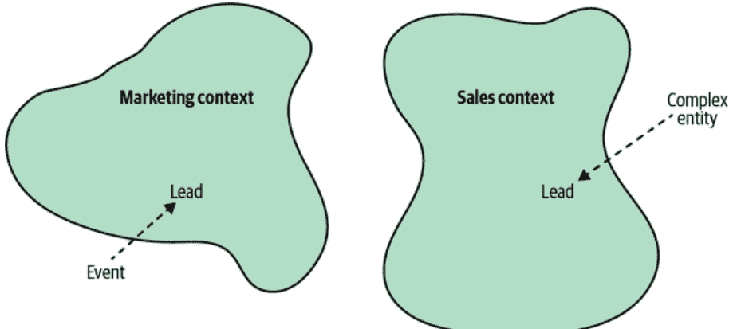
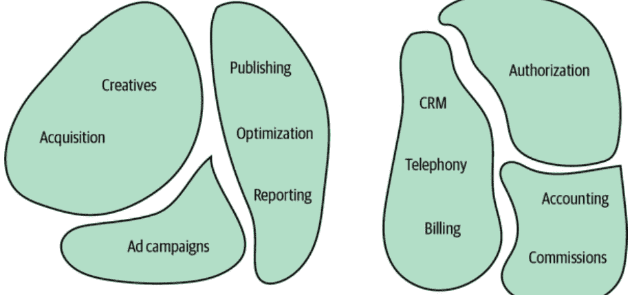
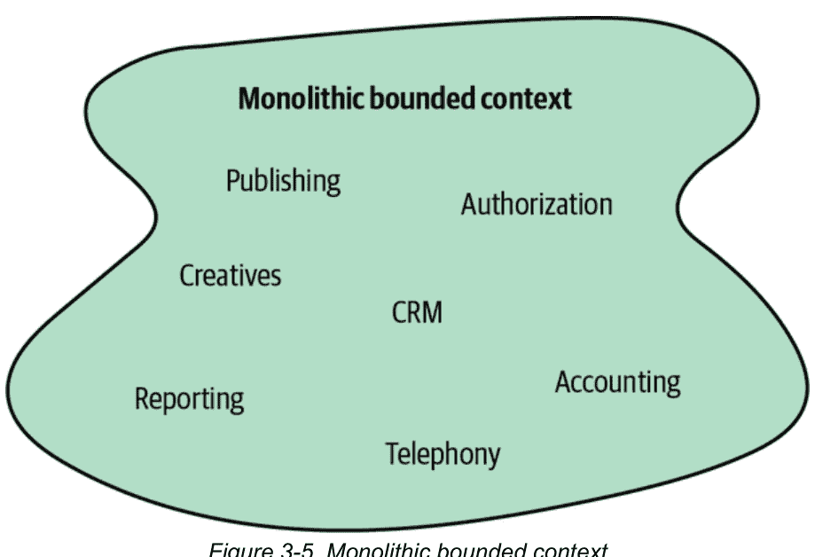
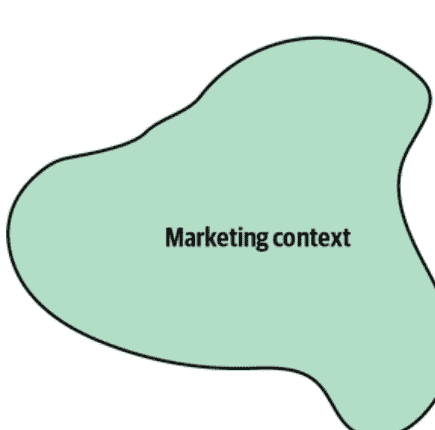
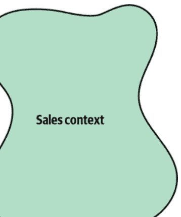
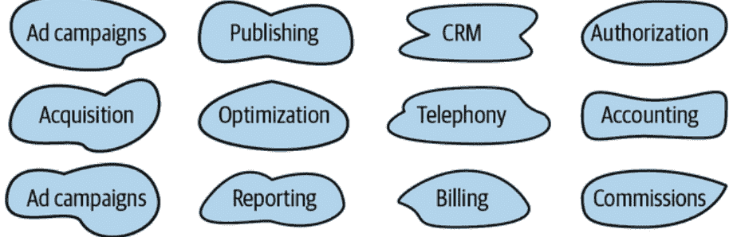
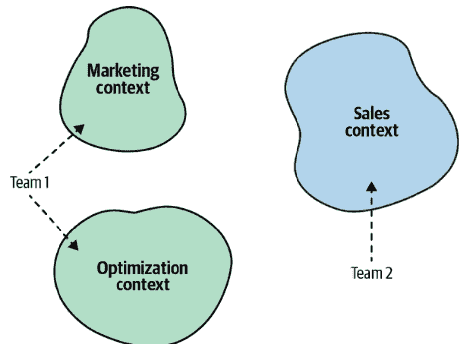

## 第 3 章 管理领域复杂性

正如你在上一章所看到的，为了确保项目的成功，至关重要的是你开发出一种通用语言，可供所有利益相关者使用，从软件工程师到领域专家。语言应反映领域专家对业务领域内部运作和基本原则的心理模型。

由于我们的目标是使用通用语言来驱动软件设计决策，因此语言必须清晰且一致。它应免于歧义、隐含假设和多余细节。然而，在组织层面，领域专家的心理模型本身可能不一致。不同的领域专家可能对同一业务领域使用不同的模型。让我们看一个例子。

#### 不一致的模型

让我们回到第 2 章中的电话营销公司示例。该公司的营销部门通过在线广告产生潜在客户。其销售部门负责招揽潜在客户购买其产品或服务，其流程如图 3-1 所示。

图 3-1. 示例业务领域：电话营销公司

对领域专家语言的检查揭示了一个奇特的观察。术语 lead 在营销和销售部门的含义不同：

#### 营销部门

对于营销人员来说，lead 代表有人对其中一种产品感兴趣的通知。将收到潜在客户联系方式的事件视为 lead。

#### 销售部门

在销售部门的语境中，lead 是一个更复杂的实体。它代表整个销售流程的生命周期。它不是一个简单的事件，而是一个长期运行的过程。

我们如何为这家电话营销公司制定通用语言？

一方面，我们知道通用语言必须保持一致——每个术语应只有一个含义。另一方面，我们知道通用语言必须反映领域专家的心理模型。在这种情况下，销售和营销部门的领域专家对“lead”的心理模型是不一致的。

这种歧义在人与人之间的沟通中并不会带来太多挑战。事实上，不同部门之间的人沟通可能更具挑战性，但人类很容易从互动的上下文中推断出确切含义。

然而，要在软件中表示这种分歧的业务领域模型则更困难。源代码无法很好地处理歧义。如果我们将销售部门的复杂模型带入营销，它会在不需要的地方引入复杂性——营销人员为优化广告活动所需的大量细节和行为都太多。但如果我们试图根据营销部门的世界观简化销售模型，它也不符合销售子域的需求，因为它对于管理和优化销售流程来说过于简单化。我们在第一种情况下会得到过度设计的解决方案，在第二种情况下会得到设计不足的解决方案。

我们如何解决这个两难困境？

解决这个问题的传统方案是设计一个可用于各种问题的单一模型。此类模型会产生巨大的实体关系图 ERD，遍布整面办公室墙。图 3-2 是一个有效的模型吗？

图 3-2. 企业级实体关系图

俗话说，“样样通，样样松”。这类模型本应适用于一切，最终却对任何事物都无效。不管你做什么，你始终面临着复杂性：过滤掉无关细节的复杂性、找到真正需要的东西的复杂性，以及最重要的是，保持数据处于一致状态的复杂性。

另一种解决方案是在有问题的术语前加上上下文的定义：“营销线索”和“销售线索”。这样就可以在代码中实现这两种模型。然而，这种方法有两个主要缺点。首先，它会增加认知负担。何时使用每种模型？冲突模型的实现越接近，犯错就越容易。其次，模型的实现不会与通用语言保持一致。没人会在对话中使用前缀。人们不需要这些额外信息；他们可以依赖对话的上下文。

让我们转向领域驱动设计模式来应对此类场景：有界上下文模式。

### 什么是有界上下文？

领域驱动设计中的解决方案很简单：将通用语言划分为多个更小的语言，然后将每种语言分配给其可以应用的明确上下文：其*有界上下文*。

在前面的示例中，我们可以识别出两个有界上下文：营销和销售。术语*lead*同时存在于这两个有界上下文中，如图 3-3 所示。只要它在每个有界上下文中都有单一含义，每个细粒度的通用语言就保持一致并遵循领域专家的心智模型。

*图 3-3. 通过将通用语言拆分为有界上下文来解决不一致问题*

从某种意义上说，术语冲突和隐式上下文是任何规模合理的企业固有的部分。有了有界上下文模式，上下文被建模为业务域中明确且不可或缺的一部分。

### 模型边界

正如我们在上一章讨论的那样，模型不是现实世界的复制品，而是一种帮助我们理解复杂系统的构造。它所要解决的问题是模型固有的部分——其目的。模型不能没有边界存在；它会扩展成为现实世界的复制品。这使得定义模型的边界——其有界上下文——成为建模过程的内在部分。

让我们回到地图作为模型的例子。我们看到每张地图都有其特定的上下文——航空、海图、地形、地铁等等。地图只有在其特定目的范围内才有用且一致。

正如地铁地图对海上导航毫无用处一样，一个有界上下文中的通用语言可能与另一个有界上下文的范围完全无关。有界上下文定义了通用语言及其所代表的模型的应用范围。它们允许根据不同的问题域定义不同的模型。换句话说，有界上下文是通用语言的一致性边界。语言的术语、原则和业务规则仅在其有界上下文内部保持一致。

### 完善的通用语言

有界上下文使我们能够完成通用语言的定义。通用语言并非以“无处不在”的意义上应该在整个组织中“无处不在”地使用和应用。通用语言并非通用。

相反，通用语言仅在其有界上下文的边界内才是无处不在的。该语言专注于描述仅由有界上下文所涵盖的模型。由于模型不能没有其所要解决的问题而存在，因此通用语言不能在没有明确适用上下文的情况下被定义或使用。

### 有界上下文的范围

本章开头的示例展示了业务域固有的边界。不同的领域专家对同一业务实体持有冲突的心智模型。为了对业务域建模，我们必须划分模型并为每个细粒度模型定义严格的适用上下文——其有界上下文。

通用语言的一致性只有助于识别该语言最宽的边界。它不能更大，否则就会出现不一致的模型和术语。然而，我们仍然可以将模型进一步分解为更小的有界上下文，如图 3-4 所示。

图 3-4. 更小的有界上下文

定义通用语言的范围——其有界上下文——是一个战略设计决策。边界可以很宽，遵循业务域固有的上下文，也可以很窄，进一步将业务域划分为更小的问题域。

有界上下文的大小本身并不是决定因素。模型不一定大或小。模型需要有用。通用语言的边界越宽，保持其一致就越困难。将大型通用语言划分为更小、更易管理的领域可能是有益的，但追求过小的有界上下文也会适得其反。它们越小，设计带来的集成开销就越大。

因此，有界上下文应有多大取决于具体的问题域。有时，使用宽边界会更清晰，而在其他时候，进一步分解会更有意义。

从较大的上下文中提取更细粒度的有界上下文的原因包括组建新的软件工程团队或解决系统的某些非功能性需求；例如，当你需要将原本位于单个有界上下文中的组件的开发生命周期分开时。提取某个功能性的另一个常见原因是能够使其独立于有界上下文的其余功能进行扩展。

因此，保持你的模型有用，并使有界上下文的大小与你的业务需求和组织约束保持一致。需要注意的一点是，不要将连贯的功能拆分为多个有界上下文。这种划分会阻碍独立演进每个上下文的能力。相反，相同的业务需求和变更将同时影响有界上下文并需要同时部署变更。为了避免这种无效的分解，使用我们在第 1 章讨论的经验法则来查找子域：识别操作相同数据的连贯用例集，并避免将它们分解为多个有界上下文。

我们将在第 8 章和第 10 章进一步讨论持续优化有界上下文边界的话题。

### 有界上下文与子域

在第 2 章中，我们看到业务域由多个子域组成。到目前为止，本章探讨了将业务域分解为一组细粒度问题域或有界上下文的概念。乍一看，这两种分解业务域的方法似乎是多余的。然而，事实并非如此。让我们来看看为什么我们需要两者。

### 子域

为了理解公司的业务战略，我们必须分析其业务域。根据领域驱动设计方法论，分析阶段涉及识别不同的子域（核心、支持和通用）。这就是组织的工作方式以及其竞争战略的规划方式。

正如你在第 1 章中学到的那样，子域类似于一组相互关联的用例。用例由业务域和系统的需求定义。作为软件工程师，我们不定义需求；这是业务的责任。相反，我们分析业务域以识别子域。

#### 有界上下文

另一方面，有界上下文是设计出来的。选择模型边界是一个战略设计决策。我们决定如何将业务域划分为更小、可管理的领域。

#### 子域与有界上下文之间的相互作用

理论上，尽管不切实际，单个模型可以跨越整个业务域。对于小型系统来说，这种策略可能有效，如图 3-5 所示。

图 3-5. 单体有界上下文

当出现冲突的模型时，我们可以遵循领域专家的心智模型，并将系统分解为有界上下文，如图 3-6 所示。

图 3-6. 由通用语言一致性驱动的有界上下文

如果模型仍然庞大且难以维护，我们可以将其进一步分解为更小的有界上下文；例如，为每个子域设置一个有界上下文，如图 3-7 所示。

图 3-7. 与子域边界对齐的有界上下文

无论哪种方式，这都是一个设计决策。我们将这些边界作为解决方案的一部分进行设计。

在某些场景下，有界上下文与子域之间的一对一关系是完全合理的。然而在其他情况下，不同的分解策略可能更合适。

必须记住，子域是被发现的，而有界上下文是被设计的。¹ 子域由业务战略定义。然而，我们可以设计软件解决方案及其有界上下文，以应对特定项目的上下文和约束。

最后，正如你在第 1 章学到的那样，一个模型旨在解决特定问题。在某些情况下，同时使用同一概念的多个模型来解决不同问题是有益的。正如不同类型的地图提供关于我们星球的不同类型信息一样，使用同一子域的不同模型来解决不同问题可能是合理的。将设计限制为有界上下文之间的一对一关系会抑制这种灵活性，并迫使我们在其有界上下文中使用子域的单一模型。

### 边界

正如 Ruth Malan 所说，架构设计本质上是关于边界的：

> *架构设计是系统设计。系统设计是上下文设计——它本质上是关于边界的（什么在内，什么在外，什么跨越，什么在两者之间移动），以及关于权衡。它重塑外部，就像它塑造内部一样。*²

有界上下文模式是领域驱动设计用于定义物理和所有权边界的工具。

#### 物理边界

有界上下文不仅作为模型的边界，也作为实现它们的系统的物理边界。每个有界上下文都应作为一个独立的服务/项目来实现，这意味着它与其它有界上下文独立地实现、演进和版本化。

有界上下文之间清晰的物理边界使我们能够使用最适合其需求的技术栈来实现每个有界上下文。

正如我们之前讨论的，一个有界上下文可以包含多个子域。在这种情况下，有界上下文是物理边界，而其每个子域是逻辑边界。逻辑边界在不同编程语言中被称为不同的名称：命名空间、模块或包。

#### 所有权边界

研究表明，好篱笆确实能造就好邻居。在软件项目中，我们可以利用模型边界——有界上下文——来实现团队的和平共处。团队之间工作划分的另一个战略决策也可以使用有界上下文模式来做出。

一个有界上下文应且只能由一个团队实现、演进和维护。两个团队不能同时工作于同一个有界上下文。这种隔离消除了团队之间可能对彼此模型做出的隐含假设。相反，他们必须明确定义集成其模型和系统的通信协议。

需要注意的是，团队与有界上下文之间的关系是单向的：一个有界上下文只能由一个团队拥有。然而，一个团队可以拥有多个有界上下文，如图 3-8 所示。

图 3-8. 团队 1 在营销和优化有界上下文上工作，而团队 2 在销售有界上下文上工作

### 现实生活中的有界上下文

在我的一次领域驱动设计课程中，一位参与者曾指出：“你说 DDD 是关于将软件设计与业务域对齐。但现实生活中的有界上下文在哪里？业务域中并没有有界上下文。”

的确，有界上下文不如业务域和子域那样明显，但它们确实存在，就像领域专家的心智模型一样。你只需要有意识地思考领域专家如何思考不同的业务实体和流程。

我想通过讨论一些例子来结束本章，证明不仅在软件中对业务域建模时有界上下文存在，而且在一般生活中使用不同上下文中的不同模型的观念也很普遍。

#### 语义域

可以说，领域驱动设计的 有界上下文 基于词典学上的语义域概念。语义域被定义为意义的领域以及用来谈论它的词语。例如，单词 monitor、port 和 processor 在软件和硬件工程语义域中具有不同的含义。

不同语义域的一个相当奇特的例子是单词 tomato 的含义。

根据植物学定义，果实是植物传播其种子的方式。果实应从植物的花中生长出来，并至少带有一种种子。另一方面，蔬菜是一个总称，涵盖植物的所有其它可食用部分：根、茎和叶。基于此定义，西红柿是一种水果。

然而，在烹饪艺术的上下文中，这个定义用处不大。在此上下文中，水果和蔬菜是基于其风味特征定义的。水果质地柔软，甜或酸，可以生吃，而蔬菜质地较硬，味道较淡，通常需要烹饪。根据此定义，*西红柿是蔬菜*。

因此，在*植物学的有界上下文*中，西红柿是水果，而在*烹饪艺术的有界上下文*中，它是蔬菜。但这还不是全部。

1883 年，美国对进口蔬菜征收 10% 的税，但不对水果征税。西红柿作为水果的植物学定义使得西红柿可以免缴进口税进入美国。为了堵住这一漏洞，1893 年美国最高法院做出裁决，将西红柿归类为蔬菜。因此，在*税收的有界上下文*中，西红柿是蔬菜。

此外，正如我的朋友 Romeu Moura 所说，*在戏剧表演的有界上下文*中，西红柿是一种反馈机制。

#### 科学

正如历史学家 Yuval Noah Harari 所说，“科学家普遍认为，没有一种理论是 100% 正确的。因此，知识的真正检验不是真理，而是效用。”换句话说，没有科学理论在所有情况下都是正确的。不同的理论在不同的上下文中有用。

这一概念可以通过艾萨克·牛顿爵士和阿尔伯特·爱因斯坦引入的不同引力模型来证明。根据牛顿运动定律，空间和时间是绝对的。它们是物体运动发生的舞台。在爱因斯坦的相对论中，空间和时间不再是绝对的，而是对不同观察者而言不同。

尽管这两种模型可以被视为矛盾的，但在各自合适的有界上下文中，两者都是有用的。

#### 购买冰箱

最后，让我们看一个更贴近现实的有界上下文例子。你在图 3-9 中看到了什么？

图 3-9. 一块纸板

它只是一块纸板吗？不，它是一个模型。它是西门子 KG86NAI31L 冰箱的模型。如果你查一下，你可能会说这块纸板看起来一点也不像那台冰箱。它没有门，甚至颜色也不同。

虽然这是真的，但这并不相关。正如我们所讨论的，模型并不打算复制现实世界实体。相反，它应该有一个目的——它应该解决的问题。因此，关于这块纸板的正确问题是，这个模型解决了什么问题？

在我们的公寓里，厨房没有标准的入口。纸板被精确裁剪成与冰箱宽度和深度相同的尺寸。它解决的问题是检查冰箱能否穿过厨房门（见图 3-10）。

图 3-10。厨房门道中的纸板模型

尽管纸板看起来与冰箱完全不同，但在我们必须决定是否购买此型号还是选择更小型号时，它被证明极其有用。同样，所有模型都是错误的，但有些是有用的。制作冰箱的 3D 模型绝对会是一个有趣的项目。但它能比纸板更高效地解决问题吗？不能。如果纸板能放进去，3D 模型也能放进去，反之亦然。用软件工程的术语来说，制作冰箱的 3D 模型就是严重的过度设计。

那冰箱的高度呢？如果底部能放进去，但太高而无法通过门道呢？这能证明我们需要粘合一个冰箱的 3D 模型吗？不能。这个问题可以用卷尺快速、轻松地解决来检查门道的高度。卷尺在这种情况下是什么？另一个简单的模型。

因此，我们最终得到了冰箱的两个模型。使用两个各自针对特定任务优化的模型，体现了 DDD 对建模业务域的方法。每个模型都有其严格的限定上下文：纸板验证冰箱的底座能否通过厨房入口，而卷尺验证它是否不会太高。*模型应省略与当前任务无关的多余信息。*此外，如果多个更简单的模型能分别有效解决每个问题，就没有必要设计一个复杂的样样通用的模型。

在我发布了 [这条推文](https://twitter.com) 后的几天里，我收到了一条回复，说我本可以用带 LiDAR 扫描仪的手机和增强现实（AR）应用程序来代替折腾纸板。让我们从领域驱动设计的角度分析一下这个建议。

评论作者说这是一个别人已经解决的问题，而且解决方案唾手可得。毋庸置疑，扫描技术和 AR 应用程序都很复杂。在 DDD 用语中，这使得检查冰箱能否通过门道的问题成为一个通用子域。

### 结论

每当我们在领域专家的心智模型中遇到固有的冲突时，我们就必须将通用语言分解为多个限定上下文。通用语言应在限定上下文的范围内保持一致。然而，在不同的限定上下文中，相同的术语可能具有不同的含义。

在发现子域的同时，限定上下文被设计出来。将领域划分为限定上下文是一个战略设计决策。

一个限定上下文及其通用语言可以由一个团队实现和维护。两个团队不能共同承担同一个限定上下文的工作。然而，一个团队可以同时处理多个限定上下文。

限定上下文将系统分解为物理组件——服务、子系统等等。每个限定上下文的生命周期与其他部分解耦。每个限定上下文都可以独立于系统的其余部分演进。然而，限定上下文必须协同工作以形成一个系统。其中一些更改会无意中影响另一个限定上下文。在下一章中，我们将讨论用于集成限定上下文以保护它们免受级联更改影响的不同模式。

## 练习

- 1. 子域和限定上下文有什么区别？
- a. 子域是设计的，而限定上下文是发现的。
- b. 限定上下文是设计的，而子域是发现的。
- c. 限定上下文和子域本质上是相同的。
- d. 以上都不正确。
- 2. 限定上下文是以下内容的边界：
- a. 模型
- b. 生命周期
- c. 所有权
- d. 以上全部

3. 关于限定上下文的大小，以下哪项是正确的？

限定上下文越小，系统越灵活。

- a. 限定上下文应始终与子域的边界保持一致。
- b. 限定上下文越宽越好。
- c. 取决于情况。

4. 关于团队对限定上下文的所有权，以下哪项是正确的？

- a. 多个团队可以共同处理同一个限定上下文。
- b. 一个团队可以拥有多个限定上下文。
- c. 限定上下文只能由一个团队拥有。
- d. B 和 C 正确。

5. 回顾前言中 WolfDesk 公司的示例，并尝试识别系统中可能需要不同支持工单模型的功能。

6. 尝试找到除本章所述之外的现实生活中的限定上下文示例。

负责软件工程和业务发展的双重工作。因此，你有能力影响软件设计（限定上下文）和业务战略（子域）。因此，在我们这里讨论的（限定）上下文中，我们仅关注软件工程。

2 Bredemeyer Consulting，“什么是软件架构。” 检索于 2021 年 9 月 22 日，https://www.bredemeyer.com/who.htm
