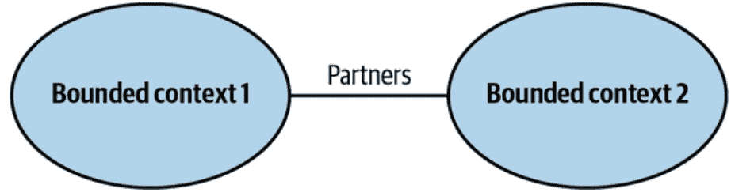
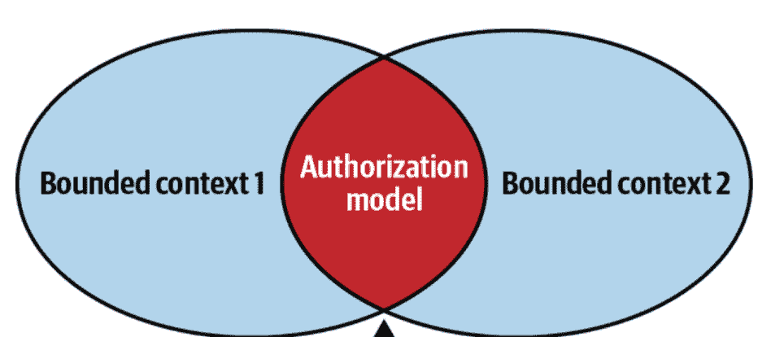
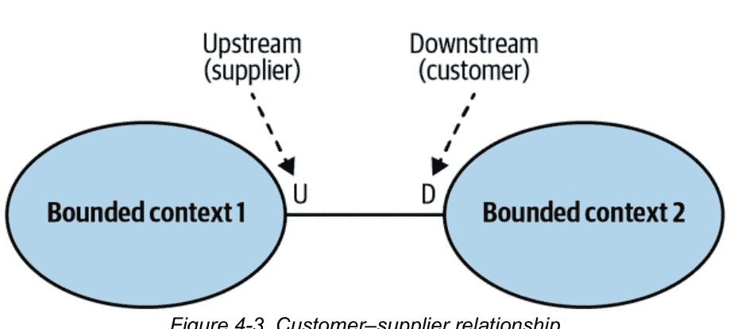
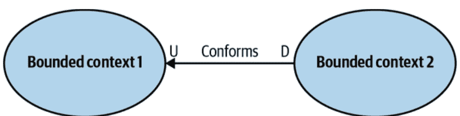
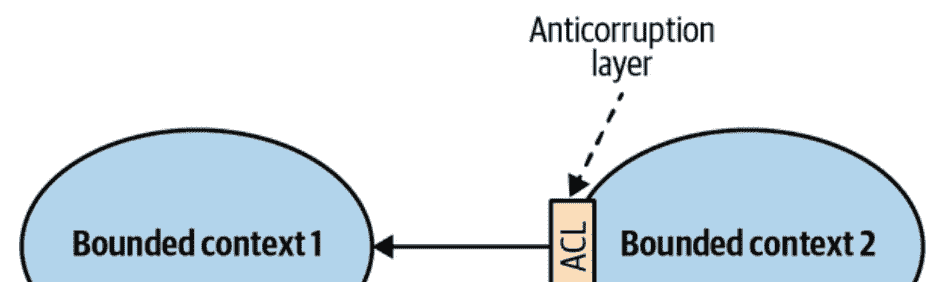
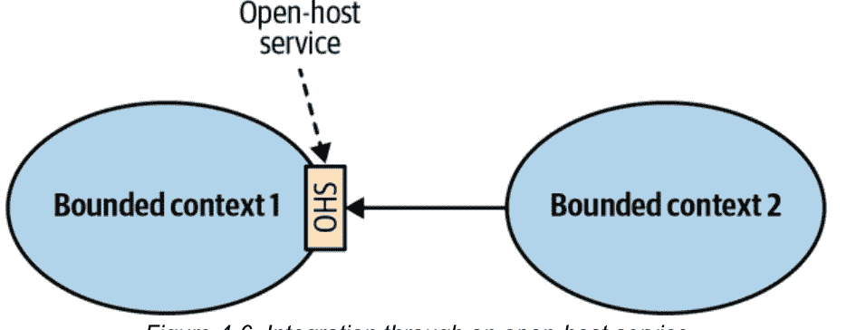
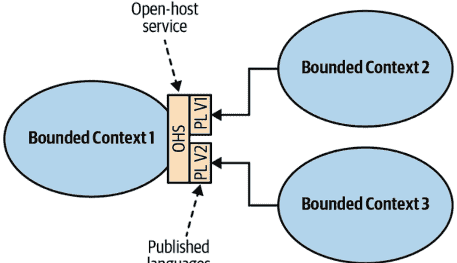
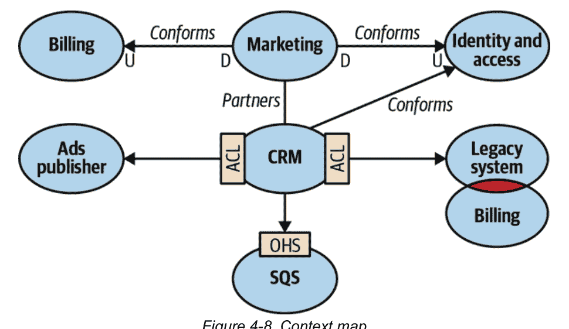
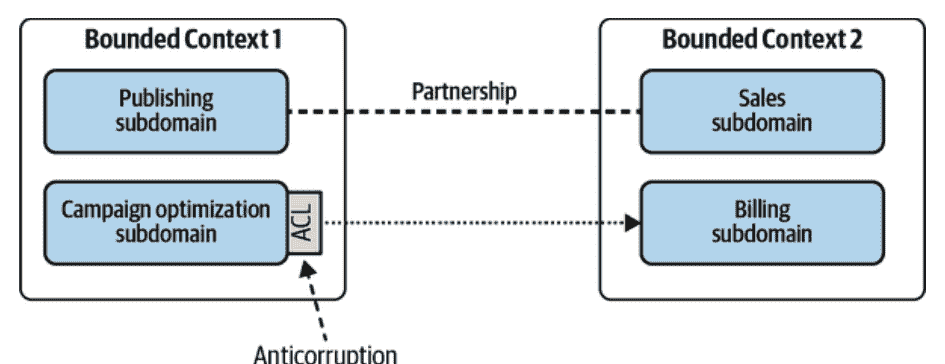

## 第 4 章。集成限定上下文

限定上下文模式不仅保护了通用语言的一致性，还使建模成为可能。你无法在不指定其目的——其边界的情况下构建模型。边界划分了语言的责任。一个限定上下文中的语言可以对业务域进行建模以解决特定问题。另一个限定上下文可以表示相同的业务实体，但对其进行建模以解决不同的问题。

此外，不同限定上下文中的模型可以独立演进和实现。也就是说，限定上下文本身并不是独立的。就像系统不能由独立的组件构建——组件必须相互交互以实现系统的总体目标——同样，限定上下文中的实现也是如此。尽管它们可以独立演进，但必须相互集成。因此，限定上下文之间总会有接触点。这些被称为 *契约*。

需要契约的原因是限定上下文的模型和语言存在差异。由于每个契约影响多个参与方，因此需要定义和协调它们。此外，根据定义，两个限定上下文使用不同的通用语言。集成时将使用哪种语言？这些集成问题应由解决方案的设计来评估和解决。

在本章中，你将学习领域驱动设计中用于定义限定上下文之间关系和集成的模式。这些模式由负责限定上下文的团队之间的协作性质驱动。我们将把这些模式分为三组，每组代表一种团队协作类型：合作、客户-供应商和各自为政。

#### 合作

合作模式涉及由沟通良好的团队实现的限定上下文。

在最简单的情况下，这些是由单个团队实现的限定上下文。这也适用于目标相互依赖的团队，其中一个团队的成功取决于另一个团队的成功，反之亦然。再次强调，这里主要标准是团队之间的沟通和协作质量。

让我们看一下适合合作团队的两种 DDD 模式：合作伙伴关系和共享内核模式。

#### 合作伙伴关系

在合作伙伴关系模型中，限定上下文之间的集成以临时方式协调。一个团队可以通知第二个团队关于 API 的更改，第二个团队会合作并适应——没有戏剧或冲突（见图 4-1）。

图 4-1。合作伙伴关系模型

这里的集成协调是双向的。没有一个团队规定用于定义契约的语言。团队可以解决差异并选择最合适的解决方案。此外，双方在解决任何集成问题时都会合作

that might come up. Neither team is interested in blocking the other one.

Well-established collaboration practices, high levels of commitment, and frequent synchronizations between teams are required for successful integration in this manner. From a technical perspective, continuous integration of the changes applied by both teams is needed to further minimize the integration feedback loop.

This pattern might not be a good fit for geographically distributed teams since it may present synchronization and communication challenges.

### Shared Kernel

Despite bounded contexts being model boundaries, there still can be cases when the same model of a subdomain, or a part of it, will be implemented in multiple bounded contexts. It’s crucial to stress that the shared model is designed according to the needs of all of the bounded contexts. Moreover, the shared model has to be consistent across all of the bounded contexts that are using it.

As an example, consider an enterprise system that uses a tailor-made model for managing users’ permissions. Each user can have their permissions granted directly or inherited from one of the organizational units they belong to. Moreover, each bounded context can modify the authorization model, and the changes each bounded context applies have to affect all the other bounded contexts using the model (see Figure 4-2).

Shared kernel

Figure 4-2. Shared kernel

### Shared scope

The overlapping model couples the lifecycles of the participating bounded contexts. A change made to the shared model has an immediate effect on all the bounded contexts. Hence, to minimize the cascading effects of changes, the overlapping model should be limited, exposing only that part of the model that has to be implemented by both bounded contexts. Ideally, the shared kernel will consist only of integration contracts and data structures that are intended to be passed across the bounded contexts’ boundaries.

### Implementation

The shared kernel is implemented so that any modification to its source code is immediately reflected in all the bounded contexts using it.

If the organization uses the mono-repository approach, these can be the same source files referenced by multiple bounded contexts. If using a shared repository is not possible, the shared kernel can be extracted into a dedicated project and referenced in the bounded contexts as a linked library. Either way, each change to the shared kernel must trigger integration tests for all the affected bounded contexts.

The continuous integration of changes is required because the shared kernel belongs to multiple bounded contexts. Not propagating shared kernel changes to all related bounded contexts leads to inconsistencies in a model: bounded contexts may rely on stale implementations of the shared kernel, leading to data corruption and/or runtime issues.

### When to use shared kernel

The overarching applicability criterion for the shared kernel pattern is the cost of duplication versus the cost of coordination. Since the pattern introduces a strong dependency between the participating bounded contexts, it should be applied only when the cost of duplication is higher than the cost of coordination—in other words, only when integrating changes applied to the shared model by both bounded contexts will require more effort than coordinating the changes in the shared codebase.

The difference between the integration and duplication costs depends on the volatility of the model. The more frequently it changes, the higher the integration costs will be. Therefore, the shared kernel will naturally be applied for the subdomains that change the most: the core subdomains.

In a sense, the shared kernel pattern contradicts the principles of bounded contexts introduced in the previous chapter. If the participating bounded contexts are not implemented by the same team, introducing a shared kernel contradicts the principle that a single team should own a bounded context. The overlapping model—the shared kernel—is, in effect, being developed by multiple teams.

That’s the reason why the use of a shared kernel has to be justified. It’s a pragmatic exception that should be considered carefully. A common use case for implementing a shared kernel is when communication or collaboration issues prevent implementing the partnership pattern—for example, because of geographical constraints or organizational politics. Implementing a closely related functionality without proper coordination will result in integration issues, desynchronized models, and arguments about which model is better designed. Minimizing the shared kernel’s scope controls the scope of cascading changes, and triggering integration tests for each change is a way to enforce early detection of integration issues.

Another common use case for applying the shared kernel pattern, albeit a temporary one, is the gradual modernization of a legacy system. In such a scenario, the shared codebase can be a pragmatic intermediate solution for gradually decomposing the system into bounded contexts.

Finally, a shared kernel can be a good fit for integrating bounded contexts owned and implemented by the same team. In such a case, an ad hoc integration of the bounded contexts—a partnership—can “wash out” the contexts’ boundaries over time. A shared kernel can be used for explicitly defining the bounded contexts’ integration contracts.

### Customer–Supplier

The second group of collaboration patterns we’ll examine is the customer–supplier patterns. As shown in Figure 4-3, one of the bounded contexts—the supplier—provides a service for its customers. The service provider is “upstream” and the customer or consumer is “downstream.”

Figure 4-3. Customer–supplier relationship

Unlike in the cooperation case, both teams (upstream and downstream) can succeed independently. Consequently, in most cases we have an imbalance of power: either the upstream or the downstream team can dictate the integration contract.

This section will discuss three patterns addressing such power differences: the conformist, anticorruption layer, and open-host service patterns.

### Conformist

In some cases, the balance of power favors the upstream team, which has no real motivation to support its clients’ needs. Instead, it just provides the integration contract, defined according to its own model—take it or leave it. Such power imbalances can be caused by integration with service providers that are external to the organization or simply by organizational politics.

If the downstream team can accept the upstream team’s model, the bounded contexts’ relationship is called conformist. The downstream conforms to the upstream bounded context’s model, as shown in Figure 4-4.

Figure 4-4. Conformist relationship

The downstream team’s decision to give up some of its autonomy can be justified in multiple ways. For example, the contract exposed by the upstream team may be an industry-standard, well-established model, or it may just be good enough for the downstream team’s needs.

The next pattern addresses the case in which a consumer is not willing to accept the supplier’s model.

### Anticorruption Layer

As in the conformist pattern, the balance of power in this relationship is still skewed toward the upstream service. However, in this case, the downstream bounded context is not willing to conform. Instead, it can translate the upstream bounded context’s model into a model tailored to its own needs via an anticorruption layer, as shown in Figure 4-5.

Figure 4-5. Integration through an anticorruption layer

The anticorruption layer pattern addresses scenarios in which it is not desirable or worth the effort to conform to the supplier’s model, such as the following:

- *When the downstream bounded context contains a core subdomain*

A core subdomain’s model requires extra attention, and adhering to the supplier’s model might impede the modeling of the problem domain.

- *When the upstream model is inefficient or inconvenient for the consumer’s needs*

If a bounded context conforms to a mess, it risks becoming a mess itself. That is often the case when integrating with legacy systems.

- *When the supplier’s contract changes often*

The consumer wants to protect its model from frequent changes. With an anticorruption layer, the changes in the supplier’s model only affect the translation mechanism.

From a modeling perspective, the translation of the supplier’s model isolates the downstream consumer from foreign concepts that are not relevant to its bounded context. Hence, it simplifies the consumer’s ubiquitous language and model.

In Chapter 9, we will explore the different ways to implement an anticorruption layer.

### Open-Host Service

This pattern addresses cases in which the power is skewed toward the consumers. The supplier is interested in protecting its consumers

and providing the best service possible.

为了保护消费者免受其实现模型变化的影响，上游供应商将实现模型与公共接口解耦。这种解耦使供应商能够以不同的速率演进其实现模型和公共模型，如图 4-6 所示。

图 4-6. 通过开放主机服务集成

供应商的公共接口并非旨在符合其通用语言。相反，它旨在以集成导向的语言表达对消费者方便的协议进行公开。因此，公共协议被称为发布语言。

从某种意义上说，开放主机服务模式是反腐败层模式的逆转：不是消费者，而是供应商实现了其内部模型的翻译。

将有界上下文的实现模型和集成模型解耦，给予上游有界上下文自由地演进其实现，而不会影响下游上下文。当然，这只有在修改后的实现模型可以翻译成消费者已在使用的发布语言时才可能。

此外，集成模型的解耦允许上游有界上下文同时公开发布语言的多个版本，从而允许消费者逐步迁移到新版本（见图 4-7）。

图 4-7. 开放主机服务公开发布语言的多个版本

### 各走各路

最后一种协作选项是根本不协作。这种模式可能因不同原因而出现，在团队不愿或无法协作的情况下。我们将在这里看几个例子。

#### 沟通问题

避免协作的常见原因是组织规模或内部政治驱动的沟通困难。当团队难以协作和达成一致时，分道扬镳并在多个有界上下文中重复功能可能更具成本效益。

#### 通用子域

重复子域的性质也可能是团队各走各路的原因。当所讨论的子域是通用的，并且如果通用解决方案易于集成时，将其在每个有界上下文中本地集成可能更具成本效益。一个例子是日志框架；一个有界上下文将其作为服务公开几乎没有意义。集成此类解决方案的额外复杂性将超过在多个上下文中不重复功能的收益。重复功能将比协作更便宜。

#### 模型差异

有界上下文模型之间的差异也可能是选择各走各路协作的原因。模型可能差异太大，以至于从属关系不可能，实现反腐败层将比重复功能更昂贵。在这种情况下，团队各走各路对团队来说更具成本效益。

> NOTE
> 
> 在集成核心子域时应避免各走各路模式。重复此类子域的实现将违背公司以最有效和最优化的方式实现它们的战略。

### 上下文映射

在分析系统有界上下文之间的集成模式后，我们可以将它们绘制在上下文映射上，如图 4-8 所示。

图 4-8. 上下文映射

上下文映射是对系统的有界上下文及其之间集成情况的视觉表示。这种视觉表示法在多个层面上提供了宝贵的战略洞察：

*高层设计*

上下文映射提供了系统组件及其实现模型的概览。

*沟通模式*

上下文映射描绘了团队之间的沟通模式——例如，哪些团队正在协作，哪些更喜欢“不太亲密”的集成模式，例如反腐败层和各走各路模式。

*组织问题*

上下文映射可以提供组织问题的洞察。例如，如果某个上游团队的下游消费者都诉诸于实现反腐败层，或者所有各走各路模式的实现都集中在同一个团队周围，这意味着什么？

#### 维护

理想情况下，上下文映射应从项目一开始就引入，并随着新有界上下文的添加和现有上下文的修改而更新。

由于上下文映射可能包含来自多个团队工作的信息，最好将上下文映射的维护定义为共同努力：每个团队负责更新其与其他有界上下文的集成。

上下文映射可以用像 Context Mapper 这样的工具作为代码进行管理和维护。

#### 限制

需要注意的是，绘制上下文映射可能是一项具有挑战性的任务。当系统的有界上下文涵盖多个子域时，可能存在多种集成模式。例如，在图 4-9 中，你可以看到两个有界上下文具有两种集成模式：合作伙伴关系和反腐败层。

图 4-9. 复杂的上下文映射

而且，即使有界上下文仅限于单个子域，仍然可能存在多种集成模式——例如，如果子域的模块需要不同的集成策略。

### 结论

有界上下文并非独立。它们必须相互交互。以下模式定义了有界上下文可以集成的不同方式：

*Partnership*

有界上下文以临时方式集成。

*Shared kernel*

两个或多个有界上下文通过共享一个属于所有参与有界上下文的有限重叠模型进行集成。

*Conformist*

消费者遵循服务提供商的模型。

*Anticorruption layer*

消费者将服务提供商的模型翻译成适合消费者需求的模型。

*Open-host service*

服务提供商实现发布语言——一个针对消费者需求优化的模型。

*Separate ways*

重复特定功能比协作和集成它更便宜。

有界上下文之间的集成可以绘制在上下文映射上。此工具提供了对系统高层设计、沟通模式和组织问题的洞察。

现在你已经了解了用于分析和建模业务域的领域驱动设计工具和技术，我们将从战略转向战术。在第二部分，你将学习实现领域逻辑、组织高层架构以及协调系统组件之间通信的不同方法。

## 练习

+   1. 哪个集成模式永远不应该用于核心子域？
+   a. Shared kernel
+   b. Open-host service
+   c. Anticorruption layer
d. Separate ways

2. 哪个下游子域更可能实现反腐败层？
+   a. Core subdomain
+   b. Supporting subdomain
+   c. Generic subdomain
+   d. B and C

3. 哪个上游子域更可能实现开放主机服务？
+   a. Core subdomain
+   b. Supporting subdomain
+   c. Generic subdomain
+   d. A and B

4. 哪个集成模式，从某种意义上说，违反了有界上下文的所有权边界？
+   a. Partnership.
+   b. Shared kernel.
+   c. Separate ways.
+   d. No integration pattern should ever break the bounded contexts’ ownership boundaries.
