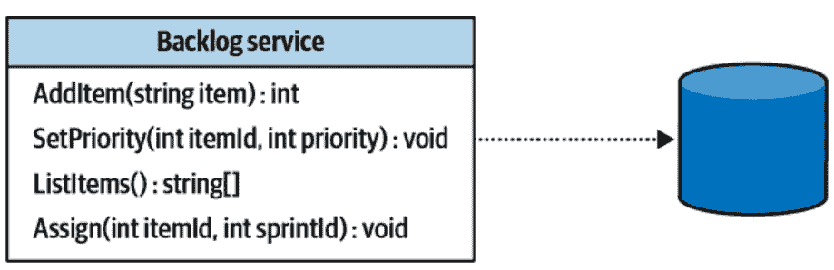
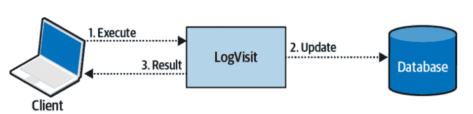
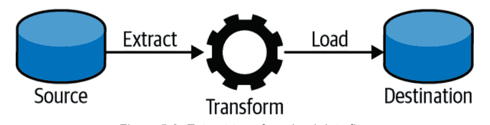
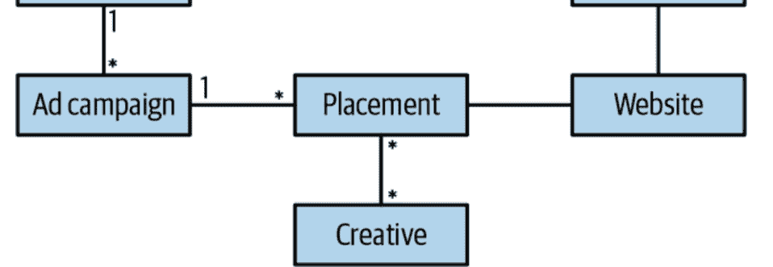

## 第 5 章. 实现简单的业务逻辑

业务逻辑是软件中最重要的一部分。它是软件首先被实现的原因。一个系统的用户界面可以很性感，其数据库可以极快且可扩展。但如果软件对业务没有用处，它只不过是一个昂贵的科技演示。

正如我们在第 2 章中所看到的，并非所有业务子域都是一样的。不同的子域具有不同的战略重要性和复杂性。本章开始我们探索建模和实现业务逻辑代码的不同方式。我们将从两种适用于相对简单业务逻辑的模式开始：事务脚本和活动记录。

### 事务脚本

> 按过程组织业务逻辑，其中每个过程处理来自表示层的单个请求。
> —Martin Fowler¹

系统的公共接口可以被视为消费者可以执行的业务事务集合，如图 5-1 所示。这些事务可以检索系统管理的的信息、修改它，或两者兼而有之。该模式基于过程组织系统的业务逻辑，其中每个过程实现由系统的消费者通过其公共接口执行的运算。实际上，系统的公共操作被用作封装边界。



图 5-1. 事务脚本接口

### 实现

每个过程都实现为一个简单、直接的过程脚本。它可以使用一个用于与存储机制集成的薄抽象层，但也可以直接访问数据库。

过程必须满足的唯一要求是事务行为。每个操作都应该成功或失败，但绝不能导致无效状态。即使事务脚本的执行在最不方便的时刻失败，系统也应保持一致——要么通过回滚失败前所做的任何更改，要么通过执行补偿操作。事务行为反映在该模式的名称中：事务脚本。

下面是一个将一批 JSON 文件转换为 XML 文件的事务脚本示例：

```
DB.StartTransaction();

var job = DB.LoadNextJob();
var json = LoadFile(job.Source);
var xml = ConvertJsonToXml(json);
WriteFile(job.Destination, xml.ToString());
DB.MarkJobAsCompleted(job);

DB.Commit()
```

#### 没那么容易！

当我在领域驱动设计课程中介绍事务脚本模式时，我的学生们常常会扬起眉毛，有些人甚至会问：“这值得我们花时间吗？我们不是来学习更高级的模式和技术吗？”

问题是，事务脚本模式是你在即将到来的章节中将学习的更高级业务逻辑实现模式的*基础*。此外，尽管它看似简单，但它是很容易做错的模式。我曾经帮助调试和修复的许多生产问题，以一种或另一种方式，往往归结为系统业务逻辑事务行为的错误实现。

让我们看一下由于未能正确实现事务脚本而导致数据损坏的三个常见、真实的例子。

#### 缺乏事务行为

未能实现事务行为的一个简单例子是，在没有总体事务的情况下发出多个更新。考虑以下更新 Users 表中的记录并向 VisitsLog 表中插入记录的方法：

```
01 public class LogVisit
02 {
03     ...
04
05     public void Execute(Guid userId, DateTime visitedOn)
06     {
07         _db.Execute("UPDATE Users SET last_visit=@p1 WHERE user_id=@p2",
08             visitedOn, userId);
09         _db.Execute(@"INSERT INTO VisitsLog(user_id, visit_date) VALUES(@p1, @p2)", userId, visitedOn);
10     }
11 }
12 }
```

如果在 Users 表中的记录被更新（第 7 行）之后，但在第 9 行的日志记录附加成功之前出现任何问题，系统将处于不一致状态。Users 表将被更新，但 VisitsLog 表中不会写入相应的记录。问题可能由任何原因引起，从网络中断到数据库超时或死锁，甚至是执行该进程的服务器崩溃。

这可以通过引入涵盖两个数据更改的适当事务来修复：

```
public class LogVisit
{
    ...
    public void Execute(Guid userId, DateTime visitedOn)
    {
        try
        {
            _db.StartTransaction();

            _db.Execute(@"UPDATE Users SET last_visit=@p1 WHERE user_id=@p2", visitedOn, userId);

            _db.Execute(@"INSERT INTO VisitsLog(user_id, visit_date) VALUES(@p1, @p2)", userId, visitedOn);

            _db.Commit();
        } catch {
            _db.Rollback();
            throw;
        }
    }
}
```

由于关系数据库对跨多个记录的事务有原生支持，因此修复很容易实现。当你必须在不支持多记录事务的数据库中发出多个更新时，或者当你使用多个无法统一到分布式事务中的存储机制时，事情会变得更复杂。让我们看一个后者的例子。

#### 分布式事务

在现代分布式系统中，常见的做法是对数据库中的数据进行更改，然后通过将消息发布到消息总线来通知系统其他组件有关更改。考虑在前一个示例中，我们不是将访问记录到表中，而是将其发布到消息总线：

```
01 public class LogVisit
02 {
03     ...
04
05     public void Execute(Guid userId, DateTime visitedOn)
06     {
07         _db.Execute("UPDATE Users SET last_visit=@p1 WHERE user_id=@p2",
08                     visitedOn,userId);
09         _messageBus.Publish("VISITS_TOPIC",
10                         new { UserId = userId, VisitDate = visitedOn });
11     }
12 }
```

与前一个示例一样，任何在第 7 行之后但在第 9 行成功之前发生的故障都会破坏系统的状态。Users 表将被更新，但由于发布到消息总线失败，其他组件不会收到通知。

不幸的是，修复这个问题并不像前一个示例那么容易。跨多个存储机制的分布式事务复杂、难以扩展、容易出错，因此通常会被避免。在第 8 章中，你将学习如何使用 CQRS 架构模式来填充多个存储机制。此外，第 9 章将介绍 outbox 模式，该模式可在将更改提交到另一个数据库后实现可靠的消息发布。

让我们看一个事务行为实现不当的更复杂的例子。

#### 隐式分布式事务

考虑以下看似简单的方法：

```
public class LogVisit
{
    ...
    public void Execute(Guid userId)
    {
        _db.Execute("UPDATE Users SET visits=visits+1 WHERE user_id=@p1",
                    userId);
    }
}
```

与前面的示例不同，此方法不是跟踪最后访问日期，而是为每个用户维护一个访问计数器。调用该方法会将相应计数器的值增加 1。该方法所做的只是更新一个表中的一个值，位于一个数据库中。然而，这仍然是一个分布式事务，可能导致不一致的状态。

此示例构成分布式事务，因为它与数据库和调用该方法的外部进程进行通信，如图 5-2 所示。



图 5-2. LogVisit 操作更新数据并通知调用者操作的成功或失败

尽管 execute 方法的类型为 void，即它不返回任何数据，但它仍然传达操作是否成功或失败：如果失败，调用者将收到异常。如果方法成功，但将结果传达给调用者失败会怎样？例如：

- 如果 LogVisit 是 REST 服务的一部分并且发生网络中断；或
- 如果 LogVisit 和调用者都在同一进程中运行，但进程在调用者跟踪 LogVisit 操作成功执行之前失败？

在两种情况下，消费者都会假设失败并尝试再次调用 LogVisit。再次执行 LogVisit 逻辑将导致计数器值不正确增加。总体而言，它将增加 2 而不是 1。与前两个示例一样，代码未能正确实现事务脚本模式，并无意中导致系统状态损坏。

与前一个示例一样，这个问题没有简单的修复方法。一切都取决于业务域及其需求。在此特定示例中，确保事务行为的一种方法是使操作幂等：即即使操作重复多次也能导致相同的结果。

例如，我们可以要求消费者传递计数器的值。为了提供计数器的值，调用者首先必须读取当前值，在本地增加它，然后提供


作为参数。即使操作会被执行多次，也不会改变最终结果：

```
public class LogVisit
{
    ...
    public void Execute(Guid userId, long visits)
    {
        _db.Execute("UPDATE Users SET visits = @p1 WHERE user_id=@p2", visits, userId);
    }
}
```

另一种解决此类问题的方法是使用乐观并发控制：在调用 LogVisit 操作之前，调用方已读取计数器的当前值并将其作为参数传递给 LogVisit。LogVisit 仅在计数器的值等于调用方最初读取的值时才更新计数器：

```
public class LogVisit
{
    ...
    public void Execute(Guid userId, long expectedVisits)
    {
        _db.Execute(@"UPDATE Users SET visits=visits+1 WHERE user_id=@p1 and visits = @p2", userId, visits);
    }
}
```

使用相同的输入参数后续执行 LogVisit 不会改变数据，因为 WHERE...visits = @prm2 条件将无法满足。

### 何时使用事务脚本

事务脚本模式非常适合最直接的问题域，其中业务逻辑类似于简单的过程操作。例如，在提取-转换-加载（ETL）操作中，每个操作从源提取数据，应用转换逻辑将其转换为另一种形式，并将结果加载到目标存储中。该过程如图 5-3 所示。



图 5-3. 提取-转换-加载数据流

事务脚本模式自然适合支持子域，其中根据定义，业务逻辑是简单的。它也可以用作与外部系统集成的适配器——例如，通用子域，或作为反腐败层的一部分（更多内容请参见第 9 章）。

事务脚本模式的主要优点是其简单性。它引入了最少的抽象，并在运行时性能和理解业务逻辑方面都将开销降至最低。也就是说，这种简单性也是该模式的缺点。随着业务逻辑变得越复杂，它越容易在事务中重复业务逻辑，从而导致不一致的行为——当重复的代码不同步时。因此，事务脚本绝不应用于核心子域，因为该模式无法应对核心子域业务逻辑的高复杂性。

这种简单性让事务脚本赢得了一个可疑的名声。有时该模式甚至被视为反模式。毕竟，如果复杂的业务逻辑被实现为事务脚本，迟早它会变成一个难以维护的大泥球。需要注意的是，尽管简单，事务脚本模式在软件开发中无处不在。我们将在本章和后续章节中讨论的所有业务逻辑实现模式，以一种或另一种方式都基于事务脚本模式。

#### 活动记录

> 一个包装数据库表或视图中一行的对象，封装数据库访问，并在该数据上添加领域逻辑。
> 
> —Martin Fowler²

与事务脚本模式一样，活动记录支持业务逻辑简单的场景。这里，业务逻辑可能操作更复杂的数据结构。例如，我们可以拥有更复杂的对象树和层次结构，如图 5-4 所示。



通过简单的事务脚本操作此类数据结构会导致大量重复代码。数据的内存表示映射会在各处重复。

### 实现

因此，该模式使用专用对象，即活动记录，来表示复杂的数据结构。除了数据结构之外，这些对象还实现了用于创建、读取、更新和删除记录的数据访问方法——即所谓的 CRUD 操作。因此，活动记录对象与对象关系映射（ORM）或其他数据访问框架耦合。该模式的名称源于每个数据结构都是“活动的”；也就是说，它实现了数据访问逻辑。

与前一个模式一样，系统的业务逻辑以事务脚本组织。两者的区别在于，在这种情况下，事务脚本不是直接访问数据库，而是操作活动记录对象。操作完成后，必须作为原子事务完成或失败：

```
public class CreateUser
{
    ...

    public void Execute(userDetails)
    {
        try
        {
            _db.StartTransaction();

            var user = new User();
            user.Name = userDetails.Name;
            user.Email = userDetails.Email;
            user.Save();

            _db.Commit();
        } catch {
            _db.Rollback();
            throw;
        }
    }
}
```

该模式的目标是封装将内存中对象映射到数据库模式的复杂性。除了负责持久化之外，活动记录对象还可以包含业务逻辑；例如，验证分配给字段的新值，甚至实现操作对象数据的业务相关过程。也就是说，活动记录对象的显著特征是数据结构和行为（业务逻辑）的分离。通常，活动记录的字段具有公共的 getter 和 setter，允许外部过程修改其状态。

#### 何时使用活动记录

由于活动记录本质上是优化数据库访问的事务脚本，因此该模式只能支持相对简单的业务逻辑，例如 CRUD 操作，最多验证用户输入。

因此，与事务脚本模式的情况一样，活动记录模式适用于支持子域、外部解决方案的通用子域集成或模型转换任务。两者的区别在于，活动记录解决了将复杂数据结构映射到数据库模式的复杂性。

活动记录模式也被称为 *贫血领域模型反模式*；换句话说，是设计不当的领域模型。我更喜欢避免 *贫血* 和 *反模式* 这一类负面含义。该模式是一种工具。就像任何工具一样，它可以解决问题，但在错误的环境中使用时也可能造成比好处更大的危害。当业务逻辑简单时，使用活动记录并没有什么问题。此外，在实现简单业务逻辑时使用更复杂的模式也会造成危害，因为会引入偶然复杂性。在下一章中，你将学习什么是领域模型以及它与活动记录模式有何不同。

### 注意

必须强调的是，在此上下文中，*活动记录* 指的是设计模式，而不是 Active Record 框架。该模式名称由 Martin Fowler 在 *Patterns of Enterprise Application Architecture* 中提出。框架后来出现，作为实现该模式的一种方式。在我们的上下文中，我们讨论的是设计模式及其背后的概念，而不是特定的实现。

### 务实一点

尽管业务数据很重要，我们设计和构建的代码应保护其完整性，但在某些情况下，务实的方法更可取。

尤其是在高规模水平下，有时可以放宽数据一致性保证。检查 100 万条记录中损坏一条记录是否真的对业务是致命的，以及它是否会负面影响业务的性能和盈利能力。例如，假设你正在构建一个系统，每天从物联网设备摄取数十亿事件。如果 0.001% 的事件被重复或丢失，是大问题吗？

正如 always 所说，没有普世法则。一切都取决于你所工作的业务域。在可能的情况下“走捷径”是可以的；只要确保你评估了风险和业务影响。

### 结论

在本章中，我们介绍了两种实现业务逻辑的模式：

*Transaction script*


这种模式将系统的操作组织为简单、直接的程序化脚本。流程确保每个操作都是事务性的——要么成功，要么失败。事务脚本模式很适合支持子域，其业务逻辑类似于简单、类似 ETL 的操作。

#### 活动记录

当业务逻辑简单但操作的是复杂的数据结构时，你可以将这些数据结构实现为活动记录。活动记录对象是一个提供简单 CRUD 数据访问方法的数据结构。

本章讨论的两种模式都面向业务逻辑相对简单的场景。在下一章中，我们将转向更复杂的业务逻辑，并讨论如何使用领域模型模式来应对这种复杂性。

## 练习

- 1. 应该使用哪种讨论过的模式来实现核心子域的业务逻辑？
  - a. 事务脚本。
  - b. 活动记录。
  - c. 这两种模式都不能用于实现核心子域。
  - d. 这两种模式都可用于实现核心子域。
- 2. 考虑以下代码：

```
public void CreateTicket(TicketData data)
{
    var agent = FindLeastBusyAgent();

    agent.ActiveTickets = agent.ActiveTickets + 1;
    agent.Save();

    var ticket = new Ticket();
    ticket.Id = Guid.New();
    ticket.Data = data;
    ticket.AssignedAgent = agent;
    ticket.Save();

    _alerts.Send(agent, "You have a new ticket!");
}
```

假设没有高级事务机制，这里可以发现哪些潜在的数据一致性问题？

- a. 在收到新工单时，被分配代理的活跃工单计数可能会增加超过 1。
- b. 代理的活跃工单计数可能会增加 1，但代理不会被分配任何新工单。
- c. 代理可能会收到新工单，但不会被通知。
- d. 以上所有问题都有可能。

3. 在前面的代码中，还有至少一个可能破坏系统状态的边缘情况。你能发现它吗？

4. 回到书前言中 WolfDesk 的例子，系统的哪些部分可能被实现为事务脚本或活动记录？

- 1 Fowler, M. (2002). *Patterns of Enterprise Application Architecture*. Boston: Addison-Wesley.
- 2 Fowler, M. (2002). *Patterns of Enterprise Application Architecture*. Boston: Addison-Wesley.
