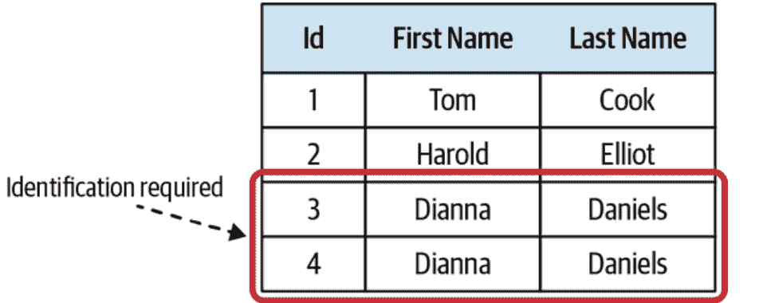
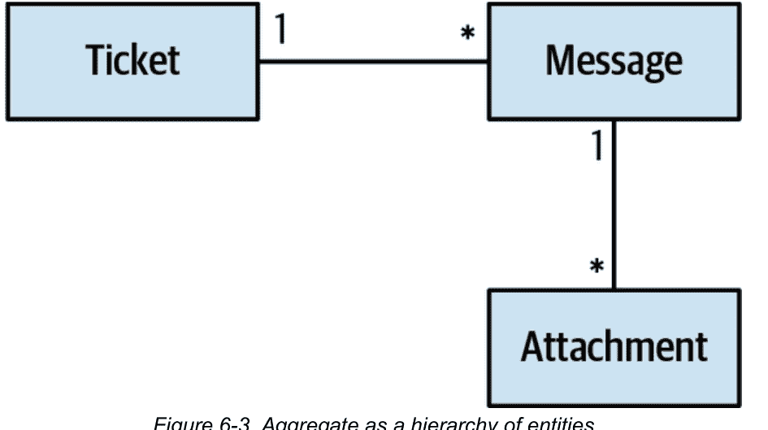
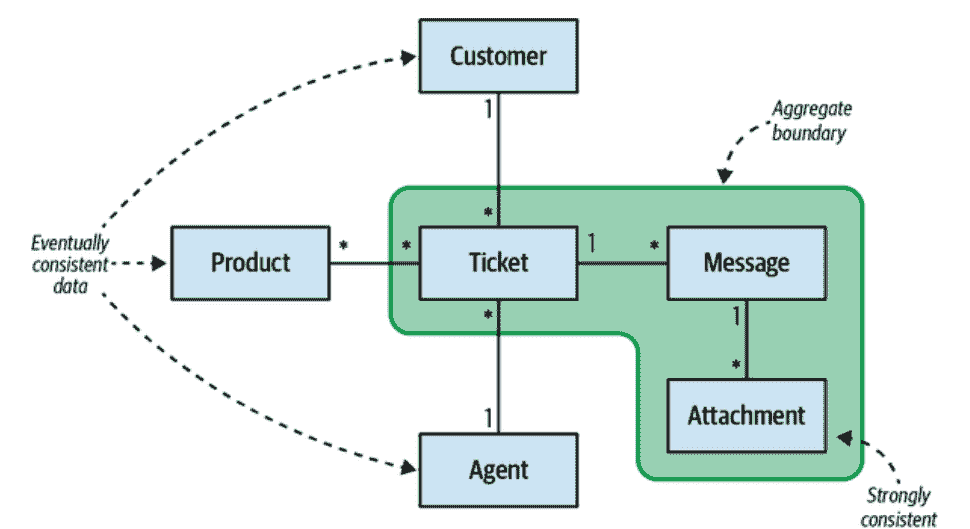
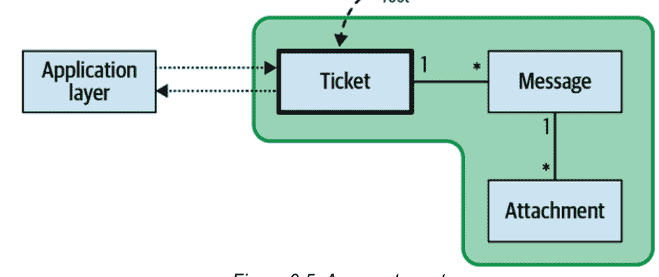
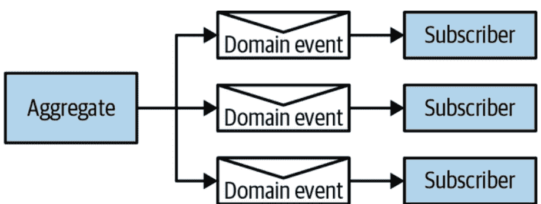

## 第 6 章. 应对复杂的业务逻辑

上一章讨论了两种处理相对简单业务逻辑的模式：事务脚本和活动记录。本章继续业务逻辑实现的话题，并介绍一种面向复杂业务逻辑的模式：领域模型模式。

#### 历史

与事务脚本和活动记录模式一样，领域模型模式最初也是在 Martin Fowler 的书 *Patterns of Enterprise Application Architecture* 中引入的。Fowler 在对该模式的讨论结尾时说：“Eric Evans 目前正在撰写一本关于构建领域模型的书。” 所引用的书籍是 Evans 的开创性著作，*Domain-Driven Design: Tackling Complexity in the Heart of Software.*

在他的书中，Evans 提出了一组旨在紧密关联代码与业务域底层模型的模式：聚合、值对象、仓储等。这些模式紧密跟随 Fowler 在其书中未竟之处，并类似于实现领域模型模式的有效工具集。

Evans 引入的模式通常被称为 *战术领域驱动设计*。为消除时间限制的混淆，33% 的时间限制。
- 如果代理在响应时间限制的 50% 内未打开升级的工单，则工单会自动重新分配给不同的代理。
- 如果客户在七天内未回复代理的问题，工单将自动关闭。
- 升级的工单不能自动关闭或由代理关闭，只能由客户或代理的经理关闭。
- 客户只能在工单关闭过去七天内重新打开已关闭的工单。

这些需求形成了一个相互纠缠的依赖网，涉及不同的规则，所有这些规则都影响着支持工单的生命周期管理逻辑。这不是我们在上一章讨论的 CRUD 数据录入屏幕。尝试使用活动记录对象实现此逻辑将很容易导致逻辑重复，并通过错误实现某些业务规则来破坏系统状态。

### 实现

领域模型是域的对象模型，融合了行为和数据。¹ DDD 的战术模式——聚合、值对象、领域事件和领域服务——是这种对象模型的构建块。²

所有这些模式都有一个共同主题：它们将业务逻辑放在首位。让我们看看领域模型如何解决不同的设计问题。

### 复杂性

域的业务逻辑本身就很复杂，因此用于建模的对象的设计不应引入任何额外的偶然复杂性。模型应不包含任何基础设施或技术方面的关注点，例如对数据库或其他系统外部组件的调用。这种限制要求模型的对象为 *普通对象*，即实现业务逻辑而不依赖或直接包含任何基础设施组件或框架的对象。³

### 通用语言

对业务逻辑而非技术关注点的强调，使得领域模型的对象更容易遵循有界上下文的通用语言的术语。换句话说，该模式允许代码“说”通用语言并遵循领域专家的心智模型。

### 构建块

让我们看看 DDD 提供的核心领域模型构建块，或战术模式：值对象、聚合和领域服务。

#### 值对象

值对象是可以根据其值的组合来识别的对象。例如，考虑一个颜色对象：

```
class Color
{
    int _red;
    int _green;
    int _blue;
}
```

三个字段 red、green 和 blue 的值的组合定义了一种颜色。更改其中一个字段的值将导致产生新的颜色。没有任何两种颜色可以具有相同的值。此外，同一颜色的两个实例必须具有相同的值。因此，不需要显式的标识字段来识别颜色。

图 6-1 中显示的 ColorId 字段不仅是冗余的，而且实际上为错误打开了大门。你可以创建两行具有相同 red、green、blue 值的数据，但比较 ColorId 的值不会反映出这其实是相同的颜色。


### Colors

| color-id | red | green | blue |
|---|---|---|---|
| 1 | 255 | 255 | 0 |
| 2 | 0 | 128 | 128 |
| 3 | 0 | 0 | 255 |
| 4 | 0 | 0 | 255 |

Figure 6-1. Redundant ColorId field, making it possible to have two rows with the same values

### Ubiquitous language

Relying exclusively on the language’s standard library’s primitive data types—such as strings, integers, or dictionaries—to represent concepts of the business domain is known as the primitive obsession⁴ code smell. For example, consider the following class:

```
class Person
{
    private int    _id;
    private string _firstName;
    private string _lastName;
    private string _landlinePhone;
    private string _mobilePhone;
    private string _email;
    private int    _heightMetric;
    private string _countryCode;

    public Person(...) {...}
}

static void Main(string[] args)
{
    var dave = new Person(
        id: 30217,
        firstName: "Dave",
        lastName: "Ancelovici",
        landlinePhone: "023745001",
        mobilePhone: "0873712503",
        email: "dave@learning-ddd.com",
        heightMetric: 180,
        countryCode: "BG");
}
```

In the preceding implementation of the Person class, most of the values are of type String and they are assigned based on convention. For example, the input to the landlinePhone should be a valid landline phone number, and the countryCode should be a valid, two-letter, uppercased country code. Of course, the system cannot trust the user to always supply correct values, and as a result, the class has to validate all input fields.

This approach presents multiple design risks. First, the validation logic tends to be duplicated. Second, it’s hard to enforce calling the validation logic before the values are used. It will become even more challenging in the future, when the codebase will be evolved by other engineers.

Compare the following alternative design of the same object, this time leveraging value objects:

```
class Person {
    private PersonId   _id;
    private Name       _name;
    private PhoneNumber _landline;
    private PhoneNumber _mobile;
    private EmailAddress _email;
    private Height     _height;
    private CountryCode _country;

    public Person(...) { ... }
}
```

```
static void Main(string[] args)
{
    var dave = new Person(
        id:      new PersonId(30217),
        name:    new Name("Dave", "Ancelovici"),
        landline: PhoneNumber.Parse("023745001"),
        mobile:  PhoneNumber.Parse("0873712503"),
        email:   Email.Parse("dave@learning-ddd.com"),
        height:  Height.FromMetric(180),
        country: CountryCode.Parse("BG");
    }
}
```

First, notice the increased clarity. Take, for example, the country variable. There is no need to elaborately call it “countryCode” to communicate the intent of it holding a country code and not, for example, a full country name. The value object makes the intent clear, even with shorter variable names.

Second, there is no need to validate the values before the assignment, as the validation logic resides in the value objects themselves. However, a value object’s behavior is not limited to mere validation. Value objects shine brightest when they centralize the business logic that manipulates the values. The cohesive logic is implemented in one place and is easy to test. Most importantly, value objects express the business domain’s concepts: they make the code speak the ubiquitous language.

Let’s see how representing the concepts of height, phone numbers, and colors as value objects makes the resultant type system rich and intuitive to use.

Compared to an integer-based value, the Height value object both makes the intent clear and decouples the measurement from a specific measurement unit. For example, the Height value object can be initialized using both metric and imperial units, making it easy to convert from one unit to another, generating string representation, and comparing values of different units:

```
var heightMetric = Height.Metric(180);
var heightImperial = Height.Imperial(5, 3);

var string1 = heightMetric.ToString();        // "180cm"
var string2 = heightImperial.ToString();        // "5 feet 3 inches"
var string3 = heightMetric.ToImperial().ToString(); // "5 feet 11 inches"

var firstIsHigher = heightMetric > heightImperial; // true
```

The PhoneNumber value object can encapsulate the logic of parsing a string value, validating it, and extracting different attributes of the phone number; for example, the country it belongs to and the phone number’s type—landline or mobile:

```
var phone = PhoneNumber.Parse("+359877123503");
var country = phone.Country;                    // "BG"
var phoneType = phone.PhoneType;                // "MOBILE"
var isValid = PhoneNumber.IsValid("+972120266680"); // false
```

The following example demonstrates the power of a value object when it encapsulates all of the business logic that manipulates the data and produces new instances of the value object:

```
var red = Color.FromRGB(255, 0, 0);
var green = Color.Green;
var yellow = red.MixWith(green);
var yellowString = yellow.ToString();            // "#FFFF00"
```

As you can see in the preceding examples, value objects eliminate the need for conventions—for example, the need to keep in mind that this string is an email and the other string is a phone number—and instead makes using the object model less error prone and more intuitive.

### Implementation

Since a change to any of the fields of a value object results in a different value, value objects are implemented as immutable objects. A change to one of the value object’s fields conceptually creates a different value—a different instance of a value object. Therefore, when an executed action results in a new value, as in the following case, which uses the MixWith method, it doesn't modify the original instance but instantiates and returns a new one:

```
public class Color
{
    public readonly byte Red;
    public readonly byte Green;
    public readonly byte Blue;

    public Color(byte r, byte g, byte b)
    {
        this.Red = r;
        this.Green = g;
        this.Blue = b;
    }

    public Color MixWith(Color other)
    {
        return new Color(
            r: (byte) Math.Min(this.Red + other.Red, 255),
            g: (byte) Math.Min(this.Green + other.Green, 255),
            b: (byte) Math.Min(this.Blue + other.Blue, 255)
        );
    }

    ...
}
```

Since the equality of value objects is based on their values rather than on an id field or reference, it's important to override and properly implement the equality checks. For example, in C#:⁵

```
public class Color
{
    ...

    public override bool Equals(object obj)
    {
        var other = obj as Color;
        return other != null &&
            this.Red == other.Red &&
            this.Green == other.Green &&
            this.Blue == other.Blue;
    }

    public static bool operator == (Color lhs, Color rhs)
    {
        if (Object.ReferenceEquals(lhs, null)) {
            return Object.ReferenceEquals(rhs, null);
        }
        return lhs.Equals(rhs);
    }

    public static bool operator != (Color lhs, Color rhs)
    {
        return !(lhs == rhs);
    }

    public override int GetHashCode()
    {
        return ToString().GetHashCode();
    }

    ...
}
```

Although using a core library’s Strings to represent domain-specific values contradicts the notion of value objects, in .NET, Java, and other languages the string type is implemented exactly as a value object. Strings are immutable, as all operations result in a new instance. Moreover, the string type encapsulates a rich behavior that creates new instances by manipulating the values of one or more strings: trim, concatenate multiple strings, replace characters, substring, and other methods.

### When to use value objects

The simple answer is, whenever you can. Not only do value objects make the code more expressive and encapsulate business logic that tends to spread apart, but the pattern makes the code safer. Since value objects are immutable, the value objects’ behavior is free of side effects and is thread safe.


从业务领域视角来看，一个有用的经验法则是：对于描述其他对象属性的领域元素，使用值对象。这主要适用于实体的属性，这些将在下一节中讨论。你之前看到的示例使用了值对象来描述一个人，包括其 ID、姓名、电话号码、电子邮件等。使用值对象的其他示例包括各种状态、密码，以及更多可通过其值识别且因此不需要显式标识字段的特定于业务领域的概念。引入值对象的一个特别重要的机会是在建模货币和其他货币值时。依赖原始类型来表示货币不仅限制了你将所有与货币相关的业务逻辑封装在一个地方的能力，而且还经常导致危险的错误，例如舍入错误和其他精度相关问题。

### 实体

*实体* 是值对象的对立面。它需要一个显式的标识字段来区分实体的不同实例。实体的一个简单示例是人。考虑以下类：

```
class Person
{
    public Name Name { get; set; }

    public Person(Name name)
    {
        this.Name = name;
    }
}
```

该类只包含一个字段：name（一个值对象）。然而，这种设计并不理想，因为不同的人可以同名，并且可以拥有完全相同的姓名。那当然并不意味着他们是同一个人。因此，需要一个标识字段来正确识别个人：

```
class Person
{
    public readonly PersonId Id;
    public Name Name { get; set; }

    public Person(PersonId id, Name name)
    {
        this.Id = id;
        this.Name = name;
    }
}
```

在前面的代码中，我们引入了类型为 PersonId 的标识字段 Id。PersonId 是一个值对象，它可以使用适合业务领域需求的任何底层数据类型。例如，Id 可以是 GUID、数字、字符串，或特定于领域的价值，例如社会安全号码。

标识字段的核心要求是它应为实体的每个实例唯一：就我们而言，每个人的实例（图 6-2）。此外，除了极其罕见的例外之外，实体标识字段的值应在实体的生命周期内保持不变。这引出了值对象与实体之间的第二个概念差异。



图 6-2. 引入显式的标识字段，允许区分对象的实例，即使所有其他字段的值相同

与值对象相反，实体不是不可变的，并且预期会发生变化。实体与值对象之间的另一个区别是，值对象描述实体的属性。本章前面你看到了实体 Person 的示例，它有两个值对象来描述每个实例：PersonId 和 Name。

实体是任何业务领域的必备构建块。也就是说，你可能注意到本章前面我没有在领域模型的构建块列表中包含“实体”。这不是一个错误。省略“实体”的原因是我们不会独立实现实体，而只是在聚合模式的上下文中实现。

### 聚合

聚合是一个实体：它需要一个显式的标识字段，其状态在实例生命周期内预期会发生变化。然而，它远不止是一个实体。该模式的目标是保护其数据的一致性。由于聚合的数据是可变的，因此该模式必须解决一些影响和挑战，以始终保持其状态一致。

#### 一致性强制

由于聚合的状态可以被修改，因此为其数据被破坏提供了多种方式。为了强制数据一致性，聚合模式在聚合与其外部范围之间划清了明确的边界：聚合是一个一致性强制边界。聚合的逻辑必须验证所有传入的修改，并确保更改不会与其业务规则矛盾。

从实现角度来看，一致性是通过只允许聚合的业务逻辑修改其状态来强制执行的。所有聚合外部的过程或对象仅允许读取聚合的状态。它的状态只能通过执行聚合公共接口的相应方法来修改。

作为聚合公共接口公开的状态修改方法通常被称为命令，如“执行某事的命令”。命令可以以两种方式实现。首先，它可以实现为聚合对象的普通公共方法：

```
public class Ticket
{
    ...
    public void AddMessage(UserId from, string body)
    {
        var message = new Message(from, body);
        _messages.Append(message);
    }
    ...
}
```

或者，命令可以表示为参数对象，该对象封装了执行命令所需的所有输入：

```
public class Ticket
{
    ...
    public void Execute(AddMessage cmd)
    {
        var message = new Message(cmd.from, cmd.body);
        _messages.Append(message);
    }
    ...
}
```

命令在聚合代码中如何表达是个人偏好问题。我更喜欢更明确地定义命令结构并以多态方式将其传递给相关 Execute 方法的方式。

聚合的公共接口负责验证输入并强制执行所有相关的业务规则和不变量。这种严格的边界也确保了与聚合相关的所有业务逻辑都实现在一个地方：聚合本身。

这使得编排聚合操作的应用程序层⁶ 变得相当简单：⁷ 它所要做的只是加载聚合的当前状态，执行所需的操作，持久化修改后的状态，并将操作结果返回给调用者：

```
01 public ExecutionResult Escalate(TicketId id, EscalationReason reason)
02 {
03     try
04     {
05         var ticket = _ticketRepository.Load(id);
06         var cmd = new Escalate(reason);
07         ticket.Execute(cmd);
08         _ticketRepository.Save(ticket);
09         return ExecutionResult.Success();
10     }
11     catch (ConcurrencyException ex)
12     {
13         return ExecutionResult.Error(ex);
14     }
15 }
```

请注意前述代码中的并发检查（第 11 行）。保护聚合状态的一致性至关重要。⁸ 如果多个进程并发更新同一个聚合，我们必须防止后一个事务盲目覆盖第一个事务提交的更改。在这种情况下，第二个进程必须被通知它所基于的状态已过时，并且必须重试操作。

因此，用于存储聚合的数据库必须支持并发管理。在最简单的形式中，聚合应保存一个版本字段，该字段在每次更新后递增：

```
class Ticket
{
    TicketId _id;
    int      _version;

    ...
}
```

在将更改提交到数据库时，我们必须确保被覆盖的版本与最初读取的版本匹配。例如，在 SQL 中：

```
01 UPDATE tickets
02 SET ticket_status = @new_status,
03 agg_version = agg_version + 1
04 WHERE ticket_id=@id and agg_version=@expected_version;
```

此 SQL 语句应用对聚合实例状态所做的更改（第 2 行），并增加其版本计数器（第 3 行），但前提是当前版本等于在对聚合状态应用更改之前读取的版本（第 4 行）。

当然，并发管理可以在关系数据库之外实现。此外，文档数据库更适合与聚合一起工作。也就是说，必须确保用于存储聚合数据的数据库支持并发管理。

#### 事务边界

由于聚合的状态只能由其自身的业务逻辑修改，聚合也充当事务边界。对聚合状态的所有更改都应作为一个原子操作事务性地提交。如果聚合的状态被修改，要么所有更改都被提交，要么一个也不提交。


此外，任何系统操作都不能假设多聚合事务。对聚合状态的更改只能单独提交，每个数据库事务一个聚合。

每个事务一个聚合实例这一要求迫使我们仔细设计聚合的边界，确保设计能够处理业务领域的不变性和规则。对多个聚合进行更改的提交需求表明事务边界错误，因此聚合边界也错误。

这似乎会带来建模限制。如果我们需要在同一个事务中修改多个对象怎么办？让我们看看该模式如何处理这种情况。

### 实体层级

正如我们在本章前面讨论的那样，我们不将实体用作独立模式，只作为聚合的一部分。让我们看看实体与聚合之间的根本区别，以及为什么实体是聚合的构建块，而不是整个领域模型的构建块。

存在多种业务场景，其中多个对象应共享事务边界；例如，当它们可以同时被修改，或者一个对象的业务规则依赖于另一个对象的状态时。

DDD 规定系统的设计应由其业务领域驱动。聚合也不例外。为了支持需要在一个原子事务中应用的对多个对象的更改，聚合模式类似于实体层级，所有实体共享事务一致性，如图 6-3 所示。



图 6-3. 聚合作为实体的层级

层级包含实体和值对象，只要它们受领域业务逻辑约束，就都属于同一个聚合。

这就是该模式被称为“聚合”的原因：它聚合属于同一事务边界的业务实体和值对象。

以下代码示例演示了跨越属于聚合边界的多个实体的业务规则——“如果代理在响应时间限制的 50% 内未打开升级的工单，则工单会自动重新分配给不同的代理”：

```
01 public class Ticket
02 {
03     ...
04     List<Message> _messages;
05     ...
06
07     public void Execute(EvaluateAutomaticActions cmd)
08     {
09         if (this.IsEscalated && this.RemainingTimePercentage < 0.5
10         &&
11             GetUnreadMessagesCount(for: AssignedAgent) > 0)
```
```
11        {
12            _agent = AssignNewAgent();
13        }
14    }
15
16    public int GetUnreadMessagesCount(UserId id)
17    {
18        return _messages.Where(x => x.To == id &&
!x.WasRead).Count();
19    }
20
21    ...
22 }
```

该方法检查工单的值以查看其是否已升级，以及剩余处理时间是否小于定义的 50% 阈值（第 9 行）。此外，它还会检查当前代理尚未阅读的消息（第 10 行）。如果所有条件都满足，则请求将工单重新分配给不同的代理。

聚合确保所有条件都针对强一致的数据进行检查，并且在检查完成后不会发生变化，因为聚合数据的所有更改都作为一个原子事务执行。

### 引用其他聚合

由于聚合包含的所有对象共享相同的事务边界，如果聚合过大，可能会出现性能和可扩展性问题。

数据的 consistency 可以成为设计聚合边界的便捷指导原则。只有聚合业务逻辑需要强一致的信息才应成为聚合的一部分。所有可以最终一致的信息都应位于聚合边界之外；例如，作为另一个聚合的一部分，如图 6-4 所示。



图 6-4. 聚合作为一致性边界

经验法则是尽可能保持聚合尽可能小，并且只包含聚合业务逻辑要求处于强一致状态的对象：

```
public class Ticket
{
    private UserId        _customer;
    private List<ProductId> _products;
    private UserId        _assignedAgent;
    private List<Message> _messages;

    ...
}
```

在前面的示例中，Ticket 聚合引用了一组消息，这些消息属于聚合的边界。另一方面，客户、与工单相关的产品集合以及指派的代理不属于聚合，因此通过其 ID 进行引用。

引用外部聚合的 ID 的原因在于明确这些对象不属于聚合的边界，并确保每个聚合都有自己的事务边界。

要决定一个实体是否属于聚合，请检查聚合是否包含业务逻辑，如果该逻辑在最终一致的数据上运行，会导致系统状态无效。让我们回到之前关于如果当前代理在响应时间限制的 50% 内未阅读新消息则重新分配工单的示例。如果关于已读/未读消息的信息是最终一致的怎么办？换句话说，接收阅读确认在一定延迟后是合理的。在这种情况下，可以合理地预期会有相当数量的工单被不必要地重新分配。当然，这会破坏系统的状态。因此，消息中的数据属于聚合的边界。

### 聚合根

我们之前看到，聚合的状态只能通过执行其命令之一来修改。由于聚合代表实体层级，其中只有一个应被指定为聚合的公共接口——聚合根，如图 6-5 所示。



图 6-5. 聚合根

考虑以下 Ticket 聚合的摘录：

```
public class Ticket
{
    ...
    List<Message> _messages;
    ...

    public void Execute(AcknowledgeMessage cmd)
    {
        var message = _messages.Where(x => x.Id == cmd.id).First();
        message.WasRead = true;
    }
    ...
}
```

在此示例中，聚合公开了一个命令，允许将特定消息标记为已读。尽管该操作修改了 Message 实体的实例，但它只能通过其聚合根 Ticket 访问。

除了聚合根的公共接口之外，还有另一种机制可供外部世界与聚合通信：领域事件。

## 领域事件

领域事件是描述业务领域中已发生的重要事件的消息。例如：

- Ticket assigned
- Ticket escalated
- Message received

由于领域事件描述的是已经发生的事情，其名称应以过去时形式表述。

领域事件的目标是描述业务领域中发生了什么，并提供与事件相关的所有必要数据。例如，以下领域事件传达特定工单已被升级、升级时间以及升级原因：

```
{
  "ticket-id": "c9d286ff-3bca-4f57-94d4-4d4e490867d1",
  "event-id": 146,
  "event-type": "ticket-escalated",
  "escalation-reason": "missed-sla",
  "escalation-time": 1628970815
}
```

与软件工程中的几乎所有事情一样，命名很重要。确保领域事件的名称简洁地反映业务领域中发生的确切内容。

领域事件是聚合公共接口的一部分。聚合发布其领域事件。其他进程、聚合甚至外部系统可以订阅并对领域事件做出响应，执行自己的逻辑，如图 6-6 所示。




图 6-6. 领域事件发布流程

在下面 Ticket 聚合的摘录中，一个新的领域事件被实例化（第 12 行）并追加到该票据的领域事件集合中（第 13 行）：

```
01 public class Ticket
02 {
03     ...
04     private List<DomainEvent> _domainEvents;
05     ...
06
07     public void Execute(RequestEscalation cmd)
08     {
09         if (!this.IsEscalated && this.RemainingTimePercentage <= 0)
10         {
11             this.IsEscalated = true;
12             var escalatedEvent = new TicketEscalated(_id, cmd.Reason);
13             _domainEvents.Append(escalatedEvent);
14         }
15     }
16
17     ...
18 }
```

在第 9 章中，我们将讨论如何将领域事件可靠地发布给感兴趣的订阅者。

通用语言

最后但同样重要的是，聚合应反映通用语言。用于聚合名称、其数据成员、其操作以及其领域事件的术语都应以有界上下文的通用语言表述。正如 Eric Evans 所说，代码必须基于开发者彼此之间以及与领域专家交流时所使用的相同语言。这对于实现复杂的业务逻辑尤其重要。

现在让我们来看一下领域模型的第三个也是最后一个构建块。

### 领域服务

 sooner or later，你可能会遇到不属于任何聚合或值对象，或似乎与多个聚合相关的业务逻辑。在这种情况下，领域驱动设计建议将逻辑实现为 *领域服务*。

*领域服务* 是一个无状态对象，用于实现业务逻辑。在绝大多数情况下，此类逻辑协调对系统各个组件的调用以执行某些计算或分析。

让我们回到票据聚合的例子。回想一下，被指派的代理有一个有限的时间框架来向客户提出解决方案。时间框架不仅取决于票据的数据（其优先级和升级状态），还取决于代理部门关于每个优先级的 SLA 的政策以及代理的工作时间表（班次）——我们不能期望代理在非工作时间做出响应。

响应时间框架计算逻辑需要来自多个来源的信息：票据、被指派代理的部门以及工作时间表。这使其成为作为领域服务实现的理想候选：

```
public class ResponseTimeFrameCalculationService
{
    ...
    public ResponseTimeframe CalculateAgentResponseDeadline(UserId agentId,
        Priority priority, bool escalated, DateTime startTime)
    {
        var policy = _departmentRepository.GetDepartmentPolicy(agentId);
        var maxProcTime = policy.GetMaxResponseTimeFor(priority);

        if (escalated) {
            maxProcTime = maxProcTime * policy.EscalationFactor;
        }

        var shifts = _departmentRepository.GetUpcomingShifts(agentId,
            startTime, startTime.Add(policy.MaxAgentResponseTime));

        return CalculateTargetTime(maxProcTime, shifts);
    }
    ...
}
```

领域服务使协调多个聚合的工作变得容易。然而，重要的是始终牢记聚合模式的限制，即在一个数据库事务中只能修改一个聚合实例的限制。领域服务并不是规避此限制的漏洞。每事务一个实例的规则仍然成立。相反，领域服务非常适合实现需要读取多个聚合数据的计算逻辑。

还必须指出的是，领域服务与微服务、面向服务的架构或软件工程中几乎任何其他对“服务”一词的使用都没有关系。它只是一个用于托管业务逻辑的无状态对象。

### 管理复杂性

正如本章引言中所述，聚合和值对象模式被引入作为处理业务逻辑实现复杂性的一种手段。让我们看看其背后的推理。

在他的书《The Choice》中，商业管理大师 Eliyahu M. Goldratt 概述了一个简洁而强大的系统复杂性定义。根据 Goldratt 的说法，在讨论系统的复杂性时，我们感兴趣的是评估控制和预测系统行为的难度。这两个方面反映在系统的自由度上。

系统的自由度是描述其状态所需的数据点。考虑以下两个类：

```
public class ClassA
{
    public int A { get; set; }
    public int B { get; set; }
    public int C { get; set; }
    public int D { get; set; }
    public int E { get; set; }
}

public class ClassB
{
    private int _a, _d;

    public int A
    {
        get => _a;
        set {
            _a = value;
            B = value / 2;
            C = value / 3;
        }
    }

    public int B { get; private set; }

    public int C { get; private set; }
```

```
public int D
{
    get => _d;
    set {
        _d = value;
        E = value * 2
    }
}

public int E { get; private set; }
}
```

乍一看，似乎 ClassB 比 ClassA 复杂得多。它具有相同数量的变量，但除此之外，还实现了额外的计算。它比 ClassA 更复杂吗？

让我们从自由度角度分析这两个类。描述 ClassA 的状态需要多少个数据元素？答案是五个：它的五个变量。因此，ClassA 有五个自由度。

描述 ClassB 的状态需要多少个数据元素？如果查看属性 A 和 D 的赋值逻辑，你会注意到 B、C 和 E 的值是 A 和 D 值的函数。如果知道 A 和 D 的值，则可以推断出其余变量的值。因此，ClassB 只有两个自由度。你只需要两个值来描述其状态。

回到最初的问题，哪一个类在控制和预测其行为方面更困难？答案是自由度更多的一个，即 ClassA。ClassB 中引入的不变量降低了其复杂性。这正是聚合和值对象模式所做的：封装不变量，从而降低复杂性。

与值对象状态相关的所有业务逻辑都位于其边界内。对聚合也是如此。聚合

只能通过其自身的方法进行修改。其业务逻辑封装并保护业务不变量，从而减少自由度。

由于领域模型模式仅应用于具有复杂业务逻辑的子域，因此可以安全地假设这些是核心子域——软件的核心。

### 结论

领域模型模式旨在处理复杂业务逻辑的情况。它由三个主要构建块组成：

- *值对象*

业务域中仅能通过其值来识别的概念，因此不需要显式的 ID 字段。由于字段之一的更改在语义上创建了新的值，因此值对象是不可变的。

值对象不仅建模数据，还建模行为：操作值并从而初始化新值对象的方法。

- *聚合*

共享事务边界的实体层次结构。聚合边界内包含的所有数据必须强一致以实现其业务逻辑。

聚合的状态及其内部对象只能通过其公共接口进行修改，通过执行聚合的命令。数据字段对外部组件只读，以确保与聚合相关的所有业务逻辑都驻留在其边界内。

聚合充当事务边界。其所有数据，包括其所有内部对象，必须作为一个原子事务提交到数据库。


聚合可以通过发布领域事件与外部实体进行通信——这些消息描述了聚合生命周期中的重要业务事件。其他组件可以订阅这些事件，并利用它们触发业务逻辑的执行。

### 领域服务

一个无状态对象，托管不自然属于领域模型中任何聚合或值对象的业务逻辑。

领域模型的构建块通过将业务逻辑封装在值对象和聚合的边界内来应对业务逻辑的复杂性。对对象状态外部修改能力的缺失确保了所有相关的业务逻辑都实现在聚合和值对象的边界内，并且不会在应用层中重复。

在下一章中，你将学习实现领域模型模式的高级方法，这次将时间维度作为模型固有的部分。

## 练习

+   1. 以下哪个陈述是正确的？
+      a. 值对象只能包含数据。
+      b. 值对象只能包含行为。
+      c. 值对象是不可变的。
+      d. 值对象的状态可以改变。
+   2. 设计聚合边界的一般指导原则是什么？

+   a. 聚合只能包含一个实体，因为一次数据库事务中只能包含一个聚合的实例。
+   b. 聚合应设计得尽可能小，只要业务域的数据一致性要求保持不变即可。
+   c. 聚合代表实体层次结构。因此，为了最大化系统数据的一致性，聚合应设计得尽可能宽。
+   d. 取决于：对于某些业务域，小聚合最好，而在其他情况下，使用尽可能大的聚合更高效。

### 3. 为什么一次事务中只能提交一个聚合的实例？

+   a. 确保模型在高负载下能够运行。
+   b. 确保正确的事务边界。
+   c. 没有这样的要求；取决于业务域。
+   d. 使能够使用不支持多记录事务的数据库，例如键值和文档存储。

### 4. 以下哪个陈述最能描述领域模型构建块之间的关系？

+   a. 值对象描述实体的属性。
+   b. 值对象可以发出领域事件。
+   c. 聚合包含一个或多个实体。
+   d. A 和 C。

### 5. 以下哪个陈述关于活动记录和聚合之间的差异是正确的？

+   a. 活动记录只包含数据，而聚合也包含行为。
+   b. 聚合封装了其所有的业务逻辑，但操作活动记录的业务逻辑可能位于其边界之外。
+   c. 聚合只包含数据，而活动记录包含数据和行为。
+   d. 聚合包含一组活动记录。

1 Fowler, M. (2002). Patterns of Enterprise Application Architecture. Boston: Addison-Wesley.

2 本章中的所有代码示例都将使用面向对象编程语言。然而，所讨论的概念不仅限于 OOP，对于函数式编程范式同样相关。

3 .NET 中的 POCOS，Java 中的 POJOs，Python 中的 POPOs 等。

4 “Primitive Obsession.” (n.d.) Retrieved June 13, 2021, from https://wiki.c2.com/?PrimitiveObsession.

5 在 C# 9.0 中，新的类型 record 实现基于值的相等性，因此不需要重写相等运算符。

6 也称为服务层，系统的一部分，将公共 API 操作转发到领域模型。

7 从本质上讲，应用层的操作实现了事务脚本模式。它必须将操作协调为原子事务。对整个聚合的更改要么全部成功，要么全部失败，但绝不会提交部分更新的状态。

8 回想一下，应用层是一组事务脚本，正如我们在第 5 章中所讨论的，并发管理对于防止竞争更新破坏系统的数据至关重要。
