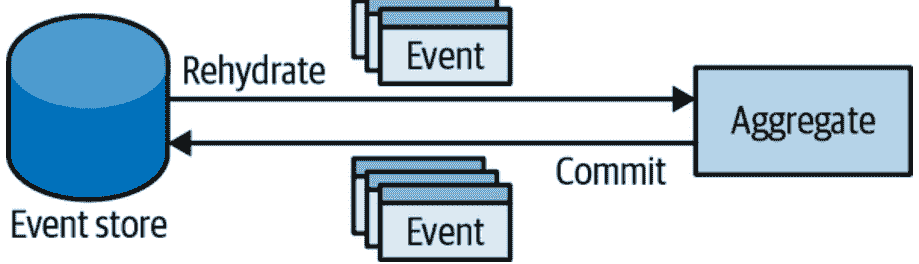
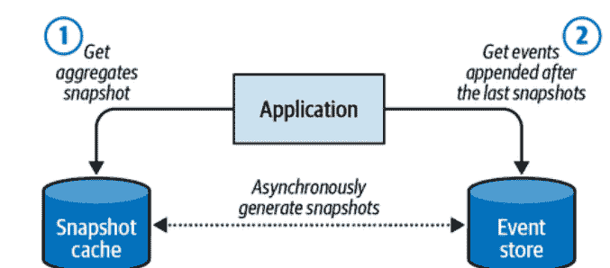
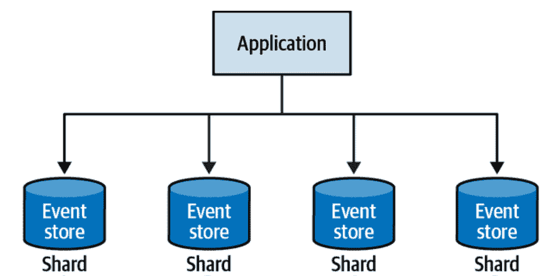

## 第 7 章. 建模时间维度

在上一章中，你学习了领域模型模式：其构建块、目的和应用上下文。事件溯源领域模型模式基于与领域模型模式相同的原则。同样，业务逻辑是复杂且属于核心子域的。此外，它使用与领域模型相同的战术模式：值对象、聚合和领域事件。

这些实现模式之间的区别在于聚合状态的持久化方式。事件溯源领域模型使用事件溯源模式来管理聚合的状态：而不是持久化聚合的状态，模型会生成描述聚合生命周期中每次更改的领域事件，并将它们用作聚合数据的事实来源。

本章首先介绍事件溯源的概念。然后介绍事件溯源如何与领域模型模式结合，使其成为事件溯源领域模型。

### 事件溯源

> *给我看你的流程图并隐藏你的表格，我将继续困惑。给我看你的表格，我通常不需要你的流程图；它会很明显。*
> 
> —Fred Brooks¹

让我们使用 Fred Brooks 的推理来定义事件溯源模式并了解它与传统建模和数据持久化方式的不同。检查表 7-1 并分析你能从这些数据中了解到关于其所属系统的信息。

### 表 7-1. 基于状态的模型

| lead-id | first-name | last-name | status | phon |
|---|---|---|---|---|
| 1 | Sean | Callahan | CONVERTED | 555-1 |
| 2 | Sarah | Estrada | CLOSED | 555-4 |
| 3 | Stephanie | Brown | CLOSED | 555-1 |
| 4 | Sami | Calhoun | CLOSED | 555-1 |
| 5 | William | Smith | CONVERTED | 555-3 |
| 6 | Sabri | Chan | NEW_LEAD | 555-2 |
| 7 | Samantha | Espinosa | NEW_LEAD | 555-8 |
| 8 | Hani | Cronin | CLOSED | 555-3 |
| 9 | Sian | Espinoza | FOLLOWUP_SET | 555-6 |
| 10 | Sophia | Escamilla | CLOSED | 555-4 |
| 11 | William | White | FOLLOWUP_SET | 555-1 |
| 12 | Casey | Davis | CONVERTED | 555-8 |
| 13 | Walter | Connor | NEW_LEAD | 555-4 |
| 14 | Sophie | Garcia | CONVERTED | 555-1 |
| 15 | Sally | Evans | PAYMENT_FAILED | 555-3 |
| 16 | Scott | Chatman | NEW_LEAD | 555-6 |

| lead-id | first-name | last-name | status | phon |
| 17 | Stephen | Pinkman | CONVERTED | 555-2 |
| 18 | Sara | Elliott | PENDING_PAYMENT | 555-2 |
| 19 | Sadie | Edwards | FOLLOWUP_SET | 555-8 |
| 20 | William | Smith | PENDING_PAYMENT | 555-9 |

很明显，该表用于在电话营销系统中管理潜在客户。对于每个潜在客户，你可以看到其 ID、名字和姓氏、记录创建和更新时间、电话号码以及潜在客户的当前状态。

通过检查各种状态，我们也可以假设每个潜在客户所经历的处理周期：

+   - 销售流程始于潜在客户处于 NEW_LEAD 状态。
+   - 一次销售电话可能以对方对优惠不感兴趣而结束（潜在客户为 CLOSED）、安排后续电话（FOLLOWUP_SET），或接受优惠（PENDING_PAYMENT）。
+   - 如果付款成功，潜在客户将被 CONVERTED 为客户。相反，付款可能失败——PAYMENT_FAILED。

仅通过分析表的模式和其中存储的数据，我们就能获得大量信息。我们甚至可以假设建模数据时使用了什么通用语言。但该表中缺少什么信息？

表中的数据记录了潜在客户的当前状态，但缺少每个潜在客户如何达到当前状态的故事。我们无法分析潜在客户生命周期中发生了什么。我们不知道在潜在客户变为 CONVERTED 之前进行了多少次通话。购买是立即完成的，还是经历了漫长的销售旅程？基于历史数据，是否值得在多次跟进后仍联系某人，还是更有效的做法是关闭潜在客户并转向更有希望的潜在客户？这些信息都不存在。我们只知道潜在客户的当前状态。

这些问题反映了优化销售流程所必需的业务关注点。从业务角度来看，分析数据并基于经验优化流程至关重要。填补缺失信息的一种方法就是使用事件溯源。

事件溯源模式将时间维度引入数据模型。基于事件溯源的系统不是反映聚合当前状态的模式，而是持久化记录聚合生命周期中每次更改的事件。

考虑表 7-1 中第 12 行的 CONVERTED 客户。以下列表演示了该人的数据在事件溯源系统中将如何表示：

```
{
  "lead-id": 12,
  "event-id": 0,
  "event-type": "lead-initialized",
  "first-name": "Casey",
  "last-name": "David",
  "phone-number": "555-2951",
  "timestamp": "2020-05-20T09:52:55.95Z"
},
{
  "lead-id": 12,
  "event-id": 1,
  "event-type": "contacted",
  "timestamp": "2020-05-20T12:32:08.24Z"
},
{
  "lead-id": 12,
  "event-id": 2,
```


```
"event-type": "followup-set",
"followup-on": "2020-05-27T12:00:00.00Z",
"timestamp": "2020-05-20T12:32:08.24Z"
},
{
  "lead-id": 12,
  "event-id": 3,
  "event-type": "contact-details-updated",
  "first-name": "Casey",
  "last-name": "Davis",
  "phone-number": "555-8101",
  "timestamp": "2020-05-20T12:32:08.24Z"
},
{
  "lead-id": 12,
  "event-id": 4,
  "event-type": "contacted",
  "timestamp": "2020-05-27T12:02:12.51Z"
},
{
  "lead-id": 12,
  "event-id": 5,
  "event-type": "order-submitted",
  "payment-deadline": "2020-05-30T12:02:12.51Z",
  "timestamp": "2020-05-27T12:02:12.51Z"
},
{
  "lead-id": 12,
  "event-id": 6,
  "event-type": "payment-confirmed",
  "status": "converted",
  "timestamp": "2020-05-27T12:38:44.12Z"
}
```

列表中的事件讲述了客户的故事。线索在系统中创建（事件 0），两小时后被销售代理联系（事件 1）。通话期间，双方约定销售代理一周后回电（事件 2），但使用不同的电话号码（事件 3）。销售代理还修正了姓氏中的拼写错误（事件 3）。在约定日期和时间，线索被联系到（事件 4）并提交了订单（事件 5）。订单需要在三天内付款（事件 5），但付款在半小时后就收到了（事件 6），线索被转化为新客户。

正如我们之前看到的，客户的状态可以很容易地从这些领域事件中投影出来。我们所要做的就是将简单的转换逻辑依次应用于每个事件：

```
public class LeadSearchModelProjection
{
    public long LeadId { get; private set; }
    public HashSet<string> FirstNames { get; private set; }
    public HashSet<string> LastNames { get; private set; }
    public HashSet<PhoneNumber> PhoneNumbers { get; private set; }
    public int Version { get; private set; }

    public void Apply(LeadInitialized @event)
    {
        LeadId = @event.LeadId;
        FirstNames = new HashSet<string>();
        LastNames = new HashSet<string>();
        PhoneNumbers = new HashSet<PhoneNumber>();
        FirstNames.Add(@event.FirstName);
        LastNames.Add(@event.LastName);
        PhoneNumbers.Add(@event.PhoneNumber);
        Version = 0;
    }

    public void Apply(ContactDetailsChanged @event)
    {
        FirstNames.Add(@event.FirstName);
        LastNames.Add(@event.LastName);
        PhoneNumbers.Add(@event.PhoneNumber);
        Version += 1;
    }

    public void Apply(Contacted @event)
    {
        Version += 1;
    }

    public void Apply(FollowupSet @event)
    {
        Version += 1;
    }
}
```

```
public void Apply(OrderSubmitted @event)
{
    Version += 1;
}

public void Apply(PaymentConfirmed @event)
{
    Version += 1;
}
}
```

对聚合的事件进行迭代并依次将其馈送到 Apply 方法的适当重写中，将精确地产生表 7-1 中建模的状态表示。

请注意在应用每个事件后递增的 Version 字段。它的值表示对业务实体所做的修改总数。此外，假设我们应用事件的子集。在这种情况下，我们可以“穿越时间”：我们可以通过仅应用相关事件来投影实体在其生命周期中的任何点的状态。例如，如果我们需要实体在版本 5 的状态，我们只需应用前五个事件即可。

最后，我们并不局限于仅投影事件的单一状态表示！请考虑以下场景。

### Search

你需要实现一个搜索功能。然而，由于线索的联系信息可能会被更新——名字、姓氏和电话号码——销售代理可能不知道其他代理所做的更改，并可能希望使用其联系信息，包括历史值，来定位线索。我们可以轻松地投影历史信息：

```
public class LeadSearchModelProjection
{
    public long LeadId { get; private set; }
```

```
public HashSet<string> FirstNames { get; private set; }
public HashSet<string> LastNames { get; private set; }
public HashSet<PhoneNumber> PhoneNumbers { get; private set; }
public int Version { get; private set; }

public void Apply(LeadInitialized @event)
{
    LeadId = @event.LeadId;
    FirstNames = new HashSet<string>();
    LastNames = new HashSet<string>();
    PhoneNumbers = new HashSet<PhoneNumber>();

    FirstNames.Add(@event.FirstName);
    LastNames.Add(@event.LastName);
    PhoneNumbers.Add(@event.PhoneNumber);

    Version = 0;
}

public void Apply(ContactDetailsChanged @event)
{
    FirstNames.Add(@event.FirstName);
    LastNames.Add(@event.LastName);
    PhoneNumbers.Add(@event.PhoneNumber);

    Version += 1;
}

public void Apply(Contacted @event)
{
Version += 1;
}

public void Apply(FollowupSet @event)
{
Version += 1;
}

public void Apply(OrderSubmitted @event)
{
Version += 1;
}

public void Apply(PaymentConfirmed @event)
{
```

```
Version += 1;
}
}
```

投影逻辑使用 LeadInitialized 和 ContactDetailsChanged 事件来填充线索个人详细信息的相应集合。其他事件被忽略，因为它们不影响特定模型的状态。

将此投影逻辑应用于前面示例中 Casey Davis 的事件将产生以下状态：

```
LeadId: 12
FirstNames: ['Casey']
LastNames: ['David', 'Davis']
PhoneNumbers: ['555-2951', '555-8101']
Version: 6
```

### Analysis

你的商业智能部门要求你提供更便于分析的线索数据表示。对于他们当前的研究，他们希望获取不同线索所安排的后续电话数量。稍后他们将筛选已转化和已关闭的线索数据，并使用该模型来优化销售流程。让我们投影他们要求的数据：

```
public class AnalysisModelProjection
{
    public long LeadId { get; private set; }
    public int Followups { get; private set; }
    public LeadStatus Status { get; private set; }
    public int Version { get; private set; }

    public void Apply(LeadInitialized @event)
    {
        LeadId = @event.LeadId;
        Followups = 0;
        Status = LeadStatus.NEW_LEAD;
        Version = 0;

```
}
public void Apply(Contacted @event)
{
    Version += 1;
}

public void Apply(FollowupSet @event)
{
    Status = LeadStatus.FOLLOWUP_SET;
    Followups += 1;
    Version += 1;
}

public void Apply(ContactDetailsChanged @event)
{
    Version += 1;
}

public void Apply(OrderSubmitted @event)
{
    Status = LeadStatus.PENDING_PAYMENT;
    Version += 1;
}

public void Apply(PaymentConfirmed @event)
{
    Status = LeadStatus.CONVERTED;
    Version += 1;
}
}
```

前述逻辑维护了一个计数器，用于统计后续事件在线索事件中出现的次数。如果我们将此投影应用于聚合事件的示例，它将生成以下状态：

```
LeadId: 12
Followups: 1
Status: Converted
Version: 6
```

前述示例中实现的逻辑在内存中投影了搜索优化和分析优化的模型。然而，要实际实现所需的功能，我们必须将投影的模型持久化到数据库中。在第 8 章中，你将学习一种允许我们这样做的模式：命令查询职责分离（CQRS）。

### Source of Truth

要使事件溯源模式发挥作用，对对象状态的所有更改都应表示为事件并作为事件持久化。这些事件成为系统的事实来源（因此得名）。该过程如图 7-1 所示。



图 7-1. 事件溯源聚合

存储系统事件的数据库是唯一强一致的存储：系统的事实来源。用于持久化事件的数据库的通用名称是事件存储。

### Event Store

事件存储不应允许修改或删除事件²，因为它是一个仅追加存储。为了支持事件溯源模式的实现，事件存储至少必须支持以下功能：获取属于特定业务实体的所有事件并追加事件。例如：


```
interface IEventStore
{
    IEnumerable<Event> Fetch(Guid instanceId);
    void Append(Guid instanceId, Event[] newEvents, int expectedVersion);
}
```

Append 方法中的 expectedVersion 参数用于实现乐观并发管理：当你追加新事件时，同时指定了你所依据的实体的版本。如果该版本已过期，即在 expectedVersion 之后有新的事件被添加，事件存储应抛出并发异常。

在大多数系统中，实现 CQRS 模式还需要额外的端点，我们将在下一章讨论。

> NOTE
> 本质上，事件溯源模式并非新事物。金融行业使用事件来表示账本的变化。账本是一个只追加的日志，用于记录交易。当前状态（例如账户余额）始终可以通过“投影”账本的记录来推导。

#### Event-Sourced Domain Model

原始领域模型维护其聚合体的状态表示并发出选定的领域事件。事件溯源领域模型则完全使用领域事件来建模聚合体的生命周期。对聚合体状态的任何更改都必须表示为领域事件。

对事件溯源聚合体的每次操作都遵循以下脚本：

- 加载聚合体的领域事件。
- 重建状态表示——将事件投影到可用于做出业务决策的状态表示中。
- 执行聚合体的命令以执行业务逻辑，并由此产生新的领域事件。
- 将新的领域事件提交到事件存储。

回到第 6 章中的 Ticket 聚合体的示例，让我们看看它将如何实现为事件溯源聚合体。

应用程序服务遵循前面描述的脚本：它加载相关票据的事件，重建聚合体实例，调用相关命令，并将更改持久化回数据库：

```
01 public class TicketAPI
02 {
03     private ITicketsRepository _ticketsRepository;
04     ...
05
06     public void RequestEscalation(TicketId id, EscalationReason reason)
07     {
08         var events = _ticketsRepository.LoadEvents(id);
09         var ticket = new Ticket(events);
10         var originalVersion = ticket.Version;
11         var cmd = new RequestEscalation(reason);
12         ticket.Execute(cmd);
13         _ticketsRepository.CommitChanges(ticket, originalVersion);
14     }
15
16     ...
17 }
```

Ticket 聚合体的重建逻辑在构造函数中（第 27 行至第 31 行）实例化状态投影器类 TicketState 的实例，并依次为票据的每个事件调用其 AppendEvent 方法：

```
18 public class Ticket
19 {
20     ...
21     private List<DomainEvent> _domainEvents = new List<DomainEvent>();
22     private TicketState _state;
23     ...
24
25     public Ticket(IEnumerable<IDomainEvents> events)
26     {
27         _state = new TicketState();
28         foreach (var e in events)
29         {
30             AppendEvent(e);
31         }
32     }
```

AppendEvent 将传入的事件传递给 TicketState 投影逻辑，从而生成票据当前状态的内存表示：

```
33     private void AppendEvent(IDomainEvent @event)
34     {
35         _domainEvents.Append(@event);
36         // Dynamically call the correct overload of the "Apply" method.
37         ((dynamic)state).Apply((dynamic)@event);
38     }
```

与上一章中看到的实现不同，事件溯源聚合体的 RequestEscalation 方法不会显式将 IsEscalated 标志设置为 true。相反，它实例化适当的事件并将其传递给 AppendEvent 方法（第 43 行和第 44 行）：

```
39     public void Execute(RequestEscalation cmd)
40     {
41         if (!_state.IsEscalated && _state.RemainingTimePercentage <= 0)
42         {
43             var escalatedEvent = new TicketEscalated(_id,
44         cmd.Reason);
45        AppendEvent(escalatedEvent);
46    }
47 }
48 
49 ...
50 }
```

添加到聚合体事件集合中的所有事件都会传递给 TicketState 类中的状态投影逻辑，其中相关字段的值会根据事件的数据进行变更：

```
50 public class TicketState
51 {
52     public TicketId Id { get; private set; }
53     public int Version { get; private set; }
54     public bool IsEscalated { get; private set; }
55     ...
56     public void Apply(TicketInitialized @event)
57     {
58         Id = @event.Id;
59         Version = 0;
60         IsEscalated = false;
61         ...
62     }
63 
64     public void Apply(TicketEscalated @event)
65     {
66         IsEscalated = true;
67         Version += 1;
68     }
69 
70     ...
71 }
```

现在让我们看看在实现复杂业务逻辑时利用事件溯源的一些优势。

#### WHY “EVENT-SOURCED DOMAIN MODEL”?

我觉得有必要解释一下为什么我使用 *event-sourced domain model* 这个术语而不是仅仅使用 *event sourcing*。使用事件来表示状态转换——事件溯源模式——可以在有或没有领域模型构建块的情况下实现。因此，我更喜欢这个较长的术语，以明确表示我们正在使用事件溯源来表示领域模型聚合体生命周期中的变化。

#### Advantages

与更传统的模型相比，聚合体的当前状态被持久化到数据库中，事件溯源领域模型需要更多的工作来建模聚合体。然而，这种方法带来了显著的优势，使得该模式在许多场景下值得考虑：

##### *Time traveling*

正如领域事件可用于重建聚合体的当前状态，它们也可以用于恢复聚合体的所有过去状态。换句话说，你始终可以重建聚合体的所有过去状态。

这通常在分析系统行为、检查系统决策和优化业务逻辑时完成。

重建过去状态的另一个常见用例是追溯调试：你可以将聚合体恢复到观察到 bug 时的确切状态。

##### *Deep insight*

在本书第一部分，我们看到优化核心子域对业务具有战略重要性。事件溯源提供了对系统状态和行为的深入洞察。正如你在本章前面学到的，事件溯源提供了灵活的模型，允许将事件转换为不同的状态表示——你始终可以添加新的投影，利用现有事件的数据提供额外的洞察。

##### Audit log

持久化的领域事件代表了聚合体状态发生的一切的强一致性审计日志。法律要求某些业务域实现此类审计日志，而事件溯源开箱即用。

这种模型对于管理资金或货币交易的系统尤其方便。它使我们能够轻松追踪系统的决策以及资金在账户之间的流动。

##### Advanced optimistic concurrency management

经典的乐观并发模型在读取数据在写入过程中变得陈旧——被另一个进程覆盖——时会抛出异常。

使用事件溯源时，我们可以更深入地了解在读取现有事件和写入新事件之间到底发生了什么。你可以查询并发追加到事件存储的确切事件，并做出基于业务域的决策，判断新事件是否与尝试的操作冲突，或者额外事件无关，可以安全继续。

#### Disadvantages

到目前为止，事件溯源领域模型似乎是实现业务逻辑的终极模式，因此应尽可能频繁使用。当然，这与让业务域需求驱动设计决策的原则相矛盾。所以，让我们讨论一下该模式带来的一些挑战：

##### Learning curve

该模式的明显缺点是它与传统的数据管理技术有很大差异。成功实施该模式需要对团队进行培训，并需要时间来适应新的思维方式。除非团队已有实施事件溯源系统的经验，否则必须考虑学习曲线。

##### Evolving the model

演进事件溯源模型可能具有挑战性。事件溯源的严格定义说事件是不可变的。但如果需要调整事件的模式怎么办？这个过程并不像更改表模式那么简单。事实上，整本书都写在了这个主题上：*Versioning in an Event Sourced System* by Greg Young。

##### Architectural complexity

事件源的实现引入了众多架构上的“活动部件”，使整体设计变得更加复杂。本主题将在下一章中更详细地介绍，当我们讨论 CQRS 架构时。


所有这些挑战如果所处理的任务并不证明该模式的使用是合理的，反而可以用更简单的设计来解决时，会变得更加严重。在第10章中，你将学习一些简单的经验法则，帮助你决定使用哪种业务逻辑实现模式。

#### 常见问题

当工程师初次接触事件溯源模式时，他们经常会提出一些常见问题，因此我认为有必要在本章中予以解答。

##### 性能

*从事件中重建聚合的状态会负面影响系统的性能。随着事件的增加，性能会下降。这怎么可能工作？*

将事件投影到状态表示确实需要计算资源，并且随着向聚合的列表中添加更多事件，这种需求会增长。

评估投影对性能的影响非常重要：处理数百或数千个事件的效果。这些结果应与聚合的预期生命周期进行比较——在其平均生命周期内预计会记录的事件数量。

在大多数系统中，性能下降只有在每个聚合超过 10,000+ 个事件后才会明显。也就是说，在绝大多数系统中，聚合的平均生命周期不会超过 100 个事件。

在极少数情况下，投影状态确实会成为性能问题时，可以实现另一种模式：

快照。该模式如图 7-2 所示，实现以下步骤：

- 一个进程会持续迭代事件存储中的新事件，生成相应的投影，并将它们存储在缓存中。
- 需要内存中的投影来对聚合执行操作。在这种情况下：
  - 进程从缓存中获取当前的状态投影。
  - 进程从事件存储中获取快照版本之后发生的事件。
  - 额外的事件被应用到快照的内存中。



| Aggregated | Last applied event id | Snapshot |
|---|---|---|
| 1 | 15 | ... |
| 2 | 7 | ... |
| 3 | 10 | ... |

| Aggregated | Event id | Data |
|---|---|---|
| ... | ... | ... |
| 2 | 6 | ... |
| 2 | 7 | ... |
| 2 | 8 | ... |
| 2 | 9 | ... |
| 2 | 10 | ... |

图 7-2. 对聚合的事件进行快照

值得重申的是，快照模式是一种需要证明其合理性的优化。如果你的系统中的聚合不会持久化 10,000+ 个事件，实现快照模式只是一种偶然的复杂性。但在你继续实现快照模式之前，我建议你退一步，重新检查聚合的边界。

##### 该模型会产生海量数据。它能扩展吗？

事件溯源模型很容易扩展。由于所有与聚合相关的操作都是在单个聚合的上下文中完成的，事件存储可以根据聚合 ID 进行分片：属于聚合实例的所有事件都应驻留在单个分片中（见图 7-3）。



图 7-3. 对事件存储进行分片

##### 删除数据

事件存储是一个仅追加的数据库，但如果我确实需要物理删除数据；例如，为了遵守 GDPR？³

这种需求可以通过可遗忘负载模式来解决：所有敏感信息都以加密形式包含在事件中。加密密钥存储在外部键值存储中：密钥存储，其中键是特定聚合的 ID，值是加密密钥。当敏感数据需要被删除时，加密密钥会从密钥存储中删除。结果，事件中包含的敏感信息将不再可访问。

##### 为什么我不能只是…？

为什么我不能只是将日志写入文本文件并将其用作审计日志？

同时将数据写入操作数据库和日志文件是一个容易出错的操作。从本质上讲，它是对两种存储机制的事务：数据库和文件。如果第一个失败，第二个必须回滚。例如，如果数据库事务失败，没有人会关心删除之前的日志消息。因此，这样的日志不是一致的，而是最终不一致的。

为什么我不能继续使用基于状态的模型，但在同一个数据库事务中，将日志追加到日志表？

从基础设施的角度来看，这种方法确实提供了状态和日志记录之间的一致同步。然而，它仍然容易出错。如果将来负责代码库的工程师忘记追加适当的日志记录怎么办？

此外，当基于状态的表示被用作事实来源时，额外的日志表的模式通常会迅速退化为混乱。没有办法强制执行所有必需的信息都被写入，并且以正确的格式写入。

为什么我不能只是继续使用基于状态的模型，但添加一个数据库触发器，该触发器将记录的快照复制到专用的“历史”表中？

这种方法克服了前一种方法的缺点：不需要显式的手动调用来向日志表追加记录。也就是说，所产生的历史记录只包括枯燥的事实：哪些字段被更改。它缺少业务上下文：为什么字段被更改。缺乏“为什么”极大地限制了投影额外模型的能力。

### 结论

本章解释了事件溯源模式及其在领域模型聚合中对时间维度建模的应用。

在事件溯源领域模型中，对聚合状态的所有更改都表示为一系列领域事件。这与更传统的在数据库中更新记录以表示状态更改的方法形成对比。由此产生的领域事件可用于投影聚合的当前状态。此外，基于事件的模型赋予我们将事件投影到多个表示模型的灵活性，每个模型都针对特定任务进行了优化。

该模式适用于需要深入了解系统数据的情况，无论是为了分析和优化，还是因为法律要求审计日志。

本章完成了我们对建模和实现业务逻辑的不同方式的探索。在下一章中，我们将把注意力转向更高范围的模式：架构模式。

## 练习

- 1. 下列关于领域事件与值对象之间关系的陈述中，哪一个是正确的？
  - a. 领域事件使用值对象来描述业务域中发生了什么。
  - b. 在实现事件溯源领域模型时，值对象应重构为事件溯源聚合。
  - c. 值对象与领域模型模式相关，并在事件溯源领域模型中被领域事件取代。
  - d. 所有陈述都是错误的。

2. 下列关于从一系列事件投影状态的选项的陈述中，哪一个是正确的？
a. 可以从聚合的事件中投影单一状态表示。
b. 可以投影多个状态表示，但领域事件必须以支持多重投影的方式建模。
c. 可以投影多个状态表示，并且你始终可以在未来添加额外的投影。
d. 所有陈述都是错误的。

3. 下列关于基于状态的聚合与事件溯源聚合之间差异的陈述中，哪一个是正确的？
a. 事件溯源聚合可以产生领域事件，而基于状态的聚合不能产生领域事件。
b. 聚合模式的两种变体都会产生领域事件，但只有事件溯源聚合使用领域事件作为事实来源。
c. 事件溯源聚合确保为每次状态转换生成领域事件。
d. B 和 C 都正确。

4. 回到书的序言中描述的 WolfDesk 公司，系统的哪个功能最适合作为事件溯源领域模型来实现？


1 Brooks, F. P. Jr. (1974). *The Mythical Man-Month: Essays on Software Engineering*. Reading, MA: Addison-Wesley.
2 Except for exceptional cases, such as data migration.
3 General Data Protection Regulation. (n.d.) Retrieved June 14, 2021, from Wikipedia.
