## Chapter 8. Architectural Patterns

本书迄今为止讨论的战术模式定义了建模和实现业务逻辑的不同方式。在本章中，我们将从更广阔的背景来探索战术设计决策：系统组件之间交互和依赖关系的编排方式。

#### Business Logic Versus Architectural Patterns

业务逻辑是软件中最重要的部分；然而，它并不是软件系统的唯一部分。为了实现功能需求和非功能需求，代码库必须履行更多职责。它必须与用户交互以收集输入并提供输出，并且必须使用不同的存储机制来持久化状态并与外部系统和信息提供者集成。

代码库需要处理的各种关注点使得其业务逻辑很容易在不同组件中扩散：即部分逻辑被实现在用户界面或数据库中，或在不同组件中被重复。缺乏对实现关注点的严格组织使得代码库难以更改。当业务逻辑需要更改时，可能不清楚代码库的哪些部分需要受到更改的影响。更改可能会对看似无关的系统部分产生意想不到的影响。相反，可能很容易遗漏需要修改的代码。所有这些问题都会大幅增加维护代码库的成本。

架构模式为代码库的不同方面引入了组织原则，并在它们之间提供了清晰的边界：业务逻辑如何与系统的输入、输出和其他基础设施组件连接。这会影响这些组件如何相互交互：它们共享什么知识以及组件如何相互引用。

选择适当的方式来组织代码库，或正确的架构模式，对于短期内支持业务逻辑的实现以及长期缓解维护至关重要。让我们探索三种主要的应用程序架构模式及其用例：分层架构、端口与适配器，以及 CQRS。

#### Layered Architecture

分层架构是最常见的架构模式之一。它将代码库组织成水平层，每层解决以下技术关注点之一：与消费者的交互、实现业务逻辑以及持久化数据。你可以在图 8-1 中看到此表示。

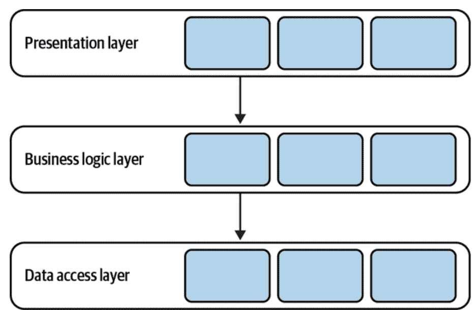

图 8-1. 分层架构

在其经典形式中，分层架构由三层组成：表示层（PL）、业务逻辑层（BLL）和数据访问层（DAL）。

#### Presentation Layer

表示层，如图 8-2 所示，实现程序与消费者交互的用户界面。在该模式的原始形式中，这一层表示图形界面，例如 Web 界面或桌面应用程序。

然而，在现代系统中，表示层具有更广泛的范围：即触发程序行为的所有手段，无论是同步还是异步。例如：

- 图形用户界面（GUI）
- 命令行界面（CLI）
- 用于与其他系统进行程序化集成的 API
- 订阅消息代理中的事件
- 用于发布外部事件的消息主题

所有这些都是系统接收来自外部环境的请求并传达输出的手段。严格来说，表示层是程序的公共接口。

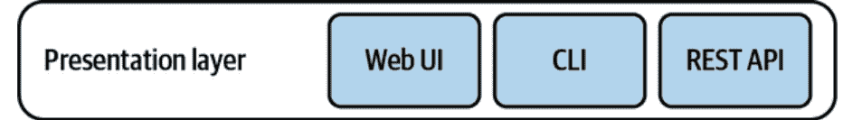

图 8-2. 表示层

#### Business Logic Layer

顾名思义，这一层负责实现和封装程序的业务逻辑。这是业务决策实现的地方。正如 Eric Evans 所说，¹这一层是软件的核心。

这是业务逻辑模式在第 5–7 章中描述的实现位置——例如，活动记录或领域模型（见图 8-3）。

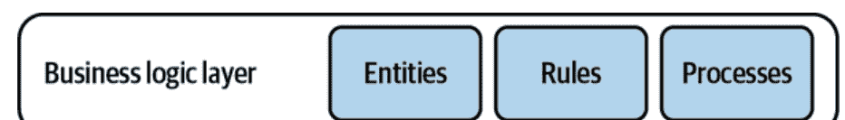

图 8-3. 业务逻辑层

#### Data Access Layer

数据访问层提供对持久化机制的访问。在该模式的原始形式中，这指的是系统的数据库。然而，与表示层的情况一样，该层的职责对于现代系统来说更广泛。

首先，自 NoSQL 革命爆发以来，系统使用多个数据库是很常见的。例如，文档存储可以用作操作数据库、用于动态查询的搜索索引，以及用于性能优化操作的内存数据库。

其次，传统数据库并不是存储信息的唯一媒介。例如，基于云的对象存储²可用于存储系统的文件，或消息总线可用于编排程序不同功能之间的通信。³

最后，这一层还包括与实现程序功能所需的各种外部信息提供者的集成：外部系统提供的 API，或云厂商托管的服务，例如语言翻译、股市数据和音频转录（见图 8-4）。

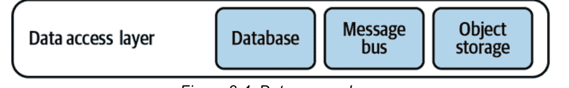

图 8-4. 数据访问层

#### Communication Between Layers

层之间采用自上而下的通信模型集成：每一层只能持有对直接下方层的依赖，如图 8-5 所示。这强制了解决方案关注点的解耦并减少层之间共享的知识。在图 8-5 中，表示层仅引用业务逻辑层。它对数据访问层中做出的设计决策一无所知。

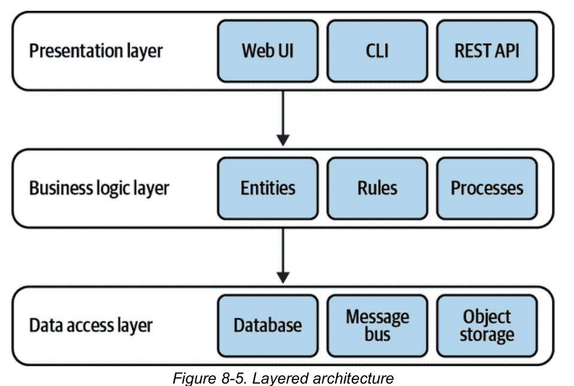

图 8-5. 分层架构

#### Variation

常见的做法是将分层架构模式扩展为增加一个额外的层：服务层。

##### Service layer

> 定义应用程序边界的一层服务，建立一组可用操作并协调应用程序在每个操作中的响应。
> 
> —Patterns of Enterprise Application Architecture⁴

服务层充当程序表示层和业务逻辑层之间的中介。考虑以下代码：

```
namespace MvcApplication.Controllers
{
    public class UserController: Controller
    {
```

```
[AcceptVerbs(HttpVerbs.Post)]
public ActionResult Create(ContactDetails contactDetails)
{
    OperationResult result = null;

    try
    {
        _db.StartTransaction();

        var user = new User();
        user.SetContactDetails(contactDetails)
        user.Save();

        _db.Commit();
        result = OperationResult.Success;
    } catch (Exception ex) {
        _db.Rollback();
        result = OperationResult.Exception(ex);
    }

    return View(result);
}
}
```

此示例中的 MVC 控制器属于表示层。它公开了一个创建新用户的端点。端点使用 User 活动记录对象创建新实例并保存它。此外，它编排数据库事务以确保在出现错误时生成适当的响应。

为了进一步将表示层与底层业务逻辑解耦，此类编排逻辑可以移入服务层，如图 8-6 所示。

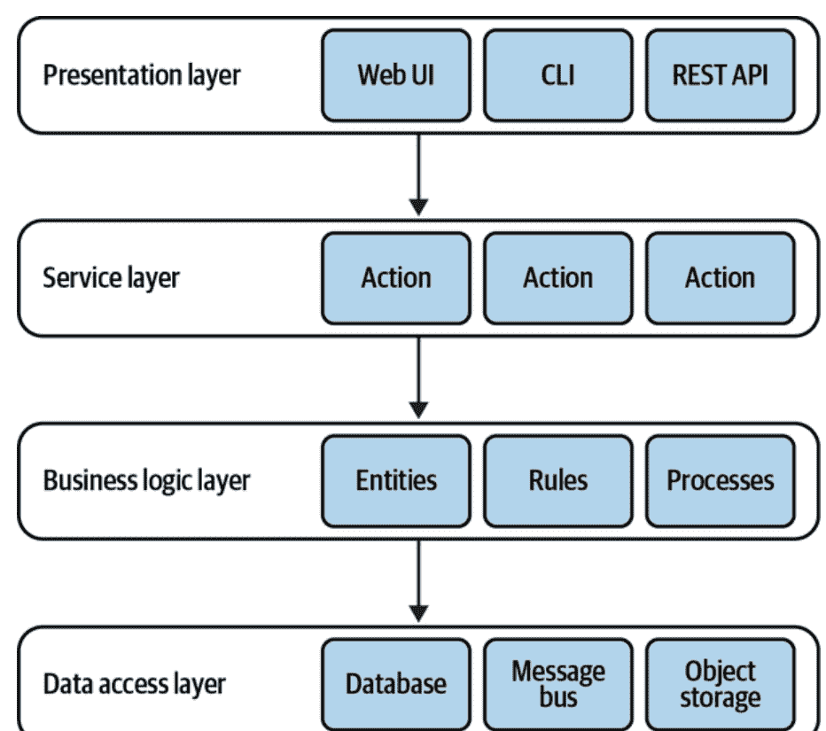

图 8-6. 服务层

需要注意的是，在架构模式的上下文中，服务层是一个逻辑边界。它不是物理服务。

服务层充当业务逻辑层的外观：它公开一个与公共接口方法相对应的接口，封装底层层的所需编排。例如：

```
interface CampaignManagementService
{
OperationResult CreateCampaign(CampaignDetails details);
OperationResult Publish(CampaignId id, PublishingSchedule schedule);
OperationResult Deactivate(CampaignId id);
OperationResult AddDisplayLocation(CampaignId id, DisplayLocation
```


```
newLocation);
    ...
}
```

所有上述方法都对应于系统的公共接口。然而，它们缺乏与演示相关的实现细节。演示层的职责变得有限，仅限于为服务层提供所需输入并将响应传回调用方。

让我们重构前面的示例并将编排逻辑提取到服务层：

```
namespace ServiceLayer
{
    public class UserService
    {
        ...
        public OperationResult Create(ContactDetails contactDetails)
        {
            OperationResult result = null;
            try
            {
                _db.StartTransaction();
                var user = new User();
                user.SetContactDetails(contactDetails)
                user.Save();
                _db.Commit();
                result = OperationResult.Success;
            } catch (Exception ex) {
                _db.Rollback();
                result = OperationResult.Exception(ex);
            }
            return result;
        }
        ...
    }
```

```
}
namespace MvcApplication.Controllers
{
    public class UserController: Controller
    {
        ...
        [AcceptVerbs(HttpVerbs.Post)]
        public ActionResult Create(ContactDetails contactDetails)
        {
            var result = _userService.Create(contactDetails);
            return View(result);
        }
    }
}
```

拥有一个明确的服务层具有诸多优势：

- 我们可以重用相同的服务层来服务多个公共接口；例如，图形用户界面和 API。无需重复编排逻辑。
- 它通过将所有相关方法集中在一处来提高模块化。
- 它进一步解耦了演示层和业务逻辑层。
- 它使测试业务功能变得更容易。

话虽如此，服务层并非总是必要的。例如，当业务逻辑以事务脚本实现时，它本质上就是一个服务层，因为它已经公开了一组构成系统公共接口的方法。在这种情况下，服务层的 API 只会重复事务脚本的公共接口，而不会抽象或封装任何复杂性。因此，服务层或业务逻辑层其中之一即可。

另一方面，如果业务逻辑模式需要外部编排，如活动记录模式的情况，则需要服务层。在这种情况下，服务层实现了事务脚本模式，而其操作的活动记录位于业务逻辑层。

### 术语

在其他地方，你可能会遇到用于分层架构的其他术语：

- Presentation layer = user interface layer
- Service layer = application layer
- Business logic layer = domain layer = model layer
- Data access layer = infrastructure layer

为消除混淆，我使用原始术语来呈现该模式。话虽如此，我更喜欢“用户界面层”和“基础设施层”，因为这些术语更好地反映了现代系统的职责，以及使用 application layer 以避免与服务的物理边界混淆。

### 何时使用分层架构

业务逻辑与数据访问层之间的依赖关系使得这种架构模式非常适合业务逻辑使用事务脚本或活动记录模式实现的系统。

然而，该模式使得实现领域模型变得具有挑战性。在领域模型中，业务实体（聚合和值对象）不应依赖于底层基础设施，也不应了解其知识。分层架构的自上而下的依赖关系需要绕一些弯路才能满足这一要求。虽然可以在分层架构中实现领域模型，但我们接下来要讨论的模式更适合。

### 可选：层与层级

层架构经常与 N 层架构混淆，反之亦然。尽管这两种模式之间存在相似之处，但层和层级在概念上是不同的：层是逻辑边界，而层级是物理边界。分层架构中的所有层都受相同生命周期约束：它们作为一个单一单元实现、演进和部署。另一方面，层级是可以独立部署的服务、服务器或系统。例如，考虑图 8-7 中的 N 层系统。

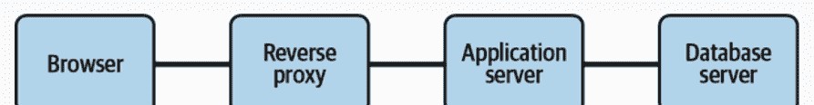

图 8-7. N 层系统

该系统描绘了参与基于 Web 的系统中的物理服务之间的集成。消费者使用浏览器，该浏览器可在台式计算机或移动设备上运行。浏览器与反向代理交互，反向代理将请求转发到实际的 Web 应用程序。Web 应用程序运行在 Web 服务器上并与数据库服务器通信。所有这些组件可能运行在同一物理服务器上，例如容器，或分布在多个服务器上。然而，由于每个组件都可以独立于其他组件进行部署和管理，因此这些是层级而不是层。

另一方面，层是 Web 应用程序内部的逻辑边界。

### 端口与适配器

端口与适配器架构解决了分层架构的不足，并且更适合实现更复杂的业务逻辑。有趣的是，这两种模式非常相似。让我们将分层架构“重构”为端口与适配器。

### 术语

本质上，演示层和数据访问层都代表了与外部组件的集成：数据库、外部服务和用户界面框架。这些技术实现细节并不反映系统的业务逻辑；因此，让我们将所有此类基础设施问题统一到单个“基础设施层”中，如图 8-8 所示。

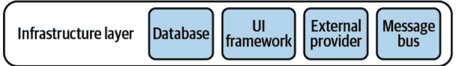

图 8-8. 演示层和数据访问层合并为基础设施层

### 依赖倒置原则

依赖倒置原则（DIP）指出，实现业务逻辑的高层模块不应依赖于低层模块。然而，这正是传统分层架构中发生的情况。业务逻辑层依赖于基础设施层。为了符合 DIP，让我们反转这种关系，如图 8-9 所示。

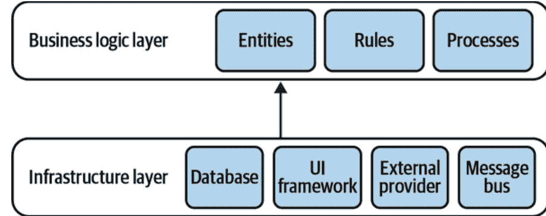

图 8-9. 反转的依赖关系

与其被夹在技术问题之间，现在业务逻辑层占据了核心地位。它不依赖于系统的任何基础设施组件。

最后，让我们添加一个 application⁵ 层作为系统公共接口的门面。与分层架构中的服务层一样，它描述了系统公开的所有操作，并编排系统的业务逻辑以执行它们。由此产生的架构如图 8-10 所示。

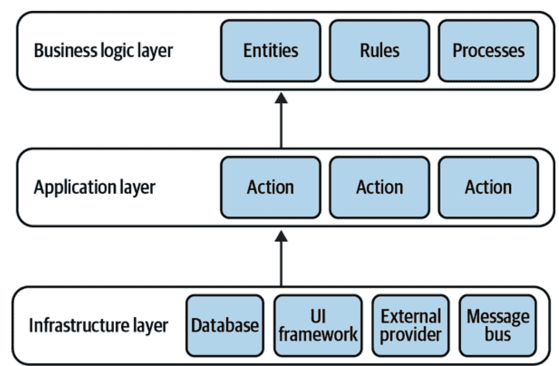

图 8-10. 端口与适配器架构的传统层

图 8-10 所示的架构是端口与适配器架构模式。业务逻辑不依赖于任何底层层，这对于实现领域模型和事件溯源领域模型模式是必需的。

为什么这种模式被称为端口与适配器？要回答这个问题，让我们看看基础设施组件是如何与业务逻辑集成的。

### 基础设施组件的集成

端口与适配器架构的核心目标是将系统的业务逻辑与其基础设施组件解耦。

业务逻辑层不是直接引用和调用基础设施组件，而是定义“端口”，这些端口必须由基础设施层实现。基础设施层实现“适配器”：用于使用不同技术的工作的端口接口的具体实现（见图 8-11）。


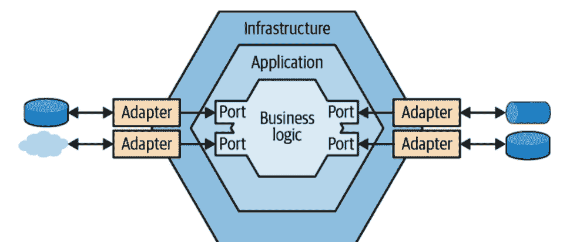

图 8-11. 端口与适配器架构

抽象端口在基础设施层通过依赖注入或引导方式解析为具体的适配器。

例如，这里是一个可能的端口定义以及消息总线的具体适配器：

```
namespace App.BusinessLogicLayer
{
    public interface IMessaging
    {
        void Publish(Message payload);
        void Subscribe(Message type, Action callback);
    }
}

namespace App.Infrastructure.Adapters
{
    public class SQSBus: IMessaging { ... }
}
```

### 变体

端口与适配器架构也被称为六边形架构、洋葱架构和整洁架构。所有这些模式都基于相同的设计原则，具有相同的组件，并且它们之间的关系也相同，但与分层架构的情况一样，术语可能有所不同：

+   - 应用层 = 服务层 = 用例层
+   - 业务逻辑层 = 领域层 = 核心层

尽管如此，这些模式仍可能被错误地视为概念上不同。这只是通用语言重要性的又一个例子。

### 何时使用端口与适配器

将业务逻辑与所有技术关注点解耦，使得端口与适配器架构非常适合使用领域模型模式实现的业务逻辑。

### 命令查询职责分离

命令查询职责分离（CQRS）模式基于与端口与适配器相同的业务逻辑和基础设施关注点的组织原则。它不同之处在于系统数据管理的方式。该模式允许以多种持久化模型表示系统的数据。

让我们看看为什么我们可能需要这样的解决方案以及如何实现它。

### 多语言建模

在许多情况下，使用系统的业务域的单一模型来满足系统的所有需求可能很困难，甚至不可能。例如，如第 7 章所述联机事务处理（OLTP）和联机分析处理（OLAP）可能需要系统数据的不同表示。

使用多个模型的另一个原因可能与多语言持久化的概念有关。没有完美的数据库。或者，正如 Greg Young⁶ 所说，所有数据库都有缺陷，各有不同：我们经常需要在扩展性、一致性或支持的查询模型之间取得平衡。寻找完美数据库的替代方案是多语言持久化模型：使用多个数据库来实现不同的数据相关需求。例如，单个系统可能会使用文档存储作为其操作数据库，使用列存储进行分析和报告，并使用搜索引擎实现强大的搜索功能。

最后，CQRS 模式与事件溯源密切相关。最初，CQRS 是为了解决事件溯源模型有限的查询可能性而定义的：一次只能查询一个聚合实例的事件。CQRS 模式提供了将投影模型物化到物理数据库中的可能性，这些数据库可用于灵活的查询选项。

话虽如此，本章将“解耦”CQRS 与事件溯源。我打算展示即使业务逻辑使用其他任何业务逻辑实现模式，CQRS 也是有用的。

让我们看看 CQRS 如何允许使用多种存储机制来表示系统数据的不同模型。

### 实现

顾名思义，该模式将系统模型的职责分离。有两种类型的模型：命令执行模型和读模型。

### 命令执行模型

CQRS 专门使用单一模型来执行修改系统状态的操作（系统命令）。该模型用于实现业务逻辑、验证规则和强制不变量。

命令执行模型也是唯一表示强一致数据的模型——系统的事实来源。应该能够读取业务实体的强一致状态，并在更新时提供乐观并发支持。

### 读模型（投影）

系统可以根据需要定义尽可能多的模型来向用户展示数据或向其他系统提供信息。

读模型是预缓存的投影。它可以驻留在持久数据库、平面文件或内存缓存中。CQRS 的正确实现允许清除投影的所有数据并从头重新生成。这也使得未来扩展系统以添加额外的投影成为可能——最初无法预见的模型。

最后，读模型是只读的。系统的任何操作都不能直接修改读模型的数据。

### 投影读模型

为了使读模型正常工作，系统必须将来自命令执行模型的更改投影到其所有读模型中。此概念在图 8-12 中说明。

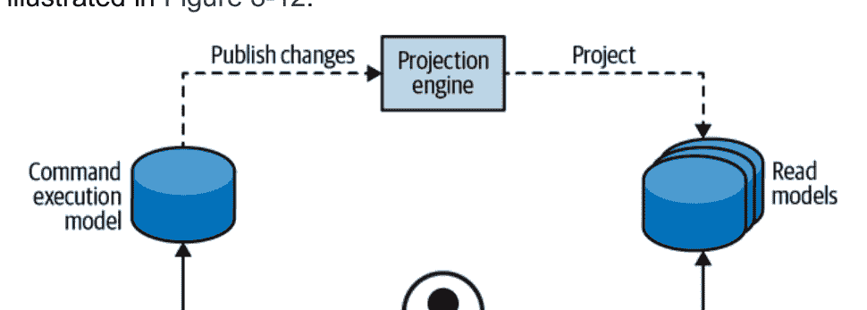

图 8-12. CQRS 架构

读模型的投影类似于关系数据库中的物化视图概念：每当源表被更新时，更改必须反映在预缓存的视图中。

接下来，让我们看看生成投影的两种方式：同步和异步。

### 同步投影

同步投影通过追赶订阅模型获取 OLTP 数据的更改：

+   - 投影引擎查询 OLTP 数据库，以获取上次处理检查点后添加或更新的记录。
+   - 投影引擎使用更新的数据重新生成/更新系统的读模型。
+   - 投影引擎存储上次处理的记录的检查点。此值将在下一次迭代中用于获取在上次处理的记录之后添加或修改的记录。

该过程在图 8-13 中说明，并在图 8-14 中以序列图形式展示。

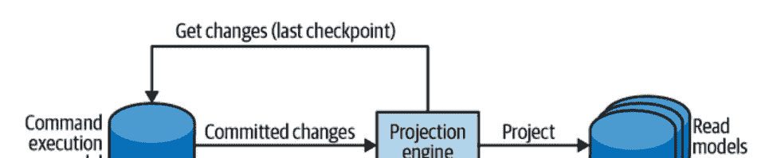

图 8-13. 同步投影模型

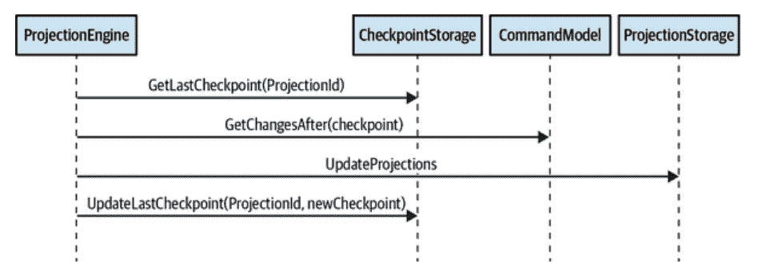

图 8-14. 通过追赶订阅同步投影读模型

为了使追赶订阅正常工作，命令执行模型必须对所有追加或更新的数据库记录进行检查点。存储机制还应支持基于检查点的记录查询。

检查点可以使用数据库的功能实现。例如，SQL Server 的“rowversion”列可用于在插入或更新行时生成唯一的递增数字，如图 8-15 所示。在缺乏此类功能的数据库中，可以实现自定义解决方案，递增运行计数器并将其附加到每个修改的记录。重要的是要确保基于检查点的查询返回一致的结果。如果上次返回的记录的检查点值为 10，则在下一次执行时不应有新的请求具有小于 10 的值。否则，这些记录将被投影引擎跳过，这将导致模型不一致。

| Id | First Name | Last Name | Checkpoint |
|---|---|---|---|
| 1 | Tom | Cook | 0x0000000000001792 |
| 2 | Harold | Elliot | 0x0000000000001793 |
| 3 | Dianna | Daniels | 0x0000000000001796 |
| 4 | Dianna | Daniels | 0x0000000000001795 |

*图 8-15. 关系数据库中自动生成的检查点列*

同步投影方法使得添加新投影和从头重新生成现有投影变得非常简单。在后一种情况下，你只需将检查点重置为 0；投影引擎将扫描记录并从头重建投影。

### 异步投影

在异步投影场景中，命令执行模型将所有已提交的更改发布到消息总线。系统的投影引擎可以订阅已发布的消息并使用它们来更新读模型，如图 8-16 所示。

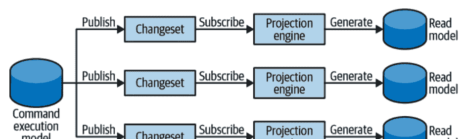

*图 8-16. 异步投影读模型*

### 挑战


尽管异步投影方法在扩展性和性能方面具有明显的优势，但它更容易受到分布式计算带来的挑战的影响。如果消息处理顺序错误或被重复，就会将不一致的数据投影到读模型中。

这种方法也使得添加新的投影或重新生成现有投影变得更加困难。

因此，建议始终实现同步投影，并在此基础上可选地再添加一个异步投影。

### 模型隔离

在 CQRS 架构中，系统的模型的职责根据其类型进行隔离。命令只能操作强一致的命令执行模型。查询不能直接修改系统的任何持久化状态——既不能修改读模型，也不能修改命令执行模型。

关于基于 CQRS 的系统的一个常见误解是，命令只能修改数据，并且数据只能通过读模型进行获取以供显示。换句话说，执行方法的命令绝不应该返回任何数据。这是错误的。这种方法会产生意外的复杂性并导致糟糕的用户体验。

命令应始终让调用方知道其是否成功或失败。如果失败了，为什么会失败？是验证问题还是技术问题？调用方必须知道如何修复命令。因此，命令可以——并且在许多情况下应该——返回数据；例如，如果系统的用户界面需要反映命令所产生的修改。不仅这使得消费者更容易使用系统，因为他们会立即获得操作的反馈，而且返回的值可以在消费者的工作流程中进一步使用，从而消除不必要的数据往返。

这里唯一的限制是，返回的数据应源自强一致的模型——命令执行模型——因为我们不能期望最终一致的投影会立即刷新。

### 何时使用 CQRS

CQRS 模式可用于需要在多个模型中处理相同数据的应用程序，这些模型可能存储在不同类型的数据库中。从运营角度来看，该模式支持领域驱动设计的核心价值，即使用最适合手头任务的模型，并持续改进业务领域的模型。从基础设施角度来看，CQRS 允许利用不同类型数据库的优势；例如，使用关系数据库存储命令执行模型，使用搜索索引进行全文搜索，并使用预渲染的平面文件进行快速数据检索，所有存储机制都可靠地同步。

此外，CQRS 自然适用于基于事件的领域模型。事件溯源模型使得基于聚合状态查询记录变得不可能，但 CQRS 通过将状态投影到可查询的数据库中来实现这一点。

### 范围

我们讨论过的模式——分层架构、端口与适配器架构以及 CQRS——不应被视为系统范围的组织原则。这些也不一定是整个有界上下文的高层架构模式。

考虑一个涵盖多个子域的有界上下文，如图 8-17 所示。子域可以是不同类型的：

核心、支持或通用。即使是同一类型的子域，也可能需要不同的业务逻辑和架构模式（这是第 10 章的主题）。强制执行单一的有界上下文范围的架构将无意中导致意外的复杂性。

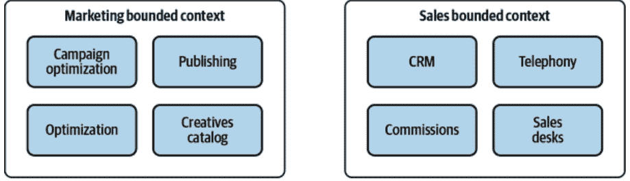

图 8-17. 跨多个子域的有界上下文

我们的目标是根据实际需求和业务战略来指导设计决策。除了在水平方向上划分系统的层之外，我们还可以引入额外的垂直划分。定义封装不同业务子域的模块的逻辑边界并为每个模块使用适当的工具至关重要，如图 8-18 所示。

适当的垂直边界使单体有界上下文成为模块化的，并有助于防止其变成大泥球。正如我们在第 11 章中将讨论的那样，这些逻辑边界以后可以重构为更细粒度的有界上下文的物理边界。

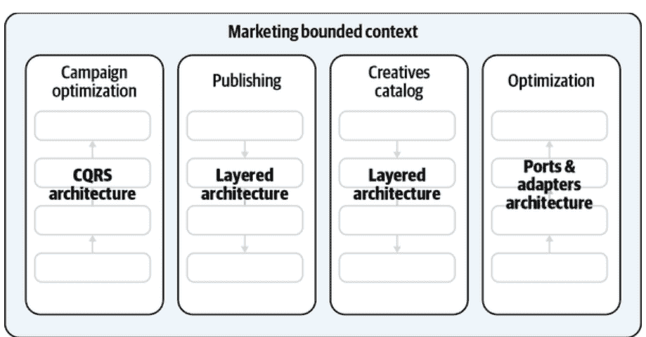

图 8-18. 架构切片

### 结论

分层架构基于其技术关注点对代码库进行分解。由于该模式将业务逻辑与数据访问实现耦合，因此非常适合基于活动记录的系统。

端口与适配器架构反转了关系：它将业务逻辑置于中心，并将其与所有基础设施依赖项解耦。该模式非常适合使用领域模型模式实现的业务逻辑。

CQRS 模式以多种模型表示相同数据。虽然该模式对于基于事件溯源领域模型的系统是强制性的，但它也可以用于任何需要以多种持久模型工作方式的系统。

我们将在下一章讨论的模式将从不同角度解决架构问题：如何实现系统不同组件之间可靠的交互。

## 练习

1. 哪些讨论过的架构模式可以与作为活动记录模式实现的业务逻辑一起使用？
- a. 分层架构
- b. 端口与适配器
- c. CQRS
- d. A 和 C

2. 哪些讨论过的架构模式将业务逻辑与基础设施问题解耦？
- a. 分层架构
- b. 端口与适配器
- c. CQRS
- d. B 和 C

3. 假设你正在实现端口与适配器模式，并且需要集成云提供商托管的消息总线。集成应在哪个层实现？
- a. 业务逻辑层
- b. 应用层
- c. 基础设施层
- d. 任何层

4. 关于 CQRS 模式，以下哪项陈述是正确的？
- a. 异步投影更容易扩展。
- b. 可以使用同步或异步投影，但不能同时使用两者。
- c. 命令不能向调用方返回任何信息。调用方应始终使用读模型来获取已执行操作的结果。
- d. 只要信息源自强一致的模型，命令就可以返回信息。
- e. A 和 D。

5. CQRS 模式允许以多个持久模型表示相同的业务对象，从而允许在同一有界上下文中处理多个模型。这与有界上下文作为模型边界的概念相矛盾吗？

> 1 Evans, E. (2003). Domain-Driven Design: Tackling Complexity in the Heart of Software. Boston: Addison-Wesley.
> 2 例如 AWS S3 或 Google Cloud Storage。
> 3 在此上下文中，消息总线用于系统的内部需求。如果它被公开暴露，则属于表示层。
> 4 Fowler, M. (2002). Patterns of Enterprise Application Architecture. Boston: Addison-Wesley.
> 5 由于我们不在分层架构的上下文中，我将自由地使用应用层一词代替服务层，因为它更好地反映了其目的。
> 6 Polyglot data by Greg Young. (n.d.). Retrieved June 14, 2021, from YouTube.
