## 第 9 章. 通信模式

第 5–8 章介绍了定义系统组件不同实现方式的战术设计模式：如何建模业务逻辑以及如何在架构上组织有界上下文的内部。在本章中，我们将超越单个组件的边界，讨论组织系统元素之间通信流的模式。

本章中你将学到的模式促进跨有界上下文的通信，解决聚合设计原则所施加的限制，并编排跨多个系统组件的业务流程。

### 模型转换

有界上下文是模型——通用语言——的边界。正如你在第 3 章中所学到的，跨不同有界上下文设计通信有不同的模式。假设实现两个有界上下文的团队进行有效沟通并愿意协作。在这种情况下，有界上下文可以以伙伴关系方式集成：协议可以以临时方式协调，任何集成问题都可以通过团队之间的沟通有效解决。另一种以协作驱动的集成方法是共享内核：团队提取并共同演进模型的一部分；例如，将有界上下文的集成契约提取到共同拥有的存储库中。

在客户-供应商关系中，权力的平衡倾向于上游（供应商）或下游（消费者）


有界上下文。假设下游有界上下文无法遵循上游有界上下文的模型。在这种情况下，需要更复杂的解决方案来通过翻译有界上下文的模型来促进通信。

这种翻译可以由一方或有时双方处理：下游有界上下文可以使用反腐败层（ACL）将上游有界上下文的模型适配到其自身需求，而上游有界上下文可以充当开放主机服务（OHS），并通过使用集成特定的发布语言来保护其消费者免受其实现模型变更的影响。由于反腐败层和开放主机服务的翻译逻辑相似，本章在不区分模式的情况下介绍实现选项，仅在特殊情况下提及差异。

模型的翻译逻辑可以是无状态的或有状态的。无状态翻译是即时发生的，即在发出传入（OHS）或传出（ACL）请求时进行，而有状态翻译涉及更复杂的翻译逻辑，需要数据库。让我们看看实现这两种模型翻译的设计模式。

### 无状态模型翻译

对于无状态模型翻译，拥有翻译的有界上下文（上游的 OHS，下游的 ACL）实现代理设计模式，以拦截传入和传出请求并将源模型映射到有界上下文的目标模型。这在图 9-1 中有所体现。

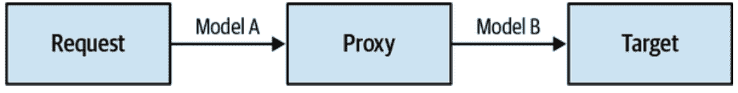

代理的实现取决于有界上下文是同步通信还是异步通信。

### 同步

在同步通信中翻译模型[content]
有界上下文。假设下游有界上下文无法遵循上游有界上下文的模型。在这种情况下，需要更复杂的解决方案来通过翻译有界上下文的模型来促进通信。

这种翻译可以由一方或有时双方处理：下游有界上下文可以使用反腐败层（ACL）将上游有界上下文的模型适配到其自身需求，而上游有界上下文可以充当开放主机服务（OHS），并通过使用集成特定的发布语言来保护其消费者免受其实现模型变更的影响。由于反腐败层和开放主机服务的翻译逻辑相似，本章在不区分模式的情况下介绍实现选项，仅在特殊情况下提及差异。

模型的翻译逻辑可以是无状态的或有状态的。无状态翻译是即时发生的，即在发出传入（OHS）或传出（ACL）请求时进行，而有状态翻译涉及更复杂的翻译逻辑，需要数据库。让我们看看实现这两种模型翻译的设计模式。

### 无状态模型翻译

对于无状态模型翻译，拥有翻译的有界上下文（上游的 OHS，下游的 ACL）实现代理设计模式，以拦截传入和传出请求并将源模型映射到有界上下文的目标模型。这在图 9-1 中有所体现。


代理的实现取决于有界上下文是同步通信还是异步通信。

### 同步

在同步通信中翻译模型通常是将转换逻辑嵌入到有界上下文的代码库中，如图 9-2 所示。在开放主机服务中，翻译为公共语言是在处理传入请求时进行的，而在反腐败层中，则在调用上游有界上下文时进行。

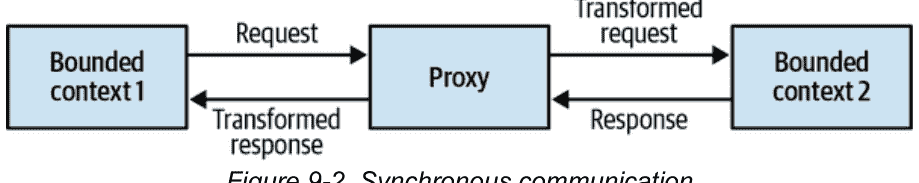

在某些情况下，将翻译逻辑卸载到外部组件（如 API 网关模式）可能更具成本效益和便利性。API 网关组件可以是基于开源软件的解决方案，如 Kong 或 KrakenD，也可以是云厂商的托管服务，如 AWS API Gateway、Google Apigee 或 Azure API Management。

对于实现开放主机模式的有界上下文，API 网关负责将内部模型转换为集成优化的发布语言。此外，拥有明确的 API 网关可以减轻管理和提供有界上下文 API 多个版本的过程，如图 9-3 所示。

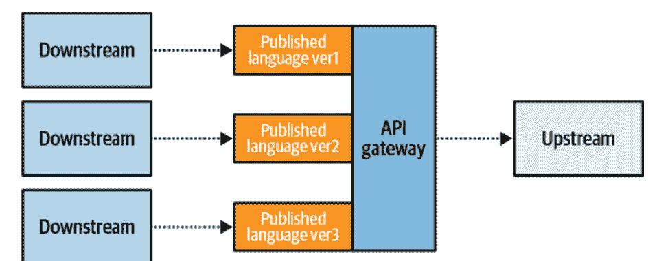

图 9-3. 暴露发布语言的不同版本

使用 API 网关实现的反腐败层可以被多个下游有界上下文消费。在这种情况下，反腐败层充当集成特定的有界上下文，如图 9-4 所示。

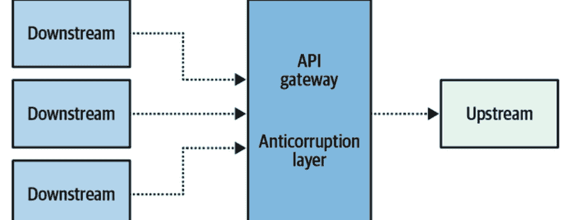

图 9-4. 共享反腐败层

此类有界上下文主要负责为其他组件更方便地消费而转换模型，通常被称为互换上下文。

### 异步

要翻译异步通信中使用的模型，可以实现消息代理：一个订阅来自源有界上下文的消息的中间组件。代理将应用所需的模型转换并将结果消息转发给目标订阅者（见图 9-5）。


图 9-5. 异步通信中翻译模型

除了翻译消息的模型外，拦截组件还可以过滤掉无关消息，从而减少目标有界上下文的噪音。

异步模型翻译对于实现开放主机服务至关重要。设计并暴露模型对象的发布语言并允许领域事件按原样发布，从而暴露有界上下文的实现模型，这是一个常见的错误。异步翻译可用于拦截领域事件并将其转换为发布语言，从而更好地封装有界上下文的实现细节（见图 9-6）。

此外，将消息翻译为发布语言可以区分旨在满足有界上下文内部需求的私有事件和为与其他有界上下文集成而设计的公共事件。我们将在第 15 章中重新讨论并扩展私有/公共事件的话题，在那里我们讨论领域驱动设计与事件驱动架构之间的关系。

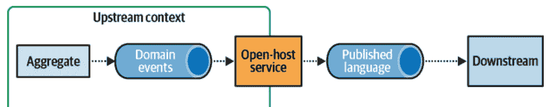

图 9-6. 发布语言中的领域事件

### 有状态模型翻译

对于更重要的模型转换——例如，当转换机制必须聚合源数据或将来自多个源的数据统一为单个模型时——可能需要有状态翻译。让我们详细讨论这些用例。

### 聚合传入数据

假设一个有界上下文有兴趣聚合传入请求并以批处理方式处理它们以优化性能。在这种情况下，聚合可能同时适用于同步和异步请求（见图 9-7）。

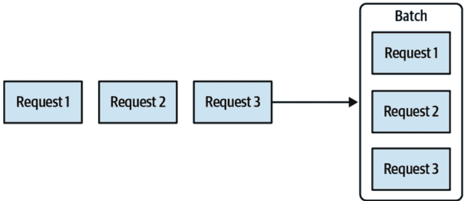

图 9-7. 批处理请求

聚合源数据的另一个常见用例是将多个细粒度消息合并为包含统一数据的单个消息，如图 9-8 所示。

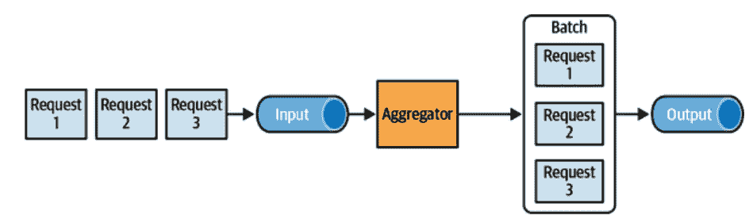

图 9-8. 统一传入事件

聚合传入数据的模型转换无法使用 API 网关实现，因此需要更复杂的有状态处理。为了跟踪传入数据并相应地处理它，翻译逻辑需要自己的持久存储（见图 9-9）。

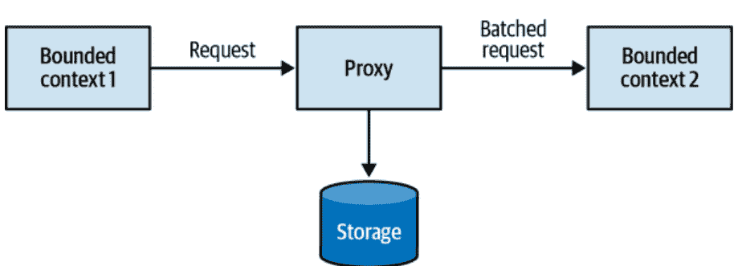

图 9-9. 有状态模型转换

在某些用例中，可以通过使用现成产品来避免为有状态翻译实现自定义解决方案；例如，流处理平台（Kafka、AWS Kinesis 等），或批处理解决方案（Apache NiFi、AWS Glue、Spark 等）。

### 统一多个源

有界上下文可能需要处理来自多个源的数据聚合，包括其他有界上下文。一个典型的例子是后端为前端模式¹，其中用户界面必须组合来自多个服务的数据。

另一个例子是有界上下文必须处理来自多个其他上下文的数据并实现复杂的业务逻辑来处理所有数据。在这种情况下，通过反腐败层前端有界上下文以聚合来自所有其他有界上下文的数据，从而解耦集成和业务逻辑复杂性是有益的，如图 9-10 所示。

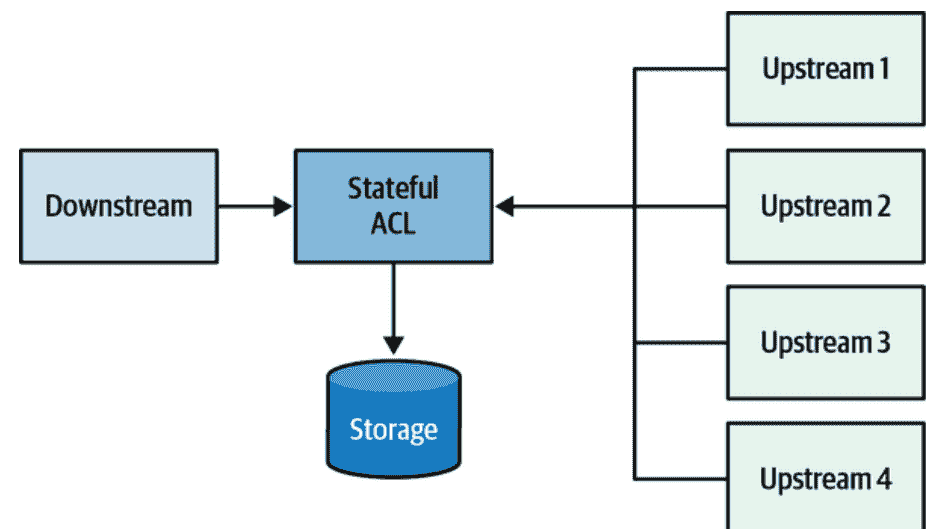

图 9-10. 使用反腐败层模式简化集成模型

### 集成聚合

在第 6 章中，我们讨论了聚合与系统其余部分通信的方式之一是通过发布领域事件。外部组件可以订阅这些领域事件并执行其逻辑。但领域事件是如何发布到消息总线的呢？

在找到解决方案之前，让我们检查事件发布过程中的一些常见错误以及每种方法的后果。考虑以下代码：


```
01 public class Campaign
02 {
03     ...
04     List<DomainEvent> _events;
05     IMessageBus _messageBus;
06     ...
07
08     public void Deactivate(string reason)
09     {
10         for (l in _locations.Values())
11         {
12             l.Deactivate();
13         }
14
15         IsActive = false;
16
17         var newEvent = new CampaignDeactivated(_id, reason);
18         _events.Append(newEvent);
19         _messageBus.Publish(newEvent);
20     }
21 }
```

第 17 行，实例化了一个新的事件。在接下来的两行中，它被追加到聚合的内部领域事件列表中（第 18 行），并且事件被发布到消息总线（第 19 行）。这种发布领域事件的实现方式很简单，但也是错误的。直接从聚合中发布领域事件有两点不好。第一，事件会在聚合的新状态提交到数据库之前就被分发。订阅者可能会收到广告活动已停用的通知，但这与广告活动的当前状态相矛盾。第二，如果数据库事务因竞争条件、后续聚合逻辑使操作无效，或数据库本身的技术问题而未能提交怎么办？即使数据库事务被回滚，事件已经被发布并推送给订阅者，且无法撤回。

让我们尝试另一种做法：

```
01 public class ManagementAPI
02 {
03     ...
04     private readonly IMessageBus _messageBus;
05     private readonly ICampaignRepository _repository;
06     ...
07     public ExecutionResult DeactivateCampaign(CampaignId id,
string reason)
08     {
09         try
10         {
11             var campaign = repository.Load(id);
12             campaign.Deactivate(reason);
13             _repository.CommitChanges(campaign);
14
15             var events = campaign.GetUnpublishedEvents();
16             for (IDomainEvent e in events)
17             {
18                 _messageBus.publish(e);
19             }
20             campaign.ClearUnpublishedEvents();
21         }
22         catch(Exception ex)
23         {
24             ...
25         }
26     }
27 }
```

在前面的代码清单中，发布新领域事件的职责被转移到了应用层。在第 11 行到第 13 行，加载了 Campaign 聚合的相关实例，执行其 Deactivate 命令，并且只有在更新后的状态成功提交到数据库之后，才在第 15 行到第 20 行将新的领域事件发布到消息总线。我们能信任这段代码吗？不能。

在这种情况下，运行逻辑的进程由于某种原因未能发布领域事件。也许消息总线宕机了。或者服务器在提交数据库事务后、发布事件前就宕机了，系统仍会处于不一致的状态，这意味着数据库事务已提交，但领域事件永远不会被发布。

这些边界情况可以使用 Outbox 模式来解决。

### Outbox

Outbox 模式（图 9-11）通过以下算法确保领域事件的可靠发布：

- 更新后的聚合状态和新的领域事件在同一个原子事务中提交。
- 消息中继从数据库中获取新提交的领域事件。
- 中继将领域事件发布到消息总线。
- 发布成功后，中继要么在数据库中将事件标记为已发布，要么完全删除它们。

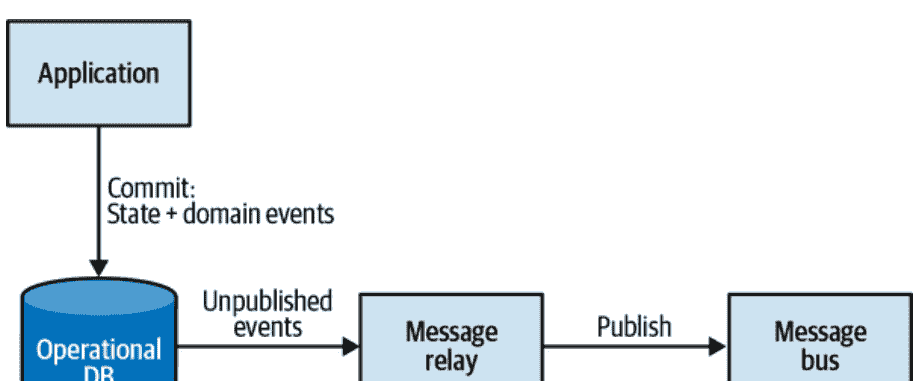

图 9-11. Outbox 模式

在使用关系型数据库时，方便利用数据库原子提交到两个表的特性，并使用专用表来存储消息，如图 9-12 所示。

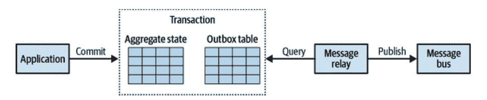

图 9-12. Outbox 表

在使用不支持多文档事务的 NoSQL 数据库时，传出的领域事件必须嵌入到聚合的记录中。例如：

```
{
  "campaign-id": "364b33c3-2171-446d-b652-8e5a7b2be1af",
  "state": {
    "name": "Autumn 2017",
    "publishing-state": "DEACTIVATED",
    "ad-locations": [
      ...
    ]
    ...
  },
  "outbox": [
    {
      "campaign-id": "364b33c3-2171-446d-b652-8e5a7b2be1af",
      "type": "campaign-deactivated",
      "reason": "Goals met",
      "published": false
    }
  ]
}
```

在此示例中，你可以看到 JSON 文档的额外属性 outbox，其中包含需要发布的领域事件列表。

### 获取未发布的事件

发布中继可以通过拉取或推送的方式获取新的领域事件：

Pull: 轮询发布者

中继可以持续查询数据库以查找未发布的事件。必须建立适当的索引，以最小化持续轮询对数据库造成的负载。

#### Push: 事务日志尾部追踪

这里我们可以利用数据库的功能集，在新事件被追加时主动调用发布中继。例如，一些关系型数据库通过尾部追踪数据库事务日志来启用对更新/插入记录的通知。一些 NoSQL 数据库将已提交的更改作为事件流公开（例如 AWS DynamoDB Streams）。

需要注意的是，Outbox 模式保证消息至少被传递一次：如果中继在发布消息后、但在数据库中将其标记为已发布之前失败，同一条消息将在下一次迭代中再次发布。

接下来，我们将看看如何利用领域事件的可靠发布来克服聚合设计原则所施加的一些限制。

### Saga

聚合设计的核心原则之一是将每个事务限制为单个聚合实例。这确保了聚合的边界得到仔细考虑，并封装了一致的业务功能集。但在某些情况下，你必须实现跨多个聚合的业务流程。

考虑以下示例：当广告活动被激活时，它应自动将其广告素材提交给其发布商。在收到发布商的确认后，广告活动的发布状态应更改为已发布。在被发布商拒绝的情况下，广告活动应被标记为已拒绝。

此流程跨越两个业务实体：广告活动和发布商。将实体放在同一个聚合边界中绝对是过度设计，因为这些显然是不同的业务实体，具有不同的职责，可能属于不同的有界上下文。相反，此流程可以作为 Saga 实现。

Saga 是一个长期的业务流程。它在时间上不一定长，Saga 可以运行数秒到数年，而是在事务层面：跨多个事务的业务流程。事务不仅可以由聚合处理，也可以由任何发出领域事件并响应命令的组件处理。Saga 监听相关组件发出的事件，并向其他组件发出后续命令。如果其中一个执行步骤失败，Saga 负责发出相关的补偿操作以确保系统状态保持一致。

让我们看看如何将前述示例中的广告活动发布流程实现为 Saga，如图 9-13 所示。

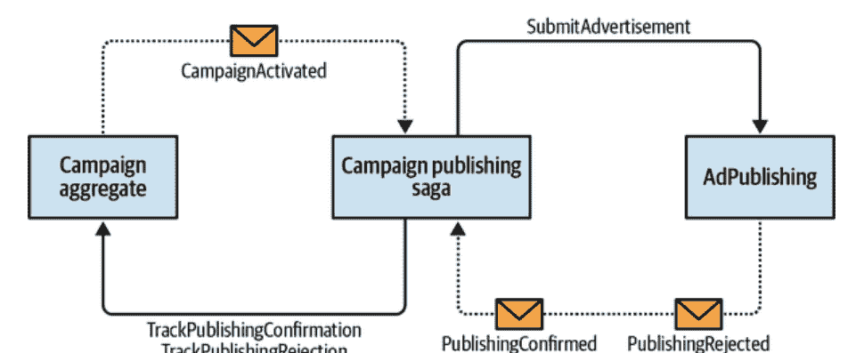

图 9-13. Saga

为了实现发布流程，Saga 必须监听来自 Campaign 聚合的 CampaignActivated 事件以及来自 AdPublishing 有界上下文的 PublishingConfirmed 和 PublishingRejected 事件。Saga 必须在 AdPublishing 上执行 Submit Advertisement 命令，并在 Campaign 聚合上执行 TrackPublishing Confirmation 和 TrackPublishingRejection 命令。在此示例中，TrackPublishingRejection 命令充当补偿操作，确保广告活动不会被列为活动状态。以下是代码：

```
public class CampaignPublishingSaga
{
    private readonly ICampaignRepository _repository;
    private readonly IPublishingServiceClient _publishingService;
    ...

    public void Process(CampaignActivated @event)
    {
        var campaign = _repository.Load(@event.CampaignId);
        var advertisingMaterials = campaign.GenerateAdvertisingMaterials();
        _publishingService.SubmitAdvertisement(@event.CampaignId, advertisingMaterials);
    }

    public void Process(PublishingConfirmed @event)
```


```
{
    var campaign = _repository.Load(@event.CampaignId);
    campaign.TrackPublishingConfirmation(@event.ConfirmationId);
    _repository.CommitChanges(campaign);
}

public void Process(PublishingRejected @event)
{
    var campaign = _repository.Load(@event.CampaignId);
    campaign.TrackPublishingRejection(@event.RejectionReason);
    _repository.CommitChanges(campaign);
}
}
```

前面的示例依赖于消息基础设施来传递相关事件，并通过执行相关命令来对事件做出反应。这是一个相对简单的 saga 的示例：它没有状态。你将会遇到需要状态管理的 saga；例如，为了跟踪已执行的业务操作，以便在失败时可以发出相关的补偿操作。在这种情况下，saga 可以实现为事件溯源聚合，持久化接收到的事件和已发出命令的完整历史。然而，命令执行逻辑应移出 saga 本身并异步执行，类似于在 outbox 模式中分派领域事件的方式：

```
public class CampaignPublishingSaga
{
    private readonly ICampaignRepository _repository;
    private readonly IList<IDomainEvent> _events;
    ...

    public void Process(CampaignActivated activated)
    {
        var campaign = _repository.Load(activated.CampaignId);
        var advertisingMaterials = campaign.GenerateAdvertisingMaterials();
        var commandIssuedEvent = new CommandIssuedEvent(
            target: Target.PublishingService,
            command: new SubmitAdvertisementCommand(activated.CampaignId,
```

```
advertisingMaterials));
    _events.Append(activated);
    _events.Append(commandIssuedEvent);
}
public void Process(PublishingConfirmed confirmed)
{
    var commandIssuedEvent = new CommandIssuedEvent(
        target: Target.CampaignAggregate,
        command: new TrackConfirmation(confirmed.CampaignId,
            confirmed.ConfirmationId));

    _events.Append(confirmed);
    _events.Append(commandIssuedEvent);
}
public void Process(PublishingRejected rejected)
{
    var commandIssuedEvent = new CommandIssuedEvent(
        target: Target.CampaignAggregate,
        command: new TrackRejection(rejected.CampaignId,
            rejected.RejectionReason));

    _events.Append(rejected);
    _events.Append(commandIssuedEvent);
}
}
```

在此示例中，outbox relay 将需要为每个 CommandIssuedEvent 实例在相关端点上执行命令。与发布领域事件的情况一样，将 saga 状态的转换与命令的执行分离可确保命令能够可靠地执行，即使在任何阶段进程失败也是如此。

### 一致性

尽管 saga 模式编排了多组件事务，但所涉及组件的状态是最终一致的。并且尽管 saga 最终会执行相关命令，但不能将任何两个事务视为原子操作。这与另一个聚合设计原则相关：

> *只能将聚合边界内的数据视为强一致。边界之外的一切都是最终一致的。*

将此作为指导原则，以确保你没有滥用 saga 来弥补不当的聚合边界。必须属于同一聚合的业务操作需要强一致的数据。

saga 模式经常被误认为是另一个模式：流程管理器。尽管实现相似，但它们是不同的模式。在下一节中，我们将讨论流程管理器模式的目的以及它与 saga 模式的区别。

### 流程管理器

saga 模式管理简单的线性流程。严格来说，saga 将事件匹配到对应的命令。在我们用于演示 saga 实现的示例中，我们实际上实现了事件到命令的简单匹配：

- CampaignActivated 事件到 PublishingService.SubmitAdvertisement 命令
- PublishingConfirmed 事件到 Campaign.TrackConfirmation 命令
- PublishingRejected 事件到 Campaign.TrackRejection 命令

流程管理器模式，如图 9-14 所示，旨在实现基于业务逻辑的流程。它被定义为维护序列状态并确定下一步处理步骤的中央处理单元。²

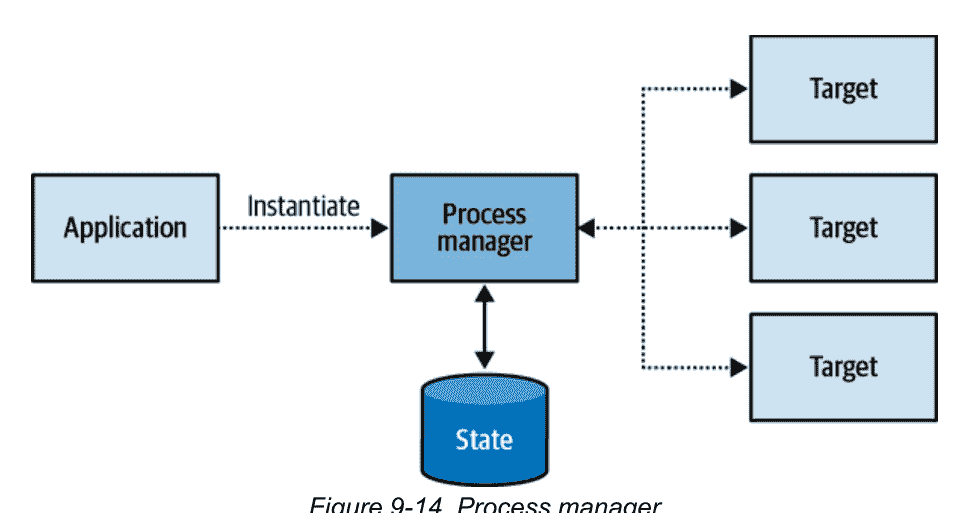

图 9-14. 流程管理器

作为一个简单的经验法则，如果 saga 包含 if-else 语句来选择正确的行动方案，那么它很可能是一个流程管理器。

流程管理器与 saga 之间的另一个区别是，saga 在观察到特定事件时会被隐式实例化，如前例中的 CampaignActivated。另一方面，流程管理器不能绑定到单一的源事件。相反，它是一个由多个步骤组成的一致的业务流程。因此，流程管理器必须被显式实例化。考虑以下示例：

预订商务旅行始于路由算法选择最具成本效益的航班路线并要求员工批准。如果员工更喜欢不同的路线，则需要其直属经理批准。航班预订后，必须为适当日期预订预批准的酒店之一。如果没有酒店可用，则必须取消机票。

在此示例中，没有中央实体来触发旅行预订流程。旅行预订就是流程，它必须实现为流程管理器（见图 9-15）。

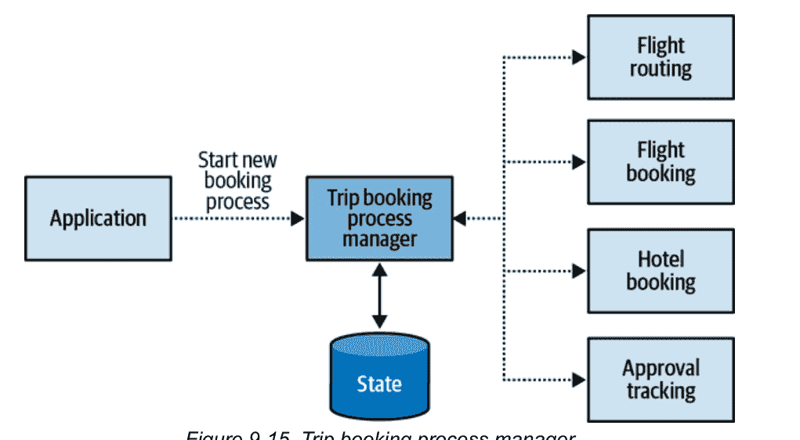

图 9-15. 旅行预订流程管理器

从实现角度来看，流程管理器通常实现为聚合，要么基于状态，要么基于事件溯源。例如：

```
public class BookingProcessManager
{
    private readonly IList<IDomainEvent> _events;
    private BookingId _id;
    private Destination _destination;
    private TripDefinition _parameters;
    private EmployeeId _traveler;
    private Route _route;
    private IList<Route> _rejectedRoutes;
    private IRoutingService _routing;
    ...

    public void Initialize(Destination destination,
                          TripDefinition parameters,
                          EmployeeId traveler)
    {
        _destination = destination;
        _parameters = parameters;
        _traveler = traveler;
        _route = _routing.Calculate(destination, parameters);
    }
```

```
var routeGenerated = new RouteGeneratedEvent(
    BookingId: _id,
    Route: _route);

var commandIssuedEvent = new CommandIssuedEvent(
    command: new RequestEmployeeApproval(_traveler, _route)
);

_events.Append(routeGenerated);
_events.Append(commandIssuedEvent);
}

public void Process(RouteConfirmed confirmed)
{
    var commandIssuedEvent = new CommandIssuedEvent(
        command: new BookFlights(_route, _parameters)
    );

    _events.Append(confirmed);
    _events.Append(commandIssuedEvent);
}

public void Process(RouteRejected rejected)
{
    var commandIssuedEvent = new CommandIssuedEvent(
        command: new RequestRerouting(_traveler, _route)
    );

    _events.Append(rejected);
    _events.Append(commandIssuedEvent);
}

public void Process(ReroutingConfirmed confirmed)
{
    _rejectedRoutes.Append(route);
    _route = _routing.CalculateAltRoute(destination,
                                        parameters,
    rejectedRoutes);
    var routeGenerated = new RouteGeneratedEvent(
        BookingId: _id,
        Route: _route);

    var commandIssuedEvent = new CommandIssuedEvent(
        command: new RequestEmployeeApproval(_traveler, _route)
```

```
);

_events.Append(confirmed);
_events.Append(routeGenerated);
_events.Append(commandIssuedEvent);
}

public void Process(FlightBooked booked)
{
    var commandIssuedEvent = new CommandIssuedEvent(
        command: new BookHotel(_destination, _parameters)
    );

    _events.Append(booked);
    _events.Append(commandIssuedEvent);
}

... 
}
```

在此示例中，流程管理器具有显式的 ID 和持久状态，描述了需要预订的旅行。与 saga 模式的早期示例一样，流程管理器订阅控制工作流的事件（RouteConfirmed、RouteRejected、ReroutingConfirmed 等），并实例化类型为 Command IssuedEvent 的事件，这些事件将由 outbox relay 处理以执行实际命令。

### 结论

在本章中，你学习了集成系统组件的不同模式。章节首先探讨了可用于实现反腐败层或开放主机服务的模型转换模式。我们看到转换可以即时处理，也可以遵循更复杂的逻辑，需要状态跟踪。

outbox 模式是发布聚合领域事件的可靠方式。它确保领域事件始终会被


published, even in the face of different process failures.

Saga 模式可用于实现简单的跨组件业务流程。更复杂的业务流程可使用流程管理器模式来实现。两种模式都依赖于对领域事件的异步反应以及命令的发出。

### Exercises

+   1. 哪种有界上下文集成模式需要实现模型转换逻辑？
+      a. 顺从者
+      b. 反腐败层
+      c. 开放主机服务
+      d. B 和 C
+   2. 出箱模式的目标是什么？
+      a. 将消息基础设施与系统的业务逻辑层解耦
+      b. 可靠地发布消息
+      c. 支持事件溯源领域模型模式的实现
+      d. A 和 C
+   3. 除了向消息总线发布消息之外，出箱模式还有哪些其他可能的用例？
+   4. Saga 模式和流程管理器模式有什么区别？

+   a. 流程管理器需要显式实例化，而 Saga 在相关领域事件发布时执行。
+   
+   b. 与流程管理器相反，Saga 从不要求其执行状态的持久化。
+   
+   c. Saga 要求其操作的组件实现事件溯源模式，而流程管理器不需要。
+   
+   d. 流程管理器模式适用于复杂的业务工作流。
+   
+   e. A 和 D 正确。

1 Richardson, C. (2019). *Microservice Patterns: With Examples in Java*. New York: Manning Publications.

2 Hohpe, G., & Woolf, B. (2003). *Enterprise Integration Patterns: Designing, Building, and Deploying Messaging Solutions*. Boston: Addison-Wesley.
