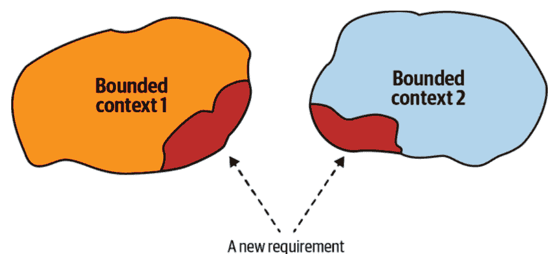
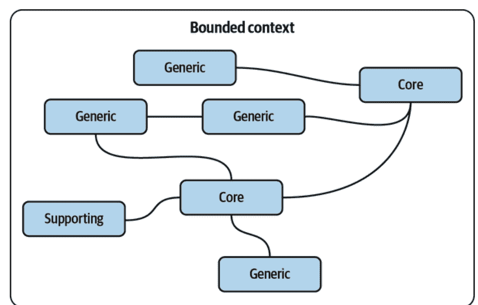
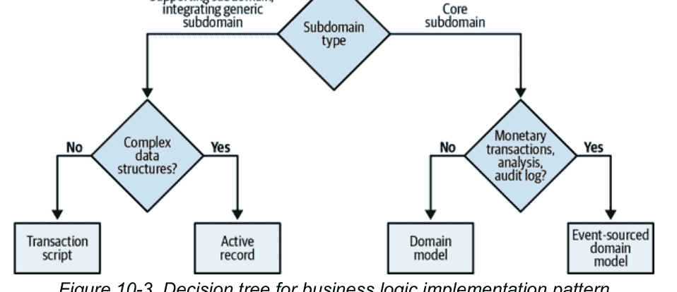
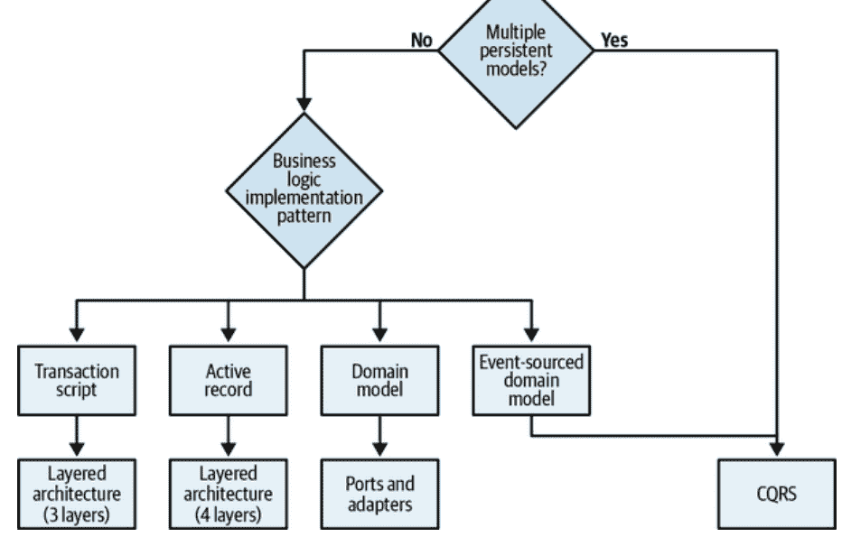
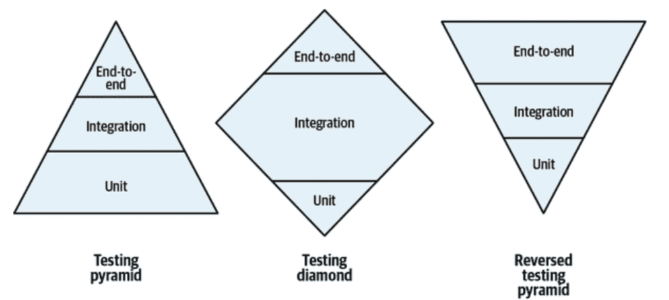
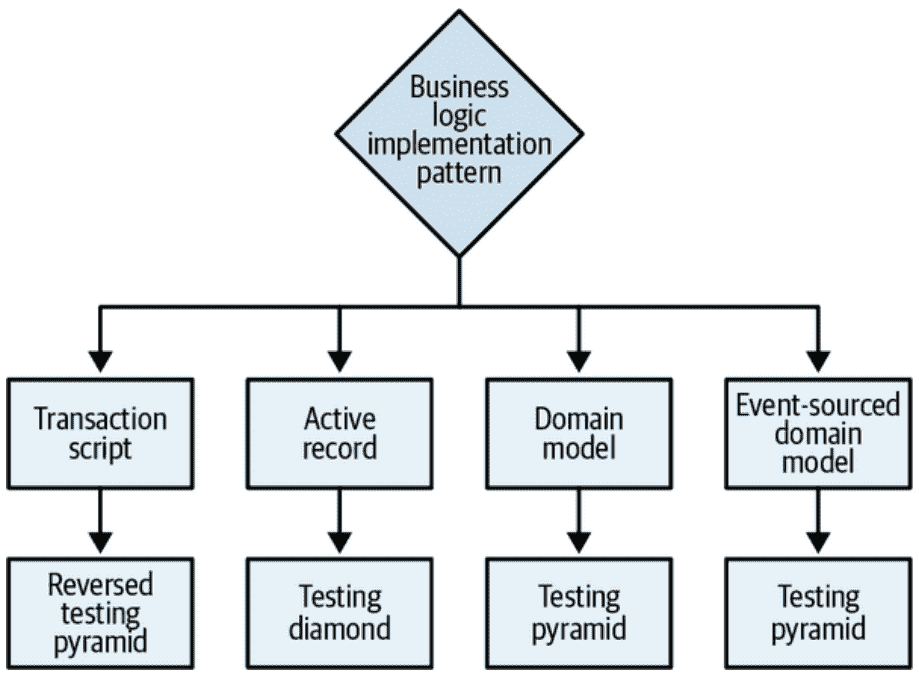
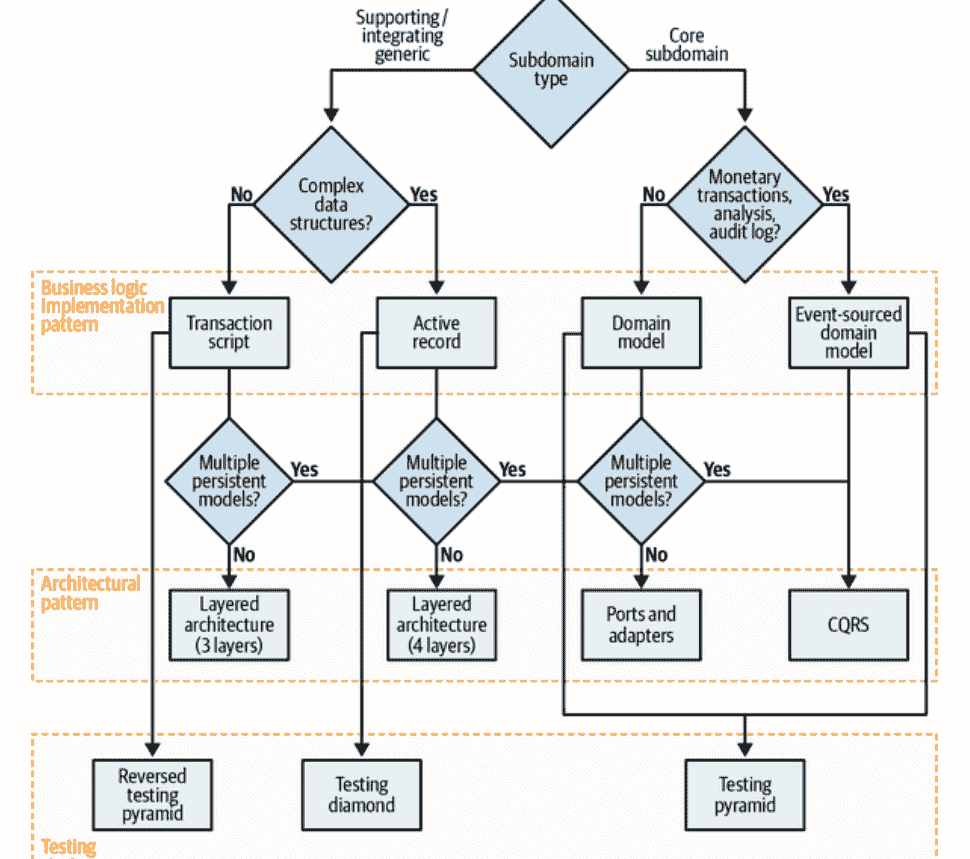

## Chapter 10. Design Heuristics

“视情况而定”是软件工程中几乎任何问题的正确回答，但并不实用。在本章中，我们将探讨“它”取决于什么。

在本书的第一部分，你学习了用于分析业务域并做出战略设计决策的领域驱动设计工具。在第二部分，我们探讨了战术设计模式：实现业务逻辑、组织系统架构以及建立系统组件之间通信的不同方式。本章架起了第一部分和第二部分之间的桥梁。你将学习将分析工具应用于驱动各种软件设计决策的经验法则：即（业务）领域驱动（软件）设计。

但首先，由于本章是关于设计经验法则的，让我们先定义一下经验法则这个术语。

#### Heuristic

经验法则并不是一种保证正确且在 100% 的情况下经过数学证明的硬性规则。相反，它是一种经验法则：不保证完美，但足以满足即时目标。换句话说，使用经验法则是一种有效的解决问题方法，它忽略了许多线索中固有的噪音，而是专注于最重要的线索所反映的“压倒性因素”。¹

本章中介绍的经验法则关注不同业务域的基本属性以及各种设计决策所解决问题的本质。

#### Bounded Contexts

正如你在第 3 章中所回忆的那样，宽边界和窄边界都符合有效有界上下文的定义，该上下文涵盖一致的通用语言。但仍然，有界上下文的最佳大小是多少？这个问题在有界上下文经常被等同于微服务的背景下尤其重要。²

我们是否应该始终追求尽可能小的有界上下文？正如我的朋友 Nick Tune 所说：

> 定义服务边界有很多有用且富有启发性的经验法则。大小是最没用的其中之一。

与其让模型成为期望大小的函数——优化为小的有界上下文——更有效的做法是反其道而行之：将有界上下文的大小视为其所包含模型的函数。

影响多个有界上下文的软件变更代价高昂，需要大量协调，尤其是当受影响的有界上下文由不同团队实现时。这种未封装在单个有界上下文中的变更表明上下文边界设计无效。不幸的是，重构有界上下文边界是一项昂贵的任务，在许多情况下，无效的边界得不到关注，最终会累积技术债务（见图 10-1）。

图 10-1. 影响多个有界上下文的变更

使有界上下文边界失效的变更通常发生在业务域不为人所知或业务需求频繁变化时。正如你在第 1 章中所学到的，不稳定性和不确定性是核心子域的属性，尤其是在实施的早期阶段。我们可以将其用作设计有界上下文边界的经验法则。

宽泛的有界上下文边界，或涵盖多个子域的边界，使我们对边界或所包含子域的模型判断错误时更安全。重构逻辑边界比重构物理边界便宜得多。因此，在设计有界上下文时，先从更宽的边界开始。如果需要，随着领域知识的积累，可将宽边界分解为更小的边界。

该经验法则主要适用于涵盖核心子域的有界上下文，因为通用和支持子域更公式化且波动性小得多。在创建包含核心子域的有界上下文时，你可以通过包含核心子域最常交互的其他子域来保护自己免受不可预见的变更影响。这可以是其他核心子域，甚至是支持和通用子域，如图 10-2 所示。

图 10-2. 宽有界上下文边界

#### Business Logic Implementation Patterns

在第 5–7 章中，我们详细讨论了业务逻辑，你学习了四种不同的业务逻辑建模方式：事务脚本、活动记录、领域模型和事件溯源领域模型模式。

事务脚本和活动记录模式更适合具有简单业务逻辑的子域，例如支持子域或为通用子域集成第三方解决方案。两种模式之间的区别在于数据结构的复杂性。事务脚本模式可用于简单数据结构，而活动记录模式有助于将复杂数据结构映射到底层数据库进行封装。

领域模型及其变体事件溯源领域模型适用于具有复杂业务逻辑的子域：

核心子域。处理货币交易、依法必须提供审计日志，或需要对系统行为进行深度分析的核心子域，更适合采用事件溯源领域模型。

综合以上考虑，选择合适的业务逻辑实现模式的有效启发式方法是提出以下问题：

- 子域是否跟踪货币或其他货币交易，或必须提供一致的审计日志，或业务需要对其行为进行深度分析？如果是，则使用事件溯源领域模型。否则...
- 子域的业务逻辑是否复杂？如果是，则实现领域模型。否则...
- 子域是否包含复杂的数据结构？如果是，则使用活动记录模式。否则...
- 实现事务脚本。

由于子域的复杂性与其类型之间存在很强的关联，我们可以使用领域驱动的决策树来可视化这些启发式方法，如图 10-3 所示。

图 10-3. 业务逻辑实现模式决策树

我们可以用另一个启发式方法来定义复杂和简单业务逻辑之间的差异。这两种业务逻辑之间的界限并不十分清晰，但很有用。一般来说，复杂的业务逻辑包括复杂的业务规则、不变量和算法。简单的方法主要围绕验证输入展开。评估复杂性的另一个启发式方法涉及通用语言本身的复杂性。它主要描述 CRUD 操作，还是描述更复杂的业务流程和规则？

根据业务逻辑及其数据结构的复杂性来决定业务逻辑实现模式，是验证你对子域类型假设的一种方式。假设你认为它是核心子域，但最佳模式是活动记录或事务脚本。或者假设你认为的支持子域需要领域模型或事件溯源领域模型；在这种情况下，这是一个重新审视你对子域和业务域总体假设的绝佳机会。请记住，核心子域的竞争优势不一定是技术性的。

### 架构模式

在第 8 章中，你学习了三种架构模式：分层架构、端口与适配器和 CQRS。

了解预期的业务逻辑实现模式后，选择架构模式就变得简单明了：

- 事件溯源领域模型需要 CQRS。否则，系统在数据查询选项上将受到极大限制，只能通过 ID 获取单个实例。
- 领域模型需要端口与适配器架构。否则，分层架构会使聚合和值对象难以对持久化一无所知。
- 活动记录模式最好配合分层架构并额外增加应用层。用于控制活动记录的逻辑。
- 事务脚本模式可以用最小的分层架构实现，仅包含三层。

上述启发式的唯一例外是 CQRS 模式。CQRS 不仅对事件溯源领域模型有益，对于任何其他模式，如果子域需要以多种持久化模型表示其数据，也同样有益。

图 10-4 显示了基于这些启发式方法选择架构模式的决策树。

图 10-4. 架构模式决策树

### 测试策略

对业务逻辑实现模式和架构模式的了解可以作为选择代码库测试策略的启发式方法。请看图 10-5 所示的三种测试策略。

图 10-5. 测试策略

图中测试策略之间的区别在于它们对不同类型测试的侧重：单元、集成和端到端。让我们分析每种策略以及每种模式应使用的上下文。

#### 测试金字塔

经典的测试金字塔强调单元测试，集成测试较少，端到端测试更少。领域模型模式的两种变体最适合采用测试金字塔。聚合和值对象是有效测试业务逻辑的完美单元。

#### 测试菱形

测试菱形最侧重于集成测试。当使用活动记录模式时，系统的业务逻辑按定义分布在服务层和业务逻辑层之间。因此，为了侧重于集成这两个层，测试金字塔是更有效的选择。

#### 反向测试金字塔

反向测试金字塔将最多的关注放在端到端测试上：验证应用程序从头到尾的工作流程。这种方法最适合实现事务脚本模式的代码库：业务逻辑简单且层数最少，因此更有效地验证系统的端到端流程。

图 10-6 显示了测试策略决策树。

图 10-6. 测试策略决策树

### 战术设计决策树

业务逻辑模式、架构模式和测试策略启发式方法可以统一并总结为战术设计决策树，如图 10-7 所示。

图 10-7. 战术设计决策树

正如你所见，识别子域类型并遵循决策树，可以为做出基本设计决策提供坚实起点。话虽如此，重要的是要重申，这些是启发式方法，而非硬性规则。每条规则都有例外，更不用说启发式方法了，它们按定义并非 intended 在 100% 的情况下都正确。

决策树基于我更喜欢使用简单工具，并在绝对必要时才求助于高级模式——领域模型、事件溯源领域模型、CQRS 等。另一方面，我遇到过一些团队在实现事件溯源领域模型方面经验丰富，因此将其用于所有子域。对他们来说，这比使用不同模式更简单。我能向每个人推荐这种方法吗？当然不能。在我工作或咨询过的公司中，基于启发式的方法比对每个问题使用相同的解决方案更有效。

归根结底，这取决于你的具体背景。使用图 10-7 所示的决策树及其所基于的设计启发式方法作为指导原则，但不要将其作为批判性思维的替代品。如果你发现其他启发式方法更适合你，请随意修改指导原则或完全构建自己的决策树。

### 结论

本章将本书的第一部分和第二部分连接起来，形成一个基于启发式的决策框架。你学习了如何将对业务域及其子域的知识应用于驱动技术决策：选择安全的有界上下文边界、建模应用程序的业务逻辑，以及确定实现每个有界上下文内部组件交互所需的架构模式。最后，我们转向了一个经常成为激烈争论的主题——哪种测试更重要——并使用相同的框架根据业务域对不同测试进行优先级排序。

做出设计决策很重要，但更重要的是随着时间的推移验证决策的有效性。在下一章中，我们将把讨论转移到软件设计生命周期的下一个阶段：设计决策的演进。

## 练习

- 1. 假设你正在实现 WolfDesk 的工单生命周期管理系统。参见前言。它是一个需要对其行为进行深度分析以便随着时间推移进一步优化算法的核心子域。你对业务逻辑和组件架构的初始实现策略是什么？你的测试策略是什么？
- 2. 你对 WolfDesk 支持代理的班次管理模块的设计决策是什么？
- 3. 为了简化代理班次管理，你想使用外部提供商提供不同地理区域的公共假日。流程是通过定期调用外部提供商并获取即将到来的公共假日的日期和名称。你将使用什么业务逻辑和架构模式来实现集成？你将如何测试它？
- 4. 基于你的经验，软件开发过程的哪些其他方面可以纳入本章介绍的基于启发式的决策树中？

1 Gigerenzer, G., Todd, P. M., & ABC Research Group (Research Group, Max Planck Institute, Germany). (1999). Simple Heuristics That Make Us Smart. New York: Oxford University Press.

2 第 11 章专门讨论有界上下文与微服务之间的相互作用。

