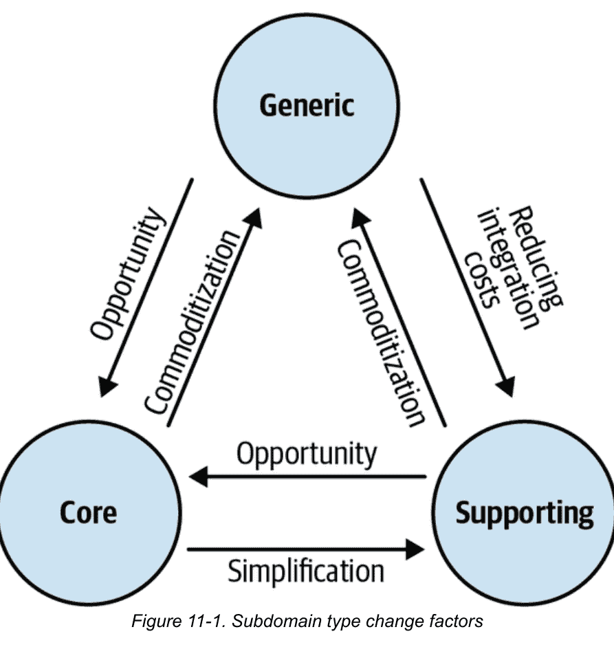
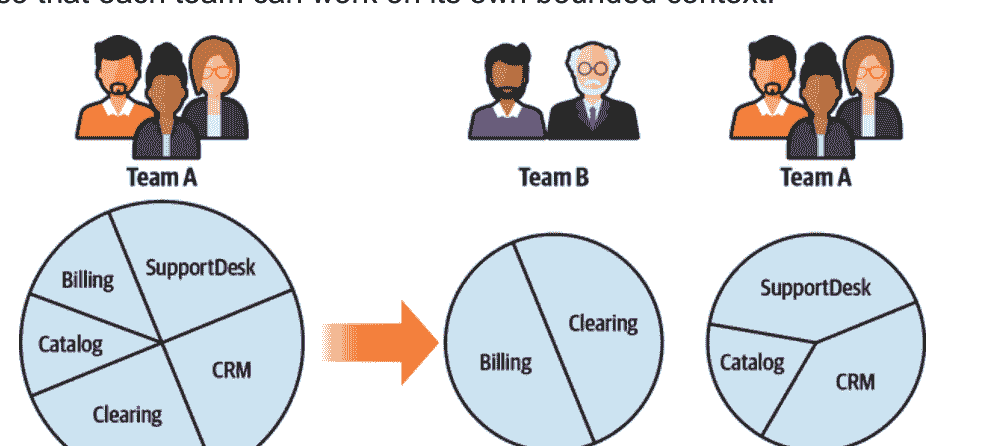
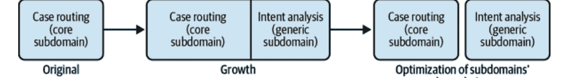

## 第11章 进化中的设计决策

在我们所处的现代快节奏世界中，企业无法承受迟缓。为了跟上竞争，他们必须不断地改变、进化，甚至随着时间的推移重新发明自己。在设计系统时，尤其是当我们打算设计与业务领域需求高度适配的软件时，我们不能忽视这一事实。当变化没有得到妥善管理时，即使是最精妙、最深思熟虑的设计最终也会变得难以维护和演进。本章讨论软件项目环境的变化如何影响设计决策，以及如何相应地演进设计。我们将考察四种最常见的变化向量：业务领域、组织结构、领域知识和增长。

### 领域的变化

在第2章中，你已经了解了三种类型的业务子域，以及它们之间的不同之处：

Core

公司与竞争对手相比执行不同的活动，以获得竞争优势

Supporting

公司与竞争对手相比做的事情不同，但不提供竞争优势

Generic

所有公司都以相同方式做的事情

在之前的章节中，你看到子域的类型会影响战略和战术设计决策：

- 如何设计有界上下文的边界
- 如何在上下文之间编排集成
- 使用哪些设计模式来适应业务逻辑的复杂性

要设计以业务领域需求为驱动的软件，识别业务子域及其类型至关重要。然而，这还不是全部故事。同样重要的是要警惕子域的演变。随着组织的成长和演变，其某些子域从一种类型转变为另一种类型的情况并不少见。让我们来看一些此类变化的例子。

### 从核心到通用

想象一家名为 BuyIT 的在线零售公司一直在实施自己的订单配送解决方案。它开发了一种创新的算法来优化其快递员的配送路线，因此能够收取比竞争对手更低的配送费用。

有一天，另一家公司——DeliverIT——颠覆了配送行业。它声称已解决了“旅行商”问题，并提供路径优化即服务。DeliverIT 的优化不仅更先进，而且提供的价格仅为 BuyIT 执行相同任务成本的一小部分。

从 BuyIT 的角度来看，一旦 DeliverIT 的解决方案作为现成产品可用，其核心子域就转变为通用子域。结果，最优解决方案变得对 BuyIT 的所有竞争对手都可用。在没有大规模研发投资的情况下，BuyIT 不再能在路径优化子域中获得竞争优势。以前被认为是 BuyIT 竞争优势的东西已经变成所有竞争对手都可用的商品。

### 从通用到核心

自成立以来，BuyIT 一直使用现成解决方案来管理其库存。然而，其商业智能报告持续显示对客户需求的预测不足。因此，BuyIT 无法补充最受欢迎产品的库存，并浪费仓库空间在不受欢迎的产品上。在评估了几种替代库存管理解决方案后，BuyIT 的管理团队做出了战略决策，投资设计和构建内部系统。该内部解决方案将考虑 BuyIT 销售产品的复杂性，并对客户需求做出更好的预测。

BuyIT 决定用自己的实现替换现成解决方案，已将库存管理从通用子域转变为核心子域：该功能的成功实施将为 BuyIT 提供额外的竞争优势，而竞争对手将“困”在通用解决方案中，无法使用 BuyIT 发明和开发的先进需求预测算法。

将通用子域转变为核心子域的现实生活教科书案例是亚马逊。像所有服务提供商一样，亚马逊需要一个运行其服务的基础设施。该公司能够“重新发明”其物理基础设施的管理方式，后来甚至将其转变为盈利业务：亚马逊网络服务。

### 从支持到通用

BuyIT 的市场部门实施了一个用于管理其合作的供应商及其合同的系统。该系统没有什么特别或复杂之处——只是一些用于输入数据的 CRUD 用户界面。换句话说，它是一个典型的支持子域。

然而，在 BuyIT 开始实施内部解决方案几年后，一个开源合同管理解决方案问世了。该开源项目实现了与现有解决方案相同的功能，并且具有更先进的功能，如 OCR 和全文搜索。这些额外功能在 BuyIT 的待办事项中已存在很长时间，但由于其业务影响低而从未被优先考虑。因此，公司决定放弃内部解决方案，转而集成开源解决方案。这样一来，文档管理子域就从支持转变为通用子域。

### 从支持到核心

支持子域也可以转变为核心子域——例如，如果公司找到一种优化支持逻辑的方法，从而降低成本或产生额外利润。

这种转变的典型症状是支持子域业务逻辑复杂性的不断增加。支持子域按定义是简单的，主要类似于 CRUD 接口或 ETL 流程。然而，如果业务逻辑随着时间的推移变得更加复杂，就应该有原因导致这种额外复杂性。如果它不影响公司的利润，为什么会变得更复杂呢？那是偶然的业务复杂性。另一方面，如果它增强了公司的盈利能力，那就是支持子域正在成为核心子域的迹象。

### 从核心到支持

核心子域随着时间的推移可能成为支持子域。这可能发生在子域的复杂性得不到证实时。换句话说，它无利可图。在这种情况下，组织可能会决定削减多余的复杂性，只保留支持其他子域实施所需的最小逻辑。

### 从通用到支持

最后，出于与核心子域相同的原因，通用子域也可以转变为支持子域。回到 BuyIT 文档管理系统示例，假设公司已决定集成开源解决方案的复杂性无法证明其收益合理，并已改回内部系统。结果，通用子域已转变为支持子域。

我们刚刚讨论的子域变化在图 11-1 中有所体现。



图 11-1. 子域类型变化因素

### 战略设计问题

子域类型的变化直接影响其有界上下文，进而影响相应的战略设计决策。正如你在第4章中所学，不同的有界上下文集成模式适应不同的子域类型。核心子域必须通过反腐败层保护其模型，并通过发布语言保护消费者免受实现模型频繁变化的影响。

受此类变化影响的另一个集成模式是分离方式模式。正如你之前所见，团队可以对支持和通用子域使用此模式。如果子域演变为核心子域，多团队复制其功能已不再可接受。因此，团队别无选择，只能集成其实现。在这种情况下，客户-供应商关系将最有意义，因为核心子域将仅由一个团队实现。

从实施策略角度来看，核心和支持子域在如何实现方面有所不同。支持子域可以外包或用作新员工的“训练轮”。核心子域必须在内部实施，尽可能靠近领域知识来源。因此，当支持子域转变为核心子域时，其实施应移至内部。相同的逻辑反过来也适用。如果核心子域转变为支持子域，则可以外包实施，让内部研发团队专注于核心子域。

### 战术设计问题

子域类型变化的主要指标是现有技术设计无法支持当前业务需求。

让我们回到支持子域成为核心子域的示例。支持子域使用相对简单的设计模式来实现业务逻辑：即事务脚本或活动记录模式。正如你在第5章中所见，这些模式不适合涉及复杂规则和不变量的业务逻辑。

如果随着时间的推移向业务逻辑添加复杂的规则和不变量，代码库也会变得越来越复杂。添加新功能将变得痛苦，因为设计不支持新的复杂程度。这种“痛苦”是一个重要


signal. 用它作为重新评估业务领域和设计选择的契机。

实施策略需要改变并非需要恐惧的事情。这是正常的。我们无法预见业务未来会如何演进。我们也不能对所有类型的子域都应用最复杂的设计模式；那样会浪费且无效。我们必须选择最合适的设计，并在需要时对其进行演进。

如果对如何建模业务逻辑的决策是 consciously 作出的，并且你了解所有可能的设计选择及其之间的差异，那么从一种设计模式迁移到另一种设计模式并不会那么麻烦。以下小节强调了一些示例。

### 从事务脚本到活动记录

从核心来看，事务脚本和活动记录模式都基于同一原则：业务逻辑以过程式脚本实现。它们之间的区别在于数据结构建模方式：活动记录模式引入数据结构来封装将其映射到存储机制的复杂性。

因此，当在事务脚本中使用数据变得具有挑战性时，将其重构为活动记录模式。寻找复杂的数据结构并将其封装在活动记录对象中。不要直接访问数据库，而是使用活动记录来抽象其模型和结构。

### 从活动记录到领域模型

如果操作活动记录的业务逻辑变得复杂，并且你注意到不一致和重复的情况越来越多，则将实现重构为领域模型模式。

首先识别值对象。哪些数据结构可以建模为不可变对象？寻找相关的业务逻辑，并将其也作为值对象的一部分。

接下来，分析数据结构并寻找事务边界。为了确保所有状态修改逻辑都是显式的，使所有活动记录的 setter 为 private，以便它们只能从活动记录内部进行修改。显然，编译会失败；然而，编译错误会明确显示状态修改逻辑所在的位置。将它重构到活动记录的边界内。例如：

```
public class Player
{
    public Guid Id { get; set; }
    public int Points { get; set; }
}

public class ApplyBonus
{
    ...
    public void Execute(Guid playerId, byte percentage)
    {
        var player = _repository.Load(playerId);
        player.Points *= 1 + percentage/100.0;
        _repository.Save(player);
    }
}
```

在以下代码中，你可以看到向转换迈出的第一步。代码尚未编译，但错误会明确显示外部组件在控制对象的状态：

```
public class Player
{
```

```
public Guid Id { get; private set; }
public int Points { get; private set; }
}

public class ApplyBonus
{
    ...
    public void Execute(Guid playerId, byte percentage)
    {
        var player = _repository.Load(playerId);
        player.Points *= 1 + percentage/100.0;
        _repository.Save(player);
    }
}
```

在下一次迭代中，我们可以将该逻辑移入活动记录的边界内：

```
public class Player
{
    public Guid Id { get; private set; }
    public int Points { get; private set; }

    public void ApplyBonus(int percentage)
    {
        this.Points *= 1 + percentage/100.0;
    }
}
```

当所有状态修改的业务逻辑都移入相应对象的边界后，检查需要哪些层次结构以确保对业务规则和不变量进行强一致性检查。它们是聚合体的良好候选。牢记我们在第 6 章中讨论的聚合设计原则，寻找最小的事务边界，即你需要保持强一致性的最小数据量。沿着这些边界分解层次结构。确保外部聚合体仅通过其 ID 被引用。

最后，对于每个聚合体，确定其根，即其公共接口的入口点。使聚合体中所有其他内部对象的 方法为 private 并且只能从聚合体内部调用。

### 从领域模型到事件溯源领域模型

一旦你拥有具有适当设计的聚合边界的领域模型，就可以将其过渡到事件溯源模型。不要直接修改聚合的数据，而是建模表示聚合生命周期所需的领域事件。

将领域模型重构为事件溯源领域模型最具挑战性的方面是现有聚合的历史：迁移“ timeless ”状态到基于事件的模型。由于表示所有过去状态变化的细粒度数据并不存在，你必须尽力生成过去的事件或建模迁移事件。

### 生成过去的转换

这种方法意味着为每个聚合生成近似的事件流，以便事件流可以投影为与原始实现相同的状态表示。考虑你在第 7 章中看到的示例，如表 11-1 所示。

表 11-1. 聚合数据的基于状态的表示

| lead-in | first-name | last-name | phone_number | status |
|---|---|---|---|---|
| 12 | Shauna | Mercia | 555-4753 | converted |

我们可以从业务逻辑角度假设聚合的实例已被初始化；然后该人已被联系，订单已被下达，最后，由于状态为“converted”，订单的付款已被确认。以下事件集可以表示所有这些假设：

```
{
  "lead-id": 12,
  "event-id": 0,
  "event-type": "lead-initialized",
  "first-name": "Shauna",
  "last-name": "Mercia",
  "phone-number": "555-4753"
},
{
  "lead-id": 12,
  "event-id": 1,
  "event-type": "contacted",
  "timestamp": "2020-05-27T12:02:12.51Z"
},
{
  "lead-id": 12,
  "event-id": 2,
  "event-type": "order-submitted",
  "payment-deadline": "2020-05-30T12:02:12.51Z",
  "timestamp": "2020-05-27T12:02:12.51Z"
},
{
  "lead-id": 12,
  "event-id": 3,
  "event-type": "payment-confirmed",
  "status": "converted",
  "timestamp": "2020-05-27T12:38:44.12Z"
}
```

逐一应用时，这些事件可以投影为与原始系统完全相同的状态表示。“恢复”的事件可以通过投影状态并将其与原始数据进行比较来轻松测试。

然而，必须牢记这种方法的缺点。使用事件溯源的目标是拥有聚合领域事件的可靠、强一致的历史。当使用这种方法时，不可能恢复状态转换的完整历史。在前面的示例中，我们不知道销售代理联系该人多少次，因此我们错过了多少个“contacted”事件。

### 建模迁移事件

替代方法是承认对过去事件缺乏了解，并将其显式建模为一个事件。不要恢复可能导致当前状态的事件，定义一个迁移事件并使用它来初始化现有聚合实例的事件流：

```
{
  "lead-id": 12,
  "event-id": 0,
  "event-type": "migrated-from-legacy",
  "first-name": "Shauna",
  "last-name": "Mercia",
  "phone-number": "555-4753",
  "status": "converted",
  "last-contacted-on": "2020-05-27T12:02:12.51Z",
  "order-placed-on": "2020-05-27T12:02:12.51Z",
  "converted-on": "2020-05-27T12:38:44.12Z",
  "followup-on": null
}
```

这种方法的优点是它使过去数据缺失的情况变得明确。在任何阶段都不可能有人错误地假设事件流捕获了聚合实例生命周期期间发生的所有领域事件。缺点是遗留系统的痕迹将永远保留在事件存储中。例如，如果你正在使用 CQRS 模式（并且使用事件-


sourced domain model you most likely will), the projections will always have to take into account the migration events.

### 组织变更

影响系统设计变化的另一种类型是组织本身的变化。第 4 章探讨了集成有界上下文的不同模式：合作伙伴关系、共享内核、顺从者、防腐层、开放主机服务和各自为政。组织结构的变化会影响团队的沟通和协作水平，进而影响有界上下文应如何集成的方式。

一个简单的例子就是开发中心的扩张，如图 11-2 所示。由于一个有界上下文只能由一个团队实现，新增开发团队可能会导致现有的更宽的有界上下文边界分裂成更小的边界，以便每个团队都能在其自己的有界上下文中工作。



此外，组织的开发中心通常位于不同的地理位置。当对现有有界上下文的工作转移到另一个地点时，可能会对团队的协作产生负面影响。因此，有界上下文的集成模式必须相应地演进，如以下场景所述。

### 从合作伙伴关系到客户-供应商

合作伙伴关系模式假设团队之间存在强烈的沟通和协作。随着时间的推移，这种情况可能不再成立；例如，当其中一个有界上下文的工作被转移到遥远的开发中心时。这种变化会负面影响团队的沟通，并且转向客户-供应商关系而不是合作伙伴关系模式可能是有意义的。

### 从客户-供应商到各自为政

不幸的是，团队出现严重的沟通问题并不少见。这些问题可能是由地理距离或组织政治造成的。随着时间的推移，这样的团队可能会遇到越来越多的集成问题。到了某个时候，复制功能可能比不断追逐对方的尾巴更具成本效益。

### 领域知识

正如你所回忆的，领域驱动设计的核心理念是领域知识对于设计成功的软件系统至关重要。获取领域知识是软件工程最具挑战性的方面之一，尤其是对于核心子域。核心子域的逻辑不仅复杂，而且预计经常发生变化。此外，建模是一个持续的过程。随着对业务域了解的加深，模型必须不断改进。

很多时候，业务域的复杂性是隐含的。起初，一切似乎简单直接。这种初始的简单性往往具有欺骗性，很快就会演变成复杂性。随着更多功能的添加，会发现越来越多的边缘情况、不变量和规则。这些见解往往具有破坏性，需要从头开始重建模型，包括有界上下文、聚合和其他实现细节的边界。

从战略设计角度来看，根据领域知识的水平来设计有界上下文的边界是一个有用的启发式方法。将系统分解为有界上下文的成本可能很高，而这些有界上下文随着时间的推移被证明是错误的。因此，当领域逻辑不明确且经常变化时，设计有界上下文时采用更宽的边界是有意义的。然后，随着领域知识的逐步发现以及业务逻辑的变化趋于稳定，这些宽泛的有界上下文可以被分解为边界更窄的上下文，或*微服务*。我们将在第 14 章更详细地讨论有界上下文与微服务之间的相互作用。

当发现新的领域知识时，应利用它来演进设计并使其更具弹性。不幸的是，领域知识的变化并不总是积极的：领域知识可能会丢失。随着时间的推移，文档往往会过时，参与原始设计的人员会离开公司，并且以临时方式添加新功能，直到某一点，代码库获得了遗留系统的可疑地位。 proactively 防止此类领域知识的退化至关重要。恢复领域知识的有效工具是 EventStorming 研讨会，这是下一章的主题。

### 增长

增长是健康系统的标志。当不断添加新功能时，这表明系统是成功的：它为用户带来价值，并不断扩展以进一步满足用户需求并跟上竞争产品。但增长也有黑暗面。随着软件项目的发展，其代码库可能会成长为大泥球：

> *大泥球是一种杂乱无章、蔓延、松散、靠胶带和铁丝捆绑、意大利面条代码的丛林。这些系统显示出不受监管的增长和反复、权宜性修复的明显迹象。*

—Brian Foote 和 Joseph Yoder¹

导致大泥球的无监管增长源于在不重新评估设计决策的情况下扩展软件系统的功能。增长会吹大组件的边界，越来越扩展其功能。必须检查增长对设计决策的影响，尤其是因为许多领域驱动设计工具都是关于设定边界的：业务构建块（子域）、模型（有界上下文）、不可变性（值对象）或一致性（聚合）。

应对增长驱动复杂性的指导原则是识别并消除偶然复杂性：由过时的设计决策引起的复杂性。业务域的本质复杂性或固有复杂性应使用领域驱动设计工具和实践进行管理。

当我们在前几章讨论 DDD 时，我们遵循首先分析业务域及其战略组件、设计业务域的相关模型，然后在代码中设计和实现模型的过程。让我们遵循相同的脚本来处理增长驱动的复杂性。

### 子域

正如我们在第 1 章中所讨论的，子域的边界可能具有挑战性地识别，因此，与其追求完美的边界，不如追求有用的边界。也就是说，子域应允许我们识别不同业务价值的组件，并使用适当的工具来设计和实现解决方案。

随着业务域的增长，子域的边界可能会变得更加模糊，使得更难识别子域跨越多个更细粒度的子域的情况。因此，重新审视已识别的子域非常重要，并遵循连贯用例的启发式方法（在同一组数据上工作的用例集），以尝试确定在哪里拆分子域（见图 11-3）。



图 11-3. 优化子域边界以适应增长

如果你能够识别出不同类型的更细粒度的子域，这是一个重要的见解，将允许你管理业务域的本质复杂性。关于子域及其类型的信息越精确，你在为每个子域选择技术解决方案时就越有效。

能够提取并使其显式的内部子域的识别对于核心子域尤其重要。我们应始终努力尽可能多地从其他子域中提炼出核心子域，以便我们可以将精力投入到从业务战略角度来看最重要的地方。

#### 有界上下文

在第 3 章中，你了解到有界上下文模式允许我们使用业务域的不同模型。与其构建一个“样样通、样样松”的模型，不如构建多个模型，每个模型都专注于解决特定问题。

随着项目的演进和增长，有界上下文失去焦点并累积与不同问题相关的逻辑的情况并不少见。这就是偶然复杂性。与子域一样，定期重新审视有界上下文的边界至关重要。始终寻找简化模型的机会，通过提取专注于解决特定问题的有界上下文。

增长也可能使现有的隐式设计问题显式化。例如，你可能会注意到越来越多的有界上下文变得越来越“健谈”，无法在不调用另一个有界上下文的情况下完成任何操作。这可能是模型无效的强烈信号，应通过重新设计有界上下文的边界以提高其自主性来解决。

### 聚合

当我们在第 6 章讨论领域模型模式时，我们使用了以下设计聚合边界的指导原则：

> 经验法则是让聚合尽可能小，并且只包含业务域要求强一致的对象。

随着系统业务需求的增长，将新功能“方便地”分配给现有聚合，而不重新审视保持聚合小的原则是可能的。如果聚合增长到包含其业务逻辑并非都需要强一致的数据，那么这又是必须消除的偶然复杂性。

将业务功能提取到专用的聚合中不仅简化了原始聚合，而且可能简化


bounded context 它所属的。经常，这种重构会揭示出一个额外的隐藏模型，一旦明确化，就应该提取到不同的 bounded context 中。

### 结论

正如赫拉克利特所说，生活中唯一不变的就是变化。企业也不例外。为了保持竞争力，公司不断努力进化和重塑自我。这些变化应被视为设计过程中的一等元素。

随着业务领域的演进，其子域的变化必须在系统的设计中被识别并采取行动。确保你的过去设计决策与业务领域及其子域的当前状态保持一致。必要时，演进你的设计以更好地匹配当前的业务战略和需求。

同时也很重要地认识到，组织结构的变化会影响团队之间的沟通与合作，以及他们的 bounded context 可以被集成的方式。学习业务领域是一个持续的过程。随着时间的推移发现更多的领域知识，必须利用这些知识来演进战略和战术设计决策。

最后，软件增长是一种期望的变化类型，但如果管理不当，它可能会对系统设计和架构产生灾难性影响。因此：

- 当子域的功能被扩展时，尝试识别更细粒度的子域边界，以便你做出更好的设计决策。
- 不要允许 bounded context 成为“样样通、样样松”。确保 bounded context 所包含的模型专注于解决特定问题。
- 确保你的聚合的边界尽可能小。使用强一致性数据的启发式方法来检测将业务逻辑提取到新的聚合中的可能性。

我关于这个主题的最后忠告是，持续检查不同边界是否存在增长驱动的复杂性的迹象。采取行动消除偶然复杂性，并使用领域驱动设计工具来管理业务领域的本质复杂性。

## 练习

1. 组织增长通常会导致 bounded context 集成发生何种变化？
   - a. 合作伙伴到客户-供应商（顺从、反腐败层或开放主机服务）
   - b. 反腐败层到开放主机服务
   - c. 顺从到共享内核
   - d. 开放主机服务到共享内核

2. 假设 bounded contexts 的集成从顺从关系转变为各自独立。基于这一变化，你能推断出什么信息？
   - a. 开发团队难以合作。
   - b. 重复的功能要么是支持子域，要么是通用子域。
   - c. 重复的功能是核心子域。
   - d. A 和 B。
   - e. A 和 C。

3. 支持子域变成核心子域的症状是什么？
   a. 演进现有模型和实现新需求变得更容易。
   b. 演进现有模型变得痛苦。
   c. 子域以更高的频率发生变化。
   d. B 和 C。
   e. 以上都不是。

4. 发现新的商业机会会带来什么变化？
   a. 支持子域转变为核心子域。
   b. 支持子域转变为通用子域。
   c. 通用子域转变为核心子域。
   d. 通用子域转变为支持子域。
   e. A 和 B。
   f. A 和 C。

5. 业务战略中的什么变化可能将 WolfDesk（在前言中描述的虚构公司）的一个通用子域转变为核心子域？
