## 第 12 章. EventStorming

在本章中，我们将暂时停止讨论软件设计模式和技术。相反，我们将专注于一种低技术建模过程，称为 *EventStorming*。该过程汇集了我们在前几章中介绍的领域驱动设计的核心方面。

你将学习 EventStorming 过程，如何主持 EventStorming 研讨会，以及如何利用 EventStorming 有效地共享领域知识并构建通用语言。

#### 什么是 EventStorming？

EventStorming 是一项低技术的活动，让一群人进行头脑风暴并快速建模业务流程。从某种意义上说，EventStorming 是共享业务领域知识的战术工具。

EventStorming 会话有一个 *范围*：小组感兴趣探索的业务流程。参与者将流程作为一系列领域事件进行探索，这些事件由便签在时间线上表示。逐步地，模型会通过添加额外的概念——参与者、命令、外部系统等——而得到增强，直到其所有元素讲述了业务流程如何运作的故事。

#### 谁应该参与 EventStorming？

> *只要记住研讨会的目的是在最短的时间内尽可能多地学习。我们邀请关键人员参加研讨会，并且我们不想浪费他们宝贵的时间。*
> 
> —Alberto Brandolini，*EventStorming* 研讨会的创建者

理想情况下，多样化的人群应参与研讨会。事实上，任何与所讨论业务领域相关的人都可以参与：工程师、领域专家、产品负责人、测试人员、UI/UX 设计师、支持人员等等。随着更多具有不同背景的人参与，将会发现更多知识。

不过要注意不要让群体过大。每位参与者都应能够为流程做出贡献，但对于超过 10 人的群体来说，这可能具有挑战性。

#### EventStorming 需要什么？

EventStorming 被认为是一种低技术研讨会，因为它使用笔和纸——实际上是大量的纸。让我们看看为了主持一次 EventStorming 会话你需要什么：

*建模空间*

首先，你需要一个大的建模空间。一整面墙覆盖的牛皮纸是最好的建模空间，如图 12-1 所示。大型白板也可以胜任，但它必须尽可能大——你需要能获得的所有建模空间。

*便签*

接下来，你需要大量不同颜色的便签。这些便签将用于表示业务领域的不同概念，并且每位参与者都应能够自由添加，因此请确保你有足够的颜色和足够的数量供每个人使用。传统上用于 EventStorming 的颜色在下一节中描述。如果可能，最好坚持这些约定，以与目前所有可用的 EventStorming 书籍和培训保持一致。

#### 记号笔

你还需要可以用来自便签上书写的记号笔。同样，物资不应成为知识共享的瓶颈——所有参与者都应有足够的记号笔。

#### 小吃

一次典型的 EventStorming 会话持续约两到四个小时，因此请带一些健康的小吃来补充能量。

#### 房间

最后，你需要一个宽敞的房间。确保中间没有巨大的桌子阻碍参与者自由移动和观察建模空间。此外，椅子对于 EventStorming 会议来说是绝对禁止的。你希望人们参与并分享知识，而不是坐在角落里发呆。因此，如果可能，请把房间里的椅子搬走。¹

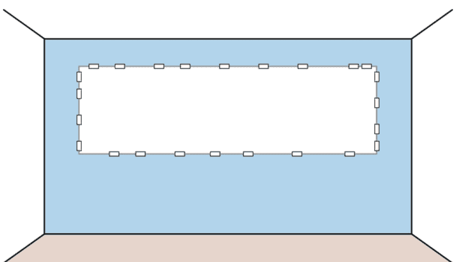

图 12-1. EventStorming 的建模空间

#### EventStorming 流程

EventStorming 研讨会通常在 10 个步骤中进行。在每个步骤中，模型都会被额外的信息和概念所丰富。

#### 第 1 步：非结构化探索

EventStorming 从对所探索业务领域的领域事件进行头脑风暴开始。领域事件是业务中发生的有趣的事情。重要的是以过去时态表述领域事件（见图 12-2）——它们描述的是已经发生的事情。

图 12-2. 非结构化探索

在此步骤中，所有参与者都在抓取一堆橙色便签，写下他们想到的任何领域事件，并将其粘贴到建模表面上。

在这个早期阶段，无需担心事件的顺序，甚至也不必担心重复。此步骤完全是关于头脑风暴业务领域中可能发生的事情。

小组应继续生成领域事件，直到新增事件的速度显著放缓。

#### 第 2 步：时间线

接下来，参与者回顾生成的领域事件，并按它们在业务领域中发生的顺序进行组织。

事件应从“快乐路径场景”开始：描述成功业务场景的流程。

一旦“快乐路径”完成，就可以添加替代场景——例如，遇到错误或不同

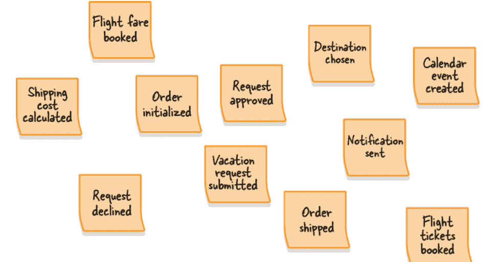

business decisions are taken. The flow branching can be expressed as two flows coming from the preceding event or with arrows drawn on the modeling surface, as shown in Figure 12-3.

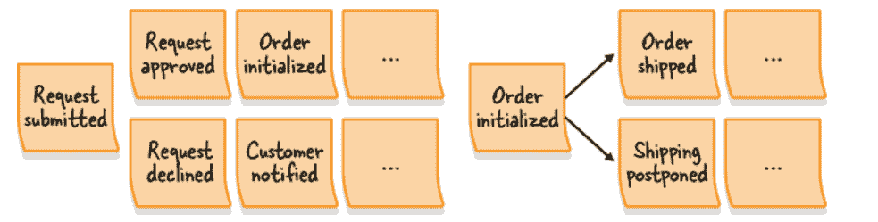

Figure 12-3. Flows of events

This step is also the time to fix incorrect events, remove duplicates, and of course, add missing events if necessary.

### Step 3: Pain Points

Once you have the events organized in a timeline, use this broad view to identify points in the process that require attention. These can be bottlenecks, manual steps that require automation, missing documentation, or missing domain knowledge.

It’s important to make these inefficiencies explicit so that it will be easy to return to them as the EventStorming session progresses, or to address them afterward. The pain points are marked with rotated (diamond) pink sticky notes, as illustrated in Figure 12-4.

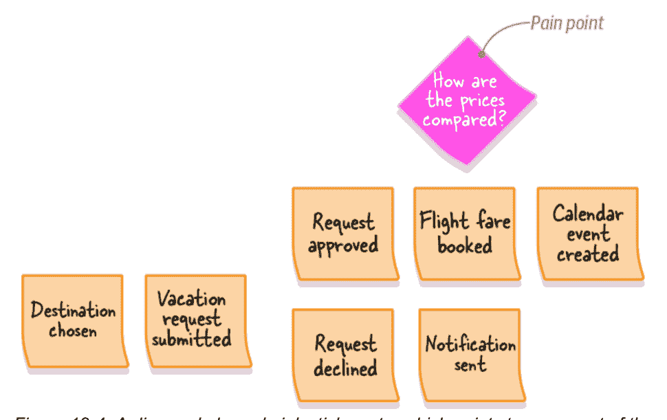

Figure 12-4. A diamond-shaped pink sticky note, which points to an aspect of the process that requires attention: missing domain knowledge about how the airfare prices are compared during the booking process

Of course, this step is not the only opportunity to track pain points. As a facilitator, be aware of the participants’ comments throughout the process. When an issue or a concern is raised, document it as a pain point.

### Step 4: Pivotal Events

Once you have a timeline of events augmented with pain points, look for significant business events indicating a change in context or phase. These are called pivotal events and are marked with a vertical bar dividing the events before and after the pivotal event.

For example, “shopping cart initialized,” “order initialized,” “order shipped,” “order delivered,” and “order returned” represent significant changes in the process of making an order, as shown in Figure 12-5.

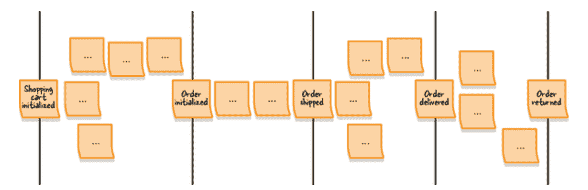

Figure 12-5. Pivotal events denoting context changes in the flow of events

Pivotal events are an indicator of potential bounded context boundaries.

### Step 5: Commands

Whereas a domain event describes something that has already happened, a command describes what triggered the event or flow of events. Commands describe the system’s operations and, contrary to domain events, are formulated in the imperative. For example:

- Publish campaign
- Roll back transaction
- Submit order

Commands are written on light blue sticky notes and placed on the modeling space before the events they can produce. If a particular command is executed by an actor in a specific role, the actor information is added to the command on a small yellow sticky note, as illustrated in Figure 12-6. The actor represents a user persona within the business domain, such as customer, administrator, or editor.

Naturally, not all commands will have an associated actor. Therefore, add the actor information only where it’s obvious. In the next step we will augment the model with additional entities that can trigger commands.

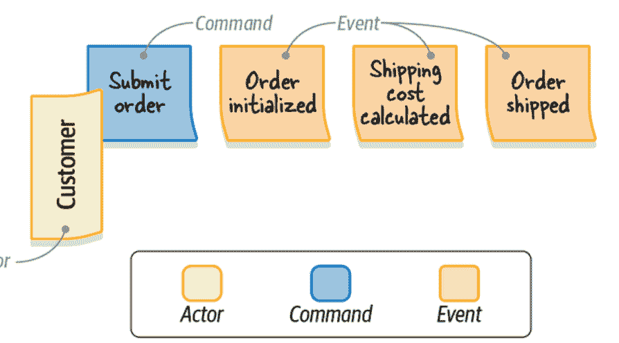

Figure 12-6. The “Submit Order” command, executed by the customer (actor) and followed by the “Order initialized,” “Shipping cost calculated,” and “Order shipped” events

### Step 6: Policies

Almost always, some commands are added to the model but have no specific actor associated with them. During this step, you look for automation policies that might execute those commands.

An automation policy is a scenario in which an event triggers the execution of a command. In other words, a command is automatically executed when a specific domain event occurs.

On the modeling surface, policies are represented as purple sticky notes connecting events to commands, as shown by the “Policy” sticky note in Figure 12-7.

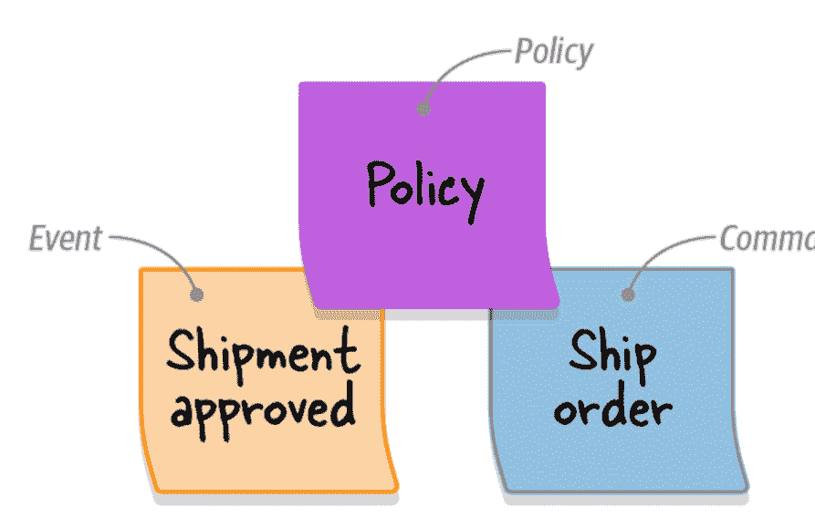

Figure 12-7. An automation policy that triggers the “Ship Order” command when the “Shipment Approved” event is observed

If the command in question should be triggered only if some decision criteria is met, you can specify the decision criteria explicitly on the policy sticky note. For example, if you need to trigger the escalate command after the “complaint received” event, but only if the complaint was received from a VIP customer, you can explicitly state the “only for VIP customers” condition on the policy sticky.

If the events and commands are far apart, you can draw an arrow on the modeling surface to connect them.

### Step 7: Read Models

A read model is the view of data within the domain that the actor uses to make a decision to execute a command. This can be one of the system’s screens, a report, a notification, and so on.

The read models are represented by green sticky notes (see the “Shopping cart” note in Figure 12-8) with a short description of the source of information needed to support the actor’s decision. Since a command is executed after the actor has viewed the read model, on the modeling surface the read models are positioned before the commands.

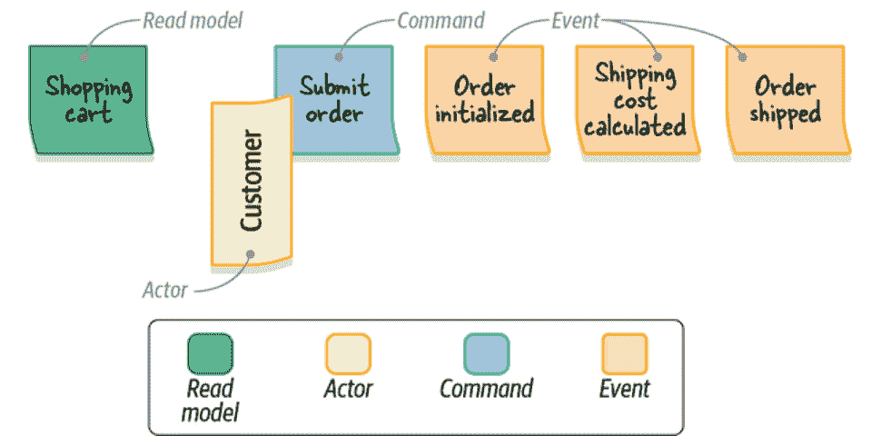

Figure 12-8. The view of the “Shopping cart” (read model) needed for the customer (actor) to make their decision to submit the order (command)

### Step 8: External Systems

This step is about augmenting the model with external systems. An external system is defined as any system that is not a part of the domain being explored. It can execute commands (input) or can be notified about events (output).

The external systems are represented by pink sticky notes. In Figure 12-9, the CRM (external system) triggers execution of the “Ship Order” command. When the shipment is approved (event), it is communicated to the CRM (external system) through a policy.

#### An external system executes a command

#### Notifying an external system

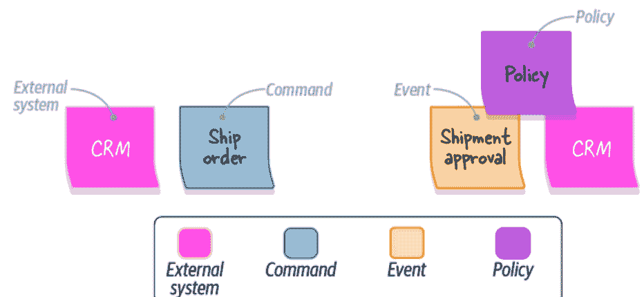

Figure 12-9. External system triggering execution of a command (left) and approval of the event being communicated to the external system (right)

By the end of this step, all commands should either be executed by actors, triggered by policies, or called by external systems.

### Step 9: Aggregates

Once all the events and commands are represented, the participants can start thinking about organizing related concepts in aggregates. An aggregate receives commands and produces events.

Aggregates are represented as large yellow sticky notes, with commands on the left and events on the right, as depicted in Figure 12-10.

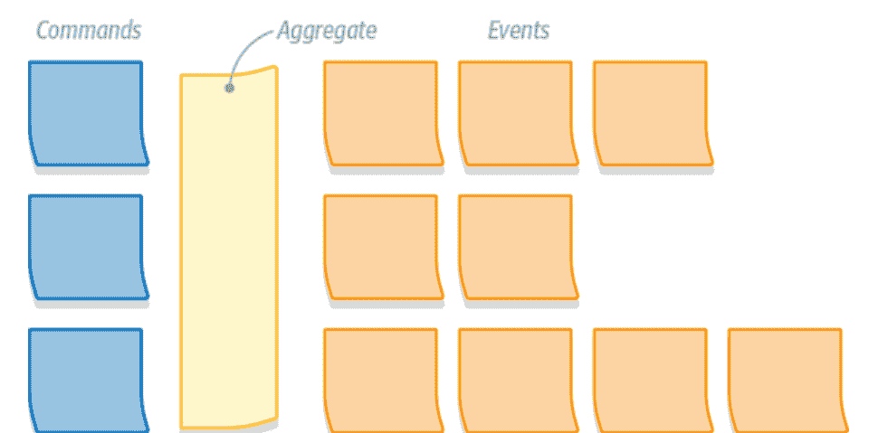

Figure 12-10. Commands and domain events organized in an aggregate

### Step 10: Bounded Contexts

The last step of an EventStorming session is to look for aggregates that are related to each other, either because they represent closely related functionality or because they’re coupled through policies. The groups of aggregates form natural candidates for bounded contexts’ boundaries, as shown in Figure 12-11.

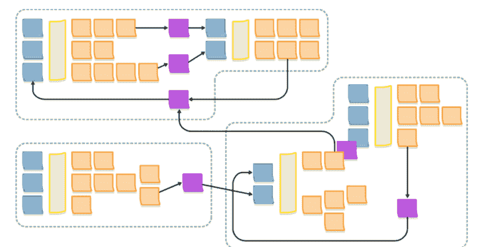

Figure 12-11. A possible decomposition of the resultant system into bounded contexts

### Variants

Alberto Brandolini, the creator of the EventStorming workshop, defines the EventStorming process as guidance, not hard rules. You are free to experiment with the process to find the “recipe” that works best for you.

In my experience, when introducing EventStorming in an organization I prefer to start by exploring the big picture of the business domain by following steps 1 (chaotic exploration) through 4 (pivotal events). The resultant model covers a wide range of the company’s business domain, builds a strong foundation for ubiquitous languages, and outlines possible boundaries for bounded contexts.

After gaining the big picture and identifying the different business processes, we continue to facilitate a dedicated EventStorming session for each relevant business process—this time, following all the steps to model the complete process.

在一次完整的 EventStorming 会话结束时，你将拥有一个描述业务域的事件、命令、聚合，甚至可能的限界上下文的模型。然而，所有这些都只是不错的附加收益。EventStorming 会话的真正价值在于过程本身——不同利益相关者之间的知识共享、对业务的心理模型的对齐、发现冲突的模型，以及最后但同样重要的是，通用语言的形成。

所得模型可以被采纳作为实现事件溯源领域模型的基础。是否走这条路的决定取决于你的业务域。如果你决定实现事件溯源领域模型，你将拥有限界上下文的边界、聚合，当然还有所需的领域事件的蓝图。

### 何时使用 EventStorming

该研讨会可以出于多种原因进行引导：

- *构建通用语言*

随着团队在构建业务流程模型时协作，他们会本能地同步术语并开始使用相同的语言。

- *建模业务流程*

EventStorming 会话是构建业务流程模型的有效方式。由于它基于 DDD 导向的构建块，因此也是发现聚合和限界上下文边界的有效方式。

- *探索新的业务需求*

你可以使用 EventStorming 来确保所有参与者对新功能达成一致，并揭示业务需求未涵盖的边缘情况。

### 恢复领域知识

随着时间的推移，领域知识可能会丢失。这在需要现代化的遗留系统中尤为严重。

EventStorming 是将每个参与者所掌握的知识合并成一个连贯图景的有效方式。

### 探索改进现有业务流程的方法

对业务流程的端到端视图提供了发现低效和改进流程机会所需的视角。

### 引导新团队成员

与新团队成员一起引导 EventStorming 会话是扩展他们领域知识的绝佳方式。

除了何时使用 EventStorming 外，提到何时不使用它也很重要。当你探索的业务流程简单或显而易见时，例如遵循一系列顺序步骤而没有任何有趣的业务逻辑或复杂性，EventStorming 的效果会较差。

### 引导技巧

当与从未做过 EventStorming 的人群引导 EventStorming 会话时，我更喜欢先进行快速的流程概述。我解释我们即将做什么、我们即将探索的业务流程，以及我们在研讨会中将使用的建模元素。随着我们逐步介绍元素——领域事件、命令、参与者等等——我会使用我们将使用的便利贴和标签构建图例，如图 12-12 所示，帮助参与者记住颜色编码。图例在研讨会期间应对所有参与者可见。

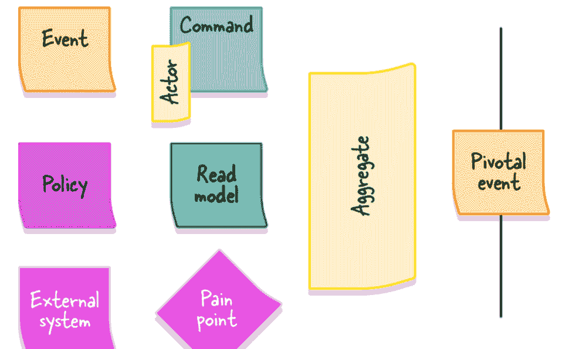

图 12-12. 描绘 EventStorming 流程的各个元素写在相应的便利贴上的图例

### 关注动态

随着研讨会的进行，跟踪团队的能量很重要。如果动态放缓，看看你是否可以通过提问重新点燃流程，或者是否该进入研讨会的下一阶段。

记住 EventStorming 是一项团队活动，因此要确保它被作为团队活动进行。确保每个人都有机会参与建模和讨论。如果你注意到某些参与者回避群体，尝试通过询问关于模型当前状态的问题来让他们参与流程。

EventStorming 是一项高强度活动，在某个时间点，团队需要休息。不要在所有参与者回到房间之前恢复会议。通过回顾模型的当前状态来恢复流程，以使团队重回协作建模状态。

### 远程 EventStorming

EventStorming 最初被发明为一项低技术活动，人们在同一房间内互动和共同学习。该研讨会的创建者 Alberto Brandolini 经常反对远程进行 EventStorming，因为当团队不在一起时，不可能达到同等程度的参与度，因而协作和知识共享也会受影响。

然而，随着 2020 年 COVID-19 大流行的爆发，面对面会议变得不可能，EventStorming 也无法按原意进行。一些工具试图实现远程 EventStorming 会议的协作和引导。在撰写本文时，其中最值得注意的是 miro.com。在进行在线 EventStorming 时要更有耐心，并考虑到由此产生的沟通效率降低。

此外，我的经验表明，远程 EventStorming 会议在参与人数较少时更有效。虽然最多 10 人可以参加面对面的 EventStorming 会议，但我更喜欢将在线会议限制在五名参与者以内。当你需要更多参与者贡献他们的知识时，你可以引导多次会议，并在之后比较和合并所得模型。

当情况允许时，回到面对面 EventStorming。

### 结论

EventStorming 是一种基于协作的建模业务流程的研讨会。除了所得模型之外，其主要好处是知识共享。到会议结束时，所有参与者都将同步他们对业务流程的心理模型，并迈出使用通用语言的第一步。

EventStorming 就像骑自行车一样。通过实践学习比在书中阅读要容易得多。尽管如此，该研讨会很有趣且易于引导。你不需要是 EventStorming 黑带才能开始。只需引导会议，遵循步骤，并在过程中学习。

## 练习

+   1. 谁应该被邀请参加 EventStorming 会议？
+      a. 软件工程师
+      b. 领域专家
+      c. QA 工程师
+      d. 拥有你想要探索的业务域知识的所有利益相关者
+   2. 何时是引导 EventStorming 会议的好机会？
+      a. 构建通用语言。
+      b. 探索新的业务域。
+      c. 恢复棕地项目的丢失知识。
+      d. 引入新团队成员。
+      e. 发现优化业务流程的方法。

f. 以上所有答案都正确。

3. 你可以从 EventStorming 会议中期待什么结果？

+   a. 对业务域有更好的共同理解
+   b. 通用语言的坚实基础
+   c. 揭示对业务域理解中的空白点
+   d. 一个可用于实现领域模型的基于事件的模型
+   e. 以上所有内容，但取决于会议的目的
